# Complete technology course

[Course index](README.md) · [Reading guide](start-here.md) · [Glossary](glossary.md)

All 31 chapters. No dedicated DSA track. Examples are teaching material; runtime execution and learner mastery are separate from written availability.

- [Chapter 1 — Foundations of Distributed Systems: Java 21, Spring Boot, REST APIs, Messaging, and Why Apache Kafka Exists](#chapter-01)
- [Chapter 2 — Java 21 and the JVM: From Domain Types to Production Evidence](#chapter-02)
- [Chapter 3 — Concurrency, the Java Memory Model, and Bounded Work](#chapter-03)
- [Chapter 4 — Spring Internals: Objects, Proxies, Requests, and Transactions](#chapter-04)
- [Chapter 5 — APIs and Integration Contracts](#chapter-05)
- [Chapter 6 — PostgreSQL, JPA, and Durable Business Invariants](#chapter-06)
- [Chapter 7 — Kafka Architecture, Storage, and Replication](#chapter-07)
- [Chapter 8 — Kafka producers: from a method call to a durable record](#chapter-08)
- [Chapter 9 — Kafka consumers, offsets, groups, and rebalances](#chapter-09)
- [Chapter 10 — Ordering, delivery guarantees, and Kafka transactions](#chapter-10)
- [Chapter 11 — Spring Kafka integration and recoverable listeners](#chapter-11)
- [Chapter 12 — Outbox, inbox, business idempotency, and Saga orchestration](#chapter-12)
- [Chapter 13 — Event schemas, compatibility, and independent deployments](#chapter-13)
- [Chapter 14 — Kafka Connect and Kafka Streams](#chapter-14)
- [Chapter 15 — Kafka operations, security, capacity, and disaster recovery](#chapter-15)
- [Chapter 16 — MongoDB Read Models, Queries, and Recovery](#chapter-16)
- [Chapter 17 — Redis: Caches, Expiration, Leases, and Recovery](#chapter-17)
- [Chapter 18 — DDD, Service Ownership, and Read/Write Models](#chapter-18)
- [Chapter 19 — Networking, Gateways, Discovery, and Time Budgets](#chapter-19)
- [Chapter 20 — Docker: Packaging, Isolation, and Running Java Reliably](#chapter-20)
- [Chapter 21 — Kubernetes: Reconciliation, Workloads, and Application Recovery](#chapter-21)
- [Chapter 22 — AWS, Azure, Terraform, Cost, and Disaster Recovery](#chapter-22)
- [Chapter 23 — Security: Identity, Authorization, Tokens, and Trust Boundaries](#chapter-23)
- [Chapter 24 — Observability, SLOs, and evidence-led diagnosis](#chapter-24)
- [Chapter 25 — Testing, Maven, CI/CD, and safe releases](#chapter-25)
- [Chapter 26 — Distributed-systems theory applied to real decisions](#chapter-26)
- [Chapter 27 — Performance engineering, queueing, and capacity](#chapter-27)
- [Chapter 28 — High-Level Design: turning requirements into a defensible system](#chapter-28)
- [Chapter 29 — Low-Level Design: responsibilities, invariants, and change](#chapter-29)
- [Chapter 30 — Failure engineering: prove recovery, not just restart](#chapter-30)
- [Chapter 31 — Technical interviews, engineering communication, and project evidence](#chapter-31)

---

<a id="chapter-01"></a>

# Chapter 1 — Foundations of Distributed Systems: Java 21, Spring Boot, REST APIs, Messaging, and Why Apache Kafka Exists

Prepared: 2026-10-24. Status: Learning. This is the full first conceptual chapter, not a completed Spring application milestone.

## 1. Lesson title
Foundations of Distributed Systems: Java 21, Spring Boot, REST APIs, Messaging, and Why Apache Kafka Exists.

## 2. Interview priority
P0. Recognizing failure boundaries is essential before choosing frameworks or messaging settings.

## 3. Prerequisites
Java methods and exceptions, HTTP APIs, basic SQL transactions, and the idea of JMS producers/consumers. Docker is not required to understand this chapter. Familiarity with an annotation does not establish understanding of the resources it controls.

## 4. Learning objectives
After practice, explain partial failure and an ambiguous result; distinguish transport success from business completion; compare a modular monolith with independently deployed services; distinguish HTTP/REST, JMS, and Kafka; draw partitions, offsets, and consumer groups; trace an order across transaction boundaries; identify a dual-write gap; and explain why bounded concurrency and idempotency are necessary.

## 5. Official references and version notes
Sources were opened on 2026-10-24. These are supporting references, not a claim that all pages or book chapters were read in full.

- [K1 Kafka 4.2 introduction](https://kafka.apache.org/42/getting-started/introduction/): event streaming and producer/topic/consumer concepts.
- [K2 Kafka 4.2 design](https://kafka.apache.org/42/design/design/): motivation, persistence, delivery semantics, transactions.
- [K3 Kafka 4.2 KRaft](https://kafka.apache.org/42/operations/kraft/): process roles and controllers.
- [K4 KafkaConsumer 4.2 API](https://kafka.apache.org/42/javadoc/org/apache/kafka/clients/consumer/KafkaConsumer.html): positions, commits, groups. The published API banner says 4.2.0; do not assume every patch-specific detail from it.
- [K5 KafkaProducer 4.2 API](https://kafka.apache.org/42/javadoc/org/apache/kafka/clients/producer/KafkaProducer.html): send buffering and completion.
- [K6 Kafka 4.2 topic configuration](https://kafka.apache.org/42/configuration/topic-configs/): retention and cleanup policy.
- [H1 HTTP semantics, RFC 9110](https://www.rfc-editor.org/rfc/rfc9110.html): section 9.2.2 idempotent methods, 15.3.2 Created, 15.3.3 Accepted.
- [J1 Jakarta Messaging 3.1](https://jakarta.ee/specifications/messaging/3.1/jakarta-messaging-spec-3.1.html): sections 1.1 and 2.4, queue and topic models.
- [S1 Spring transaction propagation](https://docs.spring.io/spring-framework/reference/data-access/transaction/declarative/tx-propagation.html): physical and logical transaction scope.
- [S2 Spring Kafka transactions](https://docs.spring.io/spring-kafka/reference/kafka/transactions.html): transaction synchronization and commit-failure handling.
- [V1 Java 21 virtual threads](https://docs.oracle.com/en/java/javase/21/core/virtual-threads.html): purpose and execution model.
- [S3 Spring Boot code organization](https://docs.spring.io/spring-boot/reference/using/structuring-your-code.html): application root package and component discovery.

Kafka-core references are all official Apache sources. Live Spring pages now display Boot/Spring Kafka 4.1.2 and Framework 7.0.10; our earlier proposed baseline remains 4.1.1/7.0.9 until reviewed. No version-sensitive Spring configuration is introduced here. No configuration defaults are needed for this lesson. Books remain recommended reading, not consulted evidence.

## 6. Fundamental explanation

### 6.1 Begin with a business rule
Imagine Order O-1001 requests two units of product P-10. The platform must accept the request, reserve stock, authorize a simulated payment, and arrange shipping. Our project rule is that an order cannot become ready for fulfillment without a confirmed reservation and payment authorization.

That rule matters more than the choice of broker. A system can have running containers and low HTTP error rates while violating it.

### 6.2 A monolith is a deployment choice
In a modular monolith, order, inventory, and payment-simulation modules can execute in one application process. Well-defined interfaces can still separate responsibilities. If order and inventory changes use the same database and transaction, their atomicity can be local.

A monolith can run on several application instances. Microservices are not required merely to add servers. Also, a monolith calling an external payment provider already crosses a distributed boundary.

Splitting services can help independent ownership, deployment, and scaling. The price is more network interactions, compatibility work, deployment coordination, telemetry, and failure recovery. These are architecture trade-offs, not mandatory stages of maturity.

### 6.3 What distribution changes
A remote call has at least three important components: the caller, the transport, and the receiver. Their observations can disagree. The caller can be healthy while the receiver is unavailable. The receiver can finish while its response is lost. A process restart can discard in-memory knowledge of completed work.

Compare:
- Local calculation: a return value is available in the executing process.
- Remote operation: an effect may exist elsewhere even when no result reaches the caller.

Do not infer that local operations never fail ambiguously: a local application's database or external system introduces its own boundary.

### 6.4 A timeout is an observation
The caller knows that a satisfactory response did not arrive within its deadline. It does not automatically know whether the receiver executed the request.

Suppose a payment provider writes authorization A-73, then its response is lost. Retrying with a different operation identity might create A-74. Our order database could record a failure even though a payment authorization exists.

Recovery requires an explicit policy: stable operation identity, a receiver that enforces idempotency, a status query or reconciliation, bounded retry, and possibly compensation. A timeout alone must not be translated into a business statement such as PaymentDeclined.

## 7. Internal architecture and mechanism

### 7.1 Three different meanings of asynchronous
1. Thread-level: a method returns a future while a request remains in flight.
2. Transport-level: work is placed in durable messaging infrastructure for later consumption.
3. Business-level: the API returns before the workflow is completed.

These are separate decisions. An asynchronous HTTP client does not make the business workflow durable. A producer's future describes its publication operation, not downstream business completion. The Kafka producer buffers records and uses background I/O; its send result must still be observed for failures. [K5]

### 7.2 Command, event, and query
A command asks an owner to perform an action: ReserveInventory.
An event reports an occurrence: InventoryReserved.
A query asks for information: What is the order's current status?

These are message semantics, not transport names. An HTTP request can carry a command, and a Kafka record can carry a command. Calling every Kafka message an event can obscure who is responsible for taking action.

### 7.3 Why Kafka exists
Kafka provides a retained event stream that independent applications can publish to and read from. Topics organize records; partitions divide each topic into ordered logs. That makes a shared stream useful when inventory, reporting, and notifications need independent processing and progress. [K1]

Kafka's design emphasizes high-volume feeds, efficient persistence, batches, and partitioned processing. Its log model does not make business operations automatically atomic across external systems. Exactly-once claims must state the participating resources and processing boundary. [K2]

Use Kafka when retained streams, replay, independent subscribers, or stream processing justify the operational cost. A small application that needs a few background jobs may be better served by a simpler queue or database-backed worker. This is our architectural recommendation.

### 7.4 The vocabulary
| Term | Meaning |
|---|---|
| Broker | Server responsible for storing and serving topic partitions |
| Topic | Named stream divided into partitions |
| Partition | Ordered log within a topic |
| Record | Key/value plus timestamp and optional headers |
| Offset | Position identifier within one partition |
| Producer | Client publishing records |
| Consumer | Client reading records |
| Consumer group | Logical subscription that coordinates work among participating consumers |
| Retention | Policy controlling how long/how much log data is retained |
| Replay | Reading previously retained data again |

These definitions follow [K1], [K4], and [K6]. Offset 12 in partition 0 and offset 12 in partition 1 identify different records. Offsets are not globally unique business event IDs.

### 7.5 Positions and work ownership
For a traditional subscribing consumer group, partitions are assigned among members. With three partitions and two members, one may handle two partitions and the other one. A fourth member cannot increase simultaneous partition ownership beyond three in that group. Different groups can process the same retained records independently.

The consumer's current position and committed restart position are distinct. A committed offset conventionally identifies where to resume, not a universal proof that an external effect happened. Offsets can have gaps. [K4]

Example: an inventory consumer commits its database change and crashes before committing its Kafka offset. After restart it may receive the same record. A database constraint and idempotent operation protect the business effect.

### 7.6 Retention and KRaft
Consumption does not by itself delete the topic's data. Cleanup depends on policies such as time/size retention or compaction. Replay only works for data still available, and replaying side effects needs additional safeguards. [K6]

KRaft controllers maintain Kafka metadata through a quorum; brokers handle record storage and serving. A development node may combine both roles. Dedicated controllers provide better isolation for critical deployments. The metadata quorum and user-record replication are different mechanisms. [K3]

## 8. Diagrams

### Lost response
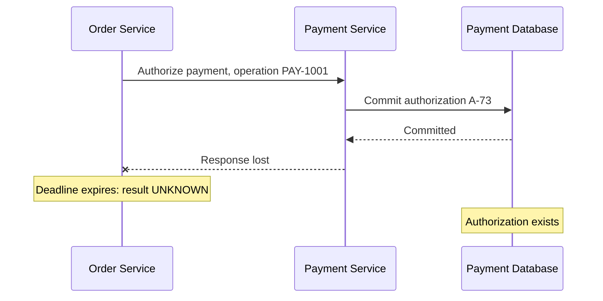

The timeout and committed authorization can coexist. Recovery must reconcile them.

### Separate subscriber progress
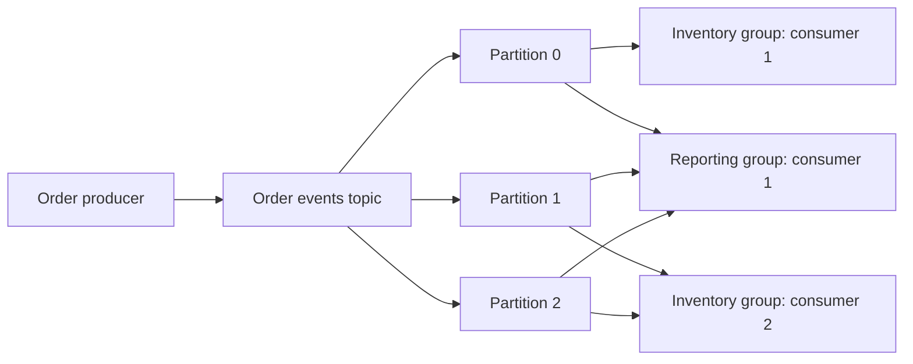

This depicts logical consumption of the same partitions by two groups, not separate copies of topic data per group.

### Target transaction boundaries
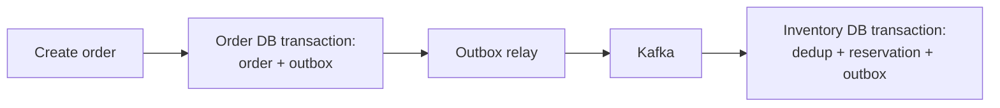

There is no one transaction spanning every box. The relay can republish; Inventory must tolerate duplicates. This is our project design.

## 9. Java 21 implementation

This deterministic simulation deliberately loses a response AFTER a simulated payment effect. It uses no HTTP, Kafka, Spring, threads, or real money. It isolates the reasoning error without timing-dependent sleeps. It is complete source, provided as a learning example; it has not been compiled or executed in this chapter.

Save as AmbiguousOutcomeDemo.java if running it:

```java
import java.util.HashMap;
import java.util.Map;

public class AmbiguousOutcomeDemo {
    record Request(String operationId, String orderId, long amountMinor) {
        Request {
            if (operationId == null || operationId.isBlank()
                    || orderId == null || orderId.isBlank()
                    || amountMinor <= 0) {
                throw new IllegalArgumentException("Invalid payment request");
            }
        }
    }

    record Authorization(String id, Request request) {}

    static final class PaymentService {
        private final Map<String, Authorization> byOperation = new HashMap<>();
        private int successfulAuthorizations;

        Authorization authorize(Request request) {
            Authorization existing = byOperation.get(request.operationId());
            if (existing != null) {
                if (!existing.request().equals(request)) {
                    throw new IllegalArgumentException(
                            "Operation ID reused for a different request");
                }
                return existing;
            }

            Authorization created = new Authorization(
                    "AUTH-" + (++successfulAuthorizations), request);
            byOperation.put(request.operationId(), created);
            return created;
        }

        int effectCount() {
            return successfulAuthorizations;
        }
    }

    static final class ResponseLost extends RuntimeException {}

    static Authorization invoke(
            PaymentService service, Request request, boolean loseResponse) {
        Authorization result = service.authorize(request);
        if (loseResponse) {
            throw new ResponseLost();
        }
        return result;
    }

    public static void main(String[] args) {
        PaymentService service = new PaymentService();
        Request request = new Request("PAY-1001", "ORDER-1001", 12500);

        try {
            invoke(service, request, true);
        } catch (ResponseLost exception) {
            System.out.println("Caller outcome: UNKNOWN");
        }

        Authorization retried = invoke(service, request, false);
        System.out.println("Recovered authorization: " + retried.id());
        System.out.println("Business effects: " + service.effectCount());

        if (service.effectCount() != 1) {
            throw new AssertionError("Duplicate business effect");
        }
    }
}
```

Important decisions:
- operationId stays the same across a retry of the same logical operation.
- amountMinor is an integer in one implicit demo currency, not a full Money implementation.
- authorize checks request identity before reusing an existing result.
- invoke loses the result only after authorize has acted.
- the check verifies one effect for this sequential scenario.

Production limitations: the map is neither durable nor concurrency-safe; a restart loses deduplication; it is not a database transaction or external-provider integration. Production requires durable unique operation keys, atomic effect/result persistence, appropriate concurrency control, and provider-side idempotency or reconciliation. ConcurrentHashMap alone would not solve persistence or external side effects.

## 10. Spring Boot integration

Spring supplies application wiring, HTTP adaptation, validation, and infrastructure integration. Our responsibilities remain business invariants and failure policies.

Planned flow:
OrderController -> CreateOrderService -> OrderRepository + OutboxRepository.
Kafka listener -> application handler -> local transaction -> outgoing outbox.

Place the main Boot application in a parent package so discovery covers its application components. [S3]

A database transaction manager controls its participating resource. An ordinary remote HTTP operation is not undone by rolling back that database transaction. Spring transaction propagation describes relationships among transaction scopes, not an automatic cross-service rollback protocol. [S1]

Spring Kafka can synchronize transactions with another transaction manager, but commits still occur in an order, and a later commit can fail after an earlier one succeeds. Therefore synchronization must not be described as failure-proof distributed atomicity. Our project uses outbox for the relevant boundary. [S2]

Virtual threads can reduce the cost of many waiting tasks. They do not increase the number of database connections or the payment provider's capacity. We will study Java 21-specific behavior in the concurrency chapter. [V1]

## 11. Production scenario

Assume an order is durably accepted at 10:00, inventory is reserved at 10:01, and the payment call times out at 10:02. These are illustrative times, not measurements.

The customer-facing state should distinguish processing/unknown outcome from confirmed rejection. A stable operation ID allows a retry or status lookup to recover the authorization. Shipping must not start until the workflow has the necessary evidence.

If cancellation begins while authorization is unresolved, the workflow needs a policy for a late success: for example, void authorization and finish cancellation. It must not both ship and release inventory.

Useful observations:
- order age in each state;
- pending outbox count and oldest age;
- unresolved payment operation count;
- duplicate detections;
- consumer lag;
- compensation failures.

An HTTP success rate cannot prove these business invariants.

## 12. HLD considerations

Choose boundaries from business ownership and consistency needs. For this course:
- Order owns workflow state.
- Inventory owns availability and reservations.
- Payment owns simulated authorization and operation identity.
- Catalog caching is advisory; inventory remains authoritative.
- Reporting can be eventually consistent.
- Each service owns its local transaction and data.

Prefer a modular monolith when independent service deployment is not justified. We split this project progressively to learn distributed mechanisms, not because all commerce applications require nine services.

Compare communication options:
| Option | Category | Useful when | Engineering cost |
|---|---|---|---|
| REST over HTTP | Architectural style commonly implemented with HTTP | Direct queries and request/response APIs | Deadlines, dependency availability, retry ambiguity |
| JMS / Jakarta Messaging | Java messaging specification | Portable queue/topic APIs in enterprise messaging | Provider configuration, acknowledgment and transaction policies |
| Kafka | Event-streaming platform | Retained records, independent consumers, replay, stream processing | Partition design, lag, schemas, retention, broker operations |

JMS supports both queue and publish/subscribe models; a queue targets one consumer per message and topics support subscriptions, including durable/shared subscription forms. It is not a particular broker or a guarantee that every provider behaves identically. [J1]

REST does not imply that the complete business operation finishes within one response. HTTP 201 describes resource creation; 202 describes acceptance without completed processing. Method idempotency and an application's POST deduplication policy are different concepts. [H1]

## 13. LLD considerations

Use explicit types: OrderId, PaymentOperationId, OrderStatus, PaymentOutcome. A timeout should not be forced into a PaymentDeclined result.

Keep responsibilities separate:
- transport adapter interprets connection/read/deadline failures;
- application layer decides retry/reconciliation;
- domain layer guards valid transitions;
- persistence enforces unique keys and durable state.

Example policy:
PENDING_PAYMENT + confirmed authorization -> READY_FOR_FULFILLMENT.
CANCELLING + confirmed authorization -> schedule a compensating action.
Do not blindly accept every event just because deserialization succeeded.

## 14. Reliability and recovery

| Failure boundary | What may already exist | Recovery direction |
|---|---|---|
| Client loses create-order response | Order row committed | Retry same request key or query existing order |
| DB commit before direct publish | Order without event | Persist outbox with order |
| Publish before relay marks completion | Event already delivered | Republish safely; consumer deduplication |
| Consumer DB commit before offset commit | Business effect committed | Detect redelivery in local transaction |
| Replay of historical records | Previous external effects | Rebuild projections separately; guard live side effects |
| Unknown payment result | Authorization may exist | Stable key, status query, reconciliation |
| Compensation repeatedly fails | Business resources still held | Persist retries; alert and expose repair work |

Retry design must classify transient transport failures versus permanent validation failures. Retry budgets and backoff reduce traffic, but they do not create idempotency. Recovery is complete only after the business invariant is checked.

## 15. Performance

Illustrative exercise: incoming rate = 1,000 records/second, sustainable processing = 800/second.
Backlog growth = 200/second.
After five minutes: 200 x 300 = 60,000 records, assuming steady rates and no initial backlog.

If processing rises to 1,200/second while arrival stays 1,000/second:
net drain = 200/second;
drain time = 60,000 / 200 = 300 seconds.

These are calculations, not benchmarks. Real traffic varies, failures add work, and record sizes differ. A queue buys time; it does not eliminate a sustained capacity deficit. Raising consumer concurrency may overwhelm the database instead of improving completion throughput.

For serial dependencies, observed request time includes the sum of their waits plus local work and network overhead. Concurrent independent calls can reduce that critical path, but do not remove capacity or correctness constraints.

## 16. Ten study interview questions with model answers

### Q1. What makes partial failure difficult? [P0]
Fundamental: some components can succeed while others fail or cannot observe success.
Senior answer: identify each effect, acknowledgment, and recovery boundary. A caller has incomplete knowledge of remote state.
Example: payment committed but response lost.
Failure/trade-off: blindly retrying can duplicate an effect; never retrying can leave work unresolved.
Common mistake: equating timeout with business rejection.
Follow-up: how would you recover after both services restart?
Reference: [H1]; the payment sequence is our worked example.

### Q2. When would you keep a modular monolith? [P0]
Fundamental: when one deployment and local coordination meet the needs.
Senior answer: assess team ownership, change coupling, independent scaling, data invariants, and operational capacity before adding boundaries.
Example: a small order system with one team and shared transactional needs.
Trade-off: less deployment independence, but fewer network failure paths.
Common mistake: claiming microservices automatically scale better.
Follow-up: which evidence would justify extracting Inventory?
Reference: architectural recommendation; no universal official rule determines service boundaries.

### Q3. How is asynchronous communication different from an asynchronous Java method? [P0]
Fundamental: a future changes waiting behavior; durable messaging changes how work survives and is delivered.
Senior answer: separate thread scheduling, transport acknowledgment, and business completion.
Example: returning CompletableFuture does not persist a payment request.
Failure: the process can stop while work exists only in memory.
Common mistake: treating async as durable.
Follow-up: what exactly does successful producer completion establish?
Reference: [K5], [V1].

### Q4. How do you compare REST, JMS, and Kafka fairly? [P0]
Fundamental: they are different categories: architectural style, Java messaging specification, and streaming platform.
Senior answer: compare concrete implementations and required contracts, not category labels alone.
Example: HTTP for order lookup; Kafka for independently consumed order changes; JMS for an established enterprise queue integration.
Trade-off: replay/retention needs differ from single-consumer work distribution.
Common mistake: saying JMS has no topics.
Follow-up: can HTTP accept asynchronous work?
Reference: [H1], [J1], [K1].

### Q5. Why retain events after consumption? [P0]
Fundamental: another reader or later rebuild may still need them.
Senior answer: retention enables independent progress, but replay must account for contract evolution and side effects.
Example: rebuilding a reporting projection without triggering fresh payment operations.
Trade-off: storage and privacy/lifecycle responsibilities grow with retained history.
Common mistake: assuming retention means unlimited history.
Follow-up: what if the required data has already expired?
Reference: [K6].

### Q6. What does a partition key solve? [P0]
Fundamental: it helps select a partition and group related records.
Senior answer: key selection balances locality/ordering requirements against skew; stable routing assumptions matter.
Example: orderId groups order-related records under an unchanged partitioning scheme.
Failure: adding partitions or using different partitioners can change routing; downstream parallel work can reorder effects.
Common mistake: claiming global business order from a shared key.
Follow-up: why does orderId not prevent inventory overselling across orders?
Reference: [K1], [K4]; inventory conclusion is our project reasoning.

### Q7. Does adding consumers always improve throughput? [P0]
Fundamental: traditional group partition ownership bounds useful parallelism.
Senior answer: partition skew, processing cost, downstream pools, and rebalances can be limiting factors.
Example: an additional member can be idle when every partition already has an owner.
Trade-off: more processing can overload PostgreSQL.
Common mistake: treating consumer count as a universal throughput multiplier.
Follow-up: which metric separates a hot partition from database saturation?
Reference: [K4].

### Q8. Does producer acknowledgment mean an order completed? [P0]
Fundamental: no; it concerns publication under configured semantics.
Senior answer: downstream consumption, database changes, and business transitions require their own evidence.
Example: reporting can be hours behind an accepted event.
Trade-off: decoupling requires status visibility and backlog management.
Common mistake: returning 'paid' when only a command was published.
Follow-up: what should the API return after durable order creation?
Reference: [K5], [H1].

### Q9. Why does an outbox still require idempotent consumers? [P0]
Fundamental: the relay can publish and crash before recording publication.
Senior answer: retry bridges a failure gap but can repeat delivery; couple consumer deduplication with its business mutation and outgoing records.
Example: inventory must not reserve twice on republished commands.
Trade-off: deduplication storage and retention/replay policy need ownership.
Common mistake: describing outbox as end-to-end exactly-once delivery.
Follow-up: what if two different event IDs request the same business operation?
Reference: [K2], [S2]; outbox protocol is our architectural design.

### Q10. Why does @Transactional not undo an HTTP payment? [P0]
Fundamental: the normal database transaction does not control the remote provider's effect.
Senior answer: enumerate transaction managers and resources; distinguish synchronization from atomic commit and use compensations/reconciliation for external effects.
Example: local order rollback after a remote authorization.
Trade-off: compensations can fail and need durable tracking.
Common mistake: assuming one annotation spans every call inside the method.
Follow-up: what evidence is needed before declaring cancellation complete?
Reference: [S1], [S2].

## 17. Exercises

A. Predict the Java program output before running it. Explain why the effect count should be one.
B. Retry with a NEW operation ID for the same order. Predict the effect count and identify the missing production business constraint.
C. Reuse the SAME operation ID but change the amount. Predict the exception and explain why silent reuse is dangerous.
D. Create a new PaymentService before retrying. Explain why in-memory deduplication fails across restarts.
E. Draw a sequence for DB commit -> Kafka publish -> process crash. Mark each place duplication or missing publication can arise.
F. Recalculate backlog for arrival 750/sec and processing 500/sec over eight minutes. Then choose a recovery rate and calculate drain time.

These are learning exercises, not a separate DSA track.

## 18. Verification

To run the embedded Java example after saving it:
```powershell
& 'C:\Program Files\Java\jdk-21.0.10\bin\java.exe' .\AmbiguousOutcomeDemo.java
```

Expected, not observed:
```text
Caller outcome: UNKNOWN
Recovered authorization: AUTH-1
Business effects: 1
```

The source-file launcher compiles and executes the single-file example. No Maven dependencies are needed for this isolated simulation; the main project remains Maven-based. This does not test HTTP networking, Kafka, persistence, or concurrent idempotency.

Paper-exercise checks: show the receiver's durable state independently of the caller's observation; mark local transaction boundaries; name a stable operation ID; distinguish publication from downstream completion.

Status: documentation sources checked; example not executed; full application not implemented; Docker/Kafka setup remains unverified.

## 19. Common misconceptions

- Timeout means the receiver did nothing.
- Async means durable.
- Monolith means one server.
- JMS is a specific broker or supports only queues.
- Kafka acknowledgment proves business completion.
- Consumer offset commit deletes the event.
- Every partition offset is globally unique.
- More consumer instances always increase throughput.
- One transaction annotation covers remote systems.
- Virtual threads create unlimited downstream capacity.
- A cache value is authoritative inventory.
- Replay is safe for every consumer.
- A completed read implies mastery.

## 20. Knowledge assessment

Unanswered assessment: Order Service times out after calling Inventory. Inventory may have committed a reservation, and the customer retries the order request. Describe the possible states and a recovery design that avoids duplicate orders and duplicate reservations.

This scenario intentionally changes the service from the study example. No score is recorded until the learner answers.

## 21. Revision summary

- Separate what happened from what the caller knows.
- Define correctness as business invariants.
- Identify every local transaction and acknowledgment boundary.
- Choose communication based on required semantics.
- Retained logs support independent consumption, but impose replay and lifecycle responsibilities.
- Use stable business operation identity and durable enforcement.
- Observe workflow age and unresolved outcomes, not only infrastructure health.

## 22. Next lesson
Chapter 1 follow-up: inspect the assessment answer and deepen any gaps. Then start the first Maven/Kafka application milestone with explicit demo limitations, or proceed with the Java/JVM chapter while environment installation is pending. Do not mark Chapter 1 interview ready from reading alone.


---

<a id="chapter-02"></a>

# Chapter 2 — Java 21 and the JVM: From Domain Types to Production Evidence

Prepared 2026-10-24. Learning material; examples are unexecuted educational examples, not a validated application release.

## 1. Lesson title
Understand the Java program that you write, the JVM that executes it, and the evidence needed when either behaves unexpectedly.

## 2. Interview priority
P0 for memory, garbage collection, exceptions, immutability, and diagnosis; P1 for compilation and class loading detail. Explain mechanisms through an order request before memorizing flags.

## 3. Prerequisites
A variable gives a name to a value; a method groups computation; a class defines behavior and state; an object is one instance. An exception changes normal control flow. Review Chapter 1's distinction between a business result and what a caller observes. No running database is required here.

## 4. Learning objectives
Model explicit outcomes with records and sealed types, distinguish Java 21 final features from previews, trace source through bytecode and runtime execution, account for heap and non-heap memory, explain reachable-object leaks, and select diagnostic evidence for latency, CPU, and memory incidents. Develop an investigation that can disprove a hypothesis.

## 5. Official references and version notes
Opened 2026-10-24; section-level evidence, not claims of reading entire manuals. Java 21 remains the language/runtime baseline. Maven remains the project build tool; Spring Boot 4.1.1 remains proposed. Nothing here validates its dependency graph.

| ID | Official reference | Sections used |
|---|---|---|
| J1 | [Java 21 language changes](https://docs.oracle.com/en/java/javase/21/language/java-language-changes-release.html) | Final and preview features |
| J2 | [Record classes](https://docs.oracle.com/en/java/javase/21/language/records.html) | Components, constructors |
| J3 | [Sealed classes](https://docs.oracle.com/en/java/javase/21/language/sealed-classes-and-interfaces.html) | Permitted implementations |
| J4 | [Pattern matching switch](https://docs.oracle.com/en/java/javase/21/language/pattern-matching-switch.html) | Type coverage, null |
| J5 | [SequencedCollection API](https://docs.oracle.com/en/java/javase/21/docs/api/java.base/java/util/SequencedCollection.html) | Encounter order, reversed view |
| J6 | [JVMS chapter 2](https://docs.oracle.com/javase/specs/jvms/se21/html/jvms-2.html) | 2.5 runtime areas, 2.6 frames |
| J7 | [JVMS chapter 5](https://docs.oracle.com/javase/specs/jvms/se21/html/jvms-5.html) | Loading, linking, initialization |
| J8 | [HotSpot enhancements](https://docs.oracle.com/en/java/javase/21/vm/java-hotspot-virtual-machine-performance-enhancements.html) | Tiered compilation, escape analysis |
| J9 | [GC introduction](https://docs.oracle.com/en/java/javase/21/gctuning/introduction-garbage-collection-tuning.html) | Reclamation and trade-offs |
| J10 | [G1 collector](https://docs.oracle.com/en/java/javase/21/gctuning/garbage-first-g1-garbage-collector1.html) | Regions, evacuation, pause goals |
| J11 | [Diagnostic tools](https://docs.oracle.com/en/java/javase/21/troubleshoot/diagnostic-tools.html) | JFR, native memory tracking, dumps |
| J12 | [jcmd](https://docs.oracle.com/en/java/javase/21/docs/specs/man/jcmd.html) | Help, recording and dump commands |

Language/JVM statements below are documented facts tied to these sources. Commerce designs, incident sequences, and suggested experiments are course recommendations and original examples. Some OpenJDK JEP links returned 403; the Oracle Java 21 language guides provide the usable evidence. No unavailable ZGC page is treated as verified.

## 6. Fundamental explanation

### Values, identity, and ownership
Order O-1001 has an identity that survives changes in status. A price of 12500 minor currency units is a value: two equivalent prices can be interchangeable. This distinction guides equality. An order entity should not become a different business order when a status changes, while two request values with different quantities should compare differently. Separate identity types reduce accidental exchange of an order ID and a payment operation ID.

A reference is a way to reach an object, not the object itself. Assigning a list to another variable gives both variables access to that list; it does not clone the elements. Consequently, passing a mutable request collection to a background job creates shared state even if no global variable exists. Our recommendation is to copy collection structure at the boundary and use immutable element values. Ownership is a design choice that the compiler does not universally enforce.

Records supply component accessors and value-oriented equality machinery. Their component fields are final, but an element reachable through a component can remain mutable. A compact constructor is a useful place for validation and defensive copying. [J2] In the example, List.copyOf prevents later changes to the caller's list from changing a submitted order. It would not deeply clone mutable line objects, which is why Line is also an immutable record.

### Features available in Java 21
Records and sealed classes were finalized before 21 and are available in our baseline. Sealed types bound the direct implementations of a type. [J3] They are useful for a deliberately closed set of local results, such as Reserved and Rejected. They do not force independent remote services to upgrade together; a wire protocol still requires its own compatibility policy.

Record patterns and pattern matching for switch are final in Java 21. Structured concurrency and scoped values are not treated as stable course APIs; preview features need separate compiler/runtime opt-in and a deliberate adoption decision. String templates are also preview in Java 21. [J1] Do not paste a later-JDK tutorial into a Java 21 application and assume compilation proves production suitability.

Java 21 sequenced collections make encounter order and first/last operations explicit. A reversed collection can be a view rather than an independent copy. [J5] In commerce, order of invoice lines may be presentation data, while order of workflow events can carry semantic meaning. Choose a structure by the required contract, not because a new interface exists.

## 7. Internal architecture and mechanism

### From source to execution
The Java compiler produces class files containing bytecode and metadata. A JVM loads types, links them, and initializes them when required. Linking includes verification, preparation, and resolution; initialization executes class initialization logic. Type identity involves the defining class loader as well as a binary name. [J7] Two plugins can therefore contain classes with identical names that are not interchangeable runtime types. For our service, minimizing unnecessary custom class loaders makes upgrades and diagnosis simpler.

Think of startup failure in stages. A missing dependency can stop loading. A method signature mismatch can produce a linkage failure after a dependency upgrade. A static initializer that opens an unavailable database can fail during initialization. The operational response differs: dependency repair, compatibility correction, or removal of external work from static initialization. Repeated retries cannot repair an incompatible method signature.

Each executing thread has JVM execution state including frames. A frame supports local variables, operand evaluation, and method return. Objects and arrays are allocated from the shared heap in the JVM model; the specification leaves representation and optimization to implementations. [J6] Avoid the interview shortcut that every local value permanently lives on a physical stack. A local reference can keep a large heap graph reachable, and optimized machine code can eliminate work while preserving observable behavior.

HotSpot uses interpretation and tiered compilation to gather execution information and optimize frequently used code. Compiled machine code occupies a code cache. Escape analysis can enable allocation-related optimizations, but code should not rely on a particular optimization occurring. [J8] A cold service can therefore behave differently from one that has processed representative traffic. A benchmark that times one invocation mostly measures a different workload from sustained checkout traffic.

### Memory pressure is a whole-process question
Heap capacity is only part of a process budget. Thread resources, class metadata, generated code, direct buffers, libraries, and other native allocations also matter. [J11] For a container limit, reserving the entire limit for the heap leaves no budget for these categories. Our sizing recommendation is to measure the whole process under its actual request and connection mix, then keep deliberate headroom. A formula with an unexplained percentage is not evidence.

Garbage collection reclaims memory that the application no longer needs according to reachability. It cannot decide that an old order retained in a map is useless to the business. [J9] A leak often means a valid reference survives too long: an unbounded cache, a listener registration never removed, or completed requests retained in a diagnostics list. Rising allocation with a stable live set and a rising live set are different problems.

G1 divides the heap into regions and performs evacuation and concurrent work as part of its collection strategy. It uses pause goals, not a guarantee that every pause meets a hard deadline. [J10] Start with evidence about allocation, retained objects, pause distribution, and CPU before selecting a different collector. Compare G1, throughput-oriented collectors, and low-latency alternatives only on an explicitly verified runtime and workload; this chapter does not assert unverified ZGC flags or benchmarks.

## 8. Diagrams

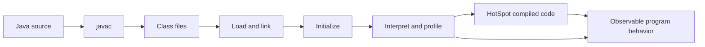

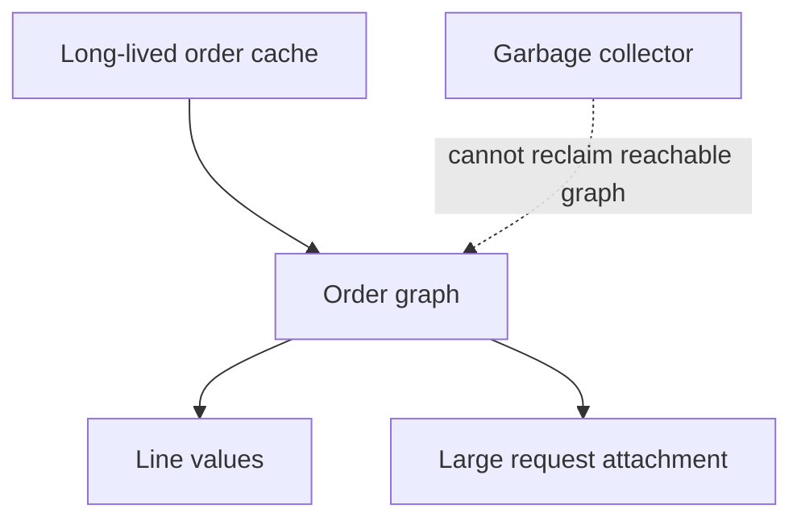

The second diagram explains why adding heap postpones exhaustion without removing the retained reference. The first is a teaching model, not a promise that all methods follow an identical compilation path.

## 9. Java 21 implementation

Unexecuted educational example. Complete single-file program named OrderValueDemo.java; no dependencies or preview flags. It demonstrates input ownership, domain validation, and explicit result handling, not reservation persistence.

```java
import java.util.ArrayList;
import java.util.List;
import java.util.Objects;

public class OrderValueDemo {
    record Line(String sku, int quantity) {
        Line {
            Objects.requireNonNull(sku);
            if (sku.isBlank() || quantity <= 0) {
                throw new IllegalArgumentException("Invalid line");
            }
        }
    }
    record OrderRequest(String orderId, List<Line> lines) {
        OrderRequest {
            Objects.requireNonNull(orderId);
            if (orderId.isBlank()) throw new IllegalArgumentException("Order ID");
            lines = List.copyOf(lines);
            if (lines.isEmpty()) throw new IllegalArgumentException("Empty order");
        }
    }
    sealed interface Reservation permits Reserved, Rejected {}
    record Reserved(String reservationId) implements Reservation {}
    record Rejected(String reason) implements Reservation {}

    static String describe(Reservation result) {
        Objects.requireNonNull(result);
        return switch (result) {
            case Reserved(String id) -> "Reserved: " + id;
            case Rejected(String reason) -> "Rejected: " + reason;
        };
    }

    public static void main(String[] args) {
        var callerLines = new ArrayList<Line>();
        callerLines.add(new Line("P-10", 2));
        var request = new OrderRequest("O-1001", callerLines);
        callerLines.clear();
        if (request.lines().size() != 1) {
            throw new AssertionError("Request changed after submission");
        }
        System.out.println(request.orderId() + " lines=" + request.lines().size());
        System.out.println(describe(new Reserved("R-1001")));
    }
}
```

An exhaustive switch over a closed hierarchy makes an added result variant visible during compilation. It does not establish completeness for unknown JSON received from the network. [J4] The boundary adapter must reject or translate unsupported input explicitly. Records are particularly useful for commands and responses; blindly replacing persistence entities with records ignores the persistence framework's own construction and identity rules.

## 10. Spring Boot integration
Keep controllers responsible for translating transport input into validated commands. Place domain calculations behind constructor-injected services and represent results explicitly. A singleton service should not keep the current request in a mutable field: many calls can reach the same instance. JVM knowledge is therefore relevant even when most application code contains annotations.

Bind JVM options in the deployment environment and record the effective runtime in diagnostics. Application configuration cannot retroactively change every VM startup option. For our Maven project, keep the Java release level explicit at 21 and let the reviewed Boot dependency management control compatible libraries. Do not claim a successful build because the source uses familiar annotations. Chapter 4 explains actual container behavior.

## 11. Production scenario
After a catalog import, Order latency rises while heap usage repeatedly falls after collection. One hypothesis is excessive temporary JSON allocation; another is a database wait that happens during the same interval. A heap graph alone cannot distinguish them. Correlate request latency with CPU samples, allocation events, garbage-collection pauses, database timing, and thread states for the same time window.

If retained heap grows after every import, inspect paths keeping imported data reachable. An intentionally bounded cache and an accidental list of every import response can look similar in a class histogram. Ownership paths explain the difference. Fix the retention policy, then repeat the same workload and compare post-collection live-set behavior. The proposed result is evidence to seek, not a measured outcome.

## 12. HLD considerations
Capacity planning must include multiple service replicas, connection buffers, request concurrency, and startup behavior. A small heap per replica may reduce per-instance loss but increase total metadata and connection overhead. Large in-memory order state increases restart cost and weakens recovery unless state can be reconstructed from durable storage. Our architecture keeps workflow state in the Order database and uses process memory for bounded work in progress.

Choose recovery before tuning. A restart should replay durable work safely and rebuild advisory caches. Losing an in-memory optimization must not lose payment identity or release an authoritative reservation. JVM tuning cannot compensate for storing the only copy of a business obligation in a map.

## 13. LLD considerations
Use immutable command values, narrow interfaces, and explicit resource ownership. Avoid returning a service's mutable internal collection. Validate quantity and money bounds near creation; define overflow behavior for multiplication. A diagnostic toString should not expose credentials or personal data, including automatically generated record output.

Separate expected rejection from infrastructure failure. Insufficient stock can be a result value. A broken database connection is operational failure needing policy and evidence. Catching every exception and returning Rejected destroys this distinction and makes an outage look like normal business demand.

## 14. Reliability and failure recovery
Classify a failure before acting. StackOverflowError suggests uncontrolled depth or recursion; heap exhaustion suggests allocation/retention pressure; a native-memory failure can occur even with heap space available. A linkage error suggests incompatible runtime artifacts. The class of failure narrows the investigation without proving its precise cause.

Plan evidence collection before an incident. Heap dumps can be large and contain business data. Give them a controlled destination, retention policy, and sufficient disk space. Thread dumps reveal stacks and synchronization snapshots; repeated snapshots help separate a transient wait from a persistent blockage. JFR provides a time-oriented view of configured runtime events. [J11] Restarting first can restore service but destroys some evidence, so define an incident policy balancing recovery urgency and capture cost.

## 15. Performance and capacity
Distinguish throughput, response-time percentiles, CPU utilization, allocation rate, and retained memory. An optimization that reduces average CPU may increase tail latency through contention. Measure representative payload sizes and mixed operations, including rejected requests. Warm-up, data distribution, and concurrency belong in the experiment description.

For an illustrative budget, 200 simultaneous requests each retaining 500 KiB consume about 97.7 MiB just for those request graphs. This is arithmetic, not a JVM measurement; object overhead and buffers add more. Reducing needless retention time may save more memory than changing a collector. Use sampled profiling to identify expensive paths and verify improvements with the same workload rather than rewriting every allocation-heavy method.

## 16. Interview questions with explained answers

1. **Does a final reference make an object immutable?** No. It prevents reassignment of that reference after initialization under its applicable rules; a referenced list can still change. Our request constructor copies the list, and its elements are immutable values. Explain the entire reachable graph when claiming immutability.

2. **Why use a record for a request?** It expresses a transparent value carrier with generated component behavior. Validation and copying remain our responsibility. A request is a better fit than an entity whose identity and lifecycle require specialized framework behavior.

3. **Why can a Java process exceed its heap size?** Heap is only one memory category. Native allocations, thread resources, metadata, and generated code contribute. Compare process memory with category evidence rather than raising Xmx automatically.

4. **How can Java leak memory with GC?** An unwanted object can remain reachable. The collector cannot infer that yesterday's requests should have been removed from a static collection. Investigate retaining paths and lifecycle ownership, then verify a stable live set.

5. **Why can startup traffic be slower?** Class loading, initialization, connection establishment, cache population, and compilation can occur early. Measure these separately. A health response does not prove representative business paths are warm.

6. **What does a class-loading error suggest?** Missing or incompatible artifacts are plausible; static initialization is a separate stage. Identify the exact error and dependency/version context. Retrying requests will not create a missing class.

7. **Is a G1 pause target a deadline guarantee?** No. A target guides a heuristic collector under workload constraints. A strict latency requirement needs measured tails, headroom, and application-level overload behavior, not one VM flag.

8. **When do you choose a thread dump over a heap dump?** Start with threads when requests appear blocked or stuck; inspect heap ownership when memory grows. Both are snapshots, while a recording provides temporal context. Select evidence from the question being asked.

9. **Why is one stopwatch invocation a weak benchmark?** Startup and optimization can dominate, inputs may be unrealistic, and unused work can be optimized. A controlled benchmark requires warm-up, useful results, representative state, and statistical interpretation.

10. **Can sealed types solve event schema evolution?** They help local exhaustiveness. Remote producers and consumers deploy independently, so unknown wire variants require versioned contracts and explicit handling. Compiler completeness within one artifact does not prove distributed compatibility.

## 17. Exercises
Save and run the program only in a Java 21 practice environment. Predict the result after callerLines.clear before executing. Then replace List.copyOf with direct assignment and repeat. Expected observation: the protected request retains one line; the altered request fails the assertion. The solution is ownership transfer through a defensive structural copy, not a synchronized list.

Add a third result, Pending(String operationId), to the sealed hierarchy. The expected compile failure at the switch is useful evidence that the decision table needs updating. Add a Pending branch that reports uncertainty without claiming rejection. This connects language design to the ambiguous outcomes in Chapter 1.

Paper lab: a service has stable post-GC heap but growing resident memory. Propose three checks. Solution: inspect thread counts/stacks, direct-buffer or native allocation evidence, and VM native memory tracking if enabled; also compare container/process accounting. Do not conclude a heap leak from resident memory alone.

## 18. Verification
No Java code or diagnostic command was executed during authoring. Expected program output is `O-1001 lines=1`, followed by `Reserved: R-1001`. Run `java OrderValueDemo.java` with a confirmed Java 21 installation. This single-file exercise does not require or replace the Maven project.

Illustrative diagnostic sequence, unexecuted: `jcmd <pid> help`, then `jcmd <pid> help JFR.start` and the relevant command help before capture. For example, a bounded recording can use `jcmd <pid> JFR.start name=checkout settings=profile duration=60s filename=checkout.jfr`. Inspect command impact and permissions on the actual target. The jcmd manual documents target access and available-command discovery. [J12] There are no measured performance results or claims of application readiness.

## 19. Common misconceptions
GC does not remove every object that is no longer useful to the business. A record is not recursively immutable. More heap is not always lower latency. A Java source feature available in a later tutorial may be preview or absent in 21. A successful local demonstration does not prove a service's transaction safety. A dump is evidence requiring interpretation, not a diagnosis by itself.

## 20. Knowledge assessment
Unanswered: Order retains completed futures in a map, request latency rises, and its container restarts while heap occasionally drops. Describe how you would distinguish reachable retention, native-memory pressure, and a slow dependency. State which observation would falsify each hypothesis. No score is recorded until an answer and supporting evidence exist.

## 21. Revision summary
Model values deliberately; use Java 21's stable type features to make invalid states harder to express. Separate language guarantees, JVM specification, and HotSpot implementation choices. Investigate whole-process memory and correlate runtime evidence with business latency. Repair ownership and lifecycle mistakes before treating tuning flags as a solution.

## 22. Next lesson
Chapter 3 adds multiple simultaneous executions. The immutable request remains useful, but shared reservation state now needs atomicity, visibility, bounded admission, and an explicit shutdown policy.


---

<a id="chapter-03"></a>

# Chapter 3 — Concurrency, the Java Memory Model, and Bounded Work

Prepared 2026-10-24. Educational examples are unexecuted; local concurrency demonstrations are not durable inventory implementations.

## 1. Lesson title
Coordinate simultaneous work without losing correctness, saturating dependencies, or hiding unfinished tasks.

## 2. Interview priority
P0. Explain atomicity, visibility, happens-before, executors, cancellation, virtual threads, and backpressure using a concrete invariant. P1: diagnose contention and choose coordination primitives by semantics.

## 3. Prerequisites
Chapter 2's references, objects, memory ownership, and immutable values. A thread is an independently scheduled execution sequence. Concurrency means activities overlap in time; parallelism means work actually executes simultaneously on different execution resources. A program can have concurrency on one CPU.

## 4. Learning objectives
Identify data races, distinguish visibility from compound atomicity, select locks and concurrent collections, build bounded executors, reason about futures and cancellation, and explain Java 21 virtual-thread limitations. Trace resource ownership and shutdown for a request that outlives its caller.

## 5. Official references and version notes
Verified 2026-10-24. Java 21 is the baseline; structured concurrency and scoped values are outside the stable-code examples. Spring Boot remains proposed 4.1.1; live Spring scheduling documentation is Framework 7.0.10 and is conceptual evidence only.

| ID | Reference | Sections |
|---|---|---|
| C1 | [JLS 17](https://docs.oracle.com/javase/specs/jls/se21/html/jls-17.html) | 17.4.5 happens-before, 17.5 final fields |
| C2 | [Concurrent package](https://docs.oracle.com/en/java/javase/21/docs/api/java.base/java/util/concurrent/package-summary.html) | Executors, queues, synchronizers, memory consistency |
| C3 | [ThreadPoolExecutor](https://docs.oracle.com/en/java/javase/21/docs/api/java.base/java/util/concurrent/ThreadPoolExecutor.html) | Queueing and rejection |
| C4 | [CompletableFuture](https://docs.oracle.com/en/java/javase/21/docs/api/java.base/java/util/concurrent/CompletableFuture.html) | Execution policy, cancellation, timeouts |
| C5 | [Virtual threads](https://docs.oracle.com/en/java/javase/21/core/virtual-threads.html) | Scheduling, pinning, adoption |
| C6 | [AtomicInteger](https://docs.oracle.com/en/java/javase/21/docs/api/java.base/java/util/concurrent/atomic/AtomicInteger.html) | Atomic updates and compare-and-set |
| C7 | [ReentrantLock](https://docs.oracle.com/en/java/javase/21/docs/api/java.base/java/util/concurrent/locks/ReentrantLock.html) | Interruptible/timed locking, fairness |
| C8 | [Spring scheduling](https://docs.spring.io/spring-framework/reference/integration/scheduling.html) | Executors and async interception |

Documented API facts are cited. All stock rules, queue capacities, failure sequences, and experiments are original recommendations with illustrative numbers. No throughput claim has been measured.

## 6. Fundamental explanation

### One unit left, two buyers
Suppose stock is one. Thread A reads one; thread B reads one; both decide a purchase is allowed; both write zero. The final number looks valid, yet two reservations were accepted. This is a lost business invariant. Making each read and write individually atomic does not make the sequence of checking and changing atomic.

Atomicity means an operation's protected state transition is indivisible with respect to competing operations. Visibility concerns which writes a reader can observe. Ordering concerns allowed relationships between operations. These ideas overlap but are not interchangeable. Our recommendation is to state the invariant first: `accepted quantity + available quantity = initial quantity` for this limited demo, with available never negative. Then identify the state transition that must be protected.

For actual Inventory, PostgreSQL is authoritative. A Java lock protects only threads sharing that lock in one process. Another replica has another lock and can still update the same SKU. Local synchronization remains useful for in-process data structures and admission control, while durable business correctness belongs at the shared database boundary.

### Visibility has rules
The Java Memory Model defines permitted observations. Unlocking a monitor happens-before a later successful lock of that monitor; volatile writes happen-before subsequent reads of the same volatile variable; thread start and completion/join relationships provide further ordering. Correct final-field construction has special publication guarantees, but it does not make mutable descendants thread-safe. [C1]

Do not reason from a particular CPU cache screenshot. A compiler and runtime may optimize as long as language rules are preserved. Sleeping for a moment is not a publication protocol. `volatile int remaining` would help visibility but `remaining--` still comprises reading, computing, and writing. Choose an atomic transition or a lock around the complete invariant.

### Waiting and doing are different costs
A checkout worker waiting on Payment consumes a different scarce resource from one calculating a signature. For waiting work, more concurrency may improve throughput until a downstream limit is reached. For CPU work, adding threads beyond useful processor capacity often adds scheduling overhead. Even cheap waiting tasks can retain payloads, connections, timers, and retry state. Count those resources explicitly.

## 7. Internal architecture and mechanism

### Locks and atomics
A synchronized block coordinates participants using the same monitor. Keep the protected region small, but not smaller than the invariant. If quantity and reservation history must change together in memory, locking only the quantity update is insufficient. ReentrantLock offers explicit acquisition options, including interruptible and timed acquisition; always release in finally after successful acquisition. Fairness can trade throughput for acquisition behavior and does not create overall scheduler fairness. [C7]

AtomicInteger supplies atomic operations on a single integer, including compareAndSet. [C6] A compare-and-set reservation loop reads an old quantity, rejects if insufficient, and attempts to replace old with old-minus-requested. Failure means another writer intervened; recompute from the new value. Do not put an irreversible payment call inside a retryable update function: a function may be evaluated more than once. Multi-field and external-resource invariants generally need a larger protocol.

Concurrent collections protect their documented operations. A ConcurrentHashMap does not make `get`, arbitrary decision, then `put` one transaction. Use a suitable atomic map operation for a single-key transition, and avoid slow network calls in mapping functions. BlockingQueue can combine storage with producer/consumer coordination; a bounded queue makes capacity visible. CountDownLatch is a one-way gate for a fixed count, Semaphore counts permits, and Phaser/CyclicBarrier coordinate phases with different reuse models. [C2]

### Executors are resource policies
An executor separates submitting work from deciding where it executes. For ThreadPoolExecutor, core size, maximum size, queue, and rejection policy interact. With an unbounded work queue, additional queued work usually prevents growth toward the maximum from being the controlling mechanism. A bounded queue can eventually trigger additional workers and then rejection. [C3] Read the actual constructor and policy; a name such as `workerPool` does not reveal boundedness.

Our design recommendation is to define what overload means to the caller. Rejection can produce a retryable response before durable acceptance, while a durably accepted command needs a reliable queue or database-backed backlog. Caller-runs can slow the submitter but is dangerous if that submitter is an event-loop thread or a listener with timing obligations. Silent discard is inappropriate for order obligations.

### Futures represent results, not guaranteed durability
Future permits waiting for a result and requesting cancellation. CompletableFuture composes dependent computations. Non-async continuations can execute on a completing thread; async methods without an explicit executor normally use the common pool. A timeout completion does not prove underlying I/O stopped, and CompletableFuture cancellation is exceptional completion rather than a general interruption protocol for the original computation. [C4]

For an Order summary, combine independent Catalog and Delivery queries with an explicit executor and a shared deadline. For a reservation and payment mutation, parallelizing merely because futures exist can violate business sequencing. Treat failures as typed outcomes and observe every branch. A lost future reference does not cancel the side effect it represents.

### Java 21 virtual threads
Virtual threads are lightweight Thread instances scheduled over platform threads. They improve the scalability of many blocking tasks; they do not make CPU computation faster or expand the database pool. In Java 21, blocking while executing synchronized or native/foreign code can pin a virtual thread to its carrier. Thread-local state is supported but per-thread resource caches can become expensive at high task counts. [C5] This is explicitly Java 21 guidance; do not substitute behavior from newer JDKs.

Use one virtual thread per suitable task and bound the scarce downstream operation with a semaphore or connection pool. A semaphore alone does not bound all waiting requests: unlimited submissions can still accumulate while waiting for permits. Admission, queue size, and active downstream concurrency are separate limits. Structured cancellation would be useful, but our stable examples use ordinary executors and explicit ownership.

## 8. Diagrams

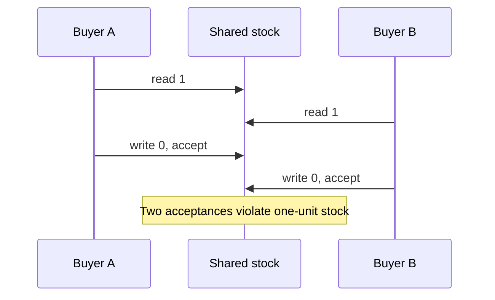

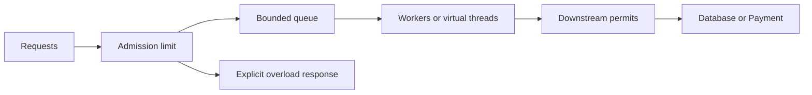

Each boundary has a different owner. Queue capacity controls waiting work; permits control active dependency usage; neither establishes durable acceptance.

## 9. Java 21 implementation

Unexecuted educational example. Complete ReservationConcurrencyDemo.java; no dependencies. It starts a finite number of virtual-thread tasks, uses one lock for the entire stock invariant, and observes every future. It is neither distributed nor durable.

```java
import java.util.ArrayList;
import java.util.List;
import java.util.concurrent.Executors;
import java.util.concurrent.Future;
import java.util.concurrent.locks.ReentrantLock;

public class ReservationConcurrencyDemo {
    static final class Stock {
        private final ReentrantLock lock = new ReentrantLock();
        private int remaining;
        private int accepted;
        Stock(int initial) {
            if (initial < 0) throw new IllegalArgumentException("initial");
            remaining = initial;
        }
        boolean reserveOne() {
            lock.lock();
            try {
                if (remaining == 0) return false;
                remaining--;
                accepted++;
                return true;
            } finally {
                lock.unlock();
            }
        }
        String snapshot() {
            lock.lock();
            try {
                return "accepted=" + accepted + ", remaining=" + remaining;
            } finally {
                lock.unlock();
            }
        }
    }
    public static void main(String[] args) throws Exception {
        Stock stock = new Stock(10);
        List<Future<Boolean>> results = new ArrayList<>();
        int successes = 0;
        try (var executor = Executors.newVirtualThreadPerTaskExecutor()) {
            for (int i = 0; i < 100; i++) {
                results.add(executor.submit(stock::reserveOne));
            }
            for (Future<Boolean> result : results) {
                if (result.get()) successes++;
            }
        }
        if (successes != 10) throw new AssertionError("Wrong reservation count");
        System.out.println(stock.snapshot());
    }
}
```

The snapshot also takes the lock so that it reads a coherent pair. The demo intentionally uses a finite submission count; this is not a server admission strategy. Executor closure waits for termination, so adding a never-completing task changes shutdown behavior. An interview answer should identify that limitation rather than call the example production-ready.

## 10. Spring Boot integration
A default singleton service can be invoked by many request threads. Constructor injection solves dependency wiring, not synchronization. Keep request state in local variables or immutable commands. Apply a named executor and a documented rejection policy to asynchronous tasks. Spring's async support uses interception and its configured executor; self-invocation does not automatically pass through that interception. [C8]

Do not assume transaction, security, logging, or trace context propagates merely because a task was submitted. Decide what context is required, capture immutable identifiers, and use the framework's supported propagation mechanism. Database work in another thread needs its own properly established transaction scope. For business work that must survive a restart, persist the obligation and let a worker process it.

## 11. Production scenario
Payment slows. Order creates one task per checkout, and every task retains an order payload while waiting for the payment pool. Response deadlines expire, customers retry, and old tasks continue. There are now several layers of duplicate demand: original requests, client retries, and possibly service retries. Virtual threads can make the thread cost tolerable while memory and payment concurrency still collapse.

Recovery begins by bounding admission and stopping retry amplification. Preserve stable payment operation IDs and reconcile ambiguous outcomes. Observe outstanding tasks, oldest task age, pool wait time, dependency latency, and accepted-but-unfinished orders. A lower thread count is not proof of recovery if the durable backlog continues growing.

## 12. HLD considerations
Define capacity at the service boundary and every expensive dependency. Separate interactive queries from slow reports so a report burst cannot consume every connection needed for checkout. This is bulkheading by resource ownership. Choose whether rejected work is safe for the client to retry or has already become a durable server obligation.

Keep database authority for inventory across replicas. Java synchronization remains an optimization or protection for process-local state. Scaling from one replica to two must not invalidate stock correctness. Design tests around that transition before relying on a local lock.

## 13. LLD considerations
Document which lock protects which fields and establish a consistent lock order when several locks are needed. Avoid callbacks into unknown code while holding a lock. Represent task ownership explicitly: who observes success, who handles failure, who cancels, and who closes the executor? A method that creates an executor on every request without clear shutdown has hidden resource ownership.

Use immutable task inputs and return immutable results. Separate a retryable calculation from an irreversible effect. If an atomic update can rerun its callback, keep that callback pure. For durable reservation, place uniqueness and quantity enforcement in one database transaction rather than reproducing it in memory.

## 14. Reliability and failure recovery
Interruption is a cooperative signal. A task must either propagate InterruptedException or restore interrupt status when it cannot propagate, then follow an explicit stopping policy. Swallowing interruption can prevent shutdown. Cancellation of a local task does not undo a completed remote authorization; cancellation of a business order is a separate workflow.

At shutdown, stop admission, stop creating new background work, allow bounded draining, and record unfinished durable work for recovery. Never hold a database transaction open while waiting indefinitely for executor termination. Diagnose deadlock through lock ownership and wait relationships; diagnose starvation through work that cannot acquire execution capacity despite no cyclic lock graph.

## 15. Performance and capacity
Suppose 40 dependency permits each remain occupied for 200 ms on average. An idealized capacity estimate is 40 / 0.2 = 200 operations per second, before overhead and variability. Doubling the thread count does not change the permit limit. If input is 250 per second, a queue grows roughly 50 per second under these assumptions. A queue of 500 absorbs about ten seconds of excess demand, not an indefinite overload.

Measure queue wait separately from service time. Large queues can make throughput look stable while users miss deadlines. Retry only within the original time budget and add jitter where retries are appropriate. CPU profiles, lock contention, blocked-thread evidence, and pool metrics answer different questions; use the relevant one.

## 16. Interview questions with explained answers

1. **Why does volatile not make decrement safe?** Visibility and ordering do not combine a read, decision, and write into one protected transition. Two buyers can both see stock and both accept. Use an atomic conditional update or a lock over the invariant.

2. **What is happens-before?** It is a specified ordering relation that constrains visibility, not a wall-clock observation. Identify an actual synchronization edge, such as monitor unlock/lock or task completion observation. Sleeping is not such a protocol.

3. **When use a lock instead of AtomicInteger?** Use a lock when several state components must change coherently or when the transition is easier to reason about under exclusion. A single atomic counter cannot atomically maintain a separate reservation map and an external effect.

4. **Is ConcurrentHashMap enough for idempotency?** It may support an atomic local key operation, but restart and other replicas remain. Durable idempotency requires persisted operation identity and business constraints. A map is useful for local coordination, not the entire protocol.

5. **Why can maximumPoolSize be misleading?** An unbounded queue can absorb submissions before additional workers are needed under the executor's policy. Inspect queue type and rejection behavior alongside thread limits. Bounded active threads do not imply bounded retained work.

6. **Does a future timeout stop payment?** It may only stop waiting or complete the future exceptionally. The effect could still happen. Use client deadlines, cooperative cancellation where supported, stable operation identity, and reconciliation of unknown results.

7. **What do virtual threads improve?** They reduce the cost of many waiting tasks. CPU capacity, database connections, rate limits, and memory remain bounded. In Java 21, account for pinning and inspect actual behavior under the chosen libraries.

8. **What is backpressure?** A downstream capacity signal influences upstream work admission or production. A finite queue with a documented rejection or waiting policy is one component. An ever-growing queue delays failure rather than communicating capacity.

9. **Why avoid payment calls under a lock?** A slow remote call extends local exclusion and couples all contenders to network latency. It may also complete after a timeout. Persist intent and perform the remote step using a durable workflow boundary.

10. **How distinguish deadlock from saturation?** Deadlock has a cycle of dependencies that cannot progress under the current protocol. Saturation can have workers making progress while arrivals exceed service rate. Thread evidence plus throughput and queue age distinguishes them better than a single blocked-thread count.

## 17. Exercises
Predict the demonstration's final state. Solution: exactly ten successes and zero remaining, independent of which tasks win. Run repeatedly only after confirming Java 21; different winners are expected, different totals are not. Remove the lock as an intentionally unsafe variant. A run that still prints ten does not establish correctness; the schedule may simply fail to expose the race.

Design a bounded payment executor for a paper workload of 80 arrivals per second and 50 completions per second. A queue of 300 fills after approximately ten seconds under constant rates. The solution must specify rejection before durable acceptance, or persisted backlog after acceptance, and must preserve payment operation identity on retry.

Add an interruptible wait to a practice worker and cancel it. Expected observations depend on the wait API: interruption-aware code can exit, but a remote effect already committed remains. Explain the difference between stopping local work and compensating a business action. Do not test this with real money.

## 18. Verification
Source documentation was checked; the Java program was not compiled or run. Expected output: `accepted=10, remaining=0`. It verifies only finite, single-process locking if executed. It does not verify fairness, throughput, distributed stock, cancellation, or durable recovery. No JUnit suite, Maven build, or environment installation was performed.

## 19. Common misconceptions
Thread-safe components do not automatically compose into a thread-safe workflow. Cheap virtual threads do not create unlimited downstream capacity. Async does not mean durable. A future timeout does not prove an effect stopped. A semaphore bounds permit holders but may leave unlimited waiters. One successful stress run cannot prove absence of a race.

## 20. Knowledge assessment
Unanswered: a service uses virtual threads, a 20-connection pool, and no admission limit. Payment latency increases fivefold. Explain the possible queue locations, retained resources, duplicate-effect risks, and a bounded recovery design. Name the measurements that would demonstrate improvement.

## 21. Revision summary
Start with the invariant, then identify the synchronization and resource boundaries. Use happens-before reasoning for visibility, protect compound transitions, observe task results, and make overload explicit. Separate local cancellation from durable business recovery.

## 22. Next lesson
Chapter 4 applies these ideas to Spring's container, proxies, transaction scopes, request dispatch, and shutdown. Framework-managed objects still execute under the same concurrency rules.


---

<a id="chapter-04"></a>

# Chapter 4 — Spring Internals: Objects, Proxies, Requests, and Transactions

Prepared 2026-10-24. Conceptual course chapter with unexecuted educational examples. No Boot application or dependency set was built.

## 1. Lesson title
Explain what Spring actually does between application startup, an HTTP request, a database commit, and shutdown.

## 2. Interview priority
P0. Constructor injection, lifecycle, auto-configuration, proxy interception, transaction boundaries, and MVC/WebFlux choices are everyday correctness topics. Framework vocabulary should support a trace of a concrete request.

## 3. Prerequisites
Java interfaces, constructors, exceptions, and Chapter 3's shared-state and executor reasoning. A dependency is an object another object needs. A container creates and connects managed objects. A transaction is a resource-specific unit of commit or rollback, not a promise about every action inside a method.

## 4. Learning objectives
Trace bean creation and post-processing, diagnose why an auto-configuration applied, identify whether a call crosses a proxy, choose coherent web and persistence stacks, and design transaction/async/shutdown boundaries for Order. Explain failure behavior without attributing magic to annotations.

## 5. Official references and version notes
All links opened 2026-10-24. Live pages report Framework 7.0.10 and Boot 4.1.2. The agreed proposed Boot baseline remains 4.1.1; no silent upgrade or compatibility claim is made. Example concepts are stable, but exact dependencies and configuration must be validated when implementation is authorized.

| ID | Primary source | Relevant section |
|---|---|---|
| S1 | [Container overview](https://docs.spring.io/spring-framework/reference/core/beans/basics.html) | ApplicationContext and metadata |
| S2 | [Bean lifecycle](https://docs.spring.io/spring-framework/reference/core/beans/factory-nature.html) | Initialization, destruction, lifecycle |
| S3 | [Proxying mechanisms](https://docs.spring.io/spring-framework/reference/core/aop/proxying.html) | JDK/CGLIB, self-invocation |
| S4 | [Boot auto-configuration](https://docs.spring.io/spring-boot/reference/using/auto-configuration.html) | Conditions, backoff, debug report |
| S5 | [DispatcherServlet](https://docs.spring.io/spring-framework/reference/web/webmvc/mvc-servlet.html) | Front controller and delegates |
| S6 | [WebFlux overview](https://docs.spring.io/spring-framework/reference/web/webflux/new-framework.html) | Reactive concurrency model |
| S7 | [Transactional annotations](https://docs.spring.io/spring-framework/reference/data-access/transaction/declarative/annotations.html) | Proxy mode, rollback, settings |
| S8 | [Propagation](https://docs.spring.io/spring-framework/reference/data-access/transaction/declarative/tx-propagation.html) | REQUIRED and REQUIRES_NEW |
| S9 | [Scheduling and async](https://docs.spring.io/spring-framework/reference/integration/scheduling.html) | TaskExecutor and async advice |
| S10 | [Graceful shutdown](https://docs.spring.io/spring-boot/reference/web/graceful-shutdown.html) | Grace periods and server behavior |

Documented mechanisms are attributed to these pages. Transaction placement, package boundaries, and commerce workflows are course design recommendations. No book chapter is claimed as consulted evidence.

## 6. Fundamental explanation

### Dependency injection is object construction with ownership
Without a container, a main method might construct a DataSource, an OrderRepository, a CreateOrderService, and a controller. Each constructor declares its required collaborators. Spring's inversion of control moves that assembly responsibility into a managed container. The application describes the objects and connections; the container creates and supplies them. ApplicationContext represents this container and reads configuration metadata. [S1]

Constructor injection makes mandatory dependencies visible and permits an object to be created in a unit test without starting a server. If a service requires twelve collaborators, the constructor is revealing a possible responsibility problem; field injection would only conceal it. Avoid asking a global context for arbitrary services inside domain methods, because dependencies then become hidden and tests need more infrastructure.

A bean is an object managed by the container. It is not necessarily a database entity, request, or remote service. Scope determines how instances are obtained. A singleton service shared across requests must avoid storing per-request mutable state. The container's ability to inject a reference does not imply that reference is thread-safe, healthy, or configured with enough capacity.

### Boot supplies conventions around Spring
Spring Framework provides container and application abstractions. Spring Boot adds opinionated startup, dependency organization, auto-configuration, and operational integration. Auto-configuration examines conditions such as dependencies and already-declared beans; it can back off when the application supplies an alternative. The conditions report helps explain the result. [S4]

This means a dependency change can alter behavior even if your service code does not change. Adding a web or database library can satisfy a condition. Troubleshooting should therefore inspect effective dependencies and the condition report. Repeatedly adding annotations until startup succeeds creates configuration that nobody can explain.

## 7. Internal architecture and mechanism

### Bean creation and lifecycle
Think in stages: discover definitions, resolve dependencies, instantiate objects, populate required configuration, run initialization callbacks, apply relevant post-processing, and expose usable instances. Lifecycle callbacks and lifecycle interfaces let managed components participate in initialization and shutdown. [S2] This sequence is a conceptual trace; special infrastructure components and dependencies complicate a rigid universal ordering.

A constructor should establish local validity. It should not send a payment or wait indefinitely for another service. Startup side effects make retries dangerous and can prevent the entire application from becoming available. Our design loads configuration at startup, validates required settings, and establishes bounded infrastructure readiness. Business work begins through explicit application commands after readiness.

Circular dependencies often indicate that responsibilities are not separated. If OrderService needs PaymentService and PaymentService needs OrderService, determine which use case owns the workflow. In this course Order owns orchestration, so Payment exposes an authorization capability and does not call back into Order's internals. Solving the cycle with delayed lookup may hide a conceptual dependency cycle.

### The reference can be a proxy
Spring AOP can expose a proxy that intercepts method calls before invoking the target. JDK proxies use interfaces; class-based proxies subclass a target type and have limitations around final/private methods. A call from a target method to another method on `this` bypasses the external proxy. [S3]

Draw the actual call graph. `controller -> proxy -> service` can trigger advice. `service.outer -> this.inner` does not become a new proxy crossing simply because inner has an annotation. A directly constructed `new CreateOrderService(...)` also has no automatic Spring transaction interceptor. The object is a valid Java object, but its execution boundary differs.

### Transactions are intercepted resource scopes
With typical proxy-based declarative transactions, an intercepted method call asks a transaction manager to establish or join a resource transaction. Completion commits or rolls back according to configuration and exceptions. Standard defaults distinguish unchecked failures from checked exceptions unless rollback rules are customized. [S7] Do not rely on memory of defaults when application configuration overrides them.

REQUIRED can join an existing physical transaction. An inner logical scope can mark it rollback-only, so catching the inner exception does not necessarily make the outer transaction committable. REQUIRES_NEW uses an independent physical transaction and can require another connection while the outer one remains held. [S8] That can exhaust a small pool when many requests nest transactions. Savepoints and nested semantics depend on the transaction manager and resource; they are not interchangeable with independent commits.

Our CreateOrder boundary writes the order and its outbox row atomically in one local database transaction. Publishing to a broker or calling Payment happens through a separate recovery protocol. An annotation cannot undo an ordinary remote HTTP effect. Keep the database transaction short enough that a slow dependency cannot hold locks and connections indefinitely.

### MVC, WebFlux, and thread ownership
Spring MVC dispatches through DispatcherServlet, which delegates mapping, invocation, conversion, and exception handling. [S5] In a typical Order request, filters process transport concerns, a handler mapping selects the controller, argument resolution constructs inputs, validation checks them, the controller calls an application service, and response conversion serializes the result. A serializer triggering lazy database access can therefore perform surprising work after the intended service boundary.

WebFlux provides a reactive, non-blocking web stack with a small-thread concurrency model and backpressure-oriented composition. [S6] It is useful when the dependency chain supports non-blocking execution. Blocking JDBC on an event-loop thread violates that assumption. Moving blocking work to another scheduler is a bridge with its own capacity limits, not a free conversion to non-blocking persistence.

For this course's initial PostgreSQL/JPA Order service, MVC is a straightforward recommendation. Virtual threads may later be evaluated with Java 21-specific constraints. Choose WebFlux when its end-to-end model solves a measured need and the team can maintain cancellation and context correctly.

## 8. Diagrams

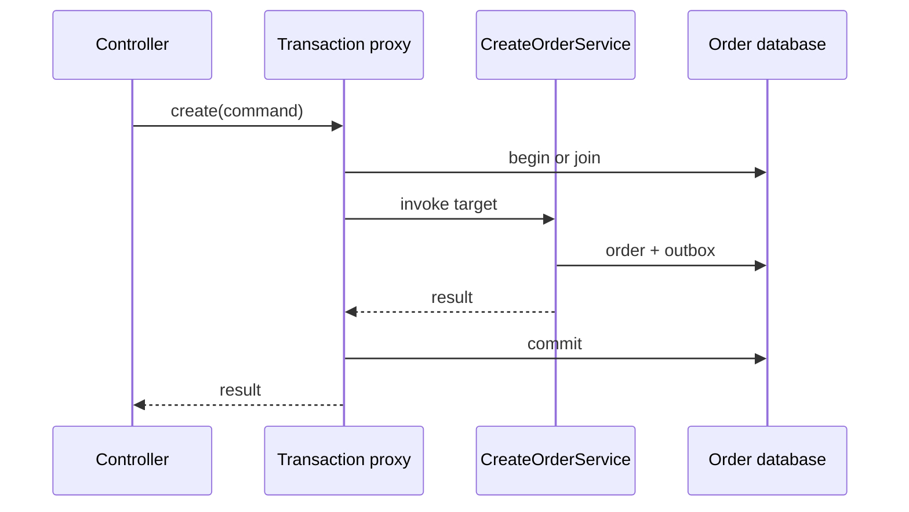

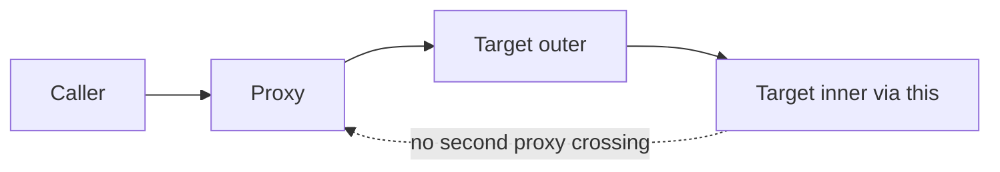

The diagrams describe typical proxy-based transaction behavior. They do not claim a global transaction with Inventory or Payment.

## 9. Java 21 implementation

Unexecuted educational example. Complete WiringDemo.java with no Spring dependency. It demonstrates constructor assembly and an explicit decorator boundary so the later proxy concept has a concrete foundation. The printed boundary-entry and exit messages do not implement a transaction.

```java
import java.util.Objects;

public class WiringDemo {
    record CreateOrder(String orderId) {
        CreateOrder {
            Objects.requireNonNull(orderId);
            if (orderId.isBlank()) throw new IllegalArgumentException("orderId");
        }
    }
    interface Orders { String create(CreateOrder command); }
    interface Store { void save(String orderId); }
    static final class MemoryStore implements Store {
        public void save(String orderId) {
            System.out.println("SAVE " + orderId);
        }
    }
    static final class OrderService implements Orders {
        private final Store store;
        OrderService(Store store) { this.store = Objects.requireNonNull(store); }
        public String create(CreateOrder command) {
            store.save(command.orderId());
            return command.orderId();
        }
    }
    static final class Boundary implements Orders {
        private final Orders target;
        Boundary(Orders target) { this.target = Objects.requireNonNull(target); }
        public String create(CreateOrder command) {
            System.out.println("ENTER boundary");
            try {
                String result = target.create(command);
                System.out.println("EXIT success");
                return result;
            } catch (RuntimeException failure) {
                System.out.println("EXIT failure");
                throw failure;
            }
        }
    }
    public static void main(String[] args) {
        Orders target = new OrderService(new MemoryStore());
        Orders exposed = new Boundary(target);
        System.out.println(exposed.create(new CreateOrder("O-1001")));
    }
}
```

The service does not know how its exposed reference was decorated. The caller controls whether it uses `target` or `exposed`; the latter is essential for interception. Real Spring transaction advice additionally coordinates a transaction manager, resource binding, rollback policy, and cleanup. This example teaches the reference boundary without pretending to implement those mechanisms.

## 10. Spring Boot integration
Recommended package responsibilities are `order.api` for HTTP adaptation, `order.application` for use cases, `order.domain` for business rules, and `order.infrastructure` for persistence and messaging. Keep the application root above these packages for intentional discovery. A public application-service method is a clear local transaction entry point when using conventional proxy advice.

A planned Spring handler would validate the command, call an injected transactional application service, and return a resource identifier. The service would persist both order and outbox through the same transaction manager. Infrastructure publication would occur later. This is a design contract, not an executed repository implementation.

Async methods use an executor and advice; they need explicit failure observation and capacity configuration. [S9] An in-memory async event can disappear on a process crash. For a post-commit notification that must eventually happen, store the obligation in the outbox. A callback after commit is useful for local behavior but cannot close the crash gap between commit and callback execution.

## 11. Production scenario
A developer calls `this.reserve()` from `checkout()` and expects reserve's transaction annotation to open an independent transaction. During an error, partial changes appear inconsistent with that expectation. Investigate the injected object, actual proxy type, method visibility, call path, and transaction manager. The immediate lesson is that metadata only matters when the configured mechanism observes the call.

A second incident appears after adding REQUIRES_NEW audit writes: under load, every outer request holds a connection while waiting for an inner transaction to acquire another. The queue is a resource cycle caused by scope design. Recovery may require removing unnecessary nested transactions, isolating durable audit through an outbox, and correcting pool sizing against real concurrency. Adding connections without changing the model may merely move the limit.

## 12. HLD considerations
Choose the business transaction boundary before choosing annotations. Order owns acceptance and workflow state; Inventory and Payment own their databases and local invariants. Service boundaries define independent failures. A controller that writes all three databases is an ownership violation even if it has a convenient transaction annotation.

Separate readiness from liveness and business success. A process can be alive but unable to accept new orders. During dependency failure, decide whether new orders can be durably queued or must be rejected. The decision depends on the product contract and recovery capacity, not the mere presence of a health endpoint.

## 13. LLD considerations
Prefer small application services with constructor-injected ports. Domain objects decide legal transitions; adapters translate persistence or HTTP details. Map exceptions at the boundary without converting every failure into a generic success response. Use a consistent error model that preserves an operation ID for support and reconciliation.

Avoid exposing persistence entities directly as web contracts. Lazy associations, cycles, sensitive fields, and schema coupling make serialization unpredictable. Materialize a response DTO while the required data is deliberately available. This makes query cost and transaction lifetime reviewable.

## 14. Reliability and failure recovery
Graceful shutdown stops accepting new work and provides a bounded interval for existing requests; actual rejection behavior depends on the embedded server. Boot's documented shutdown participates in application-context lifecycle processing. [S10] Do not assume a graceful hook runs after a hard process kill or exhausted platform termination deadline.

Our operational sequence is to remove readiness, stop admission and new scheduled work, drain bounded work, close resources, and allow durable obligations to resume elsewhere. Coordinate platform termination budgets with application drain time. Long-running jobs should checkpoint safely rather than require every deployment to wait indefinitely.

## 15. Performance and capacity
Framework overhead is often smaller than database, serialization, and network costs, but measure before concluding. Count SQL statements, payload size, connection wait, handler duration, and executor queue age. A reactive controller that calls blocking persistence may increase complexity without improving capacity. An oversized application context can affect startup, while eager expensive work can delay readiness.

For a thought experiment, each request holds a connection for 500 ms because it includes a remote call, though database work takes 20 ms. Moving the remote call outside the transaction could reduce connection occupation substantially, but consistency must be redesigned through durable intent. This is reasoning about residence time, not a promised benchmark improvement.

## 16. Interview questions with explained answers

1. **What is IoC?** The container owns assembly and lifecycle instead of every class constructing its collaborators. Constructor injection makes that assembly contract explicit. It does not remove the need to design responsibilities or thread safety.

2. **What is a bean?** It is a container-managed object with configured creation and lifecycle. A bean can be an application service, client, or configuration component. It is not synonymous with a database row or a new object per request.

3. **How does auto-configuration work?** Conditions select configuration based on the environment and existing definitions. Inspect the condition report and dependency graph when behavior changes. A default is an input to diagnosis, not a substitute for checking effective configuration.

4. **Why can self-invocation bypass a transaction?** The target calls itself without returning through the exposed proxy. The advice therefore has no interception opportunity. Refactor use-case boundaries or choose another explicit transaction mechanism when appropriate.

5. **Does catching an exception guarantee commit?** No. A participating transaction may already be rollback-only, and persistence errors can affect resource state. Understand propagation and rollback policy; do not hide the exception and assume the database is clean.

6. **Why can REQUIRES_NEW exhaust a pool?** The outer transaction may retain its connection while the inner requests a different one. Many nested callers can consume all available capacity. Independent commit semantics need a genuine business reason and a capacity analysis.

7. **Does async inherit a transaction?** Do not assume thread-bound transaction resources move to another execution thread. Establish the intended transaction in the worker and persist any obligation that must survive a crash. An annotation is not a durable job queue.

8. **When choose MVC over WebFlux?** For a blocking JPA stack and straightforward request flow, MVC is often easier to reason about. WebFlux suits an end-to-end non-blocking composition with explicit cancellation and backpressure. Choose based on dependencies and requirements, not fashion.

9. **Why avoid returning an entity from a controller?** Serialization may trigger database access, expose internal fields, or tie the public API to persistence changes. An explicit response value bounds data selection and makes compatibility intentional.

10. **What does graceful shutdown guarantee?** It provides a configured opportunity to stop and drain under supported termination conditions. It cannot guarantee completion after a hard kill or arbitrary infrastructure failure. Durable work and idempotent recovery remain necessary.

## 17. Exercises
Run WiringDemo only after confirming Java 21. Expected sequence: ENTER boundary, SAVE O-1001, EXIT success, O-1001. Replace `exposed.create` with `target.create`. The missing boundary messages demonstrate interception dependence; they do not prove anything about actual database transactions.

Paper solution exercise: a controller calls an application service that writes an order, sends HTTP payment, then writes an outbox row. Identify the unsafe window. The solution is to commit order plus durable outgoing intent locally, perform the remote step under stable operation identity, and update workflow state using a new local transaction. Database rollback cannot retract a completed payment.

Draw startup and shutdown for an outbox relay. Expected design: it starts only after required infrastructure readiness, stops claiming new rows before shutdown, allows bounded in-flight completion, and leaves unconfirmed work retryable. The precise leasing/publishing protocol is developed in Chapter 12.

## 18. Verification
References were opened and version banners recorded. The single-file Java example, Maven build, Spring contexts, transaction integration, and shutdown behavior were not executed. Treat the code as a mechanism demonstration. A future implementation needs integration tests proving rollback, proxy traversal, outbox atomicity, and restart behavior on the selected database and reviewed dependency set.

## 19. Common misconceptions
An annotation does not execute itself. A bean is not automatically thread-safe. An async task is not a durable event. A transaction does not include arbitrary remote resources. Reactive return types do not transform blocking calls. Graceful shutdown is not a replacement for crash recovery. Boot conventions still need inspection when dependencies change.

## 20. Knowledge assessment
Unanswered: a singleton OrderService stores the current request in a field, invokes a private transactional helper, and calls an async payment method on itself. Identify three distinct mechanisms that fail to match the developer's expectation and propose a corrected boundary design.

## 21. Revision summary
Trace object ownership, proxy crossings, execution threads, and physical resource transactions. Use auto-configuration as explainable conditional assembly. Keep business state and outgoing obligations durable, and make startup and shutdown part of the architecture.

## 22. Next lesson
Chapter 5 examines the contracts at the edge: HTTP status, idempotency, serialization, streaming, and messaging choices. The Spring adapter will implement those contracts, while the application layer owns their business meaning.


---

<a id="chapter-05"></a>

# Chapter 5 — APIs and Integration Contracts

Prepared 2026-10-24. All examples are unexecuted educational material. Payment is simulated throughout the course.

## 1. Lesson title
Choose and implement communication contracts whose success, failure, compatibility, and recovery meanings are explicit.

## 2. Interview priority
P0: HTTP semantics, idempotency, deadlines, validation, and contract evolution. P1: compare gRPC, GraphQL, streaming, webhooks, JMS, and AMQP through requirements rather than popularity.

## 3. Prerequisites
Chapters 1–4. A protocol specifies message exchange rules. A schema specifies message structure. A contract also includes meaning, errors, authorization, timing, and compatibility. A successful network exchange is only one part of business completion.

## 4. Learning objectives
Design a recoverable Create Order API, describe resource-oriented HTTP, write a small OpenAPI contract, compare typed RPC and query composition, distinguish server push mechanisms, and choose messaging semantics intentionally. Explain what a timeout leaves unknown.

## 5. Official references and version notes
Opened 2026-10-24. These are selected official specifications and project documentation, not a claim to have read complete standards. OpenAPI 3.1.1 and Jakarta Messaging 3.1 are explicit reference versions; no corresponding dependency installation is implied. Java remains 21, Maven the build tool, and Boot 4.1.1 the proposed application baseline.

| ID | Reference | Sections used |
|---|---|---|
| A1 | [HTTP semantics, RFC 9110](https://www.rfc-editor.org/rfc/rfc9110.html) | Methods, conditional requests, 201/202 |
| A2 | [Problem Details, RFC 9457](https://www.rfc-editor.org/rfc/rfc9457.html) | Problem members, security considerations |
| A3 | [OpenAPI 3.1.1](https://spec.openapis.org/oas/v3.1.1.html) | Paths, operations, schemas, responses |
| A4 | [gRPC concepts](https://grpc.io/docs/what-is-grpc/core-concepts/) | Unary and streaming RPC lifecycle |
| A5 | [gRPC deadlines](https://grpc.io/docs/guides/deadlines/) | Deadline propagation and cancellation |
| A6 | [Protobuf proto3](https://protobuf.dev/programming-guides/proto3/) | Field numbers, reserved fields, updating types |
| A7 | [GraphQL queries](https://graphql.org/learn/queries/) | Selection sets, arguments, variables |
| A8 | [WHATWG server-sent events](https://html.spec.whatwg.org/multipage/server-sent-events.html) | EventSource, event ID, reconnection |
| A9 | [WebSocket RFC 6455](https://www.rfc-editor.org/rfc/rfc6455.html) | Handshake, frames, close and control frames |
| A10 | [Jakarta Messaging 3.1](https://jakarta.ee/specifications/messaging/3.1/jakarta-messaging-spec-3.1.html) | Queue/topic models, acknowledgments |
| A11 | [RabbitMQ AMQP model](https://www.rabbitmq.com/tutorials/amqp-concepts) | AMQP 0-9-1 exchanges, bindings, queues |
| A12 | [GitHub webhook practices](https://docs.github.com/en/webhooks/using-webhooks/best-practices-for-using-webhooks) | Secure, prompt, deduplicated handling |
| A13 | [Java 21 HttpClient](https://docs.oracle.com/en/java/javase/21/docs/api/java.net.http/java/net/http/HttpClient.html) | Client reuse, synchronous/asynchronous calls |
| A14 | [Spring response bodies](https://docs.spring.io/spring-framework/reference/web/webmvc/mvc-controller/ann-methods/responsebody.html) | Message conversion |

GitHub-specific webhook documentation is an example provider contract, not a universal retry guarantee. Live Spring docs are Framework 7.0.10; exact proposed-Boot compatibility remains unverified. Protocol statements below are documented facts; commerce policies and payloads are recommendations.

## 6. Fundamental explanation

### Begin with the operation's meaning
A customer submits an order for two units of P-10. The API can promise durable acceptance before inventory and payment finish. It must then expose a resource whose status tells the customer what is known. Alternatively, it can wait for some work, but it still needs a policy for response loss. Synchronous appearance does not remove ambiguity.

Our recommended contract separates order creation from fulfillment readiness. A successful creation returns an order identifier and a status such as PENDING. Inventory reservation and simulated authorization later advance that state. Repeated client requests for the same logical operation use the same idempotency identity. Reusing that identity with a different body is a conflict requiring explanation, not silent reuse of an unrelated result.

### HTTP is more than JSON over POST
A resource is something addressable, such as `/orders/O-1001`. A representation describes it at a point in time. HTTP methods have defined semantics: safe methods are intended to be read-only in their requested semantics; idempotent methods have the same intended effect after repeated identical requests. POST does not acquire idempotency merely because its body is JSON. A 201 response means a resource was created; 202 means processing was accepted but has not completed. [A1]

We recommend 201 when the Order resource has been durably created, even if its business state is pending. A separate long-running operation endpoint may use 202 and a status URL. State the chosen meaning in the contract. Do not use 200 for every case and ask clients to infer success from an undocumented message string.

Validation has layers. Syntactic validation checks that quantity is a positive integer and an identifier has an allowed shape. Semantic validation checks rules such as whether a product is sellable. Authorization asks whether this caller may create or view this order. Inventory availability is a concurrent business decision at its owner, not a validation annotation on a stale cache value.

## 7. Internal architecture and mechanism

### Representation and evolution
An API contract includes field names, types, optionality, defaults, units, and allowed states. `amount: 100` is ambiguous without currency and unit. A timestamp needs a defined offset/instant convention. Missing, null, zero, and empty string can represent different intentions; choose them deliberately. Adding a field is only safe when consumers tolerate it and the new semantics do not change an old promise.

OpenAPI describes HTTP paths, operations, request/response schemas, parameters, and related metadata in a machine-readable document. [A3] It can guide clients and validation, but generated types cannot prove that an endpoint preserves idempotency across process restart. Keep behavioral rules alongside schemas and verify them with contract and integration tests later.

Problem Details standardizes a response shape including type, title, status, detail, and instance, with extension members available. [A2] Our recommendation is a stable machine-readable problem type plus an operation/correlation identifier. Avoid putting stack traces, SQL, or secrets in responses. A human message may evolve; clients should branch on stable fields.

### Typed RPC and Protobuf
gRPC presents service methods through generated clients and servers and supports unary, client-streaming, server-streaming, and bidirectional-streaming calls. [A4] It is useful when controlled clients benefit from explicit typed interfaces and streaming. It does not make a remote call equivalent to a local function: deadlines, cancellation, metadata, and deployment compatibility remain.

Protobuf identifies fields by numbered tags. Retired field numbers should not be reused; reserve them so later changes cannot reinterpret old bytes as a different field. [A6] A compact encoding is not proof that semantic changes are compatible. Renaming an amount from gross to net while keeping its tag and numeric type can preserve decoding and break the business contract.

Set realistic deadlines and propagate remaining budget. gRPC documents deadline and cancellation behavior, but the server must still stop expensive application work cooperatively where required. [A5] A request that already committed an authorization needs reconciliation, even if cancellation later arrives. Network-level cancellation is not a business rollback.

### Query composition and push
GraphQL lets a client select fields from a typed schema and pass arguments and variables. [A7] For an order dashboard, the response might combine order state, delivery estimate, and product display names. Our design recommendation is to put authorization at each meaningful data boundary, bound query cost, batch repeated fetches, and document freshness. One HTTP request can still produce many downstream calls; reducing over-fetching does not automatically reduce backend work.

SSE uses a server-to-client event stream with EventSource reconnection and event identifiers. [A8] It fits order-status updates when the client mainly listens. Retaining event IDs and providing a resume policy are application responsibilities; an ID alone does not create a durable replay store. A reconnecting browser may need to fetch the current order snapshot before resuming updates.

WebSocket establishes a bidirectional framed channel with handshake and control-frame behavior. [A9] It fits interactive communication in both directions. Our recommendation is to define message schemas, authorization renewal, heartbeats, backpressure, and reconnection explicitly. A persistent connection is a resource that can outlive a particular server instance or credential validity interval.

### Webhooks and messaging
A webhook is an HTTP callback to another system. Treat delivery as an operation with retries, duplicate detection, signature verification, and a durable receiving boundary. GitHub's official guidance illustrates secret verification, delivery IDs, and prompt processing; its exact delivery policy is provider-specific. [A12] For our simulated Payment callback, persist the verified event and inbox identity before acknowledging, then process under a recoverable local transaction.

Jakarta Messaging defines Java messaging APIs and queue/topic models. AMQP is a wire-protocol family. RabbitMQ's AMQP 0-9-1 model routes publications through exchanges and bindings to queues. These are distinct abstraction levels, and AMQP 0-9-1 must not be conflated with AMQP 1.0. [A10, A11] Choose a task queue for work distribution, or the course's retained event stream when replay and independent consumers are requirements. Kafka core behavior is developed from Apache references in Chapters 7–15 rather than asserted from unrelated broker documentation.

## 8. Diagrams

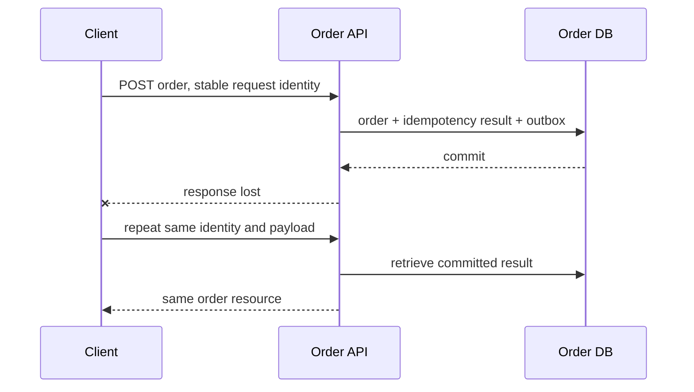

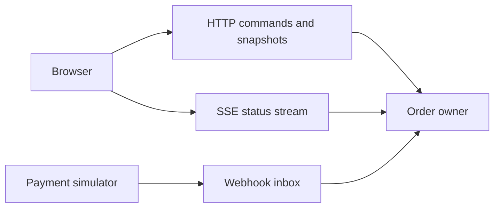

The stream accelerates user feedback; the snapshot endpoint remains the recovery reference when a connection misses updates.

## 9. Java 21 implementation

The following unexecuted OpenAPI document is complete within its declared scope: a read-only order-status endpoint. It omits authentication to isolate representation and response contracts; it is not a production API definition. Java 21 server/client code can be generated or implemented later using a reviewed toolchain.

```yaml
openapi: 3.1.1
info:
  title: Order Status Teaching API
  version: 1.0.0
paths:
  /orders/{orderId}:
    get:
      operationId: getOrder
      parameters:
        - in: path
          name: orderId
          required: true
          schema:
            type: string
            minLength: 1
      responses:
        '200':
          description: Current order snapshot
          content:
            application/json:
              schema:
                $ref: '#/components/schemas/Order'
        '404':
          description: No visible order exists for this identifier
components:
  schemas:
    Order:
      type: object
      required: [orderId, status, version]
      properties:
        orderId:
          type: string
        status:
          type: string
          enum: [PENDING, READY, CANCELLING, CANCELLED, REJECTED]
        version:
          type: integer
          minimum: 0
```

The contract gives state a controlled vocabulary and version a declared meaning as the Order owner's revision, not a global cross-service timestamp. A client must still decide how to handle a future unknown state. Strict generated enums may require a compatibility strategy before new values are introduced.

A Java client should reuse a configured HttpClient and distinguish transport exceptions, HTTP statuses, and valid business states. The Java 21 API supports synchronous and asynchronous calls. [A13] This chapter deliberately does not provide an incomplete HTTP client that pretends JSON string matching is reliable parsing.

## 10. Spring Boot integration
Spring MVC message converters translate controller return values into representations. [A14] Use explicit request/response DTOs, a central error mapping policy, and application-layer commands. Keep idempotency result persistence inside the same local transaction as order creation. Validation before the transaction saves unnecessary work, while database constraints still enforce concurrent uniqueness.

Use a dedicated outbound client configuration for each dependency class: connect and response budgets, pooling, maximum payload size, and retry policy. Keep sensitive authorization material out of logs. An endpoint's successful test with one happy-path request does not verify duplicate delivery, connection loss, or backward compatibility.

## 11. Production scenario
The client submits an order, the server commits, and a proxy closes the connection. The user retries. Without a stable identity and durable result, two orders can be created. With an identity stored atomically with the order, the server can return the existing resource. If the identity exists but its result is still processing, return a documented intermediate response rather than starting a second operation.

Now suppose Payment sends a duplicate callback after Order has begun cancellation. Inbox deduplication prevents repeating the same event, but it does not define what a distinct late success means. The workflow needs a legal transition and compensation policy. Protocol correctness and state-machine correctness are separate layers.

## 12. HLD considerations
Choose communication from required coupling. Direct HTTP/gRPC queries couple response availability to dependencies. Messaging can decouple time but introduces backlog, compatibility, and recovery obligations. GraphQL/API composition can simplify clients while increasing server fan-out. WebSocket/SSE reduce polling but require connection lifecycle management.

Our recommended starting point is HTTP for client commands and snapshots, durable messages for workflow transitions, and optional SSE for status visibility. Keep Payment simulated and Inventory authoritative in PostgreSQL. A protocol's popularity is not a reason to multiply communication mechanisms before their operational costs are understood.

## 13. LLD considerations
Use operation IDs distinct from trace IDs: an operation identity persists across retries, while trace IDs describe particular execution paths. Store an idempotency key's request fingerprint, business result, and retention policy. Scope keys by principal/tenant and operation so unrelated callers cannot collide or retrieve another customer's result.

Define pagination ordering using a stable tie-breaker, such as created time plus order ID. Avoid promising a consistent snapshot while serving pages from changing data unless the implementation actually provides it. For updates, version-based conditional requests can detect stale edits; conflict handling still needs a product rule.

## 14. Reliability and failure recovery
Retries need eligibility, maximum attempts, backoff/jitter, and an overall deadline. Retry transient transport failures only when the effect can be safely repeated or reconciled. A business decline is not usually a transient infrastructure error. A malformed schema is not repaired by exponential backoff.

For webhooks, acknowledge only after reaching the receiving durability boundary. Bound queues and reject oversized payloads before expensive parsing. Track unknown operation outcomes and provide reconciliation. For streaming clients, define resume limits and snapshot fallback when history is unavailable.

## 15. Performance and capacity
Measure payload size, request rate, connection use, dependency fan-out, serialization CPU, and tail latency. Binary encoding can reduce bytes but may be irrelevant when the dominant cost is a slow database query. A GraphQL query returning twenty orders can cause hundreds of downstream calls if field resolvers are naive; batch by owner and key where semantics permit.

Suppose one dashboard request calls four dependencies in sequence at 100 ms each. The illustrative dependency time is roughly 400 ms. Parallel independent reads could approach the slowest branch plus overhead, but increase concurrent load and require partial-result rules. This is a design estimate, not a benchmark or a guarantee.

## 16. Interview questions with explained answers

1. **Does 201 mean an order is paid?** It means the resource was created under the API contract. Business state can remain pending. Clients need a status model and cannot infer fulfillment readiness from transport success.

2. **Can POST be retried safely?** Only when the operation contract makes retries safe, for example through durable idempotency identity and payload matching. Method choice alone does not enforce the business invariant after response loss.

3. **What does OpenAPI prove?** It describes an HTTP interface and enables useful tooling. It does not prove authorization correctness, atomic idempotency, or recovery. Behavioral tests must validate those properties separately.

4. **Why reserve removed Protobuf tags?** Old serialized data and independently deployed consumers may still contain them. Reusing a tag can reinterpret bytes with a new meaning. Preserve wire and business compatibility together.

5. **When choose gRPC?** Typed internal clients and streaming can justify it when the ecosystem supports the protocol. Include deadlines, observability, compatibility, and browser/gateway constraints in the decision instead of treating it as a local method call.

6. **Does GraphQL eliminate N+1 work?** No. It shapes client selection while resolvers can still fetch one item at a time. Batch and bound resolver work, enforce authorization, and measure downstream request count.

7. **SSE or WebSocket for status?** SSE fits primarily server-to-client updates with HTTP-based delivery and reconnect conventions. WebSocket supports bidirectional interaction but requires a richer session protocol. Both need recovery and resource limits.

8. **Why deduplicate a webhook?** A sender may redeliver or the acknowledgment may be lost. Persist delivery identity and apply the effect atomically. Also enforce business uniqueness because two different deliveries can describe the same logical operation.

9. **JMS versus AMQP?** JMS/Jakarta Messaging is a Java API specification, whereas AMQP specifies wire-level behavior. A provider may expose both, but their version and feature contracts are separate. Always identify the provider and protocol version.

10. **Why share a deadline across calls?** Independent full-length timeouts at every hop can exceed the caller's useful waiting budget. Allocate the remaining budget and stop useless work where possible. Reconcile effects that may already have committed.

## 17. Exercises
Design Create Order's lost-response behavior. Solution: persist tenant-scoped request identity, request fingerprint, order, and response identity atomically; return the existing result on the same request; reject conflicting payload reuse. Explain retention: expiring identity records too early can permit a late retry to create a duplicate.

Extend the OpenAPI example with a documented error body. Expected result: clients receive stable machine fields while internal exception details remain private. Validate it later with a chosen schema tool; no validation result is claimed here.

Choose a channel for live order status, bulk reporting, and simulated payment callbacks. One defensible solution uses SSE plus snapshot fallback, an asynchronous export job with polling/download, and a verified webhook inbox. Justify alternatives by client capabilities and durability needs, not by listing technologies.

## 18. Verification
The OpenAPI example was not parsed, generated, or served. No HTTP/gRPC/GraphQL server or broker was started. Sources were checked on 2026-10-24. Expected observations are design predictions. A future implementation must test duplicate concurrent POSTs, lost responses, payload mismatch, authorization, malformed input, deadline expiry, and schema compatibility.

## 19. Common misconceptions
REST is not simply a naming convention for controllers. HTTP success is not workflow completion. Idempotency is not deduplication in a process-local map. gRPC does not remove partial failure. GraphQL does not guarantee cheap queries. A live socket is not durable delivery. Broker acknowledgment does not imply a downstream business transaction finished.

## 20. Knowledge assessment
Unanswered: a payment callback arrives twice, an order-status stream disconnects, and the original order POST response was lost. Explain the independent recovery mechanism at each boundary, including durable identity, state transitions, and the customer's eventual view.

## 21. Revision summary
Specify semantics before transport. Separate resource creation, durable acceptance, and completed business work. Preserve identity across retries, define compatibility and error behavior, budget deadlines, and make stream/callback recovery explicit.

## 22. Next lesson
Chapter 6 implements the local durable boundary with PostgreSQL and persistence. The API's uniqueness and recovery promises become constraints, transactions, indexes, and tested failure behavior.


---

<a id="chapter-06"></a>

# Chapter 6 — PostgreSQL, JPA, and Durable Business Invariants

Prepared 2026-10-24. SQL and application designs are unexecuted educational examples. No database was installed, migrated, or benchmarked.

## 1. Lesson title
Turn order and inventory rules into transactions, constraints, queries, and recoverable storage.

## 2. Interview priority
P0: transaction isolation, locks, constraints, indexes, query plans, persistence context, and N+1 behavior. P1: migration, replication, partitioning/sharding, backup, and recovery evidence.

## 3. Prerequisites
Tables contain rows; columns carry typed values; a key identifies a row. SQL selects and changes data. Chapters 1–5 establish local transaction boundaries, duplicate requests, and service ownership. Inventory owns its database and remains authoritative for stock.

## 4. Learning objectives
Explain MVCC and isolation, preserve stock under concurrent requests, use uniqueness for idempotency, reason about JPA state and flush, inspect plans, and design safe schema evolution and restore procedures. Separate a replica, a partition, a shard, and a backup.

## 5. Official references and version notes
Verified 2026-10-24. PostgreSQL 18 documentation is used as an explicit reference baseline, not an installation decision. Jakarta Persistence 3.2 and Hibernate guide 7.1.36.Final explain concepts; they are not asserted as the dependency versions selected by proposed Boot 4.1.1. Live Spring Data JPA is 4.1.2. Java 21/Maven remain agreed.

| ID | Official source | Sections |
|---|---|---|
| D1 | [MVCC introduction](https://www.postgresql.org/docs/18/mvcc-intro.html) | Snapshots |
| D2 | [Transaction isolation](https://www.postgresql.org/docs/18/transaction-iso.html) | Read committed, repeatable read, serializable |
| D3 | [Explicit locking](https://www.postgresql.org/docs/18/explicit-locking.html) | Row locks, deadlocks |
| D4 | [Constraints](https://www.postgresql.org/docs/18/ddl-constraints.html) | Check, unique, foreign keys |
| D5 | [Multicolumn indexes](https://www.postgresql.org/docs/18/indexes-multicolumn.html) | B-tree key usage |
| D6 | [Using EXPLAIN](https://www.postgresql.org/docs/18/using-explain.html) | Estimates, actual execution, buffers |
| D7 | [Routine vacuuming](https://www.postgresql.org/docs/18/routine-vacuuming.html) | Dead tuples, statistics, wraparound |
| D8 | [Backup and restore](https://www.postgresql.org/docs/18/backup.html) | Backup approaches |
| D9 | [PITR](https://www.postgresql.org/docs/18/continuous-archiving.html) | Base backup plus WAL, recovery |
| D10 | [Standby servers](https://www.postgresql.org/docs/18/warm-standby.html) | Streaming replication and lag |
| D11 | [Table partitioning](https://www.postgresql.org/docs/18/ddl-partitioning.html) | Declarative partitions, pruning |
| D12 | [CREATE INDEX](https://www.postgresql.org/docs/18/sql-createindex.html) | Concurrent builds and caveats |
| D13 | [Jakarta Persistence 3.2](https://jakarta.ee/specifications/persistence/3.2/jakarta-persistence-spec-3.2.html) | Entity lifecycle, versions, persistence contexts |
| D14 | [Hibernate ORM guide](https://docs.hibernate.org/orm/7.1/userguide/html_single/) | Fetching, flushing, batching |
| D15 | [Spring Data transactionality](https://docs.spring.io/spring-data/jpa/reference/jpa/transactions.html) | Service/facade transaction boundaries |

Documented mechanisms are cited. Commerce schemas, lock ordering, migration sequencing, and capacity reasoning are course recommendations. No claimed book consultation or measured database results.

## 6. Fundamental explanation

### Durable correctness starts with a rule
Our rule is that available stock never becomes negative and the same order line is not reserved twice. A service method that reads stock, subtracts in Java, and saves can violate this when two requests overlap. A database transaction is necessary, but its isolation and actual statements determine whether it protects the rule.

Constraints are executable contracts at the storage boundary. A primary key identifies a row; a unique constraint prevents duplicate key combinations; a foreign key enforces declared references; a check constraint restricts row values. [D4] Our schema uses a unique order/SKU reservation key and nonnegative stock. Application validation improves feedback, while the database prevents competing replicas from bypassing the invariant.

Normalization organizes facts so one owner changes one authoritative value. Inventory availability belongs in Inventory; product display information may be copied into an order snapshot for historical meaning. This duplication is deliberate when an invoice must preserve what was purchased. Do not confuse a historical snapshot with a second authoritative stock counter.

### Transactions and uncertainty
A transaction groups local changes into a commit/rollback unit. For reservation, create the reservation, decrease stock, and insert an outbox event in one local transaction. If the client connection disappears during commit, the caller may not know whether commit succeeded. Retry using the same business identity and inspect durable state; do not infer rollback from the missing response.

Money should use an explicit currency and a representation with defined precision and rounding. Integer minor units are useful within known currency rules; decimal columns can represent precise decimal amounts when rounding policies are explicit. Binary floating-point convenience is not a substitute for a monetary model.

## 7. Internal architecture and mechanism

### MVCC and isolation
PostgreSQL uses multi-version concurrency control: statements operate against snapshots rather than universally blocking readers behind writers. [D1] Updates create versions that maintenance later reclaims. A snapshot answers what is visible, while locks and conflict checks coordinate competing changes. MVCC does not mean updates never wait.

At Read Committed, successive statements can see different committed data. PostgreSQL Repeatable Read provides a stable transaction snapshot with its documented conflict behavior. Serializable detects executions that cannot safely behave as a serial ordering and can require a retry of the whole transaction. [D2] Higher isolation is not a reason to retry only the final failed statement; earlier reads may have informed decisions that are now invalid.

For our one-row stock rule, an atomic conditional update `SET available = available - quantity WHERE available >= quantity` is easier to reason about than an unlocked read-modify-write sequence. For several SKUs, acquire locks in a deterministic order or design an equivalent safe transition protocol. Row locks can block conflicting changes and deadlocks can still occur; PostgreSQL resolves a detected deadlock by aborting a transaction. [D3]

### Persistence context is not the database
JPA defines entities and a persistence context tracking managed instances. Entity states include new, managed, detached, and removed. A version attribute supports optimistic concurrency detection. [D13] Optimistic locking is useful when conflicts are uncommon and retries can recompute the operation. It is not a replacement for database uniqueness or stock checks.

Hibernate can detect changes to managed entities and synchronize them through flush. Flush is not synonymous with commit. Fetch strategies and query shape influence whether a list view triggers an initial query followed by many association queries. [D14] Our recommendation is to design a query for each use case, returning a projection or deliberately fetched graph, rather than making every association eager.

Consider twenty orders each displaying customer and lines. Loading all orders then navigating each lazy relationship can create many round trips. One giant join can instead duplicate parent data and interact badly with pagination. A two-step approach—page identifiers, then fetch required data for those identifiers—is often easier to bound. Validate the actual SQL and row count, because an object-oriented loop conceals network cost.

### Indexes and plans
An index is a maintained access structure. It accelerates suitable reads at the cost of storage and write work. For `WHERE customer_id = ? ORDER BY created_at DESC, id DESC`, a matching composite index is a candidate. Multicolumn B-tree behavior depends on predicates and ordering; avoid oversimplified claims that every query lacking a leading equality is impossible to optimize. [D5]

EXPLAIN shows a plan and estimates; EXPLAIN ANALYZE executes the statement and adds actual observations. [D6] Therefore, do not casually analyze a destructive statement against production. Compare estimated and actual rows, loops, filter selectivity, sorts, and buffer activity. A sequential scan on a tiny table is often sensible. “Index not used” is not a diagnosis without table size, selectivity, and cost context.

Vacuum supports reuse of dead-tuple space, visibility information, and transaction-ID maintenance; planner statistics also need upkeep. [D7] Long-lived transactions and stale statistics can affect a busy system even when individual queries look simple. Treat transaction age and maintenance progress as operational signals.

## 8. Diagrams

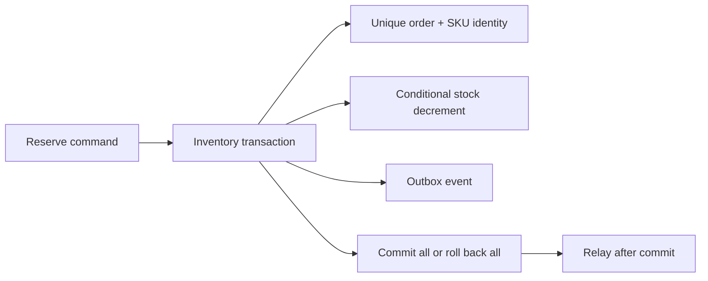

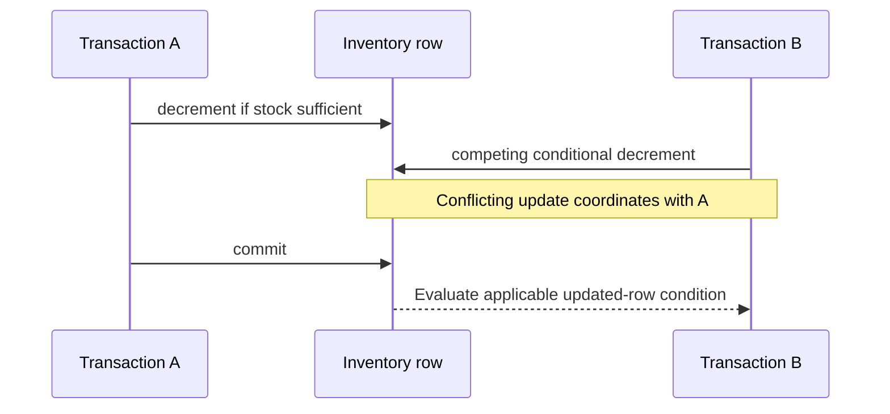

The second diagram is a conceptual Read Committed update scenario, not a universal description of every isolation level.

## 9. Java 21 implementation

Unexecuted SQL teaching example, complete for a fresh isolated practice schema. It reserves one SKU per command and demonstrates database semantics that a Java 21 application would call. It is not a full multi-line order, release workflow, migration, or outbox publisher. Run only in an empty disposable database after review.

```sql
CREATE TABLE stock_demo (
    sku text PRIMARY KEY,
    available integer NOT NULL CHECK (available >= 0)
);
CREATE TABLE reservation_demo (
    id bigint GENERATED ALWAYS AS IDENTITY PRIMARY KEY,
    order_id text NOT NULL,
    sku text NOT NULL REFERENCES stock_demo(sku),
    quantity integer NOT NULL CHECK (quantity > 0),
    UNIQUE (order_id, sku)
);
CREATE TABLE outbox_demo (
    id bigint GENERATED ALWAYS AS IDENTITY PRIMARY KEY,
    reservation_id bigint NOT NULL REFERENCES reservation_demo(id),
    event_type text NOT NULL,
    UNIQUE (reservation_id, event_type)
);
INSERT INTO stock_demo(sku, available) VALUES ('P-10', 3);

CREATE FUNCTION reserve_demo(p_order text, p_sku text, p_qty integer)
RETURNS bigint LANGUAGE plpgsql AS $$
DECLARE
    new_id bigint;
    prior reservation_demo%ROWTYPE;
BEGIN
    IF p_order IS NULL OR p_order = '' OR p_qty IS NULL OR p_qty <= 0 THEN
        RAISE EXCEPTION 'Invalid reservation command';
    END IF;
    INSERT INTO reservation_demo(order_id, sku, quantity)
    VALUES (p_order, p_sku, p_qty)
    ON CONFLICT (order_id, sku) DO NOTHING
    RETURNING id INTO new_id;

    IF new_id IS NULL THEN
        SELECT * INTO STRICT prior FROM reservation_demo
        WHERE order_id = p_order AND sku = p_sku;
        IF prior.quantity <> p_qty THEN
            RAISE EXCEPTION 'Identity reused with different quantity';
        END IF;
        RETURN prior.id;
    END IF;

    UPDATE stock_demo SET available = available - p_qty
    WHERE sku = p_sku AND available >= p_qty;
    IF NOT FOUND THEN
        RAISE EXCEPTION 'Insufficient stock';
    END IF;

    INSERT INTO outbox_demo(reservation_id, event_type)
    VALUES (new_id, 'InventoryReserved');
    RETURN new_id;
END;
$$;

BEGIN;
SELECT reserve_demo('O-1001', 'P-10', 2);
COMMIT;
BEGIN;
SELECT reserve_demo('O-1001', 'P-10', 2);
COMMIT;
SELECT available FROM stock_demo WHERE sku = 'P-10';
SELECT count(*) FROM reservation_demo;
SELECT count(*) FROM outbox_demo;
```

Expected results are one remaining unit, one reservation, and one outbox row; sequence-generated IDs may have gaps. The function raises an exception on insufficient stock, which aborts the statement/transaction unless a caller intentionally manages an enclosing savepoint. Do not catch the database error and assume an active transaction remains usable. A production command also needs tenant scoping, release state, event payload, timestamps, and explicit retry/error mapping.

## 10. Spring Boot integration
Place the local transaction at an application-service boundary so all repositories participating in one use case share its scope. Spring Data documents service/facade transaction configuration rather than requiring every repository call to be an independent business transaction. [D15] Use named transaction managers when more than one resource exists, and keep ownership unambiguous.

Map persistence results into domain outcomes. A unique-key conflict for the same reservation may mean replay, while changed payload means conflicting reuse. Optimistic-lock failure may justify bounded transaction retry; foreign-key failure may indicate invalid input or a programming error. Do not classify every persistence exception as transient.

## 11. Production scenario
Two Order commands request the final unit from different Inventory replicas. Both replicas see a cached availability of one. The database conditional update accepts one and rejects the other; Redis was only advisory. If the winner crashes after commit, a replay finds the same reservation identity and avoids a second decrement.

If the relay publishes the reservation event and crashes before marking it sent, the event may be published again. The outbox prevents a missing local obligation, not every duplicate. The receiving service combines inbox identity and business constraints in its own transaction. Each local database guarantees only its participating work.

## 12. HLD considerations
Replicas can offload suitable reads but may lag behind the primary. PostgreSQL's standby documentation distinguishes asynchronous and synchronous replication trade-offs. [D10] A customer immediately reading a newly created order needs an intentional read-your-write policy, such as routing the relevant read to the owner primary or using a freshness protocol. A read replica is not safe for authoritative stock decisions merely because it usually catches up quickly.

Table partitioning splits a logical table into partitions and can enable pruning and lifecycle management. [D11] Sharding distributes ownership across independent database groups and adds routing, cross-shard queries, rebalancing, and transaction complexity. Do not introduce sharding before measuring a bottleneck. Partitioning an order-history table by time is not automatically horizontal database sharding.

## 13. LLD considerations
Design repository methods around intent: `reserve(orderId, sku, quantity)` is clearer than exposing arbitrary entity mutation. Make an aggregate's transaction boundary explicit. Keep database-generated identifiers separate from business operation identity and never require gap-free sequences for correctness.

Use expand-and-contract migrations: add compatible structures, deploy readers/writers that support transition, backfill in bounded batches, validate, then remove old structures after all consumers are ready. Index builds can block or carry special concurrent-build restrictions; inspect the exact statement and version documentation before deployment. [D12] A rollback plan must include data compatibility, not only reverting application binaries.

## 14. Reliability and failure recovery
Backups and replicas solve different problems. A replica can promptly reproduce an accidental deletion. PostgreSQL provides logical dumps, file-level approaches, and continuous archiving strategies; base backup plus retained WAL enables point-in-time recovery within the available chain. [D8, D9] A successful backup job is not evidence that restore meets the required recovery time.

Define recovery point objective as acceptable data loss and recovery time objective as acceptable restoration delay. Rehearse restoring to an isolated environment, verify business counts and invariants, and document how external effects are reconciled after restoring an older database state. Restoring Order alone can cause its knowledge to disagree with Payment's durable authorizations.

## 15. Performance and capacity
Measure connection-pool wait, transaction duration, locks, query latency, rows examined/returned, I/O, and replication lag. A pool with more connections can increase contention on the same hot SKU. Batch only when it preserves bounded memory and acceptable transaction duration. Paginate administrative exports rather than keeping millions of managed entities in one persistence context.

For an illustrative throughput bound, 30 connections held 100 ms each imply an idealized 300 transactions per second before database limitations. If remote calls extend hold time to one second, the same pool offers only about 30 concurrent completions per second under that model. The remedy may be shorter transaction scope rather than a larger pool. These are estimates, not observed performance.

## 16. Interview questions with explained answers

1. **Does a transaction prevent overselling automatically?** No. The isolation level and statements must enforce the invariant. A conditional update, suitable locks, or a verified serializable design can protect it. An unlocked read followed by a write may still lose a concurrent decision.

2. **What does MVCC provide?** Snapshot-based visibility lets many reads avoid ordinary writer blocking. It does not eliminate writer conflicts, locks, or maintenance. Explain which snapshot a statement uses before claiming a stable view.

3. **Optimistic or pessimistic locking?** Optimistic version checks suit conflicts that are uncommon and retryable. Pessimistic locks can serialize conflicting access but create waits and deadlock considerations. Choose based on contention and invariant scope, then measure.

4. **Flush versus commit?** Flush synchronizes pending persistence changes with database operations; commit completes the transaction. Errors can surface at flush or commit. A successful save call is not necessarily durable completion.

5. **Why does N+1 happen?** A parent query is followed by per-parent association loads. The Java loop conceals repeated database round trips. Design a fetch plan or projection and verify actual SQL instead of making every relationship eager.

6. **Why might an index be ignored?** The query may return much of a small table, statistics may influence estimates, or predicate/order shape may not suit the index. Compare estimates with actual work. Index usage alone is not a performance objective.

7. **Why retry an entire serializable transaction?** Earlier reads and decisions belong to the failed attempt. Repeating only a final write can retain invalid assumptions. Keep the transaction's external effects out of the retry loop unless they are independently idempotent.

8. **Is a replica a backup?** It supports availability/read scaling but can replicate mistakes. Historical recovery requires retained backup material and a tested restore procedure. Verify business reconciliation as well as database startup.

9. **Partitioning versus sharding?** Partitioning organizes a logical table within the database design; sharding distributes ownership across database groups. Sharding introduces routing and cross-shard semantics. Neither is a free fix for an unindexed query.

10. **How does outbox help?** It atomically records local state and a publication obligation. A relay may publish duplicates, so downstream enforcement remains necessary. State the boundary rather than claiming one transaction spans every service.

## 17. Exercises
Run the SQL only in a disposable PostgreSQL practice database. Expected observations: the repeated command returns the same reservation ID and leaves one unit; a different quantity for the same identity raises an error. Solution: unique business identity is checked before decrementing stock, and changed payload is rejected.

Use two sessions to reserve the last unit for two different orders. The correct final state has one success, no negative stock, and no reservation/outbox row from an aborted insufficient-stock attempt. Observe blocking and transaction status instead of relying on sleep-based timing. Record the actual isolation level.

Plan an order-history query by customer and descending time. Propose a composite index, inspect EXPLAIN first, then use EXPLAIN ANALYZE on safe representative reads. Expected solution: justify key ordering, compare row estimates, and include a stable pagination tie-breaker. No specific plan shape is promised for tiny practice data.

## 18. Verification
Official sources were opened; the SQL function, concurrent-session lab, JPA mappings, migrations, and restore procedures were not executed. No measured plans or performance numbers are claimed. A later implementation must validate idempotency under concurrency, transaction rollback, SQL compatibility, migration locks, and restore/reconciliation on the selected environment.

## 19. Common misconceptions
JPA does not remove SQL. A repository save is not necessarily a commit. MVCC does not eliminate locking. A cache read is not an inventory reservation. More connections do not guarantee more throughput. An index has write cost. A replica is not historical backup. A restore that starts successfully is not yet a verified business recovery.

## 20. Knowledge assessment
Unanswered: Inventory commits a reservation, its response is lost, a replica serves stale availability, and the relay republishes the event after restart. Explain the constraints, query routing, retries, and receiving transaction needed to preserve stock and workflow correctness.

## 21. Revision summary
Enforce invariants where concurrent writers meet. Understand snapshots, locks, and transaction scope; inspect actual SQL and plans; preserve business identity through retries. Treat migration, maintenance, backup, and reconciliation as parts of the database design.

## 22. Next lesson
Chapters 7–15 develop the broker and consistency path behind the outbox. Later MongoDB and Redis chapters add specialized read models and caching while PostgreSQL remains authoritative for Inventory.


---

<a id="chapter-07"></a>

# Chapter 7 — Kafka Architecture, Storage, and Replication

Prepared 2026-10-24. Reading and laboratory material; no broker deployment or example execution is claimed.

## 1. Lesson title
Understand the retained partition log, the metadata control plane, and the physical machinery that makes an accepted order event recoverable.

## 2. Interview priority
P0. Explain an actual record journey before reciting broker configuration names. Senior interviews frequently expose confusion between controller quorum, replica quorum, committed data, and committed consumer offsets.

## 3. Prerequisites
Chapters 1–6: partial failure, Java objects versus bytes, TCP connections, local database transactions, and filesystem fundamentals. You need the idea of an ordered sequence, but no separate algorithms track. A directory is a namespace for files; an operating-system page cache is memory used to retain recently accessed file contents.

## 4. Learning objectives
Draw a topic with partitions and replicas; distinguish record identity from business identity; explain retention and compaction; trace append, replication, and visibility; separate KRaft metadata from user data; identify deployment failure domains; and estimate storage without claiming a benchmark.

## 5. Official references and version notes
Opened 2026-10-24: [Kafka 4.2 design](https://kafka.apache.org/42/design/design/), [record-batch format](https://kafka.apache.org/42/implementation/message-format/), [topic configuration](https://kafka.apache.org/42/configuration/topic-configs/), [KRaft operations](https://kafka.apache.org/42/operations/kraft/), [eligible leader replicas](https://kafka.apache.org/42/operations/eligible-leader-replicas/), [listener configuration](https://kafka.apache.org/42/security/listener-configuration/), [quick start](https://kafka.apache.org/42/getting-started/quickstart/), and [Apache OffsetIndex source, tag 4.2.0](https://github.com/apache/kafka/blob/4.2.0/storage/src/main/java/org/apache/kafka/storage/internals/log/OffsetIndex.java).

The approved teaching baseline remains Java 21, Boot 4.1.1, broker 4.2.2, client 4.2.1, Spring Kafka 4.1.1, and JUnit 6. Apache's 4.2 web line now points readers to 4.3; its Javadocs display 4.2.0. The older [log implementation page](https://kafka.apache.org/42/implementation/log/) contains historical byte-offset language: modern consumer offsets are logical positions, not byte addresses. Defaults are deliberately avoided unless discussed explicitly. Books are recommendations, not evidence of completed reading.

## 6. Fundamental explanation

Order Service creates a fact such as OrderAccepted. Kafka stores its serialized key, value, timestamp, and headers as a record. A topic names a stream; its partitions are separate ordered logs. The physical record coordinate is the topic identity, partition number, and offset. Our eventId remains necessary because replay, mirroring, and republishing can change physical coordinates while retaining the same business occurrence.

Suppose `commerce.order-events.v1` has three partitions. Records at offsets 40 and 41 in partition 0 have a defined log order. Offset 40 in partition 1 is unrelated. A consumer group maintains progress separately for each partition. Reporting and fulfillment can therefore process the same topic at different speeds without one subscriber deleting the other's input.

Keys are routing input, not uniqueness constraints. We choose orderId for order workflow events because related transitions should normally share a partition. Kafka does not reject two OrderAccepted records with the same key. The Inventory database still enforces reservation uniqueness. Increasing partition count can change the mapping of a key to a partition, so the architecture must plan ordering across partition changes.

Retention answers how long data remains available. A delete policy removes eligible log segments based on configured limits; it is not tied to acknowledgment by every consumer. Compaction instead removes superseded values for keys over time. It is useful for rebuilding current state, but does not promise one immediately visible record per key. A null value can represent a tombstone in a compacted topic. Choose a deletion horizon long enough for relevant readers and rebuilds. [Topic configuration](https://kafka.apache.org/42/configuration/topic-configs/)

Our order facts and a current-order projection have different purposes. Facts support audit and historical reconstruction. A compacted projection supports obtaining the latest known state. If every transition is required for legal or analytical reasons, replacing a historical stream with a compacted topic loses information the application may need. This is a data-product decision, not just a disk-space setting.

## 7. Internal architecture and mechanism

### The append path
A producer first obtains metadata and connects to the partition leader. The broker appends record batches to the partition's active segment. Followers fetch data from the leader. A replica is another copy of the partition on another broker; it is not a separate consumer group. The leader's log end, the replicated visibility boundary, and a consumer's committed restart offset describe different progress.

The high watermark marks a replication commitment boundary; offsets below it are committed under the applicable replication rules. Transactions add another visibility boundary, the last stable offset, explored in Chapter 10. A successful append to a leader does not prove downstream processing. A consumer offset commit does not alter the leader's replication state.

The ISR is the set of replicas currently considered in sync. Replication factor is the intended number of copies; ISR size can shrink when a replica cannot keep up. With acknowledgments set to all and a suitable minimum ISR, the application chooses to reject writes when its durability condition cannot be met. That creates an intentional availability trade-off rather than silently weakening the contract. [Kafka design](https://kafka.apache.org/42/design/design/)

In Kafka 4.2, eligible leader replicas matter. The official operations page says ELR is enabled by default on newly created clusters from 4.1 and describes strict minimum-ISR high-watermark behavior. A safe eligible leader can exist outside the current ISR. Therefore, the old slogan “only an ISR member can ever be safely elected” is incomplete. Inspect feature state for upgraded clusters; do not infer it solely from the installed binary version. [ELR](https://kafka.apache.org/42/operations/eligible-leader-replicas/)

### Segments, indexes, and cache
A partition is split into segment files so Kafka can roll, clean, retain, and recover bounded pieces. The active segment receives appends. A segment's base offset identifies its logical starting range. The offset index maps selected relative offsets to byte positions; it is sparse, so finding a record commonly involves an index lookup followed by scanning the nearby batch. A timestamp index helps time-based lookup. Neither is a relational index allowing arbitrary SQL predicates. [OffsetIndex source](https://github.com/apache/kafka/blob/4.2.0/storage/src/main/java/org/apache/kafka/storage/internals/log/OffsetIndex.java)

Record batches carry metadata such as base offset, timestamps, producer identity and sequence information, and compression attributes. Batching reduces repeated per-record overhead. Kafka relies heavily on the operating-system page cache: a read may come from memory even though the durable structure is a file. Sequential I/O and cache reuse explain why a broker can serve substantial throughput without retaining each event as a Java heap object. Replication acknowledgment and forcing every record to physical media are different concepts. [Batch format](https://kafka.apache.org/42/implementation/message-format/)

For our sizing exercise, imagine 2,000 records/sec, average stored size 700 bytes, three replicas, and seven days. The arithmetic is about 2.54 TB before indexes, segment slack, overhead, growth, and safety capacity. These are illustrative inputs. Compression ratio must be measured using representative records. Free disk is recovery capacity as well as an operating margin: replica rebuilds and reassignment need somewhere to write.

### KRaft is a different log
KRaft controllers replicate cluster metadata: broker registrations, partition assignments, leadership, and configuration-related state. Their quorum does not contain the commerce payload stream. Brokers host the user-data replicas. A combined process can play both roles in a local lab, but role co-location does not merge the two protocols.

Current KRaft documentation distinguishes static voter configurations from dynamic quorums. Dynamic membership depends on the KRaft feature level and uses bootstrap controller addresses rather than treating a static voter list as the only setup. Formatting initializes identity and metadata state; it is not a repair command to run against an existing data directory. [KRaft](https://kafka.apache.org/42/operations/kraft/)

## 8. Diagrams

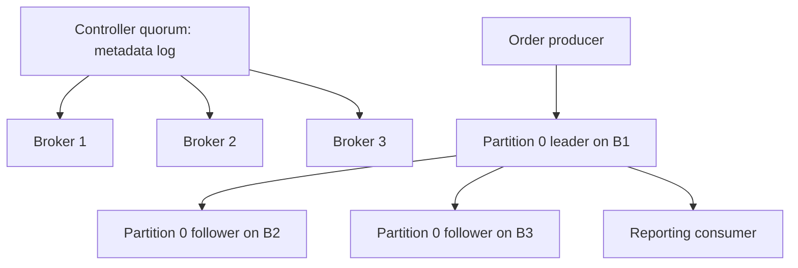

The arrows from the quorum represent metadata coordination, not copying order payloads through controllers. A three-controller majority and a three-replica data partition are separate reliability arrangements.

```text
Partition 0 directory
  00000000000000000000.log       retained segment batches
  00000000000000000000.index     sparse offset-to-position entries
  00000000000000000000.timeindex timestamp lookup entries
  00000000000000000500.log       a later segment, possibly active
```

These filenames illustrate structure; they are not captured output from this machine.

## 9. Java 21 implementation

This complete Java class inspects a pre-existing topic through the client Admin API. It needs `org.apache.kafka:kafka-clients:4.2.1` on the Maven classpath. It creates no topics, changes no broker settings, and assumes a reachable unsecured local lab endpoint. Add the approved security properties before using a secured environment.

```java
import java.time.Duration;
import java.util.List;
import java.util.Properties;
import java.util.concurrent.TimeUnit;
import org.apache.kafka.clients.admin.Admin;
import org.apache.kafka.clients.admin.TopicDescription;

public final class InspectOrderTopic {
    public static void main(String[] args) throws Exception {
        String bootstrap = args.length > 0 ? args[0] : "localhost:9092";
        String topic = "commerce.order-events.v1";
        Properties properties = new Properties();
        properties.put("bootstrap.servers", bootstrap);
        properties.put("client.id", "course-topic-inspector");
        properties.put("default.api.timeout.ms", "10000");
        Admin admin = Admin.create(properties);
        try {
            TopicDescription description = admin.describeTopics(List.of(topic))
                    .allTopicNames().get(12, TimeUnit.SECONDS).get(topic);
            for (var partition : description.partitions()) {
                System.out.printf("partition=%d leader=%s replicas=%s isr=%s%n",
                        partition.partition(), partition.leader(),
                        partition.replicas(), partition.isr());
            }
        } finally {
            admin.close(Duration.ofSeconds(5));
        }
    }
}
```

The outer future timeout bounds the caller's wait; the client timeout bounds its operation policy. Printed metadata is a point-in-time observation and may already have changed. This class cannot establish rack diversity, storage integrity, or business correctness. Compile and exercise it in the later Maven lab; no execution is claimed here.

## 10. Spring Boot integration
Boot's `spring.kafka.bootstrap-servers` supplies initial contact points. Brokers advertise the addresses clients subsequently use, so a container-only hostname returned to a Windows host can break communication after bootstrap succeeds. Give each client network a reachable advertised listener; opening one bootstrap port alone is insufficient. [Listeners](https://kafka.apache.org/42/security/listener-configuration/)

Our service topic names and keys belong to an explicit contract. Development may provision topics through an administrative bean, but production provisioning should be controlled and reviewed. Application startup should not quietly change partition counts in a way that alters key routing. Keep controller credentials outside ordinary application configuration.

## 11. Production scenario
The Inventory listener stops for six hours while Order continues. Broker health remains green, but reservation processing is delayed. On restart, retained data allows catch-up if the needed records remain. If retention expired, restarting the process cannot recover deleted input. The operational answer becomes reconstruction from authoritative service state or another retained source, followed by reconciliation.

Before increasing retention, estimate disk growth and catch-up bandwidth. Before lowering it, identify the slowest permitted consumer and the longest recovery window. A topic owner should publish a replay contract: retained horizon, schema availability, permission to replay side effects, and escalation path when the horizon is exceeded.

## 12. HLD considerations
Choose partitions from required parallelism, key distribution, growth, and recovery costs. More partitions create more scheduling and metadata work and can spread a producer's batches thinly. Separate topics when ownership, retention, authorization, or contract meaning differs, rather than creating one topic for every class in the codebase.

Place replicas across meaningful failure domains. Three replicas on three processes sharing one disk or availability zone do not survive loss of that shared dependency. Controller placement also deserves failure-domain analysis. The goal is a stated failure tolerance, not an impressive node count.

## 13. LLD considerations
Define `TopicName`, event envelope, serializer, and key policy centrally within a service's infrastructure boundary. Keep domain logic independent of partition numbers. Store eventId and aggregateVersion in the payload; do not infer order lifecycle version from a Kafka offset because unrelated orders share a partition and replay may change physical location.

The topic inspector illustrates a useful separation: an infrastructure diagnostic can know broker metadata while `ReserveInventoryHandler` knows only the command and local transaction. This makes tests smaller and prevents transport details from becoming business identities.

## 14. Reliability and failure handling
Distinguish a leader failure, follower lag, controller-quorum loss, full disk, bad listener advertisement, and a consumer behind retention. They produce different symptoms and require different recovery. Blind restarts can discard diagnostic evidence and add replica catch-up pressure.

For every incident, record the affected topic partitions, leader and ISR changes, client error class, relevant feature state, and oldest outstanding business operation. Do not use unclean leader election as an unexplained availability fix: choosing a replica without the committed history can lose acknowledged records. Preserve the original evidence and reconcile business effects after any recovery that risks loss.

## 15. Performance and trade-offs
Estimate storage from ingress bytes, retention, replication, and measured compression. Estimate recovery separately: a replica copying 500 GB has a lower bound determined by usable transfer bandwidth, then competes with normal traffic. Page-cache pressure from large historical replays can increase foreground latency. Quotas and controlled replay protect service traffic while preserving recoverability.

Tuning starts with a bottleneck hypothesis. High CPU suggests different actions from saturated disks or a single hot partition. Increasing JVM heap can reduce memory available to the page cache; it is not automatically a broker throughput improvement.

## 16. Interview questions with model answers

### Q1. Is an offset a byte position? [P0]
No. It is a logical partition position. The offset index maps selected logical offsets to file positions. If you treat offset differences as exact bytes or exact business-event counts, compaction and control records make your estimate misleading. Follow-up: explain how a timestamp lookup finds a starting point.

### Q2. Does consumption remove data? [P0]
Ordinary consumer progress is separate from retention. A second group can read the same retained log. The senior concern is whether the slow group can finish before expiration; acknowledgment by the fast group provides no protection.

### Q3. Why split a partition into segments? [P0]
Segments bound file management, cleanup, and recovery work. Our operational implication is that retention is not a precise per-record deletion timer. Follow-up: explain why a small topic might retain records beyond its nominal age threshold.

### Q4. How does KRaft differ from replication? [P0]
The controller quorum agrees on metadata, while partition replicas hold records. Losing controller availability and losing an order partition leader are distinct incidents. More controllers do not create more copies of order events.

### Q5. Is ISR the replication factor? [P0]
Replication factor is intended placement; ISR is current synchronization membership. A partition configured with three copies can have fewer synchronized replicas. Monitoring only configured replication factor misses degraded durability.

### Q6. What does high watermark mean? [P0]
It bounds replication-committed records, with transactional isolation potentially limiting visibility further. It does not mean a customer was charged or a consumer committed its offset. Name the boundary before using the word committed.

### Q7. Can compaction replace an audit log? [P0]
Usually not when intermediate transitions matter. Compaction supports latest-value reconstruction, while an audit trail needs retained occurrences. Our order history and reporting snapshot therefore have different topic policies.

### Q8. Why might bootstrap succeed but publication fail? [P0]
Metadata can advertise a broker address unreachable from the client's network. Inspect advertised listeners and DNS from the client environment. Repeatedly enlarging request timeouts does not fix an unreachable hostname.

### Q9. Are all non-ISR leader elections unsafe in 4.2? [P1]
No. Eligible leader replicas extend the safe selection model when the feature is enabled. An interview answer should distinguish ELR from arbitrary unclean election and inspect feature state in an upgraded cluster.

### Q10. Why is replica count insufficient for resilience? [P0]
Copies can share a failure domain. Three brokers on one storage device can fail together. Evaluate independent placement, spare capacity, and restoration procedures, then demonstrate the claimed tolerance with a controlled lab.

## 17. Practical exercise, expected observations, and solution
In a disposable cluster with three brokers, inspect an existing three-partition, replication-factor-three topic. Record leader, replicas, and ISR before stopping one broker through the lab's deployment mechanism. Keep the controller quorum healthy. Publish with the Chapter 8 producer, then restore the broker and observe catch-up. Do not run this against shared infrastructure.

Expected observations: some leaders may change; replicas remain assigned while ISR can shrink; successful writes depend on configured durability conditions. A stopped follower is not automatically removed from the replica assignment. After recovery it must catch up before returning to full synchronization.

Solution: draw each partition independently and annotate the leader transition. Explain why a three-controller quorum tells you nothing about whether partition 2 currently has sufficient synchronized data copies. If publication fails, retain the error and compare actual ISR with the minimum ISR instead of reducing durability immediately. Repeat the paper reasoning for two lost brokers; predict unavailable writes under minimum ISR two.

## 18. Verification
Run the inspector before and after the lab, save metadata snapshots, and compare timestamps with producer outcomes. Verify that every expected eventId exists in a downstream read and that business reconciliation detects duplicates independently of the broker inspection. Record broker/client versions and feature levels. No commands or failure tests were executed while writing this chapter.

## 19. Common misconceptions
Kafka offsets are not globally unique business IDs. Controller quorum is not payload replication. Compaction is asynchronous cleanup, not a uniqueness constraint. A healthy broker process is not proof of sufficient ISR, adequate retention, or completed customer workflows. Reformatting a data directory is not routine restart recovery.

## 20. Knowledge assessment
An upgraded 4.2 cluster has three brokers, three dedicated controllers, and a topic with replication factor three. One zone fails; writes stop for some partitions while controllers remain healthy. Describe the evidence you would collect, including feature state, before deciding whether the system behaved correctly. No score is recorded until your answer is reviewed.

## 21. Revision summary
Reason about four independent things: where a record is routed, how its bytes are stored, which replicas make it safe, and how far each reader has progressed. Use metadata and business evidence together. Preserve a replay horizon that matches the recovery promise.

## 22. Next lesson
Chapter 8 follows the producer from serialization through metadata, batching, acknowledgments, retries, and fencing. Keep the storage and visibility boundaries from this chapter visible while evaluating producer guarantees.


---

<a id="chapter-08"></a>

# Chapter 8 — Kafka producers: from a method call to a durable record

## 1. Lesson title
How Java sends an order event, what acknowledgment proves, and how to reason about a failed send.

## 2. Interview priority
P0. Producer correctness affects every downstream consumer. Learn the complete path before tuning configuration.

## 3. Prerequisites
Chapter 7: topic, partition, leader, follower, offset, in-sync replicas (ISR). A future is a handle to a result that may arrive later. Serialization converts an in-memory value into bytes.

## 4. Learning objectives
Trace a send, distinguish enqueueing from acknowledgment, select a key, calculate batching costs, interpret timeouts, and explain the boundary between transport deduplication and business idempotency.

## 5. Official references and version notes
Use Apache Kafka 4.2 documentation for this course, although the website now offers 4.3. The proposed project uses client 4.2.1 and broker 4.2.2; downloaded dependencies have not been verified. The 4.2 Javadoc banner says 4.2.0.

- [Producer configuration](https://kafka.apache.org/42/configuration/producer-configs/): explicit settings and their constraints.
- [KafkaProducer API](https://kafka.apache.org/42/javadoc/org/apache/kafka/clients/producer/KafkaProducer.html): send, callbacks, lifecycle, and transactions.
- [Transaction protocol](https://kafka.apache.org/42/operations/transaction-protocol/): release-sensitive protocol behavior.

Verified configuration facts: 4.2 defaults include linger.ms=5, acks=all, and idempotence enabled when no conflicting settings disable it. Explicit idempotence requires acks=all, retries greater than zero, and max.in.flight.requests.per.connection at most five. These facts come from the configuration page; the walkthrough and engineering decisions below are original project examples.

## 6. First principles
Imagine an Order service holding a freshly created event in memory. Inventory cannot read this memory: it is a different process. The producer must encode the event, locate a broker, send bytes, and receive evidence of acceptance. Each transition can fail independently.

A producer acknowledgment is evidence about Kafka storage under its configured replication rules. It does not prove Inventory reserved stock or Payment charged a customer. Consequently the API response must describe the state actually achieved: “order accepted” and “order fulfilled” are different promises.

A key selects an ordering domain. For order lifecycle events, orderId is a useful choice because all updates for one order usually need a coherent sequence. For inventory commands, sku or a reservation identity may be appropriate, depending on the owner and invariant. One universal key for every topic is not an architectural principle.

A null key is reasonable for independent telemetry where distribution matters more than entity order. Choosing the same constant key for all orders creates one hot partition even when many partitions exist.

## 7. Internal architecture
Work through one send:

1. The producer discovers topic partitions and leaders using cluster metadata. Bootstrap addresses are entry points, not the only brokers it will contact.
2. Serializers turn the key and value into byte arrays. An invalid object may fail here before any broker sees it.
3. An explicit partition, key-based choice, or keyless partitioning strategy determines the destination.
4. The record enters a per-partition accumulator. This is client memory, not durable storage.
5. A background sender groups ready batches into requests to the relevant leaders.
6. Brokers validate and append accepted batches; replication and acknowledgment rules determine when success can return.
7. The future completes or a callback receives the outcome. A retriable failure can cause the client to resend within its delivery budget.

The public send is asynchronous with respect to broker completion, but serialization, unavailable metadata, or exhausted buffer capacity can delay the calling thread. “Async” does not mean “cannot block.”

Batching amortizes per-request overhead. Suppose an envelope costs 200 bytes and each record costs 300 bytes. Twenty separate requests carry 10,000 bytes in this simplified model; one batch carries 6,200. This arithmetic excludes compression, TCP, encryption, and protocol details, but shows the source of the benefit.

Compression works on batches. Similar field names and repeated values compress well. It costs CPU and may increase latency if CPU is already saturated. Test with representative messages, not an easily compressed string repeated a million times.

Three clocks answer different questions. max.block.ms bounds particular client-side waits. request.timeout.ms concerns a request response. delivery.timeout.ms covers the permitted overall delivery period after send returns. None cancels a database transaction or retracts a broker append that already happened. Configure the last consistently with request timeout and batching delay.

## 8. Diagrams
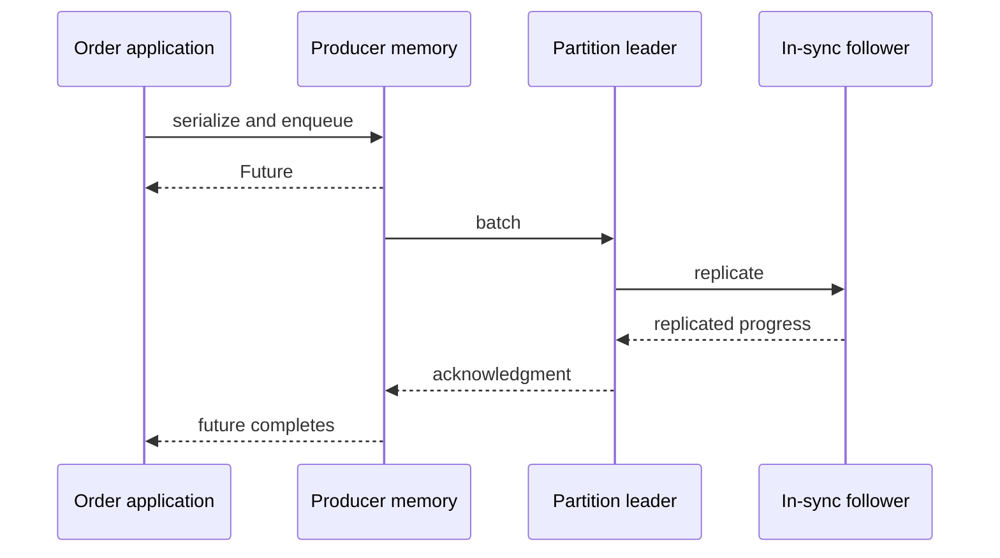
The first return and the last completion are different moments. A crash between them may lose an unsent event. An outbox later gives the event durable application ownership.

## 9. Java 21 implementation
This is a complete isolated console producer. Put it in OrderProducerDemo.java in a Maven module containing org.apache.kafka:kafka-clients managed by the course BOM. It assumes a pre-created order-events topic and a reachable local broker. It is not the outbox implementation.

```java
import java.time.Duration;
import java.util.Properties;
import java.util.UUID;
import org.apache.kafka.clients.producer.KafkaProducer;
import org.apache.kafka.clients.producer.ProducerRecord;
import org.apache.kafka.clients.producer.RecordMetadata;
import org.apache.kafka.common.serialization.StringSerializer;

public final class OrderProducerDemo {
    public static void main(String[] args) throws Exception {
        Properties p = new Properties();
        p.put("bootstrap.servers", "localhost:9092");
        p.put("key.serializer", StringSerializer.class.getName());
        p.put("value.serializer", StringSerializer.class.getName());
        p.put("client.id", "order-producer-demo");
        p.put("acks", "all");
        p.put("enable.idempotence", "true");
        p.put("linger.ms", "5");
        p.put("delivery.timeout.ms", "120000");
        p.put("request.timeout.ms", "30000");
        String orderId = "order-100";
        String eventId = UUID.randomUUID().toString();
        String json = """
            {"eventId":"%s","orderId":"%s","type":"OrderAccepted","version":1}
            """.formatted(eventId, orderId);
        try (KafkaProducer<String, String> producer = new KafkaProducer<>(p)) {
            RecordMetadata result = producer.send(
                new ProducerRecord<>("order-events", orderId, json)).get();
            System.out.printf("topic=%s partition=%d offset=%d%n",
                result.topic(), result.partition(), result.offset());
            producer.close(Duration.ofSeconds(10));
        }
    }
}
```

Properties explicitly express the lesson's requirements. They are not a universal production tuning profile. The UUID identifies an event; retries of the same business event must preserve that identity. Re-running this program intentionally creates a new eventId, so Kafka is entitled to store another record.

get() is used to make the teaching outcome visible. Calling it after every send in a high-throughput loop serializes the pipeline and wastes batching opportunities. In a service, observe completion through callbacks or completion stages and preserve durable recovery state. Do not do slow database work on the producer callback thread.

## 10. Spring Boot integration
KafkaTemplate wraps a producer and returns an asynchronous completion. Spring owns factory and producer lifecycle; do not construct a producer for every HTTP request. Configure serializers consistently with the actual value type. Sending a String through a JSON serializer can create an encoded JSON string instead of the object consumers expect.

Keep an EventPublisher port separate from order business logic. The production path will save order state and an outbox row in one PostgreSQL transaction. A relay publishes the row and records acknowledgment. Chapter 11 covers the Spring APIs; Chapter 12 closes the database-to-Kafka failure gap.

## 11. Production scenario
An acknowledgment is lost after the leader accepts a batch. The application sees delay while Kafka already has the event. A client retry can use producer identity and sequence information to avoid a duplicate append within that mechanism. If the application catches the failure, creates a second event, and sends it as a new operation, the broker cannot know that the two records represent one customer intention.

For payment safety, preserve a stable business operation ID from order orchestration through provider request and reconciliation. A transport setting cannot infer business equivalence.

## 12. HLD considerations
Choose ownership, durable acceptance point, topic contracts, partition keys, and recovery policy before buffer sizes. Budget retention for outage recovery. Plan what the API reports while publication is pending. A durable order accepted locally can have status PENDING_PUBLICATION rather than pretending Kafka publication already succeeded.

Estimate separate paths for normal delivery and replay. An outage backlog can overload consumers even when the normal rate is modest.

## 13. LLD considerations
An event envelope needs eventId, aggregateId, eventType, schemaVersion, occurredAt, and correlation information. Avoid using mutable Java entities as event contracts. Validate size and required fields before publishing. Isolate serialization, dispatch, and result handling so each failure has an identifiable owner.

Fencing applies to transactional producer ownership: an obsolete producer must not continue acting as the current transactional instance. Give concurrent logical instances distinct transactional identities while preserving intentional identity continuity across recovery. Random IDs for every retry defeat this reasoning.

## 14. Reliability
Classify failures: malformed data needs correction; authentication requires credential or policy repair; temporary leader changes may be retried; delivery timeout needs an explicit uncertain-outcome policy. Infinite application retries can consume memory or permanently block one bad record.

acks=0 provides no broker response evidence. acks=1 can acknowledge before follower replication. acks=all coordinates with the ISR and minimum ISR requirement; it does not mean every configured replica is always present. With replication factor three and minimum ISR two, availability and loss tolerance depend on actual replica state and leader-election policy. A one-broker development cluster cannot demonstrate these guarantees.

## 15. Performance
Suppose peak input is 10,000 events/s at 1 KB each: roughly 10 MB/s of logical payload before replication and protocol overhead. A 30-second outage creates about 300 MB of new payload. Increasing producer memory to hold the entire outage is usually weaker than durable buffering with a controlled relay.

Measure record queue time, request latency, batch size, compression ratio, buffer exhaustion, retry rate, and CPU together. A higher linger can reduce resource contention under load but adds waiting to sparse traffic. Changing one parameter at a time preserves causal evidence.

## 16. Ten study questions with model answers
1. **Does send returning mean success?** No: it can mean the client accepted pending work. Observe its completion. In an order API, confusing those moments reports durability that has not been established.
2. **Why share a producer?** It owns expensive connections, buffers, and a sender; sharing improves utilization. It is designed for concurrent use, unlike KafkaConsumer. Share lifecycle deliberately rather than closing it from arbitrary requests.
3. **What does acks=all buy?** Stronger replication acknowledgment than leader-only acceptance under the ISR rules. It does not acknowledge consumer business actions, and its practical durability depends on replica configuration and health.
4. **Does idempotence stop duplicate orders?** It addresses the producer retry mechanism. A repeated HTTP request or regenerated event can be a new transport operation. Enforce business keys and unique constraints at the service owning the effect.
5. **Why can an asynchronous producer stall?** It still needs metadata, buffer capacity, and serialization. Investigate backpressure and callback work before increasing timeouts.
6. **Why can increasing partitions change behavior?** Key-to-partition mapping may change when the partition count changes. Historical and new records can sit in different partitions, so sequence continuity needs a migration plan.
7. **Should every event use a random key?** Only when the required semantics permit it. Random keys distribute load but do not preserve per-order grouping; eventId and partition key serve different purposes.
8. **Why not retry every exception?** Some failures are deterministic or indicate invalid ownership. Repeating malformed data wastes resources; a fenced transactional producer must stop acting as owner.
9. **Why is flush per record expensive?** It forces pending sends toward completion and reduces useful overlap. Flush at a justified lifecycle or checkpoint boundary, not as a substitute for understanding acknowledgment.
10. **How do you defend a tuning choice?** State workload, latency target, baseline metrics, changed variable, measured benefit, and failure impact. A configuration copied without these conditions is an untested hypothesis.

## 17. Worked exercise
Order 100 produces event E1. The broker appends E1, but the network drops the response. Compare two recoveries: A lets the producer retry its existing send; B restarts the application and creates event E2 for the same order.

Expected observation: A can use the producer protocol's deduplication. B is a distinct record and may be stored. The solution is not “disable retries.” Preserve the event in an outbox and make Inventory's reserve operation unique by order/reservation identity. If publication repeats, the business effect remains one reservation.

For a later executable lab, send twenty records with one order key, inspect partition/offset metadata, restart the consumer group, and compare event IDs. Repeat with multiple keys. Do not infer ordering across partitions from a single run.

## 18. Verification and execution status
The code and laboratory are written but not executed here. First verify the broker, topic, advertised addresses, and Maven dependency tree. Run the demo, inspect the actual stored payload, and confirm consumer visibility. Then test an unavailable broker and record elapsed time and exception type. A successful send alone is not an end-to-end order test.

## 19. Common misconceptions
A producer buffer is not a durable queue. A timeout does not prove no append happened. Compression is not free. A large partition count does not remove hot keys. Exactly-once transport claims do not authorize exactly-once payment claims.

## 20. Unanswered assessment
The producer reports timeout, the customer retries, and Inventory reserves twice. Which identities and durable boundaries would you inspect first, and why?

## 21. Revision summary
Separate enqueue, append, acknowledgment, and business completion. Choose keys from invariants. Preserve event identity across retries. Tune with workload evidence. Use the outbox for durable application recovery.

## 22. Next lesson
Chapter 9 follows the stored event through consumer assignment, processing, offset commits, and rebalances.


---

<a id="chapter-09"></a>

# Chapter 9 — Kafka consumers, offsets, groups, and rebalances

## 1. Lesson title
How Inventory reads an event, makes durable progress, and recovers ownership after failure.

## 2. Interview priority
P0. Most duplicate-processing and missing-processing incidents involve misunderstood boundaries between polling, work, and committing progress.

## 3. Prerequisites
Chapters 7–8. Understand that a partition is an ordered log and that each record has a partition-local offset. A database commit and a Kafka offset commit are separate operations.

## 4. Learning objectives
Trace poll and commit, calculate a safe next offset, explain rebalances, distinguish group protocols, design bounded worker processing, and diagnose lag without assuming that adding consumers fixes it.

## 5. Official references and versions
- [KafkaConsumer API](https://kafka.apache.org/42/javadoc/org/apache/kafka/clients/consumer/KafkaConsumer.html): position, commits, threading, and rebalances.
- [Consumer configuration](https://kafka.apache.org/42/configuration/consumer-configs/): poll/fetch limits, reset policy, and protocol settings.
- [Consumer rebalance protocol](https://kafka.apache.org/42/operations/consumer-rebalance-protocol/): the newer group protocol and migration.

Verified 2026-10-24 against Kafka 4.2; API banner 4.2.0. The 4.2 configuration default for group.protocol is classic; choosing consumer opts into the newer protocol. Heartbeat/session control differs between those protocols. Do not transplant classic client heartbeat settings into the new protocol blindly. The code explicitly chooses classic to make the teaching baseline reproducible.

## 6. First principles
A consumer group is one logical subscriber implemented by one or more consumers. Inventory and Reporting should have different group IDs because both need their own progress. Two Inventory instances normally share a group to divide the work.

The broker does not delete a record because Inventory consumed it. Inventory stores a checkpoint; retention determines how long the underlying data remains. This distinction explains both replay and the possibility of falling behind retention.

Three positions matter. The log's end indicates log progress, the consumer's current position is the next offset to be delivered by poll, and the committed position is its recovery checkpoint. Internal fetch buffers can contain records that poll has not yet delivered. Business completion can trail poll-delivered progress. Keeping those concepts separate is more useful than saying “the consumer is at offset 50.”

A commit generally records where to resume, not the last record processed. If records through offset 41 are durably handled, the next offset is 42. There can be gaps in offsets, so do not treat offset differences as exact counts of user records in every situation.

## 7. Internal architecture
The application subscribes, the group coordinator manages membership and assignments, and the consumer fetches from partition leaders. Poll returns records to application code. The application processes them, then commits an appropriate checkpoint.

In a traditional consumer group, one assigned partition is consumed by one group member at a time. With six partitions and eight consumers, at least two consumers cannot actively own a partition for that topic. A member can own multiple partitions. Different groups read independently.

A rebalance changes ownership after membership, subscription, or partition topology changes. A former owner must stop treating revoked work as its responsibility. If it keeps an uncontrolled worker running, a new owner can process the same event concurrently. A local thread interruption does not reverse an external side effect already issued.

Classic protocols include eager and cooperative assignment behavior. Cooperative movement can reduce disruption, but does not eliminate all rebalances or application recovery work. The newer consumer protocol moves assignment management toward the broker and reconciles membership incrementally. Treat protocol migration as a tested change, including broker support and operational settings.

A heartbeat establishes membership liveness; it does not prove the application is making useful progress. The maximum poll interval protects against a consumer that remains connected but does not continue polling within the allowed processing window.

Fetch sizing controls network batches. max.poll.records limits what a poll hands to application code, not necessarily all bytes fetched into client memory. A slow downstream service can make a small batch take too long. Bound both records and processing time.

## 8. Diagrams
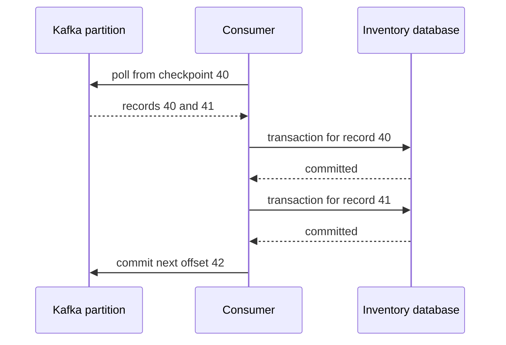
If the process dies after the second database commit but before the final Kafka commit, replay is expected. The database must recognize already completed work.

## 9. Java 21 implementation
This complete console reader uses kafka-clients from the course Maven dependency management. It demonstrates batch checkpointing; console output is not a durable business effect. It assumes a local broker and existing order-events topic.

```java
import java.time.Duration;
import java.util.List;
import java.util.Properties;
import java.util.concurrent.CountDownLatch;
import java.util.concurrent.TimeUnit;
import org.apache.kafka.clients.consumer.ConsumerRecord;
import org.apache.kafka.clients.consumer.ConsumerRecords;
import org.apache.kafka.clients.consumer.KafkaConsumer;
import org.apache.kafka.common.errors.WakeupException;
import org.apache.kafka.common.serialization.StringDeserializer;

public final class OrderConsumerDemo {
    public static void main(String[] args) {
        Properties p = new Properties();
        p.put("bootstrap.servers", "localhost:9092");
        p.put("group.id", "order-reader-demo");
        p.put("group.protocol", "classic");
        p.put("enable.auto.commit", "false");
        p.put("auto.offset.reset", "earliest");
        p.put("max.poll.records", "20");
        p.put("key.deserializer", StringDeserializer.class.getName());
        p.put("value.deserializer", StringDeserializer.class.getName());
        KafkaConsumer<String, String> consumer = new KafkaConsumer<>(p);
        CountDownLatch stopped = new CountDownLatch(1);
        Runtime.getRuntime().addShutdownHook(new Thread(() -> {
            consumer.wakeup();
            try {
                stopped.await(7, TimeUnit.SECONDS);
            } catch (InterruptedException interrupted) {
                Thread.currentThread().interrupt();
            }
        }));
        try {
            consumer.subscribe(List.of("order-events"));
            while (true) {
                ConsumerRecords<String, String> records =
                    consumer.poll(Duration.ofSeconds(1));
                for (ConsumerRecord<String, String> record : records) {
                    System.out.printf("%s:%d:%d key=%s value=%s%n",
                        record.topic(), record.partition(), record.offset(),
                        record.key(), record.value());
                }
                if (!records.isEmpty()) {
                    consumer.commitSync();
                }
            }
        } catch (WakeupException shutdown) {
            // This demo only calls wakeup from its shutdown hook.
        } finally {
            try {
                consumer.close(Duration.ofSeconds(5));
            } finally {
                stopped.countDown();
            }
        }
    }
}
```

The owning thread performs all normal consumer operations, including close. wakeup is the special cross-thread mechanism used for shutdown. The hook waits boundedly for cleanup rather than returning immediately; if its grace period expires, shutdown can still interrupt unfinished work, which must remain replay-safe. enable.auto.commit=false makes the checkpoint explicit. commitSync without a map is safe here only because all records returned by this poll were handled synchronously before the commit. Copying that call into asynchronous worker code can skip unfinished records.

earliest is a reset policy for missing or invalid committed offsets. It does not rewind an existing valid group checkpoint on every start. Use an isolated new group for a replay experiment rather than changing a production group casually.

## 10. Spring Boot integration
A Spring listener container owns polling and group membership. Concurrency creates multiple consumers; it does not remove partition constraints. Acknowledgment mode defines how container processing relates to checkpointing. Avoid mixing manual consumer commits with container-managed commits without a deliberate model.

A listener calling an @Transactional service normally returns after the database transaction completes. A listener that merely submits a background task returns much earlier. The container can interpret that return as success even though the business task has not finished. Use supported asynchronous handling deliberately, or keep the first design synchronous with bounded processing.

## 11. Production scenario
Inventory takes 200 ms per reservation under normal load, then a database lock makes some requests take 12 seconds. With a large poll batch, the consumer exceeds its processing window and loses ownership. New owners replay work; old workers are still completing reservations.

The fix begins with the cause of slow transactions and reservation uniqueness. Reducing batch size and bounding dependencies may restore predictable processing. Simply extending the poll interval hides the symptom and delays detection when a consumer is truly stuck.

## 12. HLD considerations
Set a recovery-time objective for backlog drain. If steady arrivals are 500/s and sustainable processing is 700/s, only 200/s of spare capacity drains backlog. A backlog of 120,000 needs about 600 seconds under those assumptions. More partitions help only if downstream capacity and key distribution support more parallel work.

Independent groups isolate progress but increase broker reads and downstream cost. Keep group names stable across deployments unless a replay is intentional.

## 13. LLD considerations
For worker pools, track progress independently per partition. Commit only after all earlier delivered records in that partition are complete. If offsets 10 and 12 finish while 11 is pending, committing 13 is unsafe. Pause busy partitions to bound queues while continuing the polling needed for group health.

Maintain assignment ownership tokens for work you dispatch. On revocation, stop accepting new work, drain or cancel within a bounded interval, and prevent stale completion callbacks from advancing the new owner's progress. Durable idempotency is still needed because cancellation can race with side effects.

Share groups use record acknowledgment/locking semantics and can distribute work differently from classic partition ownership. They are not a drop-in replacement when per-key processing order is an invariant. Evaluate the selected release's share-consumer API and deployment support before adopting it; this course's Order/Inventory flow uses ordinary consumer groups.

## 14. Reliability
Commit before durable processing creates a loss window: after restart Kafka resumes after work never completed. Commit after processing creates a duplicate window: replay may repeat completed work. For database consumers, prefer the latter plus inbox and business uniqueness.

A poison record is data that repeatedly fails in the same way. Retry transient failures within a budget; quarantine irreparable data with original bytes, source position, and failure reason. Moving it aside may change ordering semantics. An order cannot always safely process step three when step two was quarantined.

## 15. Performance
Lag is a symptom, not a diagnosis. Inspect arrival rate, processing rate, partition skew, database wait time, errors, rebalances, and time since oldest unprocessed business event. Offset lag can be zero while the application has handed work to a hidden queue.

Batching database operations can improve throughput but makes retry and partial-failure reasoning harder. Preserve transaction boundaries. Measure how much useful work completes, not merely how fast poll returns.

## 16. Ten study questions with model answers
1. **Why do two services need different groups?** Each service requires its own view and checkpoint. Sharing a group divides records between them, so some orders may reach Inventory and others only Reporting.
2. **What does committing 42 mean?** Resume at the next eligible record from position 42. It is not a command to delete record 41. The checkpoint's meaning must match completed work.
3. **Does earliest always replay?** No. It applies when there is no usable committed position. A valid stored checkpoint takes precedence; a new group is a safer learning replay.
4. **Can one consumer be used by many worker threads?** Normal consumer operations are not thread-safe. Keep the consumer on one owner thread and exchange bounded work/results with workers.
5. **Why can duplicates happen after a successful DB commit?** The process may die before committing its Kafka checkpoint. On restart the old checkpoint causes redelivery. The duplicate is a recovery consequence, not necessarily broker corruption.
6. **Can more consumers always reduce lag?** Partition count, skew, and downstream limits constrain useful concurrency. Adding consumers to a saturated database can reduce total useful throughput.
7. **What is the danger of auto-commit?** Its timing may not match durable application work, especially with worker handoff. It is not inherently invalid, but the application must prove its relationship to completion.
8. **Why are heartbeat and poll limits separate?** Connectivity and application progress are different. A live process can remain stuck on a dependency, so membership needs both notions.
9. **Does cooperative assignment remove replay?** No. Crashes and checkpoint gaps remain. It changes partition movement behavior, not business idempotency.
10. **What would you inspect during a rebalance storm?** Deployment churn, processing stalls, GC pauses, membership/configuration changes, broker/coordinator health, and partition counts. Correlate timestamps instead of treating every rebalance as the root cause.

## 17. Worked exercise
A consumer receives offsets 20, 21, 22 in partition 0. Three workers finish in order 22, 20, 21. Which checkpoint is safe after each completion?

Solution: after 22 alone, retain 20; after 20, advance to 21; after 21, advance to 23 because all three are complete. This assumes 20 was the next unprocessed position at dispatch. For real gaps, use the delivered sequence and consumer position carefully rather than assuming every integer corresponds to a user record.

Expected failure in the incorrect design: committing 23 after the first completion, then crashing, skips 20 and 21. Write an assertion around this counterexample before introducing worker concurrency.

## 18. Verification and execution status
The console example has not been run. Later run two instances with the same group and inspect assignments; run a third with another group and observe independent reads. Stop an instance after DB commit but before offset commit and confirm one business reservation after replay. Record event IDs, partition, offset, checkpoint, and database row counts.

## 19. Common misconceptions
Poll is not business completion. A commit is not deletion. Retention does not wait indefinitely for slow consumers. Low lag is not proof of correct outcomes. Rebalancing is ownership coordination, not rollback of external effects.

## 20. Unanswered assessment
A listener sends work to an executor, returns immediately, and reports zero lag while orders remain unreserved. Explain the failure and propose a bounded design.

## 21. Revision summary
One logical subscriber has one group. Keep fetched, processed, and committed positions separate. Respect ownership changes. Commit only durable progress and make replay safe.

## 22. Next lesson
Chapter 10 defines ordering and delivery guarantees precisely, including Kafka transactions and their limits.


---

<a id="chapter-10"></a>

# Chapter 10 — Ordering, delivery guarantees, and Kafka transactions

## 1. Lesson title
State precisely what “once,” “ordered,” and “atomic” mean, and identify the boundary where each guarantee stops.

## 2. Interview priority
P0. These distinctions separate a memorized Kafka answer from a defensible distributed-system design.

## 3. Prerequisites
Chapters 8–9: producer completion, partition keys, checkpoints, replay, and business side effects. Review local ACID transactions from Chapter 6.

## 4. Learning objectives
Describe failure windows, choose an ordering key, explain read_committed, reason about atomic consume-transform-produce, and reject an unsupported end-to-end exactly-once claim.

## 5. Official references and versions
- [KafkaProducer transaction API](https://kafka.apache.org/42/javadoc/org/apache/kafka/clients/producer/KafkaProducer.html): transaction lifecycle and fatal errors.
- [KafkaConsumer API](https://kafka.apache.org/42/javadoc/org/apache/kafka/clients/consumer/KafkaConsumer.html): transactional visibility and checkpoint usage.
- [Transaction protocol](https://kafka.apache.org/42/operations/transaction-protocol/): release evolution.
- [Consumer configuration: isolation.level](https://kafka.apache.org/42/configuration/consumer-configs/): read_committed versus read_uncommitted.
- [Producer configuration](https://kafka.apache.org/42/configuration/producer-configs/): transactional identity.

Verified 2026-10-24. Preserve Kafka4.2 baseline. API documentation banner is4.2.0. Kafka transactions can coordinate produced records and consumed offsets within Kafka; PostgreSQL changes and external HTTP effects need separate coordination. The examples below apply this boundary to the commerce project.

## 6. First principles
A delivery guarantee is a statement about an observable effect under specified failures. Ask four questions: which input, which output, which storage systems, and which observer?

At-most-once means an input may have no visible effect but should not be deliberately retried into repeated effects. At-least-once means recovery may repeat delivery, so effects need deduplication. Exactly-once processing describes a particular committed result despite retries; it is not a promise that the code executed only once.

Consider charging a card. The payment provider receives a request and commits a charge. Its response disappears. Retrying may charge twice; refusing to retry may leave an unpaid-looking order with a real charge. The useful solution is a durable payment identity, provider idempotency, and reconciliation. A Kafka transaction alone cannot answer what happened inside the provider.

Ordering also needs scope. A partition gives an ordered sequence of records. It does not automatically guarantee the sequence of worker completion, external responses, timestamps, or business state transitions. If two application threads race to publish events, Kafka cannot recover an intended order that the application never established.

## 7. Internal architecture
Idempotent publication associates batches with producer identity and sequence information. Transactional publication adds a named transactional identity, coordination, and commit/abort decisions across participating partitions. A newer owner can fence an obsolete producer so it cannot continue as the current writer.

A transaction writes records that may exist physically before they are visible to read_committed consumers. Commit makes its result eligible for that visibility; abort prevents those records from appearing as committed application data. They are not necessarily physically erased immediately.

For consume-transform-produce, begin a transaction, process inputs, publish outputs, add the next input offsets using current group metadata, and commit. The output records and input progress become one Kafka transaction. If the transaction aborts, a subsequent run can read the inputs again without exposing the aborted output as committed data.

read_committed readers stop at the last stable offset when unresolved transactions constrain visibility. A long open transaction can therefore delay visibility of later records in the affected partition, including records unrelated to the original business action. Transaction duration is an operational concern, not just an API detail.

An exception must be classified by operation. A fenced producer has lost ownership and must close. An abortable transaction can be aborted and the input retried. An uncertain commit response needs resolution using the documented transaction state/API behavior; blindly creating a new business operation is unsafe.

## 8. Diagrams
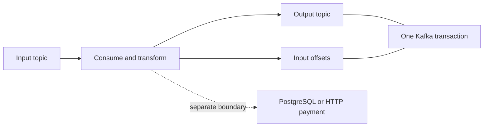
The solid transaction covers Kafka output and progress. The dashed external effect does not become atomic merely because the code executes between beginTransaction and commitTransaction.

## 9. Java 21 implementation
This complete isolated class demonstrates atomic publication to two topics on the successful path. It needs the course-managed kafka-clients dependency, existing topics, and a broker configured to support transactions. A single-broker local lab needs deliberately reduced internal-topic replication settings; do not copy those settings into a resilient deployment.

```java
import java.util.Properties;
import org.apache.kafka.clients.producer.KafkaProducer;
import org.apache.kafka.clients.producer.ProducerRecord;
import org.apache.kafka.common.serialization.StringSerializer;

public final class AtomicPublicationDemo {
    public static void main(String[] args) throws Exception {
        Properties p = new Properties();
        p.put("bootstrap.servers", "localhost:9092");
        p.put("key.serializer", StringSerializer.class.getName());
        p.put("value.serializer", StringSerializer.class.getName());
        p.put("transactional.id", "atomic-demo-owner-1");
        try (KafkaProducer<String, String> producer = new KafkaProducer<>(p)) {
            producer.initTransactions();
            producer.beginTransaction();
            producer.send(new ProducerRecord<>(
                "order-events", "order-100", "OrderAccepted:E100")).get();
            producer.send(new ProducerRecord<>(
                "order-audit", "order-100", "AuditAccepted:E100")).get();
            producer.commitTransaction();
            System.out.println("Kafka transaction committed");
        }
    }
}
```

initTransactions establishes transactional ownership and recovery state. beginTransaction opens a unit of work. send completion here proves publication progress within the open transaction, not final read_committed visibility. commitTransaction establishes the Kafka result.

The fixed transactional ID is only suitable for one logical demo owner. Running two independent copies concurrently intentionally tests fencing. This teaching program exits on errors and does not implement a production retry/reconciliation state machine. An incomplete transaction requires coordinator recovery/expiry or a subsequent correctly owned initialization; never report it as committed.

For a consume-transform-produce implementation, the extra step is sendOffsetsToTransaction with next offsets and the consumer's current groupMetadata. Merely calling consumer.commitSync after commitTransaction recreates a two-operation gap. Chapter14 uses Kafka Streams to manage that lifecycle at a higher abstraction.

## 10. Spring Boot integration
Spring Kafka can configure transactional producers and container transactions. A transaction-aware KafkaTemplate participates in the appropriate Kafka transaction. A database transaction manager controls PostgreSQL; a Kafka transaction manager controls Kafka. Synchronizing their commit order still leaves a failure window between resource commits.

Use transaction management for the guarantee it actually provides. The Order service uses a database outbox to publish its business state reliably. Kafka-native transformations may use Kafka transactions. Both patterns can coexist because they solve different boundaries.

## 11. Production scenario
A reporting processor reads OrderAccepted and emits a normalized event. It fails after producing output but before recording input progress. Without atomic output/checkpoint coordination, replay emits a duplicate. With a Kafka transaction and read_committed downstream consumption, the failed attempt can remain invisible while the retry produces one committed transformation result.

Now add an HTTP email send inside the processing block. The transaction cannot unsend an email. The same implementation no longer establishes one externally visible email. Move that effect behind a durable notification operation with provider-specific idempotency or a documented duplicate tolerance.

## 12. HLD considerations
Document ordering domains explicitly: order lifecycle by orderId; reservation decisions under Inventory authority; ledger entries under a financial account or transaction identity as appropriate. Cross-entity operations require coordination beyond a convenient key.

Partition expansion can remap keyed traffic. Plan a migration, versioned topic, drain boundary, or application sequence policy. Do not assume old and new partitions create a single sequence for a key.

A global order is costly because it serializes decisions. First determine whether the business requires it. Most commerce workflows need per-entity ordering and well-defined cross-entity outcomes.

## 13. LLD considerations
An event should carry aggregateVersion when consumers must detect stale or missing state changes. Apply version v+1 after v; treat repeated v as a duplicate when the identity and content match; investigate gaps or conflicting versions. This policy belongs in the domain handler, not just the serializer.

A transaction owner needs stable identity management and lifecycle controls. Keep fatal, retryable, abortable, and uncertain outcomes separate in error handling. Catching Exception and looping forever discards the information needed for safe recovery.

## 14. Reliability
Transaction timeout is a bound on abandoned work, not a substitute for short transactions. Avoid calling slow providers while holding a Kafka transaction open. Broker/coordinator failure, authentication problems, and ownership conflicts require different responses.

A replay can reconstruct a projection only if retained events contain enough information and the projection logic remains compatible. Kafka transactions do not repair deleted history, schema mistakes, or a logically incorrect transformation.

## 15. Performance
Transactions add coordination and visibility delay. Group a bounded amount of work per transaction to amortize overhead, while limiting replay cost and open-transaction duration. A transaction with 100 records is not inherently optimal; estimate message size, processing time, and recovery objective.

Suppose a transaction takes 400 ms and contains 200 events. One sequential processing lane has a simple upper estimate of 500 events/s before other bottlenecks. This is arithmetic, not a measured benchmark. Reducing transaction size may improve latency while increasing coordination overhead.

## 16. Ten study questions with model answers
1. **What does exactly once mean here?** A committed result within a stated boundary despite retries. Code can execute repeatedly. Name Kafka outputs and offsets explicitly; do not silently include external systems.
2. **Why is idempotence insufficient for two topics?** It protects retry behavior for publication, but a logical multi-record unit needs transaction commit/abort visibility. Otherwise one destination may contain the result while another does not.
3. **Does read_committed prevent all duplicates?** No. Two separately committed business duplicates remain two valid records. Business identity remains necessary.
4. **Why does a long transaction affect readers?** Visibility must not step past unresolved transactional work as if it were final. Investigate stable-offset blockage when data exists but committed readers appear stuck.
5. **Can a PostgreSQL commit join a Kafka transaction automatically?** No. Being in the same Java method does not create a common atomic resource. Use a proven cross-resource pattern such as the outbox for this project.
6. **What is fencing?** Preventing an obsolete owner from continuing writes after a newer owner is established. It protects against overlapping process lifetimes rather than merely checking whether a process is alive.
7. **Does one partition guarantee business order?** It orders stored records. Concurrent handlers and racing publishers can still produce unintended state transitions. Enforce sequence and state-machine rules where effects occur.
8. **Why commit offsets in the producer transaction?** To couple accepted output with input progress. Two independent commits leave either a duplicate-output or lost-output failure window.
9. **Is a committed transaction immediately seen by every consumer?** Consumers still poll at different times and may be behind. Atomic visibility is not simultaneous delivery to all observers.
10. **How would you test the guarantee?** Inject crashes at each boundary, consume with both isolation levels, and count committed output identities. Include an external-effect counterexample to show the scope honestly.

## 17. Worked exercise
A processor consumes offset7, emits eventX, charges a provider, then crashes before transaction commit. What can a committed reader see, and what might the provider have done?

Solution: eventX may remain uncommitted and later be aborted, so read_committed need not expose it. The provider may already have charged. On replay, the provider call must use the same durable payment operation ID and query/reconcile unknown outcomes. Making the Kafka transaction larger does not solve the external boundary.

Expected observation in the future lab: Kafka output visibility and provider effect count can diverge. This is the precise counterexample to an unrestricted exactly-once claim.

## 18. Verification and execution status
The class and failure experiment are unexecuted. Verify transactional broker setup, run the happy path, then deliberately throw before commit and inspect read_committed versus read_uncommitted results. Test a second producer with the same identity to observe fencing. Record exceptions and transaction outcomes; do not infer success from lack of application logs.

## 19. Common misconceptions
Atomic visibility is not simultaneous consumption. Aborted records need not vanish physically at once. A Java transaction annotation does not merge arbitrary systems. Timestamps are not a universal total order. Exactly-once processing does not mean no retries.

## 20. Unanswered assessment
A developer proposes one Kafka transaction around an Inventory database update and a payment HTTP request. Identify each remaining failure window and replace the design with explicit durable boundaries.

## 21. Revision summary
Define the observer and effect. Kafka transactions are powerful within Kafka. Preserve business identities and ordering invariants across external systems. Fencing and recovery are part of correctness.

## 22. Next lesson
Chapter11 maps these mechanisms to Spring Kafka containers, error handling, and test strategies.


---

<a id="chapter-11"></a>

# Chapter 11 — Spring Kafka integration and recoverable listeners

## 1. Lesson title
Use Spring abstractions while keeping ownership of processing, transactions, and failure policy explicit.

## 2. Interview priority
P0. You should explain what the container does before explaining what an annotation does.

## 3. Prerequisites
Chapters4 and7–10: dependency injection, proxies, producer/consumer lifecycle, checkpoints, delivery guarantees, and transactions.

## 4. Learning objectives
Connect factories, templates, and containers; configure record processing; classify errors; compare blocking retries with retry topics; design DLT recovery; and test actual outcomes.

## 5. Official references and version notes
Spring-owned integration references:
- [Boot Kafka support](https://docs.spring.io/spring-boot/reference/messaging/kafka.html): auto-configuration.
- [Listener annotation](https://docs.spring.io/spring-kafka/reference/kafka/receiving-messages/listener-annotation.html): container factory and method adaptation.
- [Exception handling](https://docs.spring.io/spring-kafka/reference/kafka/annotation-error-handling.html): DefaultErrorHandler and recoverers.
- [Serialization](https://docs.spring.io/spring-kafka/reference/kafka/serdes.html): deserialization and conversion.
- [Non-blocking retries](https://docs.spring.io/spring-kafka/reference/retrytopic.html): support and restrictions.
- [Transactions](https://docs.spring.io/spring-kafka/reference/kafka/transactions.html).
- [Testing](https://docs.spring.io/spring-kafka/reference/testing.html).

Checked2026-10-24. Live pages identify4.1.2; the project's proposed baseline remains Boot/SpringKafka4.1.1. Verify resolved dependencies before executing. This chapter explains Spring behavior from Spring sources; Kafka-core semantics remain sourced to Apache in Chapters7–10. No silent upgrade is implied.

## 6. First principles
Spring Kafka does not replace Kafka. It manages objects and repetitive lifecycle work around the same client protocols. The producer factory creates producers, KafkaTemplate provides publishing operations, the consumer factory creates consumers, and the listener container repeatedly polls and invokes application handlers.

This division lets Inventory focus on “reserve this order” rather than writing a poll loop. It also means handler return and exception behavior become part of the checkpoint protocol. Swallowing an exception can turn a failed reservation into apparent success.

A listener method is an adapter boundary. Keep parsing and transport metadata there; delegate the durable business transaction to a service. This makes domain tests independent of broker startup while preserving integration tests for actual Kafka behavior.

## 7. Internal architecture
For one record, bytes arrive in the client, deserializers construct values, a message adapter maps them to listener arguments, the method invokes business logic, and the container applies its acknowledgment/error policy.

Deserialization can fail before the listener has a value to receive. A try/catch inside the listener cannot catch an invocation that never happened. ErrorHandlingDeserializer preserves enough failure information for container-level handling; configure its delegate and consider how raw bytes are published to quarantine.

Record listeners process one record per invocation; batch listeners receive a group. Batch handling can amortize database operations but needs a clear response to a failure halfway through. Non-blocking retry support is not interchangeable with every batch/transaction configuration.

Acknowledge modes are policies about when successful processing advances the checkpoint. RECORD associates success with individual record processing; BATCH relates to the poll batch; manual modes expose acknowledgment to the application with specific container timing. “Manual” does not inherently mean safer. The safest mode is the one whose timing you can prove against the durable business transaction.

## 8. Diagrams
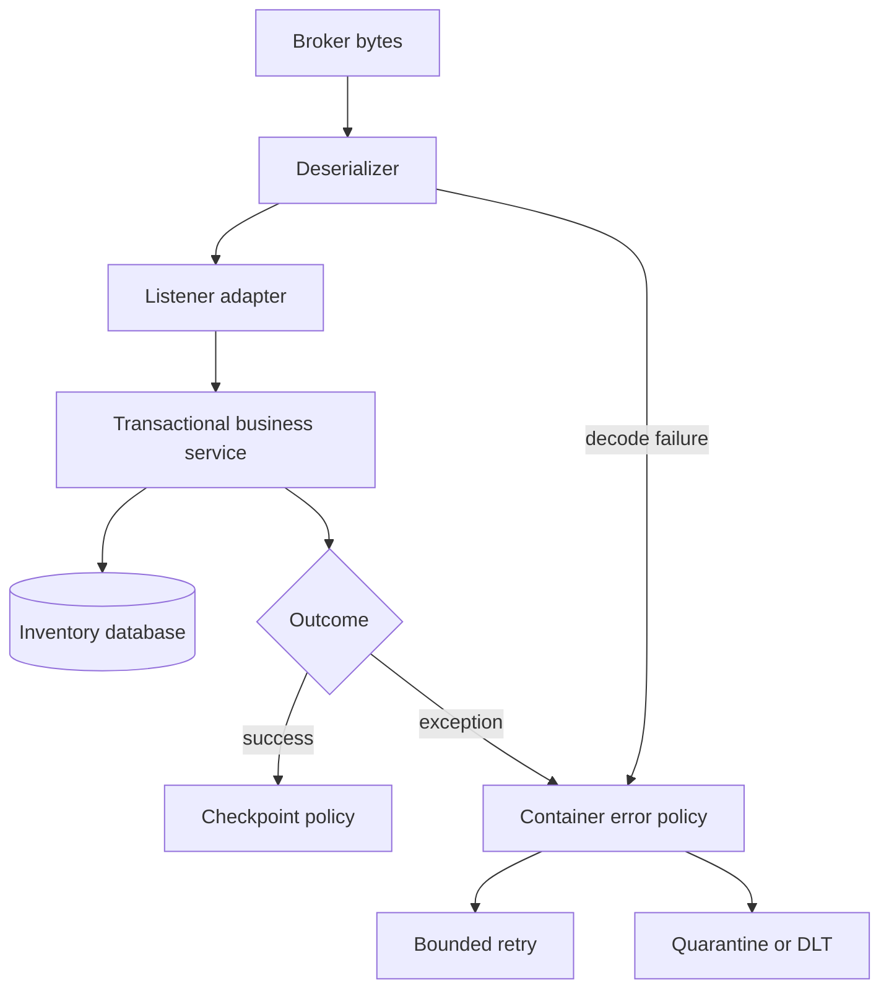
Decode failures and business failures converge at a policy boundary, but they need different diagnoses. A malformed payload is rarely fixed by waiting another second.

## 9. Java 21 implementation
The following two complete classes fit inside a Boot application with Kafka integration dependencies. They demonstrate String records and a non-transactional record listener container. They are not the final Inventory reservation implementation.

```java
import org.springframework.context.annotation.Bean;
import org.springframework.context.annotation.Configuration;
import org.springframework.kafka.config.ConcurrentKafkaListenerContainerFactory;
import org.springframework.kafka.core.ConsumerFactory;
import org.springframework.kafka.listener.ContainerProperties;
import org.springframework.kafka.listener.DefaultErrorHandler;
import org.springframework.util.backoff.FixedBackOff;

@Configuration
public class ListenerConfiguration {
    @Bean
    ConcurrentKafkaListenerContainerFactory<String, String>
    kafkaListenerContainerFactory(ConsumerFactory<String, String> consumers) {
        var factory =
            new ConcurrentKafkaListenerContainerFactory<String, String>();
        factory.setConsumerFactory(consumers);
        factory.setConcurrency(1);
        factory.getContainerProperties()
            .setAckMode(ContainerProperties.AckMode.RECORD);
        var handler = new DefaultErrorHandler(
            (record, exception) -> {
                throw new IllegalStateException(
                    "No durable quarantine configured; retain failure",
                    exception);
            },
            new FixedBackOff(1000L, 2L));
        factory.setCommonErrorHandler(handler);
        return factory;
    }
}
```

```java
import org.apache.kafka.clients.consumer.ConsumerRecord;
import org.springframework.kafka.annotation.KafkaListener;
import org.springframework.stereotype.Component;

@Component
public class OrderInspectionListener {
    @KafkaListener(topics = "order-events", groupId = "inspection-demo")
    public void receive(ConsumerRecord<String, String> record) {
        if (record.value() == null || record.value().isBlank()) {
            throw new IllegalArgumentException("Missing event body");
        }
        System.out.printf("event at %s/%d/%d: %s%n",
            record.topic(), record.partition(), record.offset(),
            record.value());
    }
}
```

The recoverer deliberately throws because this demo has no durable quarantine destination. A silent logging recoverer would imply it is acceptable to advance past failed work. FixedBackOff permits two retries after the initial delivery in this configured retry cycle; a failed recoverer can lead to further delivery cycles. This is a visible stopping condition for a lab, not an unattended production retry policy.

Configure the matching types:

```yaml
spring:
  kafka:
    bootstrap-servers: localhost:9092
    consumer:
      enable-auto-commit: false
      auto-offset-reset: earliest
      key-deserializer: org.apache.kafka.common.serialization.StringDeserializer
      value-deserializer: org.apache.kafka.common.serialization.StringDeserializer
```

Use Boot-managed Kafka dependencies; do not paste arbitrary spring-kafka versions into an existing BOM. A Boot application entry point and broker are prerequisites for these configuration classes, not artifacts claimed to exist already.

## 10. Spring Boot integration
Boot binds spring.kafka properties and supplies common beans when conditions allow. Defining a custom factory makes you responsible for its configured behavior; inspect which defaults and customizers you bypass.

KafkaTemplate completion must be observed for publication failures. A successful method return from code that never waits for or observes the send can hide a later failure.

For transactional listeners, use the documented rollback/after-rollback processing mechanisms. An error handler that consumes the exception may prevent the rollback you intended. Non-blocking retry topics cannot simply be combined with container transactions; the referenced documentation explicitly limits this combination.

## 11. Production scenario
An event contains quantity="many" while Inventory expects a number. Repeating it fifty times will not repair the schema. Quarantine it with original bytes, headers needed for diagnosis, topic/partition/offset, failure class, and a safe correlation identity.

A different event fails because PostgreSQL is temporarily unavailable. Retry with backoff within an outage budget, stop overloading the dependency, and alert on backlog age. Treating both failures as the same retryable exception turns bad data into an outage amplifier.

## 12. HLD considerations
A dead-letter topic is a holding area for work requiring another decision. Assign an owner, retention policy, access policy, alert, repair workflow, and replay policy. Store sensitive payloads only with appropriate controls.

Retry topics allow other work to continue, but later records can overtake failed ones. For order lifecycle events, this may violate a state-machine expectation. Alternatives include blocking the partition, key-aware deferral, or designing handlers around versions and reconciliation.

## 13. LLD considerations
Separate InvalidEvent, TransientDependencyFailure, BusinessRejection, and OwnershipConflict. A business rejection such as insufficient stock is often a successful decision that emits InventoryRejected; it is not an infrastructure exception to retry forever.

A recoverer must confirm durable handoff before treating failure as handled. If DLT publication fails, preserve the source failure path. Use serializer configuration that can handle both normal values and raw deserialization-failure bytes where required.

## 14. Reliability
Bound retries by elapsed business time as well as attempt count. A one-second retry repeated across several services can multiply load. Include jitter where supported and useful. Avoid logging complete personal/payment payloads on every attempt.

Shutdown must stop new work, allow bounded completion, and preserve replay safety for unfinished work. Rolling deployment testing should include active listeners, not just idle startup.

## 15. Performance
Listener concurrency must fit partitions and database capacity. Ten consumers each with a ten-connection pool can place one hundred connections against a database that cannot use them effectively. A connection pool is a concurrency control, not a throughput entitlement.

Measure per-listener processing latency, retries, DLT volume, rebalance frequency, lag age, and business completion rate. Compare record and batch processing with realistic failure injections before selecting throughput over recovery simplicity.

## 16. Ten study questions with model answers
1. **What creates the poll loop?** The listener container. The annotation identifies an endpoint and adapter; it does not magically implement domain reliability.
2. **Why separate a listener from a service?** Transport handling and business invariants change for different reasons. A transactional domain service can be tested independently while the adapter is tested against Kafka.
3. **Why can malformed JSON bypass my catch block?** Deserialization occurs before method invocation. Configure a deserialization error path at the client/container boundary.
4. **Is manual acknowledgment the safest choice?** Only with a proven timing model. A premature manual call loses work just as a premature automatic checkpoint can.
5. **Should insufficient stock go to DLT?** Usually no. It is an expected business outcome with an event and state transition. DLT is for work that cannot be interpreted or completed under the normal contract.
6. **What changes with retry topics?** Work is deferred into another topic and processing order may change. This improves isolation for some workloads but requires explicit order/version handling.
7. **When is a DLT handoff complete?** When publication is durably confirmed under the chosen policy. Logging a send request is insufficient evidence.
8. **Why not use arbitrary concurrency?** Partitions bound assignment and dependencies bound useful parallelism. More threads can increase contention and retries.
9. **What must an integration test prove?** Real serialization, container behavior, checkpoint recovery, and the business database invariant. A mocked listener invocation only proves local method behavior.
10. **How do transactions affect error handling?** Exceptions determine rollback and recovery paths. Swallowing one can commit unintended progress; use the transaction-specific documented mechanism.

## 17. Worked exercise
A listener catches every exception, logs “failed,” and returns. The container uses RECORD mode. A database outage occurs.

Expected observation: offsets may advance although reservations were never persisted. Solution: propagate infrastructure failure to the container, use bounded retry and durable quarantine policy, and make the business operation idempotent. Expected business rejection should instead be persisted and emitted as a deliberate outcome.

Then inject a malformed value before deserialization. Explain why changing only the listener catch block cannot fix that second case.

## 18. Verification and execution status
Examples are unexecuted integration components. Use JUnit6 managed by Boot and the documented Kafka test support, or Testcontainers with a real broker. Test valid data, malformed bytes, transient DB failure, DLT publication failure, restart after DB commit, and duplicate event identity. Assert database state and stored offsets with bounded waiting, not fixed sleeps alone.

## 19. Common misconceptions
DLT is not automatic repair. More retries do not fix schema errors. Container concurrency is not business parallelism without limits. Listener return is not necessarily durable completion if work escaped to an executor.

## 20. Unanswered assessment
A retry-topic design improves throughput but permits PaymentAuthorized to arrive before InventoryReserved is applied. How should the Order state machine and retry policy respond?

## 21. Revision summary
Understand the container lifecycle. Define success durably. Classify errors. Make quarantine observable and replay controlled. Test boundaries, not only annotations.

## 22. Next lesson
Chapter12 implements the database-to-event reliability model and the Order-orchestrated Saga.


---

<a id="chapter-12"></a>

# Chapter 12 — Outbox, inbox, business idempotency, and Saga orchestration

## 1. Lesson title
Build a recoverable order workflow when no single transaction controls all services.

## 2. Interview priority
P0. This chapter is the correctness backbone of the commerce project.

## 3. Prerequisites
Local SQL transactions, unique constraints, Kafka acknowledgment, replay, and Chapter10's transaction boundary. Read Chapter6 first if commit/rollback is unfamiliar.

## 4. Learning objectives
Prove the dual-write failure, design a transactional outbox, distinguish two kinds of deduplication, model an orchestrated Saga, and reconcile uncertain payment outcomes.

## 5. Official references and version notes
- [PostgreSQL18 INSERT and ON CONFLICT](https://www.postgresql.org/docs/18/sql-insert.html).
- [PostgreSQL18 explicit locking](https://www.postgresql.org/docs/18/explicit-locking.html).
- [Debezium outbox event router](https://debezium.io/documentation/reference/stable/transformations/outbox-event-router.html): connector-owned CDC behavior.
- [Kafka transaction protocol](https://kafka.apache.org/42/operations/transaction-protocol/): Kafka scope.
- [Spring Kafka transactions](https://docs.spring.io/spring-kafka/reference/kafka/transactions.html): integration boundary.

Checked2026-10-24. PostgreSQL18 is the reference version; Debezium's stable page is a moving reference and no connector release is installed here. Spring live docs4.1.2 differ from proposed4.1.1. Outbox/Saga architecture below is an explicit project design, not a claim that Kafka implements these business patterns automatically.

## 6. First principles
The dual-write problem occurs when one logical action requires two independently committed writes. Save the order first, then publish: a crash between them leaves an order with no event. Publish first, then save: a crash leaves an event for an order that does not exist. Reversing the order moves the gap.

The outbox moves the second write into the same database transaction as the first. Order state and a durable “event to publish” row commit together. A separate relay later publishes it. This changes the promise from “two systems atomically committed” to “the database contains enough durable intent to retry publication.”

The relay still has a gap between Kafka acknowledgment and marking the row published. A crash there causes duplicate publication. That is expected. The design replaces potential lost intent with replay that consumers must handle safely.

An inbox records event identities already handled by a consumer. Business idempotency records the operation itself, such as one reservation for orderId plus lineId. They are different because two distinct events may request the same business operation. Deduplicating eventId alone cannot prevent that duplicate business effect.

A Saga is a sequence of local transactions with durable coordination and compensating actions. Compensation is a new business action, not a time machine. A refund creates a financial record; it does not erase the original charge from history.

## 7. Internal architecture
The Order service orchestrates:

1. Accept request under an idempotency key and persist PENDING plus an outbox command.
2. Inventory atomically records the command, reserves stock if possible, and emits a result through its own outbox.
3. Order consumes that result and advances its durable state.
4. Payment uses a durable payment operation identity with the simulated provider.
5. Order confirms only when required outcomes are durably known.
6. If payment is rejected, Order initiates release of the reservation.
7. If the payment result is unknown, Order reconciles; it does not immediately classify the action as failed.

Each service owns its database. Order never updates Inventory tables “just to make the transaction easy.” That shortcut destroys the ownership boundary the architecture is teaching.

A polling relay claims a bounded set of rows, publishes, and records results. Multiple relays need a claim/lease or locking strategy. Holding a database transaction open during slow network publication is simple but causes lock and connection pressure. A lease avoids long locks but permits stale owners after expiry; use claim tokens and compare-and-update when completing claims.

SKIP LOCKED helps workers avoid waiting on already claimed rows; it does not alone prove per-aggregate event ordering. Concurrent relays can publish later aggregate versions first. Preserve aggregate ordering with a deliberate claim/partition strategy or make consumers enforce versions.

CDC reads committed database changes and routes outbox content to Kafka. It removes polling overhead but introduces connector offsets, replication slots, snapshot policy, schema mapping, and log-retention operations. It does not remove downstream idempotency.

## 8. Diagrams
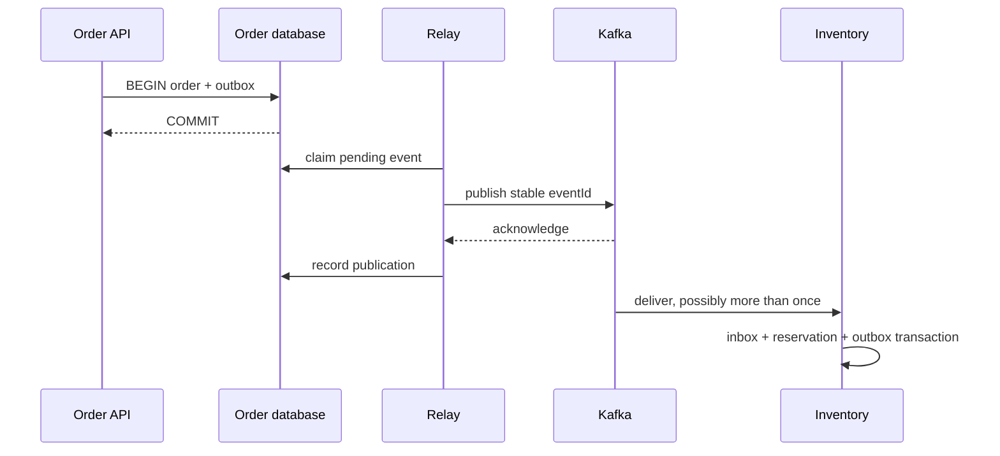

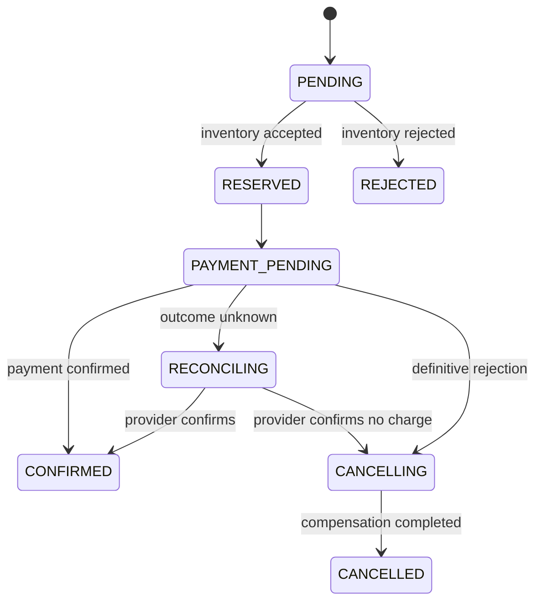
The RECONCILING state is essential: an HTTP timeout is not evidence that the provider did nothing.

## 9. Java 21 and SQL implementation
This scoped demonstration implements only the local order-plus-outbox transaction. It does not claim to implement the entire Saga. Use PostgreSQL JDBC from Boot dependency management and a supplied DataSource. Schema:

```sql
CREATE TABLE demo_orders (
    order_id uuid PRIMARY KEY,
    request_key text NOT NULL UNIQUE,
    request_body text NOT NULL,
    status text NOT NULL
);
CREATE TABLE demo_outbox (
    event_id uuid PRIMARY KEY,
    aggregate_id uuid NOT NULL REFERENCES demo_orders(order_id),
    event_type text NOT NULL,
    payload text NOT NULL,
    created_at timestamptz NOT NULL DEFAULT now(),
    published_at timestamptz
);
CREATE INDEX demo_outbox_pending
    ON demo_outbox (created_at, event_id)
    WHERE published_at IS NULL;
```

```java
import java.sql.Connection;
import java.sql.SQLException;
import java.util.UUID;
import javax.sql.DataSource;

public final class OrderWriter {
    private final DataSource dataSource;

    public OrderWriter(DataSource dataSource) {
        this.dataSource = dataSource;
    }

    public UUID accept(String requestKey, String canonicalBody)
            throws SQLException {
        if (requestKey == null || requestKey.isBlank()
                || canonicalBody == null || canonicalBody.isBlank()) {
            throw new IllegalArgumentException("Key and body are required");
        }
        try (Connection c = dataSource.getConnection()) {
            c.setAutoCommit(false);
            try {
                UUID id = UUID.randomUUID();
                int inserted;
                try (var s = c.prepareStatement("""
                    INSERT INTO demo_orders
                    (order_id, request_key, request_body, status)
                    VALUES (?, ?, ?, 'PENDING')
                    ON CONFLICT (request_key) DO NOTHING
                    """)) {
                    s.setObject(1, id);
                    s.setString(2, requestKey);
                    s.setString(3, canonicalBody);
                    inserted = s.executeUpdate();
                }
                if (inserted == 0) {
                    try (var s = c.prepareStatement("""
                        SELECT order_id, request_body
                        FROM demo_orders WHERE request_key = ?
                        """)) {
                        s.setString(1, requestKey);
                        try (var rs = s.executeQuery()) {
                            if (!rs.next()) {
                                throw new SQLException("Retry transaction");
                            }
                            if (!canonicalBody.equals(rs.getString(2))) {
                                throw new IllegalArgumentException(
                                    "Idempotency key reused for another request");
                            }
                            id = rs.getObject(1, UUID.class);
                        }
                    }
                } else {
                    try (var s = c.prepareStatement("""
                        INSERT INTO demo_outbox
                        (event_id, aggregate_id, event_type, payload)
                        VALUES (?, ?, 'OrderAccepted', ?)
                        """)) {
                        s.setObject(1, UUID.randomUUID());
                        s.setObject(2, id);
                        s.setString(3, canonicalBody);
                        s.executeUpdate();
                    }
                }
                c.commit();
                return id;
            } catch (SQLException | RuntimeException error) {
                try {
                    c.rollback();
                } catch (SQLException rollbackError) {
                    error.addSuppressed(rollbackError);
                }
                throw error;
            }
        }
    }
}
```

The unique request key handles concurrent repeats, not merely sequential calls. The stored request body detects a reused key with different intent. “Canonical” means a stable representation of validated business fields; arbitrary JSON whitespace/order is not a robust equivalence check. In production use a defined normalized representation or fingerprint, tenant/client scope, expiry policy, and stored response.

At PostgreSQL READ COMMITTED, the second statement gets a fresh statement snapshot after an ON CONFLICT wait. Other isolation levels and serialization failures require transaction-level retry policies. A connection failure during commit can leave the caller uncertain even if the database committed. Retrying with the same request key lets the database reveal the result.

The outbox payload here is deliberately minimal; a production envelope adds eventId, orderId, schema version, aggregate sequence, and trace context. The row metadata already preserves identity. Do not use this demonstration schema as a complete domain model.

## 10. Spring Boot integration
In Spring, put the order insert and outbox insert in one @Transactional service method using the same database transaction manager. Keep the relay outside the request transaction. Beware self-invocation that bypasses the proxy.

Inventory processes an event by inserting inbox identity, applying its business rule under appropriate locking/conditional SQL, and inserting its result outbox in one transaction. A failed business decision can be committed as a rejection outcome; a transient infrastructure failure should roll the whole transaction back.

## 11. Production scenario
Two Order events E1 and E2 accidentally request reservation R100. Inbox(eventId) permits both because their IDs differ. A unique reservation operation key prevents the second stock reduction. If the second request changes quantity, return a conflict or investigate; “already exists” must not silently accept contradictory intent.

For release compensation, record which reservation is released and transition it once. Repeated release messages must not increase available stock repeatedly. Reserve/release correctness belongs in Inventory's transactional state machine.

## 12. HLD considerations
Choose orchestration for this project because one durable Order state machine makes progress and compensation visible. Choreography can reduce central coordination for simple independent reactions, but long workflows can hide dependencies across many event handlers.

Define success, rejection, uncertainty, compensation-in-progress, and manual-intervention states. Define time limits using business meaning: a checkout might expire quickly while financial reconciliation can remain active longer. State expiry must not erase unresolved liabilities.

## 13. LLD considerations
Use typed commands/results with commandId, eventId, causationId, and aggregateVersion. Store Saga step identity and attempts durably. Model transition legality explicitly. A late PaymentAuthorized arriving during cancellation cannot be ignored blindly: it can require refund reconciliation.

A scheduler scans overdue durable states; it should not rely only on in-memory timers that disappear on restart. Multiple scheduler instances require safe claiming and idempotent commands.

## 14. Reliability
Monitor oldest pending outbox age, claim expiry, publication failures, inbox conflicts, stuck Saga age, uncertain payment count, and compensation failures. Reconciliation compares durable business records, not only logs.

Cleanup needs a recovery policy. Deleting inbox records too early can turn an old replay into a new effect. Deleting outbox data before publication loses intent. Retain enough identity/history for the maximum replay and audit window.

## 15. Performance
Polling frequency trades latency against database work. Index only pending work when appropriate; avoid repeatedly scanning a huge historical table. Batch bounded publication, monitor lock time, and consider CDC when operational expertise supports it.

Suppose publication is unavailable for one hour at 100 orders/s: 360,000 outbox rows accumulate. At an illustrative 2 KB per row that is about720 MB before indexes/WAL/overhead. Plan backlog drain rate and storage headroom; normal steady-state averages are insufficient.

## 16. Ten study questions with model answers
1. **Why can't write order reverse fix dual writes?** Either order leaves a crash point between independently committed resources. The outbox changes the atomic boundary by colocating state and intent.
2. **Does the outbox eliminate duplicates?** No. Acknowledgment can precede relay bookkeeping. Repeated publication is expected and consumers must make it harmless.
3. **Why both inbox and business uniqueness?** Inbox catches replay of one event; business uniqueness catches different events representing one operation. They protect different identities.
4. **Is compensation rollback?** No. It is a new action against current reality and may itself fail. A refund preserves the history of a prior charge.
5. **Why retain UNKNOWN payment state?** A timeout is insufficient evidence of failure. Reconciliation avoids both double charges and incorrectly cancelling paid orders.
6. **Does CDC guarantee business order automatically?** It exposes committed change history under connector semantics. Mapping, partition keys, multiple transactions, and aggregate versions still need a designed contract.
7. **Can Redis prevent overselling here?** It can assist caching or admission, but PostgreSQL owns authoritative inventory and its invariant. A cache or lease must not become an unproven second authority.
8. **What happens if compensation fails?** Persist the failure, retry within policy, alert on age, and provide reconciliation/manual resolution. Do not label the Saga cancelled while resources remain reserved.
9. **Why use an orchestrator?** It makes this multi-step lifecycle explicit and inspectable. The trade-off is coordinating logic and availability responsibility in the Order context.
10. **How do you prove correctness?** Enumerate crash boundaries and assert invariants: one accepted request identity, one reservation operation, no negative stock, one payment intention, and eventual resolution or visible unresolved state.

## 17. Worked exercise
Crash the relay after Kafka acknowledgment but before setting published_at. Then deliver the same event twice. Also deliver a new event ID with the same reservation operation ID.

Solution: the first repeat is stopped by inbox uniqueness; the new ID is stopped by reservation uniqueness or returns the previously recorded outcome. Both decisions and their outbox results must be transactional. Expected final stock reduction equals one reservation, not three.

Extend the exercise with a changed quantity under the same reservation ID. Correct behavior detects conflicting intent; a duplicate flag alone is insufficient.

## 18. Verification and execution status
The JDBC class, schema, and failure scenarios are unexecuted. Later verify concurrent identical request keys yield one order and one outbox row; mismatched bodies fail; forced outbox insertion failure leaves no new order; lost commit response is resolved by repeating the same key. Use Testcontainers PostgreSQL and real Kafka for cross-boundary tests. Record invariants after restart.

## 19. Common misconceptions
Outbox is not a distributed ACID transaction. Inbox alone is not business uniqueness. Saga compensation is not guaranteed instantaneous reversal. A timeout is not a definitive payment rejection. CDC removes neither ownership nor recovery decisions.

## 20. Unanswered assessment
Payment confirms after Order has started cancellation. Design the durable transitions and commands that prevent both an unrefunded charge and premature fulfillment.

## 21. Revision summary
Persist state and intent together. Publish with stable identity. Deduplicate events and business operations. Make uncertainty and compensation visible. Prove the design at every crash boundary.

## 22. Next lesson
Chapter13 defines contracts that remain readable when producers and consumers deploy at different times.


---

<a id="chapter-13"></a>

# Chapter 13 — Event schemas, compatibility, and independent deployments

## 1. Lesson title
Design messages that remain understandable after code, teams, and deployments change.

## 2. Interview priority
P0 for contract evolution; P1 for format-specific tooling.

## 3. Prerequisites
Serialization, events versus commands, producer/consumer independence, and the outbox envelope from Chapter12.

## 4. Learning objectives
Separate syntax from meaning, compare JSON/Avro/Protobuf, evaluate reader/writer compatibility, plan safe rollout and rollback, and protect replay of historical events.

## 5. Official references and versions
- [Avro1.12 specification](https://avro.apache.org/docs/1.12.0/specification/): schema resolution and defaults.
- [Protocol Buffers proto3 guide](https://protobuf.dev/programming-guides/proto3/): field numbering and evolution.
- [JSON Schema object reference](https://json-schema.org/understanding-json-schema/reference/object): required/additional properties.
- [Spring Kafka serialization](https://docs.spring.io/spring-kafka/reference/kafka/serdes.html): Java integration.

Checked2026-10-24. Avro1.12 is a reference, not a selected installed dependency. Protobuf editions also exist; proto3 is used here for a concrete illustration. Registry compatibility policy, subject naming, and wire framing depend on the selected registry product; none is installed or implied. These are format/integration sources, not substitutes for Apache Kafka-core references.

## 6. First principles
A schema is a contract describing the shape and interpretation of data. A Java class is only one language's representation. The consumer may run an older version or a different language, and historical Kafka records can outlive the class that produced them.

Syntax asks whether amount is a number. Semantics asks whether it means paise, rupees, cents, tax-inclusive price, or a refund. A schema validator may accept every byte of a financially incorrect event. Contract review therefore needs types, units, identities, invariants, and business meaning.

JSON is readable and widely interoperable, but readability does not enforce a contract. JSON Schema adds validation rules. Avro uses writer and reader schemas to resolve encoded records. Protobuf uses numbered fields and generated message types. Choose based on interoperability, evolution workflow, payload cost, team tooling, and operational ownership rather than “binary is always better.”

A registry stores and identifies schemas and can enforce configured compatibility rules. Kafka brokers themselves do not generally infer your domain schema from arbitrary record bytes. Client serializers or integration components may contact a registry; registry availability becomes a separate operational concern.

## 7. Internal architecture
A producer validates a contract, encodes a value, and associates the information required by its chosen wire format. A consumer resolves the relevant schema, decodes bytes, maps into an application model, validates business semantics, and performs work.

Backward compatibility means a new reader can read older data in the stated compatibility model. Forward compatibility means an older reader can read newer data. Full compatibility combines both. Transitive checks consider more than just the immediately previous schema. Always draw the writer/reader matrix because terminology alone is easy to reverse.

For an Avro-style example, a new reader can fill a newly added field using its schema default when the old writer did not provide it. That default is a reader-resolution mechanism, not a universal claim that producers may omit every field. For Protobuf, field numbers are wire identities: reusing a removed number can reinterpret historical bytes as a different business field. Reserve removed numbers/names as appropriate.

Unknown fields can support evolution, but exact preservation and behavior vary across binary/JSON conversions and libraries. Do not assume that converting through an older JSON model preserves every future field.

Compatibility is not only pairwise deployment compatibility. A reporting rebuild may read events from six months ago; a rollback may run yesterday's consumer against today's messages. Test both cases.

## 8. Diagrams
```mermaid
flowchart LR
    W1[Old writer] --> R2[New reader]
    W2[New writer] --> R1[Old reader]
    H[Historical retained data] --> R2
    W2 --> V[Contract validation]
    V --> B[Encoded record]
```
The first two arrows are separate tests. Historical replay adds a longer time horizon than the rolling deployment window.

## 9. Java 21 and contract implementation
A complete immutable domain-facing event type:

```java
import java.time.Instant;
import java.util.Objects;
import java.util.UUID;

public record PaymentAuthorizedV1(
        UUID eventId,
        UUID orderId,
        String paymentOperationId,
        long amountMinor,
        String currency,
        Instant occurredAt) {
    public PaymentAuthorizedV1 {
        Objects.requireNonNull(eventId, "eventId");
        Objects.requireNonNull(orderId, "orderId");
        Objects.requireNonNull(occurredAt, "occurredAt");
        if (paymentOperationId == null || paymentOperationId.isBlank()) {
            throw new IllegalArgumentException("paymentOperationId required");
        }
        if (amountMinor <= 0) {
            throw new IllegalArgumentException("amountMinor must be positive");
        }
        if (currency == null || !currency.matches("[A-Z]{3}")) {
            throw new IllegalArgumentException("Three-letter currency required");
        }
    }
}
```

This validates representation and basic invariants. A three-letter pattern does not prove a currency is supported; a service policy must check supported currencies and currency-specific minor units. A Java record is shallowly immutable: this record's fields are suitable immutable values, but a record containing a mutable list would require defensive copying.

An illustrative JSON Schema2020-12 contract:

```json
{
  "$schema": "https://json-schema.org/draft/2020-12/schema",
  "title": "PaymentAuthorizedV1",
  "type": "object",
  "required": ["eventId", "orderId", "paymentOperationId",
               "amountMinor", "currency", "occurredAt"],
  "properties": {
    "eventId": {"type": "string"},
    "orderId": {"type": "string"},
    "paymentOperationId": {"type": "string", "minLength": 1},
    "amountMinor": {"type": "integer", "minimum": 1},
    "currency": {"type": "string", "pattern": "^[A-Z]{3}$"},
    "occurredAt": {"type": "string"}
  },
  "additionalProperties": true
}
```

additionalProperties=true intentionally allows additive fields; it does not require application consumers to tolerate them. Configure and test the decoder too. UUID and timestamp parsing still require explicit validation here. Some JSON Schema format checks are annotations unless the validator enables assertion behavior, so do not claim format guarantees without testing the chosen validator.

A Protobuf equivalent would assign stable numbers:

```protobuf
syntax = "proto3";
package commerce.payment.v1;
message PaymentAuthorized {
  string event_id = 1;
  string order_id = 2;
  string payment_operation_id = 3;
  int64 amount_minor = 4;
  string currency = 5;
  string occurred_at = 6;
}
```

Generated types and compiler/runtime versions are additional build inputs. This schema is illustrative and not generated in the current project.

## 10. Spring Boot integration
Use dedicated event DTOs and explicit serializer/deserializer configuration. Do not expose JPA entities, lazy proxies, or internal class names as the durable external contract. Type headers useful within a controlled Spring application are not a substitute for a language-neutral contract.

Map wire contracts into domain commands at the boundary. This allows domain code to reject unsupported versions or business values without conflating every failure with a JSON parse error.

## 11. Production scenario
Version1 defines amount as integer minor units. Version2 keeps the same field name/type but starts sending major units rounded to an integer. Every schema check can pass while payments are wrong by a factor of100 for a two-decimal currency.

Solution: preserve meaning, introduce a clearly named new field/event version when semantics change, deploy consumer support, dual-read or translate deliberately, and retire old production only after retention/replay requirements are addressed. Semantic compatibility needs review and fixtures, not only registry approval.

## 12. HLD considerations
Assign one owner for each event contract and list consumers. Document whether an event is an immutable fact, a command, or a current-state snapshot. A compacted state topic and an append-only audit stream have different reconstruction promises.

Avoid placing unnecessary personal information in durable events. Deletion, access control, retention, and replay are harder when sensitive data has propagated to many consumers.

## 13. LLD considerations
Create an envelope separate from payload. Preserve eventId across retransmission and causationId across workflow steps. Schema version identifies contract interpretation; aggregate version identifies entity sequence. Neither is interchangeable with a timestamp.

Handle unknown enum values explicitly. A switch that throws for every newly added status may break an older reader even when the wire format can decode it. Define safe unknown behavior, alerting, and migration policy.

## 14. Reliability
Treat schema retrieval and cache behavior as part of startup and recovery. Cached schemas may allow existing traffic to continue during registry outage while new schemas fail; verify the actual client rather than assuming this behavior.

Keep representative historical fixtures in contract tests. Retaining Kafka data without retaining interpretable schemas and transformation code can make recovery theoretical.

## 15. Performance
Compare encoded size, serialization CPU, allocation rate, validation cost, and debugging effort using representative data. A2KB JSON event versus an800-byte binary event would reduce logical payload by60%, but those figures are illustrative, not measured for this project. Compression can change the gap.

Do not embed large documents merely because Kafka accepts them. Consider object storage plus a durable, authorized reference when payload lifecycle and atomicity can be designed safely.

## 16. Ten study questions with model answers
1. **Is JSON schemaless?** It has syntax and the application still assumes a structure. Without explicit validation, the contract is implicit and failures move into runtime code.
2. **What is backward compatibility?** A new reader can interpret older writer data under the chosen rules. Test old fixtures against new readers, including historical versions.
3. **Why is forward compatibility useful?** Rolling deployments and rollback leave old readers alive while new writers publish. New data must not break them unless the rollout deliberately prevents overlap.
4. **Does adding an optional field always work?** Not if consumers reject unknown fields or generated mappings impose stricter assumptions. Wire, decoder, and business compatibility all matter.
5. **Why reserve Protobuf field numbers?** A reused number can reinterpret persisted bytes as unrelated data. The identity survives source-code renaming.
6. **Does a registry validate business correctness?** It can validate configured structural evolution, not whether money units or event meaning changed incorrectly. Business fixtures and review remain necessary.
7. **Why avoid entity serialization?** Persistence details, lazy relationships, and internal fields leak into a public contract. Independent deployment then becomes coupled to database implementation.
8. **What does transitive compatibility add?** It checks a longer version history. This matters when replay spans several releases, not only yesterday's messages.
9. **Should every breaking change create a topic?** Sometimes, but not automatically. Evaluate parallel consumers, migration traffic, retention, and operational cost. A new topic is a boundary, not a migration plan.
10. **What is the strongest evolution test?** A writer/reader matrix with historical fixtures plus business assertions, including unknown fields, missing fields, enum changes, and semantic units.

## 17. Worked exercise
Version1 PaymentAuthorized has amountMinor and currency. You need optional providerReference. Then you need to change amount to support a richer decimal representation.

Solution: providerReference can be additive if the reader/writer matrix and defaults/presence behavior pass. The amount change requires a semantic migration: preserve the old field meaning, introduce a new representation with an explicit contract, support both during transition, and verify rollback and old-event replay. Do not overwrite the meaning under the original field name.

Expected observation: a syntactic validator can approve a payload whose monetary interpretation is wrong. Add an assertion that a100-minor-unit payment produces the intended currency amount.

## 18. Verification and execution status
Schemas and Java record are unexecuted examples. Compile the record with Java21, validate good/bad payloads using a selected validator, generate Protobuf only after pinning compiler/runtime versions, and run the compatibility matrix. No registry installation or performance result is claimed.

## 19. Common misconceptions
A Java class is not the complete wire contract. Optional is not universally compatible. A schema version is not an entity sequence. Structural compatibility is not semantic compatibility. Retention without readable history is not reliable replay.

## 20. Unanswered assessment
A new consumer works with today's data but fails when rebuilding a six-month projection. Design the release checks and retained artifacts that would have prevented this.

## 21. Revision summary
Specify shape, meaning, identities, and units. Test both directions and historical replay. Keep contracts independent from persistence models. Plan evolution as an operational workflow.

## 22. Next lesson
Chapter14 applies contracts to Connect pipelines and stateful Kafka Streams processing.


---

<a id="chapter-14"></a>

# Chapter 14 — Kafka Connect and Kafka Streams

## 1. Lesson title
Move data with Connect and compute continuously with Streams, while understanding offsets, state, time, and recovery.

## 2. Interview priority
P1 overall; P0 for recognizing when these tools simplify or complicate the project.

## 3. Prerequisites
Kafka groups, schemas, transactions, and the outbox. Know the difference between a business fact and a current-state view.

## 4. Learning objectives
Explain connector/task/worker roles, source/sink offsets, converters, stateful stream processing, joins/windows, restoration, and testing boundaries.

## 5. Official references and versions
All Kafka-core references use official Apache4.2:
- [Connect overview](https://kafka.apache.org/42/kafka-connect/overview/).
- [Connect user guide](https://kafka.apache.org/42/kafka-connect/user-guide/).
- [Connect administration](https://kafka.apache.org/42/kafka-connect/administration/).
- [Streams core concepts](https://kafka.apache.org/42/streams/core-concepts/).
- [Streams architecture](https://kafka.apache.org/42/streams/architecture/).
- [Streams DSL](https://kafka.apache.org/42/streams/developer-guide/dsl-api/).
- [Streams testing](https://kafka.apache.org/42/streams/developer-guide/testing/).

Checked2026-10-24. Specific third-party connectors require their owner's compatibility documentation; a Connect framework feature does not guarantee every connector supports it. No Connect or Streams application is deployed here.

## 6. First principles
Connect is a runtime for moving data between Kafka and external systems. A source connector brings data into Kafka; a sink connector takes Kafka data elsewhere. The attraction is reusable lifecycle, configuration, parallel tasks, and offset management instead of another custom transfer application.

Streams is a Java library for applications that transform Kafka records. It can filter, map, join, aggregate, and maintain local state backed by Kafka. It is not a separate central processing server that every application must contact.

Use Connect for standard data movement, Streams for Kafka-based continuous computation, and application services for domain workflows needing business ownership. A connector copying rows is not automatically an Order service, and a Streams aggregation is not a payment orchestrator.

## 7. Internal architecture
A Connect worker runs connectors and tasks. A connector interprets configuration and proposes units of work; tasks do the transfer. Distributed workers coordinate assignment and persist configuration/status/offset information in internal topics. Standalone mode is simpler for limited local experiments but lacks the same distributed operating model.

Source offsets describe positions in the external source, such as a database log position. Sink progress relates Kafka offsets to successful external writes. A crash between sink write and offset storage can repeat the write; destination idempotency and connector guarantees matter.

Converters map Connect's data representation to Kafka bytes and back. Single Message Transforms perform limited record transformations. Avoid hiding a complex business workflow inside a chain of transforms with weak observability.

Streams builds a topology: a graph of source, processing, and sink nodes. Tasks own input partitions and local state. Repartition topics redistribute records when a key-changing operation requires related keys to meet. Changelog topics preserve state updates for recovery; standby replicas can reduce recovery delay at a resource cost.

KStream treats each record as an event. KTable represents changes to a keyed current view. Three updates for order100 are three stream events but one current table row. A GlobalKTable replicates a table across instances for certain join patterns, trading local availability of data for memory/storage and update traffic.

Event time is when the business event occurred; processing time is when code handles it. Out-of-order events make those different. A window groups records by a time rule. Grace specifies tolerated lateness for relevant window operations; it is a business choice, not just a memory setting.

## 8. Diagrams
```mermaid
flowchart LR
    DB[(Order outbox)] --> SC[Source connector tasks]
    SC --> T[Kafka events]
    T --> P[Streams topology]
    P --> ST[(Local state)]
    ST --> CL[Changelog topic]
    P --> OUT[Projection topic]
    OUT --> SK[Sink connector]
    SK --> R[(Reporting database)]
```
Each arrow has recovery semantics. A Kafka transaction inside Streams does not automatically make the reporting database sink exactly once.

## 9. Java21 implementation
This complete Streams application counts observed status-event records by status. It deliberately counts events, not distinct current orders. Use org.apache.kafka:kafka-streams aligned with the course Kafka client version; application.id identifies its processing state.

```java
import java.time.Duration;
import java.util.Properties;
import org.apache.kafka.common.serialization.Serdes;
import org.apache.kafka.common.utils.Bytes;
import org.apache.kafka.streams.KafkaStreams;
import org.apache.kafka.streams.StreamsBuilder;
import org.apache.kafka.streams.StreamsConfig;
import org.apache.kafka.streams.kstream.Consumed;
import org.apache.kafka.streams.kstream.Grouped;
import org.apache.kafka.streams.kstream.Materialized;
import org.apache.kafka.streams.kstream.Produced;
import org.apache.kafka.streams.state.KeyValueStore;

public final class StatusEventCounter {
    public static void main(String[] args) {
        StreamsBuilder builder = new StreamsBuilder();
        builder.stream("order-status-demo",
                Consumed.with(Serdes.String(), Serdes.String()))
            .filter((orderId, status) ->
                orderId != null && status != null && !status.isBlank())
            .groupBy((orderId, status) -> status,
                Grouped.with(Serdes.String(), Serdes.String()))
            .count(Materialized
                .<String, Long, KeyValueStore<Bytes, byte[]>>as(
                    "status-event-counts")
                .withKeySerde(Serdes.String())
                .withValueSerde(Serdes.Long()))
            .toStream()
            .to("status-event-counts",
                Produced.with(Serdes.String(), Serdes.Long()));

        Properties p = new Properties();
        p.put(StreamsConfig.APPLICATION_ID_CONFIG, "status-counter-v1");
        p.put(StreamsConfig.BOOTSTRAP_SERVERS_CONFIG, "localhost:9092");
        p.put(StreamsConfig.PROCESSING_GUARANTEE_CONFIG, "exactly_once_v2");
        KafkaStreams streams = new KafkaStreams(builder.build(), p);
        Runtime.getRuntime().addShutdownHook(
            new Thread(() -> streams.close(Duration.ofSeconds(10))));
        streams.start();
    }
}
```

groupBy changes the key from order ID to status, so related status values must be regrouped. count stores a running result. The output value is a binary Long serde, not a text decimal: a console reader needs the corresponding deserializer.

A business duplicate in the input is still another event and increases the count. exactly_once_v2 addresses processing recovery within Kafka; it does not identify duplicate business intentions. For “current orders by status,” begin from a keyed table and account for old-value removal and new-value addition. This distinction prevents a plausible-looking but wrong dashboard.

## 10. Spring Boot integration
Spring can manage Streams configuration and lifecycle through its Kafka Streams support. Keep topology construction testable separately from startup. Ensure application IDs and state directories are intentionally assigned per logical application and instance.

Do not add a parallel @KafkaListener that consumes the same logical projection input under an accidental conflicting group identity. Streams owns its consumer/producer/state lifecycle. Its application identity is operational data, not an arbitrary display name.

## 11. Production scenario
A reporting dashboard counts ORDER_CONFIRMED events. An operator replays a topic containing duplicate business events from an outbox relay. The dashboard overcounts even though Streams' processing recovery is correct.

Correct the definition first: count event occurrences, distinct event identities, or current orders? If the business metric is distinct confirmed orders, use order identity and a state transition model. A stronger transport setting cannot repair an ambiguous metric definition.

## 12. HLD considerations
Stream-stream joins need matching keys, compatible partitioning, and a time-window model. A payment event arriving long after an order event can fall outside a chosen window. Stream-table joins enrich events with table state under the selected join semantics; they do not automatically reconstruct the exact historical value at event time.

Use a local/global table or a service lookup based on state size, consistency, recovery cost, and latency needs. Synchronous network lookups per record can make a stream processor inherit dependency outages and unpredictable processing delays.

## 13. LLD considerations
Name topology nodes and state stores intentionally when stability matters across upgrades. Serdes are part of the contract for keys, values, intermediate repartition records, and state stores. A correct source serde does not automatically imply every intermediate type is correct.

Windowed keys encode both business key and time interval. Consumers need compatible deserialization and a documented interpretation. Define tombstone handling: null values can signal deletion in table semantics and must not be casually filtered away before a required delete.

## 14. Reliability
Local state loss can be recovered from changelogs if the required data and compatible topology remain available. Restoration takes time and network/disk bandwidth. “Recoverable” does not mean “instant.”

Connector tasks can fail while the worker process remains healthy. Monitor task state and source freshness, not merely process uptime. CDC outages can retain database logs and exhaust storage. Plan the source's retention budget and recovery procedures.

A Streams reset is a destructive logical operation on application progress/state. Design a separate replay application or controlled reset runbook; do not casually delete state and restart under a production identity.

## 15. Performance
Stateful processing consumes CPU, memory, disk, and network. More threads do not create more useful tasks than partitioning allows. A hot status key such as CONFIRMED can concentrate the simple example's aggregation.

Estimate state size from distinct keys, value size, retention, and storage overhead. One million keys at an illustrative200 bytes of logical state is200 MB before indexes, caching, changelog retention, and replication. Measure restoration throughput to estimate actual recovery time.

## 16. Ten study questions with model answers
1. **Connect or Streams?** Connect moves data through reusable integrations; Streams computes on Kafka data inside an application. Many systems use both with separate ownership.
2. **Connector versus task?** A connector plans/configures transfer; tasks execute units of transfer. Increasing tasks.max cannot invent source parallelism a connector does not support.
3. **Why do source offsets differ from Kafka offsets?** They describe another system's progress. Recovery must relate the external position to emitted data, not confuse two coordinate systems.
4. **KStream versus KTable?** One models event occurrences, the other keyed evolving state. Repeated status updates affect their aggregates differently.
5. **Why repartition?** A key change can require data redistribution so all values for a new key reach the correct task. That adds topics, I/O, and serialization boundaries.
6. **What restores local state?** Changelog data and replay under the topology's semantics. Persistent disks and standby replicas can reduce delay but require their own operation.
7. **What does grace solve?** It defines tolerated event-time lateness for window processing. It cannot make arbitrarily late data free or infer missing business history.
8. **Does Streams EOS cover a sink database?** Not automatically. The sink connector and destination must provide their own effect/progress guarantee.
9. **Why test a topology without Kafka?** A topology test driver makes transformations and time cases deterministic. It does not prove broker failover, network behavior, or distributed restoration.
10. **Why can a healthy worker hide failure?** One task can be failed or stale while the worker process runs. Monitor useful data movement and task-level errors.

## 17. Worked exercise
Input records are order1:PENDING, order1:CONFIRMED, order1:CONFIRMED, order2:PENDING. Predict the example output's final counts.

Solution: PENDING=2 and CONFIRMED=2 because it counts event occurrences. Current-order counts would be PENDING=1 and CONFIRMED=1. To build the latter, maintain one current status per order and update grouped counts when that status changes.

Expected learning: choose stream/table semantics from the business question. Add an out-of-order update and define whether aggregateVersion rejects it or whether historical-time semantics are needed.

## 18. Verification and execution status
The application is unexecuted. Test the topology with kafka-streams-test-utils aligned to the client version and JUnit6. Assert final state, not only every emitted intermediate update because caching/commit behavior can coalesce updates. Then use a real broker to test restart, restoration, repartition topics, and transaction visibility. Connector labs require a selected connector and source setup.

## 19. Common misconceptions
Connect is not a schema-free copy machine. Streams is not a separate broker cluster. Current-state counts differ from event counts. Local state is not automatically disposable without recovery cost. Exactly-once processing does not remove duplicate business events.

## 20. Unanswered assessment
A one-hour window closes before delayed payment events arrive after a regional outage. How would you change the business metric, lateness policy, and correction workflow?

## 21. Revision summary
Separate movement from computation. Understand source progress, table semantics, time, and local state. Design recovery and upgrades alongside the topology.

## 22. Next lesson
Chapter15 covers the operational system that keeps Kafka secure, observable, recoverable, and within capacity.


---

<a id="chapter-15"></a>

# Chapter 15 — Kafka operations, security, capacity, and disaster recovery

## 1. Lesson title
Operate Kafka by preserving business outcomes, not merely keeping broker processes running.

## 2. Interview priority
P0 for diagnosis and durability; P1 for advanced multi-cluster administration.

## 3. Prerequisites
Chapters7–14. Know replication, ISR, retention, group progress, producer acknowledgment, and transactional visibility.

## 4. Learning objectives
Read operational evidence, estimate capacity, explain secure client access, plan reassignment and upgrades, and distinguish replication from a tested disaster-recovery capability.

## 5. Official references and versions
ApacheKafka4.2 references checked2026-10-24:
- [Monitoring](https://kafka.apache.org/42/operations/monitoring/).
- [Basic operations](https://kafka.apache.org/42/operations/basic-kafka-operations/).
- [KRaft](https://kafka.apache.org/42/operations/kraft/).
- [Security overview](https://kafka.apache.org/42/security/security-overview/).
- [Authorization and ACLs](https://kafka.apache.org/42/security/authorization-and-acls/).
- [Cross-cluster mirroring](https://kafka.apache.org/42/operations/geo-replication-cross-cluster-data-mirroring/).

All Kafka-core supporting references are Apache-owned. The local single-broker project is a learning environment, not evidence of failover. Commands below inspect state; no administrative mutation has been executed.

## 6. First principles
Availability means clients can perform useful operations. Durability means accepted data survives specified failures. Recoverability means you can restore service and reconcile state within an objective. These are related but different: a cluster can be reachable while a critical partition is unavailable, or retain data while applications cannot authenticate.

An SLO is a target for user-visible service behavior. Kafka metrics should explain that behavior. “Broker uptime100%” is weak if orders spend an hour waiting for Inventory. Pair platform metrics with outbox age, event processing delay, and unfinished order age.

RPO is the maximum acceptable loss of recent data under a defined recovery scenario. RTO is the target time to restore the required service. State whether RTO includes DNS, credentials, database recovery, consumer checkpoint translation, application warmup, and reconciliation. Otherwise two teams may promise different recoveries using the same acronym.

## 7. Internal architecture
KRaft controllers manage cluster metadata through a quorum. Brokers host partition replicas and serve data. Controller quorum availability and partition replica health are separate concerns. Three voting controllers normally tolerate one unavailable voter while retaining a majority; broker count alone does not establish controller resilience.

Disk storage contains log segments and indexes. Retention, compaction, replication traffic, and restoration compete for I/O. A disk filling gradually can become a sudden write incident when headroom disappears.

Partition reassignment moves replicas to different brokers. It consumes network and disk capacity while normal traffic continues. A safe plan measures the added load, uses appropriate throttling, verifies completion and ISR health, and removes temporary throttles afterward. Adding brokers does not automatically prove data and leaders are balanced.

An upgrade has binaries, metadata/protocol features, configuration, and client behavior. Verify the release-specific upgrade path and rollback constraints before changing feature levels. A binary downgrade after irreversible feature activation may not be supported.

## 8. Diagrams
```mermaid
flowchart TD
    U[Orders delayed] --> P{Where is progress blocked?}
    P --> O[Outbox publication age]
    P --> K[Broker availability and replication]
    P --> C[Consumer processing and checkpoints]
    K --> D[Disk network CPU]
    K --> Q[Controller quorum]
    C --> DB[Database and provider latency]
    C --> E[Errors rebalances poison data]
```
Start from the business symptom and narrow the path. A coincident CPU spike is a hypothesis, not automatically the cause.

## 9. Java21 and operational implementation
A complete read-only Admin client example inspects one topic. It needs the course-managed kafka-clients dependency and access to the local broker.

```java
import java.time.Duration;
import java.util.List;
import java.util.Properties;
import java.util.concurrent.TimeUnit;
import org.apache.kafka.clients.admin.Admin;

public final class TopicInspection {
    public static void main(String[] args) throws Exception {
        Properties p = new Properties();
        p.put("bootstrap.servers", "localhost:9092");
        p.put("client.id", "course-topic-inspection");
        try (Admin admin = Admin.create(p)) {
            var descriptions = admin.describeTopics(List.of("order-events"))
                .allTopicNames().get(10, TimeUnit.SECONDS);
            descriptions.forEach((name, topic) ->
                topic.partitions().forEach(partition ->
                    System.out.printf(
                        "%s partition=%d leader=%s replicas=%s isr=%s%n",
                        name, partition.partition(), partition.leader(),
                        partition.replicas(), partition.isr())));
            admin.close(Duration.ofSeconds(5));
        }
    }
}
```

The output describes current assignment and replication membership, not a permanent guarantee. A snapshot showing full ISR does not prove yesterday's durability or tomorrow's recovery.

In an ApacheKafka container with the documented command paths, equivalent inspections are:

```powershell
docker compose -f C:\Projects\distributed-commerce\infrastructure\compose\compose.yaml exec kafka /opt/kafka/bin/kafka-topics.sh --bootstrap-server kafka:9092 --describe --topic order-events
docker compose -f C:\Projects\distributed-commerce\infrastructure\compose\compose.yaml exec kafka /opt/kafka/bin/kafka-consumer-groups.sh --bootstrap-server kafka:9092 --describe --group inventory
```

Confirm the actual Compose service, internal listener, and topic/group names before use. These commands are examples, not evidence that those resources currently exist.

## 10. Spring Boot integration
Expose producer/consumer/container observations through the chosen metrics system. Give applications stable, recognizable client IDs without creating unbounded metric labels. Report readiness separately from deep dependency diagnostics.

A service may remain able to accept durable orders into its database while Kafka is temporarily unavailable, provided backlog limits and API promises permit it. Another service may need to refuse work. Readiness should reflect this business policy rather than a universal “every dependency must always be green” rule.

## 11. Production scenario
Inventory lag rises while broker request latency is normal. One partition has most of the lag, and database lock time increases. Adding brokers is unlikely to solve this hot-key/consumer bottleneck.

Another incident has rising producer request latency, under-replicated partitions, disk saturation, and replica fetch delay after reassignment starts. Here the operation itself competes with production traffic. Reduce movement pressure under the runbook, verify health, and resume with measured capacity.

The two incidents share “Kafka is slow” as a symptom but require different actions.

## 12. HLD considerations
Place replicas across failure domains when infrastructure supports it. Distinct virtual machines on one physical failure domain are not equivalent to independent zones. Separate controller roles where the production deployment and workload justify it; combined mode is convenient for learning.

Cross-cluster mirroring is usually asynchronous. Source and destination offsets need not be identical, topic naming can differ, and consumer checkpoint translation needs an explicit plan. Database authority, secrets, schema registries, ACLs, and application state also need recovery. A second Kafka cluster alone is not a second functioning commerce platform.

## 13. LLD considerations
Define an operational contract per topic: owner, key, schema, partitions, replication, retention, compaction/deletion policy, access rules, expected throughput, and recovery consumers. Store changes as reviewed configuration where possible.

Security has three different questions: TLS protects the connection; authentication establishes identity, often through SASL or client certificates; ACLs authorize operations on resources such as topics, groups, and transactional IDs. TLS alone does not grant least privilege.

Use separate service identities. Inventory should not inherit a broad administrator credential merely to consume one topic and publish one result. Protect Connect administration and monitoring endpoints as well as broker listeners.

## 14. Reliability
Credential rotation needs overlap and a tested rollout so active clients can reconnect. Certificate hostname validation depends on advertised addresses matching certificates. Disabling hostname verification to “fix” connectivity removes a security check while leaving the naming design broken.

Replication is not backup against every threat. Accidental deletion, incorrect writes, retention expiry, and replicated corruption can propagate. Define what independent history or snapshots are required and test recovery.

For DR, record the last known replicated data, accepted source writes, and unresolved operations. Fence old writers before promoting a new authority where split ownership would violate invariants. Reconcile after failback; switching DNS twice is not a complete data plan.

## 15. Performance
Illustrative capacity:10,000 events/s ×1KB ≈10MB/s logical ingress. Over one day that is864GB in decimal units; replication factor3 suggests about2.592TB of replicated payload before compression, indexes, internal topics, and overhead. Retention of seven days multiplies the retained payload further. State compression and retention assumptions explicitly.

Monitor request latency and error rate, disk free space and I/O latency, network throughput, ISR changes, unavailable partitions, controller health, producer retries/buffer waits, consumer rebalance rate, lag distribution, and oldest unprocessed age.

Quotas protect shared clusters from one tenant consuming all bandwidth/request capacity. Their trade-off is intentional throttling. Observe client throttle time before blaming network latency.

## 16. Ten study questions with model answers
1. **Does a running broker mean a healthy service?** No. Critical partitions or consumer dependencies may be unavailable. Start with useful business progress.
2. **Under-replicated versus unavailable?** Under-replication means fewer healthy in-sync copies than desired; unavailability means required operations cannot currently proceed for the affected partition. Severity depends on the remaining protection and workload.
3. **Why doesn't adding a broker immediately fix skew?** Existing replicas and leaders need placement changes, and a hot key remains one ordering domain. Capacity and distribution are different problems.
4. **Why throttle reassignment?** Moving replicas competes with client traffic and replication. Controlled movement preserves headroom while completing the operation.
5. **TLS versus SASL versus ACL?** Encryption, identity, and permission are separate layers. A securely encrypted connection can still be overprivileged.
6. **Why inspect advertised listeners?** Clients discover broker addresses after bootstrap. An address reachable only inside a container network breaks external clients even if bootstrap succeeds.
7. **Is mirroring zero-loss DR?** Not by default. Asynchronous replication can lag, and recovery needs coordinated authorities and checkpoints. State measured RPO rather than assuming zero.
8. **Why is a restore drill necessary?** Backups and replicas are only potential recovery inputs. A drill tests credentials, tools, ordering, data integrity, and elapsed recovery time.
9. **Can lowering durability settings solve an incident?** It may increase acceptance while changing loss guarantees. That is a business trade-off requiring an explicit decision, not an invisible tuning fix.
10. **What does a senior incident update contain?** User impact, known evidence, current hypothesis, mitigation, risk, next checkpoint, and owner. Avoid claiming a root cause before the evidence supports it.

## 17. Worked exercise
A topic has six partitions. Partition2 holds80% of traffic, consumer lag rises there, and all brokers have spare disk/network. Propose a diagnosis and a safe improvement.

Solution: inspect key distribution and per-key processing cost. More consumers cannot split one classic-group partition simultaneously. Consider a better key only if the business ordering domain permits it, or redesign the hot entity's work. If preserving one entity's serial decisions is essential, optimize that lane and apply admission control. Increasing partitions alone may redistribute other keys without fixing the dominant key.

Expected evidence: per-partition rates and business-key samples explain the skew without exposing sensitive payloads.

## 18. Verification and execution status
Admin code and commands are unexecuted. Future multi-broker labs must verify replica placement, leader loss, minimum ISR behavior, controller quorum loss, credential rotation, and restore. The current single-broker Compose setup cannot prove these claims. Record actual times and missing dependencies in the lab report.

## 19. Common misconceptions
Replication is not universal backup. Controller quorum and data replication are different. A single lag number hides skew. A second region is not a failover plan. Security disabled for a demo is not a production baseline.

## 20. Unanswered assessment
RegionA fails while mirroring is30seconds behind and some payment outcomes are unknown. What must be fenced, recovered, and reconciled before RegionB accepts authoritative orders?

## 21. Revision summary
Operate from business symptoms, preserve explicit durability, measure headroom, secure identities and permissions, and prove recovery through drills.

## 22. Next lesson
Chapters16–19 cover MongoDB, Redis, service boundaries, and networking; these explain the dependencies that often dominate Kafka application behavior.


---

<a id="chapter-16"></a>

# Chapter 16 — MongoDB Read Models, Queries, and Recovery

Prepared 2026-10-24. Commands are unexecuted educational examples. MongoDB is introduced as a deliberate modeling choice; PostgreSQL remains authoritative for Inventory.

## 1. Lesson title
Build document models around access patterns while preserving ownership, bounded growth, and explainable consistency.

## 2. Interview priority
P1 overall; P0 when MongoDB is a primary technology for the role. Prioritize modeling, indexes, atomicity, concerns, and failover before memorizing aggregation operators.

## 3. Prerequisites
Chapter 6's constraints and transactions, and the preceding event-processing chapters' duplicate/replay reasoning. A document is a structured record that can contain nested fields and arrays. A collection groups documents. BSON is MongoDB's binary document representation and supports types beyond JSON's basic vocabulary.

## 4. Learning objectives
Choose embedding or references, design a query-aligned index, build and explain an aggregation pipeline, distinguish single-document atomicity from multi-document transactions, and reason about read/write concerns, replication, sharding, and projection rebuilds. Evaluate search as a separate capability with its own freshness requirements.

## 5. Official references and version notes
All links opened 2026-10-24. MongoDB manual URLs are rolling documentation; no server version is selected or installed by this chapter. Verify exact feature support against the eventual server and driver. Live Spring Data MongoDB reports 5.1.2; it does not silently replace the proposed Boot 4.1.1 dependency set. Java 21 and Maven remain the course baseline.

| ID | Official source | Sections |
|---|---|---|
| M1 | [Data modeling](https://www.mongodb.com/docs/manual/data-modeling/) | Document design and access patterns |
| M2 | [Modeling practices](https://www.mongodb.com/docs/manual/data-modeling/best-practices/) | Embedding, references, bounded documents |
| M3 | [Compound indexes](https://www.mongodb.com/docs/manual/core/indexes/index-types/index-compound/) | Field order, prefixes |
| M4 | [Aggregation](https://www.mongodb.com/docs/manual/aggregation/) | Pipeline stages |
| M5 | [Transactions](https://www.mongodb.com/docs/manual/core/transactions/) | Single-document atomicity, distributed transactions |
| M6 | [Read concern](https://www.mongodb.com/docs/manual/reference/read-concern/) | Read guarantees |
| M7 | [Write concern](https://www.mongodb.com/docs/manual/reference/write-concern/) | Acknowledgment, majority, timeouts |
| M8 | [Replication](https://www.mongodb.com/docs/manual/replication/) | Replica-set roles and elections |
| M9 | [Sharding](https://www.mongodb.com/docs/manual/sharding/) | Routing and shard keys |
| M10 | [Change streams](https://www.mongodb.com/docs/manual/changestreams/) | Resume and deployment requirements |
| M11 | [MongoDB Search](https://www.mongodb.com/docs/search/) | Search capability overview |
| M12 | [Spring sessions/transactions](https://docs.spring.io/spring-data/mongodb/reference/mongodb/client-session-transactions.html) | Session and transaction manager |
| M13 | [Unique indexes](https://www.mongodb.com/docs/manual/core/index-unique/) | Uniqueness and deployment limitations |
| M14 | [Explain](https://www.mongodb.com/docs/manual/reference/method/db.collection.explain/) | Execution statistics |

Mechanisms below are documented facts. The order-view design, owner-version policy, rebuild sequence, and workload estimates are original recommendations. No book claims or performance measurements.

## 6. Fundamental explanation

### Why a document can fit a read model
An order-history page wants order ID, date, state, total, and a few purchased product names together. A document can hold this display snapshot in one bounded shape. The shape follows the query and update lifecycle rather than mechanically copying every relational table into a collection. MongoDB's modeling guidance emphasizes designing around application access patterns. [M1]

Our recommended `order_views` collection is a projection owned by Reporting. Order remains the owner of workflow state. A view can be rebuilt from approved source data and retained events; it is not allowed to authorize shipping or release inventory merely because a document says READY. This distinction gives eventual consistency an explicit business boundary.

Embedding places related values inside a document. References store identifiers for separately managed documents. Embed bounded data read and changed together; reference data whose lifecycle, reuse, or growth makes independent ownership useful. [M2] A purchased line description can be a historical snapshot. A complete customer profile copied into every order creates update and privacy obligations that need separate justification.

### Flexible schema still requires a contract
Two documents can have different fields, but readers still need to know what each field means. Define schema version, required fields, money units, time representation, and treatment of missing versus null. Use validation and migration policies suited to the deployment. Flexible storage shifts some schema responsibility to application and operational design; it does not remove it.

An unbounded `events` array inside every order is a common mistake. Orders may live for years and receive many updates. A bounded recent-events display can be useful, while the full history belongs in a separate retained structure with explicit lifecycle. Limits must be derived from realistic worst-case use, not the average order.

## 7. Internal architecture and mechanism

### Atomicity and conditional updates
MongoDB provides atomicity for a write to one document; multi-document transactions extend the scope under supported deployment conditions. [M5] A projection update can exploit the single-document boundary: update only if its stored owner version is older than the incoming full snapshot. Two competing updates then meet at the document's conditional write rather than performing a disconnected client-side read and save.

The version in this chapter comes from one authoritative Order owner. It is not a wall-clock timestamp and not a global sequence across Order, Inventory, and Payment. If the projection combines independently versioned sources, keep a version per source or use a deliberately designed merge policy. Comparing unrelated counters would drop valid information.

A version-skipping rule is safe here because the event contains a complete Order display snapshot. It is unsafe for deltas such as “add two units”: skipping one delta loses data. Delta consumers need contiguous sequence handling, deduplication, and gap repair. This is a course design rule, not an automatic database capability.

### Query and index mechanics
For a customer history query, filter by tenant/customer and sort by creation time plus ID. A compound index should align with that filter and order. MongoDB documents index field ordering and prefix behavior. [M3] Each additional index consumes storage and write work, so creating every permutation is not a strategy.

Unique indexes enforce declared uniqueness, with restrictions that matter in sharded deployments. [M13] An `_id` chosen from stable projection identity prevents duplicate documents for the same owned view. It does not replace duplicate-effect protection in the authoritative service. Tenant identity belongs in both query and uniqueness design when data is shared.

Explain execution statistics reveal returned documents and examined work. [M14] A query returning ten orders after scanning a large collection may need a better index or predicate, while a small scan can be perfectly acceptable. Record dataset size and distribution before comparing results. A fast query on one sample document provides almost no capacity evidence.

### Aggregation is a dataflow
An aggregation pipeline passes documents through stages that filter, reshape, group, sort, and otherwise transform them. [M4] For a daily order report, first restrict tenant and date, then group by business date/state, then shape the result. Stage order affects work and semantics: grouping before a selective match can process unnecessary data, while moving a match across a transformation may change its meaning.

Use aggregation for the read requirement, not to hide a poorly owned cross-service join. A lookup into another collection can be valid within Reporting's model, but it does not establish transactional consistency with an external PostgreSQL database. Label the report's freshness and reconciliation behavior.

### Concerns, replicas, and shards
Read concern controls the guarantees associated with a read, while write concern controls required acknowledgment conditions for a write. A write-concern timeout does not establish that the write failed to occur. [M6, M7] Reconcile by identity and desired state. Read preference, which selects eligible nodes, is a separate concept from the consistency guarantee requested of a read.

A replica set has a primary and replicating members with election behavior. Failover changes which node accepts writes and can interrupt in-flight operations. [M8] Drivers help discover topology, but the application still needs time budgets, retry classification, and idempotent operations. A secondary read can be stale relative to the latest owner update.

Sharding distributes documents by shard key and introduces routing through the cluster's query infrastructure. [M9] Choose keys from cardinality, distribution, query targeting, and growth. A monotonically increasing key can concentrate new writes depending on the sharding strategy. A tenant-only key may make a very large tenant a hotspot; hashing may distribute writes while changing range-query targeting. State the trade-off rather than declaring one universal best key.

## 8. Diagrams

```mermaid
flowchart LR
    O[Order authoritative DB] --> E[Full Order snapshot events]
    E --> P[Reporting projection worker]
    P --> V[MongoDB order_views]
    V --> Q[Customer history query]
    E --> R[Replay and reconciliation]
    R --> P
```

```mermaid
sequenceDiagram
    participant W as Projection worker
    participant D as Order view
    W->>D: apply ownerVersion 8 if stored version less than 8
    D-->>W: matched and updated
    W->>D: duplicate version 8
    D-->>W: no match
    W->>D: late version 7
    D-->>W: no match
```

The second sequence relies on full snapshots from one owner. It would be an incorrect generic recipe for arbitrary deltas or multi-owner messages.

## 9. Java 21 implementation

Unexecuted mongosh educational example. Complete within a fresh disposable collection and a pre-created view; it teaches the database update that a Java 21 adapter would issue. It does not implement initial-event races, broker offset commits, or a production consumer.

```javascript
db.order_views_demo.insertOne({
  _id: "T-1/O-1001",
  tenantId: "T-1",
  customerId: "C-7",
  orderId: "O-1001",
  ownerVersion: 0,
  status: "PENDING",
  createdAt: ISODate("2026-10-24T10:00:00Z"),
  lines: [{ sku: "P-10", quantity: 2, title: "Teaching product" }],
  totalMinor: NumberLong("12500"),
  currency: "INR"
});
db.order_views_demo.createIndex({
  tenantId: 1, customerId: 1, createdAt: -1, _id: -1
});

function applySnapshot(version, status) {
  return db.order_views_demo.updateOne(
    { _id: "T-1/O-1001", ownerVersion: { $lt: version } },
    { $set: { ownerVersion: version, status: status } }
  );
}

printjson(applySnapshot(2, "READY"));
printjson(applySnapshot(2, "READY"));
printjson(applySnapshot(1, "PENDING"));
printjson(db.order_views_demo.findOne({ _id: "T-1/O-1001" }));

printjson(db.order_views_demo.aggregate([
  { $match: { tenantId: "T-1", currency: "INR" } },
  { $group: { _id: "$status", orders: { $sum: 1 },
              totalMinor: { $sum: "$totalMinor" } } },
  { $sort: { _id: 1 } }
]).toArray());
```

The demo varies only version and status, with the other display fields fixed by initialization. In a real full-snapshot projection, update all source-owned display fields consistently. If two different payloads claim the same owner version, treat that as a contract violation requiring diagnosis; silently ignoring both can conceal corrupted publication.

## 10. Spring Boot integration
Keep a MongoDB projection adapter behind a read-model interface. Configure serialization, collection naming, indexes, concerns, and timeouts explicitly in the reviewed implementation. Spring Data supports sessions and transaction integration through the appropriate transaction manager; a generic annotation without configured resources does not create a MongoDB/PostgreSQL distributed transaction. [M12]

For a one-document projection, prefer the simplest atomic update matching the invariant. If an inbox and projection must update in separate documents, decide whether a supported MongoDB transaction is appropriate, or whether a versioned idempotent projection plus replay protocol is sufficient. The decision must match the event shape and recovery contract.

## 11. Production scenario
Reporting stops for an hour while orders continue. The UI should show projection freshness or a meaningful delayed status rather than claim the view is authoritative. On restart, the worker replays retained events and applies newer owner versions. Duplicate snapshots are harmless under the conditional update.

If the event retention window has expired, replay alone cannot rebuild the view. Use a defined snapshot/backfill interface from the owner and reconcile versions before switching traffic. Backfill and live consumption can overlap; the version guard prevents an older snapshot from replacing newer state when both share the same owner-version domain.

## 12. HLD considerations
MongoDB is optional when PostgreSQL already serves the required read patterns adequately. Adding a second database brings new backup, access control, monitoring, and operational responsibilities. Justify it through document access needs, independently scaled read models, or team capability.

A projection rebuild should use a new collection/version when possible, validate counts and sampled content, catch up to an agreed position, and switch readers deliberately. Preserve the old view long enough for rollback where feasible. Define how deletes and privacy requests propagate so rebuilding does not resurrect data that must no longer be exposed.

Optional search needs a separate evaluation. MongoDB Search documents specialized search capabilities; availability and deployment details must be checked for the chosen environment. [M11] Analyze tokenization, relevance, pagination, authorization filtering, indexing freshness, and rebuild behavior. A search hit is a candidate to display or fetch, not proof of authoritative stock or access rights.

## 13. LLD considerations
Define a projection envelope with event ID, owner aggregate ID, owner version, schema version, occurred time, and payload. Distinguish occurred time from ingestion time. Store the last applied owner version and projection schema version in the view. The latter describes how the view was constructed, while the former describes source progress.

Use bounded collections and projections of fields actually needed by the API. Keep mutable customer details separate from historical purchase snapshots unless the retention policy says otherwise. Encapsulate query filters so every tenant-scoped read includes the tenant boundary; a convenient repository method must not bypass authorization.

## 14. Reliability and failure recovery
Change streams expose database changes with resume facilities, subject to deployment and history constraints. [M10] A resume token is progress evidence, not an eternal backup. Persist processing progress in coordination with idempotent effects, detect unavailable history, and provide a resnapshot path. Do not assume a document-level change is automatically the correct public business event.

Test replica election, network interruption, write-concern ambiguity, duplicate snapshots, version gaps, and rebuild cutover. Backup strategy must include restore validation and the relationships to authoritative source systems. Since this read model is reconstructible, recovery may prioritize rebuilding over preserving every cache-like intermediate state, but only if the source history and snapshot interface actually exist.

## 15. Performance and capacity
Measure documents examined, keys examined, returned rows, query latency, index size, write rate, replication lag, and projection age. Indexes improve reads but add write amplification; large documents and arrays increase transfer and update costs. A hot customer or tenant can create skew even when average throughput looks comfortable.

For a thought experiment, two million order views averaging 4 KiB require about 7.6 GiB of raw payload before indexes, storage overhead, replicas, and working-set needs. This arithmetic is not a storage forecast. Measure representative documents and choose capacity from observed overhead and growth. Bound aggregation memory and result sizes rather than exporting all documents into one Java list.

## 16. Interview questions with explained answers

1. **When embed?** Embed bounded values read and changed with the parent when ownership and lifecycle align. Reference independently growing or reused data. Explain the worst-case document shape, not only one sample order.

2. **Does flexible schema eliminate migrations?** No. Readers still depend on field meaning and shape. Version the projection, support transition, and rebuild or backfill deliberately. Missing and null values need explicit interpretation.

3. **What is atomic in MongoDB?** A single-document write has its documented atomicity; multi-document work requires a supported transaction or another correctness protocol. Do not extend that guarantee to PostgreSQL or external HTTP effects.

4. **Why use owner versions?** They let a full-snapshot projection reject duplicates and older state from the same ordered source. They do not compare unrelated services. Delta events need gap handling instead of unconditional skipping.

5. **Read concern versus read preference?** Concern specifies the read guarantee, while preference guides eligible node selection. A secondary choice and a consistency level solve different questions. Evaluate both against the user's freshness requirement.

6. **Does write-concern timeout mean no write?** No. Acknowledgment conditions were not satisfied in time, but the effect may exist. Inspect by stable identity and desired state; blind creation of a new identity can duplicate work.

7. **Why can sharding make queries worse?** A query without a useful routing key may involve multiple shards and merge work. Distribution also creates skew and operational complexity. Choose a key from real access patterns and growth.

8. **How diagnose a slow aggregation?** Examine stage semantics, selectivity, index support, data volume, and execution statistics. Move filters only when equivalence is preserved. Do not assume the shortest pipeline is the cheapest.

9. **Can change streams replace business events?** They report database changes, which may not align with public domain meaning or expose the desired contract. A transformation can be appropriate, but ownership, schema, replay, and retention still need design.

10. **How rebuild a projection safely?** Create a replacement view, backfill from a consistent source protocol, consume subsequent changes, validate, and switch readers. Include deletes, schema version, and rollback. Merely replaying “whatever events remain” is insufficient.

## 17. Exercises
Run the mongosh example only in a fresh disposable practice collection. Expected observations: version two applies once, duplicate two and late one match no document, final state remains READY, and the aggregation returns one INR order totaling 12500 minor units. These are predictions, not measured results.

Change the event to a delta “increment total by 100” and deliberately omit version one. Explain why the current version-skipping policy is invalid. Solution: deltas require an identity/sequence protocol with gap repair or a full snapshot that supersedes missing changes.

Design a history query for one tenant/customer and inspect its explain result on representative generated data. Expected reasoning: a suitable index narrows candidates and supports order; small datasets may not demonstrate the same plan. Record examined and returned counts without inventing a target latency.

## 18. Verification
Sources and links were checked; no MongoDB deployment, mongosh command, Java adapter, index build, failover, or search experiment was executed. The example is scoped to an initialized document. Production initialization races, server version support, transaction settings, and projection rebuild correctness remain implementation validation tasks.

## 19. Common misconceptions
Document storage is not schema-free design. Embedding every event is not bounded modeling. Majority acknowledgment does not make every secondary read current. Sharding does not repair every slow query. A projection is not the owner of its copied business fact. Search freshness and database commit freshness can differ.

## 20. Knowledge assessment
Unanswered: a full Order snapshot at version twelve arrives before version eleven, then Reporting loses its collection and only the last day's events remain. Explain normal processing, recovery prerequisites, and why a full rebuild cannot be promised from incomplete history alone.

## 21. Revision summary
Model around access and ownership, keep documents bounded, enforce conditional updates atomically, and design indexes from queries. Separate concerns from node selection. Make projection freshness, rebuilds, and version domains explicit.

## 22. Next lesson
Chapter 17 adds Redis for advisory caching and coordination. The same ownership discipline applies: fast copied state cannot replace the authoritative inventory transaction.


---

<a id="chapter-17"></a>

# Chapter 17 — Redis: Caches, Expiration, Leases, and Recovery

Prepared 2026-10-24. Unexecuted educational material. Redis is advisory in this project; authoritative inventory and payment-operation identity remain in owning databases.

## 1. Lesson title
Use fast shared state without confusing speed, temporary coordination, and durable correctness.

## 2. Interview priority
P0 for cache-aside, invalidation races, stampedes, TTL/eviction, and lock limitations. P1 for structures, persistence, replication, Sentinel, and Cluster behavior.

## 3. Prerequisites
Chapters 3, 6, and 16. A cache stores a reusable copy or derived result to avoid repeated expensive work. A cache hit finds a usable entry; a miss requires another path. A lease gives time-limited permission and can expire while its previous holder is still running.

## 4. Learning objectives
Select data structures and key schemas, distinguish expiration from eviction, build bounded cache-aside behavior, prevent overload on misses, reason about stale writers and fencing, and recover from Redis loss without violating commerce invariants.

## 5. Official references and version notes
Opened 2026-10-24. Redis links are rolling `latest` documentation; no Redis server release is selected by this chapter. Commands below avoid newer compare/delete additions whose availability would need an explicit version decision. Spring Data Redis live docs report 4.1.2; proposed Boot remains 4.1.1. Java remains 21 and Maven the build tool.

| ID | Official source | Sections |
|---|---|---|
| R1 | [Data types](https://redis.io/docs/latest/develop/data-types/) | Strings, hashes, sets, lists, sorted sets, streams |
| R2 | [Eviction](https://redis.io/docs/latest/develop/reference/eviction/) | maxmemory and policies |
| R3 | [EXPIRE](https://redis.io/docs/latest/commands/expire/) | TTL semantics |
| R4 | [SET](https://redis.io/docs/latest/commands/set/) | NX and expiration options |
| R5 | [Distributed locks](https://redis.io/docs/latest/develop/clients/patterns/distributed-locks/) | Tokens, expiry, correctness caveats |
| R6 | [Persistence](https://redis.io/docs/latest/operate/oss_and_stack/management/persistence/) | RDB/AOF trade-offs |
| R7 | [Replication](https://redis.io/docs/latest/operate/oss_and_stack/management/replication/) | Asynchronous replication |
| R8 | [Sentinel](https://redis.io/docs/latest/operate/oss_and_stack/management/sentinel/) | Monitoring and failover |
| R9 | [Cluster specification](https://redis.io/docs/latest/operate/oss_and_stack/reference/cluster-spec/) | Slots, hash tags, failover constraints |
| R10 | [Lua scripting](https://redis.io/docs/latest/develop/programmability/eval-intro/) | Atomic execution and script lifetime |
| R11 | [Spring Redis cache](https://docs.spring.io/spring-data/redis/reference/redis/redis-cache.html) | Cache manager, TTL, serialization |
| R12 | [Pub/Sub](https://redis.io/docs/latest/develop/pubsub/) | Delivery semantics |

Documented behavior is cited. Cache policies, fencing examples, business boundaries, and arithmetic are course recommendations. The first attempted lock-document URL failed; the canonical clients/patterns URL above was successfully opened. No benchmark or book-reading claim.

## 6. Fundamental explanation

### Fast copies need an owner
Catalog's product display name is an attractive cache candidate because many orders read it and occasional staleness can be acceptable. Inventory reservation is different: a stale available count can oversell if treated as permission. Our API may display cached stock information as advisory, but Inventory's PostgreSQL transaction decides whether stock is actually reserved.

A cached value needs an owner, key, schema, freshness policy, and miss policy. `product:P-10` is incomplete if tenants or locales can produce different representations. A safer conceptual key is `catalog:v1:tenant:T-1:locale:en-IN:product:P-10`. The exact format is our recommendation; its purpose is to make collision, authorization, and evolution decisions visible.

### Structures encode operations
Strings hold values or serialized documents; hashes represent field/value maps; lists preserve sequence; sets represent unique membership; sorted sets associate members with scores; streams provide an append-oriented structure with their own consumption facilities. [R1] Choose from required operations. A leaderboard can benefit from sorted-set ordering, while a product snapshot may be simplest as one serialized value.

Do not turn Redis into an unreviewed second database just because adding keys is easy. If a cart is stored only there, losing it becomes a product data-loss event and requires a stronger persistence/recovery policy than an expendable catalog cache. The same server can host keys with very different business importance; that is often a reason to separate deployments or policies.

### Expiration and eviction differ
TTL gives a key a lifetime. Eviction chooses keys to remove when memory policy requires it. A key can disappear before its TTL under an eviction policy, and expiration is not a business scheduler promising an exact callback instant. [R2, R3] Always handle a miss. Do not use a key-expiry event as the only durable instruction to release inventory after a reservation deadline.

Our recommendation is to store reservation expiry in the authoritative database and let a recoverable worker perform the legal release transition. Redis can accelerate discovery of candidates, but database state and idempotency decide the effect. This keeps expiration mechanics separate from business correctness.

## 7. Internal architecture and mechanism

### Cache-aside and the stale-fill race
In cache-aside, a reader checks Redis, loads from the owner on a miss, then caches the result for reuse. A writer commits the authoritative change and invalidates or refreshes the relevant entry. This is a useful default recommendation, but the two systems do not share a transaction.

Consider this race: reader A loads product version five; writer B commits version six and deletes the key; reader A then caches version five. Invalidation happened, yet the cache is stale again. A short TTL bounds exposure only under a clearly stated policy; it does not make the update atomic. Alternatives include versioned cache values with conditional replacement, owner-published invalidations with repair, or accepting bounded staleness for this specific field.

Write-through sends updates through a cache layer that coordinates writes; write-behind defers authoritative persistence. Both require explicit failure semantics. Write-behind is especially dangerous for orders if losing a pending buffer loses accepted work. Our course does not use it for authoritative commerce state.

### Stampedes and admission
A stampede occurs when many callers miss at once and all load the same expensive value. A hot product expiring during a sale can overwhelm the database precisely when demand is highest. Useful controls include per-key request coalescing, randomized TTL, bounded refresh concurrency, a small stale-while-revalidate window for suitable data, and negative caching for genuine not-found results.

These are independent policies. Negative caching must distinguish not-found from an outage; caching every exception as “product missing” hides failures. Stale-while-revalidate must state which fields can be stale and for how long. Coalescing in one process does not automatically coordinate all replicas. A Redis advisory lease can reduce duplicate refreshes, but failed coordination must still leave the owner database protected by its own admission limits.

### Atomic commands and scripts
SET supports conditions such as NX and setting expiration in the same command. [R4] This avoids a crash gap between creating a refresh-lease key and separately attaching TTL. Lua scripts execute atomically with respect to other Redis operations while running, so keep them bounded; a long script can delay other work. [R10] Atomicity inside Redis does not include a subsequent PostgreSQL update or HTTP call.

A token identifies the current lease owner. Release must compare the token and delete atomically; a plain DEL can remove a lease acquired by someone else after yours expired. Redis's lock documentation also discusses timing and correctness limitations and recommends attention to fencing. [R5] Our example uses this only for refresh coordination, not for inventory authority.

### Why fencing matters
Imagine worker A holds a lease, pauses for thirty seconds, and loses it after ten. Worker B acquires a new lease and writes current output. A resumes and writes stale output. Token-aware release prevents A deleting B's lease, but it does not prevent A's stale write to a different resource.

A fencing protocol gives each new owner a monotonically increasing authority token and requires the protected resource to reject older tokens. The resource must enforce that comparison atomically. A random ownership token alone is not a fencing sequence. For this project's inventory, a database constraint/conditional transaction is simpler and remains the authority; Redis lease correctness is not placed on the stock path.

### Persistence, replication, and topology
RDB snapshots and AOF persistence have different durability and restart trade-offs, including work and storage costs. [R6] Choose them according to whether keys are disposable caches or business state. An RDB file existing on disk does not prove a tested recovery point or restore procedure.

Redis replication is asynchronous in its core model. A failover can therefore expose a loss window for recent writes depending on configuration and failure sequence. [R7] Sentinel coordinates monitoring and failover for non-clustered Redis; Cluster distributes keys across slots and adds routing constraints, including multi-key placement considerations. [R8, R9] Availability mechanisms do not automatically make a lease or idempotency record a durable business guarantee.

## 8. Diagrams

```mermaid
sequenceDiagram
    participant R as Reader
    participant C as Redis cache
    participant D as Catalog owner
    R->>C: GET product snapshot
    C-->>R: miss
    R->>D: bounded read
    D-->>R: value + owner version
    R->>C: cache with TTL and policy
    R-->>R: return display value
```

```mermaid
sequenceDiagram
    participant A as Refresher A
    participant L as Lease
    participant B as Refresher B
    A->>L: acquire token A
    Note over A: pauses beyond expiry
    B->>L: acquire token B
    A->>L: release only if value is A
    L-->>A: no deletion
```

The second diagram proves only safe conditional release for the described key operation, not safe access to every external resource.

## 9. Java 21 implementation

Unexecuted Redis command/Lua example, complete for a disposable single-instance practice key. It demonstrates an advisory refresh lease and conditional release. Production clients must generate a fresh unpredictable token per acquisition; the fixed token below is only a visible teaching value. No business stock or real payment is touched.

```text
SET demo:catalog:P-10 "version=5;title=Teaching product" EX 60
GET demo:catalog:P-10
TTL demo:catalog:P-10

SET demo:refresh:P-10 "demo-token-A" NX PX 10000
SET demo:refresh:P-10 "demo-token-B" NX PX 10000
```

Save the following as release-demo.lua if practicing with redis-cli:

```lua
local owner = redis.call('GET', KEYS[1])
if owner == ARGV[1] then
    return redis.call('DEL', KEYS[1])
end
return 0
```

```text
redis-cli --eval release-demo.lua demo:refresh:P-10 , demo-token-B
redis-cli --eval release-demo.lua demo:refresh:P-10 , demo-token-A
```

Expected sequence if performed within the lease interval: first acquisition succeeds, second fails, wrong-token release returns zero, correct-token release returns one. If the lease has already expired, correct-token release can also return zero; timing is part of the observation. The script is original teaching code implementing the documented comparison principle.

For Java 21, the adapter would obtain a client from the reviewed dependency configuration, generate a UUID or stronger application-appropriate random token, acquire with one conditional expiring SET, and release with this atomic comparison. It would not interpret a network timeout as proof that acquisition failed. This chapter avoids fabricating a version-specific Java client API without selecting and validating that dependency.

## 10. Spring Boot integration
Spring Data Redis integrates with the cache abstraction through RedisCacheManager and configurable serialization/TTL behavior. [R11] A cache annotation expresses interception and key lookup; it does not establish the consistency contract automatically. Review key generation, tenant scope, serialization compatibility, null handling, and error behavior.

For Catalog, treat a Redis failure as a controlled miss path with strict database admission. For an authorization decision, define a separate freshness/security policy rather than reusing a casual cache default. Do not cache mutable JPA entities and expose their object graph across process boundaries. Prefer versioned DTO representations.

## 11. Production scenario
Redis becomes unavailable during a product launch. Every request falls back to PostgreSQL, causing a connection-pool queue and timeouts. This is a cache outage turning into an owner outage. Recovery requires bounded fallback, request coalescing, admission limits, and possibly serving permitted stale display data. A “fail open” exception handler without capacity control is insufficient.

When Redis returns, refill gradually. Eagerly warming every key can compete with live traffic. Prioritize hot products, cap refresh work, and watch owner load. Inventory reservation must continue to use its authoritative database rules throughout; cached availability may disappear or be stale without allowing overselling.

## 12. HLD considerations
Classify each Redis use by consequence of loss. Disposable display caches, session state, rate-limit counters, queues, and locks do not have identical recovery requirements. Separate policies when an eviction or restart acceptable for one class would violate another. Avoid using one shared maxmemory configuration as an accidental business policy.

Redis Pub/Sub has at-most-once delivery semantics and does not retain missed messages for disconnected subscribers. [R12] It can accelerate best-effort invalidation, but critical invalidation needs TTL, version checks, or another repair mechanism. Do not substitute Pub/Sub for the durable outbox/event path without changing the guarantee explicitly.

## 13. LLD considerations
Wrap cache access in an interface returning value plus freshness/version metadata where useful. Distinguish hit, miss, stale-but-permitted, and backend error in internal observations. A public endpoint may hide cache mechanics, but operators need them to diagnose why owner load rose.

Specify serializer and schema versions in keys or envelopes. During deployment, support a compatible reading period or use a new key namespace. A Java class rename should not unexpectedly make a whole cache unreadable. Bound key and value size, avoid sensitive information in key names, and define invalidation ownership.

## 14. Reliability and failure recovery
For a cache, recovery can mean accepting empty state and rebuilding safely. For durable state, recovery requires validated persistence, replicas, backup, and consistency assumptions. Test both cold-cache startup and failover with concurrent requests. Check whether clients reconnect and refresh topology within useful deadlines.

Lease renewal must be conditional on ownership and must stop after loss of authority. A failed renewal leaves an uncertain owner that should not continue protected work without the resource's fencing protection. In this course, lease failure can cause duplicate cache refreshes, which are tolerable; it cannot grant permission to decrement stock or charge payment.

## 15. Performance and capacity
Measure hit ratio by operation class, miss latency, owner fallback rate, evictions, expired keys, memory, command latency, hot keys, and network bytes. A high global hit ratio can hide a low-hit critical endpoint. A single huge value or expensive script can affect tail latency even when average command rate looks modest.

If an endpoint serves 10,000 reads per second at a 95% hit ratio, the idealized miss stream is 500 reads per second. Losing the cache exposes 10,000 reads per second, a twentyfold change before retries. This arithmetic motivates fallback admission; it is not a measured workload. Pipelining can reduce network round trips but does not make a group of commands a cross-system transaction.

## 16. Interview questions with explained answers

1. **TTL versus eviction?** TTL is an expiration policy attached to a key; eviction responds to memory policy. A key can disappear for either reason. Code must handle misses, and business deadlines must not depend solely on exact expiry notifications.

2. **Why can cache-aside return stale data after invalidation?** An earlier reader can fill an old value after the writer deletes the cache. Define acceptable staleness or use version-aware repair. Deleting after commit reduces some races but does not create atomicity across stores.

3. **What causes a stampede?** Many callers miss together and duplicate expensive loads. Coalesce by key, add jitter where useful, bound refresh concurrency, and protect the owner. A distributed lease is an optimization whose failure policy must be explicit.

4. **Why compare a lease token before deletion?** A previous lease can expire and a new owner can acquire the key. Plain deletion by the old owner would remove the new owner's lease. Atomic compare/delete prevents that specific error.

5. **Does token-safe release provide fencing?** No. It protects lease deletion, not stale writes to another resource. Fencing requires an ordered token and enforcement by the protected resource. Random tokens identify owners but do not order them.

6. **Can Redis guarantee no overselling here?** Redis is deliberately advisory. PostgreSQL's transaction and constraints decide reservation. This avoids making inventory correctness depend on cache expiry, eviction, replication lag, or lease timing.

7. **What happens during Redis outage?** A naive miss fallback can overload the database. Bound fallback, preserve useful stale data only where allowed, and shed excess demand. Recovery includes gradual refill, not merely reconnecting clients.

8. **RDB or AOF?** They offer different persistence/restart trade-offs and can be configured according to data importance. Choose from recovery objectives and verify actual loss/restore behavior. A cache may prefer rebuild, while business state cannot assume loss is harmless.

9. **Sentinel versus Cluster?** Sentinel supports monitoring/failover for non-clustered Redis; Cluster distributes key ownership and introduces slot/routing constraints. Neither replaces a business consistency design. Choose topology from scale and availability needs.

10. **Is Pub/Sub enough for invalidation?** Disconnected subscribers can miss publications. Use TTL/version repair or a durable mechanism for required eventual invalidation. Best-effort notification alone cannot promise every cache sees every change.

## 17. Exercises
Execute the advisory-lease sequence only in a disposable Redis environment. Predict the return values before running. Repeat after allowing expiry. Solution: wrong-owner release never removes the current lease, and expired ownership yields zero even for the original token. Record elapsed time rather than treating all zero results as errors.

Draw the stale-fill race using reader A, writer B, cache, and owner database. Propose a policy for product title and one for available stock. A defensible solution allows bounded stale title with version/TTL repair while always reserving stock through PostgreSQL.

Calculate miss load at 90%, 99%, and 0% hit ratios for 2,000 reads per second. Solutions: 200, 20, and 2,000 owner reads per second before coalescing/retries. Use the result to design a fallback concurrency cap and an explicit overload response.

## 18. Verification
Official pages were opened; Redis commands, Lua, failover, persistence restore, and Spring adapters were not executed. No server/client release was installed or selected. Expected return values depend on completing the lease steps before expiry. The example verifies only a local key protocol if run, not distributed lease safety or authoritative commerce correctness.

## 19. Common misconceptions
Cache memory is not free or infinite. TTL is not a precise durable timer. Lua atomicity does not span PostgreSQL. A lock key does not stop a paused old worker from writing elsewhere. Replication is not a historical backup. A high hit ratio does not prove safe outage capacity. Redis availability does not authorize stock changes.

## 20. Knowledge assessment
Unanswered: a cache refresh lease expires during a JVM pause, a second worker refreshes newer data, and Redis then fails over. Describe the safe responsibilities of each worker and the owner database. Explain which errors are acceptable duplicate work and which would violate a business invariant.

## 21. Revision summary
Use Redis where copied or temporary state has explicit semantics. Plan misses, invalidation races, expiry, eviction, and cold recovery. Separate owner tokens from fencing and cache availability from business authority. Measure the load that escapes the cache.

## 22. Next lesson
Chapter 18 steps back to DDD and service boundaries, making clear why Order, Inventory, Payment, Reporting, and caches have different ownership and consistency responsibilities.


---

<a id="chapter-18"></a>

# Chapter 18 — DDD, Service Ownership, and Read/Write Models

Prepared 2026-10-24. Design recommendations and unexecuted Java 21 teaching example. No service extraction or deployment was performed.

## 1. Lesson title
Choose boundaries that preserve business meaning, contain change, and make distributed obligations recoverable.

## 2. Interview priority
P0 for ownership, aggregates, bounded contexts, modular monolith trade-offs, and workflow consistency. P1 for context maps, CQRS, event sourcing, and API composition. Correct reasoning matters more than pattern vocabulary.

## 3. Prerequisites
The course's Order/Inventory/Payment workflow, local state plus outbox atomicity, inbox/business constraints, and cache/read-model limitations. A domain is the business problem space; a model is a purposeful simplification used to make decisions about it.

## 4. Learning objectives
Develop a shared business vocabulary, identify bounded contexts and invariants, distinguish domain from application services, compare deployment options, and explain CQRS without confusing it with event sourcing. Design a context map and a workflow recovery contract.

## 5. Official references and version notes
Opened 2026-10-24. Microsoft Architecture Center is primary vendor architecture guidance, not a formal universal DDD specification. Spring Modulith pages report 2.1.1 and are conceptual references, not a selected dependency. Proposed Boot remains 4.1.1; Java 21/Maven remain agreed. Microsoft pages displayed an authorization notice but also exposed the substantive article sections cited here; no inaccessible content is claimed.

| ID | Source | Sections |
|---|---|---|
| B1 | [Domain analysis](https://learn.microsoft.com/en-us/azure/architecture/microservices/model/domain-analysis) | Business capabilities, language, contexts |
| B2 | [Tactical DDD](https://learn.microsoft.com/en-us/azure/architecture/microservices/model/tactical-domain-driven-design) | Entities, values, aggregates, services |
| B3 | [Service boundaries](https://learn.microsoft.com/en-us/azure/architecture/microservices/model/microservice-boundaries) | Cohesion and nonfunctional constraints |
| B4 | [CQRS](https://learn.microsoft.com/en-us/azure/architecture/patterns/cqrs) | Read/write models and trade-offs |
| B5 | [Event sourcing](https://learn.microsoft.com/en-us/azure/architecture/patterns/event-sourcing) | Authoritative history and reconstruction |
| B6 | [Gateway aggregation](https://learn.microsoft.com/en-us/azure/architecture/patterns/gateway-aggregation) | Composition and partial results |
| B7 | [Saga](https://learn.microsoft.com/en-us/azure/architecture/patterns/saga) | Local transactions and compensation |
| B8 | [Anti-corruption layer](https://learn.microsoft.com/en-us/azure/architecture/patterns/anti-corruption-layer) | Model translation |
| B9 | [Strangler Fig](https://learn.microsoft.com/en-us/azure/architecture/patterns/strangler-fig) | Incremental migration |
| B10 | [Modulith fundamentals](https://docs.spring.io/spring-modulith/reference/fundamentals.html) | Logical modules and interfaces |
| B11 | [Modulith verification](https://docs.spring.io/spring-modulith/reference/verification.html) | Cycles and internal-package access |

Definitions are attributed to selected sections. The particular commerce boundaries, state model, failure analysis, and exercises are original course designs. Books mentioned by source pages were not consulted and are not evidence here.

## 6. Fundamental explanation

### Start with language, not endpoints
Ask a domain expert what “order accepted” means. Does it mean the request was recorded, stock was reserved, payment was authorized, or a warehouse promised shipment? If these meanings are conflated, every API and dashboard can be technically correct while users receive contradictory promises. Our course distinguishes PENDING, READY, CANCELLING, CANCELLED, and REJECTED and requires evidence before advancing.

DDD encourages a shared language within a bounded context, while different contexts can legitimately give a term different meanings. [B1] “Product” in Catalog is a sellable description; in Inventory it is a stock-keeping identity and availability policy; in an Order it can be a historical purchase line. A single universal Product object passed everywhere would couple these different responsibilities.

Our recommended boundary table is: Order owns customer intent and workflow; Inventory owns reservations and availability; Payment owns simulated authorization identity and outcomes; Shipping owns fulfillment progress; Reporting owns derived views. Redis stores advisory copies. These are learning boundaries, not a claim that every commerce organization requires separate deployable services for each noun.

### Entities, values, and aggregates
An entity has identity through time; a value object is defined by its attributes; an aggregate groups state around a consistency boundary with a root controlling access. Domain services express domain behavior that does not naturally belong to one entity or value. [B2] These definitions help ask where a rule lives rather than demand a class hierarchy for every table.

For Order, the aggregate holds its ID, lines, totals, workflow state, and references to reservation/authorization evidence. It should not load an entire customer history and all inventory rows merely to change one order. An aggregate is an invariant boundary, not “everything related to an order.” Making it too large increases contention and creates unnecessary coupling.

The application service coordinates a use case: load, invoke domain behavior, persist, and record outgoing intent. The domain model decides legal transitions. Infrastructure adapters perform SQL, HTTP, or broker operations. Keep these roles distinct enough that a change to serialization does not rewrite the rule for fulfillment readiness.

## 7. Internal architecture and mechanism

### A bounded context is not automatically a process
A modular monolith can enforce business boundaries within one deployment. Modules expose interfaces and keep internal types private. Spring Modulith provides tools for expressing and inspecting logical modules; its verification can check cycles and access to internal packages. [B10, B11] Those checks support architectural intent but cannot decide whether a business boundary is correct.

Microservices add independent deployment and potentially independent scaling, but also network failures, data ownership, contract evolution, and operational overhead. Service-boundary guidance considers cohesion and nonfunctional requirements rather than slicing only by technical layer. [B3] Splitting Controller Service, Business Logic Service, and Database Service usually creates distributed call chains while preserving tight change coupling.

Our recommendation is to begin with clear modules, then split a boundary when independent ownership, scaling, release cadence, or failure isolation justifies the cost. This course deliberately introduces separate services to learn the mechanisms. That educational motivation is not a universal production recommendation.

### Context maps and translation
A context map records who supplies meaning to whom and how models translate. Inventory accepts a reservation command containing an order reference and SKU quantities. It does not receive Order's mutable persistence entity. Payment accepts a stable payment operation ID and amount/currency, not the entire checkout object graph.

An anti-corruption layer translates an external model into the receiving context's language and protects it from accidental semantic coupling. [B8] If a simulated provider returns `PENDING_REVIEW`, the adapter maps it to an explicit unresolved outcome rather than forcing it into APPROVED/DECLINED. Translation is more than renaming JSON fields; it includes meaning, units, identity, and failure interpretation.

Prefer identifiers and published contracts across contexts. A shared library of basic stable technical types may be reasonable, but sharing all domain entities forces coordinated releases. Before extracting a common type, ask whether both contexts mean the same thing and evolve it for the same reasons.

### Local decisions and distributed workflows
Order owns orchestration: it records an order and reserve intent; Inventory reserves and emits a result; Order records that evidence and requests simulated authorization; Payment records its operation and emits an outcome; Order becomes READY only after both necessary confirmations. Each service owns a local transaction and outbox, while receiving handlers use inbox/business constraints.

A saga coordinates local transactions and recovery through compensating actions rather than one cross-service rollback. [B7] Compensation has business meaning: release a reservation, void an authorization, or create a refund. It can fail and need retry or review. “Undo everything” is not a sufficiently precise cancellation contract.

Choreography lets participants react to events without a central workflow command owner; orchestration places workflow decisions in an explicit coordinator. Both can be valid. Our choice of Order orchestration makes the order's current obligation and recovery next step inspectable. It does not make Order the owner of Inventory's tables.

### CQRS and event sourcing are independent choices
CQRS separates command and query models so each can serve its purpose. It can begin within one application and database, and separate stores add synchronization complexity. [B4] Our Order write model protects transitions; Reporting's MongoDB projection serves history queries. Query freshness is therefore part of the product contract.

Event sourcing makes a retained event history the authoritative record from which state is reconstructed. It introduces event evolution, replay, concurrency, and retention obligations. [B5] Publishing events from a normal order table does not make the application event-sourced. An outbox is a publication mechanism, not an event store by definition.

Our baseline uses current-state tables plus outbox and audit information where needed. Event sourcing is an optional design study when historical reconstruction and domain requirements justify it. If adopted, command processing must append with an expected aggregate version or equivalent concurrency protection, replay must avoid repeating external effects, and snapshots must remain derived acceleration data with a compatibility policy.

### API composition
A dashboard may combine Order status, Catalog descriptions, and Shipping estimates. Gateway aggregation can reduce client chattiness, while introducing fan-out, bottleneck, and partial-result considerations. [B6] A dedicated composition service behind the edge can keep business-specific query logic away from general routing infrastructure.

Define which fields are required. If Shipping is unavailable, the dashboard may return the order with an unavailable estimate; it must not invent a delivery date. A composed view is not a transactionally consistent snapshot across owners unless a specific protocol provides that guarantee. State per-field freshness when it matters.

## 8. Diagrams

```mermaid
flowchart LR
    Client --> Order[Order context: workflow owner]
    Order -->|Reserve command| Inventory[Inventory context]
    Inventory -->|Reservation result| Order
    Order -->|Authorize command| Payment[Payment simulator context]
    Payment -->|Authorization result| Order
    Order -->|Published snapshots| Reporting[Reporting context]
    Reporting --> Mongo[MongoDB view]
    Catalog[Catalog context] --> Redis[Redis advisory cache]
```

```mermaid
stateDiagram-v2
    [*] --> PENDING
    PENDING --> READY: reservation and authorization confirmed
    PENDING --> CANCELLING: cancellation or compensating rejection
    CANCELLING --> CANCELLED: required compensations confirmed
    PENDING --> REJECTED: rejection with no unresolved obligations
```

The state diagram is a course policy sketch. A production design must enumerate late events and legal transitions with more detail than this overview can show.

## 9. Java 21 implementation

Unexecuted educational example. Complete OrderReadinessDemo.java, demonstrating a small domain invariant and duplicate evidence handling. It excludes cancellation, persistence, authentication, concurrency, and message transport. Those omissions define its scope rather than hiding a production claim.

```java
import java.util.Objects;

public class OrderReadinessDemo {
    enum Status { PENDING, READY }
    record OrderId(String value) {
        OrderId {
            Objects.requireNonNull(value);
            if (value.isBlank()) throw new IllegalArgumentException("orderId");
        }
    }
    static final class Order {
        private final OrderId id;
        private String reservationId;
        private String authorizationId;
        Order(OrderId id) { this.id = Objects.requireNonNull(id); }

        void reservationConfirmed(String evidence) {
            reservationId = acceptSameOrNew(reservationId, evidence);
        }
        void authorizationConfirmed(String evidence) {
            authorizationId = acceptSameOrNew(authorizationId, evidence);
        }
        private static String acceptSameOrNew(String existing, String incoming) {
            Objects.requireNonNull(incoming);
            if (incoming.isBlank()) throw new IllegalArgumentException("evidence");
            if (existing != null && !existing.equals(incoming)) {
                throw new IllegalStateException("Conflicting evidence");
            }
            return incoming;
        }
        Status status() {
            return reservationId != null && authorizationId != null
                    ? Status.READY : Status.PENDING;
        }
        OrderId id() { return id; }
    }
    public static void main(String[] args) {
        Order order = new Order(new OrderId("O-1001"));
        order.reservationConfirmed("R-1001");
        if (order.status() != Status.PENDING) throw new AssertionError();
        order.reservationConfirmed("R-1001");
        order.authorizationConfirmed("A-1001");
        if (order.status() != Status.READY) throw new AssertionError();
        System.out.println(order.id().value() + " " + order.status());
    }
}
```

The model derives readiness from evidence instead of exposing an arbitrary status setter. Repeated identical evidence is harmless within the object; conflicting evidence is surfaced. A real handler must authenticate the event source, validate order and operation identity, and persist the aggregate plus outgoing intent atomically. Domain methods alone do not provide durable deduplication.

## 10. Spring Boot integration
Organize packages by business module, then separate public application interfaces from internal implementation. Controllers and listeners invoke application services; repositories and clients implement ports. Constructor injection makes these dependencies inspectable. A module verification tool can later check structural constraints after its version is reviewed.

Place local transactions around loading, applying, and persisting one use case. Persist state and outbox together. Avoid calling another context's repository simply because it is injectable in the same process. In a modular monolith, explicit interfaces preserve the possibility of later extraction while allowing carefully chosen local transactions where the business model genuinely shares an invariant.

## 11. Production scenario
The business changes cancellation: once payment is authorized, cancellation must void it before the order becomes CANCELLED. If every service independently sets order status, the change requires coordinated edits and risks contradictory outcomes. With Order as workflow owner, the transition policy is centralized while Payment implements the void capability within its own domain.

A late authorization arrives after cancellation started. Order records the evidence and requests void, keeping CANCELLING until confirmation. It does not drop the event because the customer no longer wants the order. The system's obligation is determined by what happened, not only by the latest user intention.

## 12. HLD considerations
Evaluate a proposed service boundary using change coupling, consistency needs, team ownership, scale, and failure isolation. If almost every request synchronously traverses six services and every release updates all of them, independent deployment may be mostly nominal. A modular monolith can provide a clearer starting point.

For extraction, use an incremental migration approach with explicit routing and ownership cutover; the Strangler Fig pattern describes gradual replacement behind a stable facade. [B9] The hard part is often data ownership: define which implementation accepts writes at each stage, how history is transferred, and how rollback works without two competing authorities.

## 13. LLD considerations
Name domain methods after business intent: `confirmReservation`, `requestCancellation`, and `recordAuthorization` reveal more than `setStatus`. Keep invariants inside a model that can be exercised without network infrastructure. Application services coordinate resources but should not become a collection of every rule in the company.

Model domain errors separately from transport errors. A rejected reservation is a valid business outcome; a missing event field is a contract problem; a database outage is infrastructure failure; an unknown payment result is uncertainty. Distinguishing them prevents a generic exception handler from turning every failure into an incorrect state transition.

## 14. Reliability and failure recovery
Every distributed obligation needs durable state, operation identity, a retry/reconciliation policy, and an owner. A workflow should answer: what step is pending, since when, what evidence exists, and what may be attempted next? Store enough information to recover after losing all process memory.

Observe oldest pending order, unresolved authorization, compensation failures, projection lag, and cross-context contract errors. A healthy broker and database do not establish workflow completion. Reconciliation compares business facts across owners through authorized interfaces or exports and repairs using domain commands rather than arbitrary cross-service SQL edits.

## 15. Performance and capacity
Boundaries change performance. A local method call becoming a network call adds serialization, connection use, latency variability, and failure modes. Coarse use-case APIs often perform better than remote CRUD for each field. Aggregate size influences lock contention and data loading, while read models can reduce expensive composition.

If one dashboard fans out to five services, 1,000 dashboard requests per second can create up to 5,000 downstream requests before retries or per-item expansion. This is illustrative arithmetic. Cache or materialize appropriate read data, but preserve freshness requirements and ownership. Do not hide every slow call behind an eventually consistent copy without product agreement.

## 16. Interview questions with explained answers

1. **What is a bounded context?** It is a boundary within which a model and language have consistent meaning. It may be a module before becoming a service. Explain a word such as Product that legitimately differs across contexts.

2. **What makes an aggregate useful?** It identifies state whose rules are enforced together through a root. It is not all related data. A smaller coherent invariant boundary reduces unnecessary loading and contention while preserving correctness.

3. **Domain service versus application service?** A domain service expresses business behavior that does not fit one object; an application service coordinates a use case and resources. Keeping the distinction visible makes domain rules easier to test without infrastructure.

4. **Why choose a modular monolith?** It can enforce boundaries while retaining simpler deployment and local calls. Choose it when independent scaling/releases do not justify distributed costs. Modularity requires interface discipline even in one process.

5. **Does database-per-service mean a different server?** The essential property is ownership and controlled access, though physical isolation can serve operational needs. Sharing infrastructure does not authorize cross-service table writes. Independent schema and credentials can help enforce ownership.

6. **Does CQRS require event sourcing?** No. Separate command/query models can use ordinary current-state persistence. Event sourcing chooses authoritative event history. Combining them can be useful but adds separate complexity from each choice.

7. **Why is an outbox not automatically an event store?** It records publication obligations alongside current-state changes. Its retention and schema may not support full aggregate reconstruction. An event-sourced system requires explicit authoritative history semantics.

8. **Orchestration or choreography?** Compare visibility, coupling, workflow complexity, and ownership. This course chooses Order orchestration so pending steps and compensation are inspectable. Participants still own their rules and databases.

9. **Can compensation restore the exact past?** Often no: a refund differs from never charging, and released stock may be acquired by another buyer. Define business-valid recovery and track its failures. A saga is not a time machine.

10. **Why use an anti-corruption layer?** External meanings may differ from the local model. Translation prevents provider states, units, and failure codes from leaking everywhere. It must preserve uncertainty rather than forcing unknown states into a convenient enum.

## 17. Exercises
Run the Java program in a confirmed Java 21 practice environment. Expected output: `O-1001 READY`. Remove authorization confirmation and predict PENDING. Apply a different reservation ID after the first one and expect conflicting-evidence failure. The solution illustrates invariant enforcement, not durable message handling.

Draw a context map for returns and refunds. A defensible solution gives Order/Returns ownership of return eligibility, Inventory ownership of received-stock disposition, and Payment ownership of simulated refund operations. Identify who orchestrates and where compensation can fail; no universal map is required without product rules.

Assess a proposal to split one service into controller, business, and database services. Explain which changes still require coordinated releases and which new failure boundaries appear. A strong solution proposes business-capability modules first and justifies any deployment split with evidence.

## 18. Verification
Sources were checked; the Java program, module checks, state persistence, migration, and saga were not executed. Expected output is a prediction. The example covers only readiness evidence. Production cancellation, concurrent updates, event authenticity, durable deduplication, and reconciliation remain separate implementation verification tasks.

## 19. Common misconceptions
DDD is not a requirement to create many services. A bounded context is not always one container. An aggregate is not an entire object graph. Sharing a database server does not imply shared write ownership. CQRS is not event sourcing. Publishing events is not proof of reconstructible history. Compensation is not global rollback.

## 20. Knowledge assessment
Unanswered: Reporting shows READY while Order is CANCELLING, Inventory has reserved stock, and Payment's authorization result is unknown. Identify authoritative owners, valid customer communication, required reconciliation, and why a dashboard join cannot resolve the workflow by itself.

## 21. Revision summary
Use business meaning and invariants to choose boundaries. Keep modules coherent before distributing them. Separate command models, read models, and authoritative histories. Make workflow ownership, late-event handling, and compensating obligations durable and explicit.

## 22. Next lesson
Chapter 19 follows calls across DNS, connections, TLS, proxies, load balancing, discovery, and gateway policies. Logical boundaries become actual network and resource boundaries.


---

<a id="chapter-19"></a>

# Chapter 19 — Networking, Gateways, Discovery, and Time Budgets

Prepared 2026-10-24. Educational Java example is unexecuted. No ports were opened, gateway deployed, or network configuration changed during authoring.

## 1. Lesson title
Trace a request through names, connections, encryption, proxies, routing, queues, and deadlines before diagnosing a distributed failure.

## 2. Interview priority
P0 for DNS/TCP/TLS/HTTP distinctions, connection reuse, deadlines, retry safety, and load-balancing behavior. P1 for Gateway filters, discovery, rate limits, and HTTP version trade-offs.

## 3. Prerequisites
Chapters 3–5 and 18. A host address identifies a network destination; a port selects a transport endpoint on that host. A socket is a communication endpoint. A proxy makes a new connection on behalf of another participant, creating an additional failure and timing boundary.

## 4. Learning objectives
Explain the stages of an HTTPS call, distinguish transport acknowledgment from business success, diagnose pool and discovery failures, design gateway policy without moving domain ownership into it, and allocate time/concurrency budgets across a request path.

## 5. Official references and version notes
Sources opened 2026-10-24. RFCs are explicit protocol references, with later updates possible; only the named foundational mechanisms are used. Live Spring Cloud Gateway pages show 5.0.4, with discovery page 5.0.3; Commons shows 5.0.4. These do not establish compatibility with proposed Boot 4.1.1. No Cloud release train is selected. Java remains 21 and Maven the project build tool.

| ID | Source | Sections |
|---|---|---|
| N1 | [DNS concepts, RFC 1034](https://www.rfc-editor.org/rfc/rfc1034.html) | Names, resolvers, caching |
| N2 | [TCP, RFC 9293](https://www.rfc-editor.org/rfc/rfc9293.html) | Connections, reliability, flow control |
| N3 | [TLS 1.3, RFC 8446](https://www.rfc-editor.org/rfc/rfc8446.html) | Handshake, authentication, early data |
| N4 | [HTTP/1.1, RFC 9112](https://www.rfc-editor.org/rfc/rfc9112.html) | Framing, connection management |
| N5 | [HTTP/2, RFC 9113](https://www.rfc-editor.org/rfc/rfc9113.html) | Streams and multiplexing |
| N6 | [HTTP/3, RFC 9114](https://www.rfc-editor.org/rfc/rfc9114.html) | HTTP over QUIC |
| N7 | [Forwarded header, RFC 7239](https://www.rfc-editor.org/rfc/rfc7239.html) | Proxy information and trust |
| N8 | [Additional status codes, RFC 6585](https://www.rfc-editor.org/rfc/rfc6585.html) | 429 |
| N9 | [Gateway request flow](https://docs.spring.io/spring-cloud-gateway/reference/spring-cloud-gateway-server-webflux/how-it-works.html) | Matching and filters |
| N10 | [Gateway timeouts](https://docs.spring.io/spring-cloud-gateway/reference/spring-cloud-gateway-server-webflux/http-timeouts-configuration.html) | Global and per-route settings |
| N11 | [Discovery route locator](https://docs.spring.io/spring-cloud-gateway/reference/spring-cloud-gateway-server-webflux/the-discoveryclient-route-definition-locator.html) | Registry-derived routes |
| N12 | [RequestRateLimiter](https://docs.spring.io/spring-cloud-gateway/reference/spring-cloud-gateway-server-webflux/gatewayfilter-factories/requestratelimiter-factory.html) | Key resolution and limiting |
| N13 | [Spring LoadBalancer](https://docs.spring.io/spring-cloud-commons/reference/spring-cloud-commons/loadbalancer.html) | Client-side instance selection |
| N14 | [Java HttpRequest builder](https://docs.oracle.com/en/java/javase/21/docs/api/java.net.http/java/net/http/HttpRequest.Builder.html) | Request timeout |
| N15 | [Java HttpClient builder](https://docs.oracle.com/en/java/javase/21/docs/api/java.net.http/java/net/http/HttpClient.Builder.html) | Connect timeout and proxy selection |
| N16 | [JDK HttpServer](https://docs.oracle.com/en/java/javase/21/docs/api/jdk.httpserver/com/sun/net/httpserver/HttpServer.html) | Binding, handlers, executor |

Protocol mechanisms are documented facts; deadline allocations, deployment choices, failure labs, and commerce policies are original recommendations. No book claims or measured latency results.

## 6. Fundamental explanation

### Follow one order-status request
The client wants `https://shop.example/orders/O-1001`. It needs a destination address, a usable transport connection, a secure channel, an HTTP exchange, a routed application request, and a business response. Existing caches and connections may skip some setup work. “The network is slow” collapses several distinct questions that require different evidence.

DNS maps names through a distributed naming system; resolvers can cache answers for their specified lifetime. [N1] The address returned is not a health guarantee. A client can retain an old answer while new instances are already registered elsewhere. The application runtime, operating system, resolver, and discovery client can each influence how quickly changes become visible.

TCP provides an ordered byte-stream abstraction with connection establishment, sequence/acknowledgment behavior, retransmission, and flow control. [N2] TCP does not understand order reservations or database commits. A byte acknowledgment is not evidence that the remote business transaction succeeded. A connection can fail after the receiver acted, leaving the familiar ambiguous result.

TLS authenticates peers according to the configured trust model and protects the channel. Server certificate validation includes trust and name matching by the client; mutual TLS additionally authenticates the client at the TLS layer. TLS 1.3 early data has replay considerations, so mutating business operations need appropriate restrictions. [N3] Encryption does not grant a caller permission to read every order; application authorization remains required.

### HTTP versions change transport behavior
HTTP/1.1 defines message framing and connection management, including persistent connections. [N4] HTTP/2 multiplexes exchanges as streams over a connection and uses binary framing and header compression. [N5] HTTP/3 maps HTTP semantics over QUIC. [N6] These improve different transport properties without changing the application's responsibility for idempotency and timeouts.

Do not promise that HTTP/2 removes every form of head-of-line blocking: its underlying TCP stream can still experience transport-level delay. HTTP/3 changes the transport's stream behavior, but application queues and a slow database remain. Protocol choice must be supported end to end by clients, proxies, and servers; observing one negotiated connection says nothing about every hop.

## 7. Internal architecture and mechanism

### Connections are pooled resources
Creating a connection can involve name resolution, transport setup, and TLS work. Reusing a healthy connection avoids repeating some costs. A connection pool therefore affects latency and capacity. However, an idle pooled connection may have been closed by a server, proxy, or network device. The next use can fail even though acquiring the pooled object was immediate.

Our recommendation is to align pool limits, idle lifetime, connection lifetime, and dependency capacity. Consume or close response bodies correctly so the client can release resources. Separate pool acquisition wait from connect time and response time in metrics. A “connection timeout” label applied to all three makes incident diagnosis misleading.

HTTP/2 permits multiple streams per connection, so connection count alone is not request concurrency. Conversely, one slow stream or a saturated backend can still affect overall progress. Bound pending acquisitions and in-flight requests rather than assuming a small connection count proves bounded work.

### Proxy and load-balancer boundaries
A reverse proxy accepts client traffic and forwards to upstream services. Layer-4 balancing primarily handles transport connections; layer-7 balancing can inspect application protocol information such as host/path. Selection can occur at different granularities, depending on implementation and protocol. Our design records where TLS terminates and whether the next hop is re-encrypted.

Client-side load balancing selects a service instance before opening or reusing a connection. Spring Cloud LoadBalancer provides an abstraction and strategies for this selection. [N13] Server-side balancing sends clients to a stable front door that chooses upstream targets. Neither guarantees that a chosen instance remains healthy during the request.

Health checks lag reality. A target can pass a probe and fail milliseconds later; an instance can remain in a cached list after becoming unready. Readiness and connection draining reduce disruption, while retry safety and idempotency handle remaining uncertainty. Session affinity can help stateful interactions but also concentrates load and complicates failover. Prefer explicit durable state over relying on one process always receiving the same customer.

### Discovery and routing
Discovery answers which instances currently represent a logical service. It can be DNS-based, registry-based, or supplied by an orchestration platform. Gateway's DiscoveryClient locator can generate routes from compatible registry entries. [N11] Automatically exposing every discovered service is not our recommended public API policy; use deliberate route and authorization boundaries.

Spring Cloud Gateway's WebFlux request flow matches a route, executes filters around forwarding, and processes the response through the chain. [N9] Route predicates decide applicability; filters can change request/response handling. Filter ordering matters: authentication, trusted identity propagation, rate limiting, body transformation, and retry each affect what later filters observe.

Forwarded headers can carry information about the original client/protocol through proxies, but their contents are trustworthy only within an explicitly trusted proxy chain. [N7] A public client can send spoofed headers unless the edge removes or replaces them. Do not base security-sensitive identity or rate-limit policy on arbitrary incoming X-Forwarded-For values.

### Deadlines, timeouts, and limits
A timeout bounds a particular wait; a deadline describes the useful overall completion limit. Set separate budgets for acquiring a connection, establishing it, receiving a response, and completing the whole operation where the chosen client supports those distinctions. Gateway supports global and route-specific timeout settings with documented units. [N10] Inspect exact version properties instead of copying a YAML snippet from another release.

If a request has 1,000 ms remaining and three sequential dependencies each receive a fresh 1,000 ms timeout, total work can exceed the customer's useful budget. Our recommendation is to propagate remaining time, reserve response/cleanup margin, and avoid beginning a step whose minimum useful budget is unavailable. Cancellation is cooperative and cannot reverse a committed payment.

Rate limits restrict usage over time; concurrency limits bound simultaneous expensive work. A token-bucket-style policy can allow a burst while controlling sustained rate, whereas a concurrency gate protects a slow dependency when requests become longer. Gateway's limiter supports key-based policy and an overload response; HTTP 429 expresses too many requests. [N12, N8] Choose keys from trusted tenant/user identity and define behavior when the limiter backend fails.

## 8. Diagrams

```mermaid
flowchart LR
    Client --> DNS[Name resolution]
    DNS --> Edge[Edge connection and TLS]
    Edge --> Gateway[Gateway: route, auth, limits]
    Gateway --> Pool[Upstream pool and discovery]
    Pool --> Order[Order service]
    Order --> DB[Order database]
```

```mermaid
sequenceDiagram
    participant C as Client
    participant G as Gateway
    participant O as Order
    participant P as Payment simulator
    C->>G: request with overall budget
    G->>O: remaining budget
    O->>P: bounded authorization request
    P--xO: response lost after possible commit
    O-->>G: operation outcome unresolved
    G-->>C: documented pending/recovery response
```

The second diagram emphasizes that deadline propagation reduces wasted waiting but does not establish whether a remote effect occurred.

## 9. Java 21 implementation

Unexecuted educational example. Complete LocalHttpDemo.java uses JDK HttpServer on loopback and an ephemeral port, then a Java 21 client with explicit connect/request timeouts. It demonstrates lifecycle and response observation, not DNS, TLS, pooling under load, authentication, or production HTTP routing.

```java
import com.sun.net.httpserver.HttpServer;
import java.net.InetSocketAddress;
import java.net.URI;
import java.net.http.HttpClient;
import java.net.http.HttpRequest;
import java.net.http.HttpResponse;
import java.nio.charset.StandardCharsets;
import java.time.Duration;
import java.util.concurrent.Executors;

public class LocalHttpDemo {
    public static void main(String[] args) throws Exception {
        var workers = Executors.newVirtualThreadPerTaskExecutor();
        var server = HttpServer.create(new InetSocketAddress("127.0.0.1", 0), 0);
        server.setExecutor(workers);
        server.createContext("/orders/O-1001", exchange -> {
            byte[] body = "{\"status\":\"PENDING\"}".getBytes(StandardCharsets.UTF_8);
            exchange.getResponseHeaders().set("Content-Type", "application/json");
            exchange.sendResponseHeaders(200, body.length);
            try (var output = exchange.getResponseBody()) {
                output.write(body);
            } finally {
                exchange.close();
            }
        });
        server.start();
        try (HttpClient client = HttpClient.newBuilder()
                .connectTimeout(Duration.ofSeconds(1))
                .proxy(HttpClient.Builder.NO_PROXY)
                .build()) {
            URI uri = URI.create("http://127.0.0.1:"
                    + server.getAddress().getPort() + "/orders/O-1001");
            HttpRequest request = HttpRequest.newBuilder(uri)
                    .timeout(Duration.ofSeconds(2))
                    .GET().build();
            HttpResponse<String> response = client.send(
                    request, HttpResponse.BodyHandlers.ofString());
            if (response.statusCode() != 200) throw new AssertionError("HTTP status");
            System.out.println(response.statusCode());
            System.out.println(response.body());
        } finally {
            server.stop(0);
            workers.close();
        }
    }
}
```

The JDK server supports address/port binding, handlers, and an assigned executor. [N16] The client/request builders expose connect and request timeouts. [N14, N15] The chosen one/two-second values are illustrative, not recommended production defaults. The handler has intentionally narrow demonstration behavior and does not enforce method/path semantics beyond the context mapping; production routing must do so explicitly.

## 10. Spring Boot integration
Use a dedicated gateway application or infrastructure component with a reviewed compatible Spring Cloud release train. The current documentation banners do not prove compatibility with the proposed Boot version. Begin with explicit routes, a known upstream, bounded timeouts, trace propagation, and a clear authentication/authorization division.

In the WebFlux Gateway variant, keep filter work non-blocking and bound any unavoidable blocking bridge. Do not call JPA repositories from an event-loop filter. Order remains responsible for business authorization and workflow invariants even if the edge validates credentials. A gateway should not reserve stock by directly writing Inventory's database.

## 11. Production scenario
After deployment, some requests fail for one minute while others succeed. Possible explanations include stale DNS/discovery results, old pooled connections, an instance receiving traffic before readiness, or incomplete drain during shutdown. Inspect the failed request's selected upstream, connection reuse, stage timing, and instance version. A successful curl from another machine does not reproduce the same resolver, pool, or route.

A second incident appears as gateway timeouts while Order logs eventual success. The gateway's deadline can expire before the backend commits. The client retry must preserve operation identity; otherwise a proxy timeout becomes duplicate orders. Increase a timeout only after understanding whether the operation is too slow, the budget is unrealistic, or the API should expose durable asynchronous progress.

## 12. HLD considerations
Place gateways according to ingress control, trust boundaries, and operational ownership. Avoid a single overloaded component performing routing, large report aggregation, every business rule, and all workflow coordination. Route-level isolation can keep slow streaming endpoints from consuming resources needed by checkout.

Define failover across zones or regions with data ownership and consistency in mind. Repointing DNS does not transfer authoritative database state or resolve in-flight payment operations. A network failover runbook must coordinate traffic, durable state, and reconciliation, not merely replace an address.

## 13. LLD considerations
Create an outbound client policy per dependency class: base URI/discovery name, authentication, pool budget, deadlines, retry eligibility, payload limits, and telemetry. Keep business operation identity stable while each attempt gets trace evidence. Make non-idempotent retries opt-in through a proven receiver contract.

For a gateway filter, define input trust, ordering, maximum work, and error mapping. A body-transforming filter may buffer data and affect streaming; set limits before accepting arbitrary payloads. Preserve appropriate correlation metadata without logging tokens or full payment/customer bodies.

## 14. Reliability and failure recovery
Use bounded retries with jitter and one clear owner of retry policy. If client, gateway, service, and library each retry three times, attempts can multiply dramatically. Budget attempts and time across the path. Circuit breakers can stop repeated calls to a failing dependency, while bulkheads isolate resources; neither repairs an already ambiguous effect.

During shutdown, stop new routing to an instance, allow discovery/health information to propagate, drain existing connections and requests within a budget, and leave unfinished durable work recoverable. A hard kill still occurs in real systems, so readiness and graceful drain supplement idempotency rather than replacing it.

## 15. Performance and capacity
Measure DNS duration, connect/TLS duration where available, pool wait, time to headers, body transfer, total request time, upstream selection, active streams, and retry counts. A slow response body differs from a slow handler. Packet-level tools can help, but application traces identify the business operation and database boundary.

For an illustrative serial budget, a 1,000 ms user deadline might reserve 100 ms for edge/serialization, 600 ms for a dependency, and 300 ms for other work and margin. These allocations must be measured and revised. A 200 ms connect budget is not enough if the service routinely needs longer setup, and an enormous timeout can retain useless work long after users leave.

## 16. Interview questions with explained answers

1. **What does DNS success prove?** It provides a name-resolution result under the resolver's rules. It does not prove target health or current membership. Inspect caches and TTL behavior when failover appears inconsistent across clients.

2. **Does TCP acknowledgment prove payment success?** No. TCP concerns bytes and transport state. The application may not have committed, or may have committed before a response was lost. Business identity and reconciliation resolve that uncertainty.

3. **Does TLS replace authorization?** No. It secures/authenticates the channel under a trust configuration. The application still decides whether a principal may access a particular order. Gateway authentication does not excuse missing service-level ownership checks.

4. **Why reuse connections?** Reuse avoids repeated setup and can reduce latency/resource cost. Pools require bounds, idle/lifetime policy, and correct response cleanup. Reusing a stale connection can still fail and must fit the retry contract.

5. **HTTP/2 versus HTTP/3?** HTTP/2 multiplexes streams over its connection transport; HTTP/3 maps HTTP over QUIC. Their transport differences do not remove backend queues or business ambiguity. Check actual negotiation at each hop.

6. **Client-side versus server-side balancing?** Client-side code chooses an instance from discovery information; server-side infrastructure chooses behind a stable endpoint. Both can use stale health knowledge. Explain selection, connection reuse, and failure handling together.

7. **Timeout versus deadline?** A timeout bounds one wait, while a deadline bounds useful completion for the operation. Independent full timeouts at every hop can exceed the end-to-end budget. Propagate remaining time and preserve ambiguous outcomes.

8. **Rate limit versus concurrency limit?** Rate limits control arrivals over time; concurrency limits control simultaneous work. When dependency latency rises, the same rate can create much more in-flight work. Use the limit matching the resource risk.

9. **Can forwarded headers be trusted?** Only through a defined trusted proxy boundary that sanitizes client-supplied values. Otherwise a client may spoof its apparent origin. Identity-sensitive policy should use authenticated context.

10. **Why can gateway retry be dangerous?** The first upstream attempt may commit before its response disappears. Repeating a mutation without stable identity can duplicate effects. Retry only when the operation contract and remaining budget justify it.

## 17. Exercises
Save LocalHttpDemo.java and run with a confirmed Java 21 JDK; if module resolution requires it in the chosen launch setup, include `--add-modules jdk.httpserver`. Expected output is 200 and `{"status":"PENDING"}`. This is a loopback lifecycle exercise, not evidence about external networking or TLS.

Draw two independent connections when the gateway terminates TLS and forwards upstream. Identify which certificate the client validates and what secures the second hop. Solution: trust and encryption must be specified separately for client-to-edge and edge-to-service; a padlock on the browser does not describe every internal link.

Allocate a 900 ms deadline across two sequential queries plus response work. Then let the first consume 700 ms. The correct solution recomputes remaining useful time and may skip or reject the second call; it must not grant a fresh 900 ms. State the partial-result policy and whether any side effect needs reconciliation.

## 18. Verification
Sources were opened and version banners checked. The Java example, source launcher, socket lifecycle, Gateway route configuration, TLS, DNS, failover, and load behavior were not executed. No installed Spring Cloud compatibility or performance result is claimed. A later lab should verify stage timing, connection reuse, drain, retry identity, and limiter failure behavior on the actual deployment.

## 19. Common misconceptions
DNS does not guarantee health. TCP delivery is not database commit. TLS does not replace resource authorization. A connection pool is not unlimited capacity. HTTP/2 does not remove every queue. A gateway timeout does not prove backend rollback. Discovery is not instant. Rate limiting and concurrency limiting solve different constraints.

## 20. Knowledge assessment
Unanswered: a gateway times out at two seconds, Order commits at three seconds, the client retries through a different instance, and discovery still includes an old target. Explain the correctness mechanism and the independent network/operational fixes. Identify the evidence needed before changing timeouts.

## 21. Revision summary
Trace the entire path and label every timing, trust, and resource boundary. Reuse connections deliberately, budget deadlines, sanitize proxy metadata, and make retries depend on business safety. Gateways manage traffic policy while services retain domain ownership.

## 22. Next lesson
Chapter 20 packages these processes in containers. DNS, ports, resources, health, storage, and shutdown become concrete deployment settings, while the same business recovery obligations remain.


---

<a id="chapter-20"></a>

# Chapter 20 — Docker: Packaging, Isolation, and Running Java Reliably

Prepared: 2026-10-24. Reading and exercises are not completed deployment evidence.

## 1. Lesson title
Docker images, container processes, networking, storage, and Java 21 resource boundaries.

## 2. Interview priority
P0 for image versus container, persistence, networking, and memory; P1 for build caching and supply-chain trade-offs.

## 3. Prerequisites
Chapters 2–4, 6–12, and 19: JVM memory, application shutdown, PostgreSQL durability, Kafka listener addresses, and TCP. Know what a process, directory, port, and environment variable are.

## 4. Learning objectives
Explain a container without equating it to a virtual machine; produce a reviewable Dockerfile; trace connections from host and containers; preserve database data across replacement; distinguish JVM heap exhaustion from container termination; and design a development Compose environment that does not pretend to be production high availability.

## 5. Official references and version notes
References opened 2026-10-24; supporting sections are identified in source-ledger.md.

- [D1 Dockerfile overview](https://docs.docker.com/build/concepts/dockerfile/)
- [D2 Resource constraints](https://docs.docker.com/engine/containers/resource_constraints/)
- [D3 Container networking](https://docs.docker.com/engine/network/)
- [D4 Volumes](https://docs.docker.com/engine/storage/volumes/)
- [D5 Compose startup order](https://docs.docker.com/compose/how-tos/startup-order/)
- [D6 Build secrets](https://docs.docker.com/build/building/secrets/)
- [J1 Java 21 launcher](https://docs.oracle.com/en/java/javase/21/docs/specs/man/java.html)
- [S1 Spring Boot Dockerfiles](https://docs.spring.io/spring-boot/reference/packaging/container-images/dockerfiles.html)

Docker documentation is rolling, not a pinned Engine/Compose release. Live Spring documentation displays Boot 4.1.2; the course retains proposed Boot 4.1.1, Java 21, and Kafka 4.2.2. Image tags and digests must be selected and recorded during implementation. Examples below are unexecuted teaching configurations.

## 6. Fundamental explanation

### 6.1 Image, container, and host
An image is packaged filesystem content plus execution metadata. A container is a running or stopped instance with process state and a writable filesystem layer. Deleting a container does not delete its image; creating another container does not restore data written only into the previous writable layer.

Linux containers share the host kernel while obtaining isolated views of resources through kernel facilities. A container is therefore not a complete independent operating system. On a Windows development machine, Linux containers commonly run inside a Linux virtualization layer. Troubleshooting must identify whether a path, port, or resource limit belongs to Windows, that Linux environment, or the container.

Our Order container contains the application runtime. PostgreSQL remains the authoritative store. An order written to a Java map inside that container is still lost when the process restarts. Packaging never changes the business durability boundary.

### 6.2 Layers and reproducibility
Dockerfile instructions create image configuration and, where applicable, filesystem changes. Cached build results allow unchanged work to be reused. Put relatively stable dependency preparation before frequently changing application source. A change early in the dependency chain can invalidate later cached work. [D1]

A small image is useful because it transfers and scans faster, but size is only one property. The deployment needs a supported JVM, required certificates, predictable native libraries, and a way to collect diagnostics. A minimal runtime without a shell can reduce exposure while making improvised debugging harder. Prepare diagnostics before an incident rather than adding tools manually to a production container.

A tag is a convenient name that can move. A digest identifies content. Record the application digest, base digest, source revision, Java build, and dependency lock information so that two environments can be compared.

### 6.3 Isolation is a boundary, not a permission model
A process running as root inside a container deserves more scrutiny than a process running as an unprivileged identity. Avoid privileged mode, unnecessary capabilities, and mounting the Docker socket. The socket can grant control over the host's containers. Restrict readable files and writable locations independently of the application account.

The application also needs its own authorization. A non-root Order process can still leak every customer's orders if its API omits ownership checks. Container controls and business controls address different attack paths.

## 7. Internal architecture and mechanism

### 7.1 Build context and multi-stage builds
The build context is the material available to COPY and related build operations. An indiscriminate context can include local credentials, database dumps, and huge generated directories. A .dockerignore file is a correctness and confidentiality measure.

A multi-stage build uses one environment to compile and another to run. Build tools and caches need not accompany the executable. CI should first prove that Maven verification succeeds, then package a known artifact; avoid hiding all validation inside an opaque image build. An image build succeeding only establishes that its declared steps completed.

Build credentials belong in ephemeral BuildKit secret mounts, not ARG or ENV instructions. Removing a copied secret in a later layer does not safely erase earlier-layer content. [D6]

### 7.2 Names and network paths
Inside an Order container, localhost refers to that container's network namespace. It does not identify the PostgreSQL container or the Windows host. On a user-defined Docker network, use the database service name and container port. Host access uses a published host port. EXPOSE documents a port; publication is a separate operation. [D3]

For Kafka, the initial bootstrap connection can succeed while later requests fail. The client receives broker addresses in metadata. Those advertised addresses must be reachable from the client's network context. A host client and a container client may require different listeners; mapping one port does not rewrite Kafka metadata.

### 7.3 Storage and lifecycle
A named volume is managed independently of a particular container. A bind mount exposes a specific host path. A temporary filesystem is suitable for discardable scratch data. Volume deletion and container replacement are separate decisions. [D4]

PostgreSQL needs a deliberate persistent data location and a database-aware backup procedure. Copying arbitrary live database files is not automatically a consistent backup. Kafka storage must retain both the required data and correct cluster identity across restarts; mixing old log directories with a freshly initialized cluster can fail or cause dangerous operator confusion.

### 7.4 CPU and memory accounting
Resource limits apply to the container's processes, not just the Java heap. CPU restrictions can delay useful work even when Java thread counts look normal. Memory pressure can cause an operating-system kill before the JVM generates a useful heap exception. [D2]

Budget heap, metaspace, code cache, thread stacks, direct buffers, native libraries, and operational margin. Java 21 container support and heap-sizing flags are documented separately from Docker limits. [J1] A percentage-based heap setting does not reserve the remainder for native allocations; measure resident memory under realistic traffic.

## 8. Diagrams
```mermaid
flowchart LR
    H[Host client: localhost published port] --> O[Order container: 8080]
    O -->|postgres:5432| P[PostgreSQL container]
    P --> V[Named persistent volume]
    O -->|broker addresses from metadata| K[Kafka container]
    I[Immutable application image] --> O
```
The volume is outside Order's disposable runtime. The Kafka arrow represents all broker addresses, not only bootstrap.

## 9. Java 21 implementation
This complete scoped Dockerfile packages an already built executable JAR. The calling build supplies a reviewed Java 21 runtime image reference, preferably a digest. No image was pulled or built here.

```dockerfile
ARG JAVA21_RUNTIME
FROM ${JAVA21_RUNTIME}
WORKDIR /app
COPY --chown=10001:10001 target/order-service.jar /app/app.jar
USER 10001:10001
EXPOSE 8080
ENTRYPOINT ["java", "-jar", "/app/app.jar"]
```

The selected base must support numeric UID execution and provide a Java 21 runtime. Maven must produce exactly target/order-service.jar; configure finalName or adapt the COPY after inspecting the actual artifact. The JSON entry point launches Java directly so termination signals reach it.

A compatible .dockerignore for this artifact-only packaging scope is:

```text
**
!target/
target/**
!target/order-service.jar
!Dockerfile
!*.dockerignore
```

This is not a source compilation image. For a multi-stage variant, copy the Maven wrapper, wrapper configuration, POMs, and then source into a builder stage; run verification there; copy only the verified artifact into the runtime stage. Pin both builder and runtime identities.

## 10. Spring Boot integration
Keep environment-dependent endpoints outside the image. Supply datasource addresses, Kafka bootstrap servers, and identity-provider locations through reviewed configuration. Keep credentials in an appropriate secret mechanism. Spring's image layering support can separate dependencies from application classes, reducing retransmission when only application code changes. [S1]

Graceful shutdown is a bounded coordination sequence: stop accepting new work, finish or safely abandon in-flight work, commit completed database transactions, stop listeners, and close pools. Container stop timeout must exceed the intended application shutdown budget plus margin. Idempotency remains necessary if the process is killed before completion.

## 11. Production scenario
A developer reports that an order disappears after rebuilding. Investigate the storage boundary before changing retry settings. If PostgreSQL used its container writable layer, replacement discarded the database directory. If PostgreSQL retained data but Order read an in-memory cache without reloading, the defect is application reconstruction.

A second report says orders remain in processing after restart. Inspect outbox state and relay recovery. The correct image can restart successfully while messages remain unpublished. Container health is not proof of workflow progress.

Production release evidence includes image identity, migration compatibility, resource settings, shutdown behavior, dependency connectivity, and a durable order recovered across replacement. A screenshot of running containers cannot establish those properties.

## 12. HLD considerations
Use Compose as a convenient single-machine development topology. Production placement, multiple failure domains, secrets delivery, backups, and rollout control require an explicit operating model. Several containers on one laptop still share the same host failure.

Separate public ingress from internal database and broker traffic. Expose only ports needed for the chosen development workflow. Bind development admin ports to loopback where appropriate. Service-owned data means a shared PostgreSQL server can host separate databases and accounts during learning, but Order must not write Inventory's tables.

Document which data is disposable: build cache and scratch files are; order history and idempotency records are not.

## 13. LLD considerations
Design configuration validation to fail clearly for missing required endpoints without printing secrets. Use stable service names rather than hardcoded container IP addresses. Put each startup check into one of three categories: invalid configuration, temporary dependency unavailability, or optional capability degradation.

For the relay, keep claims and publish progress in durable storage. A container name is not a durable worker identity. Recovery must tolerate an old worker finishing after a replacement begins. Database constraints and ownership epochs are stronger than assuming that orchestration has stopped the old process.

## 14. Reliability and recovery

### 14.1 Development Compose boundary
The following complete Compose fragment runs only Order. Database and Kafka addresses are supplied externally; it intentionally does not invent their version-specific images or cluster settings.

```yaml
services:
  order:
    image: ${ORDER_IMAGE:?set an immutable Order image reference}
    ports:
      - "127.0.0.1:8080:8080"
    environment:
      SPRING_DATASOURCE_URL: ${ORDER_DB_URL:?set a JDBC URL}
      SPRING_DATASOURCE_USERNAME: ${ORDER_DB_USER:?set a username}
      SPRING_DATASOURCE_PASSWORD: ${ORDER_DB_PASSWORD:?set a dev password}
      SPRING_KAFKA_BOOTSTRAP_SERVERS: ${KAFKA_BOOTSTRAP:?set reachable brokers}
      JAVA_TOOL_OPTIONS: "-XX:MaxRAMPercentage=60"
    mem_limit: 768m
    cpus: 1.0
    read_only: true
    tmpfs:
      - /tmp
    cap_drop:
      - ALL
    security_opt:
      - no-new-privileges:true
    stop_grace_period: 40s
```

All numbers are starting assumptions, not measured recommendations. Environment-based passwords are a local learning concession; environment inspection and diagnostic dumps can expose them. A real deployment needs controlled secret delivery and rotation.

### 14.2 Readiness and restart
Compose dependency ordering can wait for a dependency health condition when configured, but it does not replace recovery from a later dependency failure. [D5] Avoid infinite crash loops caused by treating a short database outage as invalid configuration. Conversely, a permanently wrong password should produce a clear actionable failure, not endless silent retries.

Record exit code, container termination reason, application logs, and host resource pressure before recreating everything. Repeatedly rebuilding cannot repair a full persistent volume.

## 15. Performance
Build performance and service performance are different experiments. Measure cache reuse and transferred bytes for the former; throughput, latency, CPU throttling, resident memory, garbage collection, and disk behavior for the latter.

A laptop bind mount crossing a virtualization boundary can behave differently from production block storage. Do not generalize that result into a PostgreSQL tuning rule. Constrain CPU and memory during development experiments so a service cannot unknowingly rely on the entire workstation.

Keep the heap below the measured container budget, then test with realistic message sizes and connection counts. Raising the memory limit may hide an unbounded queue rather than fix it.

## 16. Ten study interview questions with model answers
1. **How does an image differ from a container?** An image is packaged content and metadata; a container adds execution and mutable state. Replacing the runtime should preserve required state through an external durable store.
2. **Why can localhost fail between services?** Each container normally has its own network namespace. Use the peer's service name and port; verify host and container routes separately.
3. **Does EXPOSE publish a port?** No. Publication is runtime networking configuration. The distinction matters when reviewing accidental exposure of internal APIs.
4. **Why order Dockerfile instructions carefully?** Stable dependency work can remain cached when application source changes. Cache correctness still depends on declared inputs and pinned external dependencies.
5. **Why use multi-stage builds?** Build tools can remain in a builder stage while the runtime receives only the executable and required runtime. This reduces unnecessary content without proving application security.
6. **Why can Java die below its heap limit?** Native allocations and other processes contribute to container memory. The kernel can terminate the container even while heap use appears acceptable.
7. **Is a named volume a backup?** No. It survives container replacement but shares storage failure and operator-deletion risks. A backup needs independent recovery evidence.
8. **Why did Kafka bootstrap succeed but publishing fail?** Metadata may advertise unreachable broker addresses. Examine every returned address from the client's network, rather than repeatedly changing bootstrap ports.
9. **Does depends_on guarantee availability?** It can establish startup ordering and configured health dependencies, but runtime outages still occur. Applications need bounded recovery and durable progress.
10. **What makes an image release reproducible?** Record source, dependencies, base and application digests, build tooling, and configuration differences. Reusing a tag alone cannot prove identical content.

## 17. Exercises

### Exercise: review a failed replacement
Given an Order container with a 512 MiB memory limit and a 512 MiB Java heap, PostgreSQL without a volume, a datasource using localhost, and a password copied then deleted during image build, identify four independent defects. Produce a corrected deployment plan without running infrastructure.

Expected output: a table with defect, failure mechanism, correction, and verification evidence. It should predict lost database data, failed network connection, possible native-memory kill, and retained build-secret exposure.

### Worked solution
Move PostgreSQL data to managed persistent storage and define database-aware backup/restore. Address it using the actual service DNS name from Order's network. Reduce the heap allocation enough to accommodate measured non-heap memory, then load-test within the same limit. Revoke the exposed credential because deleting it from a later layer does not undo exposure; rebuild from a clean context using a secret mount where build authentication is necessary.

Add a replacement experiment: create one order with a stable idempotency key, replace Order, replay the same request, and verify one durable order and recoverable outbox progress. Replace PostgreSQL only in an isolated lab with its persistent volume retained. Record actual output later; the predicted invariant is one order, not a particular generated identifier.

## 18. Verification
No containers were started and no code was executed while writing. Future verification should run Maven verify, inspect the image configuration, validate Compose interpolation without exposing credentials, confirm non-root identity and writable paths, and exercise shutdown plus restart recovery.

A meaningful acceptance record includes the same business order before and after replacement and a reasoned resource budget. Command success alone does not prove persistence or safe shutdown.

## 19. Common misconceptions
A container is not a backup; an image tag is not immutable; low heap use is not low total memory; localhost is not the whole machine; and restarting a container does not reconcile an ambiguous payment result. A smaller base image can still contain vulnerable dependencies or a faulty application.

## 20. Knowledge assessment
Draw host-to-Order and Order-to-database paths without consulting the diagram. Explain what survives deleting Order, deleting PostgreSQL, and deleting the database volume. Review a resource budget and identify missing native allocations. Pass only when each answer names its failure boundary and an observable verification method.

## 21. Revision summary
Package immutable artifacts, retain business data outside disposable runtimes, identify network namespaces, constrain total resources, and design restart behavior around durable state. Use Compose to reproduce development dependencies; separately design production operation.

## 22. Next lesson
Kubernetes adds desired-state reconciliation, scheduling, and rollout control. It inherits every application durability and networking responsibility discussed here.


---

<a id="chapter-21"></a>

# Chapter 21 — Kubernetes: Reconciliation, Workloads, and Application Recovery

Prepared 2026-10-24. Manifests and commands are unexecuted educational examples. No cluster, image, or infrastructure was created.

## 1. Lesson title
Understand how Kubernetes maintains desired infrastructure state and what the application must still do to preserve business correctness.

## 2. Interview priority
P0 for Pods, Deployments, Services, probes, resources, rollouts, and failure diagnosis. P1 for storage, RBAC, autoscaling, network policy, and Helm. Explain a request and a failed Pod before listing object kinds.

## 3. Prerequisites
Chapter 20's container image, process, filesystem, network, and resource concepts; Chapter 19's DNS, connections, readiness, and deadlines. A manifest describes an API object. A cluster contains a control plane and worker nodes. A namespace groups and scopes many objects, but is not by itself a complete security boundary.

## 4. Learning objectives
Trace declarative reconciliation, select workload controllers, route traffic through Services, distinguish probes, allocate Java memory correctly, and plan rollout and shutdown. Explain persistent storage, RBAC, scaling constraints, Helm rendering, and recovery evidence without claiming Kubernetes provides exactly-once business execution.

## 5. Official references and version notes
Opened 2026-10-24. Live Kubernetes pages display a v1.37 documentation selector; this is an observed page banner, not a chosen or installed cluster release. Helm pages advertise Helm 4. Spring Boot live reference is 4.1.2; proposed course Boot remains 4.1.1 with Java 21/Maven. No cluster, Helm, or Spring Cloud compatibility matrix was validated.

| ID | Official source | Sections |
|---|---|---|
| K1 | [Components](https://kubernetes.io/docs/concepts/overview/components/) | API server, etcd, scheduler, controllers, kubelet |
| K2 | [Deployments](https://kubernetes.io/docs/concepts/workloads/controllers/deployment/) | ReplicaSets, rolling updates, progress |
| K3 | [StatefulSets](https://kubernetes.io/docs/concepts/workloads/controllers/statefulset/) | Identity and storage |
| K4 | [DaemonSet](https://kubernetes.io/docs/concepts/workloads/controllers/daemonset/) | Node-oriented workloads |
| K5 | [Jobs](https://kubernetes.io/docs/concepts/workloads/controllers/job/) | Completion and retry behavior |
| K6 | [Services](https://kubernetes.io/docs/concepts/services-networking/service/) | Selectors, endpoints, exposure |
| K7 | [Cluster DNS](https://kubernetes.io/docs/concepts/services-networking/dns-pod-service/) | Service and Pod names |
| K8 | [Ingress](https://kubernetes.io/docs/concepts/services-networking/ingress/) | Controller requirement, HTTP routing |
| K9 | [Persistent volumes](https://kubernetes.io/docs/concepts/storage/persistent-volumes/) | PV/PVC, classes, reclaim policy |
| K10 | [Probes](https://kubernetes.io/docs/concepts/workloads/pods/probes/) | Startup, readiness, liveness |
| K11 | [Resources](https://kubernetes.io/docs/concepts/configuration/manage-resources-containers/) | Requests, limits, CPU and memory |
| K12 | [RBAC](https://kubernetes.io/docs/reference/access-authn-authz/rbac/) | Roles and bindings |
| K13 | [Horizontal autoscaling](https://kubernetes.io/docs/concepts/workloads/autoscaling/horizontal-pod-autoscale/) | Metrics and scaling loop |
| K14 | [NetworkPolicy](https://kubernetes.io/docs/concepts/services-networking/network-policies/) | Selection, ingress/egress, implementation |
| K15 | [Helm charts](https://helm.sh/docs/topics/charts/) | Chart structure, templates, values |
| K16 | [Boot Actuator endpoints](https://docs.spring.io/spring-boot/reference/actuator/endpoints.html) | Kubernetes probes and health groups |

Documented mechanisms are cited. Commerce deployment choices, resource values, rollout policies, and experiments are course recommendations. No book consultation or measured cluster results are claimed.

## 6. Fundamental explanation

### Desired state is a continuously checked intention
Suppose Order should have two running instances. You declare two replicas in a Deployment. Kubernetes observes actual objects and repeatedly works toward that desired state. If a Pod disappears, a controller can create a replacement. This is reconciliation, not a one-time script that succeeds forever.

The control plane contains the API server, persistent cluster-state storage in etcd, scheduler, and controllers. Worker nodes run components such as kubelet and a container runtime; networking implementations provide the relevant data plane. [K1] Distinguish the control plane's view from application data. An etcd backup is not a backup of Order's PostgreSQL database.

A Pod is the scheduling unit containing one or more tightly related containers that share relevant execution resources such as networking. A container restart and a replacement Pod are different events. The replacement can have a different identity/address. Our service must recover from losing all local process memory, using its database, outbox, and stable operation IDs.

### Controllers encode different lifecycles
A Deployment manages replaceable application instances through ReplicaSets and rollout policy. [K2] It fits the stateless compute layer of Order, where durable state is external. “Stateless” here means an instance need not preserve unique local business state across replacement; it can still use temporary caches and connection pools.

A StatefulSet provides stable identity and storage association for workloads that need them. [K3] It does not implement database replication, consensus, backups, or safe promotion. Running PostgreSQL in a StatefulSet remains a database-operating responsibility. For this course, compare a managed database with a properly operated stateful platform instead of assuming YAML replaces database expertise.

DaemonSets place node-oriented agents on eligible nodes; Jobs represent work expected to complete. [K4, K5] A Job's retries do not make a migration or payment operation exactly once. A reconciliation Job needs idempotent checkpoints, and a migration Job needs a controlled schema-deployment protocol. A CronJob adds scheduling, not a promise that every business effect happens exactly once at an exact time.

## 7. Internal architecture and mechanism

### Scheduling and execution
The scheduler chooses a suitable node for an unscheduled Pod based on declared constraints and available resources. The kubelet works with the runtime to run containers on its node. Controllers keep observing and updating objects. [K1] A Pod in Pending may lack schedulable capacity, an image may fail to pull after scheduling, and an application may crash after starting. These are different stages with different evidence.

Our diagnostic sequence follows those stages: inspect object status and events, confirm scheduling, check image/runtime preparation, inspect termination reason and logs, then inspect application dependencies. Repeatedly deleting a Pod can erase useful evidence while recreating the same failing configuration.

### Requests and limits
Resource requests inform scheduling and resource allocation; limits constrain consumption through platform mechanisms. CPU limits can throttle execution, while memory pressure can result in termination when a container exceeds its applicable limit. [K11] A Java heap limit is not the whole container budget. Include native buffers, metadata, code, thread resources, agents, and operating overhead.

For the teaching manifest, 512 MiB requested and 768 MiB limited are illustrative values, not measured sizing guidance. A large Xmx close to the container limit can still cause termination with apparently available heap space. Record effective JVM settings and process memory under representative load before setting production values.

### Services and routing
A Service provides a stable access abstraction for a changing set of endpoints, commonly selected by labels. DNS gives clients discoverable service names. [K6, K7] A label mismatch can leave a Service with no usable endpoints even when Pods are running. A listening container port declaration alone does not publish an application externally.

ClusterIP, NodePort, and LoadBalancer exposure choices have different meanings and infrastructure requirements. Ingress describes HTTP routing but requires an implementation/controller; creating an Ingress object alone does not build a working proxy. [K8] Gateway API is another routing API ecosystem whose selected implementation and version must be reviewed separately. Do not confuse an API object with a universally available managed load balancer.

NetworkPolicy describes allowed traffic for selected Pods, subject to a network implementation that enforces it. [K14] Namespace separation alone does not deny network access. A deny-by-default design must allow intentional dependencies such as DNS and database traffic. Connectivity and authorization remain separate: being able to open a socket does not permit reading another customer's order.

### Probes describe different decisions
A startup probe allows initialization to finish before other probe behavior applies. A readiness probe determines whether a Pod should receive ordinary Service traffic. A liveness probe decides when restarting a container may help. [K10] A slow database should not automatically make every Order instance fail liveness and restart together; that can amplify an external outage.

Our recommendation is a local process-health liveness signal and a readiness policy based on whether the instance can accept its documented workload. If Order can durably accept requests while a downstream service is temporarily unavailable, that downstream failure need not remove every instance from traffic. If its own database is unavailable and durable acceptance is impossible, readiness may reasonably change. The product contract determines the rule.

### Rollout and scaling loops
Deployment rolling updates trade temporary extra capacity against temporarily unavailable instances. Progress reporting helps detect a stalled rollout, but does not prove a business SLO or automatically repair every failed release. [K2] Schema compatibility must permit old and new application instances to coexist during a rollout.

Horizontal Pod Autoscaler observes configured metrics and adjusts replica targets within policy. [K13] Scaling has delay: metrics arrive, decisions occur, Pods schedule, images start, JVMs warm, and readiness succeeds. CPU is not always the right signal for waiting-heavy workloads; backlog age or latency can be useful with properly designed metrics. More replicas can overload a fixed database pool budget or remote quota.

## 8. Diagrams

```mermaid
flowchart LR
    Manifest[Desired Deployment] --> API[API server and stored state]
    API --> Controller[Deployment and ReplicaSet controllers]
    Controller --> Pod[Pod objects]
    Pod --> Scheduler[Scheduler chooses nodes]
    Scheduler --> Kubelet[Kubelet and runtime]
    Kubelet --> Process[Order process]
    Process --> DB[Owned durable database]
```

```mermaid
sequenceDiagram
    participant D as Deployment
    participant N as New Pod
    participant S as Service endpoints
    participant O as Old Pod
    D->>N: create replacement
    N->>N: initialize and pass startup
    N->>S: readiness succeeds
    D->>O: begin termination
    O->>O: stop admission and drain
    Note over O: Unfinished durable work remains recoverable
```

The sequence is an intended rollout lifecycle. Endpoint propagation and connection reuse are not instantaneous, so application shutdown must tolerate requests already in flight.

## 9. Java 21 implementation

Unexecuted Kubernetes manifest, complete within this declared scope: two instances of a prebuilt local teaching image exposing HTTP 8080 and Boot health endpoints, with a cluster-internal Service. The image name is a deliberate prerequisite, not a claim that an image exists. `imagePullPolicy: Never` prevents fetching an unspecified external image. No database credentials, public ingress, or paid load balancer is created by this design.

```yaml
apiVersion: v1
kind: Namespace
metadata:
  name: course-demo
---
apiVersion: apps/v1
kind: Deployment
metadata:
  name: order-demo
  namespace: course-demo
spec:
  replicas: 2
  selector:
    matchLabels:
      app: order-demo
  strategy:
    type: RollingUpdate
    rollingUpdate:
      maxSurge: 1
      maxUnavailable: 0
  template:
    metadata:
      labels:
        app: order-demo
    spec:
      automountServiceAccountToken: false
      terminationGracePeriodSeconds: 30
      containers:
        - name: order
          image: course/order:reviewed-local
          imagePullPolicy: Never
          ports:
            - name: http
              containerPort: 8080
          env:
            - name: SPRING_LIFECYCLE_TIMEOUT_PER_SHUTDOWN_PHASE
              value: 20s
          resources:
            requests:
              cpu: 250m
              memory: 512Mi
            limits:
              cpu: '1'
              memory: 768Mi
          startupProbe:
            httpGet:
              path: /actuator/health/liveness
              port: http
            periodSeconds: 5
            failureThreshold: 24
          readinessProbe:
            httpGet:
              path: /actuator/health/readiness
              port: http
            periodSeconds: 5
          livenessProbe:
            httpGet:
              path: /actuator/health/liveness
              port: http
            periodSeconds: 10
---
apiVersion: v1
kind: Service
metadata:
  name: order-demo
  namespace: course-demo
spec:
  selector:
    app: order-demo
  ports:
    - name: http
      port: 80
      targetPort: http
  type: ClusterIP
```

The image must be available on eligible nodes and configured with the named probe endpoints. The startup budget is approximately 24 failed checks at five-second intervals, with actual behavior also affected by probe execution and scheduling. The manifest is a teaching contract, not hardened production deployment: add a reviewed non-root image/security context, explicit configuration/secrets, placement policy, and network policy during implementation.

## 10. Spring Boot integration
Boot Actuator supports liveness/readiness health groups and discusses exposing probe paths on the application's main port. [K16] A separate management port can appear healthy while the actual request connector is broken; choose probe placement intentionally. Expose only required operational endpoints and protect sensitive ones.

Coordinate application shutdown with Kubernetes termination. Stop new work, drain bounded requests/listeners, and persist unfinished obligations. The manifest's 20-second application phase and 30-second Pod grace are illustrative and do not account for every lifecycle phase or hook. Verify the actual total shutdown behavior rather than assuming two numbers guarantee graceful completion.

## 11. Production scenario
A new Order image passes startup but readiness fails because its expected database column is absent. With maxUnavailable zero, old instances can continue serving if capacity and rollout conditions permit. Inspect the new Pod's logs and migration state; do not make readiness return true merely to unblock deployment.

Another incident occurs when a liveness check includes Payment availability. Payment fails, every Order Pod restarts, connection pools churn, and recovery becomes slower. Fix the probe decision: restarting Order does not repair Payment. Preserve durable acceptance/retry policy and use dependency metrics to report degradation separately.

## 12. HLD considerations
Plan node and zone failure, replica placement, database availability, and network paths. Two Pods on one node do not survive that node's loss. Placement constraints and topology policies can improve distribution, but require sufficient capacity to satisfy them. A disruption budget can constrain certain voluntary disruptions; it cannot prevent every crash or zone failure.

For storage, a PersistentVolume represents storage and a PersistentVolumeClaim requests it; storage classes and reclaim policies influence provisioning and cleanup. [K9] A volume surviving Pod replacement is not backup or multi-zone database failover. Verify access mode, attachment behavior, zone constraints, snapshots, restore, and application consistency separately.

## 13. LLD considerations
Use consistent labels for selectors and operational queries. Separate immutable image identity from environment configuration. Pin production images by reviewed immutable identity rather than assuming a mutable tag identifies the same bytes forever. Make environment-specific values explicit and keep secrets out of versioned plain-text manifests.

RBAC combines permissions expressed through Roles/ClusterRoles with bindings to subjects. [K12] Give application service accounts only required API permissions; many Order Pods need no Kubernetes API access at all. Human deployers, CI systems, controllers, and application workloads have different identities and privileges.

Helm charts package metadata, values, and templates that render Kubernetes resources. [K15] Values are inputs, not proof of safe output. Review rendered manifests, release diffs, and rollback implications. A Helm rollback cannot automatically reverse a destructive database migration or an external payment effect.

## 14. Reliability and failure recovery
Reconciliation can replace compute; the application must recover work. An Order Pod killed after a database commit but before publishing still relies on outbox replay. A consumer killed after its business transaction but before acknowledging can see a duplicate. Kubernetes restarts do not change those boundaries.

Keep runbooks for image-pull failure, Pending capacity, crash loops, OOM termination, probe failures, DNS/network policy, and storage attachment. Preserve events, termination reasons, previous-container logs when available, and correlated business state. A Pod returning to Running does not prove pending orders were completed.

## 15. Performance and capacity
Scale resources from measurements: CPU throttling, memory working set, request concurrency, pool wait, startup time, and tail latency. Three replicas with a 30-connection pool each can create ninety database connections, while an autoscaler growing to ten can create three hundred. Coordinate replica maxima with downstream capacity.

For an illustrative arrival rate of 600 requests per second and tested sustainable capacity of 200 per Pod, three Pods meet the simple average calculation but leave no failure/headroom allowance. The per-Pod capacity here is hypothetical, not measured. Real sizing includes burst, tail latency, warm-up, dependency limits, and the desired behavior during one-instance loss.

## 16. Interview questions with explained answers

1. **What does reconciliation mean?** Controllers repeatedly compare desired and observed state and act to reduce differences. It is not a guarantee that all dependencies are healthy. Explain which controller owns the object and which application obligation remains outside it.

2. **Pod versus Deployment?** A Pod is an execution/scheduling unit; a Deployment manages replaceable replicas and rollout behavior through controllers. Deleting a managed Pod can trigger replacement. Editing one transient Pod is not a durable deployment strategy.

3. **Why is a StatefulSet insufficient for PostgreSQL HA?** Stable identity and volume association do not implement replication, safe promotion, or backup. Database consistency and failover require a supported operating design. Kubernetes supplies primitives, not the database protocol.

4. **Readiness versus liveness?** Readiness controls ordinary traffic eligibility; liveness asks whether restart can help. A remote dependency outage often should not restart every process. Define the decision from the service's acceptance contract.

5. **Why can Java be OOM-killed with heap remaining?** Container memory includes more than heap. Native buffers, metadata, threads, and agents contribute. Compare process/container evidence and effective JVM settings before increasing Xmx.

6. **Why does a Service have no endpoints?** Selectors may not match labels, Pods may be unready, or endpoint state may not yet reflect changes. Inspect each boundary. A declared port alone does not prove a listening healthy process.

7. **Does HPA guarantee overload recovery?** Scaling requires metrics, capacity, startup time, and available downstream resources. More Pods can intensify a database bottleneck. Use bounded admission and a scale signal matched to the limiting resource.

8. **What does a PVC guarantee?** It requests storage under the cluster's binding/provisioning model. Durability, attachment, zone behavior, and backup depend on the actual storage system and policy. A bound claim is not a tested restore.

9. **Why review Helm output?** Templates and values can render unexpected selectors, privileges, or resources. Rendering is the concrete deployment proposal. A successful chart installation does not prove business correctness or safe data migration.

10. **Does a Job run a business operation exactly once?** No. Failure and retry can repeat execution. Use durable identity, checkpoints, and constraints appropriate to the operation. Scheduling machinery cannot infer whether a remote effect committed.

## 17. Exercises
Read the manifest and trace Service port 80 to named target port http and container port 8080. Change the Service selector on paper to `app: inventory-demo`. Expected result: it no longer selects these Order Pods. The solution is consistent labeling, not changing the application listener randomly.

Design probes for an Order service whose database is healthy but Payment is unavailable. One defensible solution keeps liveness healthy, accepts only work the API can durably promise, and reports Payment degradation separately. If the API requires immediate completion, readiness/admission policy may differ; explain the product contract.

Plan a rollout that adds a required database field. Solution: expand schema compatibly, deploy code supporting transition, backfill/validate, then contract after old instances are gone. Kubernetes rolling updates alone cannot coordinate an incompatible schema change. Later execute fault labs only in an approved disposable cluster.

## 18. Verification
Official sources and version banners were checked. The YAML was not parsed by kubectl, applied, rendered through Helm, or exercised against an image. No cluster exists by implication. Future verification must include schema validation on the selected version, readiness, selector routing, rollout capacity, shutdown timing, OOM behavior, and outbox/inbox recovery under forced termination.

## 19. Common misconceptions
Running is not the same as ready. Readiness is not completed business work. A StatefulSet is not a database backup. A namespace alone does not deny network traffic. A memory limit is not an Xmx setting. HPA does not create unlimited database capacity. Helm does not reverse irreversible data changes. Restarting a Pod does not deduplicate a payment.

## 20. Knowledge assessment
Unanswered: a rollout creates three new Pods that pass liveness but fail readiness, old Pods approach memory limits, and the database is at its connection ceiling. Explain the control-plane state, immediate recovery choices, and the capacity/schema evidence needed before proceeding.

## 21. Revision summary
Kubernetes reconciles infrastructure objects; applications preserve business obligations. Choose controllers by lifecycle, probes by decision, resources by evidence, and storage by recovery requirements. Review rendered deployment changes and test failure behavior across both platform and business boundaries.

## 22. Next lesson
Chapter 22 places these choices in AWS/Azure, adding managed services, identity, network boundaries, infrastructure state, cost, and regional recovery.


---

<a id="chapter-22"></a>

# Chapter 22 — AWS, Azure, Terraform, Cost, and Disaster Recovery

Prepared 2026-10-24. Architecture and configuration examples are unexecuted. No cloud account, paid resource, credential, Terraform state, or infrastructure deployment was created or changed.

## 1. Lesson title
Design a cloud deployment whose identity, network, data, cost, and recovery behavior can be explained and verified.

## 2. Interview priority
P0 for regions/zones, private networking, IAM, managed-service responsibility, recovery objectives, and infrastructure state. P1 for AWS/Azure service mapping, Terraform modules, change review, and cost optimization. Prefer reasoning to memorizing product catalogs.

## 3. Prerequisites
Chapters 19–21: networking, containers, Kubernetes, database ownership, and workload recovery. A cloud resource is a provider-managed object such as a network, database, or identity. A control plane manages resources; a data plane serves workload traffic. Infrastructure as code describes intended resources in version-controlled configuration.

## 4. Learning objectives
Compare AWS/Azure architecture concepts, design private service paths and workload identity, choose managed services intentionally, and explain Terraform plan/state/locking. Build a cost model without invented prices, and design regional recovery including database/broker reconciliation rather than only traffic redirection.

## 5. Official references and version notes
Opened 2026-10-24. Cloud features, regional availability, quotas, prices, service versions, and Terraform provider behavior are time-sensitive; no current price or deployment compatibility is asserted. These rolling official pages support named concepts. Java 21/Maven and proposed Boot 4.1.1 remain unchanged. Terraform and provider versions require a later explicit selection.

| ID | Official source | Sections |
|---|---|---|
| C1 | [AWS shared responsibility](https://aws.amazon.com/compliance/shared-responsibility-model/) | Provider/customer responsibilities |
| C2 | [AWS global infrastructure](https://docs.aws.amazon.com/whitepapers/latest/aws-overview/global-infrastructure.html) | Regions and Availability Zones |
| C3 | [Amazon VPC](https://docs.aws.amazon.com/vpc/latest/userguide/what-is-amazon-vpc.html) | Network, subnets, routing |
| C4 | [IAM practices](https://docs.aws.amazon.com/IAM/latest/UserGuide/best-practices.html) | Roles, temporary credentials, least privilege |
| C5 | [RDS Multi-AZ](https://docs.aws.amazon.com/AmazonRDS/latest/UserGuide/Concepts.MultiAZ.html) | Deployment types and failover |
| C6 | [AWS recovery strategies](https://docs.aws.amazon.com/whitepapers/latest/disaster-recovery-workloads-on-aws/disaster-recovery-options-in-the-cloud.html) | Backup/restore, pilot light, standby, active/active |
| C7 | [AWS Budgets](https://docs.aws.amazon.com/cost-management/latest/userguide/budgets-managing-costs.html) | Monitoring and actions |
| C8 | [Azure regions](https://learn.microsoft.com/en-us/azure/reliability/regions-overview) | Regional design |
| C9 | [Azure Virtual Network](https://learn.microsoft.com/en-us/azure/virtual-network/virtual-networks-overview) | Connectivity and isolation |
| C10 | [Azure managed identities](https://learn.microsoft.com/en-us/entra/identity/managed-identities-azure-resources/overview) | Workload identity |
| C11 | [Azure disaster recovery](https://learn.microsoft.com/en-us/azure/well-architected/reliability/disaster-recovery) | Objectives and testing |
| C12 | [Azure budgets](https://learn.microsoft.com/en-us/azure/cost-management-billing/costs/tutorial-acm-create-budgets) | Budget alerts and actions |
| C13 | [EKS](https://docs.aws.amazon.com/eks/latest/userguide/what-is-eks.html), [AKS](https://learn.microsoft.com/en-us/azure/aks/what-is-aks) | Managed Kubernetes scope |
| C14 | [S3](https://docs.aws.amazon.com/AmazonS3/latest/userguide/Welcome.html), [Blob Storage](https://learn.microsoft.com/en-us/azure/storage/blobs/storage-blobs-introduction) | Object storage |
| T1 | [Terraform state](https://developer.hashicorp.com/terraform/language/state) | Resource bindings and metadata |
| T2 | [State locking](https://developer.hashicorp.com/terraform/language/state/locking) | Concurrent writer protection |
| T3 | [Plan command](https://developer.hashicorp.com/terraform/cli/commands/plan) | Proposed changes and saved plans |
| T4 | [Modules](https://developer.hashicorp.com/terraform/language/modules) | Reusable configuration boundaries |
| T5 | [Sensitive data](https://developer.hashicorp.com/terraform/language/manage-sensitive-data) | Redaction and state exposure |
| T6 | [Provider requirements](https://developer.hashicorp.com/terraform/language/providers/requirements) | Sources and version constraints |
| T7 | [Locals](https://developer.hashicorp.com/terraform/language/values/locals) | Named expressions |

An initial AWS shared-responsibility URL was inaccessible and a recovery URL redirected without useful content; the working official references above replaced them. Microsoft pages exposed substantive text despite a general authorization banner. Architecture choices and examples are original recommendations, not provider guarantees or consulted book content.

## 6. Fundamental explanation

### Cloud moves responsibilities; it does not remove them
Managed infrastructure can reduce hardware and platform operations, but the workload team still owns relevant configuration, application correctness, data access, and recovery decisions. AWS's shared-responsibility model explains how responsibility varies by service. [C1] A managed database does not fix an application that authorizes another tenant's orders or retries a payment with a new identity.

Our learning deployment has an edge, Order/Inventory/Payment compute, service-owned databases, a broker, object storage, identity, and observability. Start with required guarantees and workload scale, then choose products. “Use every managed service” is no more reasoned than “operate everything ourselves.” Compare operational burden, capability, compatibility, failure behavior, cost, and team experience.

### Regions and zones are failure boundaries
AWS regions contain Availability Zones, while Azure has its own region and availability-zone support model. [C2, C8] Availability varies by product and region; never assume a named service supports every redundancy mode everywhere. Zones help address certain local failures. A regional outage, account compromise, application bug, or destructive migration can still affect all zonal copies.

For our initial design, one region with deliberately distributed compute and a supported highly available database is a reasonable teaching starting point. Regional recovery is then designed from business objectives. Multi-region active/active is not a default upgrade: it introduces ownership, conflict, routing, and cross-region latency questions that can outweigh its availability benefit.

### Distinguish redundancy, backup, and recovery
Redundancy keeps another component available. Backup preserves a recoverable historical copy. Disaster recovery restores the useful workload after a larger disruption. A replica can copy an accidental deletion immediately; a backup can exist but take too long to restore. Neither alone proves that an order workflow can resume safely.

Define RPO as the acceptable loss relative to the recoverable data point, and RTO as the acceptable restoration delay. These are business objectives, not measurements. Our course requires a restore drill that measures actual results and reconciles Order, Inventory, Payment, and event-processing positions before declaring recovery complete.

## 7. Internal architecture and mechanism

### Network design follows data paths
AWS VPC and Azure Virtual Network provide logically isolated virtual-network constructs with routing and connectivity controls. [C3, C9] Draw each allowed path: customer to edge, edge to Order, Order to its database, service to broker, and controlled outbound dependency access. Subnets, routes, security controls, DNS, and private endpoints solve different parts of that path.

“Private subnet” is not a complete security explanation. Ask whether the resource has a public address, which routes exist, which inbound/outbound rules apply, and which identity is authorized at the destination. NAT enables certain outbound connectivity; it does not grant application authorization. Private endpoints can reduce public exposure while still requiring DNS and access-policy design.

Avoid overlapping network ranges if future connectivity between environments is expected. Separate production and practice administrative boundaries, and make database access paths intentionally narrow. A publicly reachable database with a difficult password still has unnecessary exposure for this course's architecture.

### Identity has principals, permissions, and trust
A principal is the identity making a request. A permission states what actions it may perform on which resources. A trust relationship defines who may assume or use an identity. AWS recommends temporary workload credentials through roles and least privilege. Azure managed identities let workloads obtain platform-managed identity without embedding a long-lived application secret. [C4, C10]

Our Order workload should read only its required secret/configuration, connect to its own database, and publish/consume its intended messaging resources. CI deployment identity needs different permissions from runtime identity. Avoid shipping a broad administrator credential in the container or using one identity for every service. Short-lived credentials still require correct audience, trust, and scope configuration.

### Managed services need precise comparison
EKS and AKS provide managed Kubernetes capabilities, but their supported responsibilities and operating modes must be checked. [C13] They do not automatically configure a correct application rollout, network policy, database backup, or workload identity. A simpler managed container platform may be sufficient when Kubernetes-specific control is unnecessary; verify its constraints before choosing it.

RDS Multi-AZ includes distinct deployment forms with different standby/read-serving behavior. [C5] Do not describe every Multi-AZ option as a read replica. Similarly, a read replica is not automatically a synchronous failover target. For any managed PostgreSQL service, inspect engine version, extensions, maintenance windows, connection limits, backup retention, restore granularity, and failover behavior.

Object storage such as S3 or Azure Blob Storage holds objects addressed through service APIs rather than behaving like an ordinary shared POSIX filesystem. [C14] It fits exports, media, and backup artifacts. Define access control, lifecycle, versioning/retention where appropriate, encryption, and download authorization. Storing a public URL in Order is not a complete privacy policy.

For messaging, compare actual protocol and semantic needs. A service with Kafka-compatible interfaces is not automatically identical to the agreed Kafka 4.2.2 baseline in every feature or limit. Verify the selected managed service's supported version and client behavior. Queue products and event-streaming products address different delivery/replay models; names are not substitutes for contracts.

### Terraform's configuration, state, and provider
Terraform configuration expresses desired objects. Providers translate those objects into service API operations. State maps configuration addresses to managed real objects and records metadata needed for later changes. [T1, T6] State is not simply a disposable cache: losing its bindings can make safe management difficult even though resources continue running.

A plan compares configuration and known/refreshed infrastructure information to propose changes. A saved plan is a concrete change artifact, subject to its validity and the surrounding workflow. [T3] Reading a plan is necessary before applying it, especially for replacement, deletion, permissions, networking, and storage. A plan is not proof that application traffic will remain safe.

State locking, when supported by the backend, protects against conflicting state operations. [T2] It does not stop someone changing a resource manually in the cloud console. Drift is divergence between intended/recorded configuration and actual resources. Investigate and reconcile it; do not blindly overwrite an emergency fix without understanding why it exists.

Modules group reusable configuration behind inputs and outputs. [T4] Use meaningful boundaries such as a network or service runtime, not a wrapper module for every single field. Keep environments and ownership boundaries clear. Sensitive-value marking can redact display, but ordinary sensitive data can still be stored in state or plan artifacts. [T5] Protect those artifacts as potentially secret-bearing data.

## 8. Diagrams

```mermaid
flowchart TB
    Client --> Edge[Public edge]
    subgraph Region[Primary region]
      Edge --> A[Order compute in zone A]
      Edge --> B[Order compute in zone B]
      A --> DB[Owned managed database HA deployment]
      B --> DB
      A --> Broker[Messaging service]
      B --> Broker
      DB --> Backup[Protected backup chain]
    end
    Backup --> Recovery[Separate recovery environment]
```

```mermaid
flowchart LR
    Config[Reviewed configuration] --> Plan[Terraform plan]
    State[Protected state and locking] --> Plan
    Actual[Provider APIs and actual resources] --> Plan
    Plan --> Review[Review concrete changes]
    Review --> Apply[Authorized apply]
    Apply --> Actual
    Apply --> State
```

These diagrams are logical designs. They do not imply any account, region, state backend, or managed resource already exists.

## 9. Java 21 implementation

Unexecuted provider-free Terraform teaching configuration. Save as main.tf in a disposable practice directory if later authorized. It calculates a capacity proposal using illustrative inputs; it creates no cloud resources and requires no cloud credentials. No Terraform version is fabricated here: validate with the deliberately selected CLI before use.

```hcl
variable "daily_orders" {
  type    = number
  default = 100000
  validation {
    condition     = var.daily_orders >= 0
    error_message = "daily_orders must be nonnegative."
  }
}

variable "peak_multiplier" {
  type    = number
  default = 10
  validation {
    condition     = var.peak_multiplier >= 1
    error_message = "peak_multiplier must be at least one."
  }
}

variable "assumed_orders_per_second_per_replica" {
  type    = number
  default = 20
  validation {
    condition     = var.assumed_orders_per_second_per_replica > 0
    error_message = "Per-replica capacity must be positive."
  }
}

locals {
  average_orders_per_second = var.daily_orders / 86400
  estimated_peak_rate       = local.average_orders_per_second * var.peak_multiplier
  replicas_for_peak = ceil(
    local.estimated_peak_rate / var.assumed_orders_per_second_per_replica
  )
  proposed_replicas = max(2, local.replicas_for_peak)
}

output "capacity_proposal" {
  value = {
    estimated_peak_rate = local.estimated_peak_rate
    proposed_replicas   = local.proposed_replicas
    evidence_status    = "Illustrative assumptions; load testing required"
  }
}
```

Locals name reusable expressions. [T7] The expected peak estimate is about 11.57 orders per second and the minimum rule yields two replicas. This is not a benchmark, cost estimate, or availability guarantee. The model excludes per-order fan-out, background consumers, failure headroom, and database limits. Its purpose is to expose assumptions as reviewable inputs instead of hiding them in instance-size choices.

## 10. Spring Boot integration
Configure Java services through environment-specific settings and workload identity integrations, with secrets supplied through an approved runtime mechanism. Keep provider SDK clients and database clients reusable, bounded, and observable. Ensure token refresh and credential rotation do not require rebuilding application images.

Record effective deployment identity, region, service version, and nonsecret configuration in diagnostic metadata. Keep Order's local transaction and outbox unchanged by hosting choice. A managed broker acknowledgment still does not prove Inventory completed its business transaction; a managed database failover still requires client retry classification and stable operation identity.

## 11. Production scenario
A primary database fails over during checkout. Some connections fail, some commits may be ambiguous, and a new endpoint/address becomes usable after discovery and client recovery. The correct client reconnects within bounded policy and looks up the original order operation identity. It does not create a new payment operation simply because the infrastructure reported a connection failure.

A regional incident is harder. Restoring Order from an earlier point can omit authorizations already recorded by Payment. Before reissuing mutations, reconcile durable operation IDs and outcomes. Database recovery and business recovery are separate milestones; a green endpoint is insufficient evidence that money and stock agree.

## 12. HLD considerations
Compare recovery strategies by cost and objective. Backup/restore, pilot light, warm standby, and active/active maintain different amounts of ready infrastructure and impose different operational complexity. AWS and Azure recovery guidance emphasizes explicit objectives and exercises. [C6, C11] No strategy has one universal RTO/RPO independent of implementation and workload.

For the course, design a primary-region owner for each mutable aggregate and a tested recovery path. If multi-region writes are required, specify ownership transfer, conflict handling, and prevention of two simultaneous authorities. DNS failover alone cannot fence the old writer or reconcile divergent databases.

## 13. LLD considerations
Keep infrastructure modules cohesive, give resources intentional names/tags, and expose narrow outputs. Review provider version constraints and dependency lock files in the implementation workflow. A provider upgrade can change schemas or behavior even when application code is unchanged; plan it as a reviewed dependency change.

Separate runtime secrets from ordinary variables and protect remote state with access control, encryption, versioning, and supported locking. Do not commit credentials or state files to source control. A force-unlock operation is an incident tool requiring proof that another legitimate writer is not active, not a routine fix for an inconvenient lock.

## 14. Reliability and failure recovery
Maintain a dependency-ordered recovery runbook: identity and access, network/DNS, storage/database restore, messaging state, application deployment, reconciliation, then traffic. Include backups of required configuration and keys with controlled access. An encrypted backup whose decryption authority was lost may be unusable.

Exercise restore in an isolated environment and measure elapsed steps, data-loss point, and business invariants. Reconcile outbox rows, inbox identities, reservations, and simulated payment outcomes after recovery. Define failback as carefully as failover so the old region does not resume stale writes when it returns.

## 15. Performance and capacity
Cloud cost includes compute duration, storage capacity and operations, databases, managed control planes, load balancers, NAT/private connectivity, data transfer, backups, and observability. Cross-zone/region traffic and high-volume logs can matter even when compute is modest. Model units explicitly and fetch current regional prices only when preparing a real estimate.

AWS Budgets and Azure budgets support tracking and alerts/actions; a budget notification is not a universal hard spending cap. [C7, C12] Define ownership, thresholds, and response procedures. Avoid broad automatic shutdown of production as an unreviewed cost policy.

Optimize after measuring utilization and required resilience. Reduce idle practice resources, unnecessary replicas, oversized storage, excessive logs, and avoidable network paths before purchasing long commitments. Commitment products trade flexibility for pricing terms; the course makes no purchasing recommendation. Compare cost per useful business operation alongside latency and reliability, using real measured denominators.

## 16. Interview questions with explained answers

1. **What remains our responsibility with managed services?** Application correctness, identity policy, relevant configuration, data access, and recovery validation remain. The provider's scope differs by service. A managed database does not prevent a duplicate authorization caused by application retries.

2. **Zones versus regions?** They represent different geographic and failure scopes in each provider's model. Multi-zone deployment addresses some local failures; regional recovery needs a broader plan. Verify service support rather than assuming every region offers every redundancy mode.

3. **Is a private subnet sufficient security?** No. Routes, addresses, firewall/security rules, DNS, endpoints, and application identity all matter. Explain a permitted packet path and an authorized resource operation separately.

4. **Why use workload identity?** It avoids distributing long-lived static credentials and supports scoped temporary access. Trust configuration and least privilege still matter. A short-lived administrator token remains overprivileged.

5. **Is every RDS Multi-AZ deployment a read replica?** No; deployment forms have different capabilities. Inspect the exact product mode and engine documentation. Availability and read scaling are separate requirements.

6. **What is Terraform state for?** It binds configuration addresses to real resource identities and records management metadata. Resources can continue existing if state is lost, but safe management becomes harder. Protect and recover state deliberately.

7. **Does state locking prevent all drift?** It protects supported concurrent state operations, not every manual cloud change. Reconcile drift with context, particularly after emergency repairs. Do not treat the lock as a universal cloud mutex.

8. **Does sensitive=true keep secrets out of state?** Not generally. It can redact presentation while the value remains in artifacts. Use supported secret-handling features and protect state/plan access rather than relying on display suppression.

9. **RPO versus RTO?** RPO bounds acceptable lost progress; RTO bounds acceptable recovery delay. Both are objectives that drills must test. A backup schedule and an infrastructure diagram do not constitute measured recovery evidence.

10. **Why is multi-region active/active difficult for orders?** Concurrent authorities can disagree about reservations, payment operations, and workflow state. Define ownership, conflict resolution, and fencing. Traffic distribution alone does not solve data consistency.

## 17. Exercises
Evaluate the provider-free HCL by hand. With default inputs, the peak estimate is approximately 11.57 orders per second and proposed replicas is two. Increase daily orders to one million: peak becomes approximately 115.74 and the simple capacity formula requests six. Explain why six is still not a validated production capacity plan.

Draw equivalent AWS/Azure logical architectures using private compute, owned PostgreSQL, object storage, workload identity, and an edge. Solution: map capabilities first, then verify service-specific differences. Do not assume two similarly named managed services share protocol, backup, or failover semantics.

Plan a restore where Order is five minutes behind Payment. A strong solution pauses unsafe reissuance, queries/reconciles stable payment operation identities, repairs workflow knowledge, and resumes idempotently. Simply replaying every authorization command with new IDs is incorrect.

## 18. Verification
Official sources were checked; Terraform was not installed or run, HCL was not parsed, and no cloud resources, credentials, paid actions, pricing estimates, restores, or failovers were executed. Arithmetic is illustrative. Future validation must select versions/regions, review concrete plans, verify network and identity paths, and measure restoration plus business reconciliation.

## 19. Common misconceptions
Managed means fewer selected operational duties, not zero responsibility. Multi-zone is not universal regional disaster recovery. A private address does not replace authorization. A replica is not historical backup. Terraform plan is not a business-safety proof. Sensitive output marking is not state encryption. Budget alerts are not necessarily spending caps.

## 20. Knowledge assessment
Unanswered: a regional recovery restores infrastructure quickly but lacks recent Order records, while Payment retains newer authorizations and Terraform state contains an old resource binding. Explain the independent infrastructure, state-management, and business reconciliation tasks before admitting new checkout traffic.

## 21. Revision summary
Choose cloud services from required guarantees and operating responsibility. Design identity and network paths explicitly, protect infrastructure state, and review concrete changes. Model cost in units and validate recovery against measured business outcomes, not only resource availability.

## 22. Next lesson
Chapter 23 develops security across these boundaries: user/workload identity, OAuth/OIDC tokens, authorization, TLS, secrets, and threat-driven verification.


---

<a id="chapter-23"></a>

# Chapter 23 — Security: Identity, Authorization, Tokens, and Trust Boundaries

Prepared 2026-10-24. Defensive learning material with unexecuted Java 21 example. No identity provider, credentials, live accounts, penetration test, or production security configuration was changed.

## 1. Lesson title
Verify who is acting, decide exactly what they may do, and preserve those decisions across services, retries, storage, and operations.

## 2. Interview priority
P0 for authentication versus authorization, object/tenant access, OAuth/OIDC roles, JWT validation, Spring filter behavior, and secrets. P1 for service identity, mTLS, threat modeling, browser protections, and incident recovery. Security claims require a named boundary and evidence.

## 3. Prerequisites
HTTP/TLS, Spring proxies and filters, service ownership, and the Order workflow. A principal is an acting identity. Authentication establishes identity evidence; authorization decides whether an action on a resource is permitted. A credential is evidence used to authenticate; a token is a credential or protocol artifact with a defined purpose and audience.

## 4. Learning objectives
Trace Spring Security's request path, distinguish OAuth authorization from OIDC login, validate tokens correctly, enforce object-level access, and separate user from workload identity. Design secret rotation and TLS trust, identify relevant OWASP risks, and turn a threat model into concrete negative tests.

## 5. Official references and version notes
Opened 2026-10-24. Spring Security live pages report 7.1.2; proposed Boot remains 4.1.1 and its managed dependencies are unvalidated here. Java 21/Maven remain agreed. OAuth security guidance includes RFC 9700 (2025), updating earlier OAuth guidance. OIDC Core is 1.0 with errata set 2. OWASP Top 10:2025 was verified; ASVS and cheat sheets are rolling references, not a claim of full compliance.

| ID | Official source | Sections |
|---|---|---|
| S1 | [Spring Security architecture](https://docs.spring.io/spring-security/reference/servlet/architecture.html) | FilterChainProxy, SecurityFilterChain |
| S2 | [JWT resource server](https://docs.spring.io/spring-security/reference/servlet/oauth2/resource-server/jwt.html) | Decoding, validation, authorities |
| S3 | [Method security](https://docs.spring.io/spring-security/reference/servlet/authorization/method-security.html) | Interception and authorization |
| S4 | [CSRF](https://docs.spring.io/spring-security/reference/servlet/exploits/csrf.html) | Browser credentials and protections |
| S5 | [CORS](https://docs.spring.io/spring-security/reference/servlet/integrations/cors.html) | Browser preflight integration |
| O1 | [OAuth 2.0, RFC 6749](https://www.rfc-editor.org/rfc/rfc6749.html) | Roles and grant model |
| O2 | [OAuth security BCP, RFC 9700](https://www.rfc-editor.org/rfc/rfc9700.html) | Current flow/security recommendations |
| O3 | [PKCE, RFC 7636](https://www.rfc-editor.org/rfc/rfc7636.html) | Challenge/verifier binding |
| O4 | [OIDC Core](https://openid.net/specs/openid-connect-core-1_0.html) | ID token, authentication, validation |
| O5 | [JWT BCP, RFC 8725](https://www.rfc-editor.org/rfc/rfc8725.html) | Algorithm, issuer/audience, token confusion |
| O6 | [Introspection, RFC 7662](https://www.rfc-editor.org/rfc/rfc7662.html) | Token active-state query |
| O7 | [OAuth mTLS, RFC 8705](https://www.rfc-editor.org/rfc/rfc8705.html) | Client authentication and bound tokens |
| T1 | [TLS 1.3, RFC 8446](https://www.rfc-editor.org/rfc/rfc8446.html) | Channel protection and authentication |
| W1 | [OWASP authorization](https://cheatsheetseries.owasp.org/cheatsheets/Authorization_Cheat_Sheet.html) | Deny by default, per-request permission |
| W2 | [Secrets management](https://cheatsheetseries.owasp.org/cheatsheets/Secrets_Management_Cheat_Sheet.html) | Lifecycle, rotation, access |
| W3 | [Threat modeling](https://cheatsheetseries.owasp.org/cheatsheets/Threat_Modeling_Cheat_Sheet.html) | Assets, boundaries, threats, mitigation |
| W4 | [ASVS](https://asvs.owasp.org/), [Top 10:2025](https://top10.owasp.org/2025/) | Verification framework and risk awareness |
| W5 | [SSRF prevention](https://cheatsheetseries.owasp.org/cheatsheets/Server_Side_Request_Forgery_Prevention_Cheat_Sheet.html) | Destination controls |
| W6 | [SQL injection prevention](https://cheatsheetseries.owasp.org/cheatsheets/SQL_Injection_Prevention_Cheat_Sheet.html) | Parameterization |
| W7 | [Password storage](https://cheatsheetseries.owasp.org/cheatsheets/Password_Storage_Cheat_Sheet.html) | Adaptive password hashing |
| W8 | [XSS prevention](https://cheatsheetseries.owasp.org/cheatsheets/Cross_Site_Scripting_Prevention_Cheat_Sheet.html) | Contextual encoding and sanitization |

Documented protocol/framework facts are cited. Commerce policies, example identities, threat scenarios, and tests are course recommendations. No book reading, audited compliance, or successful penetration test is claimed.

## 6. Fundamental explanation

### Logging in does not authorize every order
Alice can authenticate successfully and still be forbidden from reading Bob's order. A scope such as `orders:read` can express a broad capability, while tenant and ownership rules determine which particular orders that capability covers. An unpredictable UUID is useful identification, not access control. OWASP recommends deny-by-default behavior and checking permissions consistently. [W1]

Our Order API derives the principal from validated authentication evidence, loads or queries the order within the permitted tenant/ownership boundary, and applies the requested action policy. It never trusts `customerId` supplied by the browser as proof of ownership. The same checks apply to exports, bulk endpoints, WebSocket/SSE subscriptions, and background administrative actions.

Authentication failures normally lead to an authentication response such as 401, while an authenticated principal lacking permission can receive 403. A product may deliberately use 404 for inaccessible objects to avoid revealing their existence, but the policy must be consistent. Do not expose another customer's metadata in an error message before denying access.

### Identity evidence has context
A subject identifier is meaningful within its issuer. Two identity providers can issue the same subject string for different people. Keep issuer/subject mapping explicit and distinguish human identity, tenant membership, service identity, and delegated authority. Email addresses can change and are often unsuitable as the sole immutable authorization key.

If the application manages passwords, use a supported adaptive password-hashing scheme with appropriate parameters and lifecycle handling rather than encryption or a fast general-purpose hash. [W7] This course prefers an external identity provider for the main login study so authentication protocol and application authorization remain separate responsibilities. That choice does not remove account recovery, MFA policy, or session-security design.

## 7. Internal architecture and mechanism

### OAuth and OIDC roles
OAuth defines roles including resource owner, client, authorization server, and resource server. An access token permits access within the authorization contract; OAuth alone is not a complete login identity protocol. [O1] In our example, the browser application is a client, the identity system issues tokens, and Order is a resource server.

OIDC adds authentication information, including an ID token intended for the client. [O4] Do not send an ID token to Order and accept it merely because its signature is valid: its audience and purpose can differ from an API access token. Access tokens can be JWTs or opaque values; a string containing dots does not establish its purpose or trustworthiness.

For an interactive authorization-code flow, PKCE binds the authorization request to the later code exchange through a challenge/verifier mechanism. [O3] Follow current OAuth security guidance for redirect URI handling, code flow, refresh-token protection, and avoidance of outdated insecure grants. [O2] A public browser application cannot protect an embedded client secret as if it were a confidential server.

Client credentials represents a workload acting under its own grant, not a human user. If Order calls Inventory, decide whether Inventory needs only the Order service's authority or also user-delegation context. Blindly forwarding one broad browser token to every dependency can give unintended audiences access and confuse responsibility.

### JWT validation is more than decoding
A signed JWT commonly carries a header, claims, and signature. Decoding base64url reveals data; it does not authenticate it, and signing does not encrypt the claims. JWT BCP requires careful algorithm, issuer, audience, and token-type handling to prevent substitution and confusion. [O5] Use maintained libraries and a configured trust policy rather than implementing cryptography in application code.

For Order, validate the trusted issuer, allowed algorithms/key material, intended API audience, expiry and applicable not-before conditions, and required claim semantics. Treat key IDs as selectors within trusted keys, not permission to download a key from an arbitrary token-supplied URL. Define clock skew deliberately and monitor clock health.

Spring's JWT resource-server integration uses decoding/validation and maps claims into authentication authorities. [S2] Configure the audience intentionally; do not assume every default covers the application's contract. A token with valid signature and expiry can still belong to the wrong API. Scope mapping is also application policy: a claim called roles does not automatically mean every value should become an administrator authority.

Opaque-token introspection asks the authorization server about token activity and metadata. [O6] Local JWT validation reduces per-request dependency on that lookup, while revocation and freshness have different trade-offs. Short lifetimes, introspection, deny lists, and session controls have costs and purposes; choose a coherent policy rather than promising instant revocation from an offline signature check alone.

### Spring's request path
In Servlet applications, Spring Security integrates through a filter proxy and selects a SecurityFilterChain for the request. Authentication filters establish an Authentication, and authorization uses that context before protected work proceeds. [S1] Ordering and matchers matter: an overly broad public chain can bypass a stricter chain if selection is wrong.

Request-level rules protect routes; method security can protect application-service operations through interception. [S3] As with other proxy behavior, review actual invocation paths. Object-level ownership still needs a concrete policy using trusted identity and resource data. A route requiring `orders:read` does not by itself check which order is returned.

For reactive applications, security context follows the reactive execution model rather than assuming a thread-local survives arbitrary asynchronous work. In Servlet applications, new threads likewise require deliberate propagation. Never copy raw unvalidated headers into a trusted security context to make an async task convenient.

### Browser and input boundaries
CSRF concerns unwanted requests using credentials the browser supplies automatically, such as cookies. A stateless server can still be vulnerable if its credential mechanism is ambient. Configure CSRF according to the actual authentication flow; do not disable it solely because endpoints return JSON. [S4] CORS controls browser cross-origin interaction and preflight behavior; it is not authorization and does not block non-browser callers. [S5]

Use parameterized database queries rather than concatenating untrusted input into SQL. [W6] Encode output according to its destination context and sanitize intentional rich HTML with a suitable policy. [W8] Server-side URL fetchers need destination and network controls to avoid SSRF; validation must consider redirects and resolved destinations, not only whether a string begins with https. [W5]

Our API also bounds body size, collection lengths, processing time, and concurrency. Security includes availability and business abuse: a syntactically valid order containing millions of lines can exhaust resources even without a classic injection payload.

## 8. Diagrams

```mermaid
sequenceDiagram
    participant U as User/client
    participant I as Identity provider
    participant F as Security filter chain
    participant O as Order application service
    participant D as Order database
    U->>I: authenticated authorization flow
    I-->>U: client/API artifacts with distinct purposes
    U->>F: API request with access token
    F->>F: validate issuer, audience, signature, time, policy
    F->>O: trusted identity
    O->>D: tenant and ownership-constrained access
    O-->>U: permitted representation
```

```mermaid
flowchart LR
    Browser[Untrusted browser input] --> Edge[Edge trust boundary]
    Edge --> Order[Order policy boundary]
    Order --> Inventory[Inventory service identity boundary]
    Order --> DB[Owned data boundary]
    SecretStore[Secret authority] --> Order
    Order --> Audit[Restricted audit evidence]
```

Each arrow needs identity, permission, confidentiality, integrity, and failure behavior appropriate to its data. Network placement alone does not provide all five.

## 9. Java 21 implementation

Unexecuted educational example. Complete OrderAuthorizationDemo.java isolates object-level policy after authentication. Identity objects are test fixtures, not evidence that a real token was validated. A production adapter must construct the trusted identity only after the configured authentication mechanism succeeds.

```java
import java.util.Objects;
import java.util.Set;

public class OrderAuthorizationDemo {
    record AuthenticatedIdentity(String issuer, String subject,
                                 String tenant, Set<String> scopes) {
        AuthenticatedIdentity {
            Objects.requireNonNull(issuer);
            Objects.requireNonNull(subject);
            Objects.requireNonNull(tenant);
            scopes = Set.copyOf(scopes);
            if (issuer.isBlank() || subject.isBlank() || tenant.isBlank()) {
                throw new IllegalArgumentException("Identity fields required");
            }
        }
    }
    record OrderView(String id, String tenant, String ownerIssuer,
                     String ownerSubject) {}

    static boolean mayRead(AuthenticatedIdentity actor, OrderView order) {
        Objects.requireNonNull(actor);
        Objects.requireNonNull(order);
        return actor.scopes().contains("orders:read")
                && actor.tenant().equals(order.tenant())
                && actor.issuer().equals(order.ownerIssuer())
                && actor.subject().equals(order.ownerSubject());
    }

    public static void main(String[] args) {
        var alice = new AuthenticatedIdentity(
                "https://issuer.example", "alice", "T-1", Set.of("orders:read"));
        var own = new OrderView("O-1", "T-1", "https://issuer.example", "alice");
        var other = new OrderView("O-2", "T-1", "https://issuer.example", "bob");
        var otherTenant = new OrderView(
                "O-3", "T-2", "https://issuer.example", "alice");
        if (!mayRead(alice, own) || mayRead(alice, other)
                || mayRead(alice, otherTenant)) {
            throw new AssertionError("Authorization invariant failed");
        }
        System.out.println("own=" + mayRead(alice, own));
        System.out.println("other=" + mayRead(alice, other));
        System.out.println("otherTenant=" + mayRead(alice, otherTenant));
    }
}
```

This deliberately has no administrator bypass. Administrative support is a separate policy with explicit capabilities, resource scope, and audit requirements. In a real database adapter, constrain selection by tenant/ownership where possible so unauthorized data is not fetched and accidentally exposed before a later check. Preserve policy behavior for bulk and export queries as well.

## 10. Spring Boot integration
Configure a reviewed SecurityFilterChain with explicit public endpoints and authenticated API routes, then enable method security where its interception model fits. Supply a trusted JWT decoder/issuer configuration, expected audience validation, and deliberate authority mapping. Keep the chosen dependency set under Boot's reviewed management; this chapter does not invent a working 4.1.1 configuration from newer live documentation.

The controller obtains trusted identity through framework facilities and passes a domain-relevant principal to the application layer. The service enforces tenant/ownership and business action rules inside the correct transaction boundary. Cancellation authorization does not mean cancellation can ignore a late payment authorization; security policy and workflow consistency must both hold.

## 11. Production scenario
An endpoint verifies JWT signatures and checks `orders:read`, but queries only by order ID. A customer changes the ID and receives another customer's order. Authentication worked; object authorization failed. Fix the query/policy boundary and add negative tests for same-tenant different-owner and cross-tenant access, including list/export paths.

A separate incident occurs during signing-key rotation. Some services cache keys longer than intended or cannot reach the trusted key endpoint. Diagnose issuer/key ID, cache state, clock, and validation failure categories without logging tokens. Plan overlapping valid keys and bounded refresh according to the identity provider's protocol; do not disable signature verification to restore availability.

## 12. HLD considerations
Use a threat model to identify assets, actors, dataflows, trust boundaries, plausible abuse, and mitigations. OWASP's guidance provides a structured way to ask what can go wrong and how controls will be verified. [W3] For commerce, assets include customer data, reservation authority, simulated payment identity, signing secrets, administrative actions, and audit integrity.

Service identity should express which workload is acting. TLS protects a channel; mTLS authenticates both channel endpoints under the chosen certificate trust. OAuth mTLS also defines client authentication and certificate-bound access-token mechanisms. [T1, O7] Ordinary mTLS does not automatically bind every bearer token or authorize every method. Map the verified workload identity to narrow business capabilities.

## 13. LLD considerations
Scope idempotency keys by tenant, principal/authorized operation context, and operation type. Otherwise one caller may collide with or retrieve another caller's result. Treat a request fingerprint as integrity evidence for replay, not authentication. Verify signed webhooks over the required raw representation before trusting parsed fields, and protect against replay with documented delivery identity/time policy.

Keep secrets outside source, images, logs, metrics labels, and ordinary error messages. OWASP secret-management guidance covers access, rotation, revocation, and lifecycle. [W2] Prefer workload identity where supported; where secrets remain, define owners, least-privilege access, rotation overlap, and emergency revocation. A secret manager is ineffective if every workload can read every secret.

## 14. Reliability and failure recovery
Security failures need explicit safe behavior. If an unknown signing key cannot be validated, reject authentication rather than treating the token as trusted. A dependency outage in an authorization decision should not silently permit access. Preserve useful diagnostics through categorized failures and request IDs without leaking credentials or sensitive resource details.

After a credential compromise, contain access, revoke/rotate affected credentials, assess scope through audit evidence, and restore trusted operation. Determine whether stolen tokens remain usable until expiry or require additional revocation measures. Reconcile unauthorized business changes through controlled domain workflows; deleting logs or rewriting history would destroy evidence needed for recovery.

## 15. Performance and capacity
Measure authentication latency, key retrieval/introspection calls, authorization query cost, denied requests, token-refresh failures, and audit-pipeline health. Cache trusted key material according to a rotation policy, while bounding unknown-key refresh attempts so arbitrary token headers cannot force unlimited outbound lookups.

Security checks should be efficient but never removed merely to improve a benchmark. Batch authorized reads with tenant/resource constraints, index ownership predicates, and bound expensive password/token operations. Separate rate limits for authentication, exports, and ordinary order reads. A single global average latency can hide an overloaded identity dependency or a denial-of-service path.

## 16. Interview questions with explained answers

1. **Authentication versus authorization?** Authentication establishes identity evidence; authorization evaluates an action on a resource. A valid token and broad scope do not establish order ownership. Show the tenant/object check, not only the login screen.

2. **OAuth versus OIDC?** OAuth defines delegated access roles and tokens; OIDC adds an authentication layer and ID token for the client. An ID token is not interchangeable with an API access token. Validate purpose and audience.

3. **Why use PKCE?** It binds the authorization request to code redemption using challenge/verifier material, reducing intercepted-code misuse. It does not make a browser-held client secret confidential or replace redirect/issuer validation and other flow protections.

4. **What must a JWT validator check?** Trusted signature/key and allowed algorithm, issuer, intended audience, time validity, token purpose, and application claim semantics. Decoding is not validation. A valid signature from an unrelated issuer or for another API is insufficient.

5. **Can offline JWT validation instantly revoke tokens?** Not by signature checking alone. Revocation/freshness needs a policy such as short lifetime, introspection, or another stateful mechanism. Explain the availability and latency trade-offs honestly.

6. **Why is CORS not access control?** It governs browser cross-origin behavior, not every HTTP client. Attackers can send requests outside the browser model. Enforce authentication and resource authorization regardless of CORS settings.

7. **Can stateless APIs have CSRF risk?** Yes, if the browser automatically supplies their credentials, such as cookies. Assess the credential mechanism and request flow. Returning JSON or avoiding server sessions does not alone answer the CSRF question.

8. **What does mTLS prove?** It authenticates channel peers according to certificate trust and protects transport. Permission still requires policy, and token binding requires the relevant protocol. A valid service certificate does not authorize arbitrary inventory changes.

9. **How rotate secrets without downtime?** Design supported overlap or refresh, deploy consumers that can obtain new credentials, verify use, then retire old material. The exact sequence depends on the system. Never claim rotation is complete solely because a new value was stored.

10. **How turn a threat model into evidence?** For each threat, name a control and a negative test or observable property. For cross-tenant access, test altered IDs, exports, and subscriptions with distinct tenants. A diagram without verification is only a proposal.

## 17. Exercises
Run the Java policy example only in a Java 21 practice environment. Expected output: own=true, other=false, otherTenant=false. Remove the tenant comparison and explain why equal subject/issuer values in different tenant contexts can become dangerous. The solution preserves all intended policy dimensions and verifies negative cases.

Build a token-validation matrix on paper: expired token, wrong audience, wrong issuer, unknown signing key, valid token without scope, and valid scope for another user's order. Solution: the first four fail authentication under the intended contract; the latter two fail authorization. Exact public error disclosure follows a documented policy.

Threat-model an endpoint that fetches a customer-supplied receipt URL. Identify SSRF, oversized content, redirects, malicious content, and authorization risks. A defensible solution uses a constrained destination/business model, network egress controls, size/time limits, safe parsing/storage, and tests in a controlled environment. Do not probe real third-party infrastructure.

## 18. Verification
Official references were opened; no Java execution, identity-provider flow, token validation, certificate rotation, Spring context, scanner, or penetration test was run. Expected output is predicted. OWASP Top 10 provides risk awareness and ASVS supports verification requirements; mentioning them does not establish compliance. A later implementation must test authentication negatives, object/tenant authorization, browser flows, key rotation, secrets, and safe failure behavior.

## 19. Common misconceptions
A valid JWT is not universal authorization. Signed does not mean encrypted. An ID token is not an API access token. CORS is not a firewall. Stateless does not automatically mean CSRF-safe. mTLS does not replace business policy. A secret manager does not justify broad access. A successful happy-path login is not a security test suite.

## 20. Knowledge assessment
Unanswered: an authenticated support agent requests another tenant's export, a service presents a valid certificate but the wrong token audience, and key discovery is temporarily unavailable. Explain the independent decisions, safe responses, audit evidence, and recovery policy for each case.

## 21. Revision summary
Validate identity evidence in its issuer, audience, purpose, and time context. Enforce action/resource/tenant policy at the owning service. Protect browser and input boundaries, manage secrets throughout their lifecycle, and verify threat mitigations with explicit negative cases and safe failure behavior.

## 22. Next lesson
Chapter 24 makes these systems observable. Security and business telemetry must provide enough evidence to investigate failures while avoiding token, secret, and personal-data leakage.


---

<a id="chapter-24"></a>

# Chapter 24 — Observability, SLOs, and evidence-led diagnosis

## 1. Lesson title
Follow a distributed order from customer request to durable outcome, and detect when the system fails its promises.

## 2. Interview priority
P0. A senior engineer turns “it is slow” into evidence, a bounded hypothesis, and a useful next action.

## 3. Prerequisites
HTTP, Kafka, database transactions, timeouts, and Chapter15's operational signals. A percentile describes a position in a distribution: p99 is a threshold below which about99% of observed values fall.

## 4. Learning objectives
Choose logs/metrics/traces appropriately, instrument useful boundaries, control cardinality, define SLIs/SLOs/error budgets, investigate asynchronous delays, and design actionable dashboards.

## 5. Official references and versions
- [OpenTelemetry signals](https://opentelemetry.io/docs/concepts/signals/): signal roles.
- [Boot observability](https://docs.spring.io/spring-boot/reference/actuator/observability.html): Micrometer Observation.
- [Boot metrics](https://docs.spring.io/spring-boot/reference/actuator/metrics.html): registries and export.
- [Prometheus histograms](https://prometheus.io/docs/practices/histograms/): aggregation and quantiles.
- [Grafana dashboard practices](https://grafana.com/docs/grafana/latest/visualizations/dashboards/build-dashboards/best-practices/).
- [Google SRE: implementing SLOs](https://sre.google/workbook/implementing-slos/): primary engineering supplement.

Checked2026-10-24. Live Boot docs4.1.2 do not upgrade the proposed4.1.1 baseline. Collector/backend versions remain unselected. The query below deliberately uses classic histogram buckets; it is not a native-histogram example.

## 6. First principles
Monitoring asks known questions, such as whether errors exceed a threshold. Observability supports investigating internal behavior from emitted evidence, including questions not anticipated when the system was built. Neither is achieved simply by installing a dashboard.

Logs record discrete facts with context: an order entered RECONCILING or a retry budget expired. Metrics summarize observations: request rate, error count, latency distribution, queue depth. Traces connect timed operations across boundaries: Gateway to Order to PostgreSQL, followed by publication and consumption.

“How many requests failed?” is a metric question. “Which order failed?” is a structured-log question. “Where was this request delayed?” is a trace question. “Which code consumed CPU?” is a profiling question. Combining signals is more effective than trying to answer everything from logs.

An SLI is a measurement of service behavior. An SLO is its target over a specified window. An SLA is a contractual commitment, often with consequences. For this project, HTTP acceptance latency and order completion latency are different SLIs. A fast202 response can coexist with an hour-long inventory backlog.

Define eligibility carefully. Does a rejected invalid request count as a service failure? Does an unknown payment count as completed? Does the denominator include requests lost before reaching the server? The answer depends on the promise and measurement location. A vague SLO produces a reassuring number that may describe the wrong thing.

## 7. Internal architecture
Instrumentation captures application observations. A metrics registry aggregates them; an exporter or scrape endpoint exposes them. An OpenTelemetry SDK/agent can produce traces and other signals, often through a Collector that batches, filters, and exports. Grafana queries telemetry backends and presents results.

A trace ID identifies a causal trace; each span has its own ID, timing, and context. Across Kafka, propagate suitable context in headers and decide whether processing is a child span or linked asynchronous work. A replay hours later should preserve causation without pretending that the original synchronous request is still running.

Thread-local context does not automatically cross every executor, reactive boundary, or manually created thread. Use supported propagation and test the actual path. An order ID must remain queryable independently because traces can be sampled or expire.

A counter accumulates occurrences. A gauge measures current state. A timer records durations and count. A histogram assigns observations to buckets so compatible measurements can be aggregated. Client-side summary quantiles generally cannot be averaged across instances to calculate a fleet percentile.

Cardinality is the number of distinct label combinations. Ten routes ×five outcomes ×four regions ×twenty instances yields4,000 combinations before histogram buckets. Adding one million order IDs can multiply storage and query work catastrophically. Keep IDs in logs/traces; use bounded labels in metrics.

## 8. Diagrams
```mermaid
flowchart LR
    G[Gateway span] --> O[Order span]
    O --> D[SQL span]
    O --> OB[Durable outbox]
    OB --> P[Relay publish span]
    P --> K[Kafka context headers]
    K --> I[Inventory processing span]
    I --> L[Structured outcome log]
    I --> M[Bounded metrics]
    M --> PR[Prometheus]
    PR --> GR[Grafana]
```
The relay may run in another process much later. Persist business correlation deliberately; an in-memory trace context does not survive by itself.

## 9. Java21 implementation
This complete Micrometer component measures processing attempts. It requires micrometer-core through the Boot observability/Actuator stack. It does not pretend a method return is automatically a database commit.

```java
import java.time.Duration;
import java.util.EnumMap;
import java.util.Locale;
import java.util.Map;
import java.util.concurrent.atomic.AtomicInteger;
import java.util.function.Supplier;
import io.micrometer.core.instrument.Gauge;
import io.micrometer.core.instrument.MeterRegistry;
import io.micrometer.core.instrument.Timer;

public final class ReservationMetrics {
    public enum Outcome { SUCCESS, FAILURE }
    private final MeterRegistry registry;
    private final AtomicInteger active = new AtomicInteger();
    private final Map<Outcome, Timer> timers =
        new EnumMap<>(Outcome.class);

    public ReservationMetrics(MeterRegistry registry) {
        this.registry = registry;
        Gauge.builder("inventory.reservation.active",
                active, AtomicInteger::get)
            .description("Currently executing reservation attempts")
            .register(registry);
        for (Outcome outcome : Outcome.values()) {
            timers.put(outcome,
                Timer.builder("inventory.reservation.attempt")
                    .tag("outcome", outcome.name().toLowerCase(Locale.ROOT))
                    .serviceLevelObjectives(Duration.ofMillis(50),
                        Duration.ofMillis(200), Duration.ofSeconds(1))
                    .publishPercentileHistogram()
                    .register(registry));
        }
    }

    public <T> T observe(Supplier<T> operation) {
        Timer.Sample sample = Timer.start(registry);
        Outcome outcome = Outcome.FAILURE;
        active.incrementAndGet();
        try {
            T result = operation.get();
            outcome = Outcome.SUCCESS;
            return result;
        } finally {
            sample.stop(timers.get(outcome));
            active.decrementAndGet();
        }
    }
}
```

The enum bounds outcome cardinality. Meters are registered once. The object observed by the gauge remains strongly reachable. A retry creates another attempt observation, which is why the metric name says attempt.

Success means the supplied function returned normally. If that function submits asynchronous work or returns before transaction commit, the observation does not prove a durable reservation. Instrument the true completion boundary or add a separately named committed-outcome metric. Metrics can be lost during crashes and are not an audit ledger.

## 10. Spring Boot integration
Actuator provides management capabilities; Micrometer connects instrumentation to registries. With a Prometheus registry dependency, a local learning configuration can expose selected endpoints:

```yaml
management:
  endpoints:
    web:
      exposure:
        include: health,prometheus
  endpoint:
    health:
      show-details: never
```

This is not complete access control. Network placement, authentication, authorization, and management-port isolation remain deployment decisions. Do not expose heap dumps or configuration details to untrusted users.

Avoid duplicate spans from overlapping agent and manual instrumentation. Verify that HTTP clients, database calls, Kafka operations, and custom business spans produce one understandable hierarchy.

## 11. Production scenario
Users see accepted orders but shipping never begins. HTTP dashboards are healthy. The order-completion SLI degrades; outbox age is normal; Inventory's oldest unprocessed event grows; SQL lock waits correlate with one popular SKU.

Inspect the blocking transaction and reservation concurrency. Restarting every service may destroy useful evidence and add replay load. Mitigate the contention, observe recovery, and reconcile unfinished orders. A good dashboard narrows the search; it does not prove causation automatically.

## 12. HLD considerations
Each service needs rates, errors, duration, saturation, dependency timings, backlog age, and durable workflow-state measurements. Asynchronous freshness measured with event timestamps depends on clock assumptions; document whether the timestamp is producer time, broker time, or authoritative database time.

Dashboards should move from customer outcome to service behavior to dependency internals. Every graph needs units, aggregation, time window, and scope. A panel titled “latency” without units and percentile is ambiguous during an incident.

Choose retention and sampling based on questions and cost. Head sampling decides early; tail sampling can consider completed trace outcomes but requires buffering. Sampled traces are not automatically a representative basis for financial or business counts.

## 13. LLD considerations
Structured logs should include service/version, environment, operation, outcome, sanitized error category, and correlation identifiers. Avoid tokens, secrets, payment data, and unnecessary personal content.

MDC-style context must be restored/cleared when scopes end; reused threads can otherwise log the wrong order identity. Encapsulate setup and cleanup instead of scattering mutable context operations.

Use normalized route labels such as /orders/{id}. Raw paths or arbitrary exception messages create unbounded series. Prefer stable error categories over free-text labels.

## 14. Reliability
Telemetry pipelines fail too. Bound export queues and understand drop/block behavior so a backend outage does not exhaust application memory. Alert on missing telemetry separately from zero traffic; no data is not the same as no errors.

An actionable alert identifies user impact, owner, evidence, and first response steps. High CPU is often diagnostic rather than sufficient reason to page. Fast consumption of a user-facing error budget is usually a better escalation signal.

For a99.9% success SLO, the permitted bad fraction is0.1%. Across1,000,000 eligible requests, the budget is1,000 bad requests. A current1% bad fraction burns the budget at10 times the allowed rate. Multiple windows help separate transient spikes from sustained problems. These are illustrative calculations, not measured project results.

## 15. Performance
Telemetry consumes CPU, memory, bandwidth, and storage. Benchmark with representative instrumentation enabled. Capturing every payload as an attribute can dominate cost and expose private data.

For the timer above, after checking exported names, a classic histogram query is:

```promql
histogram_quantile(
  0.95,
  sum by (le) (
    rate(inventory_reservation_attempt_seconds_bucket[5m])
  )
)
```

Aggregate bucket rates before estimating the percentile. Preserve service/route dimensions in sum by when comparing different workloads. Bucket boundaries determine precision. Averaging per-instance p95 values does not produce a correct fleet p95.

Averages hide tails:99 requests at10ms and one at5seconds have a mean59.9ms, which does not describe the slow user's experience. Inspect distributions and timeouts, not only means.

## 16. Ten study questions with model answers
1. **Which signal should I use?** Metrics reveal aggregate changes; logs explain discrete outcomes; traces connect causality and timing. Link them without forcing every identifier into every metric.
2. **Why not label by orderId?** Each distinct ID expands the time-series set. Search logs/traces by ID and keep metric labels bounded.
3. **Why is202 latency insufficient?** It measures acceptance. A durable asynchronous workflow also needs completion/freshness SLIs.
4. **Can we average pod p99 values?** Generally no. Percentiles do not combine that way; aggregate compatible histograms first.
5. **Does a successful span prove commit?** Only if the instrumented boundary includes that commit. A method that returns before asynchronous completion can be misleading.
6. **What is an error budget?** The allowed bad service under the SLO over its window. It guides reliability priorities, not permission to ignore failures.
7. **Why preserve context through Kafka?** It connects asynchronous causation. Keep business correlation separately because traces have different sampling and retention.
8. **What if export fails?** Bound buffering and monitor drops/backpressure. Diagnostic export must not create an uncontrolled application outage.
9. **How do you investigate latency?** Establish scope/time, correlate rates/errors/traces/saturation, form a hypothesis, and test a targeted change. Avoid random tuning.
10. **What makes an alert useful?** Timely action can reduce user impact, and the alert identifies an owner and evidence. Non-actionable pages create fatigue.

## 17. Worked exercise
InstanceA handles990 requests at20ms. InstanceB handles10 requests at2seconds. A dashboard averages their p95 values and reports about1.01seconds.

Solution: the averaging is invalid because the populations differ. Use merged observations or compatible buckets. Investigate whether slow traffic is concentrated by route, customer segment, or dependency. A fleet percentile can still hide a badly affected minority.

Now define “orders reach a known terminal state within two minutes.” Specify eligibility, start/end times, unknown-payment treatment, missing data, and measurement delay. Expected output is a precise SLI contract, not merely a dashboard title.

## 18. Verification and execution status
The class, YAML, and queries are unexecuted. Use a test registry to assert successful/failed attempt counts, zero active work after exceptions, and bounded meter count across many order IDs. Run an order through HTTP/outbox/Kafka and inspect correlation. Disable telemetry export and verify bounded behavior. No dashboard or measured SLO is claimed.

## 19. Common misconceptions
A dashboard alone is not observability. Missing logs do not prove zero errors. Trace IDs are not durable order IDs. Percentiles cannot usually be averaged. A healthy process does not prove completed business work.

## 20. Unanswered assessment
HTTP success is99.99%, Kafka lag is low, but many orders remain PAYMENT_UNKNOWN. Define the SLI, diagnostic signals, and alert that reveal the failure.

## 21. Revision summary
Measure actual promises, instrument durable boundaries, keep labels bounded, connect asynchronous evidence, and diagnose with hypotheses.

## 22. Next lesson
Chapter25 turns expectations into automated tests and a controlled release pipeline.


---

<a id="chapter-25"></a>

# Chapter 25 — Testing, Maven, CI/CD, and safe releases

## 1. Lesson title
Turn business guarantees into executable evidence and promote one verified artifact through a controlled delivery process.

## 2. Interview priority
P0. Strong engineers explain what each test proves, what it cannot prove, and which failure would escape the suite.

## 3. Prerequisites
Java21, local transactions, the OrderWriter example in Chapter12, Docker, schemas, and observability.

## 4. Learning objectives
Choose unit/integration/contract/end-to-end/failure tests, use JUnit6 and Mockito appropriately, test PostgreSQL/Kafka with real dependencies, understand Maven phases, and design release/rollback evidence.

## 5. Official references and version notes
- [JUnit6.0.3 overview](https://docs.junit.org/6.0.3/overview.html).
- [Mockito official site](https://site.mockito.org/): testing doubles and documentation entry point.
- [Testcontainers PostgreSQL](https://java.testcontainers.org/modules/databases/postgres/).
- [Testcontainers Kafka](https://java.testcontainers.org/modules/kafka/).
- [PostgreSQLContainer2.0.5 source](https://raw.githubusercontent.com/testcontainers/testcontainers-java/2.0.5/modules/postgresql/src/main/java/org/testcontainers/postgresql/PostgreSQLContainer.java).
- [Boot Testcontainers integration](https://docs.spring.io/spring-boot/reference/testing/testcontainers.html).
- [Maven lifecycle](https://maven.apache.org/guides/introduction/introduction-to-the-lifecycle.html).
- [GitHub Maven workflow](https://docs.github.com/en/actions/tutorials/build-and-test-code/java-with-maven).
- [GitHub secure workflow use](https://docs.github.com/en/actions/reference/security/secure-use).

Checked2026-10-24. JUnit6 is explicitly approved; Jupiter APIs retain org.junit.jupiter package names. The referenced Testcontainers2.0.5 modules use testcontainers-postgresql/testcontainers-kafka artifact names. Proposed Boot4.1.1 remains unchanged; live Boot docs show4.1.2. Resolve the real Maven dependency tree before executing examples.

## 6. First principles
A test is an experiment with a claim, controlled inputs, an action, and an observable result. “The method was called” is weaker than “the order and outbox committed together.” Choose observations that match the guarantee.

A unit test isolates a small piece of logic, such as an order state transition. An integration test checks a real boundary, such as SQL constraints and transactions. A contract test checks the assumptions between independently deployed components. An end-to-end test exercises a user journey across the deployed system. A failure test interrupts a boundary to verify recovery.

These categories overlap and their names vary across teams. The important question is what is real, what is substituted, and what evidence is asserted.

Mocks are programmed substitutes. Mockito can force a provider timeout or verify a command identity without calling a real provider. A mocked repository cannot prove PostgreSQL locking, SQL syntax, JPA flush behavior, or uniqueness under concurrency. Use a real database when those mechanisms are the subject.

A fake implements simplified behavior, such as an in-memory simulated payment provider with stable operation IDs. It can support workflow tests, but its behavior must not be mistaken for every real provider's guarantees.

## 7. Internal architecture
JUnit Platform discovers and executes test engines. Jupiter supplies the modern programming/extension model. Maven's test plugins invoke the platform as configured by the build.

Maven phases form an ordered lifecycle. compile precedes test; package creates an artifact; verify performs configured verification after integration-test-related phases. Merely naming a file SomethingIT does not ensure it runs: configure the appropriate plugin and inspect reports. Surefire commonly handles unit tests, Failsafe integration-test/verify. A build with zero discovered tests can appear green without validating the intended behavior.

Testcontainers starts actual service containers, discovers mapped addresses, and tears them down under its lifecycle. Use returned JDBC/bootstrap addresses rather than assuming localhost ports. A mapped host address and a container-network address are different.

Spring test slices load focused infrastructure; @SpringBootTest loads a broader application context. Choose the smallest context that proves the claim. Starting the full application for arithmetic makes the suite slow; using a pure mock for transaction isolation makes it misleading.

For asynchronous tests, trigger the operation, wait within a bounded deadline for an observable condition, then assert the final invariant. Fixed sleeps can be both unnecessarily slow and flaky. A timeout should report useful diagnostics such as current order state and outstanding events.

## 8. Diagrams
```mermaid
flowchart LR
    C[Commit] --> U[Compile and unit tests]
    U --> I[Database Kafka integration]
    I --> CT[Contract compatibility]
    CT --> A[Build immutable artifact]
    A --> S[Scan and record provenance]
    S --> ST[Staging migration and smoke]
    ST --> R[Controlled rollout]
    R --> O[Observe SLO and business invariants]
    O --> D{Continue or recover}
```
The promoted artifact should be the one tested. Rebuilding separately for production creates another unverified input.

## 9. Java21 integration test
This complete test uses OrderWriter from Chapter12 and PostgreSQLContainer2.0.5. Required test dependencies are JUnit Jupiter, testcontainers-postgresql, and the PostgreSQL JDBC driver, managed consistently by the build. Docker must be available.

```java
import static org.junit.jupiter.api.Assertions.assertEquals;
import static org.junit.jupiter.api.Assertions.assertThrows;

import java.util.concurrent.CountDownLatch;
import java.util.concurrent.Executors;
import java.util.concurrent.TimeUnit;
import org.junit.jupiter.api.Test;
import org.postgresql.ds.PGSimpleDataSource;
import org.testcontainers.postgresql.PostgreSQLContainer;

class OrderWriterTest {
    @Test
    void concurrentRetriesCreateOneOrderAndOneEvent() throws Exception {
        try (var postgres = new PostgreSQLContainer("postgres:18")) {
            postgres.start();
            var dataSource = new PGSimpleDataSource();
            dataSource.setURL(postgres.getJdbcUrl());
            dataSource.setUser(postgres.getUsername());
            dataSource.setPassword(postgres.getPassword());
            dataSource.setConnectTimeout(5);
            dataSource.setSocketTimeout(10);
            dataSource.setOptions(
                "-c statement_timeout=10000 -c lock_timeout=5000");
            try (var c = dataSource.getConnection();
                 var s = c.createStatement()) {
                s.execute("""
                    CREATE TABLE demo_orders (
                      order_id uuid PRIMARY KEY,
                      request_key text NOT NULL UNIQUE,
                      request_body text NOT NULL,
                      status text NOT NULL)
                    """);
                s.execute("""
                    CREATE TABLE demo_outbox (
                      event_id uuid PRIMARY KEY,
                      aggregate_id uuid NOT NULL REFERENCES demo_orders,
                      event_type text NOT NULL,
                      payload text NOT NULL,
                      created_at timestamptz NOT NULL DEFAULT now(),
                      published_at timestamptz)
                    """);
            }
            OrderWriter writer = new OrderWriter(dataSource);
            CountDownLatch start = new CountDownLatch(1);
            var pool = Executors.newVirtualThreadPerTaskExecutor();
            try {
                var first = pool.submit(() -> {
                    start.await();
                    return writer.accept("request-100", "sku=A;qty=1");
                });
                var second = pool.submit(() -> {
                    start.await();
                    return writer.accept("request-100", "sku=A;qty=1");
                });
                start.countDown();
                assertEquals(first.get(20, TimeUnit.SECONDS),
                             second.get(20, TimeUnit.SECONDS));
            } finally {
                pool.shutdownNow();
                if (!pool.awaitTermination(5, TimeUnit.SECONDS)) {
                    throw new AssertionError("Database workers did not stop");
                }
            }
            assertThrows(IllegalArgumentException.class,
                () -> writer.accept("request-100", "sku=A;qty=2"));
            try (var c = dataSource.getConnection();
                 var s = c.createStatement();
                 var rs = s.executeQuery("""
                    SELECT (SELECT count(*) FROM demo_orders),
                           (SELECT count(*) FROM demo_outbox)
                    """)) {
                rs.next();
                assertEquals(1L, rs.getLong(1));
                assertEquals(1L, rs.getLong(2));
            }
        }
    }
}
```

The latch releases both requests together, increasing the chance of exercising concurrent uniqueness. One run is not exhaustive concurrency proof; the database constraint is the mechanism and the test checks its integration with our code. Add repeated/concurrent cases and transaction-failure tests when implementing the milestone.

The future waits, JDBC connection/socket timeouts, server statement/lock timeouts, and bounded executor termination cover different waits. shutdownNow requests interruption; it cannot force arbitrary blocking code to stop. We deliberately avoid ExecutorService.close here because it waits for task termination without our five-second cleanup bound. Container startup/teardown has its own lifecycle limits, so the two future deadlines are not a hard deadline for the whole test process. Configure a CI job timeout as a final outer bound and preserve diagnostics on failure.

postgres:18 is an illustrative major tag. Pin an approved exact image/digest for reproducibility after compatibility verification. The referenced container implementation disables fsync for its default test configuration: this test proves SQL/transaction logic, not physical crash durability. That is an important boundary of the evidence.

## 10. Spring Boot integration
Boot's service-connection support can supply connection details from supported containers. This reduces hand-written test property plumbing, but it does not configure your domain migrations or assertions automatically.

Use Mockito for controlled dependency outcomes: provider accepts, rejects, times out, or returns a previously completed operation. Assert that retries preserve paymentOperationId. Avoid verifying every internal method call; refactoring should not break tests that only care about stable business behavior.

A @Transactional test can roll back before a real commit path is exercised. Explicitly test commit-time constraints, after-commit publication behavior, and lazy access outside the transaction where relevant.

## 11. Production scenario
A release passes mocked repository tests but fails under two simultaneous checkout requests. Both requests read “no existing order,” then insert. The missing unique constraint permits duplicates.

The correct prevention combines database uniqueness, a transaction-aware implementation, and an integration test like the one above. The lesson is not to abandon unit tests; it is to test each mechanism at the level where it exists.

Another release changes an event enum and breaks an older consumer. Contract fixtures and the writer/reader matrix from Chapter13 catch a class of failure that a happy-path end-to-end test using only the newest versions can miss.

## 12. HLD considerations
Use a layered evidence strategy. Many fast domain tests cover state transitions; focused integration tests cover data and messaging; contract tests protect independent deployment; a smaller end-to-end suite proves critical journeys; failure/performance suites run under explicit environments and budgets.

Test the unhappy paths that threaten invariants: duplicate request, outbox relay crash, DB commit before checkpoint, payment timeout, compensation failure, schema mismatch, stale cache, rolling deployment, and region recovery. Map each risk to at least one evidence source.

## 13. LLD considerations
Inject Clock, identifier suppliers, provider ports, and retry policy where they make nondeterminism controllable. Avoid global mutable test fixtures and shared group IDs that cause parallel tests to steal each other's messages.

A good assertion names business meaning: one reservation per operation, nonnegative stock, stable order response for a repeated key. An assertion that a private helper ran twice usually tests implementation shape.

Keep test data small but adversarial. Include changed payload under the same idempotency key, out-of-order events, unknown outcomes, and duplicate compensation. Large random datasets are not a replacement for carefully chosen counterexamples.

## 14. Reliability and CI/CD
Continuous integration merges changes into an always-validated codebase. Continuous delivery keeps a releasable artifact ready; continuous deployment automatically releases eligible changes. Decide the rollout policy explicitly.

A minimal educational GitHub Actions workflow, to add only after a Maven project exists:

```yaml
name: verify
on:
  push:
  pull_request:
permissions:
  contents: read
jobs:
  verify:
    runs-on: ubuntu-latest
    steps:
      - uses: actions/checkout@v6
      - uses: actions/setup-java@v4
        with:
          distribution: temurin
          java-version: '21'
          cache: maven
      - run: mvn --batch-mode --no-transfer-progress verify
```

Major action tags are readable teaching references, not immutable supply-chain pins. Review and pin full commit SHAs for a controlled workflow; use the Maven Wrapper once installed/pinned. Do not expose deployment credentials to untrusted pull-request code. Prefer short-lived workload identity for cloud authentication where supported.

Database migration rollback differs from application rollback. Use expand/contract: add compatible schema, deploy code that tolerates old/new forms, migrate data, then remove old structures after the compatibility window. A destructive column drop cannot be undone merely by redeploying yesterday's JAR.

## 15. Performance
A slow/flaky suite encourages bypass. Measure duration by stage, isolate tests, reuse safe infrastructure at an appropriate scope, and parallelize only when data/resources are independent. Do not hide failures with unlimited reruns.

Build cache and dependency cache accelerate work but are not proof of reproducibility. Pin build inputs, record JDK/Maven/dependency versions, and occasionally validate a clean build. An immutable artifact digest connects test evidence to the deployed binary.

Canary rollout compares a limited new version against the baseline under representative traffic. Monitor errors, latency, and business outcomes; a canary receiving only easy requests provides weak evidence.

## 16. Ten study questions with model answers
1. **Why aren't mocks enough?** They implement assumptions you programmed. They cannot reveal real SQL, locking, serialization, or broker coordination behavior.
2. **Why not make every test end-to-end?** Such tests are slower, harder to diagnose, and vulnerable to unrelated failures. Use them for critical journeys while focused tests cover mechanisms.
3. **Does JUnit6 require new package names?** Jupiter APIs remain under org.junit.jupiter. Use the approved managed versions and a compatible runtime/build plugin rather than mixing artifacts manually.
4. **What does Testcontainers prove?** Real service integration under the container's configuration. It does not automatically prove multi-zone resilience or production storage durability.
5. **Why use bounded polling?** Asynchronous completion time varies. Wait for the required condition within a deadline and report current evidence when it fails.
6. **What is a contract test?** A check of assumptions exchanged between components, including schema and semantics. It helps prevent independent deployments from breaking each other.
7. **Why can a green build be misleading?** Tests may not be discovered, integration phases may not run, or assertions may only check mocks. Inspect report counts and evidence.
8. **Why promote one artifact?** Rebuilding changes inputs and can produce a different binary. A digest ties validation to the deployed object.
9. **Why isn't rollback always easy?** Data/schema/events may have changed irreversibly. Design compatibility windows and forward recovery before release.
10. **How do you handle flaky tests?** Classify the nondeterminism, preserve diagnostics, fix timing/isolation assumptions, and track quarantine ownership if necessary. Repeated retries alone hide lost confidence.

## 17. Worked exercise
A Kafka integration test publishes an event, sleeps500ms, and checks a database row. It fails intermittently in CI but passes locally.

Solution: identify whether the consumer was assigned before publication, whether its group/offset policy sees the record, whether the DB transaction committed, and whether another test shares the group. Replace the fixed sleep with bounded condition polling and diagnostic output. Use unique topic/group/data identities where isolation requires them.

Expected result: the test fails only when its business condition remains unmet within a justified deadline, and its report shows the actual state. Do not merely increase the sleep to30seconds.

## 18. Verification and execution status
The test and workflow are unexecuted notes; no pipeline is installed. Later run mvn test and mvn verify, inspect Surefire/Failsafe reports and discovered test counts, and capture environment versions. Run the concurrent request test against the actual OrderWriter, then force an outbox insert failure and verify rollback. Docker availability and image downloads remain prerequisites.

## 19. Common misconceptions
Code coverage is not correctness coverage. Mocked SQL success is not database evidence. A container is not a production cluster. A green status with zero relevant tests proves little. Reverting code does not undo committed business data.

## 20. Unanswered assessment
A new release passes all tests but duplicates payments after consumer restart. Which missing test boundary and business invariant would you add first, and how would you inject the failure?

## 21. Revision summary
Test at the mechanism's real boundary, assert outcomes, control nondeterminism, verify discovery, and connect release evidence to one immutable artifact.

## 22. Next lesson
Chapter26 explains the distributed-system theory behind consistency, coordination, retries, and ownership.


---

<a id="chapter-26"></a>

# Chapter 26 — Distributed-systems theory applied to real decisions

## 1. Lesson title
Use consistency, coordination, clocks, and failure models to explain why a design succeeds or fails.

## 2. Interview priority
P0 for applied reasoning; P1 for detailed consensus proofs. This is technology/system-design learning, not a DSA interview track.

## 3. Prerequisites
Partial failure, local transactions, replication, Kafka guarantees, Saga, and network timeouts.

## 4. Learning objectives
Apply CAP/PACELC accurately, distinguish consistency models, reason about quorum assumptions, explain Raft and two-phase commit at mechanism level, and design deadlines, bulkheads, retries, and fencing.

## 5. Official and primary references
- [Gilbert and Lynch: CAP paper](https://www.comp.nus.edu.sg/~gilbert/pubs/BrewersConjecture-SigAct.pdf).
- [Abadi: PACELC](https://www.cs.umd.edu/~abadi/papers/abadi-pacelc.pdf).
- [Ongaro and Ousterhout: Raft](https://raft.github.io/raft.pdf).
- [Lamport: Time, Clocks, and Ordering](https://lamport.azurewebsites.net/pubs/time-clocks.pdf).
- [PostgreSQL18 PREPARE TRANSACTION](https://www.postgresql.org/docs/18/sql-prepare-transaction.html).
- [AWS: timeouts, retries, backoff, jitter](https://aws.amazon.com/builders-library/timeouts-retries-and-backoff-with-jitter/), explicitly identified primary engineering supplement.
- [Java21 System.nanoTime](https://docs.oracle.com/en/java/javase/21/docs/api/java.base/java/lang/System.html#nanoTime()).

Links checked2026-10-24. Research papers establish models, not current product defaults. The unavailable Princeton CAP mirror was replaced by the author's accessible copy. Project scenarios below are original applications of these ideas.

## 6. First principles
A distributed process cannot directly inspect another process's memory or know immediately whether it crashed. It sees messages and time passing. If a response does not arrive, the remote operation may be slow, disconnected, completed with a lost response, or never started. This uncertainty is the starting point of reliable design.

Safety means something forbidden never happens: no negative authoritative stock or two conflicting owners both accepted. Liveness means useful work eventually progresses under stated assumptions. A system that rejects every order preserves stock safety but provides no useful liveness. A system that accepts every order during isolation may be responsive while overselling.

Consistency describes what values and ordering an observer may see. Linearizability makes operations appear to take effect at a point between invocation and response while respecting real-time precedence. Serializability concerns equivalence to a serial transaction execution; it does not alone promise the same real-time ordering. Eventual consistency requires convergence under suitable conditions, but “eventual” alone specifies no useful deadline.

Read-your-writes is a session-oriented promise: after changing an address, that user should see the change. Monotonic reads prevent that user's view from moving backward. Causal consistency preserves relevant cause-before-effect relationships. Choose the smallest guarantee that satisfies each operation's invariant, and state it precisely.

CAP says that under network partitions, the formal model cannot guarantee both linearizable responses and availability for every request to a nonfailed node. It is not a permanent “pick any two” menu or a statement about normal uptime percentages. PACELC additionally highlights latency-versus-consistency choices when no partition is present. These summaries come from the primary papers; the commerce decisions below require their own business assumptions.

## 7. Internal architecture
### Quorums and coordination
A quorum is a required set of participants. In a simple fixed-replica model with N copies, read sizeR and write sizeW such that R+W>N ensure read/write set intersection. Intersection alone does not establish linearizability: version selection, concurrent writes, failure behavior, membership changes, and repair matter.

For N=3,R=2,W=2, a read overlaps an acknowledged write somewhere. If replicas return conflicting versions, the client still needs a correct rule. If a system writes to substitute nodes during failure, the original intersection assumption may no longer describe the actual participants.

Raft organizes replicated-log agreement around leader election, log replication, and safety rules. Terms distinguish leadership generations; candidates need votes, leaders replicate entries, and committed entries are applied in order. Election restrictions and log matching preserve committed history. A majority supports progress under the protocol's conditions; two isolated minorities cannot both form majorities of one fixed configuration. Membership changes need protocol support rather than arbitrary edits to a voter list. This conceptual summary does not implement Raft.

### Atomic commitment
Two-phase commit asks participants to prepare, then records/distributes a commit or abort decision. A prepared participant may retain locks/resources while awaiting resolution. Coordinator recovery and durable decision records therefore matter. It is not equivalent to consensus, though an implementation can use consensus to make coordination more resilient.

For commerce, external providers do not necessarily participate in the same transaction protocol. The Saga/outbox design makes local commits and compensation explicit instead of assuming global atomicity. PostgreSQL prepared transactions should only be used with a transaction manager and operational recovery plan; abandoned prepared work can create long-lived problems.

### Time and failure detection
Physical clocks can drift or step. Logical clocks track ordering relationships without pretending to know universal wall-clock truth. Lamport timestamps preserve the direction of happened-before, but a smaller timestamp does not prove causation. Timestamps alone do not solve all concurrent-update conflicts.

Use monotonic elapsed-time measurement such as System.nanoTime for local duration comparisons. Its origin is arbitrary and cannot be compared across machines as a global timestamp. Persist business times with a defined clock source and uncertainty assumptions.

## 8. Diagrams
```mermaid
sequenceDiagram
    participant A as Old worker token 10
    participant L as Lease authority
    participant B as New worker token 11
    participant R as Protected resource
    L-->>A: grant 10
    Note over A: long pause
    L-->>B: grant 11 after expiry
    B->>R: write with 11
    R-->>B: accepted
    A->>R: delayed write with 10
    R-->>A: reject stale owner
```
The resource enforces the token. Checking a lease only at the worker does not prevent a paused worker from sending a stale request later.

## 9. Java21 implementation
This complete local simulation demonstrates resource-side fencing. It is not a distributed lock service or consensus implementation.

```java
public final class FencingDemo {
    static final class FencedValue {
        private long highestToken = -1;
        private String value = "initial";

        public synchronized void write(long token, String replacement) {
            if (token < 0 || replacement == null) {
                throw new IllegalArgumentException("Invalid write");
            }
            if (token < highestToken) {
                throw new IllegalStateException("Stale owner token " + token);
            }
            highestToken = token;
            value = replacement;
        }

        public synchronized String read() {
            return value;
        }
    }

    public static void main(String[] args) {
        FencedValue resource = new FencedValue();
        resource.write(10, "old owner's earlier value");
        resource.write(11, "new owner's value");
        try {
            resource.write(10, "old owner's delayed value");
            throw new AssertionError("Stale write unexpectedly accepted");
        } catch (IllegalStateException expected) {
            System.out.println(expected.getMessage());
        }
        if (!"new owner's value".equals(resource.read())) {
            throw new AssertionError("New value was overwritten");
        }
        System.out.println(resource.read());
    }
}
```

Tokens10 and11 stand in for monotonically increasing grants from a reliable authority. The protected resource atomically compares and stores the highest token with the update. If that state is lost on resource restart, the guarantee is lost too; a real implementation must make it durable.

Equal-token writes are allowed because one owner may issue multiple writes. Fencing does not deduplicate operations or order all requests from the same owner. Add operation IDs and expected versions when those invariants require them. A stale token can also arrive before the resource has seen a newer token; define acquisition/use protocols so the promised ownership boundary is actually enforced.

## 10. Spring Boot integration
Retry, circuit-breaker, time-limit, and bulkhead libraries can wrap calls, but annotations do not select safe business semantics. Keep the operation identity and deadline in explicit request context.

A circuit breaker temporarily rejects calls based on recent failures and later permits probes. It protects capacity and recovery; it does not prove a dependency is dead. A fallback must preserve the API's truth: returning “payment approved” during provider failure is not a valid availability feature.

A bulkhead isolates resources such as concurrency permits or pools so a slow dependency cannot occupy every worker. Combine it with bounded queues and admission control. A huge queue can turn an isolated failure into minutes of stale work.

## 11. Production scenario
Two regions independently accept reservation of the last unit during a partition. Both had cached stock=1. After reconnecting, merging two decrements yields stock=-1 or two promised deliveries.

The design must choose: route authoritative reservation to one coordinated owner and sometimes reject/defer unreachable requests; allocate independent regional stock quotas beforehand; or permit overselling and define an explicit business correction. A “CP database” label does not choose the product behavior for you.

Catalog browsing can tolerate stale descriptions more readily than authoritative stock reservation. Different operations in one application can make different consistency/availability choices.

## 12. HLD considerations
Put strong invariants near an authority that can enforce them. Cross-service invariants require coordination, reservation, escrow-like allocation, or reconciliation depending on the business. Minimize the number of participants on latency-critical decisions.

A cross-region synchronous write pays communication delay and failure coupling. An asynchronous replica improves local responsiveness but may be stale. Evaluate latency, failure tolerance, conflict handling, RPO, and user expectations together.

Avoid a simplistic consistency label for an entire product: read modes, write modes, transactions, failover, and configuration can provide different guarantees. State the exact operation and failure model.

## 13. LLD considerations
A retry policy needs retryable error classes, stable idempotency identity, attempt/time budget, backoff, jitter, and cancellation behavior. Validation errors are not repaired by retry. A request timeout does not necessarily cancel remote execution.

Propagate an overall deadline. If the caller has500ms left, a downstream client with a fresh two-second timeout cannot satisfy the caller's budget. Subtract time already spent, reserve response overhead, and reject work that cannot reasonably finish.

Retries at multiple layers multiply. Three attempts at each of three nested call layers can produce27 deepest calls for one original request. Centralize the retry owner where practical and measure retry traffic separately from original traffic.

## 14. Reliability
A lease has an expiration condition under clock and communication assumptions. A process can pause beyond that lease and resume unaware that a replacement exists. Fencing handles stale writes at the resource; merely deleting a Redis key on release does not establish this guarantee.

Hedged requests send another attempt before the first completes to reduce tail latency. They increase load and are risky for non-idempotent effects. Use only with an explicit budget, cancellation understanding, and safe operation semantics.

Failure detectors trade sensitivity against false suspicion. Aggressive timeouts react faster but can create unnecessary failovers during pauses or congestion. Test slow responses, asymmetric partitions, and delayed messages—not only process termination.

## 15. Performance
Coordination costs network round trips and resource waiting. Reducing participants, moving computation near data, and avoiding unnecessary strong reads may improve latency without weakening required invariants.

Suppose a request makes three sequential80ms calls plus40ms local work: the simple baseline is280ms before queueing and variation. Parallel independent calls could reduce the dependency portion toward80ms, but correlated failures and concurrency capacity still matter. Never parallelize steps whose results establish prerequisites for later actions.

Backoff reduces repeated pressure; jitter spreads synchronized retries. Neither creates new server capacity. Admission control may be necessary when arrivals exceed sustainable work.

## 16. Ten study questions with model answers
1. **What does CAP actually constrain?** Simultaneously guaranteeing the formal availability and linearizability properties during partitions. It is not a general three-checkbox technology ranking.
2. **Why add PACELC?** Even healthy distributed communication has latency costs. Failure-time trade-offs do not describe every normal-operation decision.
3. **Does R+W>N prove linearizability?** It proves an intersection under specific membership assumptions. Correct ordering/version/recovery behavior still needs an appropriate protocol.
4. **Consensus versus two-phase commit?** Consensus agrees on values/log history despite specified failures; atomic commit coordinates a transaction's decision across participants. They solve related but different problems.
5. **Why can a lease holder become stale?** It may pause beyond expiry and resume after replacement. The protected resource must reject obsolete ownership where required.
6. **Do timestamps establish causality?** Wall clocks may disagree; logical clocks provide particular ordering properties. A numerical comparison alone does not identify every causal relationship.
7. **Why is timeout not failure proof?** The operation may have committed and lost its response. Preserve operation identity and reconcile uncertain outcomes.
8. **Why can retries worsen outages?** They add work to an already constrained dependency, especially when multiplied across layers. Bound attempts and elapsed time.
9. **What does a bulkhead protect?** A defined pool/concurrency budget, limiting how one failing dependency consumes shared resources. It needs bounded queues and useful rejection behavior.
10. **How do you choose consistency?** Start from the business invariant and failure consequence, then choose authority and protocol. Explain what users see during isolation and recovery.

## 17. Worked exercise
A worker holds lease10, pauses30seconds, and its lease expires after10seconds. WorkerB obtains11 and updates a shipment. WorkerA resumes and sends an old update.

Solution: a resource-side token check rejects10 after11 has established newer ownership. A worker-side “I still have my old lease object” check is insufficient. Store the highest token durably and atomically with the protected write. Add expected entity version if same-owner ordering also matters.

Now ask whether an external email provider supports fencing tokens. If not, the local mechanism cannot force it to reject stale mail. Use provider idempotency, durable intent, and documented duplicate tolerance instead of claiming a guarantee the endpoint cannot enforce.

## 18. Verification and execution status
The Java simulation is unexecuted. Later compile/run with Java21 and assert stale writes fail. For real distributed labs, inject message delay, partition, owner pause, and clock changes under controlled scope. Record safety violations and time to recovery separately. This chapter does not implement or verify a consensus protocol.

## 19. Common misconceptions
CAP availability is not an uptime percentage. Eventual consistency has no automatic deadline. Quorum arithmetic is not a full correctness proof. A timeout does not retract remote work. A lease without resource enforcement is not always sufficient ownership protection.

## 20. Unanswered assessment
A regional checkout must remain responsive during isolation while never overselling a globally limited item. Propose a precise authority/allocation model and explain what it refuses or defers.

## 21. Revision summary
State safety, liveness, observer, and failure assumptions. Put invariants at enforceable boundaries. Treat timeouts as uncertainty, retries as load, and stale ownership as a resource-side problem.

## 22. Next lesson
Chapter27 quantifies capacity and latency, then connects profiling evidence to safe optimization.


---

<a id="chapter-27"></a>

# Chapter 27 — Performance engineering, queueing, and capacity

## 1. Lesson title
Measure the bottleneck, explain the queue, and improve useful throughput without sacrificing correctness.

## 2. Interview priority
P0 for diagnosis and capacity reasoning; P1 for specialized microbenchmarking and collector tuning.

## 3. Prerequisites
Java/JVM/concurrency, database indexes, networking, Kafka, observability, and the testing model. Know that throughput is completed work per unit time and latency is elapsed time for one operation.

## 4. Learning objectives
Apply Little's Law with consistent units, distinguish saturation from CPU usage, choose load models, interpret JFR and query plans, avoid benchmark traps, and produce an honest before/after report.

## 5. Official and primary references
- [OpenJDK JMH repository](https://github.com/openjdk/jmh): benchmark harness and samples. The project website returned403; the official repository was accessible.
- [Oracle Java21 diagnostic tools](https://docs.oracle.com/en/java/javase/21/troubleshoot/diagnostic-tools.html).
- [Java21 jcmd](https://docs.oracle.com/en/java/javase/21/docs/specs/man/jcmd.html).
- [Java21 GC tuning](https://docs.oracle.com/en/java/javase/21/gctuning/introduction-garbage-collection-tuning.html).
- [PostgreSQL18 EXPLAIN](https://www.postgresql.org/docs/18/using-explain.html).
- [k6 open/closed load models](https://grafana.com/docs/k6/latest/using-k6/scenarios/concepts/open-vs-closed/).
- [MIT queueing lecture, Spring2026](https://web.mit.edu/1.041/www/lectures/L8-queuing-models-2026sp.pdf): official academic teaching source for Little's Law and queueing assumptions.

Checked2026-10-24. JMH/k6 versions are not selected or installed. All numeric workloads below are illustrative; no benchmark results are claimed.

## 6. First principles
Performance is a relationship between workload, resources, and objectives. “Fast” is incomplete: fast for which operation, payload, concurrency, data size, percentile, and failure condition?

Latency includes useful service time and waiting. A request may spend3ms computing,20ms in SQL, and400ms waiting for a connection. Optimizing the3ms loop cannot remove the400ms queue. Find where time accumulates before editing code.

Throughput and latency are related but not interchangeable. A system can complete many requests per second while some users wait a long time. A batch can improve throughput while delaying sparse requests. Define both a useful-completion rate and a latency/error target.

Little's Law relates long-run average number of items in a stable defined system to effective arrival rate and average time in that system: L=lambda×W. Use matching boundaries and units. At200 requests/s and0.25seconds average response time, average in-flight work is50 requests. This does not prove that a50-thread pool is optimal or that p99 equals the average.

If arrivals persistently exceed service capacity, a finite buffer eventually fills. A queue postpones rejection; it does not manufacture capacity. Admission control can preserve latency for accepted work instead of allowing all requests to time out after consuming resources.

## 7. Internal architecture
### Queues across the request path
A checkout can queue at the load balancer, application executor, database connection pool, database lock manager, producer buffer, Kafka partition, consumer executor, and provider. Each queue has an owner, capacity, wait budget, and cancellation behavior.

Pools limit concurrency. More database connections can increase contention and reduce total throughput. Virtual threads reduce the cost of waiting in Java but do not increase database I/O capacity or provider quotas. Bound dependency concurrency separately.

### CPU, allocation, and memory
CPU saturation can arise from business computation, serialization, encryption, GC, excessive logging, or contention. High allocation rate creates GC work even when there is no memory leak. A leak is retained memory that remains reachable unnecessarily; a short-lived allocation storm is a different problem.

Heap is not total process memory. Native buffers, thread stacks, metaspace, code cache, mapped files, and runtime overhead also matter. Container memory limits must allow the full process, not only -Xmx. CPU throttling can cause latency even when a host-level CPU graph looks comfortable.

GC tuning trades latency, throughput, footprint, and resource use. First inspect allocation/retention and pause evidence. A different collector cannot fix an unbounded queue retaining every request.

### Database and network
An N+1 access pattern executes one query for a collection and extra queries for each item. A missing index, poor selectivity estimate, spill to disk, or lock wait can dominate request time. EXPLAIN describes a plan; EXPLAIN ANALYZE executes the statement and reports actual behavior. Use it only with an appropriate safe query/environment.

Connection establishment includes DNS, TCP, TLS, and authentication. Reuse pools carefully, set timeouts, and inspect stale connections. A fast local benchmark does not represent cross-zone round-trip costs.

## 8. Diagrams
```mermaid
flowchart LR
    A[Arrival rate] --> Q[Bounded admission queue]
    Q --> W[Application workers]
    W --> P[DB connection pool]
    P --> D[SQL and locks]
    W --> K[Kafka producer buffer]
    K --> C[Consumer backlog]
    C --> X[Downstream provider]
```
The slowest constrained stage limits useful flow. Increasing an upstream queue can make the system appear to accept load while worsening completion latency.

## 9. Java21 microbenchmark example
This complete JMH benchmark measures parsing a decimal amount into minor units for a deliberately fixed two-decimal contract. It is not a production money model and does not compare different currency rules.

```java
package course.benchmark;

import java.math.BigDecimal;
import java.util.concurrent.TimeUnit;
import org.openjdk.jmh.annotations.Benchmark;
import org.openjdk.jmh.annotations.BenchmarkMode;
import org.openjdk.jmh.annotations.Fork;
import org.openjdk.jmh.annotations.Measurement;
import org.openjdk.jmh.annotations.Mode;
import org.openjdk.jmh.annotations.OutputTimeUnit;
import org.openjdk.jmh.annotations.Param;
import org.openjdk.jmh.annotations.Scope;
import org.openjdk.jmh.annotations.State;
import org.openjdk.jmh.annotations.Warmup;

@State(Scope.Thread)
@BenchmarkMode(Mode.AverageTime)
@OutputTimeUnit(TimeUnit.NANOSECONDS)
@Warmup(iterations = 5)
@Measurement(iterations = 5)
@Fork(2)
public class AmountParsingBenchmark {
    @Param({"12.34", "999999.99"})
    public String amount;

    @Benchmark
    public long parseMinorUnits() {
        return new BigDecimal(amount)
            .movePointRight(2)
            .longValueExact();
    }
}
```

Use a dedicated Maven benchmark module generated/configured with the official JMH setup, including annotation processing and its runnable harness. The class alone is not a complete benchmark build.

The returned result helps the harness prevent dead-code elimination. Parameterized state reduces trivial constant-folding mistakes. Warmup allows compiled execution to stabilize; forks provide fresh JVMs. These measures reduce pitfalls, but do not guarantee representativeness. Inspect variance, allocation, CPU/JDK/hardware, and profiler results.

Do not replace exact decimal handling with floating-point arithmetic merely because a microbenchmark is faster. Correctness of currency units and rounding is a prerequisite for a valid comparison.

## 10. Spring Boot integration
Measure HTTP route duration, database acquisition time, SQL duration, listener work, and serialization independently. Different frameworks move queues rather than abolishing them: reactive pipelines require nonblocking dependencies and bounded work; blocking an event-loop thread harms many requests.

Tune connection pools from measured database capacity and transaction duration. Tune Kafka batch/consumer settings from measured payloads and dependency speed. Keep effective configuration in the performance report so a result can be reproduced.

A controlled Java21 recording can use these PowerShell commands after selecting the intended local process:

```powershell
jcmd -l
$appProcessId = 12345
jcmd $appProcessId JFR.start name=course settings=profile duration=30s filename=course.jfr
jcmd $appProcessId Thread.print
```

12345 is a placeholder to replace with the actual process ID. Commands were not executed here. Inspect the chosen recording settings and diagnostic impact; profile files can contain operational details and need appropriate handling.

## 11. Production scenario
At100 requests/s, checkout p95 is120ms. At300/s, p95 rises to3seconds while CPU is40%. Database connection acquisition rises sharply, and transactions spend time waiting on a stock row.

The bottleneck is not necessarily CPU. Raising application threads or pool size can create more simultaneous waits. First identify transaction scope, lock order, hot-key behavior, and whether slow remote calls happen while locks are held. Shorten the critical section, preserve inventory correctness, and rerun the same workload.

If a profiler instead shows JSON serialization dominating CPU, database tuning is unlikely to solve that incident. Evidence chooses the optimization.

## 12. HLD considerations
Estimate peak and sustained traffic, burst duration, payload distribution, read/write ratio, key skew, retained state, and dependency fan-out. Average traffic is insufficient for a flash sale.

For backlog recovery, subtract ongoing arrivals from sustainable processing. A backlog of600,000 records with processing1,500/s and arrivals1,000/s needs about1,200seconds under steady assumptions. If arrivals equal processing, backlog never drains. Recovery capacity must exceed normal demand.

Amdahl-style reasoning helps prioritize: if a component is only10% of total latency, making it twice as fast improves the total by about5%, before interactions. Optimize the dominant cost, but consider whether removing it exposes another bottleneck.

## 13. LLD considerations
Avoid unnecessary materialization, repeated parsing, excess object allocation, and unbounded collections when measurements identify them. Preserve readable code and benchmark meaningful alternatives. A cache changes consistency and invalidation costs; it is not merely a faster map lookup.

Batch work when the contract permits it, then define partial failure and maximum wait. Use pagination or streaming for large results with bounded memory. Keyset pagination can avoid deep offset scanning when ordering/index constraints fit the query.

Concurrency-safe optimization needs its own correctness checks. Replacing locking with unsynchronized mutation may improve a benchmark while corrupting production state.

## 14. Reliability
Load testing must include overload behavior. Does the service reject promptly, queue indefinitely, exhaust memory, or retry into a cascade? Good performance under sustainable load does not prove graceful degradation.

An open load model schedules arrivals independently of response completion. A closed model uses a bounded user population that waits before issuing the next operation. Closed-loop generators can reduce offered load when the service slows, hiding the pressure expected from independent arrivals. Choose the model matching the scenario and report actual achieved arrival rate and dropped iterations.

Distinguish load tests at expected demand, stress tests beyond capacity, spike tests for abrupt changes, soak tests for long-term leaks/drift, and failure-under-load tests for recovery. Their success criteria differ.

## 15. Performance method and worked calculations
Use a repeatable cycle: define target; establish representative baseline; collect signals; form a bottleneck hypothesis; change one major factor; repeat; verify correctness; document the result and limits.

Example: a dependency averages50ms of occupied connection time at400 requests/s, one connection use per request. Little's Law suggests20 average busy connections under stable assumptions. It does not imply a pool of20 meets tail targets: bursts, variance, retries, transaction overlap, and database capacity matter. Start with this estimate, then measure wait/active usage.

A service accepting1,200 requests/s but completing1,000/s accumulates200/s. A10,000-request queue fills in roughly50seconds from empty if rates remain constant. A five-minute load test that reports only accepted traffic can conceal the failure.

Record a result table with workload/version, offered/achieved rate, p50/p95/p99, errors/rejections, CPU/memory, dependency saturation, queue age, correctness checks, and test duration. Put “not measured” in empty result fields rather than invented numbers.

## 16. Ten study questions with model answers
1. **Why isn't high throughput sufficient?** Work may be queued, dropped, or completed with wrong outcomes. Measure useful completion, latency, errors, and invariants together.
2. **What does Little's Law tell us?** Average work in a defined stable system relates to effective arrival rate and average residence time. It is a consistency check and sizing aid, not a tail-latency prediction.
3. **Can low CPU coexist with overload?** Yes. Threads may wait for locks, connections, network, or quotas. Inspect queues and dependency saturation.
4. **Why not increase every pool?** More concurrency can amplify contention and resource exhaustion. Pools should protect actual downstream capacity.
5. **Why use JMH?** JVM optimization, warmup, and measurement overhead can invalidate casual timing loops. The harness reduces pitfalls but does not replace representative workload design.
6. **Allocation versus leak?** Allocation creates objects; a leak retains unnecessary reachable objects. Their diagnostic evidence and remedies differ.
7. **Why inspect EXPLAIN ANALYZE carefully?** It executes the statement. A useful diagnostic on a safe read can be harmful when applied casually to a mutating query.
8. **Open versus closed load?** Independent arrivals can maintain pressure when the system slows; waiting users reduce subsequent arrivals. Choose the model matching real demand.
9. **Why can a cache worsen recovery?** Cold misses or synchronized expiration can overload the database. Include warmup, stampede control, and degraded behavior in tests.
10. **What belongs in a performance claim?** Workload, environment, versions, duration, metrics, correctness evidence, comparison, and limitations. A single best run is weak evidence.

## 17. Worked exercise
Your application completes1,000 orders/s and receives1,100/s for ten minutes. An engineer proposes increasing the queue from10,000 to100,000.

Solution: backlog grows100/s, reaching60,000 after ten minutes under constant rates. A larger queue postpones rejection but permits large waiting time and memory use. Improve sustainable capacity, reduce work, or apply admission control based on the business latency budget. Then calculate drain time using capacity minus continuing arrivals.

Expected observation: if completion capacity remains1,000/s and arrivals remain1,100/s, no queue size solves the sustained imbalance. Verify actual event/order completion rather than only HTTP acceptance.

## 18. Verification and execution status
The JMH class, profiling commands, and load scenarios are unexecuted. Later build the benchmark module, run multiple forks, capture environment and variance, and compare representative alternatives. Run a service load test with observability enabled and verify database/business invariants before/after. Do not publish performance numbers until measured.

## 19. Common misconceptions
A queue is not capacity. More threads do not create CPU or database throughput. Mean latency is not p99. Virtual threads do not remove downstream limits. A faster microbenchmark does not automatically improve end-to-end service behavior.

## 20. Unanswered assessment
Checkout p99 doubles after adding more application replicas, while database CPU and lock waits rise. Explain a plausible mechanism and propose an experiment that can distinguish it from network latency.

## 21. Revision summary
Define the workload, find the queue, measure the bottleneck, preserve correctness, and report reproducible evidence with limits.

## 22. Next lesson
Chapter28 uses these quantitative trade-offs in complete high-level architecture exercises, followed by LLD and failure validation.


---

<a id="chapter-28"></a>

# Chapter 28 — High-Level Design: turning requirements into a defensible system

## 1. Lesson title
High-Level Design (HLD) for our distributed commerce platform and eighteen additional design exercises. HLD describes responsibilities, data ownership, communication, and failure behavior; it is more than a diagram of products.

## 2. Interview priority
P0 for requirements, invariants, estimates, APIs, storage, failure recovery, and trade-offs. P1 for unfamiliar design domains. P2 for multi-region active-active designs that cannot be justified by ordinary requirements.

## 3. Prerequisites
Know HTTP requests, database transactions, asynchronous messages, and the distinction between a process and a machine. Read Chapters 1, 6, 12, 18, and 26 as needed. If “RPO” is new: recovery point objective is the tolerable amount of lost history, normally expressed as time. RTO is the target time to restore a useful service. Neither is achieved simply by writing it in a design.

## 4. Learning objectives
Convert an ambiguous prompt into measurable requirements; calculate approximate load with units; decide where correctness is enforced; draw a complete request and event path; explain overload and partial failure; compare a simpler design; and identify which assumptions need measurement.

## 5. Official references
Checked 2026-10-24:
- [AWS reliability pillar](https://docs.aws.amazon.com/wellarchitected/latest/reliability-pillar/welcome.html): architecture review framework. Used as supporting framing, not proof our design is reliable.
- [Microsoft cloud design patterns](https://learn.microsoft.com/en-us/azure/architecture/patterns/): catalogue for evaluating patterns. Page includes an authorization notice but public overview content was accessible.
- [HTTP semantics RFC 9110](https://www.rfc-editor.org/rfc/rfc9110.html): methods and response semantics.
- [PostgreSQL 18 explicit locking](https://www.postgresql.org/docs/18/explicit-locking.html): row-lock behavior.
- [Kafka 4.2 design](https://kafka.apache.org/42/design/design/): scope of messaging and transaction guarantees.
The worked architectures and numbers below are original proposals and illustrative assumptions, not published reference architectures or measured results. Approved books are optional reading; no chapter is claimed read.

## 6. Fundamental explanation

### Start with a user action, not a product list
A user wants to place an order and learn whether it will be fulfilled. They do not directly require Redis, Kafka, or Kubernetes. These technologies enter only when a mechanism satisfies a requirement.

Separate functional requirements (create order, reserve inventory, cancel order) from quality requirements (latency, durability, availability, security, recovery). “Fast” is not a measurable target. “95% of valid create-order requests receive an acceptance response within 300 ms under the defined peak workload” is testable, though still only a proposed target.

Acceptance latency differs from fulfillment latency. An asynchronous design can acknowledge durable receipt quickly while payment or shipping takes longer. Define both so that an apparently fast API cannot hide stuck workflows.

### Invariants are the hard part
For our system:
1. Available stock must not become negative.
2. A retry of the same business payment operation must not create a second authorization.
3. Fulfillment requires confirmed inventory and payment.
4. Cancellation and shipment must obey a documented race policy.
5. Every durably accepted workflow must remain discoverable for completion or repair.

These invariants establish what must be atomic and what can be delayed. Product descriptions can tolerate a stale cache; authorizing a second payment because of a stale view is unacceptable.

### How a design evolves
Begin with one application and PostgreSQL. Split Inventory when ownership or independent scaling justifies it; use messaging when work must progress independently of an HTTP caller. Add a reporting projection when its queries would burden the write model. At each step state the new failure modes and operational cost.

The simplest viable design is a useful comparison even when the final exercise explicitly requires microservices. It prevents unnecessary components from hiding an unexamined requirement.

## 7. Internal architecture: a worked design

### Step A: assumptions
Assume 200,000 new orders/day, a peak ten times average, 2 KB per order event, six lifecycle events/order, and a seven-day replay window. These are workload assumptions. User demographics, order-line counts, indexes, and operational telemetry are not yet included.

Average order arrival = 200,000 / 86,400 = approximately 2.31 orders/sec.
Illustrative peak = 23.1 orders/sec.
Event volume = 200,000 x 6 x 2,000 = 2.4 billion bytes/day, about 2.4 GB decimal.
Seven days of event payload = 16.8 GB logical. Three replicas imply about 50.4 GB before overhead, compression effects, indexes, and safety headroom.

This estimate tells us which measurements matter. It does not justify thousands of partitions or claim that a laptop meets the workload.

### Step B: contracts and ownership
Order owns order state and the orchestration record. Inventory owns the authoritative reservation. Payment owns authorization identity and result. Shipping owns dispatch state. Reporting owns a derived model. Neither reporting nor a Redis catalog cache can approve a reservation.

Create-order accepts a stable idempotency key scoped to the caller. The server saves the normalized request hash and result reference. A repeated identical request returns the existing outcome; conflicting reuse is rejected. A database uniqueness constraint resolves concurrent attempts.

### Step C: progression
Order and its outgoing command are saved atomically. A relay publishes the command. Inventory atomically records deduplication, updates stock/reservation, and writes its result outbox. Order applies the result only if its workflow state permits it. Payment follows an equivalent business-operation protocol. Shipping begins only at a legal transition.

Why store workflow state? After restart, the coordinator must know what was requested and what remains unresolved. In-memory futures cannot answer that.

### Step D: repair
Every nonterminal state has an age limit, owner, and recovery policy. A timeout raises uncertainty; it does not fabricate a decline. Reconciliation queries authoritative operation state and emits a safe next action. Compensation itself is durable, retried within policy, and visible when exhausted.

## 8. Diagrams

```mermaid
flowchart LR
    Client --> Gateway
    Gateway --> Order
    Order --> ODB[(Order DB and outbox)]
    ODB --> Relay
    Relay --> Kafka
    Kafka --> Inventory
    Kafka --> Payment
    Kafka --> Shipping
    Inventory --> IDB[(Inventory DB)]
    Payment --> PDB[(Payment DB)]
    Shipping --> SDB[(Shipping DB)]
    Kafka --> Reporting
    Reporting --> RDB[(Read model)]
```

The diagram shows dependency and ownership. It does not depict one global transaction. In a review, trace one order through every arrow and ask what survives if the process stops immediately after that arrow.

```mermaid
sequenceDiagram
    participant Client
    participant Order
    participant DB as Order DB
    participant Relay
    participant Broker
    Client->>Order: Create with stable request key
    Order->>DB: Commit order, workflow, outbox, request identity
    Order-->>Client: Created; workflow processing
    Relay->>Broker: Publish command
    Note over Relay,Broker: Relay completion can be uncertain
    Broker-->>Relay: Publication result
    Relay->>DB: Record publication progress
```

## 9. Java 21 implementation: explicit contract

This complete scoped model is unexecuted. Save as OrderContracts.java to compile it; it is not a running REST service.

```java
import java.math.BigDecimal;
import java.util.List;
import java.util.Objects;
import java.util.UUID;

public final class OrderContracts {
    private OrderContracts() {}

    public record Line(UUID productId, int quantity) {
        public Line {
            Objects.requireNonNull(productId);
            if (quantity <= 0) throw new IllegalArgumentException("quantity");
        }
    }

    public record CreateOrder(UUID customerId, List<Line> lines) {
        public CreateOrder {
            Objects.requireNonNull(customerId);
            lines = List.copyOf(lines);
            if (lines.isEmpty()) throw new IllegalArgumentException("lines");
        }
    }

    public record OrderView(UUID orderId, String status,
                            BigDecimal total, String currency) {
        public OrderView {
            Objects.requireNonNull(orderId);
            Objects.requireNonNull(status);
            Objects.requireNonNull(total);
            Objects.requireNonNull(currency);
        }
    }
}
```

The request does not accept a trusted final price from the customer. Pricing is validated from authoritative catalog/pricing policy and snapshotted into the order. A real contract needs quantity limits, supported currencies, payload limits, authorization, and error schemas. This small model demonstrates responsibility boundaries.

## 10. Spring Boot integration
Use controllers for HTTP mapping, application services for use cases, repositories for storage, and messaging adapters for transport. Do not load every entity in a shared library across services. Use Boot-managed dependencies after resolving the effective POM. API versioning and compatibility tests cover independently deployed clients; Java source compatibility is insufficient for network contracts.

Document whether GET order reads authoritative order state or a delayed projection. If using a projection, expose its semantics honestly. Security filters establish identity; the application still checks ownership of the requested order.

## 11. Production scenario
A promotion concentrates requests on one product while total RPS remains moderate. Average capacity estimates look healthy, but all reservations contend on the same inventory row. Adding Order instances increases contention and connection use. Investigate per-product traffic and lock waits, bound reservation concurrency, and test admission control. Sharding by order ID does not remove contention on the same product's stock invariant.

## 12. HLD considerations: eighteen practice designs
For each design, begin with an invariant, choose ownership, then investigate a failure.

| Exercise | First design decision | Failure to explain |
|---|---|---|
| URL shortener | Identifier uniqueness, redirect lookup/cache, expiration | Cached redirect after deletion |
| Rate limiter | Identity scope and atomic counter/token update | Different nodes independently exceed a global quota |
| Notifications | Delivery attempts versus business notification identity | Provider delivered but response lost |
| Payments | Ledger/authorization ownership and stable operation keys | Unknown provider outcome |
| Order management | Durable workflow and legal transitions | Late success during cancellation |
| Inventory | Atomic reservation and release semantics | Hot SKU contention |
| Ticket booking | Seat hold ownership and expiration | Payment races with hold expiry |
| Distributed scheduler | Durable job identity, lease, fencing | Old worker executes after lease expiry |
| Chat | Conversation ordering and offline history | Reconnect duplicates/missing acknowledgments |
| Real-time analytics | Event time, late data, aggregation semantics | Late event changes an already displayed total |
| Logging platform | Ingestion budget, retention, search indexing | Log burst overloads applications |
| File storage | Metadata versus object integrity | Upload finishes but metadata commit fails |
| Autocomplete | Index construction, prefix access, freshness | Stale index after source update |
| News feed | Fan-out/read trade-off and audience authorization | Deleted/private content remains in cache |
| Ride matching | Location freshness and assignment ownership | Two drivers assigned same trip |
| E-commerce | Checkout consistency and bounded contexts | Stock/payment/shipping disagree |
| Distributed cache | Ownership, eviction, replication, fallback | Cache outage overloads primary database |
| Financial event processing | Immutable operation identity and reconciliation | Replayed events repeat external effects |

These are starting points, not complete answers. For three of them, write APIs, a data model, a diagram, capacity math, and two alternatives. Then apply an interviewer change such as tenfold traffic or a regional outage. The goal is adaptation, not a memorized universal architecture.

## 13. LLD considerations
Translate each owner into interfaces and invariants. OrderWorkflow decides legal transitions; OutboxRelay concerns publication progress; PaymentGateway abstracts a provider without concealing its idempotency and status-query capabilities. Domain errors and transport errors should not share a vague boolean result. Use an enum or sealed result hierarchy when the distinction changes recovery.

## 14. Reliability
A design is incomplete until it explains restoration. Backups without restore exercises do not prove RPO/RTO. A replicated mistake can spread to every replica. An outbox without monitored age can strand work indefinitely. A DLQ without ownership and replay policy moves the failure rather than resolving it.

Design overload behavior before failure: reject or defer selected work while preserving critical reads and already accepted workflows. Give reconciliation a bounded resource budget so repair traffic does not become the next outage.

## 15. Performance
Measure endpoint latency, queue age, completion latency, lock waits, pool occupancy, partition skew, and event size. Average latency hides tails. An end-to-end SLO should identify the population: valid orders, eligible payment responses, and excluded customer abandonment must be defined rather than selected after measurement.

Partition counts are not chosen from daily user counts alone. Measure per-partition workload, ordering constraints, broker resources, and recovery time. A hot key can dominate one partition even when the cluster average is low.

## 16. Ten interview questions and model answers
1. **Where do you start?** With users, operations, invariants, and workload assumptions. Naming databases first can lock the conversation into unnecessary machinery. For checkout, distinguish resource acceptance from fulfillment completion and identify the atomic stock rule before drawing services.
2. **How accurate must estimates be?** Accurate enough to reveal dominant constraints and guide measurements. Keep units visible and perform sensitivity analysis. A factor-of-ten uncertainty in event size may matter more than rounding average RPS to a decimal.
3. **Why PostgreSQL for orders?** Our order write model needs transactional updates, constraints, and indexed lookup. This is a workload-specific recommendation, not a claim that document databases cannot transact. Explain failure recovery and operational skill alongside features.
4. **Why Kafka here?** Independent durable consumption and replay are useful for orchestration results and projections. The cost is schema, lag, retention, and operations. A simpler queue remains a valid alternative if replay and multiple independent subscribers are unnecessary.
5. **How do you prevent overselling?** Enforce availability and reservation creation in the Inventory owner with appropriate local concurrency control and retry policy. A preliminary GET stock is advisory; correctness must hold at the write.
6. **Can Gateway enforce all security?** No. Services must validate trusted identity and resource-specific permissions. Internal reachability is not sufficient authorization, and direct service access or compromised peers must not bypass ownership checks.
7. **What does cancellation mean?** Define legal states and compensation semantics. Before dispatch it might release inventory and void authorization; after dispatch it may become a return process. A single CANCELLED flag cannot erase external effects.
8. **How do you scale a hot product?** First measure lock/queue behavior and bound work. Partitioning by an unrelated key cannot remove the shared invariant. Options include serialized reservation ownership or carefully allocated stock pools, each with explicit trade-offs.
9. **What if a region fails?** Start with RPO/RTO and authority. A failover that permits two writers can violate invariants. Explain replication lag, fencing, routing, credentials, and reconciliation instead of only adding another region to the drawing.
10. **When would you change the design?** Record thresholds in ADRs: workload measurements, team ownership, unmet SLOs, or operational cost. Choosing a simpler first design with an observable migration trigger is stronger than premature complexity.

## 17. Exercise with solution
Design order acceptance for a customer retrying after a lost response. Include storage, response semantics, and a concurrent retry.

Solution: scope an idempotency key to caller and operation; persist request hash, order ID, workflow, and outbox atomically. A unique constraint resolves concurrent creation. Same key and same request returns the stored resource; a different request is a conflict. If the first transaction has not completed, follow a bounded wait/in-progress policy instead of creating another order. After response loss, lookup by key recovers the committed result. This protects creation, not every downstream effect; each owner still needs business idempotency.

## 18. Verification
Run a design review before implementation: trace happy path, lost response, DB failure, publication retry, duplicate consumption, late result, and replay. Each accepted request must have a durable discoverable identity. The API must not claim fulfillment from publication alone. Execute concurrent and crash tests only after the relevant milestone exists. No code, load test, or failover experiment in this chapter has been executed.

## 19. Common misconceptions
A large diagram proves seniority; replication is backup; async means immediate consistency; a cache can decide stock; a gateway eliminates authorization inside services; more partitions solve all skew; multi-region always increases useful availability; example capacity numbers are measurements. Each statement ignores a requirement or failure boundary.

## 20. Knowledge assessment
Your workload has ordinary total RPS but one product receives 70% of reservations. Explain how you would discover the bottleneck, protect correctness, and choose an improvement. No score is assigned until an answer is supplied.

## 21. Summary
Requirements establish success; invariants establish correctness; ownership establishes responsibility; estimates guide measurement; failure analysis establishes recovery work. Technology follows those decisions.

## 22. Next lesson
Chapter 29 translates this architecture into responsibilities, interfaces, state transitions, and tests. Return to this HLD whenever an implementation reveals an unstated assumption.


---

<a id="chapter-29"></a>

# Chapter 29 — Low-Level Design: responsibilities, invariants, and change

## 1. Lesson title
Designing Java components whose behavior remains understandable when requirements, concurrency, and dependencies change.

## 2. Interview priority
P0: responsibility assignment, interfaces, invariants, errors, tests, state transitions, and concurrency boundaries. P1: selecting patterns for real variation. Pattern-name recall without explanation is not the objective.

## 3. Prerequisites
Basic classes, methods, interfaces, exceptions, and collections. A class is a definition of state and behavior; an object is an instance. An interface states a contract that multiple implementations may satisfy. A domain invariant is a rule that valid state must preserve. Read Chapter 28 for system ownership and Chapter 3 for concurrency.

## 4. Learning objectives
Turn use cases into objects; enforce valid transitions; separate policy from transport; use composition and interfaces purposefully; explain every required pattern; implement a scoped state model; design error and concurrency behavior; and create tests that catch business regressions rather than reproduce the implementation.

## 5. Official references
Verified 2026-10-24:
- [Java 21 concurrency package](https://docs.oracle.com/en/java/javase/21/docs/api/java.base/java/util/concurrent/package-summary.html): executor, collection, and coordination API contracts.
- [Java 21 language specification](https://docs.oracle.com/javase/specs/jls/se21/html/index.html): classes, interfaces, records, sealed types; authoritative language reference.
- [Spring dependency injection](https://docs.spring.io/spring-framework/reference/core/beans/dependencies/factory-collaborators.html): collaborator configuration; live documentation may differ from the proposed project patch.
- [Azure design-pattern catalogue](https://learn.microsoft.com/en-us/azure/architecture/patterns/): architectural patterns, not a Java language specification.
- [PostgreSQL 18 explicit locking](https://www.postgresql.org/docs/18/explicit-locking.html): local data concurrency control.
Patterns below are original teaching explanations of established design ideas. Effective Java, Learning Domain-Driven Design, and Head First Design Patterns are recommended supplements; no unavailable chapter is claimed consulted.

## 6. Fundamental explanation

### Begin with behavior
“Create an Order class” is incomplete. Ask what an order is allowed to do: accept lines, capture agreed prices, await reservation, await payment, become ready, request cancellation, and record shipment. Then ask which transitions are forbidden.

An object with public setters for every field lets callers construct contradictory states. For example, paid=true and paymentStatus=DECLINED can coexist. Encapsulation means exposing meaningful operations that preserve rules, not merely hiding fields behind setters.

### Cohesion and coupling
Cohesion asks whether the responsibilities inside a component belong together. An Order calculating its total and enforcing its state transitions is cohesive. An Order constructing HTTP requests, choosing retry delays, and formatting emails has unrelated reasons to change.

Coupling is dependency. Some dependency is unavoidable. The design goal is to make necessary dependencies explicit and stable, and avoid knowledge of irrelevant internals. An adapter can depend on a provider's JSON; the domain should not.

### Composition and inheritance
Inheritance says a subtype can stand in for its base type without surprising callers. Composition assembles behavior from collaborators. If a payment adapter's inheritance forces unsupported operations to throw unexpectedly, an interface split or composition may be more honest.

Do not introduce an interface for every class automatically. Add a boundary when there are alternative policies, external dependencies, ownership separation, or meaningful test substitution.

### Principles as questions
- Single responsibility: what independent business or technical reason would change this component?
- Open/closed: which variation should be introduced without editing stable orchestration?
- Liskov substitution: does the replacement preserve the promises callers rely on?
- Interface segregation: do clients depend on operations they cannot use?
- Dependency inversion: does business policy depend on a concrete network/database tool?
DRY removes duplicated knowledge, not every repeated line. KISS prefers understandable mechanisms. YAGNI delays speculative extension points. These principles can conflict; explain the trade-off instead of applying slogans mechanically.

## 7. Internal architecture: model the order

### Responsibilities
Order owns legal transitions and business values. CreateOrderService coordinates authorization, pricing, and storage within a use case. OrderRepository loads/saves state. A Kafka listener decodes a message and calls an application handler. OutboxPublisher performs transport. PaymentGateway describes an external capability, including idempotency/status-query limitations.

A domain event is a meaningful state fact; an integration envelope adds transport metadata. A persistence entity is shaped by mapping concerns. They may share a simple representation initially, but do not distribute JPA entities as network contracts.

### Choosing identity
Order identity is stable even when status changes. A Money value has amount and currency and is compared by value. A payment operation has its own identity because one order can have authorization, void, capture, or refund operations with different semantics.

Use immutable inputs where practical. Defensive copying prevents a caller from mutating an order's line list after validation. Immutability reduces coordination needs; it does not make an entire database workflow atomic.

### Error design
Separate validation failure, state conflict, dependency unavailability, and uncertain external outcome. Returning false for all four removes information required for recovery. At the API boundary map these to documented responses without leaking database internals.

### Concurrency ownership
Two application instances can load the same version of an order and apply different events. Java synchronized protects one object's monitor within one JVM, not every replica. Persist a version and handle write conflict, lock rows where appropriate, or serialize ownership with a justified design. Reevaluate state after conflict rather than blindly replaying an old mutation.

## 8. Diagrams

```mermaid
classDiagram
    class Order {
        -UUID id
        -Status status
        +reserveConfirmed()
        +paymentConfirmed()
        +requestCancellation()
    }
    class OrderWorkflowService {
        +handle(event)
    }
    class OrderRepository {
        <<interface>>
        +load(id)
        +save(order)
    }
    class PaymentGateway {
        <<interface>>
        +authorize(operation)
        +lookup(operationId)
    }
    class ProviderAdapter
    OrderWorkflowService --> Order
    OrderWorkflowService --> OrderRepository
    OrderWorkflowService --> PaymentGateway
    ProviderAdapter ..|> PaymentGateway
```

The adapter translates provider behavior; it must not invent stronger guarantees than the provider offers.

```mermaid
stateDiagram-v2
    [*] --> PENDING_INVENTORY
    PENDING_INVENTORY --> PENDING_PAYMENT: reservation confirmed
    PENDING_PAYMENT --> READY: authorization confirmed
    PENDING_PAYMENT --> CANCELLING: cancellation requested
    CANCELLING --> CANCELLED: compensation confirmed
```

A late authorization in CANCELLING needs an explicit compensation policy. The arrow is not silently added to READY.

## 9. Java 21 implementation

Complete single-file educational example, unexecuted. Save OrderStateDemo.java.

```java
import java.util.Objects;
import java.util.UUID;

public final class OrderStateDemo {
    enum Status { PENDING_INVENTORY, PENDING_PAYMENT, READY, CANCELLING, CANCELLED }

    static final class Order {
        private final UUID id;
        private Status status = Status.PENDING_INVENTORY;

        Order(UUID id) { this.id = Objects.requireNonNull(id); }

        void inventoryReserved() {
            move(Status.PENDING_INVENTORY, Status.PENDING_PAYMENT);
        }

        void paymentAuthorized() {
            move(Status.PENDING_PAYMENT, Status.READY);
        }

        void requestCancellation() {
            if (status != Status.PENDING_INVENTORY && status != Status.PENDING_PAYMENT) {
                throw new IllegalStateException("Cancellation not allowed from " + status);
            }
            status = Status.CANCELLING;
        }

        void compensationCompleted() {
            move(Status.CANCELLING, Status.CANCELLED);
        }

        private void move(Status expected, Status next) {
            if (status != expected) {
                throw new IllegalStateException("Expected " + expected + ", got " + status);
            }
            status = next;
        }

        Status status() { return status; }
        UUID id() { return id; }
    }

    public static void main(String[] args) {
        Order order = new Order(UUID.randomUUID());
        order.inventoryReserved();
        order.requestCancellation();

        boolean rejected = false;
        try {
            order.paymentAuthorized();
        } catch (IllegalStateException expected) {
            rejected = true;
        }
        if (!rejected || order.status() != Status.CANCELLING) {
            throw new AssertionError("Late payment must not make cancelling order READY");
        }
        order.compensationCompleted();
        System.out.println(order.status());
    }
}
```

Expected output is CANCELLED. The example rejects an illegal transition; it does not implement the application handler that schedules a void after late authorization. That missing behavior must be implemented before using this as a complete payment workflow. It also has no persistence, thread safety, or duplicate handling.

## 10. Spring Boot integration
Constructor injection supplies collaborators explicitly. Keep application transaction boundaries at the use-case level. A repository adapter can translate optimistic-lock exceptions into a conflict requiring state reload; do not hide them in a blanket retry that reissues external payments. Listener methods should delegate to testable handlers rather than contain every rule.

Spring-managed singleton scope means one bean instance per container, not a global singleton across the deployment. Mutable shared fields still require concurrency design.

## 11. Production scenario
A new payment provider returns PENDING and requires polling, unlike the original immediate-response simulator. An interface returning only boolean approved is inadequate. Model Authorized, Declined, and Pending/Unknown with operation identity. Add a status-query adapter and persist the workflow. This is a real extension pressure that justifies a richer contract; adding a Factory does not fix an incorrect result model.

## 12. HLD considerations
Class boundaries cannot compensate for bad data ownership. A perfectly abstracted repository that writes another service's tables still violates that service's authority. Conversely, many classes do not require many microservices. Deploy modules together until independent deployment serves a requirement.

## 13. LLD considerations: pattern catalogue

### Creational patterns
**Singleton** controls one instance in a defined scope. Use cautiously for immutable/shared facilities; it can hide dependencies and make tests order-dependent. It is not a distributed leader.
**Factory Method** lets a creation operation choose a concrete implementation. Useful when constructing a provider adapter varies; avoid obscuring trivial constructors.
**Abstract Factory** creates a related family of collaborators, such as provider-specific authorization and refund clients. The family must have a real consistency requirement.
**Builder** assembles a complex validated object incrementally. Its build step must enforce invariants; a builder is not permission to expose invalid final state.
**Prototype** derives a new instance from a template. Define deep versus shallow copying; shared mutable lists can make the copy unsafe.

### Structural patterns
**Adapter** translates one interface into another. A provider adapter maps status/error semantics as well as field names.
**Decorator** adds behavior while preserving a contract, such as timing around a gateway. Retrying a non-idempotent call is not a harmless decorator.
**Proxy** controls access or interception. Spring transaction proxies are an example of interception; invocation paths determine whether advice runs.
**Facade** offers a simpler entry point over collaborating components. A checkout facade should not become a god object containing every domain rule.
**Composite** treats individual and grouped objects uniformly, such as a tree of pricing conditions. Watch for cycles and unclear aggregation semantics.
**Bridge** separates independently varying abstraction and implementation, such as notification intent from delivery transport. It helps when both axes truly vary.

### Behavioral patterns
**Strategy** selects an interchangeable policy, such as shipping-price calculation. Its contract must include units and error behavior.
**Observer** notifies interested parties. In-process observation is not durable messaging; a crash can lose a notification.
**Command** represents an intended action with data and identity. A durable command needs a lifecycle and deduplication policy.
**State** organizes behavior by lifecycle state. For a small state machine an enum and transition table may be clearer than many classes.
**Template Method** fixes a sequence while allowing selected steps to vary. Prefer composition when subclass overrides can violate invariants.
**Chain of Responsibility** routes through handlers until one acts or all decline. Define ordering, short-circuit, and no-handler behavior.
**Mediator** centralizes coordination among participants. Our orchestration service resembles this role; avoid accumulating unrelated domain rules.
**Iterator** traverses a collection without exposing representation. Iterating database results also raises paging, transaction, and resource-lifetime concerns.
**Memento** captures restorable state. In a distributed business workflow, restoring an object snapshot does not reverse external payments.

### Application and architectural patterns
Repository hides storage access; Unit of Work groups tracked changes; Dependency Injection supplies dependencies; Circuit Breaker controls calls after observed failures; Retry repeats eligible work within a budget; Outbox persists intended publication with state; CQRS separates write and read responsibilities; Saga coordinates local steps and compensations; Hexagonal Architecture places adapters around application ports. Each solves a particular boundary, not every reliability problem.

## 14. Reliability
A design should specify duplicate, out-of-order, malformed, and late input. A duplicate successful event may be a harmless no-op only after verifying it matches the existing operation. A late event can require compensation. Validation at the controller does not protect messages arriving through Kafka, migrations, or internal jobs; invariants need enforcement at authoritative boundaries.

## 15. Performance
Avoid abstraction costs by measurement, not by removing all boundaries. N+1 database calls dominate many micro-optimizations. A Strategy object allocation is usually irrelevant beside a remote call, but an unbounded queue of commands can consume memory. Keep iteration and batching explicit where data volume matters. Do not introduce a cache without ownership, eviction, and invalidation semantics.

## 16. Ten interview questions and model answers
1. **What is good encapsulation?** Expose operations that preserve meaning, not arbitrary setters. An Order should transition through business operations. Private fields with setters can still permit impossible combinations and do not prove a sound model.
2. **When use an interface?** When it captures a stable capability, meaningful variation, or external boundary. A PaymentGateway is useful for provider semantics and tests; an interface mirroring every trivial class creates navigation cost without clear value.
3. **State versus Strategy?** State changes behavior according to lifecycle; Strategy chooses a policy. Payment retry eligibility might depend on workflow state, while a provider-selection strategy is an independent choice. Combining them carelessly can hide illegal transitions.
4. **Why composition?** It permits focused collaborators and explicit substitution without inheriting unrelated behavior. Inheritance remains valid when substitutability is real. Explain the actual variation rather than claiming one mechanism is always superior.
5. **How ensure thread safety?** Identify mutable state and ownership first. Immutability, confinement, locks, atomics, or database concurrency may fit different boundaries. Synchronizing a bean does not coordinate another application instance.
6. **What is a rich domain model?** It holds behavior that protects domain rules. It is not a model that knows HTTP, SQL, Kafka, and UI details. Application coordination and adapters should remain distinct from business state.
7. **How model failures?** Preserve distinctions that affect action: invalid request, legal-state conflict, unavailable dependency, and unknown outcome. A generic RuntimeException or boolean can erase information needed for retry and reconciliation.
8. **How test extensibility?** Add a concrete variation, such as a pending payment provider, and observe which files change. If orchestration branches on provider names everywhere, the boundary is weak. Test behavior and contracts rather than class-count targets.
9. **When is a pattern harmful?** When its indirection exceeds the variability or risk it addresses. A full State hierarchy for three simple transitions may be less clear than an enum. Patterns are vocabulary for decisions, not mandatory decorations.
10. **How handle late payment success?** Reload authoritative workflow state and correlate the operation. If cancellation has begun, schedule the permitted compensation instead of moving to READY. Record the action durably and tolerate duplicate results.

## 17. Exercises with solutions
A. Add a second authorization provider that can return PENDING. Solution direction: extend the result contract and status lookup, persist the operation identity, and let orchestration await/reconcile. Do not block indefinitely inside the domain object.

B. Implement a notification framework. Separate NotificationRequest, DeliveryChannel, DeliveryResult, and DeliveryAttemptRepository. The attempt ID differs from notification identity. Retry an attempt only under policy; do not promise exactly-once email delivery.

C. Practice the remaining agreed exercises: parking lot, elevator, vending machine, library, Splitwise, ATM, rate limiter, in-memory cache, logging, scheduler, payment processor, inventory engine, order state machine, retry framework, event dispatcher. For each write actors, invariants, object responsibilities, class/state diagram, errors, concurrency, and tests. For an ATM, separate cash-dispense uncertainty from account debit; for a vending machine, handle payment accepted but dispense failed; for Splitwise, define currency/rounding and settlement identity. These scenarios exercise real modeling, not standalone DSA.

## 18. Verification
Run the sample with Java21 after saving it; expected CANCELLED and no assertion failure. It has not been run here. Test every legal and illegal transition, repeat events, conflict versions, cancellation races, malformed identifiers, and provider timeouts in the actual project. A passing sequential demonstration cannot prove concurrent distributed correctness.

## 19. Common misconceptions
More interfaces mean cleaner architecture; design patterns eliminate trade-offs; immutable objects make external effects atomic; singleton means one instance globally; mocks prove provider compatibility; DTOs and entities are interchangeable everywhere; a compensating action is an exact rollback; an enum alone implements workflow durability.

## 20. Knowledge assessment
A new payment provider can return PENDING for up to ten minutes. Which interfaces, persisted state, recovery behavior, and tests would you change? Explain why each belongs to that layer.

## 21. Summary
Begin with responsibility and invariants. Choose boundaries around real variation. Make failure outcomes explicit. Treat concurrency and persistence as part of the design. Prefer the least complicated structure that preserves correctness and supports the next justified change.

## 22. Next lesson
Chapter 30 tests the architecture and component assumptions with controlled failures. Return to the class model when an incident reveals missing state or ambiguous responsibility.


---

<a id="chapter-30"></a>

# Chapter 30 — Failure engineering: prove recovery, not just restart

## 1. Lesson title
A controlled failure laboratory for the commerce platform: twenty-five scenarios, evidence collection, safe recovery, and invariant verification.

## 2. Interview priority
P0 for duplicate handling, unknown outcomes, database concurrency, bounded retry, and systematic diagnosis. P1 for infrastructure failures. Multi-broker elections and genuine network partitions need a richer environment than the first single-node demonstration.

## 3. Prerequisites
Have a runnable milestone, isolated lab data, a known healthy baseline, and a documented recovery command before injecting failure. Know which process owns each transaction. No lab below has been executed in this course-writing task. Many require services not yet implemented. Do not run them against shared or production infrastructure.

A fault is an injected condition, such as an unavailable broker. A symptom is an observation, such as rising outbox age. A hypothesis explains the mechanism and predicts evidence. A mitigation reduces harm; a root-cause correction prevents recurrence. Restarting is an action, not a diagnosis.

## 4. Learning objectives
Form testable hypotheses; inject bounded faults; distinguish expected redelivery from business duplication; investigate logs/metrics/traces and database state; recover without deleting evidence; verify invariants; and write a useful incident report.

## 5. Official references
Checked 2026-10-24:
- [Kafka 4.2 design](https://kafka.apache.org/42/design/design/): delivery and replication boundaries.
- [Kafka 4.2 monitoring](https://kafka.apache.org/42/operations/monitoring/): broker/client monitoring categories.
- [PostgreSQL 18 locking](https://www.postgresql.org/docs/18/explicit-locking.html): blocking and deadlocks.
- [PostgreSQL 18 statistics](https://www.postgresql.org/docs/18/monitoring-stats.html): pg_stat_activity and wait evidence.
- [Docker Compose stop](https://docs.docker.com/reference/cli/docker/compose/stop/): stopping without removal.
- [Kubernetes application troubleshooting](https://kubernetes.io/docs/tasks/debug/debug-application/): inspecting workload state.
- [kubectl delete](https://kubernetes.io/docs/reference/kubectl/generated/kubectl_delete/): deletion semantics; use only a named disposable lab Pod.
- [Google SRE incident management](https://sre.google/sre-book/managing-incidents/): primary engineering guidance on incident coordination. This is a named supplement to the approved books; the accessible chapter was consulted for role separation, not reproduced.
Lab procedures are our project designs. Kafka core references are Apache sources. Exact metrics/protocol settings must be checked for the deployed release.

## 6. Fundamental explanation
A healthy process is not proof of a healthy business system. All Pods can be ready while an order waits forever for a lost workflow transition. Conversely, a consumer restart can be expected recovery while the business invariant remains intact.

The lab's question is not “can I make it fail?” It is “does the mechanism preserve the promise under this precise failure?” Each experiment begins with a promise: one reservation per business operation, no negative stock, no duplicate authorization, or eventual visible completion/repair.

Change one condition at a time. If Kafka, PostgreSQL, and the gateway are stopped together, a failure tells little about which boundary is protected. Multi-fault experiments follow only after individual mechanisms are understood.

Record operation IDs, event IDs, timestamps, versions, and starting data. Use synthetic customers and simulated payments. Keep faults reversible. A fault script should identify the exact target and stop condition; it should not discover and terminate arbitrary processes.

## 7. Internal mechanism of a failure experiment
1. Establish a baseline: known request, expected state transition, and normal telemetry.
2. State the hypothesis: “If Inventory commits before its offset, replay occurs but the reservation remains unique.”
3. Choose the boundary: a deterministic hook after DB commit and before acknowledgment is more precise than random sleep.
4. Inject once and capture evidence.
5. Restore the dependency or process.
6. Observe recovery and backlogs.
7. Query authoritative state and assert the invariant.
8. Record whether observation supports the hypothesis.
9. Improve the mechanism and rerun the smallest relevant test.

A failure hook belongs only in a controlled test configuration. It must not be accidentally enabled in a normal deployment. A timed pause is not proof of the exact transaction boundary; instrumentation should make the boundary visible.

## 8. Diagrams
```mermaid
flowchart TD
    Baseline --> Hypothesis
    Hypothesis --> Injection
    Injection --> Evidence
    Evidence --> Restore
    Restore --> Reconcile
    Reconcile --> Invariants
    Invariants --> Report
    Invariants -->|violation| Correction
    Correction --> Hypothesis
```

```mermaid
sequenceDiagram
    participant K as Kafka
    participant C as Consumer
    participant D as Database
    K->>C: Event E1
    C->>D: Dedup + reservation + outbox transaction
    D-->>C: Committed
    Note over C: Crash before offset commit
    K->>C: E1 after restart
    C->>D: Detect already handled operation
    C->>K: Advance committed progress safely
```

The duplicate delivery is an observation. The invariant is about duplicate business effects.

## 9. Implementation: explicit local commands and SQL

The current project only has a Kafka orientation Compose file. These commands target that disposable lab and must run from C:\Projects\distributed-commerce after Docker verification:

```powershell
docker compose -f .\infrastructure\compose\compose.yaml ps
docker compose -f .\infrastructure\compose\compose.yaml stop kafka
docker compose -f .\infrastructure\compose\compose.yaml start kafka
docker compose -f .\infrastructure\compose\compose.yaml logs --tail 100 kafka
```

Stopping preserves the container; the orientation configuration has no explicit data volume, so removing/recreating it has different data consequences. Do not use down as an interchangeable failure injection. No command above has been executed here.

Database deadlock exercise, isolated lab database only:
```sql
CREATE TABLE lab_accounts (
  id integer PRIMARY KEY,
  balance numeric(12,2) NOT NULL
);
INSERT INTO lab_accounts VALUES (1,100.00),(2,100.00);
```
Session A:
```sql
BEGIN;
UPDATE lab_accounts SET balance = balance + 1 WHERE id = 1;
-- Pause here until B updates row 2.
UPDATE lab_accounts SET balance = balance + 1 WHERE id = 2;
COMMIT;
```
Session B:
```sql
BEGIN;
UPDATE lab_accounts SET balance = balance + 1 WHERE id = 2;
-- Run after A has updated row 1.
UPDATE lab_accounts SET balance = balance + 1 WHERE id = 1;
COMMIT;
```
One transaction can be chosen as the deadlock victim. Explicitly roll it back and retry the complete transaction if appropriate. The solution is consistent lock ordering plus a bounded whole-transaction retry policy; do not retry only the last statement inside an aborted transaction. Expected behavior follows PostgreSQL locking; no actual result is claimed.

## 10. Spring Boot integration
Use profiles/test configuration to inject a controlled exception at a known boundary, simulate a provider response, and configure bounded pool sizes. The actual handler must preserve the same transaction ordering as production code. A mocked repository cannot prove SQL uniqueness under concurrent commits. A listener test must assert database effects as well as consumed records.

When adding failpoints, distinguish exception-before-commit (which may roll back) from process death after commit. A thrown exception inside a transaction is not an equivalent simulation of every crash window.

## 11. Production scenario
Payment authorizations are timing out and operators see retries. First establish whether customers are being charged twice, merely waiting, or seeing inaccurate status. Stabilize admission and retry volume, preserve operation IDs, and reconcile provider state. Releasing all inventory immediately could worsen correctness if authorizations later succeed. Assign one operational decision owner and a communication owner so parallel investigation does not become conflicting changes.

## 12. HLD considerations
Failure domains include process, host, zone, network route, database, broker, credentials, and deployment. Separate availability from correctness. A design that accepts unlimited work while a dependency is down may remain reachable but run out of storage or violate completion objectives. Set admission, retention, and recovery budgets.

## 13. LLD considerations
Represent attempted operations, uncertain outcomes, retry schedules, and compensation status durably. Give runbooks safe lookup keys. A generic “failed” state cannot tell an operator whether retry risks repeating an external effect. Testability improves when adapters expose deterministic controls and application services have explicit inputs.

## 14. The twenty-five failure labs

### 1. Consumer crash after database commit
Prerequisite: durable inbox/reservation/outbox and manual or correctly configured container progress. Inject a termination after commit but before offset acknowledgment. Expect redelivery after restart. Inspect event identity and reservation rows. Recovery: restart consumer, let deduplication short-circuit repeated effects, then verify exactly one reservation. Interview: why is redelivery healthy rather than automatically a bug?

### 2. Producer timeout
Prerequisite: a durable pending outbox record. Make broker communication unavailable or use a controlled network fault; do not assume every timeout means no append. Expect uncertain publication and a pending/retryable record. Inspect producer errors plus consumer/event-ID evidence. Restore connectivity, retry under policy, and verify downstream business uniqueness. Prevention: stable event identity, bounded retries, and observable backlog.

### 3. Broker unavailable
Stop the single lab broker. Expect publication/consumption disruption; durable order acceptance depends on the chosen API/outbox policy. Observe outbox oldest age and service behavior, not just connection errors. Restart and verify backlog drains without duplicates affecting business state. A single-broker outage cannot prove replicated failover.

### 4. Partition leadership change
Requires multiple brokers and a replicated topic. Identify a partition leader, stop only that broker, and observe election and client recovery. Inspect replica health before and after. If the configured durability prerequisites are unmet, writes may fail rather than continue. Restore the broker and verify replica catch-up. Do not run this using the single-node orientation and claim an election test.

### 5. Consumer rebalancing
Add or stop one member in a known group while records arrive. Record assignments, progress, and business effects. Expected redistribution depends on the configured group protocol. Recovery should preserve processed-state invariants despite repeated records. Investigate slow processing and polling behavior before increasing timeouts blindly.

### 6. Duplicate event delivery
Publish the identical event ID twice to a lab topic. Then publish two different event IDs requesting the same business operation. The first tests event deduplication; the second tests business uniqueness. Inspect both counts. A design that passes only the first is incomplete. Repair should not delete the evidence and reapply side effects.

### 7. Poison message
Send deliberately malformed or semantically invalid test data. Observe where failure occurs: deserialization or application handling. Verify retries are bounded, diagnostic metadata is preserved, and later eligible work follows the documented ordering policy. Correct or quarantine the record; replay only after fixing the cause and preserving identity.

### 8. Database deadlock
Use the two-session SQL above. Observe blocked statements and the victim's failure. PostgreSQL wait/lock views provide evidence. Recovery is rollback and policy-controlled retry of the entire unit. Prevention includes consistent access order and short transactions. Verify no half-applied business change.

### 9. Connection-pool exhaustion
Use a small test pool and intentionally hold transactions while requests arrive. Observe pending acquisition, active connections, wait time, and request deadlines. Restore by releasing test blockers and limiting admission. Raising pool size can move overload into the database; investigate transaction lifetime and leaks first.

### 10. PostgreSQL unavailable
Stop the disposable database after capturing its starting state. Expect operations requiring persistence to fail or defer; they must not claim durable success without storage. Observe transaction errors and bounded retries. Restore, verify schema/connection recovery, and reconcile uncertain commits by operation identity.

### 11. Redis unavailable
Stop Redis in the later cache lab. Observe whether catalog reads fall back within a bounded budget or degrade explicitly. Unbounded fallback can overload PostgreSQL. Restore Redis and warm gradually; verify authoritative data remains correct and cache errors do not create stock decisions.

### 12. Stale cache
Coordinate a delayed reader and concurrent writer to recreate an invalidation race. Inspect value version, DB version, TTL, and timing. Recovery may evict affected entries or rely on bounded freshness policy; it must not rewrite correct primary data from stale cache. Prevention needs a documented consistency strategy, not “always delete cache.”

### 13. MongoDB unavailable
Stop the reporting/notification datastore. Decide which read models can lag and which work must be retained for retry. Observe consumer failures and backlog. Restore and rebuild or resume according to projection semantics. Do not replay external notifications indiscriminately while rebuilding a read model.

### 14. Downstream service timeout
Inject latency beyond a caller deadline using a controlled stub. Distinguish cancellation of waiting from cancellation of the remote effect. Record stable operation IDs and unknown outcomes. Recover by status lookup or safe retry; verify no repeated authorization. Prevention includes propagated deadlines and explicit result states.

### 15. API Gateway failure
Stop the lab gateway while internal consumers keep working. External admission may fail while accepted orders continue. Check both paths. Restore routing and verify client retries use stable keys. This separates edge availability from business-processing availability.

### 16. High consumer lag
Throttle processing below arrival rate. Predict backlog growth, then measure it when executed. Restore capacity with bounded downstream concurrency and compute drain time. Verify freshness/business completion as well as offset lag. More members cannot fix a single hot partition or slow database by themselves.

### 17. Kubernetes Pod restart
Only in the named local namespace, remove a selected application Pod or perform a controlled rollout. Observe termination, readiness, replacement, and in-flight work. Inspect events and previous container logs when available. Verify durable workflow recovery; an emptyDir or process map does not survive like a database.

### 18. Memory pressure
Run a bounded test workload with explicit container/JVM limits and observe heap versus native/container memory. Capture evidence before the process is killed when feasible. Recovery is reducing pressure or correcting the cause, not endlessly restarting. Verify queue bounds, payload sizes, thread/native allocation, and leaks separately.

### 19. Thread-pool exhaustion
Block a controlled dependency and fill a bounded worker pool. Inspect thread dumps and queue size. Observe rejection/timeout behavior. Release the blocker, verify tasks drain and permits/connections are released. Prevention includes bulkheads and realistic deadlines; virtual threads do not eliminate downstream capacity limits.

### 20. Retry storm
Configure a small test population to fail together, then compare immediate retries with bounded backoff and jitter. Predict request amplification across layers. Stop the experiment at a defined volume. Recovery includes disabling redundant retry layers and limiting concurrency; preserve business identities throughout.

### 21. Network partition
Requires a deliberate lab network fault between named components, not merely stopping a process. Document directionality: requests may pass while responses fail. Predict which side can act and what knowledge is missing. Restore routing, reconcile uncertain effects, and verify no dual authority. Do not equate a connection refusal with every partition scenario.

### 22. Partial Saga failure
Allow inventory reservation and payment success, then fail shipping initiation. Persist the workflow and apply the defined policy: retry shipping, void authorization/release inventory where allowed, or escalate. Compensation can fail too. Verify final state across owners and expose unresolved operations.

### 23. Outbox publishing failure
Pause the relay while orders commit. Verify order/outbox atomicity and oldest pending age. Restart relay, then inject failure after successful publish but before marking completion. Expect repeat publication; verify idempotent effects. A row marked “sent” before acknowledged publication risks lost work.

### 24. Schema incompatibility
Deploy a consumer contract test against a deliberately incompatible event. Distinguish syntax compatibility from changed business meaning. Observe decode/validation failures and quarantine behavior. Restore a compatible reader/writer or perform a planned migration; never delete problematic history merely to make lag disappear.

### 25. Duplicate payment-authorization attempt
Send repeated requests with the same operation key, then different keys for the same protected business operation. Simulate a lost provider response. Verify durable uniqueness and provider reconciliation. The correct invariant is not “one HTTP request”; it is the permitted number of authorizations for the defined business operation.

## 15. Performance during recovery
Recovery work competes with live work. A backlog of 60,000 at a net drain rate of 200/sec needs about 300 seconds under steady assumptions. If replay consumes all database connections, fresh orders and reconciliation can starve. Define separate budgets or admission policies and observe completion tails. A fast restart followed by an hour of overload is not a successful short recovery.

## 16. Ten interview questions and model answers
1. **What is your first action in an incident?** Establish customer impact, current scope, and safe stabilization while preserving evidence. Do not immediately restart every dependency. A bounded mitigation buys time to diagnose without multiplying changes.
2. **Which logs matter?** Correlated operation/event IDs, state transitions, errors with causes, and timing around boundaries. Logs without stable identity cannot distinguish a retry from a new operation. Avoid sensitive payment/customer data.
3. **How prove no duplicate payment?** Query the authoritative business operation ledger/provider result, not only consumer logs. Two distinct messages may request the same payment. Define the invariant and inspect durable effects after recovery.
4. **Why not retry everything?** Validation failures do not become valid with delay, and unknown outcomes can already have effects. Classify errors, preserve identity, bound attempts, and expose exhausted or unresolved work.
5. **Can you reset offsets to fix lag?** Resetting changes what will be read, not whether business work is correct. It can skip required effects or repeat dangerous ones. First determine whether the backlog is valid and design replay/idempotency.
6. **What if the DLQ grows?** Treat it as owned unresolved work. Classify causes, alert on age and volume, repair contracts/data safely, and replay with preserved identity. A DLQ is not a business completion state.
7. **How distinguish deadlock from slow SQL?** Inspect waits, competing transactions, plans, and timing. A deadlock is a cycle of dependencies; slow execution may consume resources without a cycle. Use evidence rather than the same timeout fix for both.
8. **Why can recovery overload the system?** Replayed work adds to ongoing arrivals, often with cache misses and downstream writes. Limit drain concurrency and protect live traffic. Calculate net recovery capacity rather than assuming restart clears backlog instantly.
9. **What belongs in a postmortem?** Impact, evidence-backed timeline, contributing conditions, mitigation, recovery verification, and owned corrective actions. Avoid speculative blame. Distinguish confirmed causes from remaining hypotheses.
10. **What if compensation fails?** Persist the failed compensation and retry/escalate under policy. Do not mark cancellation complete while inventory or authorization remains unresolved. Recovery needs a visible owner and auditable state.

## 17. Exercise and solution
Design a test for outbox publication uncertainty. Solution: create an order/outbox atomically; let relay publish E1; fail before publication state update; restart; observe E1 again; assert one downstream business operation and eventual outbox progress. Include a second distinct event ID for the same operation to test business idempotency separately. A test that only checks two consumed messages does not establish correctness.

## 18. Verification and report template
For each actual run record environment/version, preconditions, target, hypothesis, injection timestamp, observations, logs/metrics/query evidence, restoration, final invariants, and remaining risks. Use “expected” until executed. Do not fill the observed column with predicted results.

| Field | Record during execution |
|---|---|
| Initial business state | Identifiers and query output |
| Injected fault | Exact target and command/hook |
| Expected consequence | Written before injection |
| Actual consequence | Evidence, not inference alone |
| Recovery | Command/policy and timing |
| Invariant checks | Queries/assertions and results |
| Follow-up | Owner, change, verification |

## 19. Common misconceptions
Restart means recovery; a timeout proves rejection; duplicate delivery proves duplicate business state; green Pods prove orders complete; higher timeouts fix every rebalance; offset reset repairs data; replicas replace backups; all retries are safe; a hypothetical lab result is an observation.

## 20. Knowledge assessment
After Kafka returns, outbox age falls but payment-unknown age keeps rising. Explain at least three hypotheses, evidence that distinguishes them, and a safe first mitigation.

## 21. Summary
A fault experiment is a hypothesis with evidence and a recovery contract. Restore dependencies, reconcile uncertainty, and verify business invariants. Record unexecuted work honestly.

## 22. Next lesson
Chapter 31 turns the resulting artifacts and reasoning into interview explanations and an honest project portfolio.


---

<a id="chapter-31"></a>

# Chapter 31 — Technical interviews, engineering communication, and project evidence

## 1. Lesson title
Explain mechanisms clearly, defend decisions honestly, and turn the commerce project into evidence of practiced engineering.

## 2. Interview priority
P0: correctness, reasoning, communication, and honest ownership. P1: tailoring depth to the interviewer and handling changing constraints. There is no standalone DSA interview track.

## 3. Prerequisites
You need at least one implemented feature or concrete worked design to discuss. Reading a chapter creates vocabulary, not professional production experience. Keep three categories separate: work you did professionally, experiments you ran in this project, and approaches you understand conceptually.

## 4. Learning objectives
Answer at fundamental and senior depth; reason aloud without guessing; demonstrate a technical mechanism through a trace; explain trade-offs and failures; tell truthful experience stories; evaluate answers with a rubric; and finalize a reproducible project portfolio.

## 5. Official references
Verified 2026-10-24:
- [AWS reliability pillar](https://docs.aws.amazon.com/wellarchitected/latest/reliability-pillar/welcome.html): architecture review context.
- [Kafka 4.2 design](https://kafka.apache.org/42/design/design/): verify messaging claims before using them in answers.
- [Java21 concurrency API](https://docs.oracle.com/en/java/javase/21/docs/api/java.base/java/util/concurrent/package-summary.html): verify Java contracts.
- [PostgreSQL18 locking](https://www.postgresql.org/docs/18/explicit-locking.html): verify SQL concurrency claims.
- [Google SRE incident management](https://sre.google/sre-book/managing-incidents/): named primary engineering supplement for incident roles.
Interview rubrics and practice scenarios below are our course method, not claims about any company's private interview process. No current employer process is asserted. No professional achievements are invented.

## 6. Fundamental explanation

### An answer is a model the listener can inspect
A useful explanation states the conclusion, the mechanism that makes it true, the assumptions it needs, and the case where it fails. Saying “Kafka gives exactly once” hides the important boundary. A stronger answer identifies the input, output, offset transaction, and any external database or side effect outside that boundary.

The listener should be able to draw your explanation. If you cannot trace the request, you may be relying on vocabulary rather than understanding. Use one concrete order, event, transaction, and failure to expose the mechanism.

### Three levels of depth
Fundamental: define the idea in familiar language.
Senior: explain how it operates and what can go wrong.
Design: compare alternatives under stated requirements and propose verification.

For example, idempotency means repeated attempts of the same logical operation preserve the intended business effect. Senior reasoning adds stable operation identity, request-conflict detection, durable uniqueness, concurrency, retention, and external-provider limits. Design reasoning asks which owner enforces it and how recovery finds unknown outcomes.

### Confidence and uncertainty
“I would verify that default in the selected Kafka release” is stronger than inventing it. Follow uncertainty with a method: identify the official config section, inspect effective configuration, and design an experiment. Do not hide lack of experience with claimed production scale.

You can say: “My professional experience is Java/Spring enterprise integration. In this course project I implemented and tested an outbox and duplicate-consumption scenario.” That statement becomes valid only after the implementation and experiment exist.

## 7. Internal mechanism of an interview answer

Use this sequence:
1. Restate the question's relevant constraint.
2. Give the direct answer.
3. Explain the mechanism in chronological order.
4. Name the invariant and boundary.
5. Show a failure case.
6. Compare a realistic alternative.
7. Explain how you would verify it.

Do not recite every fact you know. If asked why a transaction failed, begin with participating resources and invocation path, not a ten-minute history of Spring. If asked to design checkout, clarify acceptance versus completion and inventory/payment correctness before infrastructure.

For troubleshooting, separate observation from hypothesis. “Pool acquisition timed out” is an observation. “A connection leak caused it” is a hypothesis until evidence distinguishes it from long transactions or legitimate saturation.

## 8. Diagrams

```mermaid
flowchart LR
    Question --> Constraints
    Constraints --> Answer
    Answer --> Mechanism
    Mechanism --> Failure
    Failure --> Tradeoff
    Tradeoff --> Verification
```

A second diagram can make an architecture claim testable:
```mermaid
sequenceDiagram
    participant API
    participant DB
    participant Kafka
    API->>DB: Commit order and outbox
    API-->>API: Return created resource
    DB->>Kafka: Relay publishes later
    Note over DB,Kafka: Explain uncertain publication and duplicates
```
The database does not literally send Kafka records; “Relay publishes later” represents the relay reading persisted outbox state. In a spoken answer, identify that worker explicitly rather than letting a compressed diagram imply magic.

## 9. Java21 implementation discussion
No new product implementation is required in this chapter. Review a concrete method from earlier notes or the implemented project and explain:
- preconditions and postconditions;
- state it owns;
- exceptions that change recovery;
- synchronization or transaction boundary;
- external operations;
- test evidence;
- limitations.

A useful code-review question is whether a method saves an order and then publishes without a durable outbox. Do not claim a code block is correct merely because it compiles. Compilation establishes syntax/types, not distributed atomicity.

When code is requested in a mock, write a complete scoped example and define what the scope excludes. A sequential map demonstration can teach an idea; it cannot prove concurrency or restart safety.

## 10. Spring Boot integration
Prepare an accurate explanation of request flow, bean creation, proxies, transaction managers, listener containers, and shutdown. Use the actual project's effective POM and configuration when asked versions. The proposed baseline in this course has not yet been resolved and tested as a full application.

Distinguish annotation intent from runtime behavior. A proxy only intercepts the applicable invocation path; an application transaction only governs participating resources. Explain an actual test that demonstrates the behavior.

## 11. Production scenario and truthful storytelling
Use a story structure: context, responsibility, action, evidence, result, and reflection. For a query-optimization incident, explain the observed symptom, execution-plan evidence, chosen change, rollout, and measured result if you have it. If no measurement exists, do not invent “60% improvement.”

Your existing modernization, production troubleshooting, mentoring, and integration experience is valuable. Map it to ownership and trade-off reasoning. Do not relabel JMS work as Kafka production work. A clear transfer explanation is more credible: “I knew acknowledgment/redelivery concepts from JMS; I learned Kafka's retained partition log and group progress separately.”

## 12. HLD interview method
Clarify requirements, prioritize invariants, estimate with units, draw ownership and data flow, then test failures and scaling. Spend time on the most consequential trade-off. If the interviewer changes the workload, revisit the assumption rather than defend a memorized architecture.

For a short interview, state what you are deferring: exact partition sizing requires measurements; security and restore strategy are important but can be discussed after the core workflow. Deferral is a time-management choice, not an assertion that the concern is unimportant.

## 13. LLD interview method
Identify use cases and invariants, assign responsibilities, define interfaces and state transitions, write the critical behavior, then test errors and concurrency. Explain why a pattern fits. If a simple enum is sufficient, do not manufacture a class hierarchy just to name State.

A reviewer should see how a new provider, event, or business rule changes the design. Demonstrating a small extension is stronger than claiming that a design is “fully extensible.”

## 14. Reliability of your claims
Maintain an evidence ledger:
- Claim: what you can do or what the system guarantees.
- Scope: version, configuration, environment, and workload.
- Evidence: test, experiment, query, source, or professional example.
- Limit: what the evidence does not establish.
- Next verification: the unresolved case.

For example: “The duplicate-event integration test leaves one reservation row” is narrower and stronger than “the platform has exactly-once processing.” Add concurrent duplicate, alternate event identity, and restart tests before broadening the claim.

## 15. Performance communication
Separate baseline, changed variable, workload, environment, measurement method, results, and uncertainty. Use percentiles rather than a single average when tails matter. If warm caches or omitted errors distort a benchmark, explain the limitation.

A design estimate is allowed, but label it: “At an assumed peak of 100 requests/sec and average 200 ms in-service time, this rough steady-state reasoning suggests 20 concurrent in-service requests; I would validate distributions and queueing.” Do not present the calculation as an observed capacity result.

## 16. Ten study questions with model answers

1. **Tell me about your Kafka experience.** A truthful answer separates professional usage from project practice and conceptual learning. Describe the exact lab, failure, and test you performed; then explain a lesson such as publication uncertainty. Do not claim broker operations at production scale without having done them.

2. **Why did you choose an outbox?** Our local database transaction must persist both the order and the intent to publish. A relay can retry after failure, so duplicate publication remains possible and consumers need protection. Explain the simpler direct-publish failure window and the storage/relay cost.

3. **What would you change at ten times load?** First identify the bottleneck through telemetry and load tests. Hot keys, database locks, pool limits, and partition assignment may dominate different operations. Scaling every service uniformly wastes resources and may worsen a constrained database.

4. **Describe a production incident.** Use a real incident and make your contribution explicit. Explain customer impact, evidence, mitigation, root cause, and prevention. If you worked as part of a team, say which actions were yours and which were shared. Avoid invented outcome metrics.

5. **How do you handle a question whose default you cannot recall?** State the mechanism you understand, identify the version sensitivity, and explain how you would verify the default and effective setting. Guessing a number confidently can invalidate otherwise sound reasoning.

6. **How would you prevent duplicate payments?** Define the business operation and stable identity; enforce durable uniqueness; detect conflicting request reuse; coordinate with provider idempotency/status lookup; and reconcile unknown outcomes. A consumer offset or event ID alone does not solve every payment duplicate.

7. **How do you know a system is recovered?** Dependencies are available, backlog and unresolved workflows are within objectives, and authoritative business invariants pass checks. A green dashboard with stale business state is insufficient. Name the queries and operation IDs you would inspect.

8. **Why not use microservices everywhere?** They offer ownership and deployment independence at the cost of distributed coordination and operations. Compare with a modular monolith for the actual team and workload. Choosing fewer services can be a deliberate senior decision.

9. **How do you mentor an engineer?** Use a real example: establish the concept gap, demonstrate a mechanism, let them attempt a task, review evidence, and gradually increase ownership. Do not measure mentoring only by how much explanation you delivered; describe the learner's observable capability.

10. **What are this project's limitations?** State implementation and verification status precisely. Local labs do not prove multi-zone operations, real financial compliance, provider guarantees, or production throughput. Explain what additional evidence would be needed and why it matters.

Each answer is a study model. Interactive mocks use fresh questions and withhold the answer until the learner responds.

## 17. Practice and model solution

Exercise: answer “Our payment call timed out; should we retry?” in two minutes.

Model reasoning: first identify whether the timeout occurred before sending or after an uncertain remote effect, and whether the provider supports a stable idempotency key and status lookup. Preserve the same logical operation identity. Classify business decline separately from transport uncertainty. Use bounded retries only under the provider contract, persist unresolved work, and reconcile. Explain that creating a new key can duplicate authorization. Verify with a lost-response experiment and durable state queries.

Then vary the scenario: the provider does not support idempotency. A good answer acknowledges the remaining uncertainty and chooses a reconciliation/manual-review policy rather than promising exactly once.

## 18. Verification and graduation evidence
Reading all chapters does not establish proficiency. A P0 topic needs an independent explanation, mechanism diagram, relevant implementation, failure experiment or reasoning exercise, trade-off comparison, and a fresh follow-up.

Portfolio deliverables must include:
1. Reproducible Maven setup and actual version matrix.
2. Working services and API contracts.
3. Database migrations and ownership.
4. Kafka contracts, outbox, Saga, and idempotency evidence.
5. Docker/Compose and Kubernetes examples with status.
6. Unit/integration/contract tests and actual results.
7. Security and observability configuration.
8. CI/CD pipeline.
9. HLD/LLD/UML/ER/event diagrams and ADRs.
10. Failure runbooks and executed results where available.
11. Performance methodology and actual measurements or explicit unexecuted status.
12. Known limitations and a truthful experience narrative.

Do not check these off because files exist. A configuration that has never started is documentation, not deployment evidence.

## 19. Common misconceptions
Memorized answers prove understanding; naming more technologies improves design; years of experience establish every mechanism; reading notes creates production experience; a sample benchmark is your result; confident guesses are better than bounded uncertainty; code compilation proves reliability; mock scores are objective hiring predictions.

## 20. Assessment rubric and interactive rules
Score 0–10 using five dimensions worth 0–2 each: conceptual correctness, mechanism depth, failure reasoning, trade-off judgment, and clarity/evidence. A serious correctness gap cannot be hidden by fluent delivery. Record specific evidence and one revision task.

Ask one question at a time, wait for the answer, give feedback, then a follow-up. Do not reveal the answer before assessment. Track topic, question, score, misconception, exercise, and reassessment date. Do not claim interview-ready status from study-answer recall.

Unanswered scenario: a team proposes resetting all consumer offsets to latest to restore a lagging checkout system. How would you evaluate and communicate that proposal?

## 21. Summary
Strong technical communication makes assumptions, mechanisms, failures, and evidence visible. Your professional experience and project practice are different sources of credibility. Honest limits make the explanation more precise.

## 22. Next learning cycle
Return to the weakest assessed P0 topic, implement or investigate a fresh case, and reassess. Keep the 16-week schedule adjustable. The course is complete as a reading library only when all chapters exist; engineering competence continues through application, feedback, and operations.

