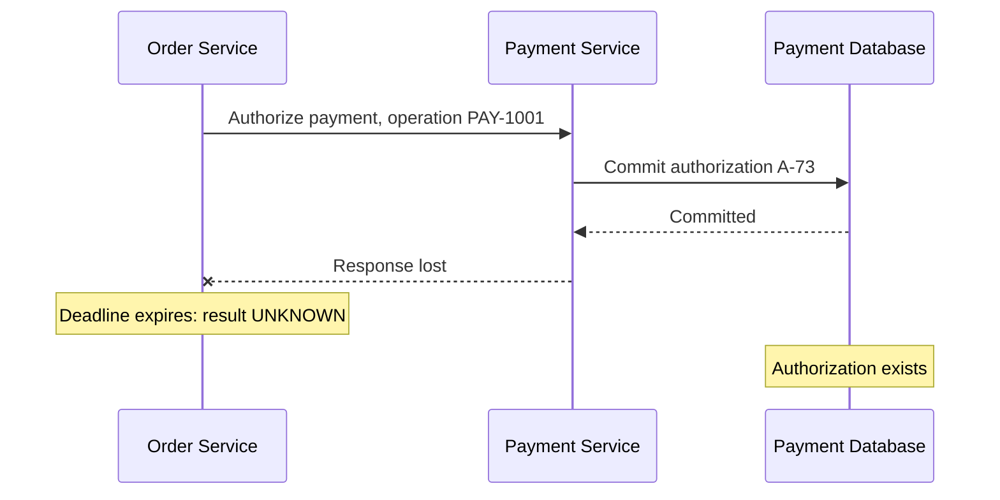
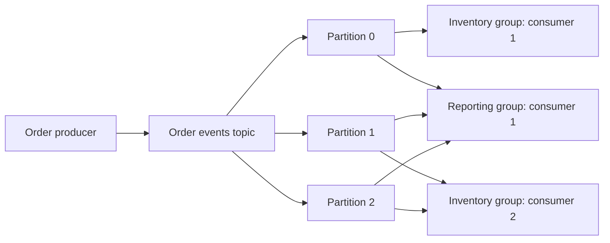
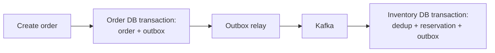

# Chapter 1 — Foundations of Distributed Systems: Java 21, Spring Boot, REST APIs, Messaging, and Why Apache Kafka Exists

Prepared: 2026-10-24. Status: Learning. This is the full first conceptual chapter, not a completed Spring application milestone.

## 1. Lesson title
Foundations of Distributed Systems: Java 21, Spring Boot, REST APIs, Messaging, and Why Apache Kafka Exists.

## 2. Interview priority
P0. Recognizing failure boundaries is essential before choosing frameworks or messaging settings.

## 3. Prerequisites
Java methods and exceptions, HTTP APIs, basic SQL transactions, and the idea of JMS producers/consumers. Docker is not required to understand this chapter. Familiarity with an annotation does not establish understanding of the resources it controls.

## 4. Learning objectives
After practice, explain partial failure and an ambiguous result; distinguish transport success from business completion; compare a modular monolith with independently deployed services; distinguish HTTP/REST, JMS, and Kafka; draw partitions, offsets, and consumer groups; trace an order across transaction boundaries; identify a dual-write gap; and explain why bounded concurrency and idempotency are necessary.

## 5. Official references and version notes
Sources were opened on 2026-10-24. These are supporting references, not a claim that all pages or book chapters were read in full.

- [K1 Kafka 4.2 introduction](https://kafka.apache.org/42/getting-started/introduction/): event streaming and producer/topic/consumer concepts.
- [K2 Kafka 4.2 design](https://kafka.apache.org/42/design/design/): motivation, persistence, delivery semantics, transactions.
- [K3 Kafka 4.2 KRaft](https://kafka.apache.org/42/operations/kraft/): process roles and controllers.
- [K4 KafkaConsumer 4.2 API](https://kafka.apache.org/42/javadoc/org/apache/kafka/clients/consumer/KafkaConsumer.html): positions, commits, groups. The published API banner says 4.2.0; do not assume every patch-specific detail from it.
- [K5 KafkaProducer 4.2 API](https://kafka.apache.org/42/javadoc/org/apache/kafka/clients/producer/KafkaProducer.html): send buffering and completion.
- [K6 Kafka 4.2 topic configuration](https://kafka.apache.org/42/configuration/topic-configs/): retention and cleanup policy.
- [H1 HTTP semantics, RFC 9110](https://www.rfc-editor.org/rfc/rfc9110.html): section 9.2.2 idempotent methods, 15.3.2 Created, 15.3.3 Accepted.
- [J1 Jakarta Messaging 3.1](https://jakarta.ee/specifications/messaging/3.1/jakarta-messaging-spec-3.1.html): sections 1.1 and 2.4, queue and topic models.
- [S1 Spring transaction propagation](https://docs.spring.io/spring-framework/reference/data-access/transaction/declarative/tx-propagation.html): physical and logical transaction scope.
- [S2 Spring Kafka transactions](https://docs.spring.io/spring-kafka/reference/kafka/transactions.html): transaction synchronization and commit-failure handling.
- [V1 Java 21 virtual threads](https://docs.oracle.com/en/java/javase/21/core/virtual-threads.html): purpose and execution model.
- [S3 Spring Boot code organization](https://docs.spring.io/spring-boot/reference/using/structuring-your-code.html): application root package and component discovery.

Kafka-core references are all official Apache sources. Live Spring pages now display Boot/Spring Kafka 4.1.2 and Framework 7.0.10; our earlier proposed baseline remains 4.1.1/7.0.9 until reviewed. No version-sensitive Spring configuration is introduced here. No configuration defaults are needed for this lesson. Books remain recommended reading, not consulted evidence.

## 6. Fundamental explanation

### 6.1 Begin with a business rule
Imagine Order O-1001 requests two units of product P-10. The platform must accept the request, reserve stock, authorize a simulated payment, and arrange shipping. Our project rule is that an order cannot become ready for fulfillment without a confirmed reservation and payment authorization.

That rule matters more than the choice of broker. A system can have running containers and low HTTP error rates while violating it.

### 6.2 A monolith is a deployment choice
In a modular monolith, order, inventory, and payment-simulation modules can execute in one application process. Well-defined interfaces can still separate responsibilities. If order and inventory changes use the same database and transaction, their atomicity can be local.

A monolith can run on several application instances. Microservices are not required merely to add servers. Also, a monolith calling an external payment provider already crosses a distributed boundary.

Splitting services can help independent ownership, deployment, and scaling. The price is more network interactions, compatibility work, deployment coordination, telemetry, and failure recovery. These are architecture trade-offs, not mandatory stages of maturity.

### 6.3 What distribution changes
A remote call has at least three important components: the caller, the transport, and the receiver. Their observations can disagree. The caller can be healthy while the receiver is unavailable. The receiver can finish while its response is lost. A process restart can discard in-memory knowledge of completed work.

Compare:
- Local calculation: a return value is available in the executing process.
- Remote operation: an effect may exist elsewhere even when no result reaches the caller.

Do not infer that local operations never fail ambiguously: a local application's database or external system introduces its own boundary.

### 6.4 A timeout is an observation
The caller knows that a satisfactory response did not arrive within its deadline. It does not automatically know whether the receiver executed the request.

Suppose a payment provider writes authorization A-73, then its response is lost. Retrying with a different operation identity might create A-74. Our order database could record a failure even though a payment authorization exists.

Recovery requires an explicit policy: stable operation identity, a receiver that enforces idempotency, a status query or reconciliation, bounded retry, and possibly compensation. A timeout alone must not be translated into a business statement such as PaymentDeclined.

## 7. Internal architecture and mechanism

### 7.1 Three different meanings of asynchronous
1. Thread-level: a method returns a future while a request remains in flight.
2. Transport-level: work is placed in durable messaging infrastructure for later consumption.
3. Business-level: the API returns before the workflow is completed.

These are separate decisions. An asynchronous HTTP client does not make the business workflow durable. A producer's future describes its publication operation, not downstream business completion. The Kafka producer buffers records and uses background I/O; its send result must still be observed for failures. [K5]

### 7.2 Command, event, and query
A command asks an owner to perform an action: ReserveInventory.
An event reports an occurrence: InventoryReserved.
A query asks for information: What is the order's current status?

These are message semantics, not transport names. An HTTP request can carry a command, and a Kafka record can carry a command. Calling every Kafka message an event can obscure who is responsible for taking action.

### 7.3 Why Kafka exists
Kafka provides a retained event stream that independent applications can publish to and read from. Topics organize records; partitions divide each topic into ordered logs. That makes a shared stream useful when inventory, reporting, and notifications need independent processing and progress. [K1]

Kafka's design emphasizes high-volume feeds, efficient persistence, batches, and partitioned processing. Its log model does not make business operations automatically atomic across external systems. Exactly-once claims must state the participating resources and processing boundary. [K2]

Use Kafka when retained streams, replay, independent subscribers, or stream processing justify the operational cost. A small application that needs a few background jobs may be better served by a simpler queue or database-backed worker. This is our architectural recommendation.

### 7.4 The vocabulary
| Term | Meaning |
|---|---|
| Broker | Server responsible for storing and serving topic partitions |
| Topic | Named stream divided into partitions |
| Partition | Ordered log within a topic |
| Record | Key/value plus timestamp and optional headers |
| Offset | Position identifier within one partition |
| Producer | Client publishing records |
| Consumer | Client reading records |
| Consumer group | Logical subscription that coordinates work among participating consumers |
| Retention | Policy controlling how long/how much log data is retained |
| Replay | Reading previously retained data again |

These definitions follow [K1], [K4], and [K6]. Offset 12 in partition 0 and offset 12 in partition 1 identify different records. Offsets are not globally unique business event IDs.

### 7.5 Positions and work ownership
For a traditional subscribing consumer group, partitions are assigned among members. With three partitions and two members, one may handle two partitions and the other one. A fourth member cannot increase simultaneous partition ownership beyond three in that group. Different groups can process the same retained records independently.

The consumer's current position and committed restart position are distinct. A committed offset conventionally identifies where to resume, not a universal proof that an external effect happened. Offsets can have gaps. [K4]

Example: an inventory consumer commits its database change and crashes before committing its Kafka offset. After restart it may receive the same record. A database constraint and idempotent operation protect the business effect.

### 7.6 Retention and KRaft
Consumption does not by itself delete the topic's data. Cleanup depends on policies such as time/size retention or compaction. Replay only works for data still available, and replaying side effects needs additional safeguards. [K6]

KRaft controllers maintain Kafka metadata through a quorum; brokers handle record storage and serving. A development node may combine both roles. Dedicated controllers provide better isolation for critical deployments. The metadata quorum and user-record replication are different mechanisms. [K3]

## 8. Diagrams

### Lost response


The timeout and committed authorization can coexist. Recovery must reconcile them.

### Separate subscriber progress


This depicts logical consumption of the same partitions by two groups, not separate copies of topic data per group.

### Target transaction boundaries


There is no one transaction spanning every box. The relay can republish; Inventory must tolerate duplicates. This is our project design.

## 9. Java 21 implementation

This deterministic simulation deliberately loses a response AFTER a simulated payment effect. It uses no HTTP, Kafka, Spring, threads, or real money. It isolates the reasoning error without timing-dependent sleeps. It is complete source, provided as a learning example; it has not been compiled or executed in this chapter.

Save as AmbiguousOutcomeDemo.java if running it:

```java
import java.util.HashMap;
import java.util.Map;

public class AmbiguousOutcomeDemo {
    record Request(String operationId, String orderId, long amountMinor) {
        Request {
            if (operationId == null || operationId.isBlank()
                    || orderId == null || orderId.isBlank()
                    || amountMinor <= 0) {
                throw new IllegalArgumentException("Invalid payment request");
            }
        }
    }

    record Authorization(String id, Request request) {}

    static final class PaymentService {
        private final Map<String, Authorization> byOperation = new HashMap<>();
        private int successfulAuthorizations;

        Authorization authorize(Request request) {
            Authorization existing = byOperation.get(request.operationId());
            if (existing != null) {
                if (!existing.request().equals(request)) {
                    throw new IllegalArgumentException(
                            "Operation ID reused for a different request");
                }
                return existing;
            }

            Authorization created = new Authorization(
                    "AUTH-" + (++successfulAuthorizations), request);
            byOperation.put(request.operationId(), created);
            return created;
        }

        int effectCount() {
            return successfulAuthorizations;
        }
    }

    static final class ResponseLost extends RuntimeException {}

    static Authorization invoke(
            PaymentService service, Request request, boolean loseResponse) {
        Authorization result = service.authorize(request);
        if (loseResponse) {
            throw new ResponseLost();
        }
        return result;
    }

    public static void main(String[] args) {
        PaymentService service = new PaymentService();
        Request request = new Request("PAY-1001", "ORDER-1001", 12500);

        try {
            invoke(service, request, true);
        } catch (ResponseLost exception) {
            System.out.println("Caller outcome: UNKNOWN");
        }

        Authorization retried = invoke(service, request, false);
        System.out.println("Recovered authorization: " + retried.id());
        System.out.println("Business effects: " + service.effectCount());

        if (service.effectCount() != 1) {
            throw new AssertionError("Duplicate business effect");
        }
    }
}
```

Important decisions:
- operationId stays the same across a retry of the same logical operation.
- amountMinor is an integer in one implicit demo currency, not a full Money implementation.
- authorize checks request identity before reusing an existing result.
- invoke loses the result only after authorize has acted.
- the check verifies one effect for this sequential scenario.

Production limitations: the map is neither durable nor concurrency-safe; a restart loses deduplication; it is not a database transaction or external-provider integration. Production requires durable unique operation keys, atomic effect/result persistence, appropriate concurrency control, and provider-side idempotency or reconciliation. ConcurrentHashMap alone would not solve persistence or external side effects.

## 10. Spring Boot integration

Spring supplies application wiring, HTTP adaptation, validation, and infrastructure integration. Our responsibilities remain business invariants and failure policies.

Planned flow:
OrderController -> CreateOrderService -> OrderRepository + OutboxRepository.
Kafka listener -> application handler -> local transaction -> outgoing outbox.

Place the main Boot application in a parent package so discovery covers its application components. [S3]

A database transaction manager controls its participating resource. An ordinary remote HTTP operation is not undone by rolling back that database transaction. Spring transaction propagation describes relationships among transaction scopes, not an automatic cross-service rollback protocol. [S1]

Spring Kafka can synchronize transactions with another transaction manager, but commits still occur in an order, and a later commit can fail after an earlier one succeeds. Therefore synchronization must not be described as failure-proof distributed atomicity. Our project uses outbox for the relevant boundary. [S2]

Virtual threads can reduce the cost of many waiting tasks. They do not increase the number of database connections or the payment provider's capacity. We will study Java 21-specific behavior in the concurrency chapter. [V1]

## 11. Production scenario

Assume an order is durably accepted at 10:00, inventory is reserved at 10:01, and the payment call times out at 10:02. These are illustrative times, not measurements.

The customer-facing state should distinguish processing/unknown outcome from confirmed rejection. A stable operation ID allows a retry or status lookup to recover the authorization. Shipping must not start until the workflow has the necessary evidence.

If cancellation begins while authorization is unresolved, the workflow needs a policy for a late success: for example, void authorization and finish cancellation. It must not both ship and release inventory.

Useful observations:
- order age in each state;
- pending outbox count and oldest age;
- unresolved payment operation count;
- duplicate detections;
- consumer lag;
- compensation failures.

An HTTP success rate cannot prove these business invariants.

## 12. HLD considerations

Choose boundaries from business ownership and consistency needs. For this course:
- Order owns workflow state.
- Inventory owns availability and reservations.
- Payment owns simulated authorization and operation identity.
- Catalog caching is advisory; inventory remains authoritative.
- Reporting can be eventually consistent.
- Each service owns its local transaction and data.

Prefer a modular monolith when independent service deployment is not justified. We split this project progressively to learn distributed mechanisms, not because all commerce applications require nine services.

Compare communication options:
| Option | Category | Useful when | Engineering cost |
|---|---|---|---|
| REST over HTTP | Architectural style commonly implemented with HTTP | Direct queries and request/response APIs | Deadlines, dependency availability, retry ambiguity |
| JMS / Jakarta Messaging | Java messaging specification | Portable queue/topic APIs in enterprise messaging | Provider configuration, acknowledgment and transaction policies |
| Kafka | Event-streaming platform | Retained records, independent consumers, replay, stream processing | Partition design, lag, schemas, retention, broker operations |

JMS supports both queue and publish/subscribe models; a queue targets one consumer per message and topics support subscriptions, including durable/shared subscription forms. It is not a particular broker or a guarantee that every provider behaves identically. [J1]

REST does not imply that the complete business operation finishes within one response. HTTP 201 describes resource creation; 202 describes acceptance without completed processing. Method idempotency and an application's POST deduplication policy are different concepts. [H1]

## 13. LLD considerations

Use explicit types: OrderId, PaymentOperationId, OrderStatus, PaymentOutcome. A timeout should not be forced into a PaymentDeclined result.

Keep responsibilities separate:
- transport adapter interprets connection/read/deadline failures;
- application layer decides retry/reconciliation;
- domain layer guards valid transitions;
- persistence enforces unique keys and durable state.

Example policy:
PENDING_PAYMENT + confirmed authorization -> READY_FOR_FULFILLMENT.
CANCELLING + confirmed authorization -> schedule a compensating action.
Do not blindly accept every event just because deserialization succeeded.

## 14. Reliability and recovery

| Failure boundary | What may already exist | Recovery direction |
|---|---|---|
| Client loses create-order response | Order row committed | Retry same request key or query existing order |
| DB commit before direct publish | Order without event | Persist outbox with order |
| Publish before relay marks completion | Event already delivered | Republish safely; consumer deduplication |
| Consumer DB commit before offset commit | Business effect committed | Detect redelivery in local transaction |
| Replay of historical records | Previous external effects | Rebuild projections separately; guard live side effects |
| Unknown payment result | Authorization may exist | Stable key, status query, reconciliation |
| Compensation repeatedly fails | Business resources still held | Persist retries; alert and expose repair work |

Retry design must classify transient transport failures versus permanent validation failures. Retry budgets and backoff reduce traffic, but they do not create idempotency. Recovery is complete only after the business invariant is checked.

## 15. Performance

Illustrative exercise: incoming rate = 1,000 records/second, sustainable processing = 800/second.
Backlog growth = 200/second.
After five minutes: 200 x 300 = 60,000 records, assuming steady rates and no initial backlog.

If processing rises to 1,200/second while arrival stays 1,000/second:
net drain = 200/second;
drain time = 60,000 / 200 = 300 seconds.

These are calculations, not benchmarks. Real traffic varies, failures add work, and record sizes differ. A queue buys time; it does not eliminate a sustained capacity deficit. Raising consumer concurrency may overwhelm the database instead of improving completion throughput.

For serial dependencies, observed request time includes the sum of their waits plus local work and network overhead. Concurrent independent calls can reduce that critical path, but do not remove capacity or correctness constraints.

## 16. Ten study interview questions with model answers

### Q1. What makes partial failure difficult? [P0]
Fundamental: some components can succeed while others fail or cannot observe success.
Senior answer: identify each effect, acknowledgment, and recovery boundary. A caller has incomplete knowledge of remote state.
Example: payment committed but response lost.
Failure/trade-off: blindly retrying can duplicate an effect; never retrying can leave work unresolved.
Common mistake: equating timeout with business rejection.
Follow-up: how would you recover after both services restart?
Reference: [H1]; the payment sequence is our worked example.

### Q2. When would you keep a modular monolith? [P0]
Fundamental: when one deployment and local coordination meet the needs.
Senior answer: assess team ownership, change coupling, independent scaling, data invariants, and operational capacity before adding boundaries.
Example: a small order system with one team and shared transactional needs.
Trade-off: less deployment independence, but fewer network failure paths.
Common mistake: claiming microservices automatically scale better.
Follow-up: which evidence would justify extracting Inventory?
Reference: architectural recommendation; no universal official rule determines service boundaries.

### Q3. How is asynchronous communication different from an asynchronous Java method? [P0]
Fundamental: a future changes waiting behavior; durable messaging changes how work survives and is delivered.
Senior answer: separate thread scheduling, transport acknowledgment, and business completion.
Example: returning CompletableFuture does not persist a payment request.
Failure: the process can stop while work exists only in memory.
Common mistake: treating async as durable.
Follow-up: what exactly does successful producer completion establish?
Reference: [K5], [V1].

### Q4. How do you compare REST, JMS, and Kafka fairly? [P0]
Fundamental: they are different categories: architectural style, Java messaging specification, and streaming platform.
Senior answer: compare concrete implementations and required contracts, not category labels alone.
Example: HTTP for order lookup; Kafka for independently consumed order changes; JMS for an established enterprise queue integration.
Trade-off: replay/retention needs differ from single-consumer work distribution.
Common mistake: saying JMS has no topics.
Follow-up: can HTTP accept asynchronous work?
Reference: [H1], [J1], [K1].

### Q5. Why retain events after consumption? [P0]
Fundamental: another reader or later rebuild may still need them.
Senior answer: retention enables independent progress, but replay must account for contract evolution and side effects.
Example: rebuilding a reporting projection without triggering fresh payment operations.
Trade-off: storage and privacy/lifecycle responsibilities grow with retained history.
Common mistake: assuming retention means unlimited history.
Follow-up: what if the required data has already expired?
Reference: [K6].

### Q6. What does a partition key solve? [P0]
Fundamental: it helps select a partition and group related records.
Senior answer: key selection balances locality/ordering requirements against skew; stable routing assumptions matter.
Example: orderId groups order-related records under an unchanged partitioning scheme.
Failure: adding partitions or using different partitioners can change routing; downstream parallel work can reorder effects.
Common mistake: claiming global business order from a shared key.
Follow-up: why does orderId not prevent inventory overselling across orders?
Reference: [K1], [K4]; inventory conclusion is our project reasoning.

### Q7. Does adding consumers always improve throughput? [P0]
Fundamental: traditional group partition ownership bounds useful parallelism.
Senior answer: partition skew, processing cost, downstream pools, and rebalances can be limiting factors.
Example: an additional member can be idle when every partition already has an owner.
Trade-off: more processing can overload PostgreSQL.
Common mistake: treating consumer count as a universal throughput multiplier.
Follow-up: which metric separates a hot partition from database saturation?
Reference: [K4].

### Q8. Does producer acknowledgment mean an order completed? [P0]
Fundamental: no; it concerns publication under configured semantics.
Senior answer: downstream consumption, database changes, and business transitions require their own evidence.
Example: reporting can be hours behind an accepted event.
Trade-off: decoupling requires status visibility and backlog management.
Common mistake: returning 'paid' when only a command was published.
Follow-up: what should the API return after durable order creation?
Reference: [K5], [H1].

### Q9. Why does an outbox still require idempotent consumers? [P0]
Fundamental: the relay can publish and crash before recording publication.
Senior answer: retry bridges a failure gap but can repeat delivery; couple consumer deduplication with its business mutation and outgoing records.
Example: inventory must not reserve twice on republished commands.
Trade-off: deduplication storage and retention/replay policy need ownership.
Common mistake: describing outbox as end-to-end exactly-once delivery.
Follow-up: what if two different event IDs request the same business operation?
Reference: [K2], [S2]; outbox protocol is our architectural design.

### Q10. Why does @Transactional not undo an HTTP payment? [P0]
Fundamental: the normal database transaction does not control the remote provider's effect.
Senior answer: enumerate transaction managers and resources; distinguish synchronization from atomic commit and use compensations/reconciliation for external effects.
Example: local order rollback after a remote authorization.
Trade-off: compensations can fail and need durable tracking.
Common mistake: assuming one annotation spans every call inside the method.
Follow-up: what evidence is needed before declaring cancellation complete?
Reference: [S1], [S2].

## 17. Exercises

A. Predict the Java program output before running it. Explain why the effect count should be one.
B. Retry with a NEW operation ID for the same order. Predict the effect count and identify the missing production business constraint.
C. Reuse the SAME operation ID but change the amount. Predict the exception and explain why silent reuse is dangerous.
D. Create a new PaymentService before retrying. Explain why in-memory deduplication fails across restarts.
E. Draw a sequence for DB commit -> Kafka publish -> process crash. Mark each place duplication or missing publication can arise.
F. Recalculate backlog for arrival 750/sec and processing 500/sec over eight minutes. Then choose a recovery rate and calculate drain time.

These are learning exercises, not a separate DSA track.

## 18. Verification

To run the embedded Java example after saving it:
```powershell
& 'C:\Program Files\Java\jdk-21.0.10\bin\java.exe' .\AmbiguousOutcomeDemo.java
```

Expected, not observed:
```text
Caller outcome: UNKNOWN
Recovered authorization: AUTH-1
Business effects: 1
```

The source-file launcher compiles and executes the single-file example. No Maven dependencies are needed for this isolated simulation; the main project remains Maven-based. This does not test HTTP networking, Kafka, persistence, or concurrent idempotency.

Paper-exercise checks: show the receiver's durable state independently of the caller's observation; mark local transaction boundaries; name a stable operation ID; distinguish publication from downstream completion.

Status: documentation sources checked; example not executed; full application not implemented; Docker/Kafka setup remains unverified.

## 19. Common misconceptions

- Timeout means the receiver did nothing.
- Async means durable.
- Monolith means one server.
- JMS is a specific broker or supports only queues.
- Kafka acknowledgment proves business completion.
- Consumer offset commit deletes the event.
- Every partition offset is globally unique.
- More consumer instances always increase throughput.
- One transaction annotation covers remote systems.
- Virtual threads create unlimited downstream capacity.
- A cache value is authoritative inventory.
- Replay is safe for every consumer.
- A completed read implies mastery.

## 20. Knowledge assessment

Unanswered assessment: Order Service times out after calling Inventory. Inventory may have committed a reservation, and the customer retries the order request. Describe the possible states and a recovery design that avoids duplicate orders and duplicate reservations.

This scenario intentionally changes the service from the study example. No score is recorded until the learner answers.

## 21. Revision summary

- Separate what happened from what the caller knows.
- Define correctness as business invariants.
- Identify every local transaction and acknowledgment boundary.
- Choose communication based on required semantics.
- Retained logs support independent consumption, but impose replay and lifecycle responsibilities.
- Use stable business operation identity and durable enforcement.
- Observe workflow age and unresolved outcomes, not only infrastructure health.

## 22. Next lesson
Chapter 1 follow-up: inspect the assessment answer and deepen any gaps. Then start the first Maven/Kafka application milestone with explicit demo limitations, or proceed with the Java/JVM chapter while environment installation is pending. Do not mark Chapter 1 interview ready from reading alone.
