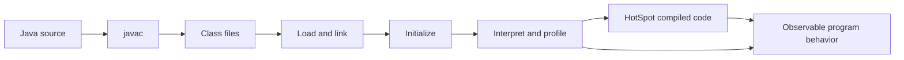
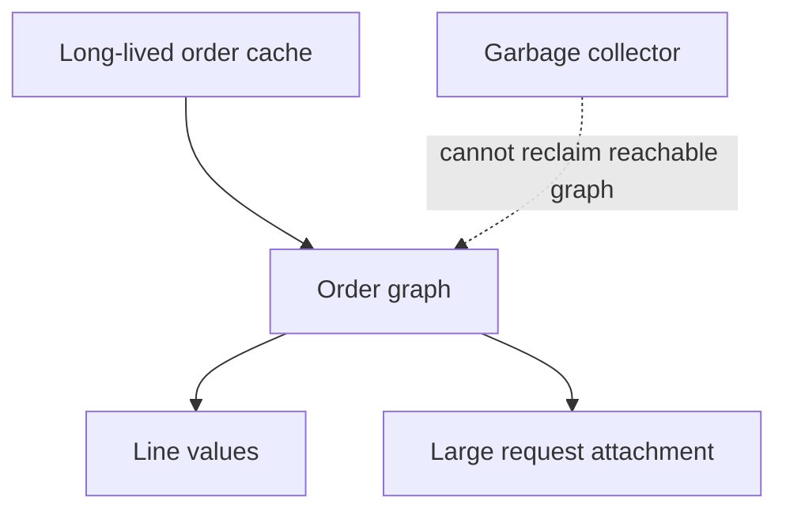

# Chapter 2 — Java 21 and the JVM: From Domain Types to Production Evidence

Prepared 2026-10-24. Learning material; examples are unexecuted educational examples, not a validated application release.

## 1. Lesson title
Understand the Java program that you write, the JVM that executes it, and the evidence needed when either behaves unexpectedly.

## 2. Interview priority
P0 for memory, garbage collection, exceptions, immutability, and diagnosis; P1 for compilation and class loading detail. Explain mechanisms through an order request before memorizing flags.

## 3. Prerequisites
A variable gives a name to a value; a method groups computation; a class defines behavior and state; an object is one instance. An exception changes normal control flow. Review Chapter 1's distinction between a business result and what a caller observes. No running database is required here.

## 4. Learning objectives
Model explicit outcomes with records and sealed types, distinguish Java 21 final features from previews, trace source through bytecode and runtime execution, account for heap and non-heap memory, explain reachable-object leaks, and select diagnostic evidence for latency, CPU, and memory incidents. Develop an investigation that can disprove a hypothesis.

## 5. Official references and version notes
Opened 2026-10-24; section-level evidence, not claims of reading entire manuals. Java 21 remains the language/runtime baseline. Maven remains the project build tool; Spring Boot 4.1.1 remains proposed. Nothing here validates its dependency graph.

| ID | Official reference | Sections used |
|---|---|---|
| J1 | [Java 21 language changes](https://docs.oracle.com/en/java/javase/21/language/java-language-changes-release.html) | Final and preview features |
| J2 | [Record classes](https://docs.oracle.com/en/java/javase/21/language/records.html) | Components, constructors |
| J3 | [Sealed classes](https://docs.oracle.com/en/java/javase/21/language/sealed-classes-and-interfaces.html) | Permitted implementations |
| J4 | [Pattern matching switch](https://docs.oracle.com/en/java/javase/21/language/pattern-matching-switch.html) | Type coverage, null |
| J5 | [SequencedCollection API](https://docs.oracle.com/en/java/javase/21/docs/api/java.base/java/util/SequencedCollection.html) | Encounter order, reversed view |
| J6 | [JVMS chapter 2](https://docs.oracle.com/javase/specs/jvms/se21/html/jvms-2.html) | 2.5 runtime areas, 2.6 frames |
| J7 | [JVMS chapter 5](https://docs.oracle.com/javase/specs/jvms/se21/html/jvms-5.html) | Loading, linking, initialization |
| J8 | [HotSpot enhancements](https://docs.oracle.com/en/java/javase/21/vm/java-hotspot-virtual-machine-performance-enhancements.html) | Tiered compilation, escape analysis |
| J9 | [GC introduction](https://docs.oracle.com/en/java/javase/21/gctuning/introduction-garbage-collection-tuning.html) | Reclamation and trade-offs |
| J10 | [G1 collector](https://docs.oracle.com/en/java/javase/21/gctuning/garbage-first-g1-garbage-collector1.html) | Regions, evacuation, pause goals |
| J11 | [Diagnostic tools](https://docs.oracle.com/en/java/javase/21/troubleshoot/diagnostic-tools.html) | JFR, native memory tracking, dumps |
| J12 | [jcmd](https://docs.oracle.com/en/java/javase/21/docs/specs/man/jcmd.html) | Help, recording and dump commands |

Language/JVM statements below are documented facts tied to these sources. Commerce designs, incident sequences, and suggested experiments are course recommendations and original examples. Some OpenJDK JEP links returned 403; the Oracle Java 21 language guides provide the usable evidence. No unavailable ZGC page is treated as verified.

## 6. Fundamental explanation

### Values, identity, and ownership
Order O-1001 has an identity that survives changes in status. A price of 12500 minor currency units is a value: two equivalent prices can be interchangeable. This distinction guides equality. An order entity should not become a different business order when a status changes, while two request values with different quantities should compare differently. Separate identity types reduce accidental exchange of an order ID and a payment operation ID.

A reference is a way to reach an object, not the object itself. Assigning a list to another variable gives both variables access to that list; it does not clone the elements. Consequently, passing a mutable request collection to a background job creates shared state even if no global variable exists. Our recommendation is to copy collection structure at the boundary and use immutable element values. Ownership is a design choice that the compiler does not universally enforce.

Records supply component accessors and value-oriented equality machinery. Their component fields are final, but an element reachable through a component can remain mutable. A compact constructor is a useful place for validation and defensive copying. [J2] In the example, List.copyOf prevents later changes to the caller's list from changing a submitted order. It would not deeply clone mutable line objects, which is why Line is also an immutable record.

### Features available in Java 21
Records and sealed classes were finalized before 21 and are available in our baseline. Sealed types bound the direct implementations of a type. [J3] They are useful for a deliberately closed set of local results, such as Reserved and Rejected. They do not force independent remote services to upgrade together; a wire protocol still requires its own compatibility policy.

Record patterns and pattern matching for switch are final in Java 21. Structured concurrency and scoped values are not treated as stable course APIs; preview features need separate compiler/runtime opt-in and a deliberate adoption decision. String templates are also preview in Java 21. [J1] Do not paste a later-JDK tutorial into a Java 21 application and assume compilation proves production suitability.

Java 21 sequenced collections make encounter order and first/last operations explicit. A reversed collection can be a view rather than an independent copy. [J5] In commerce, order of invoice lines may be presentation data, while order of workflow events can carry semantic meaning. Choose a structure by the required contract, not because a new interface exists.

## 7. Internal architecture and mechanism

### From source to execution
The Java compiler produces class files containing bytecode and metadata. A JVM loads types, links them, and initializes them when required. Linking includes verification, preparation, and resolution; initialization executes class initialization logic. Type identity involves the defining class loader as well as a binary name. [J7] Two plugins can therefore contain classes with identical names that are not interchangeable runtime types. For our service, minimizing unnecessary custom class loaders makes upgrades and diagnosis simpler.

Think of startup failure in stages. A missing dependency can stop loading. A method signature mismatch can produce a linkage failure after a dependency upgrade. A static initializer that opens an unavailable database can fail during initialization. The operational response differs: dependency repair, compatibility correction, or removal of external work from static initialization. Repeated retries cannot repair an incompatible method signature.

Each executing thread has JVM execution state including frames. A frame supports local variables, operand evaluation, and method return. Objects and arrays are allocated from the shared heap in the JVM model; the specification leaves representation and optimization to implementations. [J6] Avoid the interview shortcut that every local value permanently lives on a physical stack. A local reference can keep a large heap graph reachable, and optimized machine code can eliminate work while preserving observable behavior.

HotSpot uses interpretation and tiered compilation to gather execution information and optimize frequently used code. Compiled machine code occupies a code cache. Escape analysis can enable allocation-related optimizations, but code should not rely on a particular optimization occurring. [J8] A cold service can therefore behave differently from one that has processed representative traffic. A benchmark that times one invocation mostly measures a different workload from sustained checkout traffic.

### Memory pressure is a whole-process question
Heap capacity is only part of a process budget. Thread resources, class metadata, generated code, direct buffers, libraries, and other native allocations also matter. [J11] For a container limit, reserving the entire limit for the heap leaves no budget for these categories. Our sizing recommendation is to measure the whole process under its actual request and connection mix, then keep deliberate headroom. A formula with an unexplained percentage is not evidence.

Garbage collection reclaims memory that the application no longer needs according to reachability. It cannot decide that an old order retained in a map is useless to the business. [J9] A leak often means a valid reference survives too long: an unbounded cache, a listener registration never removed, or completed requests retained in a diagnostics list. Rising allocation with a stable live set and a rising live set are different problems.

G1 divides the heap into regions and performs evacuation and concurrent work as part of its collection strategy. It uses pause goals, not a guarantee that every pause meets a hard deadline. [J10] Start with evidence about allocation, retained objects, pause distribution, and CPU before selecting a different collector. Compare G1, throughput-oriented collectors, and low-latency alternatives only on an explicitly verified runtime and workload; this chapter does not assert unverified ZGC flags or benchmarks.

## 8. Diagrams





The second diagram explains why adding heap postpones exhaustion without removing the retained reference. The first is a teaching model, not a promise that all methods follow an identical compilation path.

## 9. Java 21 implementation

Unexecuted educational example. Complete single-file program named OrderValueDemo.java; no dependencies or preview flags. It demonstrates input ownership, domain validation, and explicit result handling, not reservation persistence.

```java
import java.util.ArrayList;
import java.util.List;
import java.util.Objects;

public class OrderValueDemo {
    record Line(String sku, int quantity) {
        Line {
            Objects.requireNonNull(sku);
            if (sku.isBlank() || quantity <= 0) {
                throw new IllegalArgumentException("Invalid line");
            }
        }
    }
    record OrderRequest(String orderId, List<Line> lines) {
        OrderRequest {
            Objects.requireNonNull(orderId);
            if (orderId.isBlank()) throw new IllegalArgumentException("Order ID");
            lines = List.copyOf(lines);
            if (lines.isEmpty()) throw new IllegalArgumentException("Empty order");
        }
    }
    sealed interface Reservation permits Reserved, Rejected {}
    record Reserved(String reservationId) implements Reservation {}
    record Rejected(String reason) implements Reservation {}

    static String describe(Reservation result) {
        Objects.requireNonNull(result);
        return switch (result) {
            case Reserved(String id) -> "Reserved: " + id;
            case Rejected(String reason) -> "Rejected: " + reason;
        };
    }

    public static void main(String[] args) {
        var callerLines = new ArrayList<Line>();
        callerLines.add(new Line("P-10", 2));
        var request = new OrderRequest("O-1001", callerLines);
        callerLines.clear();
        if (request.lines().size() != 1) {
            throw new AssertionError("Request changed after submission");
        }
        System.out.println(request.orderId() + " lines=" + request.lines().size());
        System.out.println(describe(new Reserved("R-1001")));
    }
}
```

An exhaustive switch over a closed hierarchy makes an added result variant visible during compilation. It does not establish completeness for unknown JSON received from the network. [J4] The boundary adapter must reject or translate unsupported input explicitly. Records are particularly useful for commands and responses; blindly replacing persistence entities with records ignores the persistence framework's own construction and identity rules.

## 10. Spring Boot integration
Keep controllers responsible for translating transport input into validated commands. Place domain calculations behind constructor-injected services and represent results explicitly. A singleton service should not keep the current request in a mutable field: many calls can reach the same instance. JVM knowledge is therefore relevant even when most application code contains annotations.

Bind JVM options in the deployment environment and record the effective runtime in diagnostics. Application configuration cannot retroactively change every VM startup option. For our Maven project, keep the Java release level explicit at 21 and let the reviewed Boot dependency management control compatible libraries. Do not claim a successful build because the source uses familiar annotations. Chapter 4 explains actual container behavior.

## 11. Production scenario
After a catalog import, Order latency rises while heap usage repeatedly falls after collection. One hypothesis is excessive temporary JSON allocation; another is a database wait that happens during the same interval. A heap graph alone cannot distinguish them. Correlate request latency with CPU samples, allocation events, garbage-collection pauses, database timing, and thread states for the same time window.

If retained heap grows after every import, inspect paths keeping imported data reachable. An intentionally bounded cache and an accidental list of every import response can look similar in a class histogram. Ownership paths explain the difference. Fix the retention policy, then repeat the same workload and compare post-collection live-set behavior. The proposed result is evidence to seek, not a measured outcome.

## 12. HLD considerations
Capacity planning must include multiple service replicas, connection buffers, request concurrency, and startup behavior. A small heap per replica may reduce per-instance loss but increase total metadata and connection overhead. Large in-memory order state increases restart cost and weakens recovery unless state can be reconstructed from durable storage. Our architecture keeps workflow state in the Order database and uses process memory for bounded work in progress.

Choose recovery before tuning. A restart should replay durable work safely and rebuild advisory caches. Losing an in-memory optimization must not lose payment identity or release an authoritative reservation. JVM tuning cannot compensate for storing the only copy of a business obligation in a map.

## 13. LLD considerations
Use immutable command values, narrow interfaces, and explicit resource ownership. Avoid returning a service's mutable internal collection. Validate quantity and money bounds near creation; define overflow behavior for multiplication. A diagnostic toString should not expose credentials or personal data, including automatically generated record output.

Separate expected rejection from infrastructure failure. Insufficient stock can be a result value. A broken database connection is operational failure needing policy and evidence. Catching every exception and returning Rejected destroys this distinction and makes an outage look like normal business demand.

## 14. Reliability and failure recovery
Classify a failure before acting. StackOverflowError suggests uncontrolled depth or recursion; heap exhaustion suggests allocation/retention pressure; a native-memory failure can occur even with heap space available. A linkage error suggests incompatible runtime artifacts. The class of failure narrows the investigation without proving its precise cause.

Plan evidence collection before an incident. Heap dumps can be large and contain business data. Give them a controlled destination, retention policy, and sufficient disk space. Thread dumps reveal stacks and synchronization snapshots; repeated snapshots help separate a transient wait from a persistent blockage. JFR provides a time-oriented view of configured runtime events. [J11] Restarting first can restore service but destroys some evidence, so define an incident policy balancing recovery urgency and capture cost.

## 15. Performance and capacity
Distinguish throughput, response-time percentiles, CPU utilization, allocation rate, and retained memory. An optimization that reduces average CPU may increase tail latency through contention. Measure representative payload sizes and mixed operations, including rejected requests. Warm-up, data distribution, and concurrency belong in the experiment description.

For an illustrative budget, 200 simultaneous requests each retaining 500 KiB consume about 97.7 MiB just for those request graphs. This is arithmetic, not a JVM measurement; object overhead and buffers add more. Reducing needless retention time may save more memory than changing a collector. Use sampled profiling to identify expensive paths and verify improvements with the same workload rather than rewriting every allocation-heavy method.

## 16. Interview questions with explained answers

1. **Does a final reference make an object immutable?** No. It prevents reassignment of that reference after initialization under its applicable rules; a referenced list can still change. Our request constructor copies the list, and its elements are immutable values. Explain the entire reachable graph when claiming immutability.

2. **Why use a record for a request?** It expresses a transparent value carrier with generated component behavior. Validation and copying remain our responsibility. A request is a better fit than an entity whose identity and lifecycle require specialized framework behavior.

3. **Why can a Java process exceed its heap size?** Heap is only one memory category. Native allocations, thread resources, metadata, and generated code contribute. Compare process memory with category evidence rather than raising Xmx automatically.

4. **How can Java leak memory with GC?** An unwanted object can remain reachable. The collector cannot infer that yesterday's requests should have been removed from a static collection. Investigate retaining paths and lifecycle ownership, then verify a stable live set.

5. **Why can startup traffic be slower?** Class loading, initialization, connection establishment, cache population, and compilation can occur early. Measure these separately. A health response does not prove representative business paths are warm.

6. **What does a class-loading error suggest?** Missing or incompatible artifacts are plausible; static initialization is a separate stage. Identify the exact error and dependency/version context. Retrying requests will not create a missing class.

7. **Is a G1 pause target a deadline guarantee?** No. A target guides a heuristic collector under workload constraints. A strict latency requirement needs measured tails, headroom, and application-level overload behavior, not one VM flag.

8. **When do you choose a thread dump over a heap dump?** Start with threads when requests appear blocked or stuck; inspect heap ownership when memory grows. Both are snapshots, while a recording provides temporal context. Select evidence from the question being asked.

9. **Why is one stopwatch invocation a weak benchmark?** Startup and optimization can dominate, inputs may be unrealistic, and unused work can be optimized. A controlled benchmark requires warm-up, useful results, representative state, and statistical interpretation.

10. **Can sealed types solve event schema evolution?** They help local exhaustiveness. Remote producers and consumers deploy independently, so unknown wire variants require versioned contracts and explicit handling. Compiler completeness within one artifact does not prove distributed compatibility.

## 17. Exercises
Save and run the program only in a Java 21 practice environment. Predict the result after callerLines.clear before executing. Then replace List.copyOf with direct assignment and repeat. Expected observation: the protected request retains one line; the altered request fails the assertion. The solution is ownership transfer through a defensive structural copy, not a synchronized list.

Add a third result, Pending(String operationId), to the sealed hierarchy. The expected compile failure at the switch is useful evidence that the decision table needs updating. Add a Pending branch that reports uncertainty without claiming rejection. This connects language design to the ambiguous outcomes in Chapter 1.

Paper lab: a service has stable post-GC heap but growing resident memory. Propose three checks. Solution: inspect thread counts/stacks, direct-buffer or native allocation evidence, and VM native memory tracking if enabled; also compare container/process accounting. Do not conclude a heap leak from resident memory alone.

## 18. Verification
No Java code or diagnostic command was executed during authoring. Expected program output is `O-1001 lines=1`, followed by `Reserved: R-1001`. Run `java OrderValueDemo.java` with a confirmed Java 21 installation. This single-file exercise does not require or replace the Maven project.

Illustrative diagnostic sequence, unexecuted: `jcmd <pid> help`, then `jcmd <pid> help JFR.start` and the relevant command help before capture. For example, a bounded recording can use `jcmd <pid> JFR.start name=checkout settings=profile duration=60s filename=checkout.jfr`. Inspect command impact and permissions on the actual target. The jcmd manual documents target access and available-command discovery. [J12] There are no measured performance results or claims of application readiness.

## 19. Common misconceptions
GC does not remove every object that is no longer useful to the business. A record is not recursively immutable. More heap is not always lower latency. A Java source feature available in a later tutorial may be preview or absent in 21. A successful local demonstration does not prove a service's transaction safety. A dump is evidence requiring interpretation, not a diagnosis by itself.

## 20. Knowledge assessment
Unanswered: Order retains completed futures in a map, request latency rises, and its container restarts while heap occasionally drops. Describe how you would distinguish reachable retention, native-memory pressure, and a slow dependency. State which observation would falsify each hypothesis. No score is recorded until an answer and supporting evidence exist.

## 21. Revision summary
Model values deliberately; use Java 21's stable type features to make invalid states harder to express. Separate language guarantees, JVM specification, and HotSpot implementation choices. Investigate whole-process memory and correlate runtime evidence with business latency. Repair ownership and lifecycle mistakes before treating tuning flags as a solution.

## 22. Next lesson
Chapter 3 adds multiple simultaneous executions. The immutable request remains useful, but shared reservation state now needs atomicity, visibility, bounded admission, and an explicit shutdown policy.
