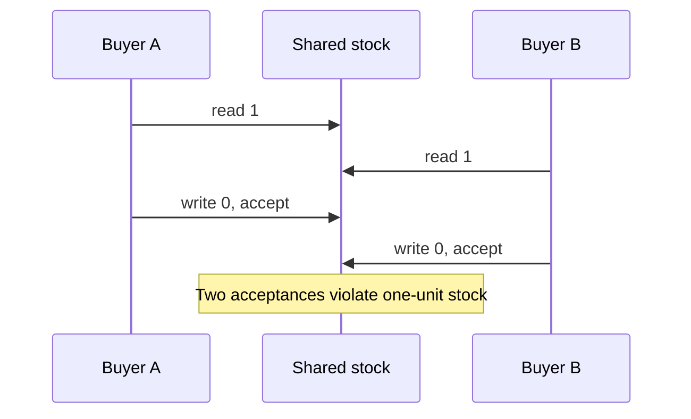
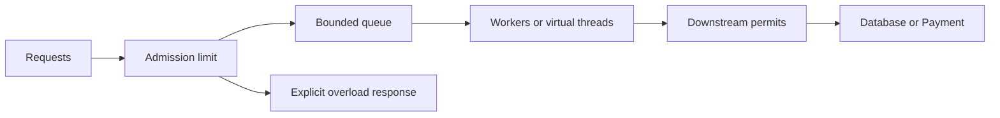

# Chapter 3 — Concurrency, the Java Memory Model, and Bounded Work

Prepared 2026-10-24. Educational examples are unexecuted; local concurrency demonstrations are not durable inventory implementations.

## 1. Lesson title
Coordinate simultaneous work without losing correctness, saturating dependencies, or hiding unfinished tasks.

## 2. Interview priority
P0. Explain atomicity, visibility, happens-before, executors, cancellation, virtual threads, and backpressure using a concrete invariant. P1: diagnose contention and choose coordination primitives by semantics.

## 3. Prerequisites
Chapter 2's references, objects, memory ownership, and immutable values. A thread is an independently scheduled execution sequence. Concurrency means activities overlap in time; parallelism means work actually executes simultaneously on different execution resources. A program can have concurrency on one CPU.

## 4. Learning objectives
Identify data races, distinguish visibility from compound atomicity, select locks and concurrent collections, build bounded executors, reason about futures and cancellation, and explain Java 21 virtual-thread limitations. Trace resource ownership and shutdown for a request that outlives its caller.

## 5. Official references and version notes
Verified 2026-10-24. Java 21 is the baseline; structured concurrency and scoped values are outside the stable-code examples. Spring Boot remains proposed 4.1.1; live Spring scheduling documentation is Framework 7.0.10 and is conceptual evidence only.

| ID | Reference | Sections |
|---|---|---|
| C1 | [JLS 17](https://docs.oracle.com/javase/specs/jls/se21/html/jls-17.html) | 17.4.5 happens-before, 17.5 final fields |
| C2 | [Concurrent package](https://docs.oracle.com/en/java/javase/21/docs/api/java.base/java/util/concurrent/package-summary.html) | Executors, queues, synchronizers, memory consistency |
| C3 | [ThreadPoolExecutor](https://docs.oracle.com/en/java/javase/21/docs/api/java.base/java/util/concurrent/ThreadPoolExecutor.html) | Queueing and rejection |
| C4 | [CompletableFuture](https://docs.oracle.com/en/java/javase/21/docs/api/java.base/java/util/concurrent/CompletableFuture.html) | Execution policy, cancellation, timeouts |
| C5 | [Virtual threads](https://docs.oracle.com/en/java/javase/21/core/virtual-threads.html) | Scheduling, pinning, adoption |
| C6 | [AtomicInteger](https://docs.oracle.com/en/java/javase/21/docs/api/java.base/java/util/concurrent/atomic/AtomicInteger.html) | Atomic updates and compare-and-set |
| C7 | [ReentrantLock](https://docs.oracle.com/en/java/javase/21/docs/api/java.base/java/util/concurrent/locks/ReentrantLock.html) | Interruptible/timed locking, fairness |
| C8 | [Spring scheduling](https://docs.spring.io/spring-framework/reference/integration/scheduling.html) | Executors and async interception |

Documented API facts are cited. All stock rules, queue capacities, failure sequences, and experiments are original recommendations with illustrative numbers. No throughput claim has been measured.

## 6. Fundamental explanation

### One unit left, two buyers
Suppose stock is one. Thread A reads one; thread B reads one; both decide a purchase is allowed; both write zero. The final number looks valid, yet two reservations were accepted. This is a lost business invariant. Making each read and write individually atomic does not make the sequence of checking and changing atomic.

Atomicity means an operation's protected state transition is indivisible with respect to competing operations. Visibility concerns which writes a reader can observe. Ordering concerns allowed relationships between operations. These ideas overlap but are not interchangeable. Our recommendation is to state the invariant first: `accepted quantity + available quantity = initial quantity` for this limited demo, with available never negative. Then identify the state transition that must be protected.

For actual Inventory, PostgreSQL is authoritative. A Java lock protects only threads sharing that lock in one process. Another replica has another lock and can still update the same SKU. Local synchronization remains useful for in-process data structures and admission control, while durable business correctness belongs at the shared database boundary.

### Visibility has rules
The Java Memory Model defines permitted observations. Unlocking a monitor happens-before a later successful lock of that monitor; volatile writes happen-before subsequent reads of the same volatile variable; thread start and completion/join relationships provide further ordering. Correct final-field construction has special publication guarantees, but it does not make mutable descendants thread-safe. [C1]

Do not reason from a particular CPU cache screenshot. A compiler and runtime may optimize as long as language rules are preserved. Sleeping for a moment is not a publication protocol. `volatile int remaining` would help visibility but `remaining--` still comprises reading, computing, and writing. Choose an atomic transition or a lock around the complete invariant.

### Waiting and doing are different costs
A checkout worker waiting on Payment consumes a different scarce resource from one calculating a signature. For waiting work, more concurrency may improve throughput until a downstream limit is reached. For CPU work, adding threads beyond useful processor capacity often adds scheduling overhead. Even cheap waiting tasks can retain payloads, connections, timers, and retry state. Count those resources explicitly.

## 7. Internal architecture and mechanism

### Locks and atomics
A synchronized block coordinates participants using the same monitor. Keep the protected region small, but not smaller than the invariant. If quantity and reservation history must change together in memory, locking only the quantity update is insufficient. ReentrantLock offers explicit acquisition options, including interruptible and timed acquisition; always release in finally after successful acquisition. Fairness can trade throughput for acquisition behavior and does not create overall scheduler fairness. [C7]

AtomicInteger supplies atomic operations on a single integer, including compareAndSet. [C6] A compare-and-set reservation loop reads an old quantity, rejects if insufficient, and attempts to replace old with old-minus-requested. Failure means another writer intervened; recompute from the new value. Do not put an irreversible payment call inside a retryable update function: a function may be evaluated more than once. Multi-field and external-resource invariants generally need a larger protocol.

Concurrent collections protect their documented operations. A ConcurrentHashMap does not make `get`, arbitrary decision, then `put` one transaction. Use a suitable atomic map operation for a single-key transition, and avoid slow network calls in mapping functions. BlockingQueue can combine storage with producer/consumer coordination; a bounded queue makes capacity visible. CountDownLatch is a one-way gate for a fixed count, Semaphore counts permits, and Phaser/CyclicBarrier coordinate phases with different reuse models. [C2]

### Executors are resource policies
An executor separates submitting work from deciding where it executes. For ThreadPoolExecutor, core size, maximum size, queue, and rejection policy interact. With an unbounded work queue, additional queued work usually prevents growth toward the maximum from being the controlling mechanism. A bounded queue can eventually trigger additional workers and then rejection. [C3] Read the actual constructor and policy; a name such as `workerPool` does not reveal boundedness.

Our design recommendation is to define what overload means to the caller. Rejection can produce a retryable response before durable acceptance, while a durably accepted command needs a reliable queue or database-backed backlog. Caller-runs can slow the submitter but is dangerous if that submitter is an event-loop thread or a listener with timing obligations. Silent discard is inappropriate for order obligations.

### Futures represent results, not guaranteed durability
Future permits waiting for a result and requesting cancellation. CompletableFuture composes dependent computations. Non-async continuations can execute on a completing thread; async methods without an explicit executor normally use the common pool. A timeout completion does not prove underlying I/O stopped, and CompletableFuture cancellation is exceptional completion rather than a general interruption protocol for the original computation. [C4]

For an Order summary, combine independent Catalog and Delivery queries with an explicit executor and a shared deadline. For a reservation and payment mutation, parallelizing merely because futures exist can violate business sequencing. Treat failures as typed outcomes and observe every branch. A lost future reference does not cancel the side effect it represents.

### Java 21 virtual threads
Virtual threads are lightweight Thread instances scheduled over platform threads. They improve the scalability of many blocking tasks; they do not make CPU computation faster or expand the database pool. In Java 21, blocking while executing synchronized or native/foreign code can pin a virtual thread to its carrier. Thread-local state is supported but per-thread resource caches can become expensive at high task counts. [C5] This is explicitly Java 21 guidance; do not substitute behavior from newer JDKs.

Use one virtual thread per suitable task and bound the scarce downstream operation with a semaphore or connection pool. A semaphore alone does not bound all waiting requests: unlimited submissions can still accumulate while waiting for permits. Admission, queue size, and active downstream concurrency are separate limits. Structured cancellation would be useful, but our stable examples use ordinary executors and explicit ownership.

## 8. Diagrams





Each boundary has a different owner. Queue capacity controls waiting work; permits control active dependency usage; neither establishes durable acceptance.

## 9. Java 21 implementation

Unexecuted educational example. Complete ReservationConcurrencyDemo.java; no dependencies. It starts a finite number of virtual-thread tasks, uses one lock for the entire stock invariant, and observes every future. It is neither distributed nor durable.

```java
import java.util.ArrayList;
import java.util.List;
import java.util.concurrent.Executors;
import java.util.concurrent.Future;
import java.util.concurrent.locks.ReentrantLock;

public class ReservationConcurrencyDemo {
    static final class Stock {
        private final ReentrantLock lock = new ReentrantLock();
        private int remaining;
        private int accepted;
        Stock(int initial) {
            if (initial < 0) throw new IllegalArgumentException("initial");
            remaining = initial;
        }
        boolean reserveOne() {
            lock.lock();
            try {
                if (remaining == 0) return false;
                remaining--;
                accepted++;
                return true;
            } finally {
                lock.unlock();
            }
        }
        String snapshot() {
            lock.lock();
            try {
                return "accepted=" + accepted + ", remaining=" + remaining;
            } finally {
                lock.unlock();
            }
        }
    }
    public static void main(String[] args) throws Exception {
        Stock stock = new Stock(10);
        List<Future<Boolean>> results = new ArrayList<>();
        int successes = 0;
        try (var executor = Executors.newVirtualThreadPerTaskExecutor()) {
            for (int i = 0; i < 100; i++) {
                results.add(executor.submit(stock::reserveOne));
            }
            for (Future<Boolean> result : results) {
                if (result.get()) successes++;
            }
        }
        if (successes != 10) throw new AssertionError("Wrong reservation count");
        System.out.println(stock.snapshot());
    }
}
```

The snapshot also takes the lock so that it reads a coherent pair. The demo intentionally uses a finite submission count; this is not a server admission strategy. Executor closure waits for termination, so adding a never-completing task changes shutdown behavior. An interview answer should identify that limitation rather than call the example production-ready.

## 10. Spring Boot integration
A default singleton service can be invoked by many request threads. Constructor injection solves dependency wiring, not synchronization. Keep request state in local variables or immutable commands. Apply a named executor and a documented rejection policy to asynchronous tasks. Spring's async support uses interception and its configured executor; self-invocation does not automatically pass through that interception. [C8]

Do not assume transaction, security, logging, or trace context propagates merely because a task was submitted. Decide what context is required, capture immutable identifiers, and use the framework's supported propagation mechanism. Database work in another thread needs its own properly established transaction scope. For business work that must survive a restart, persist the obligation and let a worker process it.

## 11. Production scenario
Payment slows. Order creates one task per checkout, and every task retains an order payload while waiting for the payment pool. Response deadlines expire, customers retry, and old tasks continue. There are now several layers of duplicate demand: original requests, client retries, and possibly service retries. Virtual threads can make the thread cost tolerable while memory and payment concurrency still collapse.

Recovery begins by bounding admission and stopping retry amplification. Preserve stable payment operation IDs and reconcile ambiguous outcomes. Observe outstanding tasks, oldest task age, pool wait time, dependency latency, and accepted-but-unfinished orders. A lower thread count is not proof of recovery if the durable backlog continues growing.

## 12. HLD considerations
Define capacity at the service boundary and every expensive dependency. Separate interactive queries from slow reports so a report burst cannot consume every connection needed for checkout. This is bulkheading by resource ownership. Choose whether rejected work is safe for the client to retry or has already become a durable server obligation.

Keep database authority for inventory across replicas. Java synchronization remains an optimization or protection for process-local state. Scaling from one replica to two must not invalidate stock correctness. Design tests around that transition before relying on a local lock.

## 13. LLD considerations
Document which lock protects which fields and establish a consistent lock order when several locks are needed. Avoid callbacks into unknown code while holding a lock. Represent task ownership explicitly: who observes success, who handles failure, who cancels, and who closes the executor? A method that creates an executor on every request without clear shutdown has hidden resource ownership.

Use immutable task inputs and return immutable results. Separate a retryable calculation from an irreversible effect. If an atomic update can rerun its callback, keep that callback pure. For durable reservation, place uniqueness and quantity enforcement in one database transaction rather than reproducing it in memory.

## 14. Reliability and failure recovery
Interruption is a cooperative signal. A task must either propagate InterruptedException or restore interrupt status when it cannot propagate, then follow an explicit stopping policy. Swallowing interruption can prevent shutdown. Cancellation of a local task does not undo a completed remote authorization; cancellation of a business order is a separate workflow.

At shutdown, stop admission, stop creating new background work, allow bounded draining, and record unfinished durable work for recovery. Never hold a database transaction open while waiting indefinitely for executor termination. Diagnose deadlock through lock ownership and wait relationships; diagnose starvation through work that cannot acquire execution capacity despite no cyclic lock graph.

## 15. Performance and capacity
Suppose 40 dependency permits each remain occupied for 200 ms on average. An idealized capacity estimate is 40 / 0.2 = 200 operations per second, before overhead and variability. Doubling the thread count does not change the permit limit. If input is 250 per second, a queue grows roughly 50 per second under these assumptions. A queue of 500 absorbs about ten seconds of excess demand, not an indefinite overload.

Measure queue wait separately from service time. Large queues can make throughput look stable while users miss deadlines. Retry only within the original time budget and add jitter where retries are appropriate. CPU profiles, lock contention, blocked-thread evidence, and pool metrics answer different questions; use the relevant one.

## 16. Interview questions with explained answers

1. **Why does volatile not make decrement safe?** Visibility and ordering do not combine a read, decision, and write into one protected transition. Two buyers can both see stock and both accept. Use an atomic conditional update or a lock over the invariant.

2. **What is happens-before?** It is a specified ordering relation that constrains visibility, not a wall-clock observation. Identify an actual synchronization edge, such as monitor unlock/lock or task completion observation. Sleeping is not such a protocol.

3. **When use a lock instead of AtomicInteger?** Use a lock when several state components must change coherently or when the transition is easier to reason about under exclusion. A single atomic counter cannot atomically maintain a separate reservation map and an external effect.

4. **Is ConcurrentHashMap enough for idempotency?** It may support an atomic local key operation, but restart and other replicas remain. Durable idempotency requires persisted operation identity and business constraints. A map is useful for local coordination, not the entire protocol.

5. **Why can maximumPoolSize be misleading?** An unbounded queue can absorb submissions before additional workers are needed under the executor's policy. Inspect queue type and rejection behavior alongside thread limits. Bounded active threads do not imply bounded retained work.

6. **Does a future timeout stop payment?** It may only stop waiting or complete the future exceptionally. The effect could still happen. Use client deadlines, cooperative cancellation where supported, stable operation identity, and reconciliation of unknown results.

7. **What do virtual threads improve?** They reduce the cost of many waiting tasks. CPU capacity, database connections, rate limits, and memory remain bounded. In Java 21, account for pinning and inspect actual behavior under the chosen libraries.

8. **What is backpressure?** A downstream capacity signal influences upstream work admission or production. A finite queue with a documented rejection or waiting policy is one component. An ever-growing queue delays failure rather than communicating capacity.

9. **Why avoid payment calls under a lock?** A slow remote call extends local exclusion and couples all contenders to network latency. It may also complete after a timeout. Persist intent and perform the remote step using a durable workflow boundary.

10. **How distinguish deadlock from saturation?** Deadlock has a cycle of dependencies that cannot progress under the current protocol. Saturation can have workers making progress while arrivals exceed service rate. Thread evidence plus throughput and queue age distinguishes them better than a single blocked-thread count.

## 17. Exercises
Predict the demonstration's final state. Solution: exactly ten successes and zero remaining, independent of which tasks win. Run repeatedly only after confirming Java 21; different winners are expected, different totals are not. Remove the lock as an intentionally unsafe variant. A run that still prints ten does not establish correctness; the schedule may simply fail to expose the race.

Design a bounded payment executor for a paper workload of 80 arrivals per second and 50 completions per second. A queue of 300 fills after approximately ten seconds under constant rates. The solution must specify rejection before durable acceptance, or persisted backlog after acceptance, and must preserve payment operation identity on retry.

Add an interruptible wait to a practice worker and cancel it. Expected observations depend on the wait API: interruption-aware code can exit, but a remote effect already committed remains. Explain the difference between stopping local work and compensating a business action. Do not test this with real money.

## 18. Verification
Source documentation was checked; the Java program was not compiled or run. Expected output: `accepted=10, remaining=0`. It verifies only finite, single-process locking if executed. It does not verify fairness, throughput, distributed stock, cancellation, or durable recovery. No JUnit suite, Maven build, or environment installation was performed.

## 19. Common misconceptions
Thread-safe components do not automatically compose into a thread-safe workflow. Cheap virtual threads do not create unlimited downstream capacity. Async does not mean durable. A future timeout does not prove an effect stopped. A semaphore bounds permit holders but may leave unlimited waiters. One successful stress run cannot prove absence of a race.

## 20. Knowledge assessment
Unanswered: a service uses virtual threads, a 20-connection pool, and no admission limit. Payment latency increases fivefold. Explain the possible queue locations, retained resources, duplicate-effect risks, and a bounded recovery design. Name the measurements that would demonstrate improvement.

## 21. Revision summary
Start with the invariant, then identify the synchronization and resource boundaries. Use happens-before reasoning for visibility, protect compound transitions, observe task results, and make overload explicit. Separate local cancellation from durable business recovery.

## 22. Next lesson
Chapter 4 applies these ideas to Spring's container, proxies, transaction scopes, request dispatch, and shutdown. Framework-managed objects still execute under the same concurrency rules.
