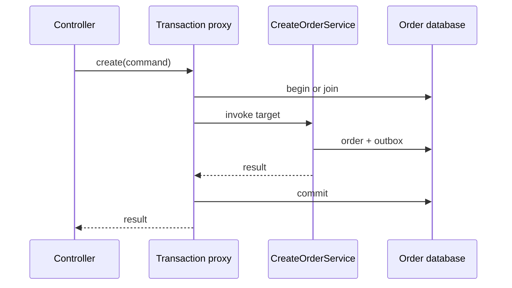
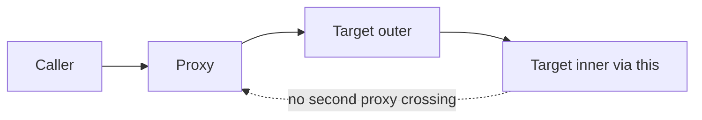

# Chapter 4 — Spring Internals: Objects, Proxies, Requests, and Transactions

Prepared 2026-10-24. Conceptual course chapter with unexecuted educational examples. No Boot application or dependency set was built.

## 1. Lesson title
Explain what Spring actually does between application startup, an HTTP request, a database commit, and shutdown.

## 2. Interview priority
P0. Constructor injection, lifecycle, auto-configuration, proxy interception, transaction boundaries, and MVC/WebFlux choices are everyday correctness topics. Framework vocabulary should support a trace of a concrete request.

## 3. Prerequisites
Java interfaces, constructors, exceptions, and Chapter 3's shared-state and executor reasoning. A dependency is an object another object needs. A container creates and connects managed objects. A transaction is a resource-specific unit of commit or rollback, not a promise about every action inside a method.

## 4. Learning objectives
Trace bean creation and post-processing, diagnose why an auto-configuration applied, identify whether a call crosses a proxy, choose coherent web and persistence stacks, and design transaction/async/shutdown boundaries for Order. Explain failure behavior without attributing magic to annotations.

## 5. Official references and version notes
All links opened 2026-10-24. Live pages report Framework 7.0.10 and Boot 4.1.2. The agreed proposed Boot baseline remains 4.1.1; no silent upgrade or compatibility claim is made. Example concepts are stable, but exact dependencies and configuration must be validated when implementation is authorized.

| ID | Primary source | Relevant section |
|---|---|---|
| S1 | [Container overview](https://docs.spring.io/spring-framework/reference/core/beans/basics.html) | ApplicationContext and metadata |
| S2 | [Bean lifecycle](https://docs.spring.io/spring-framework/reference/core/beans/factory-nature.html) | Initialization, destruction, lifecycle |
| S3 | [Proxying mechanisms](https://docs.spring.io/spring-framework/reference/core/aop/proxying.html) | JDK/CGLIB, self-invocation |
| S4 | [Boot auto-configuration](https://docs.spring.io/spring-boot/reference/using/auto-configuration.html) | Conditions, backoff, debug report |
| S5 | [DispatcherServlet](https://docs.spring.io/spring-framework/reference/web/webmvc/mvc-servlet.html) | Front controller and delegates |
| S6 | [WebFlux overview](https://docs.spring.io/spring-framework/reference/web/webflux/new-framework.html) | Reactive concurrency model |
| S7 | [Transactional annotations](https://docs.spring.io/spring-framework/reference/data-access/transaction/declarative/annotations.html) | Proxy mode, rollback, settings |
| S8 | [Propagation](https://docs.spring.io/spring-framework/reference/data-access/transaction/declarative/tx-propagation.html) | REQUIRED and REQUIRES_NEW |
| S9 | [Scheduling and async](https://docs.spring.io/spring-framework/reference/integration/scheduling.html) | TaskExecutor and async advice |
| S10 | [Graceful shutdown](https://docs.spring.io/spring-boot/reference/web/graceful-shutdown.html) | Grace periods and server behavior |

Documented mechanisms are attributed to these pages. Transaction placement, package boundaries, and commerce workflows are course design recommendations. No book chapter is claimed as consulted evidence.

## 6. Fundamental explanation

### Dependency injection is object construction with ownership
Without a container, a main method might construct a DataSource, an OrderRepository, a CreateOrderService, and a controller. Each constructor declares its required collaborators. Spring's inversion of control moves that assembly responsibility into a managed container. The application describes the objects and connections; the container creates and supplies them. ApplicationContext represents this container and reads configuration metadata. [S1]

Constructor injection makes mandatory dependencies visible and permits an object to be created in a unit test without starting a server. If a service requires twelve collaborators, the constructor is revealing a possible responsibility problem; field injection would only conceal it. Avoid asking a global context for arbitrary services inside domain methods, because dependencies then become hidden and tests need more infrastructure.

A bean is an object managed by the container. It is not necessarily a database entity, request, or remote service. Scope determines how instances are obtained. A singleton service shared across requests must avoid storing per-request mutable state. The container's ability to inject a reference does not imply that reference is thread-safe, healthy, or configured with enough capacity.

### Boot supplies conventions around Spring
Spring Framework provides container and application abstractions. Spring Boot adds opinionated startup, dependency organization, auto-configuration, and operational integration. Auto-configuration examines conditions such as dependencies and already-declared beans; it can back off when the application supplies an alternative. The conditions report helps explain the result. [S4]

This means a dependency change can alter behavior even if your service code does not change. Adding a web or database library can satisfy a condition. Troubleshooting should therefore inspect effective dependencies and the condition report. Repeatedly adding annotations until startup succeeds creates configuration that nobody can explain.

## 7. Internal architecture and mechanism

### Bean creation and lifecycle
Think in stages: discover definitions, resolve dependencies, instantiate objects, populate required configuration, run initialization callbacks, apply relevant post-processing, and expose usable instances. Lifecycle callbacks and lifecycle interfaces let managed components participate in initialization and shutdown. [S2] This sequence is a conceptual trace; special infrastructure components and dependencies complicate a rigid universal ordering.

A constructor should establish local validity. It should not send a payment or wait indefinitely for another service. Startup side effects make retries dangerous and can prevent the entire application from becoming available. Our design loads configuration at startup, validates required settings, and establishes bounded infrastructure readiness. Business work begins through explicit application commands after readiness.

Circular dependencies often indicate that responsibilities are not separated. If OrderService needs PaymentService and PaymentService needs OrderService, determine which use case owns the workflow. In this course Order owns orchestration, so Payment exposes an authorization capability and does not call back into Order's internals. Solving the cycle with delayed lookup may hide a conceptual dependency cycle.

### The reference can be a proxy
Spring AOP can expose a proxy that intercepts method calls before invoking the target. JDK proxies use interfaces; class-based proxies subclass a target type and have limitations around final/private methods. A call from a target method to another method on `this` bypasses the external proxy. [S3]

Draw the actual call graph. `controller -> proxy -> service` can trigger advice. `service.outer -> this.inner` does not become a new proxy crossing simply because inner has an annotation. A directly constructed `new CreateOrderService(...)` also has no automatic Spring transaction interceptor. The object is a valid Java object, but its execution boundary differs.

### Transactions are intercepted resource scopes
With typical proxy-based declarative transactions, an intercepted method call asks a transaction manager to establish or join a resource transaction. Completion commits or rolls back according to configuration and exceptions. Standard defaults distinguish unchecked failures from checked exceptions unless rollback rules are customized. [S7] Do not rely on memory of defaults when application configuration overrides them.

REQUIRED can join an existing physical transaction. An inner logical scope can mark it rollback-only, so catching the inner exception does not necessarily make the outer transaction committable. REQUIRES_NEW uses an independent physical transaction and can require another connection while the outer one remains held. [S8] That can exhaust a small pool when many requests nest transactions. Savepoints and nested semantics depend on the transaction manager and resource; they are not interchangeable with independent commits.

Our CreateOrder boundary writes the order and its outbox row atomically in one local database transaction. Publishing to a broker or calling Payment happens through a separate recovery protocol. An annotation cannot undo an ordinary remote HTTP effect. Keep the database transaction short enough that a slow dependency cannot hold locks and connections indefinitely.

### MVC, WebFlux, and thread ownership
Spring MVC dispatches through DispatcherServlet, which delegates mapping, invocation, conversion, and exception handling. [S5] In a typical Order request, filters process transport concerns, a handler mapping selects the controller, argument resolution constructs inputs, validation checks them, the controller calls an application service, and response conversion serializes the result. A serializer triggering lazy database access can therefore perform surprising work after the intended service boundary.

WebFlux provides a reactive, non-blocking web stack with a small-thread concurrency model and backpressure-oriented composition. [S6] It is useful when the dependency chain supports non-blocking execution. Blocking JDBC on an event-loop thread violates that assumption. Moving blocking work to another scheduler is a bridge with its own capacity limits, not a free conversion to non-blocking persistence.

For this course's initial PostgreSQL/JPA Order service, MVC is a straightforward recommendation. Virtual threads may later be evaluated with Java 21-specific constraints. Choose WebFlux when its end-to-end model solves a measured need and the team can maintain cancellation and context correctly.

## 8. Diagrams





The diagrams describe typical proxy-based transaction behavior. They do not claim a global transaction with Inventory or Payment.

## 9. Java 21 implementation

Unexecuted educational example. Complete WiringDemo.java with no Spring dependency. It demonstrates constructor assembly and an explicit decorator boundary so the later proxy concept has a concrete foundation. The printed boundary-entry and exit messages do not implement a transaction.

```java
import java.util.Objects;

public class WiringDemo {
    record CreateOrder(String orderId) {
        CreateOrder {
            Objects.requireNonNull(orderId);
            if (orderId.isBlank()) throw new IllegalArgumentException("orderId");
        }
    }
    interface Orders { String create(CreateOrder command); }
    interface Store { void save(String orderId); }
    static final class MemoryStore implements Store {
        public void save(String orderId) {
            System.out.println("SAVE " + orderId);
        }
    }
    static final class OrderService implements Orders {
        private final Store store;
        OrderService(Store store) { this.store = Objects.requireNonNull(store); }
        public String create(CreateOrder command) {
            store.save(command.orderId());
            return command.orderId();
        }
    }
    static final class Boundary implements Orders {
        private final Orders target;
        Boundary(Orders target) { this.target = Objects.requireNonNull(target); }
        public String create(CreateOrder command) {
            System.out.println("ENTER boundary");
            try {
                String result = target.create(command);
                System.out.println("EXIT success");
                return result;
            } catch (RuntimeException failure) {
                System.out.println("EXIT failure");
                throw failure;
            }
        }
    }
    public static void main(String[] args) {
        Orders target = new OrderService(new MemoryStore());
        Orders exposed = new Boundary(target);
        System.out.println(exposed.create(new CreateOrder("O-1001")));
    }
}
```

The service does not know how its exposed reference was decorated. The caller controls whether it uses `target` or `exposed`; the latter is essential for interception. Real Spring transaction advice additionally coordinates a transaction manager, resource binding, rollback policy, and cleanup. This example teaches the reference boundary without pretending to implement those mechanisms.

## 10. Spring Boot integration
Recommended package responsibilities are `order.api` for HTTP adaptation, `order.application` for use cases, `order.domain` for business rules, and `order.infrastructure` for persistence and messaging. Keep the application root above these packages for intentional discovery. A public application-service method is a clear local transaction entry point when using conventional proxy advice.

A planned Spring handler would validate the command, call an injected transactional application service, and return a resource identifier. The service would persist both order and outbox through the same transaction manager. Infrastructure publication would occur later. This is a design contract, not an executed repository implementation.

Async methods use an executor and advice; they need explicit failure observation and capacity configuration. [S9] An in-memory async event can disappear on a process crash. For a post-commit notification that must eventually happen, store the obligation in the outbox. A callback after commit is useful for local behavior but cannot close the crash gap between commit and callback execution.

## 11. Production scenario
A developer calls `this.reserve()` from `checkout()` and expects reserve's transaction annotation to open an independent transaction. During an error, partial changes appear inconsistent with that expectation. Investigate the injected object, actual proxy type, method visibility, call path, and transaction manager. The immediate lesson is that metadata only matters when the configured mechanism observes the call.

A second incident appears after adding REQUIRES_NEW audit writes: under load, every outer request holds a connection while waiting for an inner transaction to acquire another. The queue is a resource cycle caused by scope design. Recovery may require removing unnecessary nested transactions, isolating durable audit through an outbox, and correcting pool sizing against real concurrency. Adding connections without changing the model may merely move the limit.

## 12. HLD considerations
Choose the business transaction boundary before choosing annotations. Order owns acceptance and workflow state; Inventory and Payment own their databases and local invariants. Service boundaries define independent failures. A controller that writes all three databases is an ownership violation even if it has a convenient transaction annotation.

Separate readiness from liveness and business success. A process can be alive but unable to accept new orders. During dependency failure, decide whether new orders can be durably queued or must be rejected. The decision depends on the product contract and recovery capacity, not the mere presence of a health endpoint.

## 13. LLD considerations
Prefer small application services with constructor-injected ports. Domain objects decide legal transitions; adapters translate persistence or HTTP details. Map exceptions at the boundary without converting every failure into a generic success response. Use a consistent error model that preserves an operation ID for support and reconciliation.

Avoid exposing persistence entities directly as web contracts. Lazy associations, cycles, sensitive fields, and schema coupling make serialization unpredictable. Materialize a response DTO while the required data is deliberately available. This makes query cost and transaction lifetime reviewable.

## 14. Reliability and failure recovery
Graceful shutdown stops accepting new work and provides a bounded interval for existing requests; actual rejection behavior depends on the embedded server. Boot's documented shutdown participates in application-context lifecycle processing. [S10] Do not assume a graceful hook runs after a hard process kill or exhausted platform termination deadline.

Our operational sequence is to remove readiness, stop admission and new scheduled work, drain bounded work, close resources, and allow durable obligations to resume elsewhere. Coordinate platform termination budgets with application drain time. Long-running jobs should checkpoint safely rather than require every deployment to wait indefinitely.

## 15. Performance and capacity
Framework overhead is often smaller than database, serialization, and network costs, but measure before concluding. Count SQL statements, payload size, connection wait, handler duration, and executor queue age. A reactive controller that calls blocking persistence may increase complexity without improving capacity. An oversized application context can affect startup, while eager expensive work can delay readiness.

For a thought experiment, each request holds a connection for 500 ms because it includes a remote call, though database work takes 20 ms. Moving the remote call outside the transaction could reduce connection occupation substantially, but consistency must be redesigned through durable intent. This is reasoning about residence time, not a promised benchmark improvement.

## 16. Interview questions with explained answers

1. **What is IoC?** The container owns assembly and lifecycle instead of every class constructing its collaborators. Constructor injection makes that assembly contract explicit. It does not remove the need to design responsibilities or thread safety.

2. **What is a bean?** It is a container-managed object with configured creation and lifecycle. A bean can be an application service, client, or configuration component. It is not synonymous with a database row or a new object per request.

3. **How does auto-configuration work?** Conditions select configuration based on the environment and existing definitions. Inspect the condition report and dependency graph when behavior changes. A default is an input to diagnosis, not a substitute for checking effective configuration.

4. **Why can self-invocation bypass a transaction?** The target calls itself without returning through the exposed proxy. The advice therefore has no interception opportunity. Refactor use-case boundaries or choose another explicit transaction mechanism when appropriate.

5. **Does catching an exception guarantee commit?** No. A participating transaction may already be rollback-only, and persistence errors can affect resource state. Understand propagation and rollback policy; do not hide the exception and assume the database is clean.

6. **Why can REQUIRES_NEW exhaust a pool?** The outer transaction may retain its connection while the inner requests a different one. Many nested callers can consume all available capacity. Independent commit semantics need a genuine business reason and a capacity analysis.

7. **Does async inherit a transaction?** Do not assume thread-bound transaction resources move to another execution thread. Establish the intended transaction in the worker and persist any obligation that must survive a crash. An annotation is not a durable job queue.

8. **When choose MVC over WebFlux?** For a blocking JPA stack and straightforward request flow, MVC is often easier to reason about. WebFlux suits an end-to-end non-blocking composition with explicit cancellation and backpressure. Choose based on dependencies and requirements, not fashion.

9. **Why avoid returning an entity from a controller?** Serialization may trigger database access, expose internal fields, or tie the public API to persistence changes. An explicit response value bounds data selection and makes compatibility intentional.

10. **What does graceful shutdown guarantee?** It provides a configured opportunity to stop and drain under supported termination conditions. It cannot guarantee completion after a hard kill or arbitrary infrastructure failure. Durable work and idempotent recovery remain necessary.

## 17. Exercises
Run WiringDemo only after confirming Java 21. Expected sequence: ENTER boundary, SAVE O-1001, EXIT success, O-1001. Replace `exposed.create` with `target.create`. The missing boundary messages demonstrate interception dependence; they do not prove anything about actual database transactions.

Paper solution exercise: a controller calls an application service that writes an order, sends HTTP payment, then writes an outbox row. Identify the unsafe window. The solution is to commit order plus durable outgoing intent locally, perform the remote step under stable operation identity, and update workflow state using a new local transaction. Database rollback cannot retract a completed payment.

Draw startup and shutdown for an outbox relay. Expected design: it starts only after required infrastructure readiness, stops claiming new rows before shutdown, allows bounded in-flight completion, and leaves unconfirmed work retryable. The precise leasing/publishing protocol is developed in Chapter 12.

## 18. Verification
References were opened and version banners recorded. The single-file Java example, Maven build, Spring contexts, transaction integration, and shutdown behavior were not executed. Treat the code as a mechanism demonstration. A future implementation needs integration tests proving rollback, proxy traversal, outbox atomicity, and restart behavior on the selected database and reviewed dependency set.

## 19. Common misconceptions
An annotation does not execute itself. A bean is not automatically thread-safe. An async task is not a durable event. A transaction does not include arbitrary remote resources. Reactive return types do not transform blocking calls. Graceful shutdown is not a replacement for crash recovery. Boot conventions still need inspection when dependencies change.

## 20. Knowledge assessment
Unanswered: a singleton OrderService stores the current request in a field, invokes a private transactional helper, and calls an async payment method on itself. Identify three distinct mechanisms that fail to match the developer's expectation and propose a corrected boundary design.

## 21. Revision summary
Trace object ownership, proxy crossings, execution threads, and physical resource transactions. Use auto-configuration as explainable conditional assembly. Keep business state and outgoing obligations durable, and make startup and shutdown part of the architecture.

## 22. Next lesson
Chapter 5 examines the contracts at the edge: HTTP status, idempotency, serialization, streaming, and messaging choices. The Spring adapter will implement those contracts, while the application layer owns their business meaning.
