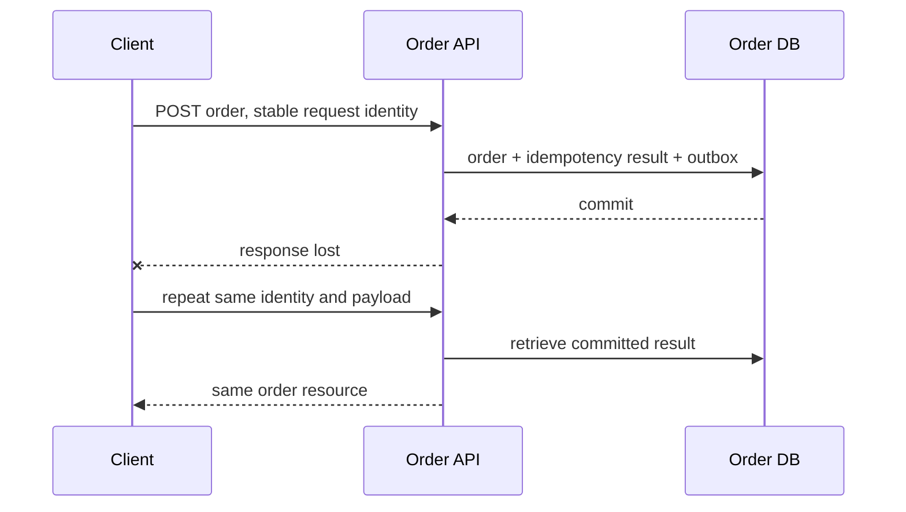
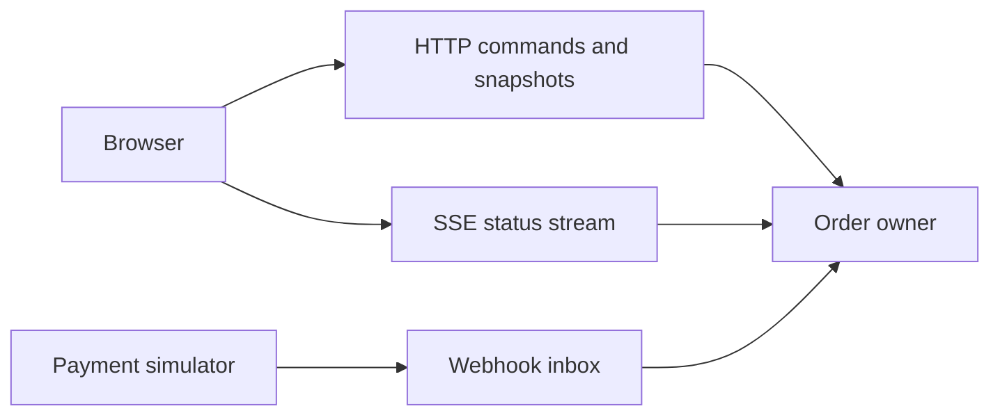

# Chapter 5 — APIs and Integration Contracts

Prepared 2026-10-24. All examples are unexecuted educational material. Payment is simulated throughout the course.

## 1. Lesson title
Choose and implement communication contracts whose success, failure, compatibility, and recovery meanings are explicit.

## 2. Interview priority
P0: HTTP semantics, idempotency, deadlines, validation, and contract evolution. P1: compare gRPC, GraphQL, streaming, webhooks, JMS, and AMQP through requirements rather than popularity.

## 3. Prerequisites
Chapters 1–4. A protocol specifies message exchange rules. A schema specifies message structure. A contract also includes meaning, errors, authorization, timing, and compatibility. A successful network exchange is only one part of business completion.

## 4. Learning objectives
Design a recoverable Create Order API, describe resource-oriented HTTP, write a small OpenAPI contract, compare typed RPC and query composition, distinguish server push mechanisms, and choose messaging semantics intentionally. Explain what a timeout leaves unknown.

## 5. Official references and version notes
Opened 2026-10-24. These are selected official specifications and project documentation, not a claim to have read complete standards. OpenAPI 3.1.1 and Jakarta Messaging 3.1 are explicit reference versions; no corresponding dependency installation is implied. Java remains 21, Maven the build tool, and Boot 4.1.1 the proposed application baseline.

| ID | Reference | Sections used |
|---|---|---|
| A1 | [HTTP semantics, RFC 9110](https://www.rfc-editor.org/rfc/rfc9110.html) | Methods, conditional requests, 201/202 |
| A2 | [Problem Details, RFC 9457](https://www.rfc-editor.org/rfc/rfc9457.html) | Problem members, security considerations |
| A3 | [OpenAPI 3.1.1](https://spec.openapis.org/oas/v3.1.1.html) | Paths, operations, schemas, responses |
| A4 | [gRPC concepts](https://grpc.io/docs/what-is-grpc/core-concepts/) | Unary and streaming RPC lifecycle |
| A5 | [gRPC deadlines](https://grpc.io/docs/guides/deadlines/) | Deadline propagation and cancellation |
| A6 | [Protobuf proto3](https://protobuf.dev/programming-guides/proto3/) | Field numbers, reserved fields, updating types |
| A7 | [GraphQL queries](https://graphql.org/learn/queries/) | Selection sets, arguments, variables |
| A8 | [WHATWG server-sent events](https://html.spec.whatwg.org/multipage/server-sent-events.html) | EventSource, event ID, reconnection |
| A9 | [WebSocket RFC 6455](https://www.rfc-editor.org/rfc/rfc6455.html) | Handshake, frames, close and control frames |
| A10 | [Jakarta Messaging 3.1](https://jakarta.ee/specifications/messaging/3.1/jakarta-messaging-spec-3.1.html) | Queue/topic models, acknowledgments |
| A11 | [RabbitMQ AMQP model](https://www.rabbitmq.com/tutorials/amqp-concepts) | AMQP 0-9-1 exchanges, bindings, queues |
| A12 | [GitHub webhook practices](https://docs.github.com/en/webhooks/using-webhooks/best-practices-for-using-webhooks) | Secure, prompt, deduplicated handling |
| A13 | [Java 21 HttpClient](https://docs.oracle.com/en/java/javase/21/docs/api/java.net.http/java/net/http/HttpClient.html) | Client reuse, synchronous/asynchronous calls |
| A14 | [Spring response bodies](https://docs.spring.io/spring-framework/reference/web/webmvc/mvc-controller/ann-methods/responsebody.html) | Message conversion |

GitHub-specific webhook documentation is an example provider contract, not a universal retry guarantee. Live Spring docs are Framework 7.0.10; exact proposed-Boot compatibility remains unverified. Protocol statements below are documented facts; commerce policies and payloads are recommendations.

## 6. Fundamental explanation

### Begin with the operation's meaning
A customer submits an order for two units of P-10. The API can promise durable acceptance before inventory and payment finish. It must then expose a resource whose status tells the customer what is known. Alternatively, it can wait for some work, but it still needs a policy for response loss. Synchronous appearance does not remove ambiguity.

Our recommended contract separates order creation from fulfillment readiness. A successful creation returns an order identifier and a status such as PENDING. Inventory reservation and simulated authorization later advance that state. Repeated client requests for the same logical operation use the same idempotency identity. Reusing that identity with a different body is a conflict requiring explanation, not silent reuse of an unrelated result.

### HTTP is more than JSON over POST
A resource is something addressable, such as `/orders/O-1001`. A representation describes it at a point in time. HTTP methods have defined semantics: safe methods are intended to be read-only in their requested semantics; idempotent methods have the same intended effect after repeated identical requests. POST does not acquire idempotency merely because its body is JSON. A 201 response means a resource was created; 202 means processing was accepted but has not completed. [A1]

We recommend 201 when the Order resource has been durably created, even if its business state is pending. A separate long-running operation endpoint may use 202 and a status URL. State the chosen meaning in the contract. Do not use 200 for every case and ask clients to infer success from an undocumented message string.

Validation has layers. Syntactic validation checks that quantity is a positive integer and an identifier has an allowed shape. Semantic validation checks rules such as whether a product is sellable. Authorization asks whether this caller may create or view this order. Inventory availability is a concurrent business decision at its owner, not a validation annotation on a stale cache value.

## 7. Internal architecture and mechanism

### Representation and evolution
An API contract includes field names, types, optionality, defaults, units, and allowed states. `amount: 100` is ambiguous without currency and unit. A timestamp needs a defined offset/instant convention. Missing, null, zero, and empty string can represent different intentions; choose them deliberately. Adding a field is only safe when consumers tolerate it and the new semantics do not change an old promise.

OpenAPI describes HTTP paths, operations, request/response schemas, parameters, and related metadata in a machine-readable document. [A3] It can guide clients and validation, but generated types cannot prove that an endpoint preserves idempotency across process restart. Keep behavioral rules alongside schemas and verify them with contract and integration tests later.

Problem Details standardizes a response shape including type, title, status, detail, and instance, with extension members available. [A2] Our recommendation is a stable machine-readable problem type plus an operation/correlation identifier. Avoid putting stack traces, SQL, or secrets in responses. A human message may evolve; clients should branch on stable fields.

### Typed RPC and Protobuf
gRPC presents service methods through generated clients and servers and supports unary, client-streaming, server-streaming, and bidirectional-streaming calls. [A4] It is useful when controlled clients benefit from explicit typed interfaces and streaming. It does not make a remote call equivalent to a local function: deadlines, cancellation, metadata, and deployment compatibility remain.

Protobuf identifies fields by numbered tags. Retired field numbers should not be reused; reserve them so later changes cannot reinterpret old bytes as a different field. [A6] A compact encoding is not proof that semantic changes are compatible. Renaming an amount from gross to net while keeping its tag and numeric type can preserve decoding and break the business contract.

Set realistic deadlines and propagate remaining budget. gRPC documents deadline and cancellation behavior, but the server must still stop expensive application work cooperatively where required. [A5] A request that already committed an authorization needs reconciliation, even if cancellation later arrives. Network-level cancellation is not a business rollback.

### Query composition and push
GraphQL lets a client select fields from a typed schema and pass arguments and variables. [A7] For an order dashboard, the response might combine order state, delivery estimate, and product display names. Our design recommendation is to put authorization at each meaningful data boundary, bound query cost, batch repeated fetches, and document freshness. One HTTP request can still produce many downstream calls; reducing over-fetching does not automatically reduce backend work.

SSE uses a server-to-client event stream with EventSource reconnection and event identifiers. [A8] It fits order-status updates when the client mainly listens. Retaining event IDs and providing a resume policy are application responsibilities; an ID alone does not create a durable replay store. A reconnecting browser may need to fetch the current order snapshot before resuming updates.

WebSocket establishes a bidirectional framed channel with handshake and control-frame behavior. [A9] It fits interactive communication in both directions. Our recommendation is to define message schemas, authorization renewal, heartbeats, backpressure, and reconnection explicitly. A persistent connection is a resource that can outlive a particular server instance or credential validity interval.

### Webhooks and messaging
A webhook is an HTTP callback to another system. Treat delivery as an operation with retries, duplicate detection, signature verification, and a durable receiving boundary. GitHub's official guidance illustrates secret verification, delivery IDs, and prompt processing; its exact delivery policy is provider-specific. [A12] For our simulated Payment callback, persist the verified event and inbox identity before acknowledging, then process under a recoverable local transaction.

Jakarta Messaging defines Java messaging APIs and queue/topic models. AMQP is a wire-protocol family. RabbitMQ's AMQP 0-9-1 model routes publications through exchanges and bindings to queues. These are distinct abstraction levels, and AMQP 0-9-1 must not be conflated with AMQP 1.0. [A10, A11] Choose a task queue for work distribution, or the course's retained event stream when replay and independent consumers are requirements. Kafka core behavior is developed from Apache references in Chapters 7–15 rather than asserted from unrelated broker documentation.

## 8. Diagrams





The stream accelerates user feedback; the snapshot endpoint remains the recovery reference when a connection misses updates.

## 9. Java 21 implementation

The following unexecuted OpenAPI document is complete within its declared scope: a read-only order-status endpoint. It omits authentication to isolate representation and response contracts; it is not a production API definition. Java 21 server/client code can be generated or implemented later using a reviewed toolchain.

```yaml
openapi: 3.1.1
info:
  title: Order Status Teaching API
  version: 1.0.0
paths:
  /orders/{orderId}:
    get:
      operationId: getOrder
      parameters:
        - in: path
          name: orderId
          required: true
          schema:
            type: string
            minLength: 1
      responses:
        '200':
          description: Current order snapshot
          content:
            application/json:
              schema:
                $ref: '#/components/schemas/Order'
        '404':
          description: No visible order exists for this identifier
components:
  schemas:
    Order:
      type: object
      required: [orderId, status, version]
      properties:
        orderId:
          type: string
        status:
          type: string
          enum: [PENDING, READY, CANCELLING, CANCELLED, REJECTED]
        version:
          type: integer
          minimum: 0
```

The contract gives state a controlled vocabulary and version a declared meaning as the Order owner's revision, not a global cross-service timestamp. A client must still decide how to handle a future unknown state. Strict generated enums may require a compatibility strategy before new values are introduced.

A Java client should reuse a configured HttpClient and distinguish transport exceptions, HTTP statuses, and valid business states. The Java 21 API supports synchronous and asynchronous calls. [A13] This chapter deliberately does not provide an incomplete HTTP client that pretends JSON string matching is reliable parsing.

## 10. Spring Boot integration
Spring MVC message converters translate controller return values into representations. [A14] Use explicit request/response DTOs, a central error mapping policy, and application-layer commands. Keep idempotency result persistence inside the same local transaction as order creation. Validation before the transaction saves unnecessary work, while database constraints still enforce concurrent uniqueness.

Use a dedicated outbound client configuration for each dependency class: connect and response budgets, pooling, maximum payload size, and retry policy. Keep sensitive authorization material out of logs. An endpoint's successful test with one happy-path request does not verify duplicate delivery, connection loss, or backward compatibility.

## 11. Production scenario
The client submits an order, the server commits, and a proxy closes the connection. The user retries. Without a stable identity and durable result, two orders can be created. With an identity stored atomically with the order, the server can return the existing resource. If the identity exists but its result is still processing, return a documented intermediate response rather than starting a second operation.

Now suppose Payment sends a duplicate callback after Order has begun cancellation. Inbox deduplication prevents repeating the same event, but it does not define what a distinct late success means. The workflow needs a legal transition and compensation policy. Protocol correctness and state-machine correctness are separate layers.

## 12. HLD considerations
Choose communication from required coupling. Direct HTTP/gRPC queries couple response availability to dependencies. Messaging can decouple time but introduces backlog, compatibility, and recovery obligations. GraphQL/API composition can simplify clients while increasing server fan-out. WebSocket/SSE reduce polling but require connection lifecycle management.

Our recommended starting point is HTTP for client commands and snapshots, durable messages for workflow transitions, and optional SSE for status visibility. Keep Payment simulated and Inventory authoritative in PostgreSQL. A protocol's popularity is not a reason to multiply communication mechanisms before their operational costs are understood.

## 13. LLD considerations
Use operation IDs distinct from trace IDs: an operation identity persists across retries, while trace IDs describe particular execution paths. Store an idempotency key's request fingerprint, business result, and retention policy. Scope keys by principal/tenant and operation so unrelated callers cannot collide or retrieve another customer's result.

Define pagination ordering using a stable tie-breaker, such as created time plus order ID. Avoid promising a consistent snapshot while serving pages from changing data unless the implementation actually provides it. For updates, version-based conditional requests can detect stale edits; conflict handling still needs a product rule.

## 14. Reliability and failure recovery
Retries need eligibility, maximum attempts, backoff/jitter, and an overall deadline. Retry transient transport failures only when the effect can be safely repeated or reconciled. A business decline is not usually a transient infrastructure error. A malformed schema is not repaired by exponential backoff.

For webhooks, acknowledge only after reaching the receiving durability boundary. Bound queues and reject oversized payloads before expensive parsing. Track unknown operation outcomes and provide reconciliation. For streaming clients, define resume limits and snapshot fallback when history is unavailable.

## 15. Performance and capacity
Measure payload size, request rate, connection use, dependency fan-out, serialization CPU, and tail latency. Binary encoding can reduce bytes but may be irrelevant when the dominant cost is a slow database query. A GraphQL query returning twenty orders can cause hundreds of downstream calls if field resolvers are naive; batch by owner and key where semantics permit.

Suppose one dashboard request calls four dependencies in sequence at 100 ms each. The illustrative dependency time is roughly 400 ms. Parallel independent reads could approach the slowest branch plus overhead, but increase concurrent load and require partial-result rules. This is a design estimate, not a benchmark or a guarantee.

## 16. Interview questions with explained answers

1. **Does 201 mean an order is paid?** It means the resource was created under the API contract. Business state can remain pending. Clients need a status model and cannot infer fulfillment readiness from transport success.

2. **Can POST be retried safely?** Only when the operation contract makes retries safe, for example through durable idempotency identity and payload matching. Method choice alone does not enforce the business invariant after response loss.

3. **What does OpenAPI prove?** It describes an HTTP interface and enables useful tooling. It does not prove authorization correctness, atomic idempotency, or recovery. Behavioral tests must validate those properties separately.

4. **Why reserve removed Protobuf tags?** Old serialized data and independently deployed consumers may still contain them. Reusing a tag can reinterpret bytes with a new meaning. Preserve wire and business compatibility together.

5. **When choose gRPC?** Typed internal clients and streaming can justify it when the ecosystem supports the protocol. Include deadlines, observability, compatibility, and browser/gateway constraints in the decision instead of treating it as a local method call.

6. **Does GraphQL eliminate N+1 work?** No. It shapes client selection while resolvers can still fetch one item at a time. Batch and bound resolver work, enforce authorization, and measure downstream request count.

7. **SSE or WebSocket for status?** SSE fits primarily server-to-client updates with HTTP-based delivery and reconnect conventions. WebSocket supports bidirectional interaction but requires a richer session protocol. Both need recovery and resource limits.

8. **Why deduplicate a webhook?** A sender may redeliver or the acknowledgment may be lost. Persist delivery identity and apply the effect atomically. Also enforce business uniqueness because two different deliveries can describe the same logical operation.

9. **JMS versus AMQP?** JMS/Jakarta Messaging is a Java API specification, whereas AMQP specifies wire-level behavior. A provider may expose both, but their version and feature contracts are separate. Always identify the provider and protocol version.

10. **Why share a deadline across calls?** Independent full-length timeouts at every hop can exceed the caller's useful waiting budget. Allocate the remaining budget and stop useless work where possible. Reconcile effects that may already have committed.

## 17. Exercises
Design Create Order's lost-response behavior. Solution: persist tenant-scoped request identity, request fingerprint, order, and response identity atomically; return the existing result on the same request; reject conflicting payload reuse. Explain retention: expiring identity records too early can permit a late retry to create a duplicate.

Extend the OpenAPI example with a documented error body. Expected result: clients receive stable machine fields while internal exception details remain private. Validate it later with a chosen schema tool; no validation result is claimed here.

Choose a channel for live order status, bulk reporting, and simulated payment callbacks. One defensible solution uses SSE plus snapshot fallback, an asynchronous export job with polling/download, and a verified webhook inbox. Justify alternatives by client capabilities and durability needs, not by listing technologies.

## 18. Verification
The OpenAPI example was not parsed, generated, or served. No HTTP/gRPC/GraphQL server or broker was started. Sources were checked on 2026-10-24. Expected observations are design predictions. A future implementation must test duplicate concurrent POSTs, lost responses, payload mismatch, authorization, malformed input, deadline expiry, and schema compatibility.

## 19. Common misconceptions
REST is not simply a naming convention for controllers. HTTP success is not workflow completion. Idempotency is not deduplication in a process-local map. gRPC does not remove partial failure. GraphQL does not guarantee cheap queries. A live socket is not durable delivery. Broker acknowledgment does not imply a downstream business transaction finished.

## 20. Knowledge assessment
Unanswered: a payment callback arrives twice, an order-status stream disconnects, and the original order POST response was lost. Explain the independent recovery mechanism at each boundary, including durable identity, state transitions, and the customer's eventual view.

## 21. Revision summary
Specify semantics before transport. Separate resource creation, durable acceptance, and completed business work. Preserve identity across retries, define compatibility and error behavior, budget deadlines, and make stream/callback recovery explicit.

## 22. Next lesson
Chapter 6 implements the local durable boundary with PostgreSQL and persistence. The API's uniqueness and recovery promises become constraints, transactions, indexes, and tested failure behavior.
