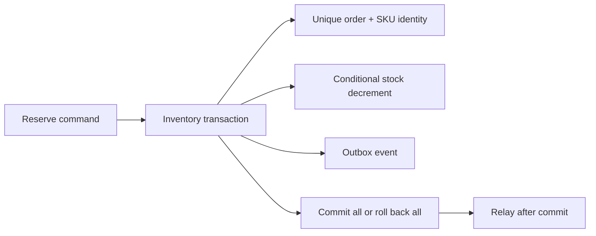
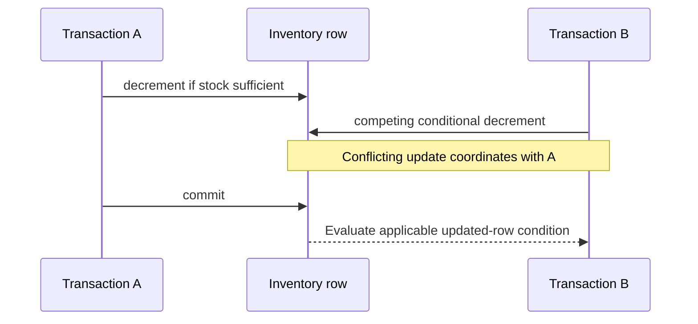

# Chapter 6 — PostgreSQL, JPA, and Durable Business Invariants

Prepared 2026-10-24. SQL and application designs are unexecuted educational examples. No database was installed, migrated, or benchmarked.

## 1. Lesson title
Turn order and inventory rules into transactions, constraints, queries, and recoverable storage.

## 2. Interview priority
P0: transaction isolation, locks, constraints, indexes, query plans, persistence context, and N+1 behavior. P1: migration, replication, partitioning/sharding, backup, and recovery evidence.

## 3. Prerequisites
Tables contain rows; columns carry typed values; a key identifies a row. SQL selects and changes data. Chapters 1–5 establish local transaction boundaries, duplicate requests, and service ownership. Inventory owns its database and remains authoritative for stock.

## 4. Learning objectives
Explain MVCC and isolation, preserve stock under concurrent requests, use uniqueness for idempotency, reason about JPA state and flush, inspect plans, and design safe schema evolution and restore procedures. Separate a replica, a partition, a shard, and a backup.

## 5. Official references and version notes
Verified 2026-10-24. PostgreSQL 18 documentation is used as an explicit reference baseline, not an installation decision. Jakarta Persistence 3.2 and Hibernate guide 7.1.36.Final explain concepts; they are not asserted as the dependency versions selected by proposed Boot 4.1.1. Live Spring Data JPA is 4.1.2. Java 21/Maven remain agreed.

| ID | Official source | Sections |
|---|---|---|
| D1 | [MVCC introduction](https://www.postgresql.org/docs/18/mvcc-intro.html) | Snapshots |
| D2 | [Transaction isolation](https://www.postgresql.org/docs/18/transaction-iso.html) | Read committed, repeatable read, serializable |
| D3 | [Explicit locking](https://www.postgresql.org/docs/18/explicit-locking.html) | Row locks, deadlocks |
| D4 | [Constraints](https://www.postgresql.org/docs/18/ddl-constraints.html) | Check, unique, foreign keys |
| D5 | [Multicolumn indexes](https://www.postgresql.org/docs/18/indexes-multicolumn.html) | B-tree key usage |
| D6 | [Using EXPLAIN](https://www.postgresql.org/docs/18/using-explain.html) | Estimates, actual execution, buffers |
| D7 | [Routine vacuuming](https://www.postgresql.org/docs/18/routine-vacuuming.html) | Dead tuples, statistics, wraparound |
| D8 | [Backup and restore](https://www.postgresql.org/docs/18/backup.html) | Backup approaches |
| D9 | [PITR](https://www.postgresql.org/docs/18/continuous-archiving.html) | Base backup plus WAL, recovery |
| D10 | [Standby servers](https://www.postgresql.org/docs/18/warm-standby.html) | Streaming replication and lag |
| D11 | [Table partitioning](https://www.postgresql.org/docs/18/ddl-partitioning.html) | Declarative partitions, pruning |
| D12 | [CREATE INDEX](https://www.postgresql.org/docs/18/sql-createindex.html) | Concurrent builds and caveats |
| D13 | [Jakarta Persistence 3.2](https://jakarta.ee/specifications/persistence/3.2/jakarta-persistence-spec-3.2.html) | Entity lifecycle, versions, persistence contexts |
| D14 | [Hibernate ORM guide](https://docs.hibernate.org/orm/7.1/userguide/html_single/) | Fetching, flushing, batching |
| D15 | [Spring Data transactionality](https://docs.spring.io/spring-data/jpa/reference/jpa/transactions.html) | Service/facade transaction boundaries |

Documented mechanisms are cited. Commerce schemas, lock ordering, migration sequencing, and capacity reasoning are course recommendations. No claimed book consultation or measured database results.

## 6. Fundamental explanation

### Durable correctness starts with a rule
Our rule is that available stock never becomes negative and the same order line is not reserved twice. A service method that reads stock, subtracts in Java, and saves can violate this when two requests overlap. A database transaction is necessary, but its isolation and actual statements determine whether it protects the rule.

Constraints are executable contracts at the storage boundary. A primary key identifies a row; a unique constraint prevents duplicate key combinations; a foreign key enforces declared references; a check constraint restricts row values. [D4] Our schema uses a unique order/SKU reservation key and nonnegative stock. Application validation improves feedback, while the database prevents competing replicas from bypassing the invariant.

Normalization organizes facts so one owner changes one authoritative value. Inventory availability belongs in Inventory; product display information may be copied into an order snapshot for historical meaning. This duplication is deliberate when an invoice must preserve what was purchased. Do not confuse a historical snapshot with a second authoritative stock counter.

### Transactions and uncertainty
A transaction groups local changes into a commit/rollback unit. For reservation, create the reservation, decrease stock, and insert an outbox event in one local transaction. If the client connection disappears during commit, the caller may not know whether commit succeeded. Retry using the same business identity and inspect durable state; do not infer rollback from the missing response.

Money should use an explicit currency and a representation with defined precision and rounding. Integer minor units are useful within known currency rules; decimal columns can represent precise decimal amounts when rounding policies are explicit. Binary floating-point convenience is not a substitute for a monetary model.

## 7. Internal architecture and mechanism

### MVCC and isolation
PostgreSQL uses multi-version concurrency control: statements operate against snapshots rather than universally blocking readers behind writers. [D1] Updates create versions that maintenance later reclaims. A snapshot answers what is visible, while locks and conflict checks coordinate competing changes. MVCC does not mean updates never wait.

At Read Committed, successive statements can see different committed data. PostgreSQL Repeatable Read provides a stable transaction snapshot with its documented conflict behavior. Serializable detects executions that cannot safely behave as a serial ordering and can require a retry of the whole transaction. [D2] Higher isolation is not a reason to retry only the final failed statement; earlier reads may have informed decisions that are now invalid.

For our one-row stock rule, an atomic conditional update `SET available = available - quantity WHERE available >= quantity` is easier to reason about than an unlocked read-modify-write sequence. For several SKUs, acquire locks in a deterministic order or design an equivalent safe transition protocol. Row locks can block conflicting changes and deadlocks can still occur; PostgreSQL resolves a detected deadlock by aborting a transaction. [D3]

### Persistence context is not the database
JPA defines entities and a persistence context tracking managed instances. Entity states include new, managed, detached, and removed. A version attribute supports optimistic concurrency detection. [D13] Optimistic locking is useful when conflicts are uncommon and retries can recompute the operation. It is not a replacement for database uniqueness or stock checks.

Hibernate can detect changes to managed entities and synchronize them through flush. Flush is not synonymous with commit. Fetch strategies and query shape influence whether a list view triggers an initial query followed by many association queries. [D14] Our recommendation is to design a query for each use case, returning a projection or deliberately fetched graph, rather than making every association eager.

Consider twenty orders each displaying customer and lines. Loading all orders then navigating each lazy relationship can create many round trips. One giant join can instead duplicate parent data and interact badly with pagination. A two-step approach—page identifiers, then fetch required data for those identifiers—is often easier to bound. Validate the actual SQL and row count, because an object-oriented loop conceals network cost.

### Indexes and plans
An index is a maintained access structure. It accelerates suitable reads at the cost of storage and write work. For `WHERE customer_id = ? ORDER BY created_at DESC, id DESC`, a matching composite index is a candidate. Multicolumn B-tree behavior depends on predicates and ordering; avoid oversimplified claims that every query lacking a leading equality is impossible to optimize. [D5]

EXPLAIN shows a plan and estimates; EXPLAIN ANALYZE executes the statement and adds actual observations. [D6] Therefore, do not casually analyze a destructive statement against production. Compare estimated and actual rows, loops, filter selectivity, sorts, and buffer activity. A sequential scan on a tiny table is often sensible. “Index not used” is not a diagnosis without table size, selectivity, and cost context.

Vacuum supports reuse of dead-tuple space, visibility information, and transaction-ID maintenance; planner statistics also need upkeep. [D7] Long-lived transactions and stale statistics can affect a busy system even when individual queries look simple. Treat transaction age and maintenance progress as operational signals.

## 8. Diagrams





The second diagram is a conceptual Read Committed update scenario, not a universal description of every isolation level.

## 9. Java 21 implementation

Unexecuted SQL teaching example, complete for a fresh isolated practice schema. It reserves one SKU per command and demonstrates database semantics that a Java 21 application would call. It is not a full multi-line order, release workflow, migration, or outbox publisher. Run only in an empty disposable database after review.

```sql
CREATE TABLE stock_demo (
    sku text PRIMARY KEY,
    available integer NOT NULL CHECK (available >= 0)
);
CREATE TABLE reservation_demo (
    id bigint GENERATED ALWAYS AS IDENTITY PRIMARY KEY,
    order_id text NOT NULL,
    sku text NOT NULL REFERENCES stock_demo(sku),
    quantity integer NOT NULL CHECK (quantity > 0),
    UNIQUE (order_id, sku)
);
CREATE TABLE outbox_demo (
    id bigint GENERATED ALWAYS AS IDENTITY PRIMARY KEY,
    reservation_id bigint NOT NULL REFERENCES reservation_demo(id),
    event_type text NOT NULL,
    UNIQUE (reservation_id, event_type)
);
INSERT INTO stock_demo(sku, available) VALUES ('P-10', 3);

CREATE FUNCTION reserve_demo(p_order text, p_sku text, p_qty integer)
RETURNS bigint LANGUAGE plpgsql AS $$
DECLARE
    new_id bigint;
    prior reservation_demo%ROWTYPE;
BEGIN
    IF p_order IS NULL OR p_order = '' OR p_qty IS NULL OR p_qty <= 0 THEN
        RAISE EXCEPTION 'Invalid reservation command';
    END IF;
    INSERT INTO reservation_demo(order_id, sku, quantity)
    VALUES (p_order, p_sku, p_qty)
    ON CONFLICT (order_id, sku) DO NOTHING
    RETURNING id INTO new_id;

    IF new_id IS NULL THEN
        SELECT * INTO STRICT prior FROM reservation_demo
        WHERE order_id = p_order AND sku = p_sku;
        IF prior.quantity <> p_qty THEN
            RAISE EXCEPTION 'Identity reused with different quantity';
        END IF;
        RETURN prior.id;
    END IF;

    UPDATE stock_demo SET available = available - p_qty
    WHERE sku = p_sku AND available >= p_qty;
    IF NOT FOUND THEN
        RAISE EXCEPTION 'Insufficient stock';
    END IF;

    INSERT INTO outbox_demo(reservation_id, event_type)
    VALUES (new_id, 'InventoryReserved');
    RETURN new_id;
END;
$$;

BEGIN;
SELECT reserve_demo('O-1001', 'P-10', 2);
COMMIT;
BEGIN;
SELECT reserve_demo('O-1001', 'P-10', 2);
COMMIT;
SELECT available FROM stock_demo WHERE sku = 'P-10';
SELECT count(*) FROM reservation_demo;
SELECT count(*) FROM outbox_demo;
```

Expected results are one remaining unit, one reservation, and one outbox row; sequence-generated IDs may have gaps. The function raises an exception on insufficient stock, which aborts the statement/transaction unless a caller intentionally manages an enclosing savepoint. Do not catch the database error and assume an active transaction remains usable. A production command also needs tenant scoping, release state, event payload, timestamps, and explicit retry/error mapping.

## 10. Spring Boot integration
Place the local transaction at an application-service boundary so all repositories participating in one use case share its scope. Spring Data documents service/facade transaction configuration rather than requiring every repository call to be an independent business transaction. [D15] Use named transaction managers when more than one resource exists, and keep ownership unambiguous.

Map persistence results into domain outcomes. A unique-key conflict for the same reservation may mean replay, while changed payload means conflicting reuse. Optimistic-lock failure may justify bounded transaction retry; foreign-key failure may indicate invalid input or a programming error. Do not classify every persistence exception as transient.

## 11. Production scenario
Two Order commands request the final unit from different Inventory replicas. Both replicas see a cached availability of one. The database conditional update accepts one and rejects the other; Redis was only advisory. If the winner crashes after commit, a replay finds the same reservation identity and avoids a second decrement.

If the relay publishes the reservation event and crashes before marking it sent, the event may be published again. The outbox prevents a missing local obligation, not every duplicate. The receiving service combines inbox identity and business constraints in its own transaction. Each local database guarantees only its participating work.

## 12. HLD considerations
Replicas can offload suitable reads but may lag behind the primary. PostgreSQL's standby documentation distinguishes asynchronous and synchronous replication trade-offs. [D10] A customer immediately reading a newly created order needs an intentional read-your-write policy, such as routing the relevant read to the owner primary or using a freshness protocol. A read replica is not safe for authoritative stock decisions merely because it usually catches up quickly.

Table partitioning splits a logical table into partitions and can enable pruning and lifecycle management. [D11] Sharding distributes ownership across independent database groups and adds routing, cross-shard queries, rebalancing, and transaction complexity. Do not introduce sharding before measuring a bottleneck. Partitioning an order-history table by time is not automatically horizontal database sharding.

## 13. LLD considerations
Design repository methods around intent: `reserve(orderId, sku, quantity)` is clearer than exposing arbitrary entity mutation. Make an aggregate's transaction boundary explicit. Keep database-generated identifiers separate from business operation identity and never require gap-free sequences for correctness.

Use expand-and-contract migrations: add compatible structures, deploy readers/writers that support transition, backfill in bounded batches, validate, then remove old structures after all consumers are ready. Index builds can block or carry special concurrent-build restrictions; inspect the exact statement and version documentation before deployment. [D12] A rollback plan must include data compatibility, not only reverting application binaries.

## 14. Reliability and failure recovery
Backups and replicas solve different problems. A replica can promptly reproduce an accidental deletion. PostgreSQL provides logical dumps, file-level approaches, and continuous archiving strategies; base backup plus retained WAL enables point-in-time recovery within the available chain. [D8, D9] A successful backup job is not evidence that restore meets the required recovery time.

Define recovery point objective as acceptable data loss and recovery time objective as acceptable restoration delay. Rehearse restoring to an isolated environment, verify business counts and invariants, and document how external effects are reconciled after restoring an older database state. Restoring Order alone can cause its knowledge to disagree with Payment's durable authorizations.

## 15. Performance and capacity
Measure connection-pool wait, transaction duration, locks, query latency, rows examined/returned, I/O, and replication lag. A pool with more connections can increase contention on the same hot SKU. Batch only when it preserves bounded memory and acceptable transaction duration. Paginate administrative exports rather than keeping millions of managed entities in one persistence context.

For an illustrative throughput bound, 30 connections held 100 ms each imply an idealized 300 transactions per second before database limitations. If remote calls extend hold time to one second, the same pool offers only about 30 concurrent completions per second under that model. The remedy may be shorter transaction scope rather than a larger pool. These are estimates, not observed performance.

## 16. Interview questions with explained answers

1. **Does a transaction prevent overselling automatically?** No. The isolation level and statements must enforce the invariant. A conditional update, suitable locks, or a verified serializable design can protect it. An unlocked read followed by a write may still lose a concurrent decision.

2. **What does MVCC provide?** Snapshot-based visibility lets many reads avoid ordinary writer blocking. It does not eliminate writer conflicts, locks, or maintenance. Explain which snapshot a statement uses before claiming a stable view.

3. **Optimistic or pessimistic locking?** Optimistic version checks suit conflicts that are uncommon and retryable. Pessimistic locks can serialize conflicting access but create waits and deadlock considerations. Choose based on contention and invariant scope, then measure.

4. **Flush versus commit?** Flush synchronizes pending persistence changes with database operations; commit completes the transaction. Errors can surface at flush or commit. A successful save call is not necessarily durable completion.

5. **Why does N+1 happen?** A parent query is followed by per-parent association loads. The Java loop conceals repeated database round trips. Design a fetch plan or projection and verify actual SQL instead of making every relationship eager.

6. **Why might an index be ignored?** The query may return much of a small table, statistics may influence estimates, or predicate/order shape may not suit the index. Compare estimates with actual work. Index usage alone is not a performance objective.

7. **Why retry an entire serializable transaction?** Earlier reads and decisions belong to the failed attempt. Repeating only a final write can retain invalid assumptions. Keep the transaction's external effects out of the retry loop unless they are independently idempotent.

8. **Is a replica a backup?** It supports availability/read scaling but can replicate mistakes. Historical recovery requires retained backup material and a tested restore procedure. Verify business reconciliation as well as database startup.

9. **Partitioning versus sharding?** Partitioning organizes a logical table within the database design; sharding distributes ownership across database groups. Sharding introduces routing and cross-shard semantics. Neither is a free fix for an unindexed query.

10. **How does outbox help?** It atomically records local state and a publication obligation. A relay may publish duplicates, so downstream enforcement remains necessary. State the boundary rather than claiming one transaction spans every service.

## 17. Exercises
Run the SQL only in a disposable PostgreSQL practice database. Expected observations: the repeated command returns the same reservation ID and leaves one unit; a different quantity for the same identity raises an error. Solution: unique business identity is checked before decrementing stock, and changed payload is rejected.

Use two sessions to reserve the last unit for two different orders. The correct final state has one success, no negative stock, and no reservation/outbox row from an aborted insufficient-stock attempt. Observe blocking and transaction status instead of relying on sleep-based timing. Record the actual isolation level.

Plan an order-history query by customer and descending time. Propose a composite index, inspect EXPLAIN first, then use EXPLAIN ANALYZE on safe representative reads. Expected solution: justify key ordering, compare row estimates, and include a stable pagination tie-breaker. No specific plan shape is promised for tiny practice data.

## 18. Verification
Official sources were opened; the SQL function, concurrent-session lab, JPA mappings, migrations, and restore procedures were not executed. No measured plans or performance numbers are claimed. A later implementation must validate idempotency under concurrency, transaction rollback, SQL compatibility, migration locks, and restore/reconciliation on the selected environment.

## 19. Common misconceptions
JPA does not remove SQL. A repository save is not necessarily a commit. MVCC does not eliminate locking. A cache read is not an inventory reservation. More connections do not guarantee more throughput. An index has write cost. A replica is not historical backup. A restore that starts successfully is not yet a verified business recovery.

## 20. Knowledge assessment
Unanswered: Inventory commits a reservation, its response is lost, a replica serves stale availability, and the relay republishes the event after restart. Explain the constraints, query routing, retries, and receiving transaction needed to preserve stock and workflow correctness.

## 21. Revision summary
Enforce invariants where concurrent writers meet. Understand snapshots, locks, and transaction scope; inspect actual SQL and plans; preserve business identity through retries. Treat migration, maintenance, backup, and reconciliation as parts of the database design.

## 22. Next lesson
Chapters 7–15 develop the broker and consistency path behind the outbox. Later MongoDB and Redis chapters add specialized read models and caching while PostgreSQL remains authoritative for Inventory.
