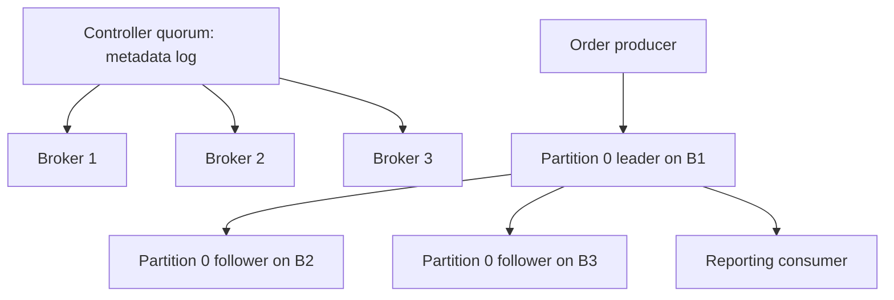

# Chapter 7 — Kafka Architecture, Storage, and Replication

Prepared 2026-10-24. Reading and laboratory material; no broker deployment or example execution is claimed.

## 1. Lesson title
Understand the retained partition log, the metadata control plane, and the physical machinery that makes an accepted order event recoverable.

## 2. Interview priority
P0. Explain an actual record journey before reciting broker configuration names. Senior interviews frequently expose confusion between controller quorum, replica quorum, committed data, and committed consumer offsets.

## 3. Prerequisites
Chapters 1–6: partial failure, Java objects versus bytes, TCP connections, local database transactions, and filesystem fundamentals. You need the idea of an ordered sequence, but no separate algorithms track. A directory is a namespace for files; an operating-system page cache is memory used to retain recently accessed file contents.

## 4. Learning objectives
Draw a topic with partitions and replicas; distinguish record identity from business identity; explain retention and compaction; trace append, replication, and visibility; separate KRaft metadata from user data; identify deployment failure domains; and estimate storage without claiming a benchmark.

## 5. Official references and version notes
Opened 2026-10-24: [Kafka 4.2 design](https://kafka.apache.org/42/design/design/), [record-batch format](https://kafka.apache.org/42/implementation/message-format/), [topic configuration](https://kafka.apache.org/42/configuration/topic-configs/), [KRaft operations](https://kafka.apache.org/42/operations/kraft/), [eligible leader replicas](https://kafka.apache.org/42/operations/eligible-leader-replicas/), [listener configuration](https://kafka.apache.org/42/security/listener-configuration/), [quick start](https://kafka.apache.org/42/getting-started/quickstart/), and [Apache OffsetIndex source, tag 4.2.0](https://github.com/apache/kafka/blob/4.2.0/storage/src/main/java/org/apache/kafka/storage/internals/log/OffsetIndex.java).

The approved teaching baseline remains Java 21, Boot 4.1.1, broker 4.2.2, client 4.2.1, Spring Kafka 4.1.1, and JUnit 6. Apache's 4.2 web line now points readers to 4.3; its Javadocs display 4.2.0. The older [log implementation page](https://kafka.apache.org/42/implementation/log/) contains historical byte-offset language: modern consumer offsets are logical positions, not byte addresses. Defaults are deliberately avoided unless discussed explicitly. Books are recommendations, not evidence of completed reading.

## 6. Fundamental explanation

Order Service creates a fact such as OrderAccepted. Kafka stores its serialized key, value, timestamp, and headers as a record. A topic names a stream; its partitions are separate ordered logs. The physical record coordinate is the topic identity, partition number, and offset. Our eventId remains necessary because replay, mirroring, and republishing can change physical coordinates while retaining the same business occurrence.

Suppose `commerce.order-events.v1` has three partitions. Records at offsets 40 and 41 in partition 0 have a defined log order. Offset 40 in partition 1 is unrelated. A consumer group maintains progress separately for each partition. Reporting and fulfillment can therefore process the same topic at different speeds without one subscriber deleting the other's input.

Keys are routing input, not uniqueness constraints. We choose orderId for order workflow events because related transitions should normally share a partition. Kafka does not reject two OrderAccepted records with the same key. The Inventory database still enforces reservation uniqueness. Increasing partition count can change the mapping of a key to a partition, so the architecture must plan ordering across partition changes.

Retention answers how long data remains available. A delete policy removes eligible log segments based on configured limits; it is not tied to acknowledgment by every consumer. Compaction instead removes superseded values for keys over time. It is useful for rebuilding current state, but does not promise one immediately visible record per key. A null value can represent a tombstone in a compacted topic. Choose a deletion horizon long enough for relevant readers and rebuilds. [Topic configuration](https://kafka.apache.org/42/configuration/topic-configs/)

Our order facts and a current-order projection have different purposes. Facts support audit and historical reconstruction. A compacted projection supports obtaining the latest known state. If every transition is required for legal or analytical reasons, replacing a historical stream with a compacted topic loses information the application may need. This is a data-product decision, not just a disk-space setting.

## 7. Internal architecture and mechanism

### The append path
A producer first obtains metadata and connects to the partition leader. The broker appends record batches to the partition's active segment. Followers fetch data from the leader. A replica is another copy of the partition on another broker; it is not a separate consumer group. The leader's log end, the replicated visibility boundary, and a consumer's committed restart offset describe different progress.

The high watermark marks a replication commitment boundary; offsets below it are committed under the applicable replication rules. Transactions add another visibility boundary, the last stable offset, explored in Chapter 10. A successful append to a leader does not prove downstream processing. A consumer offset commit does not alter the leader's replication state.

The ISR is the set of replicas currently considered in sync. Replication factor is the intended number of copies; ISR size can shrink when a replica cannot keep up. With acknowledgments set to all and a suitable minimum ISR, the application chooses to reject writes when its durability condition cannot be met. That creates an intentional availability trade-off rather than silently weakening the contract. [Kafka design](https://kafka.apache.org/42/design/design/)

In Kafka 4.2, eligible leader replicas matter. The official operations page says ELR is enabled by default on newly created clusters from 4.1 and describes strict minimum-ISR high-watermark behavior. A safe eligible leader can exist outside the current ISR. Therefore, the old slogan “only an ISR member can ever be safely elected” is incomplete. Inspect feature state for upgraded clusters; do not infer it solely from the installed binary version. [ELR](https://kafka.apache.org/42/operations/eligible-leader-replicas/)

### Segments, indexes, and cache
A partition is split into segment files so Kafka can roll, clean, retain, and recover bounded pieces. The active segment receives appends. A segment's base offset identifies its logical starting range. The offset index maps selected relative offsets to byte positions; it is sparse, so finding a record commonly involves an index lookup followed by scanning the nearby batch. A timestamp index helps time-based lookup. Neither is a relational index allowing arbitrary SQL predicates. [OffsetIndex source](https://github.com/apache/kafka/blob/4.2.0/storage/src/main/java/org/apache/kafka/storage/internals/log/OffsetIndex.java)

Record batches carry metadata such as base offset, timestamps, producer identity and sequence information, and compression attributes. Batching reduces repeated per-record overhead. Kafka relies heavily on the operating-system page cache: a read may come from memory even though the durable structure is a file. Sequential I/O and cache reuse explain why a broker can serve substantial throughput without retaining each event as a Java heap object. Replication acknowledgment and forcing every record to physical media are different concepts. [Batch format](https://kafka.apache.org/42/implementation/message-format/)

For our sizing exercise, imagine 2,000 records/sec, average stored size 700 bytes, three replicas, and seven days. The arithmetic is about 2.54 TB before indexes, segment slack, overhead, growth, and safety capacity. These are illustrative inputs. Compression ratio must be measured using representative records. Free disk is recovery capacity as well as an operating margin: replica rebuilds and reassignment need somewhere to write.

### KRaft is a different log
KRaft controllers replicate cluster metadata: broker registrations, partition assignments, leadership, and configuration-related state. Their quorum does not contain the commerce payload stream. Brokers host the user-data replicas. A combined process can play both roles in a local lab, but role co-location does not merge the two protocols.

Current KRaft documentation distinguishes static voter configurations from dynamic quorums. Dynamic membership depends on the KRaft feature level and uses bootstrap controller addresses rather than treating a static voter list as the only setup. Formatting initializes identity and metadata state; it is not a repair command to run against an existing data directory. [KRaft](https://kafka.apache.org/42/operations/kraft/)

## 8. Diagrams



The arrows from the quorum represent metadata coordination, not copying order payloads through controllers. A three-controller majority and a three-replica data partition are separate reliability arrangements.

```text
Partition 0 directory
  00000000000000000000.log       retained segment batches
  00000000000000000000.index     sparse offset-to-position entries
  00000000000000000000.timeindex timestamp lookup entries
  00000000000000000500.log       a later segment, possibly active
```

These filenames illustrate structure; they are not captured output from this machine.

## 9. Java 21 implementation

This complete Java class inspects a pre-existing topic through the client Admin API. It needs `org.apache.kafka:kafka-clients:4.2.1` on the Maven classpath. It creates no topics, changes no broker settings, and assumes a reachable unsecured local lab endpoint. Add the approved security properties before using a secured environment.

```java
import java.time.Duration;
import java.util.List;
import java.util.Properties;
import java.util.concurrent.TimeUnit;
import org.apache.kafka.clients.admin.Admin;
import org.apache.kafka.clients.admin.TopicDescription;

public final class InspectOrderTopic {
    public static void main(String[] args) throws Exception {
        String bootstrap = args.length > 0 ? args[0] : "localhost:9092";
        String topic = "commerce.order-events.v1";
        Properties properties = new Properties();
        properties.put("bootstrap.servers", bootstrap);
        properties.put("client.id", "course-topic-inspector");
        properties.put("default.api.timeout.ms", "10000");
        Admin admin = Admin.create(properties);
        try {
            TopicDescription description = admin.describeTopics(List.of(topic))
                    .allTopicNames().get(12, TimeUnit.SECONDS).get(topic);
            for (var partition : description.partitions()) {
                System.out.printf("partition=%d leader=%s replicas=%s isr=%s%n",
                        partition.partition(), partition.leader(),
                        partition.replicas(), partition.isr());
            }
        } finally {
            admin.close(Duration.ofSeconds(5));
        }
    }
}
```

The outer future timeout bounds the caller's wait; the client timeout bounds its operation policy. Printed metadata is a point-in-time observation and may already have changed. This class cannot establish rack diversity, storage integrity, or business correctness. Compile and exercise it in the later Maven lab; no execution is claimed here.

## 10. Spring Boot integration
Boot's `spring.kafka.bootstrap-servers` supplies initial contact points. Brokers advertise the addresses clients subsequently use, so a container-only hostname returned to a Windows host can break communication after bootstrap succeeds. Give each client network a reachable advertised listener; opening one bootstrap port alone is insufficient. [Listeners](https://kafka.apache.org/42/security/listener-configuration/)

Our service topic names and keys belong to an explicit contract. Development may provision topics through an administrative bean, but production provisioning should be controlled and reviewed. Application startup should not quietly change partition counts in a way that alters key routing. Keep controller credentials outside ordinary application configuration.

## 11. Production scenario
The Inventory listener stops for six hours while Order continues. Broker health remains green, but reservation processing is delayed. On restart, retained data allows catch-up if the needed records remain. If retention expired, restarting the process cannot recover deleted input. The operational answer becomes reconstruction from authoritative service state or another retained source, followed by reconciliation.

Before increasing retention, estimate disk growth and catch-up bandwidth. Before lowering it, identify the slowest permitted consumer and the longest recovery window. A topic owner should publish a replay contract: retained horizon, schema availability, permission to replay side effects, and escalation path when the horizon is exceeded.

## 12. HLD considerations
Choose partitions from required parallelism, key distribution, growth, and recovery costs. More partitions create more scheduling and metadata work and can spread a producer's batches thinly. Separate topics when ownership, retention, authorization, or contract meaning differs, rather than creating one topic for every class in the codebase.

Place replicas across meaningful failure domains. Three replicas on three processes sharing one disk or availability zone do not survive loss of that shared dependency. Controller placement also deserves failure-domain analysis. The goal is a stated failure tolerance, not an impressive node count.

## 13. LLD considerations
Define `TopicName`, event envelope, serializer, and key policy centrally within a service's infrastructure boundary. Keep domain logic independent of partition numbers. Store eventId and aggregateVersion in the payload; do not infer order lifecycle version from a Kafka offset because unrelated orders share a partition and replay may change physical location.

The topic inspector illustrates a useful separation: an infrastructure diagnostic can know broker metadata while `ReserveInventoryHandler` knows only the command and local transaction. This makes tests smaller and prevents transport details from becoming business identities.

## 14. Reliability and failure handling
Distinguish a leader failure, follower lag, controller-quorum loss, full disk, bad listener advertisement, and a consumer behind retention. They produce different symptoms and require different recovery. Blind restarts can discard diagnostic evidence and add replica catch-up pressure.

For every incident, record the affected topic partitions, leader and ISR changes, client error class, relevant feature state, and oldest outstanding business operation. Do not use unclean leader election as an unexplained availability fix: choosing a replica without the committed history can lose acknowledged records. Preserve the original evidence and reconcile business effects after any recovery that risks loss.

## 15. Performance and trade-offs
Estimate storage from ingress bytes, retention, replication, and measured compression. Estimate recovery separately: a replica copying 500 GB has a lower bound determined by usable transfer bandwidth, then competes with normal traffic. Page-cache pressure from large historical replays can increase foreground latency. Quotas and controlled replay protect service traffic while preserving recoverability.

Tuning starts with a bottleneck hypothesis. High CPU suggests different actions from saturated disks or a single hot partition. Increasing JVM heap can reduce memory available to the page cache; it is not automatically a broker throughput improvement.

## 16. Interview questions with model answers

### Q1. Is an offset a byte position? [P0]
No. It is a logical partition position. The offset index maps selected logical offsets to file positions. If you treat offset differences as exact bytes or exact business-event counts, compaction and control records make your estimate misleading. Follow-up: explain how a timestamp lookup finds a starting point.

### Q2. Does consumption remove data? [P0]
Ordinary consumer progress is separate from retention. A second group can read the same retained log. The senior concern is whether the slow group can finish before expiration; acknowledgment by the fast group provides no protection.

### Q3. Why split a partition into segments? [P0]
Segments bound file management, cleanup, and recovery work. Our operational implication is that retention is not a precise per-record deletion timer. Follow-up: explain why a small topic might retain records beyond its nominal age threshold.

### Q4. How does KRaft differ from replication? [P0]
The controller quorum agrees on metadata, while partition replicas hold records. Losing controller availability and losing an order partition leader are distinct incidents. More controllers do not create more copies of order events.

### Q5. Is ISR the replication factor? [P0]
Replication factor is intended placement; ISR is current synchronization membership. A partition configured with three copies can have fewer synchronized replicas. Monitoring only configured replication factor misses degraded durability.

### Q6. What does high watermark mean? [P0]
It bounds replication-committed records, with transactional isolation potentially limiting visibility further. It does not mean a customer was charged or a consumer committed its offset. Name the boundary before using the word committed.

### Q7. Can compaction replace an audit log? [P0]
Usually not when intermediate transitions matter. Compaction supports latest-value reconstruction, while an audit trail needs retained occurrences. Our order history and reporting snapshot therefore have different topic policies.

### Q8. Why might bootstrap succeed but publication fail? [P0]
Metadata can advertise a broker address unreachable from the client's network. Inspect advertised listeners and DNS from the client environment. Repeatedly enlarging request timeouts does not fix an unreachable hostname.

### Q9. Are all non-ISR leader elections unsafe in 4.2? [P1]
No. Eligible leader replicas extend the safe selection model when the feature is enabled. An interview answer should distinguish ELR from arbitrary unclean election and inspect feature state in an upgraded cluster.

### Q10. Why is replica count insufficient for resilience? [P0]
Copies can share a failure domain. Three brokers on one storage device can fail together. Evaluate independent placement, spare capacity, and restoration procedures, then demonstrate the claimed tolerance with a controlled lab.

## 17. Practical exercise, expected observations, and solution
In a disposable cluster with three brokers, inspect an existing three-partition, replication-factor-three topic. Record leader, replicas, and ISR before stopping one broker through the lab's deployment mechanism. Keep the controller quorum healthy. Publish with the Chapter 8 producer, then restore the broker and observe catch-up. Do not run this against shared infrastructure.

Expected observations: some leaders may change; replicas remain assigned while ISR can shrink; successful writes depend on configured durability conditions. A stopped follower is not automatically removed from the replica assignment. After recovery it must catch up before returning to full synchronization.

Solution: draw each partition independently and annotate the leader transition. Explain why a three-controller quorum tells you nothing about whether partition 2 currently has sufficient synchronized data copies. If publication fails, retain the error and compare actual ISR with the minimum ISR instead of reducing durability immediately. Repeat the paper reasoning for two lost brokers; predict unavailable writes under minimum ISR two.

## 18. Verification
Run the inspector before and after the lab, save metadata snapshots, and compare timestamps with producer outcomes. Verify that every expected eventId exists in a downstream read and that business reconciliation detects duplicates independently of the broker inspection. Record broker/client versions and feature levels. No commands or failure tests were executed while writing this chapter.

## 19. Common misconceptions
Kafka offsets are not globally unique business IDs. Controller quorum is not payload replication. Compaction is asynchronous cleanup, not a uniqueness constraint. A healthy broker process is not proof of sufficient ISR, adequate retention, or completed customer workflows. Reformatting a data directory is not routine restart recovery.

## 20. Knowledge assessment
An upgraded 4.2 cluster has three brokers, three dedicated controllers, and a topic with replication factor three. One zone fails; writes stop for some partitions while controllers remain healthy. Describe the evidence you would collect, including feature state, before deciding whether the system behaved correctly. No score is recorded until your answer is reviewed.

## 21. Revision summary
Reason about four independent things: where a record is routed, how its bytes are stored, which replicas make it safe, and how far each reader has progressed. Use metadata and business evidence together. Preserve a replay horizon that matches the recovery promise.

## 22. Next lesson
Chapter 8 follows the producer from serialization through metadata, batching, acknowledgments, retries, and fencing. Keep the storage and visibility boundaries from this chapter visible while evaluating producer guarantees.
