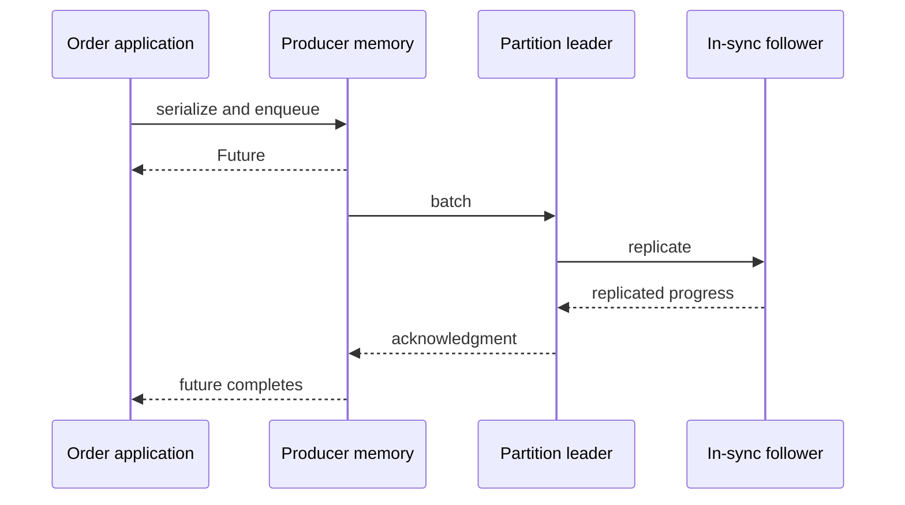

# Chapter 8 — Kafka producers: from a method call to a durable record

## 1. Lesson title
How Java sends an order event, what acknowledgment proves, and how to reason about a failed send.

## 2. Interview priority
P0. Producer correctness affects every downstream consumer. Learn the complete path before tuning configuration.

## 3. Prerequisites
Chapter 7: topic, partition, leader, follower, offset, in-sync replicas (ISR). A future is a handle to a result that may arrive later. Serialization converts an in-memory value into bytes.

## 4. Learning objectives
Trace a send, distinguish enqueueing from acknowledgment, select a key, calculate batching costs, interpret timeouts, and explain the boundary between transport deduplication and business idempotency.

## 5. Official references and version notes
Use Apache Kafka 4.2 documentation for this course, although the website now offers 4.3. The proposed project uses client 4.2.1 and broker 4.2.2; downloaded dependencies have not been verified. The 4.2 Javadoc banner says 4.2.0.

- [Producer configuration](https://kafka.apache.org/42/configuration/producer-configs/): explicit settings and their constraints.
- [KafkaProducer API](https://kafka.apache.org/42/javadoc/org/apache/kafka/clients/producer/KafkaProducer.html): send, callbacks, lifecycle, and transactions.
- [Transaction protocol](https://kafka.apache.org/42/operations/transaction-protocol/): release-sensitive protocol behavior.

Verified configuration facts: 4.2 defaults include linger.ms=5, acks=all, and idempotence enabled when no conflicting settings disable it. Explicit idempotence requires acks=all, retries greater than zero, and max.in.flight.requests.per.connection at most five. These facts come from the configuration page; the walkthrough and engineering decisions below are original project examples.

## 6. First principles
Imagine an Order service holding a freshly created event in memory. Inventory cannot read this memory: it is a different process. The producer must encode the event, locate a broker, send bytes, and receive evidence of acceptance. Each transition can fail independently.

A producer acknowledgment is evidence about Kafka storage under its configured replication rules. It does not prove Inventory reserved stock or Payment charged a customer. Consequently the API response must describe the state actually achieved: “order accepted” and “order fulfilled” are different promises.

A key selects an ordering domain. For order lifecycle events, orderId is a useful choice because all updates for one order usually need a coherent sequence. For inventory commands, sku or a reservation identity may be appropriate, depending on the owner and invariant. One universal key for every topic is not an architectural principle.

A null key is reasonable for independent telemetry where distribution matters more than entity order. Choosing the same constant key for all orders creates one hot partition even when many partitions exist.

## 7. Internal architecture
Work through one send:

1. The producer discovers topic partitions and leaders using cluster metadata. Bootstrap addresses are entry points, not the only brokers it will contact.
2. Serializers turn the key and value into byte arrays. An invalid object may fail here before any broker sees it.
3. An explicit partition, key-based choice, or keyless partitioning strategy determines the destination.
4. The record enters a per-partition accumulator. This is client memory, not durable storage.
5. A background sender groups ready batches into requests to the relevant leaders.
6. Brokers validate and append accepted batches; replication and acknowledgment rules determine when success can return.
7. The future completes or a callback receives the outcome. A retriable failure can cause the client to resend within its delivery budget.

The public send is asynchronous with respect to broker completion, but serialization, unavailable metadata, or exhausted buffer capacity can delay the calling thread. “Async” does not mean “cannot block.”

Batching amortizes per-request overhead. Suppose an envelope costs 200 bytes and each record costs 300 bytes. Twenty separate requests carry 10,000 bytes in this simplified model; one batch carries 6,200. This arithmetic excludes compression, TCP, encryption, and protocol details, but shows the source of the benefit.

Compression works on batches. Similar field names and repeated values compress well. It costs CPU and may increase latency if CPU is already saturated. Test with representative messages, not an easily compressed string repeated a million times.

Three clocks answer different questions. max.block.ms bounds particular client-side waits. request.timeout.ms concerns a request response. delivery.timeout.ms covers the permitted overall delivery period after send returns. None cancels a database transaction or retracts a broker append that already happened. Configure the last consistently with request timeout and batching delay.

## 8. Diagrams

The first return and the last completion are different moments. A crash between them may lose an unsent event. An outbox later gives the event durable application ownership.

## 9. Java 21 implementation
This is a complete isolated console producer. Put it in OrderProducerDemo.java in a Maven module containing org.apache.kafka:kafka-clients managed by the course BOM. It assumes a pre-created order-events topic and a reachable local broker. It is not the outbox implementation.

```java
import java.time.Duration;
import java.util.Properties;
import java.util.UUID;
import org.apache.kafka.clients.producer.KafkaProducer;
import org.apache.kafka.clients.producer.ProducerRecord;
import org.apache.kafka.clients.producer.RecordMetadata;
import org.apache.kafka.common.serialization.StringSerializer;

public final class OrderProducerDemo {
    public static void main(String[] args) throws Exception {
        Properties p = new Properties();
        p.put("bootstrap.servers", "localhost:9092");
        p.put("key.serializer", StringSerializer.class.getName());
        p.put("value.serializer", StringSerializer.class.getName());
        p.put("client.id", "order-producer-demo");
        p.put("acks", "all");
        p.put("enable.idempotence", "true");
        p.put("linger.ms", "5");
        p.put("delivery.timeout.ms", "120000");
        p.put("request.timeout.ms", "30000");
        String orderId = "order-100";
        String eventId = UUID.randomUUID().toString();
        String json = """
            {"eventId":"%s","orderId":"%s","type":"OrderAccepted","version":1}
            """.formatted(eventId, orderId);
        try (KafkaProducer<String, String> producer = new KafkaProducer<>(p)) {
            RecordMetadata result = producer.send(
                new ProducerRecord<>("order-events", orderId, json)).get();
            System.out.printf("topic=%s partition=%d offset=%d%n",
                result.topic(), result.partition(), result.offset());
            producer.close(Duration.ofSeconds(10));
        }
    }
}
```

Properties explicitly express the lesson's requirements. They are not a universal production tuning profile. The UUID identifies an event; retries of the same business event must preserve that identity. Re-running this program intentionally creates a new eventId, so Kafka is entitled to store another record.

get() is used to make the teaching outcome visible. Calling it after every send in a high-throughput loop serializes the pipeline and wastes batching opportunities. In a service, observe completion through callbacks or completion stages and preserve durable recovery state. Do not do slow database work on the producer callback thread.

## 10. Spring Boot integration
KafkaTemplate wraps a producer and returns an asynchronous completion. Spring owns factory and producer lifecycle; do not construct a producer for every HTTP request. Configure serializers consistently with the actual value type. Sending a String through a JSON serializer can create an encoded JSON string instead of the object consumers expect.

Keep an EventPublisher port separate from order business logic. The production path will save order state and an outbox row in one PostgreSQL transaction. A relay publishes the row and records acknowledgment. Chapter 11 covers the Spring APIs; Chapter 12 closes the database-to-Kafka failure gap.

## 11. Production scenario
An acknowledgment is lost after the leader accepts a batch. The application sees delay while Kafka already has the event. A client retry can use producer identity and sequence information to avoid a duplicate append within that mechanism. If the application catches the failure, creates a second event, and sends it as a new operation, the broker cannot know that the two records represent one customer intention.

For payment safety, preserve a stable business operation ID from order orchestration through provider request and reconciliation. A transport setting cannot infer business equivalence.

## 12. HLD considerations
Choose ownership, durable acceptance point, topic contracts, partition keys, and recovery policy before buffer sizes. Budget retention for outage recovery. Plan what the API reports while publication is pending. A durable order accepted locally can have status PENDING_PUBLICATION rather than pretending Kafka publication already succeeded.

Estimate separate paths for normal delivery and replay. An outage backlog can overload consumers even when the normal rate is modest.

## 13. LLD considerations
An event envelope needs eventId, aggregateId, eventType, schemaVersion, occurredAt, and correlation information. Avoid using mutable Java entities as event contracts. Validate size and required fields before publishing. Isolate serialization, dispatch, and result handling so each failure has an identifiable owner.

Fencing applies to transactional producer ownership: an obsolete producer must not continue acting as the current transactional instance. Give concurrent logical instances distinct transactional identities while preserving intentional identity continuity across recovery. Random IDs for every retry defeat this reasoning.

## 14. Reliability
Classify failures: malformed data needs correction; authentication requires credential or policy repair; temporary leader changes may be retried; delivery timeout needs an explicit uncertain-outcome policy. Infinite application retries can consume memory or permanently block one bad record.

acks=0 provides no broker response evidence. acks=1 can acknowledge before follower replication. acks=all coordinates with the ISR and minimum ISR requirement; it does not mean every configured replica is always present. With replication factor three and minimum ISR two, availability and loss tolerance depend on actual replica state and leader-election policy. A one-broker development cluster cannot demonstrate these guarantees.

## 15. Performance
Suppose peak input is 10,000 events/s at 1 KB each: roughly 10 MB/s of logical payload before replication and protocol overhead. A 30-second outage creates about 300 MB of new payload. Increasing producer memory to hold the entire outage is usually weaker than durable buffering with a controlled relay.

Measure record queue time, request latency, batch size, compression ratio, buffer exhaustion, retry rate, and CPU together. A higher linger can reduce resource contention under load but adds waiting to sparse traffic. Changing one parameter at a time preserves causal evidence.

## 16. Ten study questions with model answers
1. **Does send returning mean success?** No: it can mean the client accepted pending work. Observe its completion. In an order API, confusing those moments reports durability that has not been established.
2. **Why share a producer?** It owns expensive connections, buffers, and a sender; sharing improves utilization. It is designed for concurrent use, unlike KafkaConsumer. Share lifecycle deliberately rather than closing it from arbitrary requests.
3. **What does acks=all buy?** Stronger replication acknowledgment than leader-only acceptance under the ISR rules. It does not acknowledge consumer business actions, and its practical durability depends on replica configuration and health.
4. **Does idempotence stop duplicate orders?** It addresses the producer retry mechanism. A repeated HTTP request or regenerated event can be a new transport operation. Enforce business keys and unique constraints at the service owning the effect.
5. **Why can an asynchronous producer stall?** It still needs metadata, buffer capacity, and serialization. Investigate backpressure and callback work before increasing timeouts.
6. **Why can increasing partitions change behavior?** Key-to-partition mapping may change when the partition count changes. Historical and new records can sit in different partitions, so sequence continuity needs a migration plan.
7. **Should every event use a random key?** Only when the required semantics permit it. Random keys distribute load but do not preserve per-order grouping; eventId and partition key serve different purposes.
8. **Why not retry every exception?** Some failures are deterministic or indicate invalid ownership. Repeating malformed data wastes resources; a fenced transactional producer must stop acting as owner.
9. **Why is flush per record expensive?** It forces pending sends toward completion and reduces useful overlap. Flush at a justified lifecycle or checkpoint boundary, not as a substitute for understanding acknowledgment.
10. **How do you defend a tuning choice?** State workload, latency target, baseline metrics, changed variable, measured benefit, and failure impact. A configuration copied without these conditions is an untested hypothesis.

## 17. Worked exercise
Order 100 produces event E1. The broker appends E1, but the network drops the response. Compare two recoveries: A lets the producer retry its existing send; B restarts the application and creates event E2 for the same order.

Expected observation: A can use the producer protocol's deduplication. B is a distinct record and may be stored. The solution is not “disable retries.” Preserve the event in an outbox and make Inventory's reserve operation unique by order/reservation identity. If publication repeats, the business effect remains one reservation.

For a later executable lab, send twenty records with one order key, inspect partition/offset metadata, restart the consumer group, and compare event IDs. Repeat with multiple keys. Do not infer ordering across partitions from a single run.

## 18. Verification and execution status
The code and laboratory are written but not executed here. First verify the broker, topic, advertised addresses, and Maven dependency tree. Run the demo, inspect the actual stored payload, and confirm consumer visibility. Then test an unavailable broker and record elapsed time and exception type. A successful send alone is not an end-to-end order test.

## 19. Common misconceptions
A producer buffer is not a durable queue. A timeout does not prove no append happened. Compression is not free. A large partition count does not remove hot keys. Exactly-once transport claims do not authorize exactly-once payment claims.

## 20. Unanswered assessment
The producer reports timeout, the customer retries, and Inventory reserves twice. Which identities and durable boundaries would you inspect first, and why?

## 21. Revision summary
Separate enqueue, append, acknowledgment, and business completion. Choose keys from invariants. Preserve event identity across retries. Tune with workload evidence. Use the outbox for durable application recovery.

## 22. Next lesson
Chapter 9 follows the stored event through consumer assignment, processing, offset commits, and rebalances.

