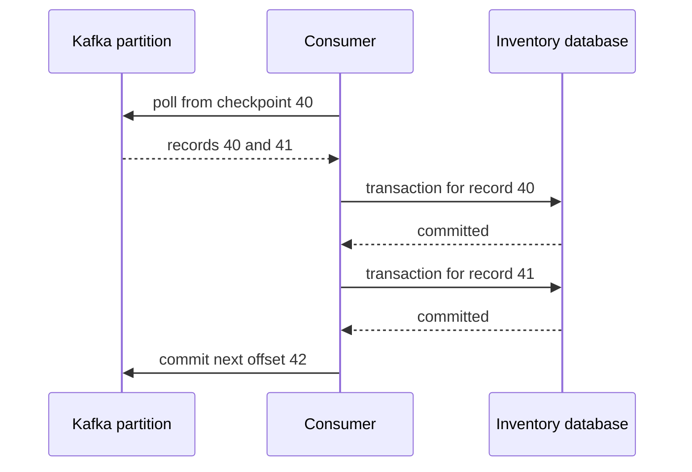

# Chapter 9 — Kafka consumers, offsets, groups, and rebalances

## 1. Lesson title
How Inventory reads an event, makes durable progress, and recovers ownership after failure.

## 2. Interview priority
P0. Most duplicate-processing and missing-processing incidents involve misunderstood boundaries between polling, work, and committing progress.

## 3. Prerequisites
Chapters 7–8. Understand that a partition is an ordered log and that each record has a partition-local offset. A database commit and a Kafka offset commit are separate operations.

## 4. Learning objectives
Trace poll and commit, calculate a safe next offset, explain rebalances, distinguish group protocols, design bounded worker processing, and diagnose lag without assuming that adding consumers fixes it.

## 5. Official references and versions
- [KafkaConsumer API](https://kafka.apache.org/42/javadoc/org/apache/kafka/clients/consumer/KafkaConsumer.html): position, commits, threading, and rebalances.
- [Consumer configuration](https://kafka.apache.org/42/configuration/consumer-configs/): poll/fetch limits, reset policy, and protocol settings.
- [Consumer rebalance protocol](https://kafka.apache.org/42/operations/consumer-rebalance-protocol/): the newer group protocol and migration.

Verified 2026-10-24 against Kafka 4.2; API banner 4.2.0. The 4.2 configuration default for group.protocol is classic; choosing consumer opts into the newer protocol. Heartbeat/session control differs between those protocols. Do not transplant classic client heartbeat settings into the new protocol blindly. The code explicitly chooses classic to make the teaching baseline reproducible.

## 6. First principles
A consumer group is one logical subscriber implemented by one or more consumers. Inventory and Reporting should have different group IDs because both need their own progress. Two Inventory instances normally share a group to divide the work.

The broker does not delete a record because Inventory consumed it. Inventory stores a checkpoint; retention determines how long the underlying data remains. This distinction explains both replay and the possibility of falling behind retention.

Three positions matter. The log's end indicates log progress, the consumer's current position is the next offset to be delivered by poll, and the committed position is its recovery checkpoint. Internal fetch buffers can contain records that poll has not yet delivered. Business completion can trail poll-delivered progress. Keeping those concepts separate is more useful than saying “the consumer is at offset 50.”

A commit generally records where to resume, not the last record processed. If records through offset 41 are durably handled, the next offset is 42. There can be gaps in offsets, so do not treat offset differences as exact counts of user records in every situation.

## 7. Internal architecture
The application subscribes, the group coordinator manages membership and assignments, and the consumer fetches from partition leaders. Poll returns records to application code. The application processes them, then commits an appropriate checkpoint.

In a traditional consumer group, one assigned partition is consumed by one group member at a time. With six partitions and eight consumers, at least two consumers cannot actively own a partition for that topic. A member can own multiple partitions. Different groups read independently.

A rebalance changes ownership after membership, subscription, or partition topology changes. A former owner must stop treating revoked work as its responsibility. If it keeps an uncontrolled worker running, a new owner can process the same event concurrently. A local thread interruption does not reverse an external side effect already issued.

Classic protocols include eager and cooperative assignment behavior. Cooperative movement can reduce disruption, but does not eliminate all rebalances or application recovery work. The newer consumer protocol moves assignment management toward the broker and reconciles membership incrementally. Treat protocol migration as a tested change, including broker support and operational settings.

A heartbeat establishes membership liveness; it does not prove the application is making useful progress. The maximum poll interval protects against a consumer that remains connected but does not continue polling within the allowed processing window.

Fetch sizing controls network batches. max.poll.records limits what a poll hands to application code, not necessarily all bytes fetched into client memory. A slow downstream service can make a small batch take too long. Bound both records and processing time.

## 8. Diagrams

If the process dies after the second database commit but before the final Kafka commit, replay is expected. The database must recognize already completed work.

## 9. Java 21 implementation
This complete console reader uses kafka-clients from the course Maven dependency management. It demonstrates batch checkpointing; console output is not a durable business effect. It assumes a local broker and existing order-events topic.

```java
import java.time.Duration;
import java.util.List;
import java.util.Properties;
import java.util.concurrent.CountDownLatch;
import java.util.concurrent.TimeUnit;
import org.apache.kafka.clients.consumer.ConsumerRecord;
import org.apache.kafka.clients.consumer.ConsumerRecords;
import org.apache.kafka.clients.consumer.KafkaConsumer;
import org.apache.kafka.common.errors.WakeupException;
import org.apache.kafka.common.serialization.StringDeserializer;

public final class OrderConsumerDemo {
    public static void main(String[] args) {
        Properties p = new Properties();
        p.put("bootstrap.servers", "localhost:9092");
        p.put("group.id", "order-reader-demo");
        p.put("group.protocol", "classic");
        p.put("enable.auto.commit", "false");
        p.put("auto.offset.reset", "earliest");
        p.put("max.poll.records", "20");
        p.put("key.deserializer", StringDeserializer.class.getName());
        p.put("value.deserializer", StringDeserializer.class.getName());
        KafkaConsumer<String, String> consumer = new KafkaConsumer<>(p);
        CountDownLatch stopped = new CountDownLatch(1);
        Runtime.getRuntime().addShutdownHook(new Thread(() -> {
            consumer.wakeup();
            try {
                stopped.await(7, TimeUnit.SECONDS);
            } catch (InterruptedException interrupted) {
                Thread.currentThread().interrupt();
            }
        }));
        try {
            consumer.subscribe(List.of("order-events"));
            while (true) {
                ConsumerRecords<String, String> records =
                    consumer.poll(Duration.ofSeconds(1));
                for (ConsumerRecord<String, String> record : records) {
                    System.out.printf("%s:%d:%d key=%s value=%s%n",
                        record.topic(), record.partition(), record.offset(),
                        record.key(), record.value());
                }
                if (!records.isEmpty()) {
                    consumer.commitSync();
                }
            }
        } catch (WakeupException shutdown) {
            // This demo only calls wakeup from its shutdown hook.
        } finally {
            try {
                consumer.close(Duration.ofSeconds(5));
            } finally {
                stopped.countDown();
            }
        }
    }
}
```

The owning thread performs all normal consumer operations, including close. wakeup is the special cross-thread mechanism used for shutdown. The hook waits boundedly for cleanup rather than returning immediately; if its grace period expires, shutdown can still interrupt unfinished work, which must remain replay-safe. enable.auto.commit=false makes the checkpoint explicit. commitSync without a map is safe here only because all records returned by this poll were handled synchronously before the commit. Copying that call into asynchronous worker code can skip unfinished records.

earliest is a reset policy for missing or invalid committed offsets. It does not rewind an existing valid group checkpoint on every start. Use an isolated new group for a replay experiment rather than changing a production group casually.

## 10. Spring Boot integration
A Spring listener container owns polling and group membership. Concurrency creates multiple consumers; it does not remove partition constraints. Acknowledgment mode defines how container processing relates to checkpointing. Avoid mixing manual consumer commits with container-managed commits without a deliberate model.

A listener calling an @Transactional service normally returns after the database transaction completes. A listener that merely submits a background task returns much earlier. The container can interpret that return as success even though the business task has not finished. Use supported asynchronous handling deliberately, or keep the first design synchronous with bounded processing.

## 11. Production scenario
Inventory takes 200 ms per reservation under normal load, then a database lock makes some requests take 12 seconds. With a large poll batch, the consumer exceeds its processing window and loses ownership. New owners replay work; old workers are still completing reservations.

The fix begins with the cause of slow transactions and reservation uniqueness. Reducing batch size and bounding dependencies may restore predictable processing. Simply extending the poll interval hides the symptom and delays detection when a consumer is truly stuck.

## 12. HLD considerations
Set a recovery-time objective for backlog drain. If steady arrivals are 500/s and sustainable processing is 700/s, only 200/s of spare capacity drains backlog. A backlog of 120,000 needs about 600 seconds under those assumptions. More partitions help only if downstream capacity and key distribution support more parallel work.

Independent groups isolate progress but increase broker reads and downstream cost. Keep group names stable across deployments unless a replay is intentional.

## 13. LLD considerations
For worker pools, track progress independently per partition. Commit only after all earlier delivered records in that partition are complete. If offsets 10 and 12 finish while 11 is pending, committing 13 is unsafe. Pause busy partitions to bound queues while continuing the polling needed for group health.

Maintain assignment ownership tokens for work you dispatch. On revocation, stop accepting new work, drain or cancel within a bounded interval, and prevent stale completion callbacks from advancing the new owner's progress. Durable idempotency is still needed because cancellation can race with side effects.

Share groups use record acknowledgment/locking semantics and can distribute work differently from classic partition ownership. They are not a drop-in replacement when per-key processing order is an invariant. Evaluate the selected release's share-consumer API and deployment support before adopting it; this course's Order/Inventory flow uses ordinary consumer groups.

## 14. Reliability
Commit before durable processing creates a loss window: after restart Kafka resumes after work never completed. Commit after processing creates a duplicate window: replay may repeat completed work. For database consumers, prefer the latter plus inbox and business uniqueness.

A poison record is data that repeatedly fails in the same way. Retry transient failures within a budget; quarantine irreparable data with original bytes, source position, and failure reason. Moving it aside may change ordering semantics. An order cannot always safely process step three when step two was quarantined.

## 15. Performance
Lag is a symptom, not a diagnosis. Inspect arrival rate, processing rate, partition skew, database wait time, errors, rebalances, and time since oldest unprocessed business event. Offset lag can be zero while the application has handed work to a hidden queue.

Batching database operations can improve throughput but makes retry and partial-failure reasoning harder. Preserve transaction boundaries. Measure how much useful work completes, not merely how fast poll returns.

## 16. Ten study questions with model answers
1. **Why do two services need different groups?** Each service requires its own view and checkpoint. Sharing a group divides records between them, so some orders may reach Inventory and others only Reporting.
2. **What does committing 42 mean?** Resume at the next eligible record from position 42. It is not a command to delete record 41. The checkpoint's meaning must match completed work.
3. **Does earliest always replay?** No. It applies when there is no usable committed position. A valid stored checkpoint takes precedence; a new group is a safer learning replay.
4. **Can one consumer be used by many worker threads?** Normal consumer operations are not thread-safe. Keep the consumer on one owner thread and exchange bounded work/results with workers.
5. **Why can duplicates happen after a successful DB commit?** The process may die before committing its Kafka checkpoint. On restart the old checkpoint causes redelivery. The duplicate is a recovery consequence, not necessarily broker corruption.
6. **Can more consumers always reduce lag?** Partition count, skew, and downstream limits constrain useful concurrency. Adding consumers to a saturated database can reduce total useful throughput.
7. **What is the danger of auto-commit?** Its timing may not match durable application work, especially with worker handoff. It is not inherently invalid, but the application must prove its relationship to completion.
8. **Why are heartbeat and poll limits separate?** Connectivity and application progress are different. A live process can remain stuck on a dependency, so membership needs both notions.
9. **Does cooperative assignment remove replay?** No. Crashes and checkpoint gaps remain. It changes partition movement behavior, not business idempotency.
10. **What would you inspect during a rebalance storm?** Deployment churn, processing stalls, GC pauses, membership/configuration changes, broker/coordinator health, and partition counts. Correlate timestamps instead of treating every rebalance as the root cause.

## 17. Worked exercise
A consumer receives offsets 20, 21, 22 in partition 0. Three workers finish in order 22, 20, 21. Which checkpoint is safe after each completion?

Solution: after 22 alone, retain 20; after 20, advance to 21; after 21, advance to 23 because all three are complete. This assumes 20 was the next unprocessed position at dispatch. For real gaps, use the delivered sequence and consumer position carefully rather than assuming every integer corresponds to a user record.

Expected failure in the incorrect design: committing 23 after the first completion, then crashing, skips 20 and 21. Write an assertion around this counterexample before introducing worker concurrency.

## 18. Verification and execution status
The console example has not been run. Later run two instances with the same group and inspect assignments; run a third with another group and observe independent reads. Stop an instance after DB commit but before offset commit and confirm one business reservation after replay. Record event IDs, partition, offset, checkpoint, and database row counts.

## 19. Common misconceptions
Poll is not business completion. A commit is not deletion. Retention does not wait indefinitely for slow consumers. Low lag is not proof of correct outcomes. Rebalancing is ownership coordination, not rollback of external effects.

## 20. Unanswered assessment
A listener sends work to an executor, returns immediately, and reports zero lag while orders remain unreserved. Explain the failure and propose a bounded design.

## 21. Revision summary
One logical subscriber has one group. Keep fetched, processed, and committed positions separate. Respect ownership changes. Commit only durable progress and make replay safe.

## 22. Next lesson
Chapter 10 defines ordering and delivery guarantees precisely, including Kafka transactions and their limits.

