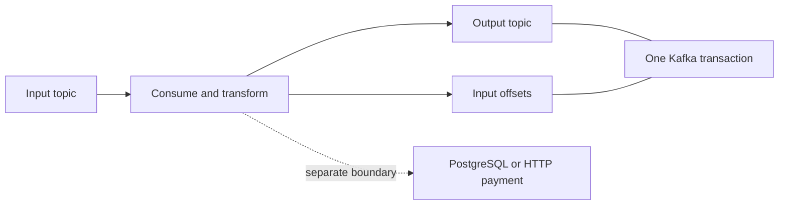

# Chapter 10 — Ordering, delivery guarantees, and Kafka transactions

## 1. Lesson title
State precisely what “once,” “ordered,” and “atomic” mean, and identify the boundary where each guarantee stops.

## 2. Interview priority
P0. These distinctions separate a memorized Kafka answer from a defensible distributed-system design.

## 3. Prerequisites
Chapters 8–9: producer completion, partition keys, checkpoints, replay, and business side effects. Review local ACID transactions from Chapter 6.

## 4. Learning objectives
Describe failure windows, choose an ordering key, explain read_committed, reason about atomic consume-transform-produce, and reject an unsupported end-to-end exactly-once claim.

## 5. Official references and versions
- [KafkaProducer transaction API](https://kafka.apache.org/42/javadoc/org/apache/kafka/clients/producer/KafkaProducer.html): transaction lifecycle and fatal errors.
- [KafkaConsumer API](https://kafka.apache.org/42/javadoc/org/apache/kafka/clients/consumer/KafkaConsumer.html): transactional visibility and checkpoint usage.
- [Transaction protocol](https://kafka.apache.org/42/operations/transaction-protocol/): release evolution.
- [Consumer configuration: isolation.level](https://kafka.apache.org/42/configuration/consumer-configs/): read_committed versus read_uncommitted.
- [Producer configuration](https://kafka.apache.org/42/configuration/producer-configs/): transactional identity.

Verified 2026-10-24. Preserve Kafka4.2 baseline. API documentation banner is4.2.0. Kafka transactions can coordinate produced records and consumed offsets within Kafka; PostgreSQL changes and external HTTP effects need separate coordination. The examples below apply this boundary to the commerce project.

## 6. First principles
A delivery guarantee is a statement about an observable effect under specified failures. Ask four questions: which input, which output, which storage systems, and which observer?

At-most-once means an input may have no visible effect but should not be deliberately retried into repeated effects. At-least-once means recovery may repeat delivery, so effects need deduplication. Exactly-once processing describes a particular committed result despite retries; it is not a promise that the code executed only once.

Consider charging a card. The payment provider receives a request and commits a charge. Its response disappears. Retrying may charge twice; refusing to retry may leave an unpaid-looking order with a real charge. The useful solution is a durable payment identity, provider idempotency, and reconciliation. A Kafka transaction alone cannot answer what happened inside the provider.

Ordering also needs scope. A partition gives an ordered sequence of records. It does not automatically guarantee the sequence of worker completion, external responses, timestamps, or business state transitions. If two application threads race to publish events, Kafka cannot recover an intended order that the application never established.

## 7. Internal architecture
Idempotent publication associates batches with producer identity and sequence information. Transactional publication adds a named transactional identity, coordination, and commit/abort decisions across participating partitions. A newer owner can fence an obsolete producer so it cannot continue as the current writer.

A transaction writes records that may exist physically before they are visible to read_committed consumers. Commit makes its result eligible for that visibility; abort prevents those records from appearing as committed application data. They are not necessarily physically erased immediately.

For consume-transform-produce, begin a transaction, process inputs, publish outputs, add the next input offsets using current group metadata, and commit. The output records and input progress become one Kafka transaction. If the transaction aborts, a subsequent run can read the inputs again without exposing the aborted output as committed data.

read_committed readers stop at the last stable offset when unresolved transactions constrain visibility. A long open transaction can therefore delay visibility of later records in the affected partition, including records unrelated to the original business action. Transaction duration is an operational concern, not just an API detail.

An exception must be classified by operation. A fenced producer has lost ownership and must close. An abortable transaction can be aborted and the input retried. An uncertain commit response needs resolution using the documented transaction state/API behavior; blindly creating a new business operation is unsafe.

## 8. Diagrams

The solid transaction covers Kafka output and progress. The dashed external effect does not become atomic merely because the code executes between beginTransaction and commitTransaction.

## 9. Java 21 implementation
This complete isolated class demonstrates atomic publication to two topics on the successful path. It needs the course-managed kafka-clients dependency, existing topics, and a broker configured to support transactions. A single-broker local lab needs deliberately reduced internal-topic replication settings; do not copy those settings into a resilient deployment.

```java
import java.util.Properties;
import org.apache.kafka.clients.producer.KafkaProducer;
import org.apache.kafka.clients.producer.ProducerRecord;
import org.apache.kafka.common.serialization.StringSerializer;

public final class AtomicPublicationDemo {
    public static void main(String[] args) throws Exception {
        Properties p = new Properties();
        p.put("bootstrap.servers", "localhost:9092");
        p.put("key.serializer", StringSerializer.class.getName());
        p.put("value.serializer", StringSerializer.class.getName());
        p.put("transactional.id", "atomic-demo-owner-1");
        try (KafkaProducer<String, String> producer = new KafkaProducer<>(p)) {
            producer.initTransactions();
            producer.beginTransaction();
            producer.send(new ProducerRecord<>(
                "order-events", "order-100", "OrderAccepted:E100")).get();
            producer.send(new ProducerRecord<>(
                "order-audit", "order-100", "AuditAccepted:E100")).get();
            producer.commitTransaction();
            System.out.println("Kafka transaction committed");
        }
    }
}
```

initTransactions establishes transactional ownership and recovery state. beginTransaction opens a unit of work. send completion here proves publication progress within the open transaction, not final read_committed visibility. commitTransaction establishes the Kafka result.

The fixed transactional ID is only suitable for one logical demo owner. Running two independent copies concurrently intentionally tests fencing. This teaching program exits on errors and does not implement a production retry/reconciliation state machine. An incomplete transaction requires coordinator recovery/expiry or a subsequent correctly owned initialization; never report it as committed.

For a consume-transform-produce implementation, the extra step is sendOffsetsToTransaction with next offsets and the consumer's current groupMetadata. Merely calling consumer.commitSync after commitTransaction recreates a two-operation gap. Chapter14 uses Kafka Streams to manage that lifecycle at a higher abstraction.

## 10. Spring Boot integration
Spring Kafka can configure transactional producers and container transactions. A transaction-aware KafkaTemplate participates in the appropriate Kafka transaction. A database transaction manager controls PostgreSQL; a Kafka transaction manager controls Kafka. Synchronizing their commit order still leaves a failure window between resource commits.

Use transaction management for the guarantee it actually provides. The Order service uses a database outbox to publish its business state reliably. Kafka-native transformations may use Kafka transactions. Both patterns can coexist because they solve different boundaries.

## 11. Production scenario
A reporting processor reads OrderAccepted and emits a normalized event. It fails after producing output but before recording input progress. Without atomic output/checkpoint coordination, replay emits a duplicate. With a Kafka transaction and read_committed downstream consumption, the failed attempt can remain invisible while the retry produces one committed transformation result.

Now add an HTTP email send inside the processing block. The transaction cannot unsend an email. The same implementation no longer establishes one externally visible email. Move that effect behind a durable notification operation with provider-specific idempotency or a documented duplicate tolerance.

## 12. HLD considerations
Document ordering domains explicitly: order lifecycle by orderId; reservation decisions under Inventory authority; ledger entries under a financial account or transaction identity as appropriate. Cross-entity operations require coordination beyond a convenient key.

Partition expansion can remap keyed traffic. Plan a migration, versioned topic, drain boundary, or application sequence policy. Do not assume old and new partitions create a single sequence for a key.

A global order is costly because it serializes decisions. First determine whether the business requires it. Most commerce workflows need per-entity ordering and well-defined cross-entity outcomes.

## 13. LLD considerations
An event should carry aggregateVersion when consumers must detect stale or missing state changes. Apply version v+1 after v; treat repeated v as a duplicate when the identity and content match; investigate gaps or conflicting versions. This policy belongs in the domain handler, not just the serializer.

A transaction owner needs stable identity management and lifecycle controls. Keep fatal, retryable, abortable, and uncertain outcomes separate in error handling. Catching Exception and looping forever discards the information needed for safe recovery.

## 14. Reliability
Transaction timeout is a bound on abandoned work, not a substitute for short transactions. Avoid calling slow providers while holding a Kafka transaction open. Broker/coordinator failure, authentication problems, and ownership conflicts require different responses.

A replay can reconstruct a projection only if retained events contain enough information and the projection logic remains compatible. Kafka transactions do not repair deleted history, schema mistakes, or a logically incorrect transformation.

## 15. Performance
Transactions add coordination and visibility delay. Group a bounded amount of work per transaction to amortize overhead, while limiting replay cost and open-transaction duration. A transaction with 100 records is not inherently optimal; estimate message size, processing time, and recovery objective.

Suppose a transaction takes 400 ms and contains 200 events. One sequential processing lane has a simple upper estimate of 500 events/s before other bottlenecks. This is arithmetic, not a measured benchmark. Reducing transaction size may improve latency while increasing coordination overhead.

## 16. Ten study questions with model answers
1. **What does exactly once mean here?** A committed result within a stated boundary despite retries. Code can execute repeatedly. Name Kafka outputs and offsets explicitly; do not silently include external systems.
2. **Why is idempotence insufficient for two topics?** It protects retry behavior for publication, but a logical multi-record unit needs transaction commit/abort visibility. Otherwise one destination may contain the result while another does not.
3. **Does read_committed prevent all duplicates?** No. Two separately committed business duplicates remain two valid records. Business identity remains necessary.
4. **Why does a long transaction affect readers?** Visibility must not step past unresolved transactional work as if it were final. Investigate stable-offset blockage when data exists but committed readers appear stuck.
5. **Can a PostgreSQL commit join a Kafka transaction automatically?** No. Being in the same Java method does not create a common atomic resource. Use a proven cross-resource pattern such as the outbox for this project.
6. **What is fencing?** Preventing an obsolete owner from continuing writes after a newer owner is established. It protects against overlapping process lifetimes rather than merely checking whether a process is alive.
7. **Does one partition guarantee business order?** It orders stored records. Concurrent handlers and racing publishers can still produce unintended state transitions. Enforce sequence and state-machine rules where effects occur.
8. **Why commit offsets in the producer transaction?** To couple accepted output with input progress. Two independent commits leave either a duplicate-output or lost-output failure window.
9. **Is a committed transaction immediately seen by every consumer?** Consumers still poll at different times and may be behind. Atomic visibility is not simultaneous delivery to all observers.
10. **How would you test the guarantee?** Inject crashes at each boundary, consume with both isolation levels, and count committed output identities. Include an external-effect counterexample to show the scope honestly.

## 17. Worked exercise
A processor consumes offset7, emits eventX, charges a provider, then crashes before transaction commit. What can a committed reader see, and what might the provider have done?

Solution: eventX may remain uncommitted and later be aborted, so read_committed need not expose it. The provider may already have charged. On replay, the provider call must use the same durable payment operation ID and query/reconcile unknown outcomes. Making the Kafka transaction larger does not solve the external boundary.

Expected observation in the future lab: Kafka output visibility and provider effect count can diverge. This is the precise counterexample to an unrestricted exactly-once claim.

## 18. Verification and execution status
The class and failure experiment are unexecuted. Verify transactional broker setup, run the happy path, then deliberately throw before commit and inspect read_committed versus read_uncommitted results. Test a second producer with the same identity to observe fencing. Record exceptions and transaction outcomes; do not infer success from lack of application logs.

## 19. Common misconceptions
Atomic visibility is not simultaneous consumption. Aborted records need not vanish physically at once. A Java transaction annotation does not merge arbitrary systems. Timestamps are not a universal total order. Exactly-once processing does not mean no retries.

## 20. Unanswered assessment
A developer proposes one Kafka transaction around an Inventory database update and a payment HTTP request. Identify each remaining failure window and replace the design with explicit durable boundaries.

## 21. Revision summary
Define the observer and effect. Kafka transactions are powerful within Kafka. Preserve business identities and ordering invariants across external systems. Fencing and recovery are part of correctness.

## 22. Next lesson
Chapter11 maps these mechanisms to Spring Kafka containers, error handling, and test strategies.

