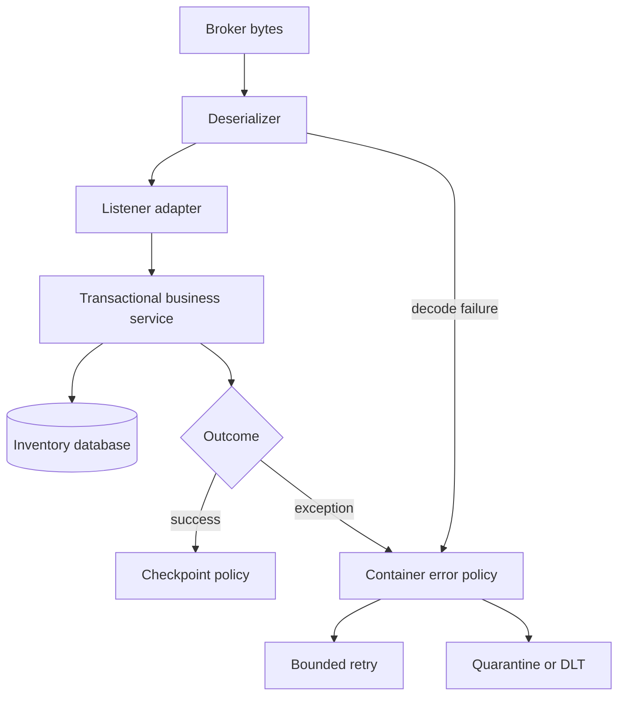

# Chapter 11 — Spring Kafka integration and recoverable listeners

## 1. Lesson title
Use Spring abstractions while keeping ownership of processing, transactions, and failure policy explicit.

## 2. Interview priority
P0. You should explain what the container does before explaining what an annotation does.

## 3. Prerequisites
Chapters4 and7–10: dependency injection, proxies, producer/consumer lifecycle, checkpoints, delivery guarantees, and transactions.

## 4. Learning objectives
Connect factories, templates, and containers; configure record processing; classify errors; compare blocking retries with retry topics; design DLT recovery; and test actual outcomes.

## 5. Official references and version notes
Spring-owned integration references:
- [Boot Kafka support](https://docs.spring.io/spring-boot/reference/messaging/kafka.html): auto-configuration.
- [Listener annotation](https://docs.spring.io/spring-kafka/reference/kafka/receiving-messages/listener-annotation.html): container factory and method adaptation.
- [Exception handling](https://docs.spring.io/spring-kafka/reference/kafka/annotation-error-handling.html): DefaultErrorHandler and recoverers.
- [Serialization](https://docs.spring.io/spring-kafka/reference/kafka/serdes.html): deserialization and conversion.
- [Non-blocking retries](https://docs.spring.io/spring-kafka/reference/retrytopic.html): support and restrictions.
- [Transactions](https://docs.spring.io/spring-kafka/reference/kafka/transactions.html).
- [Testing](https://docs.spring.io/spring-kafka/reference/testing.html).

Checked2026-10-24. Live pages identify4.1.2; the project's proposed baseline remains Boot/SpringKafka4.1.1. Verify resolved dependencies before executing. This chapter explains Spring behavior from Spring sources; Kafka-core semantics remain sourced to Apache in Chapters7–10. No silent upgrade is implied.

## 6. First principles
Spring Kafka does not replace Kafka. It manages objects and repetitive lifecycle work around the same client protocols. The producer factory creates producers, KafkaTemplate provides publishing operations, the consumer factory creates consumers, and the listener container repeatedly polls and invokes application handlers.

This division lets Inventory focus on “reserve this order” rather than writing a poll loop. It also means handler return and exception behavior become part of the checkpoint protocol. Swallowing an exception can turn a failed reservation into apparent success.

A listener method is an adapter boundary. Keep parsing and transport metadata there; delegate the durable business transaction to a service. This makes domain tests independent of broker startup while preserving integration tests for actual Kafka behavior.

## 7. Internal architecture
For one record, bytes arrive in the client, deserializers construct values, a message adapter maps them to listener arguments, the method invokes business logic, and the container applies its acknowledgment/error policy.

Deserialization can fail before the listener has a value to receive. A try/catch inside the listener cannot catch an invocation that never happened. ErrorHandlingDeserializer preserves enough failure information for container-level handling; configure its delegate and consider how raw bytes are published to quarantine.

Record listeners process one record per invocation; batch listeners receive a group. Batch handling can amortize database operations but needs a clear response to a failure halfway through. Non-blocking retry support is not interchangeable with every batch/transaction configuration.

Acknowledge modes are policies about when successful processing advances the checkpoint. RECORD associates success with individual record processing; BATCH relates to the poll batch; manual modes expose acknowledgment to the application with specific container timing. “Manual” does not inherently mean safer. The safest mode is the one whose timing you can prove against the durable business transaction.

## 8. Diagrams

Decode failures and business failures converge at a policy boundary, but they need different diagnoses. A malformed payload is rarely fixed by waiting another second.

## 9. Java 21 implementation
The following two complete classes fit inside a Boot application with Kafka integration dependencies. They demonstrate String records and a non-transactional record listener container. They are not the final Inventory reservation implementation.

```java
import org.springframework.context.annotation.Bean;
import org.springframework.context.annotation.Configuration;
import org.springframework.kafka.config.ConcurrentKafkaListenerContainerFactory;
import org.springframework.kafka.core.ConsumerFactory;
import org.springframework.kafka.listener.ContainerProperties;
import org.springframework.kafka.listener.DefaultErrorHandler;
import org.springframework.util.backoff.FixedBackOff;

@Configuration
public class ListenerConfiguration {
    @Bean
    ConcurrentKafkaListenerContainerFactory<String, String>
    kafkaListenerContainerFactory(ConsumerFactory<String, String> consumers) {
        var factory =
            new ConcurrentKafkaListenerContainerFactory<String, String>();
        factory.setConsumerFactory(consumers);
        factory.setConcurrency(1);
        factory.getContainerProperties()
            .setAckMode(ContainerProperties.AckMode.RECORD);
        var handler = new DefaultErrorHandler(
            (record, exception) -> {
                throw new IllegalStateException(
                    "No durable quarantine configured; retain failure",
                    exception);
            },
            new FixedBackOff(1000L, 2L));
        factory.setCommonErrorHandler(handler);
        return factory;
    }
}
```

```java
import org.apache.kafka.clients.consumer.ConsumerRecord;
import org.springframework.kafka.annotation.KafkaListener;
import org.springframework.stereotype.Component;

@Component
public class OrderInspectionListener {
    @KafkaListener(topics = "order-events", groupId = "inspection-demo")
    public void receive(ConsumerRecord<String, String> record) {
        if (record.value() == null || record.value().isBlank()) {
            throw new IllegalArgumentException("Missing event body");
        }
        System.out.printf("event at %s/%d/%d: %s%n",
            record.topic(), record.partition(), record.offset(),
            record.value());
    }
}
```

The recoverer deliberately throws because this demo has no durable quarantine destination. A silent logging recoverer would imply it is acceptable to advance past failed work. FixedBackOff permits two retries after the initial delivery in this configured retry cycle; a failed recoverer can lead to further delivery cycles. This is a visible stopping condition for a lab, not an unattended production retry policy.

Configure the matching types:

```yaml
spring:
  kafka:
    bootstrap-servers: localhost:9092
    consumer:
      enable-auto-commit: false
      auto-offset-reset: earliest
      key-deserializer: org.apache.kafka.common.serialization.StringDeserializer
      value-deserializer: org.apache.kafka.common.serialization.StringDeserializer
```

Use Boot-managed Kafka dependencies; do not paste arbitrary spring-kafka versions into an existing BOM. A Boot application entry point and broker are prerequisites for these configuration classes, not artifacts claimed to exist already.

## 10. Spring Boot integration
Boot binds spring.kafka properties and supplies common beans when conditions allow. Defining a custom factory makes you responsible for its configured behavior; inspect which defaults and customizers you bypass.

KafkaTemplate completion must be observed for publication failures. A successful method return from code that never waits for or observes the send can hide a later failure.

For transactional listeners, use the documented rollback/after-rollback processing mechanisms. An error handler that consumes the exception may prevent the rollback you intended. Non-blocking retry topics cannot simply be combined with container transactions; the referenced documentation explicitly limits this combination.

## 11. Production scenario
An event contains quantity="many" while Inventory expects a number. Repeating it fifty times will not repair the schema. Quarantine it with original bytes, headers needed for diagnosis, topic/partition/offset, failure class, and a safe correlation identity.

A different event fails because PostgreSQL is temporarily unavailable. Retry with backoff within an outage budget, stop overloading the dependency, and alert on backlog age. Treating both failures as the same retryable exception turns bad data into an outage amplifier.

## 12. HLD considerations
A dead-letter topic is a holding area for work requiring another decision. Assign an owner, retention policy, access policy, alert, repair workflow, and replay policy. Store sensitive payloads only with appropriate controls.

Retry topics allow other work to continue, but later records can overtake failed ones. For order lifecycle events, this may violate a state-machine expectation. Alternatives include blocking the partition, key-aware deferral, or designing handlers around versions and reconciliation.

## 13. LLD considerations
Separate InvalidEvent, TransientDependencyFailure, BusinessRejection, and OwnershipConflict. A business rejection such as insufficient stock is often a successful decision that emits InventoryRejected; it is not an infrastructure exception to retry forever.

A recoverer must confirm durable handoff before treating failure as handled. If DLT publication fails, preserve the source failure path. Use serializer configuration that can handle both normal values and raw deserialization-failure bytes where required.

## 14. Reliability
Bound retries by elapsed business time as well as attempt count. A one-second retry repeated across several services can multiply load. Include jitter where supported and useful. Avoid logging complete personal/payment payloads on every attempt.

Shutdown must stop new work, allow bounded completion, and preserve replay safety for unfinished work. Rolling deployment testing should include active listeners, not just idle startup.

## 15. Performance
Listener concurrency must fit partitions and database capacity. Ten consumers each with a ten-connection pool can place one hundred connections against a database that cannot use them effectively. A connection pool is a concurrency control, not a throughput entitlement.

Measure per-listener processing latency, retries, DLT volume, rebalance frequency, lag age, and business completion rate. Compare record and batch processing with realistic failure injections before selecting throughput over recovery simplicity.

## 16. Ten study questions with model answers
1. **What creates the poll loop?** The listener container. The annotation identifies an endpoint and adapter; it does not magically implement domain reliability.
2. **Why separate a listener from a service?** Transport handling and business invariants change for different reasons. A transactional domain service can be tested independently while the adapter is tested against Kafka.
3. **Why can malformed JSON bypass my catch block?** Deserialization occurs before method invocation. Configure a deserialization error path at the client/container boundary.
4. **Is manual acknowledgment the safest choice?** Only with a proven timing model. A premature manual call loses work just as a premature automatic checkpoint can.
5. **Should insufficient stock go to DLT?** Usually no. It is an expected business outcome with an event and state transition. DLT is for work that cannot be interpreted or completed under the normal contract.
6. **What changes with retry topics?** Work is deferred into another topic and processing order may change. This improves isolation for some workloads but requires explicit order/version handling.
7. **When is a DLT handoff complete?** When publication is durably confirmed under the chosen policy. Logging a send request is insufficient evidence.
8. **Why not use arbitrary concurrency?** Partitions bound assignment and dependencies bound useful parallelism. More threads can increase contention and retries.
9. **What must an integration test prove?** Real serialization, container behavior, checkpoint recovery, and the business database invariant. A mocked listener invocation only proves local method behavior.
10. **How do transactions affect error handling?** Exceptions determine rollback and recovery paths. Swallowing one can commit unintended progress; use the transaction-specific documented mechanism.

## 17. Worked exercise
A listener catches every exception, logs “failed,” and returns. The container uses RECORD mode. A database outage occurs.

Expected observation: offsets may advance although reservations were never persisted. Solution: propagate infrastructure failure to the container, use bounded retry and durable quarantine policy, and make the business operation idempotent. Expected business rejection should instead be persisted and emitted as a deliberate outcome.

Then inject a malformed value before deserialization. Explain why changing only the listener catch block cannot fix that second case.

## 18. Verification and execution status
Examples are unexecuted integration components. Use JUnit6 managed by Boot and the documented Kafka test support, or Testcontainers with a real broker. Test valid data, malformed bytes, transient DB failure, DLT publication failure, restart after DB commit, and duplicate event identity. Assert database state and stored offsets with bounded waiting, not fixed sleeps alone.

## 19. Common misconceptions
DLT is not automatic repair. More retries do not fix schema errors. Container concurrency is not business parallelism without limits. Listener return is not necessarily durable completion if work escaped to an executor.

## 20. Unanswered assessment
A retry-topic design improves throughput but permits PaymentAuthorized to arrive before InventoryReserved is applied. How should the Order state machine and retry policy respond?

## 21. Revision summary
Understand the container lifecycle. Define success durably. Classify errors. Make quarantine observable and replay controlled. Test boundaries, not only annotations.

## 22. Next lesson
Chapter12 implements the database-to-event reliability model and the Order-orchestrated Saga.

