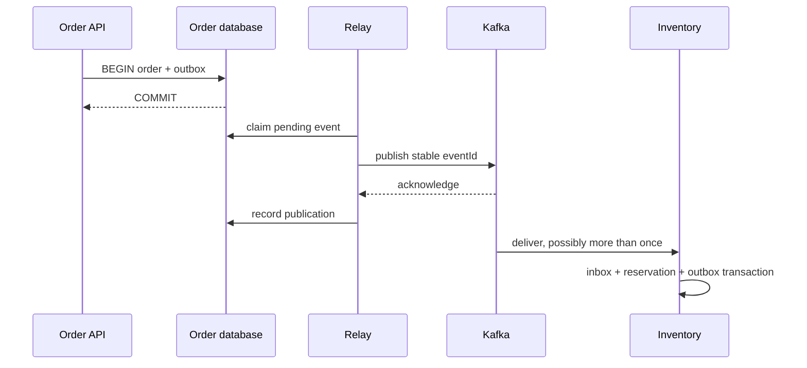
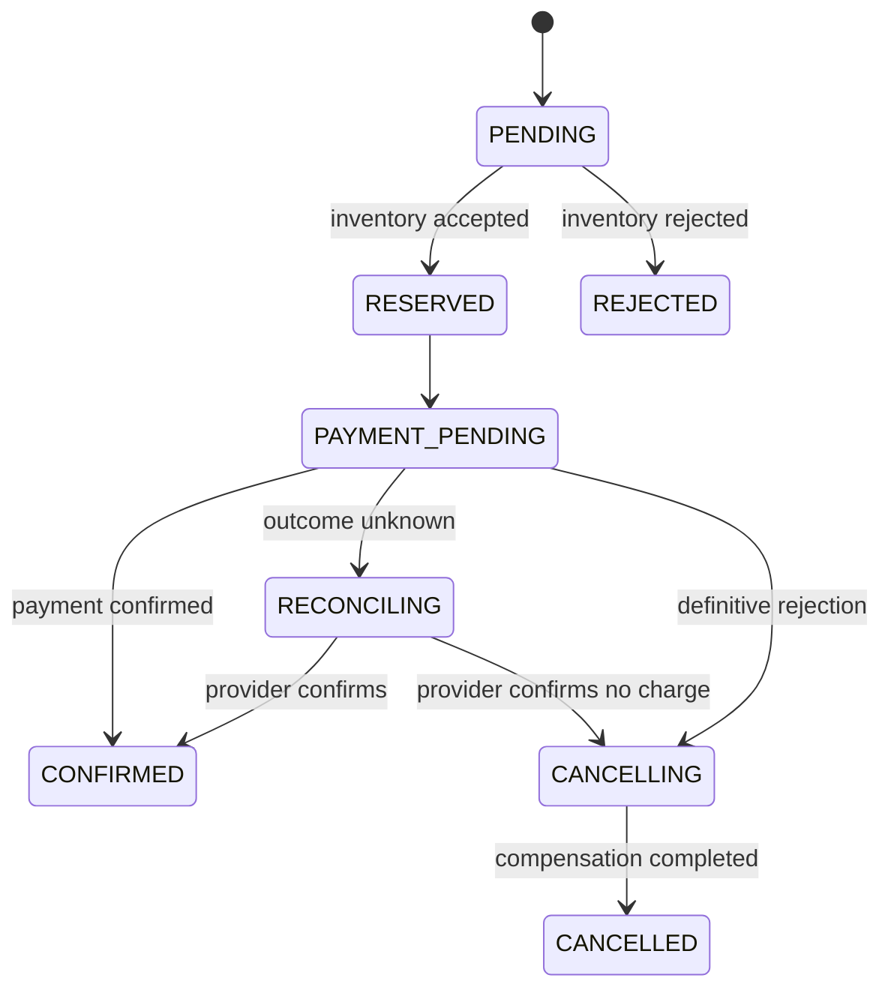

# Chapter 12 — Outbox, inbox, business idempotency, and Saga orchestration

## 1. Lesson title
Build a recoverable order workflow when no single transaction controls all services.

## 2. Interview priority
P0. This chapter is the correctness backbone of the commerce project.

## 3. Prerequisites
Local SQL transactions, unique constraints, Kafka acknowledgment, replay, and Chapter10's transaction boundary. Read Chapter6 first if commit/rollback is unfamiliar.

## 4. Learning objectives
Prove the dual-write failure, design a transactional outbox, distinguish two kinds of deduplication, model an orchestrated Saga, and reconcile uncertain payment outcomes.

## 5. Official references and version notes
- [PostgreSQL18 INSERT and ON CONFLICT](https://www.postgresql.org/docs/18/sql-insert.html).
- [PostgreSQL18 explicit locking](https://www.postgresql.org/docs/18/explicit-locking.html).
- [Debezium outbox event router](https://debezium.io/documentation/reference/stable/transformations/outbox-event-router.html): connector-owned CDC behavior.
- [Kafka transaction protocol](https://kafka.apache.org/42/operations/transaction-protocol/): Kafka scope.
- [Spring Kafka transactions](https://docs.spring.io/spring-kafka/reference/kafka/transactions.html): integration boundary.

Checked2026-10-24. PostgreSQL18 is the reference version; Debezium's stable page is a moving reference and no connector release is installed here. Spring live docs4.1.2 differ from proposed4.1.1. Outbox/Saga architecture below is an explicit project design, not a claim that Kafka implements these business patterns automatically.

## 6. First principles
The dual-write problem occurs when one logical action requires two independently committed writes. Save the order first, then publish: a crash between them leaves an order with no event. Publish first, then save: a crash leaves an event for an order that does not exist. Reversing the order moves the gap.

The outbox moves the second write into the same database transaction as the first. Order state and a durable “event to publish” row commit together. A separate relay later publishes it. This changes the promise from “two systems atomically committed” to “the database contains enough durable intent to retry publication.”

The relay still has a gap between Kafka acknowledgment and marking the row published. A crash there causes duplicate publication. That is expected. The design replaces potential lost intent with replay that consumers must handle safely.

An inbox records event identities already handled by a consumer. Business idempotency records the operation itself, such as one reservation for orderId plus lineId. They are different because two distinct events may request the same business operation. Deduplicating eventId alone cannot prevent that duplicate business effect.

A Saga is a sequence of local transactions with durable coordination and compensating actions. Compensation is a new business action, not a time machine. A refund creates a financial record; it does not erase the original charge from history.

## 7. Internal architecture
The Order service orchestrates:

1. Accept request under an idempotency key and persist PENDING plus an outbox command.
2. Inventory atomically records the command, reserves stock if possible, and emits a result through its own outbox.
3. Order consumes that result and advances its durable state.
4. Payment uses a durable payment operation identity with the simulated provider.
5. Order confirms only when required outcomes are durably known.
6. If payment is rejected, Order initiates release of the reservation.
7. If the payment result is unknown, Order reconciles; it does not immediately classify the action as failed.

Each service owns its database. Order never updates Inventory tables “just to make the transaction easy.” That shortcut destroys the ownership boundary the architecture is teaching.

A polling relay claims a bounded set of rows, publishes, and records results. Multiple relays need a claim/lease or locking strategy. Holding a database transaction open during slow network publication is simple but causes lock and connection pressure. A lease avoids long locks but permits stale owners after expiry; use claim tokens and compare-and-update when completing claims.

SKIP LOCKED helps workers avoid waiting on already claimed rows; it does not alone prove per-aggregate event ordering. Concurrent relays can publish later aggregate versions first. Preserve aggregate ordering with a deliberate claim/partition strategy or make consumers enforce versions.

CDC reads committed database changes and routes outbox content to Kafka. It removes polling overhead but introduces connector offsets, replication slots, snapshot policy, schema mapping, and log-retention operations. It does not remove downstream idempotency.

## 8. Diagrams



The RECONCILING state is essential: an HTTP timeout is not evidence that the provider did nothing.

## 9. Java 21 and SQL implementation
This scoped demonstration implements only the local order-plus-outbox transaction. It does not claim to implement the entire Saga. Use PostgreSQL JDBC from Boot dependency management and a supplied DataSource. Schema:

```sql
CREATE TABLE demo_orders (
    order_id uuid PRIMARY KEY,
    request_key text NOT NULL UNIQUE,
    request_body text NOT NULL,
    status text NOT NULL
);
CREATE TABLE demo_outbox (
    event_id uuid PRIMARY KEY,
    aggregate_id uuid NOT NULL REFERENCES demo_orders(order_id),
    event_type text NOT NULL,
    payload text NOT NULL,
    created_at timestamptz NOT NULL DEFAULT now(),
    published_at timestamptz
);
CREATE INDEX demo_outbox_pending
    ON demo_outbox (created_at, event_id)
    WHERE published_at IS NULL;
```

```java
import java.sql.Connection;
import java.sql.SQLException;
import java.util.UUID;
import javax.sql.DataSource;

public final class OrderWriter {
    private final DataSource dataSource;

    public OrderWriter(DataSource dataSource) {
        this.dataSource = dataSource;
    }

    public UUID accept(String requestKey, String canonicalBody)
            throws SQLException {
        if (requestKey == null || requestKey.isBlank()
                || canonicalBody == null || canonicalBody.isBlank()) {
            throw new IllegalArgumentException("Key and body are required");
        }
        try (Connection c = dataSource.getConnection()) {
            c.setAutoCommit(false);
            try {
                UUID id = UUID.randomUUID();
                int inserted;
                try (var s = c.prepareStatement("""
                    INSERT INTO demo_orders
                    (order_id, request_key, request_body, status)
                    VALUES (?, ?, ?, 'PENDING')
                    ON CONFLICT (request_key) DO NOTHING
                    """)) {
                    s.setObject(1, id);
                    s.setString(2, requestKey);
                    s.setString(3, canonicalBody);
                    inserted = s.executeUpdate();
                }
                if (inserted == 0) {
                    try (var s = c.prepareStatement("""
                        SELECT order_id, request_body
                        FROM demo_orders WHERE request_key = ?
                        """)) {
                        s.setString(1, requestKey);
                        try (var rs = s.executeQuery()) {
                            if (!rs.next()) {
                                throw new SQLException("Retry transaction");
                            }
                            if (!canonicalBody.equals(rs.getString(2))) {
                                throw new IllegalArgumentException(
                                    "Idempotency key reused for another request");
                            }
                            id = rs.getObject(1, UUID.class);
                        }
                    }
                } else {
                    try (var s = c.prepareStatement("""
                        INSERT INTO demo_outbox
                        (event_id, aggregate_id, event_type, payload)
                        VALUES (?, ?, 'OrderAccepted', ?)
                        """)) {
                        s.setObject(1, UUID.randomUUID());
                        s.setObject(2, id);
                        s.setString(3, canonicalBody);
                        s.executeUpdate();
                    }
                }
                c.commit();
                return id;
            } catch (SQLException | RuntimeException error) {
                try {
                    c.rollback();
                } catch (SQLException rollbackError) {
                    error.addSuppressed(rollbackError);
                }
                throw error;
            }
        }
    }
}
```

The unique request key handles concurrent repeats, not merely sequential calls. The stored request body detects a reused key with different intent. “Canonical” means a stable representation of validated business fields; arbitrary JSON whitespace/order is not a robust equivalence check. In production use a defined normalized representation or fingerprint, tenant/client scope, expiry policy, and stored response.

At PostgreSQL READ COMMITTED, the second statement gets a fresh statement snapshot after an ON CONFLICT wait. Other isolation levels and serialization failures require transaction-level retry policies. A connection failure during commit can leave the caller uncertain even if the database committed. Retrying with the same request key lets the database reveal the result.

The outbox payload here is deliberately minimal; a production envelope adds eventId, orderId, schema version, aggregate sequence, and trace context. The row metadata already preserves identity. Do not use this demonstration schema as a complete domain model.

## 10. Spring Boot integration
In Spring, put the order insert and outbox insert in one @Transactional service method using the same database transaction manager. Keep the relay outside the request transaction. Beware self-invocation that bypasses the proxy.

Inventory processes an event by inserting inbox identity, applying its business rule under appropriate locking/conditional SQL, and inserting its result outbox in one transaction. A failed business decision can be committed as a rejection outcome; a transient infrastructure failure should roll the whole transaction back.

## 11. Production scenario
Two Order events E1 and E2 accidentally request reservation R100. Inbox(eventId) permits both because their IDs differ. A unique reservation operation key prevents the second stock reduction. If the second request changes quantity, return a conflict or investigate; “already exists” must not silently accept contradictory intent.

For release compensation, record which reservation is released and transition it once. Repeated release messages must not increase available stock repeatedly. Reserve/release correctness belongs in Inventory's transactional state machine.

## 12. HLD considerations
Choose orchestration for this project because one durable Order state machine makes progress and compensation visible. Choreography can reduce central coordination for simple independent reactions, but long workflows can hide dependencies across many event handlers.

Define success, rejection, uncertainty, compensation-in-progress, and manual-intervention states. Define time limits using business meaning: a checkout might expire quickly while financial reconciliation can remain active longer. State expiry must not erase unresolved liabilities.

## 13. LLD considerations
Use typed commands/results with commandId, eventId, causationId, and aggregateVersion. Store Saga step identity and attempts durably. Model transition legality explicitly. A late PaymentAuthorized arriving during cancellation cannot be ignored blindly: it can require refund reconciliation.

A scheduler scans overdue durable states; it should not rely only on in-memory timers that disappear on restart. Multiple scheduler instances require safe claiming and idempotent commands.

## 14. Reliability
Monitor oldest pending outbox age, claim expiry, publication failures, inbox conflicts, stuck Saga age, uncertain payment count, and compensation failures. Reconciliation compares durable business records, not only logs.

Cleanup needs a recovery policy. Deleting inbox records too early can turn an old replay into a new effect. Deleting outbox data before publication loses intent. Retain enough identity/history for the maximum replay and audit window.

## 15. Performance
Polling frequency trades latency against database work. Index only pending work when appropriate; avoid repeatedly scanning a huge historical table. Batch bounded publication, monitor lock time, and consider CDC when operational expertise supports it.

Suppose publication is unavailable for one hour at 100 orders/s: 360,000 outbox rows accumulate. At an illustrative 2 KB per row that is about720 MB before indexes/WAL/overhead. Plan backlog drain rate and storage headroom; normal steady-state averages are insufficient.

## 16. Ten study questions with model answers
1. **Why can't write order reverse fix dual writes?** Either order leaves a crash point between independently committed resources. The outbox changes the atomic boundary by colocating state and intent.
2. **Does the outbox eliminate duplicates?** No. Acknowledgment can precede relay bookkeeping. Repeated publication is expected and consumers must make it harmless.
3. **Why both inbox and business uniqueness?** Inbox catches replay of one event; business uniqueness catches different events representing one operation. They protect different identities.
4. **Is compensation rollback?** No. It is a new action against current reality and may itself fail. A refund preserves the history of a prior charge.
5. **Why retain UNKNOWN payment state?** A timeout is insufficient evidence of failure. Reconciliation avoids both double charges and incorrectly cancelling paid orders.
6. **Does CDC guarantee business order automatically?** It exposes committed change history under connector semantics. Mapping, partition keys, multiple transactions, and aggregate versions still need a designed contract.
7. **Can Redis prevent overselling here?** It can assist caching or admission, but PostgreSQL owns authoritative inventory and its invariant. A cache or lease must not become an unproven second authority.
8. **What happens if compensation fails?** Persist the failure, retry within policy, alert on age, and provide reconciliation/manual resolution. Do not label the Saga cancelled while resources remain reserved.
9. **Why use an orchestrator?** It makes this multi-step lifecycle explicit and inspectable. The trade-off is coordinating logic and availability responsibility in the Order context.
10. **How do you prove correctness?** Enumerate crash boundaries and assert invariants: one accepted request identity, one reservation operation, no negative stock, one payment intention, and eventual resolution or visible unresolved state.

## 17. Worked exercise
Crash the relay after Kafka acknowledgment but before setting published_at. Then deliver the same event twice. Also deliver a new event ID with the same reservation operation ID.

Solution: the first repeat is stopped by inbox uniqueness; the new ID is stopped by reservation uniqueness or returns the previously recorded outcome. Both decisions and their outbox results must be transactional. Expected final stock reduction equals one reservation, not three.

Extend the exercise with a changed quantity under the same reservation ID. Correct behavior detects conflicting intent; a duplicate flag alone is insufficient.

## 18. Verification and execution status
The JDBC class, schema, and failure scenarios are unexecuted. Later verify concurrent identical request keys yield one order and one outbox row; mismatched bodies fail; forced outbox insertion failure leaves no new order; lost commit response is resolved by repeating the same key. Use Testcontainers PostgreSQL and real Kafka for cross-boundary tests. Record invariants after restart.

## 19. Common misconceptions
Outbox is not a distributed ACID transaction. Inbox alone is not business uniqueness. Saga compensation is not guaranteed instantaneous reversal. A timeout is not a definitive payment rejection. CDC removes neither ownership nor recovery decisions.

## 20. Unanswered assessment
Payment confirms after Order has started cancellation. Design the durable transitions and commands that prevent both an unrefunded charge and premature fulfillment.

## 21. Revision summary
Persist state and intent together. Publish with stable identity. Deduplicate events and business operations. Make uncertainty and compensation visible. Prove the design at every crash boundary.

## 22. Next lesson
Chapter13 defines contracts that remain readable when producers and consumers deploy at different times.

