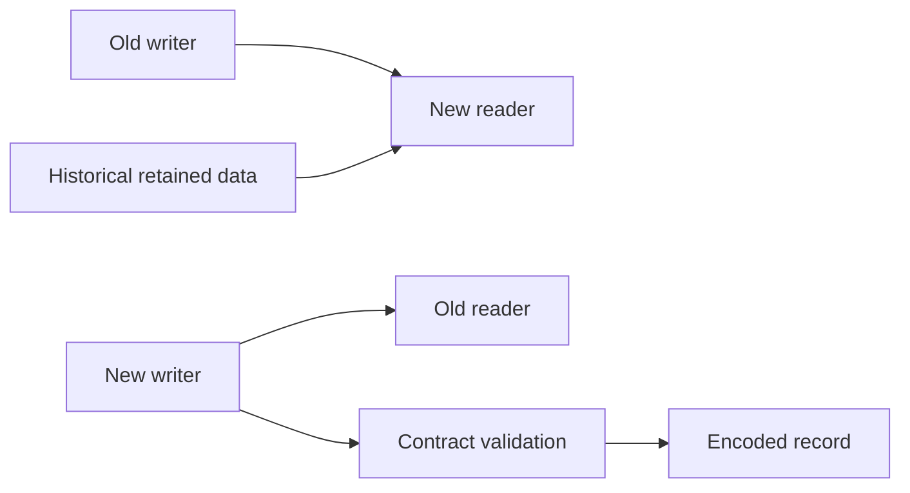

# Chapter 13 — Event schemas, compatibility, and independent deployments

## 1. Lesson title
Design messages that remain understandable after code, teams, and deployments change.

## 2. Interview priority
P0 for contract evolution; P1 for format-specific tooling.

## 3. Prerequisites
Serialization, events versus commands, producer/consumer independence, and the outbox envelope from Chapter12.

## 4. Learning objectives
Separate syntax from meaning, compare JSON/Avro/Protobuf, evaluate reader/writer compatibility, plan safe rollout and rollback, and protect replay of historical events.

## 5. Official references and versions
- [Avro1.12 specification](https://avro.apache.org/docs/1.12.0/specification/): schema resolution and defaults.
- [Protocol Buffers proto3 guide](https://protobuf.dev/programming-guides/proto3/): field numbering and evolution.
- [JSON Schema object reference](https://json-schema.org/understanding-json-schema/reference/object): required/additional properties.
- [Spring Kafka serialization](https://docs.spring.io/spring-kafka/reference/kafka/serdes.html): Java integration.

Checked2026-10-24. Avro1.12 is a reference, not a selected installed dependency. Protobuf editions also exist; proto3 is used here for a concrete illustration. Registry compatibility policy, subject naming, and wire framing depend on the selected registry product; none is installed or implied. These are format/integration sources, not substitutes for Apache Kafka-core references.

## 6. First principles
A schema is a contract describing the shape and interpretation of data. A Java class is only one language's representation. The consumer may run an older version or a different language, and historical Kafka records can outlive the class that produced them.

Syntax asks whether amount is a number. Semantics asks whether it means paise, rupees, cents, tax-inclusive price, or a refund. A schema validator may accept every byte of a financially incorrect event. Contract review therefore needs types, units, identities, invariants, and business meaning.

JSON is readable and widely interoperable, but readability does not enforce a contract. JSON Schema adds validation rules. Avro uses writer and reader schemas to resolve encoded records. Protobuf uses numbered fields and generated message types. Choose based on interoperability, evolution workflow, payload cost, team tooling, and operational ownership rather than “binary is always better.”

A registry stores and identifies schemas and can enforce configured compatibility rules. Kafka brokers themselves do not generally infer your domain schema from arbitrary record bytes. Client serializers or integration components may contact a registry; registry availability becomes a separate operational concern.

## 7. Internal architecture
A producer validates a contract, encodes a value, and associates the information required by its chosen wire format. A consumer resolves the relevant schema, decodes bytes, maps into an application model, validates business semantics, and performs work.

Backward compatibility means a new reader can read older data in the stated compatibility model. Forward compatibility means an older reader can read newer data. Full compatibility combines both. Transitive checks consider more than just the immediately previous schema. Always draw the writer/reader matrix because terminology alone is easy to reverse.

For an Avro-style example, a new reader can fill a newly added field using its schema default when the old writer did not provide it. That default is a reader-resolution mechanism, not a universal claim that producers may omit every field. For Protobuf, field numbers are wire identities: reusing a removed number can reinterpret historical bytes as a different business field. Reserve removed numbers/names as appropriate.

Unknown fields can support evolution, but exact preservation and behavior vary across binary/JSON conversions and libraries. Do not assume that converting through an older JSON model preserves every future field.

Compatibility is not only pairwise deployment compatibility. A reporting rebuild may read events from six months ago; a rollback may run yesterday's consumer against today's messages. Test both cases.

## 8. Diagrams

The first two arrows are separate tests. Historical replay adds a longer time horizon than the rolling deployment window.

## 9. Java 21 and contract implementation
A complete immutable domain-facing event type:

```java
import java.time.Instant;
import java.util.Objects;
import java.util.UUID;

public record PaymentAuthorizedV1(
        UUID eventId,
        UUID orderId,
        String paymentOperationId,
        long amountMinor,
        String currency,
        Instant occurredAt) {
    public PaymentAuthorizedV1 {
        Objects.requireNonNull(eventId, "eventId");
        Objects.requireNonNull(orderId, "orderId");
        Objects.requireNonNull(occurredAt, "occurredAt");
        if (paymentOperationId == null || paymentOperationId.isBlank()) {
            throw new IllegalArgumentException("paymentOperationId required");
        }
        if (amountMinor <= 0) {
            throw new IllegalArgumentException("amountMinor must be positive");
        }
        if (currency == null || !currency.matches("[A-Z]{3}")) {
            throw new IllegalArgumentException("Three-letter currency required");
        }
    }
}
```

This validates representation and basic invariants. A three-letter pattern does not prove a currency is supported; a service policy must check supported currencies and currency-specific minor units. A Java record is shallowly immutable: this record's fields are suitable immutable values, but a record containing a mutable list would require defensive copying.

An illustrative JSON Schema2020-12 contract:

```json
{
  "$schema": "https://json-schema.org/draft/2020-12/schema",
  "title": "PaymentAuthorizedV1",
  "type": "object",
  "required": ["eventId", "orderId", "paymentOperationId",
               "amountMinor", "currency", "occurredAt"],
  "properties": {
    "eventId": {"type": "string"},
    "orderId": {"type": "string"},
    "paymentOperationId": {"type": "string", "minLength": 1},
    "amountMinor": {"type": "integer", "minimum": 1},
    "currency": {"type": "string", "pattern": "^[A-Z]{3}$"},
    "occurredAt": {"type": "string"}
  },
  "additionalProperties": true
}
```

additionalProperties=true intentionally allows additive fields; it does not require application consumers to tolerate them. Configure and test the decoder too. UUID and timestamp parsing still require explicit validation here. Some JSON Schema format checks are annotations unless the validator enables assertion behavior, so do not claim format guarantees without testing the chosen validator.

A Protobuf equivalent would assign stable numbers:

```protobuf
syntax = "proto3";
package commerce.payment.v1;
message PaymentAuthorized {
  string event_id = 1;
  string order_id = 2;
  string payment_operation_id = 3;
  int64 amount_minor = 4;
  string currency = 5;
  string occurred_at = 6;
}
```

Generated types and compiler/runtime versions are additional build inputs. This schema is illustrative and not generated in the current project.

## 10. Spring Boot integration
Use dedicated event DTOs and explicit serializer/deserializer configuration. Do not expose JPA entities, lazy proxies, or internal class names as the durable external contract. Type headers useful within a controlled Spring application are not a substitute for a language-neutral contract.

Map wire contracts into domain commands at the boundary. This allows domain code to reject unsupported versions or business values without conflating every failure with a JSON parse error.

## 11. Production scenario
Version1 defines amount as integer minor units. Version2 keeps the same field name/type but starts sending major units rounded to an integer. Every schema check can pass while payments are wrong by a factor of100 for a two-decimal currency.

Solution: preserve meaning, introduce a clearly named new field/event version when semantics change, deploy consumer support, dual-read or translate deliberately, and retire old production only after retention/replay requirements are addressed. Semantic compatibility needs review and fixtures, not only registry approval.

## 12. HLD considerations
Assign one owner for each event contract and list consumers. Document whether an event is an immutable fact, a command, or a current-state snapshot. A compacted state topic and an append-only audit stream have different reconstruction promises.

Avoid placing unnecessary personal information in durable events. Deletion, access control, retention, and replay are harder when sensitive data has propagated to many consumers.

## 13. LLD considerations
Create an envelope separate from payload. Preserve eventId across retransmission and causationId across workflow steps. Schema version identifies contract interpretation; aggregate version identifies entity sequence. Neither is interchangeable with a timestamp.

Handle unknown enum values explicitly. A switch that throws for every newly added status may break an older reader even when the wire format can decode it. Define safe unknown behavior, alerting, and migration policy.

## 14. Reliability
Treat schema retrieval and cache behavior as part of startup and recovery. Cached schemas may allow existing traffic to continue during registry outage while new schemas fail; verify the actual client rather than assuming this behavior.

Keep representative historical fixtures in contract tests. Retaining Kafka data without retaining interpretable schemas and transformation code can make recovery theoretical.

## 15. Performance
Compare encoded size, serialization CPU, allocation rate, validation cost, and debugging effort using representative data. A2KB JSON event versus an800-byte binary event would reduce logical payload by60%, but those figures are illustrative, not measured for this project. Compression can change the gap.

Do not embed large documents merely because Kafka accepts them. Consider object storage plus a durable, authorized reference when payload lifecycle and atomicity can be designed safely.

## 16. Ten study questions with model answers
1. **Is JSON schemaless?** It has syntax and the application still assumes a structure. Without explicit validation, the contract is implicit and failures move into runtime code.
2. **What is backward compatibility?** A new reader can interpret older writer data under the chosen rules. Test old fixtures against new readers, including historical versions.
3. **Why is forward compatibility useful?** Rolling deployments and rollback leave old readers alive while new writers publish. New data must not break them unless the rollout deliberately prevents overlap.
4. **Does adding an optional field always work?** Not if consumers reject unknown fields or generated mappings impose stricter assumptions. Wire, decoder, and business compatibility all matter.
5. **Why reserve Protobuf field numbers?** A reused number can reinterpret persisted bytes as unrelated data. The identity survives source-code renaming.
6. **Does a registry validate business correctness?** It can validate configured structural evolution, not whether money units or event meaning changed incorrectly. Business fixtures and review remain necessary.
7. **Why avoid entity serialization?** Persistence details, lazy relationships, and internal fields leak into a public contract. Independent deployment then becomes coupled to database implementation.
8. **What does transitive compatibility add?** It checks a longer version history. This matters when replay spans several releases, not only yesterday's messages.
9. **Should every breaking change create a topic?** Sometimes, but not automatically. Evaluate parallel consumers, migration traffic, retention, and operational cost. A new topic is a boundary, not a migration plan.
10. **What is the strongest evolution test?** A writer/reader matrix with historical fixtures plus business assertions, including unknown fields, missing fields, enum changes, and semantic units.

## 17. Worked exercise
Version1 PaymentAuthorized has amountMinor and currency. You need optional providerReference. Then you need to change amount to support a richer decimal representation.

Solution: providerReference can be additive if the reader/writer matrix and defaults/presence behavior pass. The amount change requires a semantic migration: preserve the old field meaning, introduce a new representation with an explicit contract, support both during transition, and verify rollback and old-event replay. Do not overwrite the meaning under the original field name.

Expected observation: a syntactic validator can approve a payload whose monetary interpretation is wrong. Add an assertion that a100-minor-unit payment produces the intended currency amount.

## 18. Verification and execution status
Schemas and Java record are unexecuted examples. Compile the record with Java21, validate good/bad payloads using a selected validator, generate Protobuf only after pinning compiler/runtime versions, and run the compatibility matrix. No registry installation or performance result is claimed.

## 19. Common misconceptions
A Java class is not the complete wire contract. Optional is not universally compatible. A schema version is not an entity sequence. Structural compatibility is not semantic compatibility. Retention without readable history is not reliable replay.

## 20. Unanswered assessment
A new consumer works with today's data but fails when rebuilding a six-month projection. Design the release checks and retained artifacts that would have prevented this.

## 21. Revision summary
Specify shape, meaning, identities, and units. Test both directions and historical replay. Keep contracts independent from persistence models. Plan evolution as an operational workflow.

## 22. Next lesson
Chapter14 applies contracts to Connect pipelines and stateful Kafka Streams processing.

