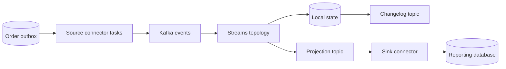

# Chapter 14 — Kafka Connect and Kafka Streams

## 1. Lesson title
Move data with Connect and compute continuously with Streams, while understanding offsets, state, time, and recovery.

## 2. Interview priority
P1 overall; P0 for recognizing when these tools simplify or complicate the project.

## 3. Prerequisites
Kafka groups, schemas, transactions, and the outbox. Know the difference between a business fact and a current-state view.

## 4. Learning objectives
Explain connector/task/worker roles, source/sink offsets, converters, stateful stream processing, joins/windows, restoration, and testing boundaries.

## 5. Official references and versions
All Kafka-core references use official Apache4.2:
- [Connect overview](https://kafka.apache.org/42/kafka-connect/overview/).
- [Connect user guide](https://kafka.apache.org/42/kafka-connect/user-guide/).
- [Connect administration](https://kafka.apache.org/42/kafka-connect/administration/).
- [Streams core concepts](https://kafka.apache.org/42/streams/core-concepts/).
- [Streams architecture](https://kafka.apache.org/42/streams/architecture/).
- [Streams DSL](https://kafka.apache.org/42/streams/developer-guide/dsl-api/).
- [Streams testing](https://kafka.apache.org/42/streams/developer-guide/testing/).

Checked2026-10-24. Specific third-party connectors require their owner's compatibility documentation; a Connect framework feature does not guarantee every connector supports it. No Connect or Streams application is deployed here.

## 6. First principles
Connect is a runtime for moving data between Kafka and external systems. A source connector brings data into Kafka; a sink connector takes Kafka data elsewhere. The attraction is reusable lifecycle, configuration, parallel tasks, and offset management instead of another custom transfer application.

Streams is a Java library for applications that transform Kafka records. It can filter, map, join, aggregate, and maintain local state backed by Kafka. It is not a separate central processing server that every application must contact.

Use Connect for standard data movement, Streams for Kafka-based continuous computation, and application services for domain workflows needing business ownership. A connector copying rows is not automatically an Order service, and a Streams aggregation is not a payment orchestrator.

## 7. Internal architecture
A Connect worker runs connectors and tasks. A connector interprets configuration and proposes units of work; tasks do the transfer. Distributed workers coordinate assignment and persist configuration/status/offset information in internal topics. Standalone mode is simpler for limited local experiments but lacks the same distributed operating model.

Source offsets describe positions in the external source, such as a database log position. Sink progress relates Kafka offsets to successful external writes. A crash between sink write and offset storage can repeat the write; destination idempotency and connector guarantees matter.

Converters map Connect's data representation to Kafka bytes and back. Single Message Transforms perform limited record transformations. Avoid hiding a complex business workflow inside a chain of transforms with weak observability.

Streams builds a topology: a graph of source, processing, and sink nodes. Tasks own input partitions and local state. Repartition topics redistribute records when a key-changing operation requires related keys to meet. Changelog topics preserve state updates for recovery; standby replicas can reduce recovery delay at a resource cost.

KStream treats each record as an event. KTable represents changes to a keyed current view. Three updates for order100 are three stream events but one current table row. A GlobalKTable replicates a table across instances for certain join patterns, trading local availability of data for memory/storage and update traffic.

Event time is when the business event occurred; processing time is when code handles it. Out-of-order events make those different. A window groups records by a time rule. Grace specifies tolerated lateness for relevant window operations; it is a business choice, not just a memory setting.

## 8. Diagrams

Each arrow has recovery semantics. A Kafka transaction inside Streams does not automatically make the reporting database sink exactly once.

## 9. Java21 implementation
This complete Streams application counts observed status-event records by status. It deliberately counts events, not distinct current orders. Use org.apache.kafka:kafka-streams aligned with the course Kafka client version; application.id identifies its processing state.

```java
import java.time.Duration;
import java.util.Properties;
import org.apache.kafka.common.serialization.Serdes;
import org.apache.kafka.common.utils.Bytes;
import org.apache.kafka.streams.KafkaStreams;
import org.apache.kafka.streams.StreamsBuilder;
import org.apache.kafka.streams.StreamsConfig;
import org.apache.kafka.streams.kstream.Consumed;
import org.apache.kafka.streams.kstream.Grouped;
import org.apache.kafka.streams.kstream.Materialized;
import org.apache.kafka.streams.kstream.Produced;
import org.apache.kafka.streams.state.KeyValueStore;

public final class StatusEventCounter {
    public static void main(String[] args) {
        StreamsBuilder builder = new StreamsBuilder();
        builder.stream("order-status-demo",
                Consumed.with(Serdes.String(), Serdes.String()))
            .filter((orderId, status) ->
                orderId != null && status != null && !status.isBlank())
            .groupBy((orderId, status) -> status,
                Grouped.with(Serdes.String(), Serdes.String()))
            .count(Materialized
                .<String, Long, KeyValueStore<Bytes, byte[]>>as(
                    "status-event-counts")
                .withKeySerde(Serdes.String())
                .withValueSerde(Serdes.Long()))
            .toStream()
            .to("status-event-counts",
                Produced.with(Serdes.String(), Serdes.Long()));

        Properties p = new Properties();
        p.put(StreamsConfig.APPLICATION_ID_CONFIG, "status-counter-v1");
        p.put(StreamsConfig.BOOTSTRAP_SERVERS_CONFIG, "localhost:9092");
        p.put(StreamsConfig.PROCESSING_GUARANTEE_CONFIG, "exactly_once_v2");
        KafkaStreams streams = new KafkaStreams(builder.build(), p);
        Runtime.getRuntime().addShutdownHook(
            new Thread(() -> streams.close(Duration.ofSeconds(10))));
        streams.start();
    }
}
```

groupBy changes the key from order ID to status, so related status values must be regrouped. count stores a running result. The output value is a binary Long serde, not a text decimal: a console reader needs the corresponding deserializer.

A business duplicate in the input is still another event and increases the count. exactly_once_v2 addresses processing recovery within Kafka; it does not identify duplicate business intentions. For “current orders by status,” begin from a keyed table and account for old-value removal and new-value addition. This distinction prevents a plausible-looking but wrong dashboard.

## 10. Spring Boot integration
Spring can manage Streams configuration and lifecycle through its Kafka Streams support. Keep topology construction testable separately from startup. Ensure application IDs and state directories are intentionally assigned per logical application and instance.

Do not add a parallel @KafkaListener that consumes the same logical projection input under an accidental conflicting group identity. Streams owns its consumer/producer/state lifecycle. Its application identity is operational data, not an arbitrary display name.

## 11. Production scenario
A reporting dashboard counts ORDER_CONFIRMED events. An operator replays a topic containing duplicate business events from an outbox relay. The dashboard overcounts even though Streams' processing recovery is correct.

Correct the definition first: count event occurrences, distinct event identities, or current orders? If the business metric is distinct confirmed orders, use order identity and a state transition model. A stronger transport setting cannot repair an ambiguous metric definition.

## 12. HLD considerations
Stream-stream joins need matching keys, compatible partitioning, and a time-window model. A payment event arriving long after an order event can fall outside a chosen window. Stream-table joins enrich events with table state under the selected join semantics; they do not automatically reconstruct the exact historical value at event time.

Use a local/global table or a service lookup based on state size, consistency, recovery cost, and latency needs. Synchronous network lookups per record can make a stream processor inherit dependency outages and unpredictable processing delays.

## 13. LLD considerations
Name topology nodes and state stores intentionally when stability matters across upgrades. Serdes are part of the contract for keys, values, intermediate repartition records, and state stores. A correct source serde does not automatically imply every intermediate type is correct.

Windowed keys encode both business key and time interval. Consumers need compatible deserialization and a documented interpretation. Define tombstone handling: null values can signal deletion in table semantics and must not be casually filtered away before a required delete.

## 14. Reliability
Local state loss can be recovered from changelogs if the required data and compatible topology remain available. Restoration takes time and network/disk bandwidth. “Recoverable” does not mean “instant.”

Connector tasks can fail while the worker process remains healthy. Monitor task state and source freshness, not merely process uptime. CDC outages can retain database logs and exhaust storage. Plan the source's retention budget and recovery procedures.

A Streams reset is a destructive logical operation on application progress/state. Design a separate replay application or controlled reset runbook; do not casually delete state and restart under a production identity.

## 15. Performance
Stateful processing consumes CPU, memory, disk, and network. More threads do not create more useful tasks than partitioning allows. A hot status key such as CONFIRMED can concentrate the simple example's aggregation.

Estimate state size from distinct keys, value size, retention, and storage overhead. One million keys at an illustrative200 bytes of logical state is200 MB before indexes, caching, changelog retention, and replication. Measure restoration throughput to estimate actual recovery time.

## 16. Ten study questions with model answers
1. **Connect or Streams?** Connect moves data through reusable integrations; Streams computes on Kafka data inside an application. Many systems use both with separate ownership.
2. **Connector versus task?** A connector plans/configures transfer; tasks execute units of transfer. Increasing tasks.max cannot invent source parallelism a connector does not support.
3. **Why do source offsets differ from Kafka offsets?** They describe another system's progress. Recovery must relate the external position to emitted data, not confuse two coordinate systems.
4. **KStream versus KTable?** One models event occurrences, the other keyed evolving state. Repeated status updates affect their aggregates differently.
5. **Why repartition?** A key change can require data redistribution so all values for a new key reach the correct task. That adds topics, I/O, and serialization boundaries.
6. **What restores local state?** Changelog data and replay under the topology's semantics. Persistent disks and standby replicas can reduce delay but require their own operation.
7. **What does grace solve?** It defines tolerated event-time lateness for window processing. It cannot make arbitrarily late data free or infer missing business history.
8. **Does Streams EOS cover a sink database?** Not automatically. The sink connector and destination must provide their own effect/progress guarantee.
9. **Why test a topology without Kafka?** A topology test driver makes transformations and time cases deterministic. It does not prove broker failover, network behavior, or distributed restoration.
10. **Why can a healthy worker hide failure?** One task can be failed or stale while the worker process runs. Monitor useful data movement and task-level errors.

## 17. Worked exercise
Input records are order1:PENDING, order1:CONFIRMED, order1:CONFIRMED, order2:PENDING. Predict the example output's final counts.

Solution: PENDING=2 and CONFIRMED=2 because it counts event occurrences. Current-order counts would be PENDING=1 and CONFIRMED=1. To build the latter, maintain one current status per order and update grouped counts when that status changes.

Expected learning: choose stream/table semantics from the business question. Add an out-of-order update and define whether aggregateVersion rejects it or whether historical-time semantics are needed.

## 18. Verification and execution status
The application is unexecuted. Test the topology with kafka-streams-test-utils aligned to the client version and JUnit6. Assert final state, not only every emitted intermediate update because caching/commit behavior can coalesce updates. Then use a real broker to test restart, restoration, repartition topics, and transaction visibility. Connector labs require a selected connector and source setup.

## 19. Common misconceptions
Connect is not a schema-free copy machine. Streams is not a separate broker cluster. Current-state counts differ from event counts. Local state is not automatically disposable without recovery cost. Exactly-once processing does not remove duplicate business events.

## 20. Unanswered assessment
A one-hour window closes before delayed payment events arrive after a regional outage. How would you change the business metric, lateness policy, and correction workflow?

## 21. Revision summary
Separate movement from computation. Understand source progress, table semantics, time, and local state. Design recovery and upgrades alongside the topology.

## 22. Next lesson
Chapter15 covers the operational system that keeps Kafka secure, observable, recoverable, and within capacity.

