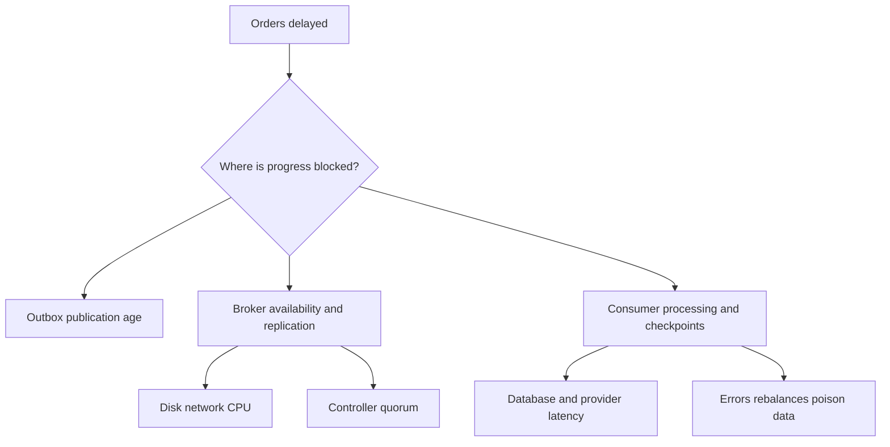

# Chapter 15 — Kafka operations, security, capacity, and disaster recovery

## 1. Lesson title
Operate Kafka by preserving business outcomes, not merely keeping broker processes running.

## 2. Interview priority
P0 for diagnosis and durability; P1 for advanced multi-cluster administration.

## 3. Prerequisites
Chapters7–14. Know replication, ISR, retention, group progress, producer acknowledgment, and transactional visibility.

## 4. Learning objectives
Read operational evidence, estimate capacity, explain secure client access, plan reassignment and upgrades, and distinguish replication from a tested disaster-recovery capability.

## 5. Official references and versions
ApacheKafka4.2 references checked2026-10-24:
- [Monitoring](https://kafka.apache.org/42/operations/monitoring/).
- [Basic operations](https://kafka.apache.org/42/operations/basic-kafka-operations/).
- [KRaft](https://kafka.apache.org/42/operations/kraft/).
- [Security overview](https://kafka.apache.org/42/security/security-overview/).
- [Authorization and ACLs](https://kafka.apache.org/42/security/authorization-and-acls/).
- [Cross-cluster mirroring](https://kafka.apache.org/42/operations/geo-replication-cross-cluster-data-mirroring/).

All Kafka-core supporting references are Apache-owned. The local single-broker project is a learning environment, not evidence of failover. Commands below inspect state; no administrative mutation has been executed.

## 6. First principles
Availability means clients can perform useful operations. Durability means accepted data survives specified failures. Recoverability means you can restore service and reconcile state within an objective. These are related but different: a cluster can be reachable while a critical partition is unavailable, or retain data while applications cannot authenticate.

An SLO is a target for user-visible service behavior. Kafka metrics should explain that behavior. “Broker uptime100%” is weak if orders spend an hour waiting for Inventory. Pair platform metrics with outbox age, event processing delay, and unfinished order age.

RPO is the maximum acceptable loss of recent data under a defined recovery scenario. RTO is the target time to restore the required service. State whether RTO includes DNS, credentials, database recovery, consumer checkpoint translation, application warmup, and reconciliation. Otherwise two teams may promise different recoveries using the same acronym.

## 7. Internal architecture
KRaft controllers manage cluster metadata through a quorum. Brokers host partition replicas and serve data. Controller quorum availability and partition replica health are separate concerns. Three voting controllers normally tolerate one unavailable voter while retaining a majority; broker count alone does not establish controller resilience.

Disk storage contains log segments and indexes. Retention, compaction, replication traffic, and restoration compete for I/O. A disk filling gradually can become a sudden write incident when headroom disappears.

Partition reassignment moves replicas to different brokers. It consumes network and disk capacity while normal traffic continues. A safe plan measures the added load, uses appropriate throttling, verifies completion and ISR health, and removes temporary throttles afterward. Adding brokers does not automatically prove data and leaders are balanced.

An upgrade has binaries, metadata/protocol features, configuration, and client behavior. Verify the release-specific upgrade path and rollback constraints before changing feature levels. A binary downgrade after irreversible feature activation may not be supported.

## 8. Diagrams

Start from the business symptom and narrow the path. A coincident CPU spike is a hypothesis, not automatically the cause.

## 9. Java21 and operational implementation
A complete read-only Admin client example inspects one topic. It needs the course-managed kafka-clients dependency and access to the local broker.

```java
import java.time.Duration;
import java.util.List;
import java.util.Properties;
import java.util.concurrent.TimeUnit;
import org.apache.kafka.clients.admin.Admin;

public final class TopicInspection {
    public static void main(String[] args) throws Exception {
        Properties p = new Properties();
        p.put("bootstrap.servers", "localhost:9092");
        p.put("client.id", "course-topic-inspection");
        try (Admin admin = Admin.create(p)) {
            var descriptions = admin.describeTopics(List.of("order-events"))
                .allTopicNames().get(10, TimeUnit.SECONDS);
            descriptions.forEach((name, topic) ->
                topic.partitions().forEach(partition ->
                    System.out.printf(
                        "%s partition=%d leader=%s replicas=%s isr=%s%n",
                        name, partition.partition(), partition.leader(),
                        partition.replicas(), partition.isr())));
            admin.close(Duration.ofSeconds(5));
        }
    }
}
```

The output describes current assignment and replication membership, not a permanent guarantee. A snapshot showing full ISR does not prove yesterday's durability or tomorrow's recovery.

In an ApacheKafka container with the documented command paths, equivalent inspections are:

```powershell
docker compose -f C:\Projects\distributed-commerce\infrastructure\compose\compose.yaml exec kafka /opt/kafka/bin/kafka-topics.sh --bootstrap-server kafka:9092 --describe --topic order-events
docker compose -f C:\Projects\distributed-commerce\infrastructure\compose\compose.yaml exec kafka /opt/kafka/bin/kafka-consumer-groups.sh --bootstrap-server kafka:9092 --describe --group inventory
```

Confirm the actual Compose service, internal listener, and topic/group names before use. These commands are examples, not evidence that those resources currently exist.

## 10. Spring Boot integration
Expose producer/consumer/container observations through the chosen metrics system. Give applications stable, recognizable client IDs without creating unbounded metric labels. Report readiness separately from deep dependency diagnostics.

A service may remain able to accept durable orders into its database while Kafka is temporarily unavailable, provided backlog limits and API promises permit it. Another service may need to refuse work. Readiness should reflect this business policy rather than a universal “every dependency must always be green” rule.

## 11. Production scenario
Inventory lag rises while broker request latency is normal. One partition has most of the lag, and database lock time increases. Adding brokers is unlikely to solve this hot-key/consumer bottleneck.

Another incident has rising producer request latency, under-replicated partitions, disk saturation, and replica fetch delay after reassignment starts. Here the operation itself competes with production traffic. Reduce movement pressure under the runbook, verify health, and resume with measured capacity.

The two incidents share “Kafka is slow” as a symptom but require different actions.

## 12. HLD considerations
Place replicas across failure domains when infrastructure supports it. Distinct virtual machines on one physical failure domain are not equivalent to independent zones. Separate controller roles where the production deployment and workload justify it; combined mode is convenient for learning.

Cross-cluster mirroring is usually asynchronous. Source and destination offsets need not be identical, topic naming can differ, and consumer checkpoint translation needs an explicit plan. Database authority, secrets, schema registries, ACLs, and application state also need recovery. A second Kafka cluster alone is not a second functioning commerce platform.

## 13. LLD considerations
Define an operational contract per topic: owner, key, schema, partitions, replication, retention, compaction/deletion policy, access rules, expected throughput, and recovery consumers. Store changes as reviewed configuration where possible.

Security has three different questions: TLS protects the connection; authentication establishes identity, often through SASL or client certificates; ACLs authorize operations on resources such as topics, groups, and transactional IDs. TLS alone does not grant least privilege.

Use separate service identities. Inventory should not inherit a broad administrator credential merely to consume one topic and publish one result. Protect Connect administration and monitoring endpoints as well as broker listeners.

## 14. Reliability
Credential rotation needs overlap and a tested rollout so active clients can reconnect. Certificate hostname validation depends on advertised addresses matching certificates. Disabling hostname verification to “fix” connectivity removes a security check while leaving the naming design broken.

Replication is not backup against every threat. Accidental deletion, incorrect writes, retention expiry, and replicated corruption can propagate. Define what independent history or snapshots are required and test recovery.

For DR, record the last known replicated data, accepted source writes, and unresolved operations. Fence old writers before promoting a new authority where split ownership would violate invariants. Reconcile after failback; switching DNS twice is not a complete data plan.

## 15. Performance
Illustrative capacity:10,000 events/s ×1KB ≈10MB/s logical ingress. Over one day that is864GB in decimal units; replication factor3 suggests about2.592TB of replicated payload before compression, indexes, internal topics, and overhead. Retention of seven days multiplies the retained payload further. State compression and retention assumptions explicitly.

Monitor request latency and error rate, disk free space and I/O latency, network throughput, ISR changes, unavailable partitions, controller health, producer retries/buffer waits, consumer rebalance rate, lag distribution, and oldest unprocessed age.

Quotas protect shared clusters from one tenant consuming all bandwidth/request capacity. Their trade-off is intentional throttling. Observe client throttle time before blaming network latency.

## 16. Ten study questions with model answers
1. **Does a running broker mean a healthy service?** No. Critical partitions or consumer dependencies may be unavailable. Start with useful business progress.
2. **Under-replicated versus unavailable?** Under-replication means fewer healthy in-sync copies than desired; unavailability means required operations cannot currently proceed for the affected partition. Severity depends on the remaining protection and workload.
3. **Why doesn't adding a broker immediately fix skew?** Existing replicas and leaders need placement changes, and a hot key remains one ordering domain. Capacity and distribution are different problems.
4. **Why throttle reassignment?** Moving replicas competes with client traffic and replication. Controlled movement preserves headroom while completing the operation.
5. **TLS versus SASL versus ACL?** Encryption, identity, and permission are separate layers. A securely encrypted connection can still be overprivileged.
6. **Why inspect advertised listeners?** Clients discover broker addresses after bootstrap. An address reachable only inside a container network breaks external clients even if bootstrap succeeds.
7. **Is mirroring zero-loss DR?** Not by default. Asynchronous replication can lag, and recovery needs coordinated authorities and checkpoints. State measured RPO rather than assuming zero.
8. **Why is a restore drill necessary?** Backups and replicas are only potential recovery inputs. A drill tests credentials, tools, ordering, data integrity, and elapsed recovery time.
9. **Can lowering durability settings solve an incident?** It may increase acceptance while changing loss guarantees. That is a business trade-off requiring an explicit decision, not an invisible tuning fix.
10. **What does a senior incident update contain?** User impact, known evidence, current hypothesis, mitigation, risk, next checkpoint, and owner. Avoid claiming a root cause before the evidence supports it.

## 17. Worked exercise
A topic has six partitions. Partition2 holds80% of traffic, consumer lag rises there, and all brokers have spare disk/network. Propose a diagnosis and a safe improvement.

Solution: inspect key distribution and per-key processing cost. More consumers cannot split one classic-group partition simultaneously. Consider a better key only if the business ordering domain permits it, or redesign the hot entity's work. If preserving one entity's serial decisions is essential, optimize that lane and apply admission control. Increasing partitions alone may redistribute other keys without fixing the dominant key.

Expected evidence: per-partition rates and business-key samples explain the skew without exposing sensitive payloads.

## 18. Verification and execution status
Admin code and commands are unexecuted. Future multi-broker labs must verify replica placement, leader loss, minimum ISR behavior, controller quorum loss, credential rotation, and restore. The current single-broker Compose setup cannot prove these claims. Record actual times and missing dependencies in the lab report.

## 19. Common misconceptions
Replication is not universal backup. Controller quorum and data replication are different. A single lag number hides skew. A second region is not a failover plan. Security disabled for a demo is not a production baseline.

## 20. Unanswered assessment
RegionA fails while mirroring is30seconds behind and some payment outcomes are unknown. What must be fenced, recovered, and reconciled before RegionB accepts authoritative orders?

## 21. Revision summary
Operate from business symptoms, preserve explicit durability, measure headroom, secure identities and permissions, and prove recovery through drills.

## 22. Next lesson
Chapters16–19 cover MongoDB, Redis, service boundaries, and networking; these explain the dependencies that often dominate Kafka application behavior.

