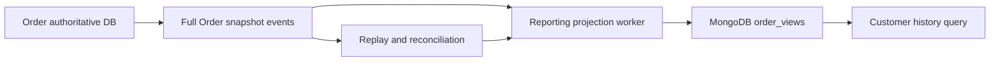
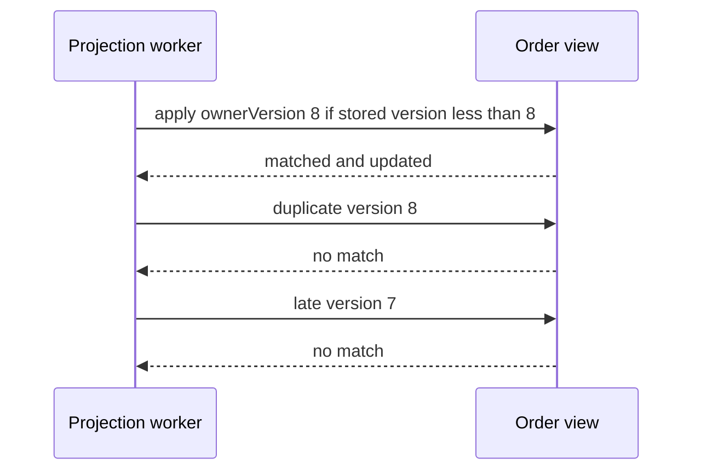

# Chapter 16 — MongoDB Read Models, Queries, and Recovery

Prepared 2026-10-24. Commands are unexecuted educational examples. MongoDB is introduced as a deliberate modeling choice; PostgreSQL remains authoritative for Inventory.

## 1. Lesson title
Build document models around access patterns while preserving ownership, bounded growth, and explainable consistency.

## 2. Interview priority
P1 overall; P0 when MongoDB is a primary technology for the role. Prioritize modeling, indexes, atomicity, concerns, and failover before memorizing aggregation operators.

## 3. Prerequisites
Chapter 6's constraints and transactions, and the preceding event-processing chapters' duplicate/replay reasoning. A document is a structured record that can contain nested fields and arrays. A collection groups documents. BSON is MongoDB's binary document representation and supports types beyond JSON's basic vocabulary.

## 4. Learning objectives
Choose embedding or references, design a query-aligned index, build and explain an aggregation pipeline, distinguish single-document atomicity from multi-document transactions, and reason about read/write concerns, replication, sharding, and projection rebuilds. Evaluate search as a separate capability with its own freshness requirements.

## 5. Official references and version notes
All links opened 2026-10-24. MongoDB manual URLs are rolling documentation; no server version is selected or installed by this chapter. Verify exact feature support against the eventual server and driver. Live Spring Data MongoDB reports 5.1.2; it does not silently replace the proposed Boot 4.1.1 dependency set. Java 21 and Maven remain the course baseline.

| ID | Official source | Sections |
|---|---|---|
| M1 | [Data modeling](https://www.mongodb.com/docs/manual/data-modeling/) | Document design and access patterns |
| M2 | [Modeling practices](https://www.mongodb.com/docs/manual/data-modeling/best-practices/) | Embedding, references, bounded documents |
| M3 | [Compound indexes](https://www.mongodb.com/docs/manual/core/indexes/index-types/index-compound/) | Field order, prefixes |
| M4 | [Aggregation](https://www.mongodb.com/docs/manual/aggregation/) | Pipeline stages |
| M5 | [Transactions](https://www.mongodb.com/docs/manual/core/transactions/) | Single-document atomicity, distributed transactions |
| M6 | [Read concern](https://www.mongodb.com/docs/manual/reference/read-concern/) | Read guarantees |
| M7 | [Write concern](https://www.mongodb.com/docs/manual/reference/write-concern/) | Acknowledgment, majority, timeouts |
| M8 | [Replication](https://www.mongodb.com/docs/manual/replication/) | Replica-set roles and elections |
| M9 | [Sharding](https://www.mongodb.com/docs/manual/sharding/) | Routing and shard keys |
| M10 | [Change streams](https://www.mongodb.com/docs/manual/changestreams/) | Resume and deployment requirements |
| M11 | [MongoDB Search](https://www.mongodb.com/docs/search/) | Search capability overview |
| M12 | [Spring sessions/transactions](https://docs.spring.io/spring-data/mongodb/reference/mongodb/client-session-transactions.html) | Session and transaction manager |
| M13 | [Unique indexes](https://www.mongodb.com/docs/manual/core/index-unique/) | Uniqueness and deployment limitations |
| M14 | [Explain](https://www.mongodb.com/docs/manual/reference/method/db.collection.explain/) | Execution statistics |

Mechanisms below are documented facts. The order-view design, owner-version policy, rebuild sequence, and workload estimates are original recommendations. No book claims or performance measurements.

## 6. Fundamental explanation

### Why a document can fit a read model
An order-history page wants order ID, date, state, total, and a few purchased product names together. A document can hold this display snapshot in one bounded shape. The shape follows the query and update lifecycle rather than mechanically copying every relational table into a collection. MongoDB's modeling guidance emphasizes designing around application access patterns. [M1]

Our recommended `order_views` collection is a projection owned by Reporting. Order remains the owner of workflow state. A view can be rebuilt from approved source data and retained events; it is not allowed to authorize shipping or release inventory merely because a document says READY. This distinction gives eventual consistency an explicit business boundary.

Embedding places related values inside a document. References store identifiers for separately managed documents. Embed bounded data read and changed together; reference data whose lifecycle, reuse, or growth makes independent ownership useful. [M2] A purchased line description can be a historical snapshot. A complete customer profile copied into every order creates update and privacy obligations that need separate justification.

### Flexible schema still requires a contract
Two documents can have different fields, but readers still need to know what each field means. Define schema version, required fields, money units, time representation, and treatment of missing versus null. Use validation and migration policies suited to the deployment. Flexible storage shifts some schema responsibility to application and operational design; it does not remove it.

An unbounded `events` array inside every order is a common mistake. Orders may live for years and receive many updates. A bounded recent-events display can be useful, while the full history belongs in a separate retained structure with explicit lifecycle. Limits must be derived from realistic worst-case use, not the average order.

## 7. Internal architecture and mechanism

### Atomicity and conditional updates
MongoDB provides atomicity for a write to one document; multi-document transactions extend the scope under supported deployment conditions. [M5] A projection update can exploit the single-document boundary: update only if its stored owner version is older than the incoming full snapshot. Two competing updates then meet at the document's conditional write rather than performing a disconnected client-side read and save.

The version in this chapter comes from one authoritative Order owner. It is not a wall-clock timestamp and not a global sequence across Order, Inventory, and Payment. If the projection combines independently versioned sources, keep a version per source or use a deliberately designed merge policy. Comparing unrelated counters would drop valid information.

A version-skipping rule is safe here because the event contains a complete Order display snapshot. It is unsafe for deltas such as “add two units”: skipping one delta loses data. Delta consumers need contiguous sequence handling, deduplication, and gap repair. This is a course design rule, not an automatic database capability.

### Query and index mechanics
For a customer history query, filter by tenant/customer and sort by creation time plus ID. A compound index should align with that filter and order. MongoDB documents index field ordering and prefix behavior. [M3] Each additional index consumes storage and write work, so creating every permutation is not a strategy.

Unique indexes enforce declared uniqueness, with restrictions that matter in sharded deployments. [M13] An `_id` chosen from stable projection identity prevents duplicate documents for the same owned view. It does not replace duplicate-effect protection in the authoritative service. Tenant identity belongs in both query and uniqueness design when data is shared.

Explain execution statistics reveal returned documents and examined work. [M14] A query returning ten orders after scanning a large collection may need a better index or predicate, while a small scan can be perfectly acceptable. Record dataset size and distribution before comparing results. A fast query on one sample document provides almost no capacity evidence.

### Aggregation is a dataflow
An aggregation pipeline passes documents through stages that filter, reshape, group, sort, and otherwise transform them. [M4] For a daily order report, first restrict tenant and date, then group by business date/state, then shape the result. Stage order affects work and semantics: grouping before a selective match can process unnecessary data, while moving a match across a transformation may change its meaning.

Use aggregation for the read requirement, not to hide a poorly owned cross-service join. A lookup into another collection can be valid within Reporting's model, but it does not establish transactional consistency with an external PostgreSQL database. Label the report's freshness and reconciliation behavior.

### Concerns, replicas, and shards
Read concern controls the guarantees associated with a read, while write concern controls required acknowledgment conditions for a write. A write-concern timeout does not establish that the write failed to occur. [M6, M7] Reconcile by identity and desired state. Read preference, which selects eligible nodes, is a separate concept from the consistency guarantee requested of a read.

A replica set has a primary and replicating members with election behavior. Failover changes which node accepts writes and can interrupt in-flight operations. [M8] Drivers help discover topology, but the application still needs time budgets, retry classification, and idempotent operations. A secondary read can be stale relative to the latest owner update.

Sharding distributes documents by shard key and introduces routing through the cluster's query infrastructure. [M9] Choose keys from cardinality, distribution, query targeting, and growth. A monotonically increasing key can concentrate new writes depending on the sharding strategy. A tenant-only key may make a very large tenant a hotspot; hashing may distribute writes while changing range-query targeting. State the trade-off rather than declaring one universal best key.

## 8. Diagrams





The second sequence relies on full snapshots from one owner. It would be an incorrect generic recipe for arbitrary deltas or multi-owner messages.

## 9. Java 21 implementation

Unexecuted mongosh educational example. Complete within a fresh disposable collection and a pre-created view; it teaches the database update that a Java 21 adapter would issue. It does not implement initial-event races, broker offset commits, or a production consumer.

```javascript
db.order_views_demo.insertOne({
  _id: "T-1/O-1001",
  tenantId: "T-1",
  customerId: "C-7",
  orderId: "O-1001",
  ownerVersion: 0,
  status: "PENDING",
  createdAt: ISODate("2026-10-24T10:00:00Z"),
  lines: [{ sku: "P-10", quantity: 2, title: "Teaching product" }],
  totalMinor: NumberLong("12500"),
  currency: "INR"
});
db.order_views_demo.createIndex({
  tenantId: 1, customerId: 1, createdAt: -1, _id: -1
});

function applySnapshot(version, status) {
  return db.order_views_demo.updateOne(
    { _id: "T-1/O-1001", ownerVersion: { $lt: version } },
    { $set: { ownerVersion: version, status: status } }
  );
}

printjson(applySnapshot(2, "READY"));
printjson(applySnapshot(2, "READY"));
printjson(applySnapshot(1, "PENDING"));
printjson(db.order_views_demo.findOne({ _id: "T-1/O-1001" }));

printjson(db.order_views_demo.aggregate([
  { $match: { tenantId: "T-1", currency: "INR" } },
  { $group: { _id: "$status", orders: { $sum: 1 },
              totalMinor: { $sum: "$totalMinor" } } },
  { $sort: { _id: 1 } }
]).toArray());
```

The demo varies only version and status, with the other display fields fixed by initialization. In a real full-snapshot projection, update all source-owned display fields consistently. If two different payloads claim the same owner version, treat that as a contract violation requiring diagnosis; silently ignoring both can conceal corrupted publication.

## 10. Spring Boot integration
Keep a MongoDB projection adapter behind a read-model interface. Configure serialization, collection naming, indexes, concerns, and timeouts explicitly in the reviewed implementation. Spring Data supports sessions and transaction integration through the appropriate transaction manager; a generic annotation without configured resources does not create a MongoDB/PostgreSQL distributed transaction. [M12]

For a one-document projection, prefer the simplest atomic update matching the invariant. If an inbox and projection must update in separate documents, decide whether a supported MongoDB transaction is appropriate, or whether a versioned idempotent projection plus replay protocol is sufficient. The decision must match the event shape and recovery contract.

## 11. Production scenario
Reporting stops for an hour while orders continue. The UI should show projection freshness or a meaningful delayed status rather than claim the view is authoritative. On restart, the worker replays retained events and applies newer owner versions. Duplicate snapshots are harmless under the conditional update.

If the event retention window has expired, replay alone cannot rebuild the view. Use a defined snapshot/backfill interface from the owner and reconcile versions before switching traffic. Backfill and live consumption can overlap; the version guard prevents an older snapshot from replacing newer state when both share the same owner-version domain.

## 12. HLD considerations
MongoDB is optional when PostgreSQL already serves the required read patterns adequately. Adding a second database brings new backup, access control, monitoring, and operational responsibilities. Justify it through document access needs, independently scaled read models, or team capability.

A projection rebuild should use a new collection/version when possible, validate counts and sampled content, catch up to an agreed position, and switch readers deliberately. Preserve the old view long enough for rollback where feasible. Define how deletes and privacy requests propagate so rebuilding does not resurrect data that must no longer be exposed.

Optional search needs a separate evaluation. MongoDB Search documents specialized search capabilities; availability and deployment details must be checked for the chosen environment. [M11] Analyze tokenization, relevance, pagination, authorization filtering, indexing freshness, and rebuild behavior. A search hit is a candidate to display or fetch, not proof of authoritative stock or access rights.

## 13. LLD considerations
Define a projection envelope with event ID, owner aggregate ID, owner version, schema version, occurred time, and payload. Distinguish occurred time from ingestion time. Store the last applied owner version and projection schema version in the view. The latter describes how the view was constructed, while the former describes source progress.

Use bounded collections and projections of fields actually needed by the API. Keep mutable customer details separate from historical purchase snapshots unless the retention policy says otherwise. Encapsulate query filters so every tenant-scoped read includes the tenant boundary; a convenient repository method must not bypass authorization.

## 14. Reliability and failure recovery
Change streams expose database changes with resume facilities, subject to deployment and history constraints. [M10] A resume token is progress evidence, not an eternal backup. Persist processing progress in coordination with idempotent effects, detect unavailable history, and provide a resnapshot path. Do not assume a document-level change is automatically the correct public business event.

Test replica election, network interruption, write-concern ambiguity, duplicate snapshots, version gaps, and rebuild cutover. Backup strategy must include restore validation and the relationships to authoritative source systems. Since this read model is reconstructible, recovery may prioritize rebuilding over preserving every cache-like intermediate state, but only if the source history and snapshot interface actually exist.

## 15. Performance and capacity
Measure documents examined, keys examined, returned rows, query latency, index size, write rate, replication lag, and projection age. Indexes improve reads but add write amplification; large documents and arrays increase transfer and update costs. A hot customer or tenant can create skew even when average throughput looks comfortable.

For a thought experiment, two million order views averaging 4 KiB require about 7.6 GiB of raw payload before indexes, storage overhead, replicas, and working-set needs. This arithmetic is not a storage forecast. Measure representative documents and choose capacity from observed overhead and growth. Bound aggregation memory and result sizes rather than exporting all documents into one Java list.

## 16. Interview questions with explained answers

1. **When embed?** Embed bounded values read and changed with the parent when ownership and lifecycle align. Reference independently growing or reused data. Explain the worst-case document shape, not only one sample order.

2. **Does flexible schema eliminate migrations?** No. Readers still depend on field meaning and shape. Version the projection, support transition, and rebuild or backfill deliberately. Missing and null values need explicit interpretation.

3. **What is atomic in MongoDB?** A single-document write has its documented atomicity; multi-document work requires a supported transaction or another correctness protocol. Do not extend that guarantee to PostgreSQL or external HTTP effects.

4. **Why use owner versions?** They let a full-snapshot projection reject duplicates and older state from the same ordered source. They do not compare unrelated services. Delta events need gap handling instead of unconditional skipping.

5. **Read concern versus read preference?** Concern specifies the read guarantee, while preference guides eligible node selection. A secondary choice and a consistency level solve different questions. Evaluate both against the user's freshness requirement.

6. **Does write-concern timeout mean no write?** No. Acknowledgment conditions were not satisfied in time, but the effect may exist. Inspect by stable identity and desired state; blind creation of a new identity can duplicate work.

7. **Why can sharding make queries worse?** A query without a useful routing key may involve multiple shards and merge work. Distribution also creates skew and operational complexity. Choose a key from real access patterns and growth.

8. **How diagnose a slow aggregation?** Examine stage semantics, selectivity, index support, data volume, and execution statistics. Move filters only when equivalence is preserved. Do not assume the shortest pipeline is the cheapest.

9. **Can change streams replace business events?** They report database changes, which may not align with public domain meaning or expose the desired contract. A transformation can be appropriate, but ownership, schema, replay, and retention still need design.

10. **How rebuild a projection safely?** Create a replacement view, backfill from a consistent source protocol, consume subsequent changes, validate, and switch readers. Include deletes, schema version, and rollback. Merely replaying “whatever events remain” is insufficient.

## 17. Exercises
Run the mongosh example only in a fresh disposable practice collection. Expected observations: version two applies once, duplicate two and late one match no document, final state remains READY, and the aggregation returns one INR order totaling 12500 minor units. These are predictions, not measured results.

Change the event to a delta “increment total by 100” and deliberately omit version one. Explain why the current version-skipping policy is invalid. Solution: deltas require an identity/sequence protocol with gap repair or a full snapshot that supersedes missing changes.

Design a history query for one tenant/customer and inspect its explain result on representative generated data. Expected reasoning: a suitable index narrows candidates and supports order; small datasets may not demonstrate the same plan. Record examined and returned counts without inventing a target latency.

## 18. Verification
Sources and links were checked; no MongoDB deployment, mongosh command, Java adapter, index build, failover, or search experiment was executed. The example is scoped to an initialized document. Production initialization races, server version support, transaction settings, and projection rebuild correctness remain implementation validation tasks.

## 19. Common misconceptions
Document storage is not schema-free design. Embedding every event is not bounded modeling. Majority acknowledgment does not make every secondary read current. Sharding does not repair every slow query. A projection is not the owner of its copied business fact. Search freshness and database commit freshness can differ.

## 20. Knowledge assessment
Unanswered: a full Order snapshot at version twelve arrives before version eleven, then Reporting loses its collection and only the last day's events remain. Explain normal processing, recovery prerequisites, and why a full rebuild cannot be promised from incomplete history alone.

## 21. Revision summary
Model around access and ownership, keep documents bounded, enforce conditional updates atomically, and design indexes from queries. Separate concerns from node selection. Make projection freshness, rebuilds, and version domains explicit.

## 22. Next lesson
Chapter 17 adds Redis for advisory caching and coordination. The same ownership discipline applies: fast copied state cannot replace the authoritative inventory transaction.
