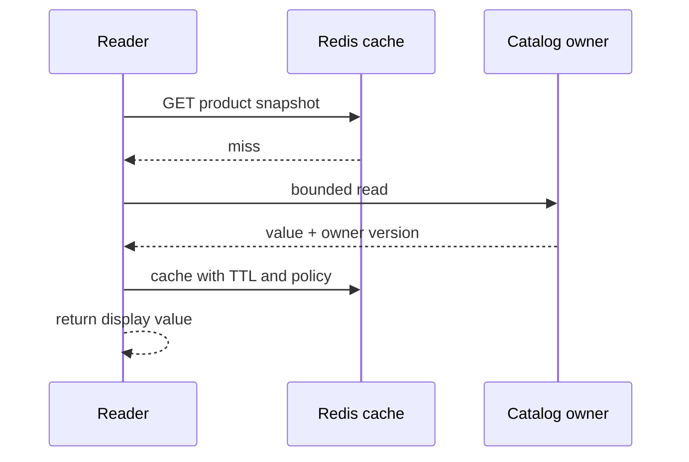
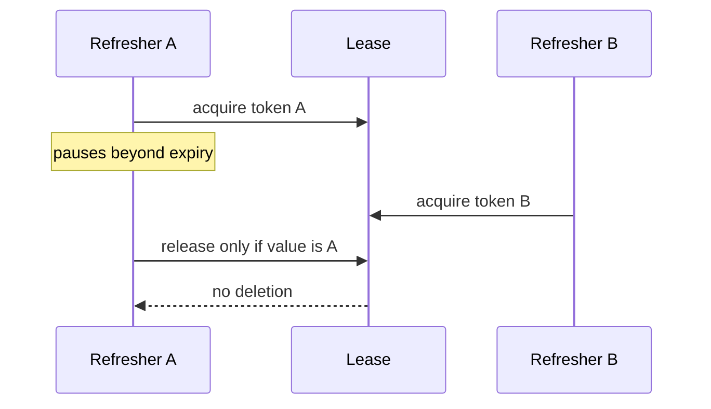

# Chapter 17 — Redis: Caches, Expiration, Leases, and Recovery

Prepared 2026-10-24. Unexecuted educational material. Redis is advisory in this project; authoritative inventory and payment-operation identity remain in owning databases.

## 1. Lesson title
Use fast shared state without confusing speed, temporary coordination, and durable correctness.

## 2. Interview priority
P0 for cache-aside, invalidation races, stampedes, TTL/eviction, and lock limitations. P1 for structures, persistence, replication, Sentinel, and Cluster behavior.

## 3. Prerequisites
Chapters 3, 6, and 16. A cache stores a reusable copy or derived result to avoid repeated expensive work. A cache hit finds a usable entry; a miss requires another path. A lease gives time-limited permission and can expire while its previous holder is still running.

## 4. Learning objectives
Select data structures and key schemas, distinguish expiration from eviction, build bounded cache-aside behavior, prevent overload on misses, reason about stale writers and fencing, and recover from Redis loss without violating commerce invariants.

## 5. Official references and version notes
Opened 2026-10-24. Redis links are rolling `latest` documentation; no Redis server release is selected by this chapter. Commands below avoid newer compare/delete additions whose availability would need an explicit version decision. Spring Data Redis live docs report 4.1.2; proposed Boot remains 4.1.1. Java remains 21 and Maven the build tool.

| ID | Official source | Sections |
|---|---|---|
| R1 | [Data types](https://redis.io/docs/latest/develop/data-types/) | Strings, hashes, sets, lists, sorted sets, streams |
| R2 | [Eviction](https://redis.io/docs/latest/develop/reference/eviction/) | maxmemory and policies |
| R3 | [EXPIRE](https://redis.io/docs/latest/commands/expire/) | TTL semantics |
| R4 | [SET](https://redis.io/docs/latest/commands/set/) | NX and expiration options |
| R5 | [Distributed locks](https://redis.io/docs/latest/develop/clients/patterns/distributed-locks/) | Tokens, expiry, correctness caveats |
| R6 | [Persistence](https://redis.io/docs/latest/operate/oss_and_stack/management/persistence/) | RDB/AOF trade-offs |
| R7 | [Replication](https://redis.io/docs/latest/operate/oss_and_stack/management/replication/) | Asynchronous replication |
| R8 | [Sentinel](https://redis.io/docs/latest/operate/oss_and_stack/management/sentinel/) | Monitoring and failover |
| R9 | [Cluster specification](https://redis.io/docs/latest/operate/oss_and_stack/reference/cluster-spec/) | Slots, hash tags, failover constraints |
| R10 | [Lua scripting](https://redis.io/docs/latest/develop/programmability/eval-intro/) | Atomic execution and script lifetime |
| R11 | [Spring Redis cache](https://docs.spring.io/spring-data/redis/reference/redis/redis-cache.html) | Cache manager, TTL, serialization |
| R12 | [Pub/Sub](https://redis.io/docs/latest/develop/pubsub/) | Delivery semantics |

Documented behavior is cited. Cache policies, fencing examples, business boundaries, and arithmetic are course recommendations. The first attempted lock-document URL failed; the canonical clients/patterns URL above was successfully opened. No benchmark or book-reading claim.

## 6. Fundamental explanation

### Fast copies need an owner
Catalog's product display name is an attractive cache candidate because many orders read it and occasional staleness can be acceptable. Inventory reservation is different: a stale available count can oversell if treated as permission. Our API may display cached stock information as advisory, but Inventory's PostgreSQL transaction decides whether stock is actually reserved.

A cached value needs an owner, key, schema, freshness policy, and miss policy. `product:P-10` is incomplete if tenants or locales can produce different representations. A safer conceptual key is `catalog:v1:tenant:T-1:locale:en-IN:product:P-10`. The exact format is our recommendation; its purpose is to make collision, authorization, and evolution decisions visible.

### Structures encode operations
Strings hold values or serialized documents; hashes represent field/value maps; lists preserve sequence; sets represent unique membership; sorted sets associate members with scores; streams provide an append-oriented structure with their own consumption facilities. [R1] Choose from required operations. A leaderboard can benefit from sorted-set ordering, while a product snapshot may be simplest as one serialized value.

Do not turn Redis into an unreviewed second database just because adding keys is easy. If a cart is stored only there, losing it becomes a product data-loss event and requires a stronger persistence/recovery policy than an expendable catalog cache. The same server can host keys with very different business importance; that is often a reason to separate deployments or policies.

### Expiration and eviction differ
TTL gives a key a lifetime. Eviction chooses keys to remove when memory policy requires it. A key can disappear before its TTL under an eviction policy, and expiration is not a business scheduler promising an exact callback instant. [R2, R3] Always handle a miss. Do not use a key-expiry event as the only durable instruction to release inventory after a reservation deadline.

Our recommendation is to store reservation expiry in the authoritative database and let a recoverable worker perform the legal release transition. Redis can accelerate discovery of candidates, but database state and idempotency decide the effect. This keeps expiration mechanics separate from business correctness.

## 7. Internal architecture and mechanism

### Cache-aside and the stale-fill race
In cache-aside, a reader checks Redis, loads from the owner on a miss, then caches the result for reuse. A writer commits the authoritative change and invalidates or refreshes the relevant entry. This is a useful default recommendation, but the two systems do not share a transaction.

Consider this race: reader A loads product version five; writer B commits version six and deletes the key; reader A then caches version five. Invalidation happened, yet the cache is stale again. A short TTL bounds exposure only under a clearly stated policy; it does not make the update atomic. Alternatives include versioned cache values with conditional replacement, owner-published invalidations with repair, or accepting bounded staleness for this specific field.

Write-through sends updates through a cache layer that coordinates writes; write-behind defers authoritative persistence. Both require explicit failure semantics. Write-behind is especially dangerous for orders if losing a pending buffer loses accepted work. Our course does not use it for authoritative commerce state.

### Stampedes and admission
A stampede occurs when many callers miss at once and all load the same expensive value. A hot product expiring during a sale can overwhelm the database precisely when demand is highest. Useful controls include per-key request coalescing, randomized TTL, bounded refresh concurrency, a small stale-while-revalidate window for suitable data, and negative caching for genuine not-found results.

These are independent policies. Negative caching must distinguish not-found from an outage; caching every exception as “product missing” hides failures. Stale-while-revalidate must state which fields can be stale and for how long. Coalescing in one process does not automatically coordinate all replicas. A Redis advisory lease can reduce duplicate refreshes, but failed coordination must still leave the owner database protected by its own admission limits.

### Atomic commands and scripts
SET supports conditions such as NX and setting expiration in the same command. [R4] This avoids a crash gap between creating a refresh-lease key and separately attaching TTL. Lua scripts execute atomically with respect to other Redis operations while running, so keep them bounded; a long script can delay other work. [R10] Atomicity inside Redis does not include a subsequent PostgreSQL update or HTTP call.

A token identifies the current lease owner. Release must compare the token and delete atomically; a plain DEL can remove a lease acquired by someone else after yours expired. Redis's lock documentation also discusses timing and correctness limitations and recommends attention to fencing. [R5] Our example uses this only for refresh coordination, not for inventory authority.

### Why fencing matters
Imagine worker A holds a lease, pauses for thirty seconds, and loses it after ten. Worker B acquires a new lease and writes current output. A resumes and writes stale output. Token-aware release prevents A deleting B's lease, but it does not prevent A's stale write to a different resource.

A fencing protocol gives each new owner a monotonically increasing authority token and requires the protected resource to reject older tokens. The resource must enforce that comparison atomically. A random ownership token alone is not a fencing sequence. For this project's inventory, a database constraint/conditional transaction is simpler and remains the authority; Redis lease correctness is not placed on the stock path.

### Persistence, replication, and topology
RDB snapshots and AOF persistence have different durability and restart trade-offs, including work and storage costs. [R6] Choose them according to whether keys are disposable caches or business state. An RDB file existing on disk does not prove a tested recovery point or restore procedure.

Redis replication is asynchronous in its core model. A failover can therefore expose a loss window for recent writes depending on configuration and failure sequence. [R7] Sentinel coordinates monitoring and failover for non-clustered Redis; Cluster distributes keys across slots and adds routing constraints, including multi-key placement considerations. [R8, R9] Availability mechanisms do not automatically make a lease or idempotency record a durable business guarantee.

## 8. Diagrams





The second diagram proves only safe conditional release for the described key operation, not safe access to every external resource.

## 9. Java 21 implementation

Unexecuted Redis command/Lua example, complete for a disposable single-instance practice key. It demonstrates an advisory refresh lease and conditional release. Production clients must generate a fresh unpredictable token per acquisition; the fixed token below is only a visible teaching value. No business stock or real payment is touched.

```text
SET demo:catalog:P-10 "version=5;title=Teaching product" EX 60
GET demo:catalog:P-10
TTL demo:catalog:P-10

SET demo:refresh:P-10 "demo-token-A" NX PX 10000
SET demo:refresh:P-10 "demo-token-B" NX PX 10000
```

Save the following as release-demo.lua if practicing with redis-cli:

```lua
local owner = redis.call('GET', KEYS[1])
if owner == ARGV[1] then
    return redis.call('DEL', KEYS[1])
end
return 0
```

```text
redis-cli --eval release-demo.lua demo:refresh:P-10 , demo-token-B
redis-cli --eval release-demo.lua demo:refresh:P-10 , demo-token-A
```

Expected sequence if performed within the lease interval: first acquisition succeeds, second fails, wrong-token release returns zero, correct-token release returns one. If the lease has already expired, correct-token release can also return zero; timing is part of the observation. The script is original teaching code implementing the documented comparison principle.

For Java 21, the adapter would obtain a client from the reviewed dependency configuration, generate a UUID or stronger application-appropriate random token, acquire with one conditional expiring SET, and release with this atomic comparison. It would not interpret a network timeout as proof that acquisition failed. This chapter avoids fabricating a version-specific Java client API without selecting and validating that dependency.

## 10. Spring Boot integration
Spring Data Redis integrates with the cache abstraction through RedisCacheManager and configurable serialization/TTL behavior. [R11] A cache annotation expresses interception and key lookup; it does not establish the consistency contract automatically. Review key generation, tenant scope, serialization compatibility, null handling, and error behavior.

For Catalog, treat a Redis failure as a controlled miss path with strict database admission. For an authorization decision, define a separate freshness/security policy rather than reusing a casual cache default. Do not cache mutable JPA entities and expose their object graph across process boundaries. Prefer versioned DTO representations.

## 11. Production scenario
Redis becomes unavailable during a product launch. Every request falls back to PostgreSQL, causing a connection-pool queue and timeouts. This is a cache outage turning into an owner outage. Recovery requires bounded fallback, request coalescing, admission limits, and possibly serving permitted stale display data. A “fail open” exception handler without capacity control is insufficient.

When Redis returns, refill gradually. Eagerly warming every key can compete with live traffic. Prioritize hot products, cap refresh work, and watch owner load. Inventory reservation must continue to use its authoritative database rules throughout; cached availability may disappear or be stale without allowing overselling.

## 12. HLD considerations
Classify each Redis use by consequence of loss. Disposable display caches, session state, rate-limit counters, queues, and locks do not have identical recovery requirements. Separate policies when an eviction or restart acceptable for one class would violate another. Avoid using one shared maxmemory configuration as an accidental business policy.

Redis Pub/Sub has at-most-once delivery semantics and does not retain missed messages for disconnected subscribers. [R12] It can accelerate best-effort invalidation, but critical invalidation needs TTL, version checks, or another repair mechanism. Do not substitute Pub/Sub for the durable outbox/event path without changing the guarantee explicitly.

## 13. LLD considerations
Wrap cache access in an interface returning value plus freshness/version metadata where useful. Distinguish hit, miss, stale-but-permitted, and backend error in internal observations. A public endpoint may hide cache mechanics, but operators need them to diagnose why owner load rose.

Specify serializer and schema versions in keys or envelopes. During deployment, support a compatible reading period or use a new key namespace. A Java class rename should not unexpectedly make a whole cache unreadable. Bound key and value size, avoid sensitive information in key names, and define invalidation ownership.

## 14. Reliability and failure recovery
For a cache, recovery can mean accepting empty state and rebuilding safely. For durable state, recovery requires validated persistence, replicas, backup, and consistency assumptions. Test both cold-cache startup and failover with concurrent requests. Check whether clients reconnect and refresh topology within useful deadlines.

Lease renewal must be conditional on ownership and must stop after loss of authority. A failed renewal leaves an uncertain owner that should not continue protected work without the resource's fencing protection. In this course, lease failure can cause duplicate cache refreshes, which are tolerable; it cannot grant permission to decrement stock or charge payment.

## 15. Performance and capacity
Measure hit ratio by operation class, miss latency, owner fallback rate, evictions, expired keys, memory, command latency, hot keys, and network bytes. A high global hit ratio can hide a low-hit critical endpoint. A single huge value or expensive script can affect tail latency even when average command rate looks modest.

If an endpoint serves 10,000 reads per second at a 95% hit ratio, the idealized miss stream is 500 reads per second. Losing the cache exposes 10,000 reads per second, a twentyfold change before retries. This arithmetic motivates fallback admission; it is not a measured workload. Pipelining can reduce network round trips but does not make a group of commands a cross-system transaction.

## 16. Interview questions with explained answers

1. **TTL versus eviction?** TTL is an expiration policy attached to a key; eviction responds to memory policy. A key can disappear for either reason. Code must handle misses, and business deadlines must not depend solely on exact expiry notifications.

2. **Why can cache-aside return stale data after invalidation?** An earlier reader can fill an old value after the writer deletes the cache. Define acceptable staleness or use version-aware repair. Deleting after commit reduces some races but does not create atomicity across stores.

3. **What causes a stampede?** Many callers miss together and duplicate expensive loads. Coalesce by key, add jitter where useful, bound refresh concurrency, and protect the owner. A distributed lease is an optimization whose failure policy must be explicit.

4. **Why compare a lease token before deletion?** A previous lease can expire and a new owner can acquire the key. Plain deletion by the old owner would remove the new owner's lease. Atomic compare/delete prevents that specific error.

5. **Does token-safe release provide fencing?** No. It protects lease deletion, not stale writes to another resource. Fencing requires an ordered token and enforcement by the protected resource. Random tokens identify owners but do not order them.

6. **Can Redis guarantee no overselling here?** Redis is deliberately advisory. PostgreSQL's transaction and constraints decide reservation. This avoids making inventory correctness depend on cache expiry, eviction, replication lag, or lease timing.

7. **What happens during Redis outage?** A naive miss fallback can overload the database. Bound fallback, preserve useful stale data only where allowed, and shed excess demand. Recovery includes gradual refill, not merely reconnecting clients.

8. **RDB or AOF?** They offer different persistence/restart trade-offs and can be configured according to data importance. Choose from recovery objectives and verify actual loss/restore behavior. A cache may prefer rebuild, while business state cannot assume loss is harmless.

9. **Sentinel versus Cluster?** Sentinel supports monitoring/failover for non-clustered Redis; Cluster distributes key ownership and introduces slot/routing constraints. Neither replaces a business consistency design. Choose topology from scale and availability needs.

10. **Is Pub/Sub enough for invalidation?** Disconnected subscribers can miss publications. Use TTL/version repair or a durable mechanism for required eventual invalidation. Best-effort notification alone cannot promise every cache sees every change.

## 17. Exercises
Execute the advisory-lease sequence only in a disposable Redis environment. Predict the return values before running. Repeat after allowing expiry. Solution: wrong-owner release never removes the current lease, and expired ownership yields zero even for the original token. Record elapsed time rather than treating all zero results as errors.

Draw the stale-fill race using reader A, writer B, cache, and owner database. Propose a policy for product title and one for available stock. A defensible solution allows bounded stale title with version/TTL repair while always reserving stock through PostgreSQL.

Calculate miss load at 90%, 99%, and 0% hit ratios for 2,000 reads per second. Solutions: 200, 20, and 2,000 owner reads per second before coalescing/retries. Use the result to design a fallback concurrency cap and an explicit overload response.

## 18. Verification
Official pages were opened; Redis commands, Lua, failover, persistence restore, and Spring adapters were not executed. No server/client release was installed or selected. Expected return values depend on completing the lease steps before expiry. The example verifies only a local key protocol if run, not distributed lease safety or authoritative commerce correctness.

## 19. Common misconceptions
Cache memory is not free or infinite. TTL is not a precise durable timer. Lua atomicity does not span PostgreSQL. A lock key does not stop a paused old worker from writing elsewhere. Replication is not a historical backup. A high hit ratio does not prove safe outage capacity. Redis availability does not authorize stock changes.

## 20. Knowledge assessment
Unanswered: a cache refresh lease expires during a JVM pause, a second worker refreshes newer data, and Redis then fails over. Describe the safe responsibilities of each worker and the owner database. Explain which errors are acceptable duplicate work and which would violate a business invariant.

## 21. Revision summary
Use Redis where copied or temporary state has explicit semantics. Plan misses, invalidation races, expiry, eviction, and cold recovery. Separate owner tokens from fencing and cache availability from business authority. Measure the load that escapes the cache.

## 22. Next lesson
Chapter 18 steps back to DDD and service boundaries, making clear why Order, Inventory, Payment, Reporting, and caches have different ownership and consistency responsibilities.
