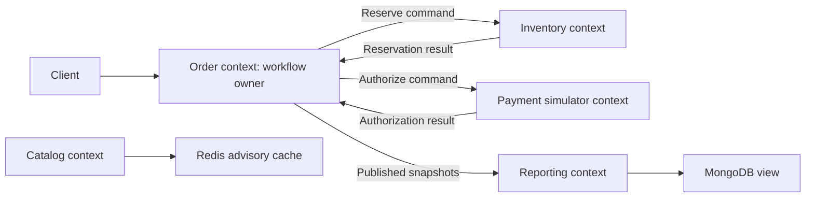
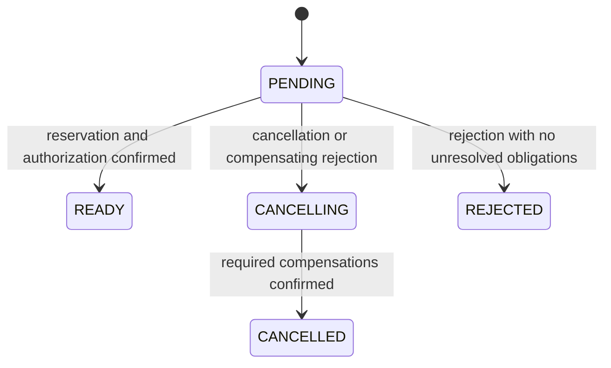

# Chapter 18 — DDD, Service Ownership, and Read/Write Models

Prepared 2026-10-24. Design recommendations and unexecuted Java 21 teaching example. No service extraction or deployment was performed.

## 1. Lesson title
Choose boundaries that preserve business meaning, contain change, and make distributed obligations recoverable.

## 2. Interview priority
P0 for ownership, aggregates, bounded contexts, modular monolith trade-offs, and workflow consistency. P1 for context maps, CQRS, event sourcing, and API composition. Correct reasoning matters more than pattern vocabulary.

## 3. Prerequisites
The course's Order/Inventory/Payment workflow, local state plus outbox atomicity, inbox/business constraints, and cache/read-model limitations. A domain is the business problem space; a model is a purposeful simplification used to make decisions about it.

## 4. Learning objectives
Develop a shared business vocabulary, identify bounded contexts and invariants, distinguish domain from application services, compare deployment options, and explain CQRS without confusing it with event sourcing. Design a context map and a workflow recovery contract.

## 5. Official references and version notes
Opened 2026-10-24. Microsoft Architecture Center is primary vendor architecture guidance, not a formal universal DDD specification. Spring Modulith pages report 2.1.1 and are conceptual references, not a selected dependency. Proposed Boot remains 4.1.1; Java 21/Maven remain agreed. Microsoft pages displayed an authorization notice but also exposed the substantive article sections cited here; no inaccessible content is claimed.

| ID | Source | Sections |
|---|---|---|
| B1 | [Domain analysis](https://learn.microsoft.com/en-us/azure/architecture/microservices/model/domain-analysis) | Business capabilities, language, contexts |
| B2 | [Tactical DDD](https://learn.microsoft.com/en-us/azure/architecture/microservices/model/tactical-domain-driven-design) | Entities, values, aggregates, services |
| B3 | [Service boundaries](https://learn.microsoft.com/en-us/azure/architecture/microservices/model/microservice-boundaries) | Cohesion and nonfunctional constraints |
| B4 | [CQRS](https://learn.microsoft.com/en-us/azure/architecture/patterns/cqrs) | Read/write models and trade-offs |
| B5 | [Event sourcing](https://learn.microsoft.com/en-us/azure/architecture/patterns/event-sourcing) | Authoritative history and reconstruction |
| B6 | [Gateway aggregation](https://learn.microsoft.com/en-us/azure/architecture/patterns/gateway-aggregation) | Composition and partial results |
| B7 | [Saga](https://learn.microsoft.com/en-us/azure/architecture/patterns/saga) | Local transactions and compensation |
| B8 | [Anti-corruption layer](https://learn.microsoft.com/en-us/azure/architecture/patterns/anti-corruption-layer) | Model translation |
| B9 | [Strangler Fig](https://learn.microsoft.com/en-us/azure/architecture/patterns/strangler-fig) | Incremental migration |
| B10 | [Modulith fundamentals](https://docs.spring.io/spring-modulith/reference/fundamentals.html) | Logical modules and interfaces |
| B11 | [Modulith verification](https://docs.spring.io/spring-modulith/reference/verification.html) | Cycles and internal-package access |

Definitions are attributed to selected sections. The particular commerce boundaries, state model, failure analysis, and exercises are original course designs. Books mentioned by source pages were not consulted and are not evidence here.

## 6. Fundamental explanation

### Start with language, not endpoints
Ask a domain expert what “order accepted” means. Does it mean the request was recorded, stock was reserved, payment was authorized, or a warehouse promised shipment? If these meanings are conflated, every API and dashboard can be technically correct while users receive contradictory promises. Our course distinguishes PENDING, READY, CANCELLING, CANCELLED, and REJECTED and requires evidence before advancing.

DDD encourages a shared language within a bounded context, while different contexts can legitimately give a term different meanings. [B1] “Product” in Catalog is a sellable description; in Inventory it is a stock-keeping identity and availability policy; in an Order it can be a historical purchase line. A single universal Product object passed everywhere would couple these different responsibilities.

Our recommended boundary table is: Order owns customer intent and workflow; Inventory owns reservations and availability; Payment owns simulated authorization identity and outcomes; Shipping owns fulfillment progress; Reporting owns derived views. Redis stores advisory copies. These are learning boundaries, not a claim that every commerce organization requires separate deployable services for each noun.

### Entities, values, and aggregates
An entity has identity through time; a value object is defined by its attributes; an aggregate groups state around a consistency boundary with a root controlling access. Domain services express domain behavior that does not naturally belong to one entity or value. [B2] These definitions help ask where a rule lives rather than demand a class hierarchy for every table.

For Order, the aggregate holds its ID, lines, totals, workflow state, and references to reservation/authorization evidence. It should not load an entire customer history and all inventory rows merely to change one order. An aggregate is an invariant boundary, not “everything related to an order.” Making it too large increases contention and creates unnecessary coupling.

The application service coordinates a use case: load, invoke domain behavior, persist, and record outgoing intent. The domain model decides legal transitions. Infrastructure adapters perform SQL, HTTP, or broker operations. Keep these roles distinct enough that a change to serialization does not rewrite the rule for fulfillment readiness.

## 7. Internal architecture and mechanism

### A bounded context is not automatically a process
A modular monolith can enforce business boundaries within one deployment. Modules expose interfaces and keep internal types private. Spring Modulith provides tools for expressing and inspecting logical modules; its verification can check cycles and access to internal packages. [B10, B11] Those checks support architectural intent but cannot decide whether a business boundary is correct.

Microservices add independent deployment and potentially independent scaling, but also network failures, data ownership, contract evolution, and operational overhead. Service-boundary guidance considers cohesion and nonfunctional requirements rather than slicing only by technical layer. [B3] Splitting Controller Service, Business Logic Service, and Database Service usually creates distributed call chains while preserving tight change coupling.

Our recommendation is to begin with clear modules, then split a boundary when independent ownership, scaling, release cadence, or failure isolation justifies the cost. This course deliberately introduces separate services to learn the mechanisms. That educational motivation is not a universal production recommendation.

### Context maps and translation
A context map records who supplies meaning to whom and how models translate. Inventory accepts a reservation command containing an order reference and SKU quantities. It does not receive Order's mutable persistence entity. Payment accepts a stable payment operation ID and amount/currency, not the entire checkout object graph.

An anti-corruption layer translates an external model into the receiving context's language and protects it from accidental semantic coupling. [B8] If a simulated provider returns `PENDING_REVIEW`, the adapter maps it to an explicit unresolved outcome rather than forcing it into APPROVED/DECLINED. Translation is more than renaming JSON fields; it includes meaning, units, identity, and failure interpretation.

Prefer identifiers and published contracts across contexts. A shared library of basic stable technical types may be reasonable, but sharing all domain entities forces coordinated releases. Before extracting a common type, ask whether both contexts mean the same thing and evolve it for the same reasons.

### Local decisions and distributed workflows
Order owns orchestration: it records an order and reserve intent; Inventory reserves and emits a result; Order records that evidence and requests simulated authorization; Payment records its operation and emits an outcome; Order becomes READY only after both necessary confirmations. Each service owns a local transaction and outbox, while receiving handlers use inbox/business constraints.

A saga coordinates local transactions and recovery through compensating actions rather than one cross-service rollback. [B7] Compensation has business meaning: release a reservation, void an authorization, or create a refund. It can fail and need retry or review. “Undo everything” is not a sufficiently precise cancellation contract.

Choreography lets participants react to events without a central workflow command owner; orchestration places workflow decisions in an explicit coordinator. Both can be valid. Our choice of Order orchestration makes the order's current obligation and recovery next step inspectable. It does not make Order the owner of Inventory's tables.

### CQRS and event sourcing are independent choices
CQRS separates command and query models so each can serve its purpose. It can begin within one application and database, and separate stores add synchronization complexity. [B4] Our Order write model protects transitions; Reporting's MongoDB projection serves history queries. Query freshness is therefore part of the product contract.

Event sourcing makes a retained event history the authoritative record from which state is reconstructed. It introduces event evolution, replay, concurrency, and retention obligations. [B5] Publishing events from a normal order table does not make the application event-sourced. An outbox is a publication mechanism, not an event store by definition.

Our baseline uses current-state tables plus outbox and audit information where needed. Event sourcing is an optional design study when historical reconstruction and domain requirements justify it. If adopted, command processing must append with an expected aggregate version or equivalent concurrency protection, replay must avoid repeating external effects, and snapshots must remain derived acceleration data with a compatibility policy.

### API composition
A dashboard may combine Order status, Catalog descriptions, and Shipping estimates. Gateway aggregation can reduce client chattiness, while introducing fan-out, bottleneck, and partial-result considerations. [B6] A dedicated composition service behind the edge can keep business-specific query logic away from general routing infrastructure.

Define which fields are required. If Shipping is unavailable, the dashboard may return the order with an unavailable estimate; it must not invent a delivery date. A composed view is not a transactionally consistent snapshot across owners unless a specific protocol provides that guarantee. State per-field freshness when it matters.

## 8. Diagrams





The state diagram is a course policy sketch. A production design must enumerate late events and legal transitions with more detail than this overview can show.

## 9. Java 21 implementation

Unexecuted educational example. Complete OrderReadinessDemo.java, demonstrating a small domain invariant and duplicate evidence handling. It excludes cancellation, persistence, authentication, concurrency, and message transport. Those omissions define its scope rather than hiding a production claim.

```java
import java.util.Objects;

public class OrderReadinessDemo {
    enum Status { PENDING, READY }
    record OrderId(String value) {
        OrderId {
            Objects.requireNonNull(value);
            if (value.isBlank()) throw new IllegalArgumentException("orderId");
        }
    }
    static final class Order {
        private final OrderId id;
        private String reservationId;
        private String authorizationId;
        Order(OrderId id) { this.id = Objects.requireNonNull(id); }

        void reservationConfirmed(String evidence) {
            reservationId = acceptSameOrNew(reservationId, evidence);
        }
        void authorizationConfirmed(String evidence) {
            authorizationId = acceptSameOrNew(authorizationId, evidence);
        }
        private static String acceptSameOrNew(String existing, String incoming) {
            Objects.requireNonNull(incoming);
            if (incoming.isBlank()) throw new IllegalArgumentException("evidence");
            if (existing != null && !existing.equals(incoming)) {
                throw new IllegalStateException("Conflicting evidence");
            }
            return incoming;
        }
        Status status() {
            return reservationId != null && authorizationId != null
                    ? Status.READY : Status.PENDING;
        }
        OrderId id() { return id; }
    }
    public static void main(String[] args) {
        Order order = new Order(new OrderId("O-1001"));
        order.reservationConfirmed("R-1001");
        if (order.status() != Status.PENDING) throw new AssertionError();
        order.reservationConfirmed("R-1001");
        order.authorizationConfirmed("A-1001");
        if (order.status() != Status.READY) throw new AssertionError();
        System.out.println(order.id().value() + " " + order.status());
    }
}
```

The model derives readiness from evidence instead of exposing an arbitrary status setter. Repeated identical evidence is harmless within the object; conflicting evidence is surfaced. A real handler must authenticate the event source, validate order and operation identity, and persist the aggregate plus outgoing intent atomically. Domain methods alone do not provide durable deduplication.

## 10. Spring Boot integration
Organize packages by business module, then separate public application interfaces from internal implementation. Controllers and listeners invoke application services; repositories and clients implement ports. Constructor injection makes these dependencies inspectable. A module verification tool can later check structural constraints after its version is reviewed.

Place local transactions around loading, applying, and persisting one use case. Persist state and outbox together. Avoid calling another context's repository simply because it is injectable in the same process. In a modular monolith, explicit interfaces preserve the possibility of later extraction while allowing carefully chosen local transactions where the business model genuinely shares an invariant.

## 11. Production scenario
The business changes cancellation: once payment is authorized, cancellation must void it before the order becomes CANCELLED. If every service independently sets order status, the change requires coordinated edits and risks contradictory outcomes. With Order as workflow owner, the transition policy is centralized while Payment implements the void capability within its own domain.

A late authorization arrives after cancellation started. Order records the evidence and requests void, keeping CANCELLING until confirmation. It does not drop the event because the customer no longer wants the order. The system's obligation is determined by what happened, not only by the latest user intention.

## 12. HLD considerations
Evaluate a proposed service boundary using change coupling, consistency needs, team ownership, scale, and failure isolation. If almost every request synchronously traverses six services and every release updates all of them, independent deployment may be mostly nominal. A modular monolith can provide a clearer starting point.

For extraction, use an incremental migration approach with explicit routing and ownership cutover; the Strangler Fig pattern describes gradual replacement behind a stable facade. [B9] The hard part is often data ownership: define which implementation accepts writes at each stage, how history is transferred, and how rollback works without two competing authorities.

## 13. LLD considerations
Name domain methods after business intent: `confirmReservation`, `requestCancellation`, and `recordAuthorization` reveal more than `setStatus`. Keep invariants inside a model that can be exercised without network infrastructure. Application services coordinate resources but should not become a collection of every rule in the company.

Model domain errors separately from transport errors. A rejected reservation is a valid business outcome; a missing event field is a contract problem; a database outage is infrastructure failure; an unknown payment result is uncertainty. Distinguishing them prevents a generic exception handler from turning every failure into an incorrect state transition.

## 14. Reliability and failure recovery
Every distributed obligation needs durable state, operation identity, a retry/reconciliation policy, and an owner. A workflow should answer: what step is pending, since when, what evidence exists, and what may be attempted next? Store enough information to recover after losing all process memory.

Observe oldest pending order, unresolved authorization, compensation failures, projection lag, and cross-context contract errors. A healthy broker and database do not establish workflow completion. Reconciliation compares business facts across owners through authorized interfaces or exports and repairs using domain commands rather than arbitrary cross-service SQL edits.

## 15. Performance and capacity
Boundaries change performance. A local method call becoming a network call adds serialization, connection use, latency variability, and failure modes. Coarse use-case APIs often perform better than remote CRUD for each field. Aggregate size influences lock contention and data loading, while read models can reduce expensive composition.

If one dashboard fans out to five services, 1,000 dashboard requests per second can create up to 5,000 downstream requests before retries or per-item expansion. This is illustrative arithmetic. Cache or materialize appropriate read data, but preserve freshness requirements and ownership. Do not hide every slow call behind an eventually consistent copy without product agreement.

## 16. Interview questions with explained answers

1. **What is a bounded context?** It is a boundary within which a model and language have consistent meaning. It may be a module before becoming a service. Explain a word such as Product that legitimately differs across contexts.

2. **What makes an aggregate useful?** It identifies state whose rules are enforced together through a root. It is not all related data. A smaller coherent invariant boundary reduces unnecessary loading and contention while preserving correctness.

3. **Domain service versus application service?** A domain service expresses business behavior that does not fit one object; an application service coordinates a use case and resources. Keeping the distinction visible makes domain rules easier to test without infrastructure.

4. **Why choose a modular monolith?** It can enforce boundaries while retaining simpler deployment and local calls. Choose it when independent scaling/releases do not justify distributed costs. Modularity requires interface discipline even in one process.

5. **Does database-per-service mean a different server?** The essential property is ownership and controlled access, though physical isolation can serve operational needs. Sharing infrastructure does not authorize cross-service table writes. Independent schema and credentials can help enforce ownership.

6. **Does CQRS require event sourcing?** No. Separate command/query models can use ordinary current-state persistence. Event sourcing chooses authoritative event history. Combining them can be useful but adds separate complexity from each choice.

7. **Why is an outbox not automatically an event store?** It records publication obligations alongside current-state changes. Its retention and schema may not support full aggregate reconstruction. An event-sourced system requires explicit authoritative history semantics.

8. **Orchestration or choreography?** Compare visibility, coupling, workflow complexity, and ownership. This course chooses Order orchestration so pending steps and compensation are inspectable. Participants still own their rules and databases.

9. **Can compensation restore the exact past?** Often no: a refund differs from never charging, and released stock may be acquired by another buyer. Define business-valid recovery and track its failures. A saga is not a time machine.

10. **Why use an anti-corruption layer?** External meanings may differ from the local model. Translation prevents provider states, units, and failure codes from leaking everywhere. It must preserve uncertainty rather than forcing unknown states into a convenient enum.

## 17. Exercises
Run the Java program in a confirmed Java 21 practice environment. Expected output: `O-1001 READY`. Remove authorization confirmation and predict PENDING. Apply a different reservation ID after the first one and expect conflicting-evidence failure. The solution illustrates invariant enforcement, not durable message handling.

Draw a context map for returns and refunds. A defensible solution gives Order/Returns ownership of return eligibility, Inventory ownership of received-stock disposition, and Payment ownership of simulated refund operations. Identify who orchestrates and where compensation can fail; no universal map is required without product rules.

Assess a proposal to split one service into controller, business, and database services. Explain which changes still require coordinated releases and which new failure boundaries appear. A strong solution proposes business-capability modules first and justifies any deployment split with evidence.

## 18. Verification
Sources were checked; the Java program, module checks, state persistence, migration, and saga were not executed. Expected output is a prediction. The example covers only readiness evidence. Production cancellation, concurrent updates, event authenticity, durable deduplication, and reconciliation remain separate implementation verification tasks.

## 19. Common misconceptions
DDD is not a requirement to create many services. A bounded context is not always one container. An aggregate is not an entire object graph. Sharing a database server does not imply shared write ownership. CQRS is not event sourcing. Publishing events is not proof of reconstructible history. Compensation is not global rollback.

## 20. Knowledge assessment
Unanswered: Reporting shows READY while Order is CANCELLING, Inventory has reserved stock, and Payment's authorization result is unknown. Identify authoritative owners, valid customer communication, required reconciliation, and why a dashboard join cannot resolve the workflow by itself.

## 21. Revision summary
Use business meaning and invariants to choose boundaries. Keep modules coherent before distributing them. Separate command models, read models, and authoritative histories. Make workflow ownership, late-event handling, and compensating obligations durable and explicit.

## 22. Next lesson
Chapter 19 follows calls across DNS, connections, TLS, proxies, load balancing, discovery, and gateway policies. Logical boundaries become actual network and resource boundaries.
