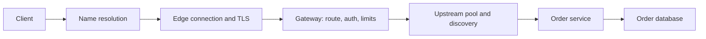
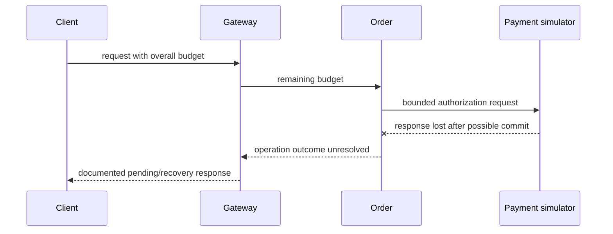

# Chapter 19 — Networking, Gateways, Discovery, and Time Budgets

Prepared 2026-10-24. Educational Java example is unexecuted. No ports were opened, gateway deployed, or network configuration changed during authoring.

## 1. Lesson title
Trace a request through names, connections, encryption, proxies, routing, queues, and deadlines before diagnosing a distributed failure.

## 2. Interview priority
P0 for DNS/TCP/TLS/HTTP distinctions, connection reuse, deadlines, retry safety, and load-balancing behavior. P1 for Gateway filters, discovery, rate limits, and HTTP version trade-offs.

## 3. Prerequisites
Chapters 3–5 and 18. A host address identifies a network destination; a port selects a transport endpoint on that host. A socket is a communication endpoint. A proxy makes a new connection on behalf of another participant, creating an additional failure and timing boundary.

## 4. Learning objectives
Explain the stages of an HTTPS call, distinguish transport acknowledgment from business success, diagnose pool and discovery failures, design gateway policy without moving domain ownership into it, and allocate time/concurrency budgets across a request path.

## 5. Official references and version notes
Sources opened 2026-10-24. RFCs are explicit protocol references, with later updates possible; only the named foundational mechanisms are used. Live Spring Cloud Gateway pages show 5.0.4, with discovery page 5.0.3; Commons shows 5.0.4. These do not establish compatibility with proposed Boot 4.1.1. No Cloud release train is selected. Java remains 21 and Maven the project build tool.

| ID | Source | Sections |
|---|---|---|
| N1 | [DNS concepts, RFC 1034](https://www.rfc-editor.org/rfc/rfc1034.html) | Names, resolvers, caching |
| N2 | [TCP, RFC 9293](https://www.rfc-editor.org/rfc/rfc9293.html) | Connections, reliability, flow control |
| N3 | [TLS 1.3, RFC 8446](https://www.rfc-editor.org/rfc/rfc8446.html) | Handshake, authentication, early data |
| N4 | [HTTP/1.1, RFC 9112](https://www.rfc-editor.org/rfc/rfc9112.html) | Framing, connection management |
| N5 | [HTTP/2, RFC 9113](https://www.rfc-editor.org/rfc/rfc9113.html) | Streams and multiplexing |
| N6 | [HTTP/3, RFC 9114](https://www.rfc-editor.org/rfc/rfc9114.html) | HTTP over QUIC |
| N7 | [Forwarded header, RFC 7239](https://www.rfc-editor.org/rfc/rfc7239.html) | Proxy information and trust |
| N8 | [Additional status codes, RFC 6585](https://www.rfc-editor.org/rfc/rfc6585.html) | 429 |
| N9 | [Gateway request flow](https://docs.spring.io/spring-cloud-gateway/reference/spring-cloud-gateway-server-webflux/how-it-works.html) | Matching and filters |
| N10 | [Gateway timeouts](https://docs.spring.io/spring-cloud-gateway/reference/spring-cloud-gateway-server-webflux/http-timeouts-configuration.html) | Global and per-route settings |
| N11 | [Discovery route locator](https://docs.spring.io/spring-cloud-gateway/reference/spring-cloud-gateway-server-webflux/the-discoveryclient-route-definition-locator.html) | Registry-derived routes |
| N12 | [RequestRateLimiter](https://docs.spring.io/spring-cloud-gateway/reference/spring-cloud-gateway-server-webflux/gatewayfilter-factories/requestratelimiter-factory.html) | Key resolution and limiting |
| N13 | [Spring LoadBalancer](https://docs.spring.io/spring-cloud-commons/reference/spring-cloud-commons/loadbalancer.html) | Client-side instance selection |
| N14 | [Java HttpRequest builder](https://docs.oracle.com/en/java/javase/21/docs/api/java.net.http/java/net/http/HttpRequest.Builder.html) | Request timeout |
| N15 | [Java HttpClient builder](https://docs.oracle.com/en/java/javase/21/docs/api/java.net.http/java/net/http/HttpClient.Builder.html) | Connect timeout and proxy selection |
| N16 | [JDK HttpServer](https://docs.oracle.com/en/java/javase/21/docs/api/jdk.httpserver/com/sun/net/httpserver/HttpServer.html) | Binding, handlers, executor |

Protocol mechanisms are documented facts; deadline allocations, deployment choices, failure labs, and commerce policies are original recommendations. No book claims or measured latency results.

## 6. Fundamental explanation

### Follow one order-status request
The client wants `https://shop.example/orders/O-1001`. It needs a destination address, a usable transport connection, a secure channel, an HTTP exchange, a routed application request, and a business response. Existing caches and connections may skip some setup work. “The network is slow” collapses several distinct questions that require different evidence.

DNS maps names through a distributed naming system; resolvers can cache answers for their specified lifetime. [N1] The address returned is not a health guarantee. A client can retain an old answer while new instances are already registered elsewhere. The application runtime, operating system, resolver, and discovery client can each influence how quickly changes become visible.

TCP provides an ordered byte-stream abstraction with connection establishment, sequence/acknowledgment behavior, retransmission, and flow control. [N2] TCP does not understand order reservations or database commits. A byte acknowledgment is not evidence that the remote business transaction succeeded. A connection can fail after the receiver acted, leaving the familiar ambiguous result.

TLS authenticates peers according to the configured trust model and protects the channel. Server certificate validation includes trust and name matching by the client; mutual TLS additionally authenticates the client at the TLS layer. TLS 1.3 early data has replay considerations, so mutating business operations need appropriate restrictions. [N3] Encryption does not grant a caller permission to read every order; application authorization remains required.

### HTTP versions change transport behavior
HTTP/1.1 defines message framing and connection management, including persistent connections. [N4] HTTP/2 multiplexes exchanges as streams over a connection and uses binary framing and header compression. [N5] HTTP/3 maps HTTP semantics over QUIC. [N6] These improve different transport properties without changing the application's responsibility for idempotency and timeouts.

Do not promise that HTTP/2 removes every form of head-of-line blocking: its underlying TCP stream can still experience transport-level delay. HTTP/3 changes the transport's stream behavior, but application queues and a slow database remain. Protocol choice must be supported end to end by clients, proxies, and servers; observing one negotiated connection says nothing about every hop.

## 7. Internal architecture and mechanism

### Connections are pooled resources
Creating a connection can involve name resolution, transport setup, and TLS work. Reusing a healthy connection avoids repeating some costs. A connection pool therefore affects latency and capacity. However, an idle pooled connection may have been closed by a server, proxy, or network device. The next use can fail even though acquiring the pooled object was immediate.

Our recommendation is to align pool limits, idle lifetime, connection lifetime, and dependency capacity. Consume or close response bodies correctly so the client can release resources. Separate pool acquisition wait from connect time and response time in metrics. A “connection timeout” label applied to all three makes incident diagnosis misleading.

HTTP/2 permits multiple streams per connection, so connection count alone is not request concurrency. Conversely, one slow stream or a saturated backend can still affect overall progress. Bound pending acquisitions and in-flight requests rather than assuming a small connection count proves bounded work.

### Proxy and load-balancer boundaries
A reverse proxy accepts client traffic and forwards to upstream services. Layer-4 balancing primarily handles transport connections; layer-7 balancing can inspect application protocol information such as host/path. Selection can occur at different granularities, depending on implementation and protocol. Our design records where TLS terminates and whether the next hop is re-encrypted.

Client-side load balancing selects a service instance before opening or reusing a connection. Spring Cloud LoadBalancer provides an abstraction and strategies for this selection. [N13] Server-side balancing sends clients to a stable front door that chooses upstream targets. Neither guarantees that a chosen instance remains healthy during the request.

Health checks lag reality. A target can pass a probe and fail milliseconds later; an instance can remain in a cached list after becoming unready. Readiness and connection draining reduce disruption, while retry safety and idempotency handle remaining uncertainty. Session affinity can help stateful interactions but also concentrates load and complicates failover. Prefer explicit durable state over relying on one process always receiving the same customer.

### Discovery and routing
Discovery answers which instances currently represent a logical service. It can be DNS-based, registry-based, or supplied by an orchestration platform. Gateway's DiscoveryClient locator can generate routes from compatible registry entries. [N11] Automatically exposing every discovered service is not our recommended public API policy; use deliberate route and authorization boundaries.

Spring Cloud Gateway's WebFlux request flow matches a route, executes filters around forwarding, and processes the response through the chain. [N9] Route predicates decide applicability; filters can change request/response handling. Filter ordering matters: authentication, trusted identity propagation, rate limiting, body transformation, and retry each affect what later filters observe.

Forwarded headers can carry information about the original client/protocol through proxies, but their contents are trustworthy only within an explicitly trusted proxy chain. [N7] A public client can send spoofed headers unless the edge removes or replaces them. Do not base security-sensitive identity or rate-limit policy on arbitrary incoming X-Forwarded-For values.

### Deadlines, timeouts, and limits
A timeout bounds a particular wait; a deadline describes the useful overall completion limit. Set separate budgets for acquiring a connection, establishing it, receiving a response, and completing the whole operation where the chosen client supports those distinctions. Gateway supports global and route-specific timeout settings with documented units. [N10] Inspect exact version properties instead of copying a YAML snippet from another release.

If a request has 1,000 ms remaining and three sequential dependencies each receive a fresh 1,000 ms timeout, total work can exceed the customer's useful budget. Our recommendation is to propagate remaining time, reserve response/cleanup margin, and avoid beginning a step whose minimum useful budget is unavailable. Cancellation is cooperative and cannot reverse a committed payment.

Rate limits restrict usage over time; concurrency limits bound simultaneous expensive work. A token-bucket-style policy can allow a burst while controlling sustained rate, whereas a concurrency gate protects a slow dependency when requests become longer. Gateway's limiter supports key-based policy and an overload response; HTTP 429 expresses too many requests. [N12, N8] Choose keys from trusted tenant/user identity and define behavior when the limiter backend fails.

## 8. Diagrams





The second diagram emphasizes that deadline propagation reduces wasted waiting but does not establish whether a remote effect occurred.

## 9. Java 21 implementation

Unexecuted educational example. Complete LocalHttpDemo.java uses JDK HttpServer on loopback and an ephemeral port, then a Java 21 client with explicit connect/request timeouts. It demonstrates lifecycle and response observation, not DNS, TLS, pooling under load, authentication, or production HTTP routing.

```java
import com.sun.net.httpserver.HttpServer;
import java.net.InetSocketAddress;
import java.net.URI;
import java.net.http.HttpClient;
import java.net.http.HttpRequest;
import java.net.http.HttpResponse;
import java.nio.charset.StandardCharsets;
import java.time.Duration;
import java.util.concurrent.Executors;

public class LocalHttpDemo {
    public static void main(String[] args) throws Exception {
        var workers = Executors.newVirtualThreadPerTaskExecutor();
        var server = HttpServer.create(new InetSocketAddress("127.0.0.1", 0), 0);
        server.setExecutor(workers);
        server.createContext("/orders/O-1001", exchange -> {
            byte[] body = "{\"status\":\"PENDING\"}".getBytes(StandardCharsets.UTF_8);
            exchange.getResponseHeaders().set("Content-Type", "application/json");
            exchange.sendResponseHeaders(200, body.length);
            try (var output = exchange.getResponseBody()) {
                output.write(body);
            } finally {
                exchange.close();
            }
        });
        server.start();
        try (HttpClient client = HttpClient.newBuilder()
                .connectTimeout(Duration.ofSeconds(1))
                .proxy(HttpClient.Builder.NO_PROXY)
                .build()) {
            URI uri = URI.create("http://127.0.0.1:"
                    + server.getAddress().getPort() + "/orders/O-1001");
            HttpRequest request = HttpRequest.newBuilder(uri)
                    .timeout(Duration.ofSeconds(2))
                    .GET().build();
            HttpResponse<String> response = client.send(
                    request, HttpResponse.BodyHandlers.ofString());
            if (response.statusCode() != 200) throw new AssertionError("HTTP status");
            System.out.println(response.statusCode());
            System.out.println(response.body());
        } finally {
            server.stop(0);
            workers.close();
        }
    }
}
```

The JDK server supports address/port binding, handlers, and an assigned executor. [N16] The client/request builders expose connect and request timeouts. [N14, N15] The chosen one/two-second values are illustrative, not recommended production defaults. The handler has intentionally narrow demonstration behavior and does not enforce method/path semantics beyond the context mapping; production routing must do so explicitly.

## 10. Spring Boot integration
Use a dedicated gateway application or infrastructure component with a reviewed compatible Spring Cloud release train. The current documentation banners do not prove compatibility with the proposed Boot version. Begin with explicit routes, a known upstream, bounded timeouts, trace propagation, and a clear authentication/authorization division.

In the WebFlux Gateway variant, keep filter work non-blocking and bound any unavoidable blocking bridge. Do not call JPA repositories from an event-loop filter. Order remains responsible for business authorization and workflow invariants even if the edge validates credentials. A gateway should not reserve stock by directly writing Inventory's database.

## 11. Production scenario
After deployment, some requests fail for one minute while others succeed. Possible explanations include stale DNS/discovery results, old pooled connections, an instance receiving traffic before readiness, or incomplete drain during shutdown. Inspect the failed request's selected upstream, connection reuse, stage timing, and instance version. A successful curl from another machine does not reproduce the same resolver, pool, or route.

A second incident appears as gateway timeouts while Order logs eventual success. The gateway's deadline can expire before the backend commits. The client retry must preserve operation identity; otherwise a proxy timeout becomes duplicate orders. Increase a timeout only after understanding whether the operation is too slow, the budget is unrealistic, or the API should expose durable asynchronous progress.

## 12. HLD considerations
Place gateways according to ingress control, trust boundaries, and operational ownership. Avoid a single overloaded component performing routing, large report aggregation, every business rule, and all workflow coordination. Route-level isolation can keep slow streaming endpoints from consuming resources needed by checkout.

Define failover across zones or regions with data ownership and consistency in mind. Repointing DNS does not transfer authoritative database state or resolve in-flight payment operations. A network failover runbook must coordinate traffic, durable state, and reconciliation, not merely replace an address.

## 13. LLD considerations
Create an outbound client policy per dependency class: base URI/discovery name, authentication, pool budget, deadlines, retry eligibility, payload limits, and telemetry. Keep business operation identity stable while each attempt gets trace evidence. Make non-idempotent retries opt-in through a proven receiver contract.

For a gateway filter, define input trust, ordering, maximum work, and error mapping. A body-transforming filter may buffer data and affect streaming; set limits before accepting arbitrary payloads. Preserve appropriate correlation metadata without logging tokens or full payment/customer bodies.

## 14. Reliability and failure recovery
Use bounded retries with jitter and one clear owner of retry policy. If client, gateway, service, and library each retry three times, attempts can multiply dramatically. Budget attempts and time across the path. Circuit breakers can stop repeated calls to a failing dependency, while bulkheads isolate resources; neither repairs an already ambiguous effect.

During shutdown, stop new routing to an instance, allow discovery/health information to propagate, drain existing connections and requests within a budget, and leave unfinished durable work recoverable. A hard kill still occurs in real systems, so readiness and graceful drain supplement idempotency rather than replacing it.

## 15. Performance and capacity
Measure DNS duration, connect/TLS duration where available, pool wait, time to headers, body transfer, total request time, upstream selection, active streams, and retry counts. A slow response body differs from a slow handler. Packet-level tools can help, but application traces identify the business operation and database boundary.

For an illustrative serial budget, a 1,000 ms user deadline might reserve 100 ms for edge/serialization, 600 ms for a dependency, and 300 ms for other work and margin. These allocations must be measured and revised. A 200 ms connect budget is not enough if the service routinely needs longer setup, and an enormous timeout can retain useless work long after users leave.

## 16. Interview questions with explained answers

1. **What does DNS success prove?** It provides a name-resolution result under the resolver's rules. It does not prove target health or current membership. Inspect caches and TTL behavior when failover appears inconsistent across clients.

2. **Does TCP acknowledgment prove payment success?** No. TCP concerns bytes and transport state. The application may not have committed, or may have committed before a response was lost. Business identity and reconciliation resolve that uncertainty.

3. **Does TLS replace authorization?** No. It secures/authenticates the channel under a trust configuration. The application still decides whether a principal may access a particular order. Gateway authentication does not excuse missing service-level ownership checks.

4. **Why reuse connections?** Reuse avoids repeated setup and can reduce latency/resource cost. Pools require bounds, idle/lifetime policy, and correct response cleanup. Reusing a stale connection can still fail and must fit the retry contract.

5. **HTTP/2 versus HTTP/3?** HTTP/2 multiplexes streams over its connection transport; HTTP/3 maps HTTP over QUIC. Their transport differences do not remove backend queues or business ambiguity. Check actual negotiation at each hop.

6. **Client-side versus server-side balancing?** Client-side code chooses an instance from discovery information; server-side infrastructure chooses behind a stable endpoint. Both can use stale health knowledge. Explain selection, connection reuse, and failure handling together.

7. **Timeout versus deadline?** A timeout bounds one wait, while a deadline bounds useful completion for the operation. Independent full timeouts at every hop can exceed the end-to-end budget. Propagate remaining time and preserve ambiguous outcomes.

8. **Rate limit versus concurrency limit?** Rate limits control arrivals over time; concurrency limits control simultaneous work. When dependency latency rises, the same rate can create much more in-flight work. Use the limit matching the resource risk.

9. **Can forwarded headers be trusted?** Only through a defined trusted proxy boundary that sanitizes client-supplied values. Otherwise a client may spoof its apparent origin. Identity-sensitive policy should use authenticated context.

10. **Why can gateway retry be dangerous?** The first upstream attempt may commit before its response disappears. Repeating a mutation without stable identity can duplicate effects. Retry only when the operation contract and remaining budget justify it.

## 17. Exercises
Save LocalHttpDemo.java and run with a confirmed Java 21 JDK; if module resolution requires it in the chosen launch setup, include `--add-modules jdk.httpserver`. Expected output is 200 and `{"status":"PENDING"}`. This is a loopback lifecycle exercise, not evidence about external networking or TLS.

Draw two independent connections when the gateway terminates TLS and forwards upstream. Identify which certificate the client validates and what secures the second hop. Solution: trust and encryption must be specified separately for client-to-edge and edge-to-service; a padlock on the browser does not describe every internal link.

Allocate a 900 ms deadline across two sequential queries plus response work. Then let the first consume 700 ms. The correct solution recomputes remaining useful time and may skip or reject the second call; it must not grant a fresh 900 ms. State the partial-result policy and whether any side effect needs reconciliation.

## 18. Verification
Sources were opened and version banners checked. The Java example, source launcher, socket lifecycle, Gateway route configuration, TLS, DNS, failover, and load behavior were not executed. No installed Spring Cloud compatibility or performance result is claimed. A later lab should verify stage timing, connection reuse, drain, retry identity, and limiter failure behavior on the actual deployment.

## 19. Common misconceptions
DNS does not guarantee health. TCP delivery is not database commit. TLS does not replace resource authorization. A connection pool is not unlimited capacity. HTTP/2 does not remove every queue. A gateway timeout does not prove backend rollback. Discovery is not instant. Rate limiting and concurrency limiting solve different constraints.

## 20. Knowledge assessment
Unanswered: a gateway times out at two seconds, Order commits at three seconds, the client retries through a different instance, and discovery still includes an old target. Explain the correctness mechanism and the independent network/operational fixes. Identify the evidence needed before changing timeouts.

## 21. Revision summary
Trace the entire path and label every timing, trust, and resource boundary. Reuse connections deliberately, budget deadlines, sanitize proxy metadata, and make retries depend on business safety. Gateways manage traffic policy while services retain domain ownership.

## 22. Next lesson
Chapter 20 packages these processes in containers. DNS, ports, resources, health, storage, and shutdown become concrete deployment settings, while the same business recovery obligations remain.
