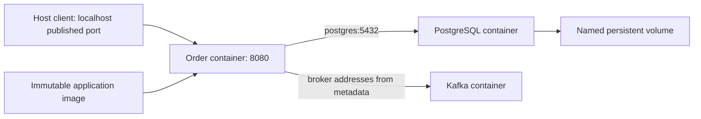

# Chapter 20 — Docker: Packaging, Isolation, and Running Java Reliably

Prepared: 2026-10-24. Reading and exercises are not completed deployment evidence.

## 1. Lesson title
Docker images, container processes, networking, storage, and Java 21 resource boundaries.

## 2. Interview priority
P0 for image versus container, persistence, networking, and memory; P1 for build caching and supply-chain trade-offs.

## 3. Prerequisites
Chapters 2–4, 6–12, and 19: JVM memory, application shutdown, PostgreSQL durability, Kafka listener addresses, and TCP. Know what a process, directory, port, and environment variable are.

## 4. Learning objectives
Explain a container without equating it to a virtual machine; produce a reviewable Dockerfile; trace connections from host and containers; preserve database data across replacement; distinguish JVM heap exhaustion from container termination; and design a development Compose environment that does not pretend to be production high availability.

## 5. Official references and version notes
References opened 2026-10-24; supporting sections are identified in source-ledger.md.

- [D1 Dockerfile overview](https://docs.docker.com/build/concepts/dockerfile/)
- [D2 Resource constraints](https://docs.docker.com/engine/containers/resource_constraints/)
- [D3 Container networking](https://docs.docker.com/engine/network/)
- [D4 Volumes](https://docs.docker.com/engine/storage/volumes/)
- [D5 Compose startup order](https://docs.docker.com/compose/how-tos/startup-order/)
- [D6 Build secrets](https://docs.docker.com/build/building/secrets/)
- [J1 Java 21 launcher](https://docs.oracle.com/en/java/javase/21/docs/specs/man/java.html)
- [S1 Spring Boot Dockerfiles](https://docs.spring.io/spring-boot/reference/packaging/container-images/dockerfiles.html)

Docker documentation is rolling, not a pinned Engine/Compose release. Live Spring documentation displays Boot 4.1.2; the course retains proposed Boot 4.1.1, Java 21, and Kafka 4.2.2. Image tags and digests must be selected and recorded during implementation. Examples below are unexecuted teaching configurations.

## 6. Fundamental explanation

### 6.1 Image, container, and host
An image is packaged filesystem content plus execution metadata. A container is a running or stopped instance with process state and a writable filesystem layer. Deleting a container does not delete its image; creating another container does not restore data written only into the previous writable layer.

Linux containers share the host kernel while obtaining isolated views of resources through kernel facilities. A container is therefore not a complete independent operating system. On a Windows development machine, Linux containers commonly run inside a Linux virtualization layer. Troubleshooting must identify whether a path, port, or resource limit belongs to Windows, that Linux environment, or the container.

Our Order container contains the application runtime. PostgreSQL remains the authoritative store. An order written to a Java map inside that container is still lost when the process restarts. Packaging never changes the business durability boundary.

### 6.2 Layers and reproducibility
Dockerfile instructions create image configuration and, where applicable, filesystem changes. Cached build results allow unchanged work to be reused. Put relatively stable dependency preparation before frequently changing application source. A change early in the dependency chain can invalidate later cached work. [D1]

A small image is useful because it transfers and scans faster, but size is only one property. The deployment needs a supported JVM, required certificates, predictable native libraries, and a way to collect diagnostics. A minimal runtime without a shell can reduce exposure while making improvised debugging harder. Prepare diagnostics before an incident rather than adding tools manually to a production container.

A tag is a convenient name that can move. A digest identifies content. Record the application digest, base digest, source revision, Java build, and dependency lock information so that two environments can be compared.

### 6.3 Isolation is a boundary, not a permission model
A process running as root inside a container deserves more scrutiny than a process running as an unprivileged identity. Avoid privileged mode, unnecessary capabilities, and mounting the Docker socket. The socket can grant control over the host's containers. Restrict readable files and writable locations independently of the application account.

The application also needs its own authorization. A non-root Order process can still leak every customer's orders if its API omits ownership checks. Container controls and business controls address different attack paths.

## 7. Internal architecture and mechanism

### 7.1 Build context and multi-stage builds
The build context is the material available to COPY and related build operations. An indiscriminate context can include local credentials, database dumps, and huge generated directories. A .dockerignore file is a correctness and confidentiality measure.

A multi-stage build uses one environment to compile and another to run. Build tools and caches need not accompany the executable. CI should first prove that Maven verification succeeds, then package a known artifact; avoid hiding all validation inside an opaque image build. An image build succeeding only establishes that its declared steps completed.

Build credentials belong in ephemeral BuildKit secret mounts, not ARG or ENV instructions. Removing a copied secret in a later layer does not safely erase earlier-layer content. [D6]

### 7.2 Names and network paths
Inside an Order container, localhost refers to that container's network namespace. It does not identify the PostgreSQL container or the Windows host. On a user-defined Docker network, use the database service name and container port. Host access uses a published host port. EXPOSE documents a port; publication is a separate operation. [D3]

For Kafka, the initial bootstrap connection can succeed while later requests fail. The client receives broker addresses in metadata. Those advertised addresses must be reachable from the client's network context. A host client and a container client may require different listeners; mapping one port does not rewrite Kafka metadata.

### 7.3 Storage and lifecycle
A named volume is managed independently of a particular container. A bind mount exposes a specific host path. A temporary filesystem is suitable for discardable scratch data. Volume deletion and container replacement are separate decisions. [D4]

PostgreSQL needs a deliberate persistent data location and a database-aware backup procedure. Copying arbitrary live database files is not automatically a consistent backup. Kafka storage must retain both the required data and correct cluster identity across restarts; mixing old log directories with a freshly initialized cluster can fail or cause dangerous operator confusion.

### 7.4 CPU and memory accounting
Resource limits apply to the container's processes, not just the Java heap. CPU restrictions can delay useful work even when Java thread counts look normal. Memory pressure can cause an operating-system kill before the JVM generates a useful heap exception. [D2]

Budget heap, metaspace, code cache, thread stacks, direct buffers, native libraries, and operational margin. Java 21 container support and heap-sizing flags are documented separately from Docker limits. [J1] A percentage-based heap setting does not reserve the remainder for native allocations; measure resident memory under realistic traffic.

## 8. Diagrams

The volume is outside Order's disposable runtime. The Kafka arrow represents all broker addresses, not only bootstrap.

## 9. Java 21 implementation
This complete scoped Dockerfile packages an already built executable JAR. The calling build supplies a reviewed Java 21 runtime image reference, preferably a digest. No image was pulled or built here.

```dockerfile
ARG JAVA21_RUNTIME
FROM ${JAVA21_RUNTIME}
WORKDIR /app
COPY --chown=10001:10001 target/order-service.jar /app/app.jar
USER 10001:10001
EXPOSE 8080
ENTRYPOINT ["java", "-jar", "/app/app.jar"]
```

The selected base must support numeric UID execution and provide a Java 21 runtime. Maven must produce exactly target/order-service.jar; configure finalName or adapt the COPY after inspecting the actual artifact. The JSON entry point launches Java directly so termination signals reach it.

A compatible .dockerignore for this artifact-only packaging scope is:

```text
**
!target/
target/**
!target/order-service.jar
!Dockerfile
!*.dockerignore
```

This is not a source compilation image. For a multi-stage variant, copy the Maven wrapper, wrapper configuration, POMs, and then source into a builder stage; run verification there; copy only the verified artifact into the runtime stage. Pin both builder and runtime identities.

## 10. Spring Boot integration
Keep environment-dependent endpoints outside the image. Supply datasource addresses, Kafka bootstrap servers, and identity-provider locations through reviewed configuration. Keep credentials in an appropriate secret mechanism. Spring's image layering support can separate dependencies from application classes, reducing retransmission when only application code changes. [S1]

Graceful shutdown is a bounded coordination sequence: stop accepting new work, finish or safely abandon in-flight work, commit completed database transactions, stop listeners, and close pools. Container stop timeout must exceed the intended application shutdown budget plus margin. Idempotency remains necessary if the process is killed before completion.

## 11. Production scenario
A developer reports that an order disappears after rebuilding. Investigate the storage boundary before changing retry settings. If PostgreSQL used its container writable layer, replacement discarded the database directory. If PostgreSQL retained data but Order read an in-memory cache without reloading, the defect is application reconstruction.

A second report says orders remain in processing after restart. Inspect outbox state and relay recovery. The correct image can restart successfully while messages remain unpublished. Container health is not proof of workflow progress.

Production release evidence includes image identity, migration compatibility, resource settings, shutdown behavior, dependency connectivity, and a durable order recovered across replacement. A screenshot of running containers cannot establish those properties.

## 12. HLD considerations
Use Compose as a convenient single-machine development topology. Production placement, multiple failure domains, secrets delivery, backups, and rollout control require an explicit operating model. Several containers on one laptop still share the same host failure.

Separate public ingress from internal database and broker traffic. Expose only ports needed for the chosen development workflow. Bind development admin ports to loopback where appropriate. Service-owned data means a shared PostgreSQL server can host separate databases and accounts during learning, but Order must not write Inventory's tables.

Document which data is disposable: build cache and scratch files are; order history and idempotency records are not.

## 13. LLD considerations
Design configuration validation to fail clearly for missing required endpoints without printing secrets. Use stable service names rather than hardcoded container IP addresses. Put each startup check into one of three categories: invalid configuration, temporary dependency unavailability, or optional capability degradation.

For the relay, keep claims and publish progress in durable storage. A container name is not a durable worker identity. Recovery must tolerate an old worker finishing after a replacement begins. Database constraints and ownership epochs are stronger than assuming that orchestration has stopped the old process.

## 14. Reliability and recovery

### 14.1 Development Compose boundary
The following complete Compose fragment runs only Order. Database and Kafka addresses are supplied externally; it intentionally does not invent their version-specific images or cluster settings.

```yaml
services:
  order:
    image: ${ORDER_IMAGE:?set an immutable Order image reference}
    ports:
      - "127.0.0.1:8080:8080"
    environment:
      SPRING_DATASOURCE_URL: ${ORDER_DB_URL:?set a JDBC URL}
      SPRING_DATASOURCE_USERNAME: ${ORDER_DB_USER:?set a username}
      SPRING_DATASOURCE_PASSWORD: ${ORDER_DB_PASSWORD:?set a dev password}
      SPRING_KAFKA_BOOTSTRAP_SERVERS: ${KAFKA_BOOTSTRAP:?set reachable brokers}
      JAVA_TOOL_OPTIONS: "-XX:MaxRAMPercentage=60"
    mem_limit: 768m
    cpus: 1.0
    read_only: true
    tmpfs:
      - /tmp
    cap_drop:
      - ALL
    security_opt:
      - no-new-privileges:true
    stop_grace_period: 40s
```

All numbers are starting assumptions, not measured recommendations. Environment-based passwords are a local learning concession; environment inspection and diagnostic dumps can expose them. A real deployment needs controlled secret delivery and rotation.

### 14.2 Readiness and restart
Compose dependency ordering can wait for a dependency health condition when configured, but it does not replace recovery from a later dependency failure. [D5] Avoid infinite crash loops caused by treating a short database outage as invalid configuration. Conversely, a permanently wrong password should produce a clear actionable failure, not endless silent retries.

Record exit code, container termination reason, application logs, and host resource pressure before recreating everything. Repeatedly rebuilding cannot repair a full persistent volume.

## 15. Performance
Build performance and service performance are different experiments. Measure cache reuse and transferred bytes for the former; throughput, latency, CPU throttling, resident memory, garbage collection, and disk behavior for the latter.

A laptop bind mount crossing a virtualization boundary can behave differently from production block storage. Do not generalize that result into a PostgreSQL tuning rule. Constrain CPU and memory during development experiments so a service cannot unknowingly rely on the entire workstation.

Keep the heap below the measured container budget, then test with realistic message sizes and connection counts. Raising the memory limit may hide an unbounded queue rather than fix it.

## 16. Ten study interview questions with model answers
1. **How does an image differ from a container?** An image is packaged content and metadata; a container adds execution and mutable state. Replacing the runtime should preserve required state through an external durable store.
2. **Why can localhost fail between services?** Each container normally has its own network namespace. Use the peer's service name and port; verify host and container routes separately.
3. **Does EXPOSE publish a port?** No. Publication is runtime networking configuration. The distinction matters when reviewing accidental exposure of internal APIs.
4. **Why order Dockerfile instructions carefully?** Stable dependency work can remain cached when application source changes. Cache correctness still depends on declared inputs and pinned external dependencies.
5. **Why use multi-stage builds?** Build tools can remain in a builder stage while the runtime receives only the executable and required runtime. This reduces unnecessary content without proving application security.
6. **Why can Java die below its heap limit?** Native allocations and other processes contribute to container memory. The kernel can terminate the container even while heap use appears acceptable.
7. **Is a named volume a backup?** No. It survives container replacement but shares storage failure and operator-deletion risks. A backup needs independent recovery evidence.
8. **Why did Kafka bootstrap succeed but publishing fail?** Metadata may advertise unreachable broker addresses. Examine every returned address from the client's network, rather than repeatedly changing bootstrap ports.
9. **Does depends_on guarantee availability?** It can establish startup ordering and configured health dependencies, but runtime outages still occur. Applications need bounded recovery and durable progress.
10. **What makes an image release reproducible?** Record source, dependencies, base and application digests, build tooling, and configuration differences. Reusing a tag alone cannot prove identical content.

## 17. Exercises

### Exercise: review a failed replacement
Given an Order container with a 512 MiB memory limit and a 512 MiB Java heap, PostgreSQL without a volume, a datasource using localhost, and a password copied then deleted during image build, identify four independent defects. Produce a corrected deployment plan without running infrastructure.

Expected output: a table with defect, failure mechanism, correction, and verification evidence. It should predict lost database data, failed network connection, possible native-memory kill, and retained build-secret exposure.

### Worked solution
Move PostgreSQL data to managed persistent storage and define database-aware backup/restore. Address it using the actual service DNS name from Order's network. Reduce the heap allocation enough to accommodate measured non-heap memory, then load-test within the same limit. Revoke the exposed credential because deleting it from a later layer does not undo exposure; rebuild from a clean context using a secret mount where build authentication is necessary.

Add a replacement experiment: create one order with a stable idempotency key, replace Order, replay the same request, and verify one durable order and recoverable outbox progress. Replace PostgreSQL only in an isolated lab with its persistent volume retained. Record actual output later; the predicted invariant is one order, not a particular generated identifier.

## 18. Verification
No containers were started and no code was executed while writing. Future verification should run Maven verify, inspect the image configuration, validate Compose interpolation without exposing credentials, confirm non-root identity and writable paths, and exercise shutdown plus restart recovery.

A meaningful acceptance record includes the same business order before and after replacement and a reasoned resource budget. Command success alone does not prove persistence or safe shutdown.

## 19. Common misconceptions
A container is not a backup; an image tag is not immutable; low heap use is not low total memory; localhost is not the whole machine; and restarting a container does not reconcile an ambiguous payment result. A smaller base image can still contain vulnerable dependencies or a faulty application.

## 20. Knowledge assessment
Draw host-to-Order and Order-to-database paths without consulting the diagram. Explain what survives deleting Order, deleting PostgreSQL, and deleting the database volume. Review a resource budget and identify missing native allocations. Pass only when each answer names its failure boundary and an observable verification method.

## 21. Revision summary
Package immutable artifacts, retain business data outside disposable runtimes, identify network namespaces, constrain total resources, and design restart behavior around durable state. Use Compose to reproduce development dependencies; separately design production operation.

## 22. Next lesson
Kubernetes adds desired-state reconciliation, scheduling, and rollout control. It inherits every application durability and networking responsibility discussed here.

