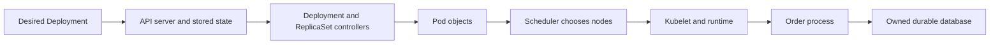
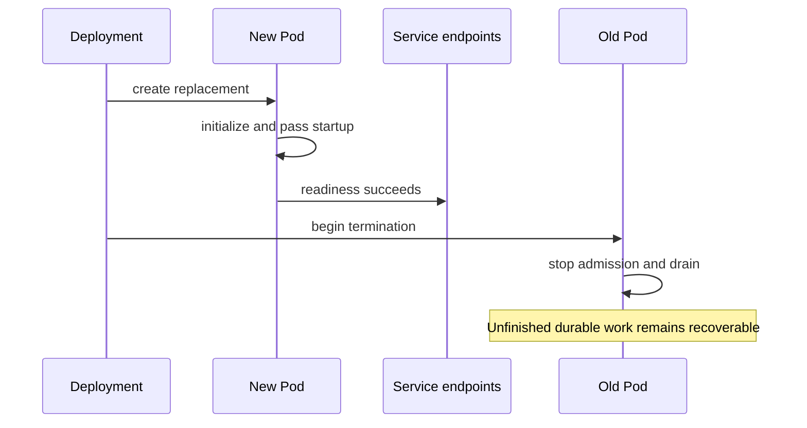

# Chapter 21 — Kubernetes: Reconciliation, Workloads, and Application Recovery

Prepared 2026-10-24. Manifests and commands are unexecuted educational examples. No cluster, image, or infrastructure was created.

## 1. Lesson title
Understand how Kubernetes maintains desired infrastructure state and what the application must still do to preserve business correctness.

## 2. Interview priority
P0 for Pods, Deployments, Services, probes, resources, rollouts, and failure diagnosis. P1 for storage, RBAC, autoscaling, network policy, and Helm. Explain a request and a failed Pod before listing object kinds.

## 3. Prerequisites
Chapter 20's container image, process, filesystem, network, and resource concepts; Chapter 19's DNS, connections, readiness, and deadlines. A manifest describes an API object. A cluster contains a control plane and worker nodes. A namespace groups and scopes many objects, but is not by itself a complete security boundary.

## 4. Learning objectives
Trace declarative reconciliation, select workload controllers, route traffic through Services, distinguish probes, allocate Java memory correctly, and plan rollout and shutdown. Explain persistent storage, RBAC, scaling constraints, Helm rendering, and recovery evidence without claiming Kubernetes provides exactly-once business execution.

## 5. Official references and version notes
Opened 2026-10-24. Live Kubernetes pages display a v1.37 documentation selector; this is an observed page banner, not a chosen or installed cluster release. Helm pages advertise Helm 4. Spring Boot live reference is 4.1.2; proposed course Boot remains 4.1.1 with Java 21/Maven. No cluster, Helm, or Spring Cloud compatibility matrix was validated.

| ID | Official source | Sections |
|---|---|---|
| K1 | [Components](https://kubernetes.io/docs/concepts/overview/components/) | API server, etcd, scheduler, controllers, kubelet |
| K2 | [Deployments](https://kubernetes.io/docs/concepts/workloads/controllers/deployment/) | ReplicaSets, rolling updates, progress |
| K3 | [StatefulSets](https://kubernetes.io/docs/concepts/workloads/controllers/statefulset/) | Identity and storage |
| K4 | [DaemonSet](https://kubernetes.io/docs/concepts/workloads/controllers/daemonset/) | Node-oriented workloads |
| K5 | [Jobs](https://kubernetes.io/docs/concepts/workloads/controllers/job/) | Completion and retry behavior |
| K6 | [Services](https://kubernetes.io/docs/concepts/services-networking/service/) | Selectors, endpoints, exposure |
| K7 | [Cluster DNS](https://kubernetes.io/docs/concepts/services-networking/dns-pod-service/) | Service and Pod names |
| K8 | [Ingress](https://kubernetes.io/docs/concepts/services-networking/ingress/) | Controller requirement, HTTP routing |
| K9 | [Persistent volumes](https://kubernetes.io/docs/concepts/storage/persistent-volumes/) | PV/PVC, classes, reclaim policy |
| K10 | [Probes](https://kubernetes.io/docs/concepts/workloads/pods/probes/) | Startup, readiness, liveness |
| K11 | [Resources](https://kubernetes.io/docs/concepts/configuration/manage-resources-containers/) | Requests, limits, CPU and memory |
| K12 | [RBAC](https://kubernetes.io/docs/reference/access-authn-authz/rbac/) | Roles and bindings |
| K13 | [Horizontal autoscaling](https://kubernetes.io/docs/concepts/workloads/autoscaling/horizontal-pod-autoscale/) | Metrics and scaling loop |
| K14 | [NetworkPolicy](https://kubernetes.io/docs/concepts/services-networking/network-policies/) | Selection, ingress/egress, implementation |
| K15 | [Helm charts](https://helm.sh/docs/topics/charts/) | Chart structure, templates, values |
| K16 | [Boot Actuator endpoints](https://docs.spring.io/spring-boot/reference/actuator/endpoints.html) | Kubernetes probes and health groups |

Documented mechanisms are cited. Commerce deployment choices, resource values, rollout policies, and experiments are course recommendations. No book consultation or measured cluster results are claimed.

## 6. Fundamental explanation

### Desired state is a continuously checked intention
Suppose Order should have two running instances. You declare two replicas in a Deployment. Kubernetes observes actual objects and repeatedly works toward that desired state. If a Pod disappears, a controller can create a replacement. This is reconciliation, not a one-time script that succeeds forever.

The control plane contains the API server, persistent cluster-state storage in etcd, scheduler, and controllers. Worker nodes run components such as kubelet and a container runtime; networking implementations provide the relevant data plane. [K1] Distinguish the control plane's view from application data. An etcd backup is not a backup of Order's PostgreSQL database.

A Pod is the scheduling unit containing one or more tightly related containers that share relevant execution resources such as networking. A container restart and a replacement Pod are different events. The replacement can have a different identity/address. Our service must recover from losing all local process memory, using its database, outbox, and stable operation IDs.

### Controllers encode different lifecycles
A Deployment manages replaceable application instances through ReplicaSets and rollout policy. [K2] It fits the stateless compute layer of Order, where durable state is external. “Stateless” here means an instance need not preserve unique local business state across replacement; it can still use temporary caches and connection pools.

A StatefulSet provides stable identity and storage association for workloads that need them. [K3] It does not implement database replication, consensus, backups, or safe promotion. Running PostgreSQL in a StatefulSet remains a database-operating responsibility. For this course, compare a managed database with a properly operated stateful platform instead of assuming YAML replaces database expertise.

DaemonSets place node-oriented agents on eligible nodes; Jobs represent work expected to complete. [K4, K5] A Job's retries do not make a migration or payment operation exactly once. A reconciliation Job needs idempotent checkpoints, and a migration Job needs a controlled schema-deployment protocol. A CronJob adds scheduling, not a promise that every business effect happens exactly once at an exact time.

## 7. Internal architecture and mechanism

### Scheduling and execution
The scheduler chooses a suitable node for an unscheduled Pod based on declared constraints and available resources. The kubelet works with the runtime to run containers on its node. Controllers keep observing and updating objects. [K1] A Pod in Pending may lack schedulable capacity, an image may fail to pull after scheduling, and an application may crash after starting. These are different stages with different evidence.

Our diagnostic sequence follows those stages: inspect object status and events, confirm scheduling, check image/runtime preparation, inspect termination reason and logs, then inspect application dependencies. Repeatedly deleting a Pod can erase useful evidence while recreating the same failing configuration.

### Requests and limits
Resource requests inform scheduling and resource allocation; limits constrain consumption through platform mechanisms. CPU limits can throttle execution, while memory pressure can result in termination when a container exceeds its applicable limit. [K11] A Java heap limit is not the whole container budget. Include native buffers, metadata, code, thread resources, agents, and operating overhead.

For the teaching manifest, 512 MiB requested and 768 MiB limited are illustrative values, not measured sizing guidance. A large Xmx close to the container limit can still cause termination with apparently available heap space. Record effective JVM settings and process memory under representative load before setting production values.

### Services and routing
A Service provides a stable access abstraction for a changing set of endpoints, commonly selected by labels. DNS gives clients discoverable service names. [K6, K7] A label mismatch can leave a Service with no usable endpoints even when Pods are running. A listening container port declaration alone does not publish an application externally.

ClusterIP, NodePort, and LoadBalancer exposure choices have different meanings and infrastructure requirements. Ingress describes HTTP routing but requires an implementation/controller; creating an Ingress object alone does not build a working proxy. [K8] Gateway API is another routing API ecosystem whose selected implementation and version must be reviewed separately. Do not confuse an API object with a universally available managed load balancer.

NetworkPolicy describes allowed traffic for selected Pods, subject to a network implementation that enforces it. [K14] Namespace separation alone does not deny network access. A deny-by-default design must allow intentional dependencies such as DNS and database traffic. Connectivity and authorization remain separate: being able to open a socket does not permit reading another customer's order.

### Probes describe different decisions
A startup probe allows initialization to finish before other probe behavior applies. A readiness probe determines whether a Pod should receive ordinary Service traffic. A liveness probe decides when restarting a container may help. [K10] A slow database should not automatically make every Order instance fail liveness and restart together; that can amplify an external outage.

Our recommendation is a local process-health liveness signal and a readiness policy based on whether the instance can accept its documented workload. If Order can durably accept requests while a downstream service is temporarily unavailable, that downstream failure need not remove every instance from traffic. If its own database is unavailable and durable acceptance is impossible, readiness may reasonably change. The product contract determines the rule.

### Rollout and scaling loops
Deployment rolling updates trade temporary extra capacity against temporarily unavailable instances. Progress reporting helps detect a stalled rollout, but does not prove a business SLO or automatically repair every failed release. [K2] Schema compatibility must permit old and new application instances to coexist during a rollout.

Horizontal Pod Autoscaler observes configured metrics and adjusts replica targets within policy. [K13] Scaling has delay: metrics arrive, decisions occur, Pods schedule, images start, JVMs warm, and readiness succeeds. CPU is not always the right signal for waiting-heavy workloads; backlog age or latency can be useful with properly designed metrics. More replicas can overload a fixed database pool budget or remote quota.

## 8. Diagrams





The sequence is an intended rollout lifecycle. Endpoint propagation and connection reuse are not instantaneous, so application shutdown must tolerate requests already in flight.

## 9. Java 21 implementation

Unexecuted Kubernetes manifest, complete within this declared scope: two instances of a prebuilt local teaching image exposing HTTP 8080 and Boot health endpoints, with a cluster-internal Service. The image name is a deliberate prerequisite, not a claim that an image exists. `imagePullPolicy: Never` prevents fetching an unspecified external image. No database credentials, public ingress, or paid load balancer is created by this design.

```yaml
apiVersion: v1
kind: Namespace
metadata:
  name: course-demo
---
apiVersion: apps/v1
kind: Deployment
metadata:
  name: order-demo
  namespace: course-demo
spec:
  replicas: 2
  selector:
    matchLabels:
      app: order-demo
  strategy:
    type: RollingUpdate
    rollingUpdate:
      maxSurge: 1
      maxUnavailable: 0
  template:
    metadata:
      labels:
        app: order-demo
    spec:
      automountServiceAccountToken: false
      terminationGracePeriodSeconds: 30
      containers:
        - name: order
          image: course/order:reviewed-local
          imagePullPolicy: Never
          ports:
            - name: http
              containerPort: 8080
          env:
            - name: SPRING_LIFECYCLE_TIMEOUT_PER_SHUTDOWN_PHASE
              value: 20s
          resources:
            requests:
              cpu: 250m
              memory: 512Mi
            limits:
              cpu: '1'
              memory: 768Mi
          startupProbe:
            httpGet:
              path: /actuator/health/liveness
              port: http
            periodSeconds: 5
            failureThreshold: 24
          readinessProbe:
            httpGet:
              path: /actuator/health/readiness
              port: http
            periodSeconds: 5
          livenessProbe:
            httpGet:
              path: /actuator/health/liveness
              port: http
            periodSeconds: 10
---
apiVersion: v1
kind: Service
metadata:
  name: order-demo
  namespace: course-demo
spec:
  selector:
    app: order-demo
  ports:
    - name: http
      port: 80
      targetPort: http
  type: ClusterIP
```

The image must be available on eligible nodes and configured with the named probe endpoints. The startup budget is approximately 24 failed checks at five-second intervals, with actual behavior also affected by probe execution and scheduling. The manifest is a teaching contract, not hardened production deployment: add a reviewed non-root image/security context, explicit configuration/secrets, placement policy, and network policy during implementation.

## 10. Spring Boot integration
Boot Actuator supports liveness/readiness health groups and discusses exposing probe paths on the application's main port. [K16] A separate management port can appear healthy while the actual request connector is broken; choose probe placement intentionally. Expose only required operational endpoints and protect sensitive ones.

Coordinate application shutdown with Kubernetes termination. Stop new work, drain bounded requests/listeners, and persist unfinished obligations. The manifest's 20-second application phase and 30-second Pod grace are illustrative and do not account for every lifecycle phase or hook. Verify the actual total shutdown behavior rather than assuming two numbers guarantee graceful completion.

## 11. Production scenario
A new Order image passes startup but readiness fails because its expected database column is absent. With maxUnavailable zero, old instances can continue serving if capacity and rollout conditions permit. Inspect the new Pod's logs and migration state; do not make readiness return true merely to unblock deployment.

Another incident occurs when a liveness check includes Payment availability. Payment fails, every Order Pod restarts, connection pools churn, and recovery becomes slower. Fix the probe decision: restarting Order does not repair Payment. Preserve durable acceptance/retry policy and use dependency metrics to report degradation separately.

## 12. HLD considerations
Plan node and zone failure, replica placement, database availability, and network paths. Two Pods on one node do not survive that node's loss. Placement constraints and topology policies can improve distribution, but require sufficient capacity to satisfy them. A disruption budget can constrain certain voluntary disruptions; it cannot prevent every crash or zone failure.

For storage, a PersistentVolume represents storage and a PersistentVolumeClaim requests it; storage classes and reclaim policies influence provisioning and cleanup. [K9] A volume surviving Pod replacement is not backup or multi-zone database failover. Verify access mode, attachment behavior, zone constraints, snapshots, restore, and application consistency separately.

## 13. LLD considerations
Use consistent labels for selectors and operational queries. Separate immutable image identity from environment configuration. Pin production images by reviewed immutable identity rather than assuming a mutable tag identifies the same bytes forever. Make environment-specific values explicit and keep secrets out of versioned plain-text manifests.

RBAC combines permissions expressed through Roles/ClusterRoles with bindings to subjects. [K12] Give application service accounts only required API permissions; many Order Pods need no Kubernetes API access at all. Human deployers, CI systems, controllers, and application workloads have different identities and privileges.

Helm charts package metadata, values, and templates that render Kubernetes resources. [K15] Values are inputs, not proof of safe output. Review rendered manifests, release diffs, and rollback implications. A Helm rollback cannot automatically reverse a destructive database migration or an external payment effect.

## 14. Reliability and failure recovery
Reconciliation can replace compute; the application must recover work. An Order Pod killed after a database commit but before publishing still relies on outbox replay. A consumer killed after its business transaction but before acknowledging can see a duplicate. Kubernetes restarts do not change those boundaries.

Keep runbooks for image-pull failure, Pending capacity, crash loops, OOM termination, probe failures, DNS/network policy, and storage attachment. Preserve events, termination reasons, previous-container logs when available, and correlated business state. A Pod returning to Running does not prove pending orders were completed.

## 15. Performance and capacity
Scale resources from measurements: CPU throttling, memory working set, request concurrency, pool wait, startup time, and tail latency. Three replicas with a 30-connection pool each can create ninety database connections, while an autoscaler growing to ten can create three hundred. Coordinate replica maxima with downstream capacity.

For an illustrative arrival rate of 600 requests per second and tested sustainable capacity of 200 per Pod, three Pods meet the simple average calculation but leave no failure/headroom allowance. The per-Pod capacity here is hypothetical, not measured. Real sizing includes burst, tail latency, warm-up, dependency limits, and the desired behavior during one-instance loss.

## 16. Interview questions with explained answers

1. **What does reconciliation mean?** Controllers repeatedly compare desired and observed state and act to reduce differences. It is not a guarantee that all dependencies are healthy. Explain which controller owns the object and which application obligation remains outside it.

2. **Pod versus Deployment?** A Pod is an execution/scheduling unit; a Deployment manages replaceable replicas and rollout behavior through controllers. Deleting a managed Pod can trigger replacement. Editing one transient Pod is not a durable deployment strategy.

3. **Why is a StatefulSet insufficient for PostgreSQL HA?** Stable identity and volume association do not implement replication, safe promotion, or backup. Database consistency and failover require a supported operating design. Kubernetes supplies primitives, not the database protocol.

4. **Readiness versus liveness?** Readiness controls ordinary traffic eligibility; liveness asks whether restart can help. A remote dependency outage often should not restart every process. Define the decision from the service's acceptance contract.

5. **Why can Java be OOM-killed with heap remaining?** Container memory includes more than heap. Native buffers, metadata, threads, and agents contribute. Compare process/container evidence and effective JVM settings before increasing Xmx.

6. **Why does a Service have no endpoints?** Selectors may not match labels, Pods may be unready, or endpoint state may not yet reflect changes. Inspect each boundary. A declared port alone does not prove a listening healthy process.

7. **Does HPA guarantee overload recovery?** Scaling requires metrics, capacity, startup time, and available downstream resources. More Pods can intensify a database bottleneck. Use bounded admission and a scale signal matched to the limiting resource.

8. **What does a PVC guarantee?** It requests storage under the cluster's binding/provisioning model. Durability, attachment, zone behavior, and backup depend on the actual storage system and policy. A bound claim is not a tested restore.

9. **Why review Helm output?** Templates and values can render unexpected selectors, privileges, or resources. Rendering is the concrete deployment proposal. A successful chart installation does not prove business correctness or safe data migration.

10. **Does a Job run a business operation exactly once?** No. Failure and retry can repeat execution. Use durable identity, checkpoints, and constraints appropriate to the operation. Scheduling machinery cannot infer whether a remote effect committed.

## 17. Exercises
Read the manifest and trace Service port 80 to named target port http and container port 8080. Change the Service selector on paper to `app: inventory-demo`. Expected result: it no longer selects these Order Pods. The solution is consistent labeling, not changing the application listener randomly.

Design probes for an Order service whose database is healthy but Payment is unavailable. One defensible solution keeps liveness healthy, accepts only work the API can durably promise, and reports Payment degradation separately. If the API requires immediate completion, readiness/admission policy may differ; explain the product contract.

Plan a rollout that adds a required database field. Solution: expand schema compatibly, deploy code supporting transition, backfill/validate, then contract after old instances are gone. Kubernetes rolling updates alone cannot coordinate an incompatible schema change. Later execute fault labs only in an approved disposable cluster.

## 18. Verification
Official sources and version banners were checked. The YAML was not parsed by kubectl, applied, rendered through Helm, or exercised against an image. No cluster exists by implication. Future verification must include schema validation on the selected version, readiness, selector routing, rollout capacity, shutdown timing, OOM behavior, and outbox/inbox recovery under forced termination.

## 19. Common misconceptions
Running is not the same as ready. Readiness is not completed business work. A StatefulSet is not a database backup. A namespace alone does not deny network traffic. A memory limit is not an Xmx setting. HPA does not create unlimited database capacity. Helm does not reverse irreversible data changes. Restarting a Pod does not deduplicate a payment.

## 20. Knowledge assessment
Unanswered: a rollout creates three new Pods that pass liveness but fail readiness, old Pods approach memory limits, and the database is at its connection ceiling. Explain the control-plane state, immediate recovery choices, and the capacity/schema evidence needed before proceeding.

## 21. Revision summary
Kubernetes reconciles infrastructure objects; applications preserve business obligations. Choose controllers by lifecycle, probes by decision, resources by evidence, and storage by recovery requirements. Review rendered deployment changes and test failure behavior across both platform and business boundaries.

## 22. Next lesson
Chapter 22 places these choices in AWS/Azure, adding managed services, identity, network boundaries, infrastructure state, cost, and regional recovery.
