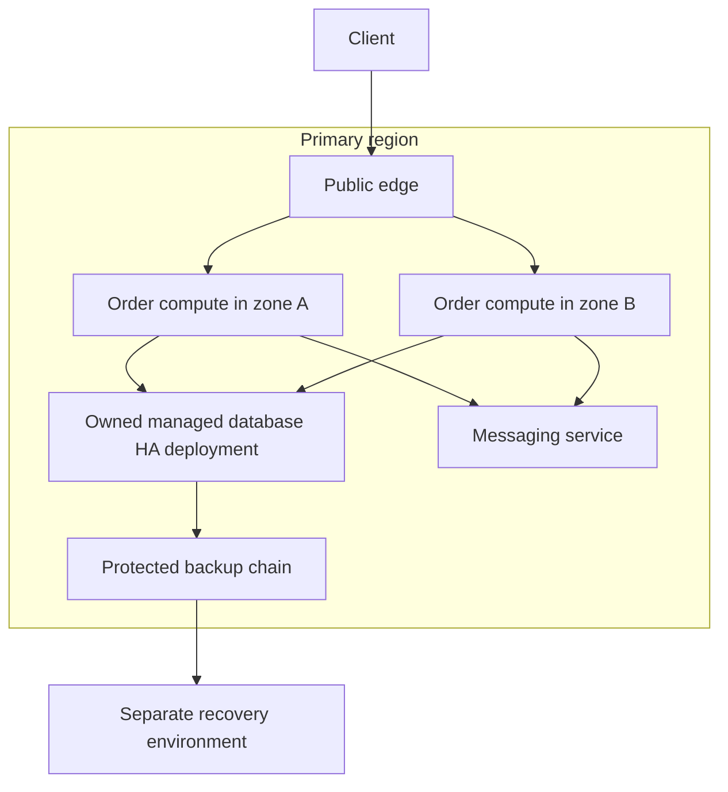
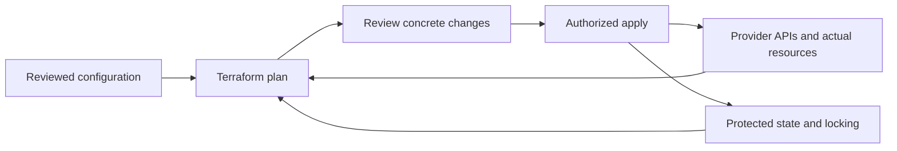

# Chapter 22 — AWS, Azure, Terraform, Cost, and Disaster Recovery

Prepared 2026-10-24. Architecture and configuration examples are unexecuted. No cloud account, paid resource, credential, Terraform state, or infrastructure deployment was created or changed.

## 1. Lesson title
Design a cloud deployment whose identity, network, data, cost, and recovery behavior can be explained and verified.

## 2. Interview priority
P0 for regions/zones, private networking, IAM, managed-service responsibility, recovery objectives, and infrastructure state. P1 for AWS/Azure service mapping, Terraform modules, change review, and cost optimization. Prefer reasoning to memorizing product catalogs.

## 3. Prerequisites
Chapters 19–21: networking, containers, Kubernetes, database ownership, and workload recovery. A cloud resource is a provider-managed object such as a network, database, or identity. A control plane manages resources; a data plane serves workload traffic. Infrastructure as code describes intended resources in version-controlled configuration.

## 4. Learning objectives
Compare AWS/Azure architecture concepts, design private service paths and workload identity, choose managed services intentionally, and explain Terraform plan/state/locking. Build a cost model without invented prices, and design regional recovery including database/broker reconciliation rather than only traffic redirection.

## 5. Official references and version notes
Opened 2026-10-24. Cloud features, regional availability, quotas, prices, service versions, and Terraform provider behavior are time-sensitive; no current price or deployment compatibility is asserted. These rolling official pages support named concepts. Java 21/Maven and proposed Boot 4.1.1 remain unchanged. Terraform and provider versions require a later explicit selection.

| ID | Official source | Sections |
|---|---|---|
| C1 | [AWS shared responsibility](https://aws.amazon.com/compliance/shared-responsibility-model/) | Provider/customer responsibilities |
| C2 | [AWS global infrastructure](https://docs.aws.amazon.com/whitepapers/latest/aws-overview/global-infrastructure.html) | Regions and Availability Zones |
| C3 | [Amazon VPC](https://docs.aws.amazon.com/vpc/latest/userguide/what-is-amazon-vpc.html) | Network, subnets, routing |
| C4 | [IAM practices](https://docs.aws.amazon.com/IAM/latest/UserGuide/best-practices.html) | Roles, temporary credentials, least privilege |
| C5 | [RDS Multi-AZ](https://docs.aws.amazon.com/AmazonRDS/latest/UserGuide/Concepts.MultiAZ.html) | Deployment types and failover |
| C6 | [AWS recovery strategies](https://docs.aws.amazon.com/whitepapers/latest/disaster-recovery-workloads-on-aws/disaster-recovery-options-in-the-cloud.html) | Backup/restore, pilot light, standby, active/active |
| C7 | [AWS Budgets](https://docs.aws.amazon.com/cost-management/latest/userguide/budgets-managing-costs.html) | Monitoring and actions |
| C8 | [Azure regions](https://learn.microsoft.com/en-us/azure/reliability/regions-overview) | Regional design |
| C9 | [Azure Virtual Network](https://learn.microsoft.com/en-us/azure/virtual-network/virtual-networks-overview) | Connectivity and isolation |
| C10 | [Azure managed identities](https://learn.microsoft.com/en-us/entra/identity/managed-identities-azure-resources/overview) | Workload identity |
| C11 | [Azure disaster recovery](https://learn.microsoft.com/en-us/azure/well-architected/reliability/disaster-recovery) | Objectives and testing |
| C12 | [Azure budgets](https://learn.microsoft.com/en-us/azure/cost-management-billing/costs/tutorial-acm-create-budgets) | Budget alerts and actions |
| C13 | [EKS](https://docs.aws.amazon.com/eks/latest/userguide/what-is-eks.html), [AKS](https://learn.microsoft.com/en-us/azure/aks/what-is-aks) | Managed Kubernetes scope |
| C14 | [S3](https://docs.aws.amazon.com/AmazonS3/latest/userguide/Welcome.html), [Blob Storage](https://learn.microsoft.com/en-us/azure/storage/blobs/storage-blobs-introduction) | Object storage |
| T1 | [Terraform state](https://developer.hashicorp.com/terraform/language/state) | Resource bindings and metadata |
| T2 | [State locking](https://developer.hashicorp.com/terraform/language/state/locking) | Concurrent writer protection |
| T3 | [Plan command](https://developer.hashicorp.com/terraform/cli/commands/plan) | Proposed changes and saved plans |
| T4 | [Modules](https://developer.hashicorp.com/terraform/language/modules) | Reusable configuration boundaries |
| T5 | [Sensitive data](https://developer.hashicorp.com/terraform/language/manage-sensitive-data) | Redaction and state exposure |
| T6 | [Provider requirements](https://developer.hashicorp.com/terraform/language/providers/requirements) | Sources and version constraints |
| T7 | [Locals](https://developer.hashicorp.com/terraform/language/values/locals) | Named expressions |

An initial AWS shared-responsibility URL was inaccessible and a recovery URL redirected without useful content; the working official references above replaced them. Microsoft pages exposed substantive text despite a general authorization banner. Architecture choices and examples are original recommendations, not provider guarantees or consulted book content.

## 6. Fundamental explanation

### Cloud moves responsibilities; it does not remove them
Managed infrastructure can reduce hardware and platform operations, but the workload team still owns relevant configuration, application correctness, data access, and recovery decisions. AWS's shared-responsibility model explains how responsibility varies by service. [C1] A managed database does not fix an application that authorizes another tenant's orders or retries a payment with a new identity.

Our learning deployment has an edge, Order/Inventory/Payment compute, service-owned databases, a broker, object storage, identity, and observability. Start with required guarantees and workload scale, then choose products. “Use every managed service” is no more reasoned than “operate everything ourselves.” Compare operational burden, capability, compatibility, failure behavior, cost, and team experience.

### Regions and zones are failure boundaries
AWS regions contain Availability Zones, while Azure has its own region and availability-zone support model. [C2, C8] Availability varies by product and region; never assume a named service supports every redundancy mode everywhere. Zones help address certain local failures. A regional outage, account compromise, application bug, or destructive migration can still affect all zonal copies.

For our initial design, one region with deliberately distributed compute and a supported highly available database is a reasonable teaching starting point. Regional recovery is then designed from business objectives. Multi-region active/active is not a default upgrade: it introduces ownership, conflict, routing, and cross-region latency questions that can outweigh its availability benefit.

### Distinguish redundancy, backup, and recovery
Redundancy keeps another component available. Backup preserves a recoverable historical copy. Disaster recovery restores the useful workload after a larger disruption. A replica can copy an accidental deletion immediately; a backup can exist but take too long to restore. Neither alone proves that an order workflow can resume safely.

Define RPO as the acceptable loss relative to the recoverable data point, and RTO as the acceptable restoration delay. These are business objectives, not measurements. Our course requires a restore drill that measures actual results and reconciles Order, Inventory, Payment, and event-processing positions before declaring recovery complete.

## 7. Internal architecture and mechanism

### Network design follows data paths
AWS VPC and Azure Virtual Network provide logically isolated virtual-network constructs with routing and connectivity controls. [C3, C9] Draw each allowed path: customer to edge, edge to Order, Order to its database, service to broker, and controlled outbound dependency access. Subnets, routes, security controls, DNS, and private endpoints solve different parts of that path.

“Private subnet” is not a complete security explanation. Ask whether the resource has a public address, which routes exist, which inbound/outbound rules apply, and which identity is authorized at the destination. NAT enables certain outbound connectivity; it does not grant application authorization. Private endpoints can reduce public exposure while still requiring DNS and access-policy design.

Avoid overlapping network ranges if future connectivity between environments is expected. Separate production and practice administrative boundaries, and make database access paths intentionally narrow. A publicly reachable database with a difficult password still has unnecessary exposure for this course's architecture.

### Identity has principals, permissions, and trust
A principal is the identity making a request. A permission states what actions it may perform on which resources. A trust relationship defines who may assume or use an identity. AWS recommends temporary workload credentials through roles and least privilege. Azure managed identities let workloads obtain platform-managed identity without embedding a long-lived application secret. [C4, C10]

Our Order workload should read only its required secret/configuration, connect to its own database, and publish/consume its intended messaging resources. CI deployment identity needs different permissions from runtime identity. Avoid shipping a broad administrator credential in the container or using one identity for every service. Short-lived credentials still require correct audience, trust, and scope configuration.

### Managed services need precise comparison
EKS and AKS provide managed Kubernetes capabilities, but their supported responsibilities and operating modes must be checked. [C13] They do not automatically configure a correct application rollout, network policy, database backup, or workload identity. A simpler managed container platform may be sufficient when Kubernetes-specific control is unnecessary; verify its constraints before choosing it.

RDS Multi-AZ includes distinct deployment forms with different standby/read-serving behavior. [C5] Do not describe every Multi-AZ option as a read replica. Similarly, a read replica is not automatically a synchronous failover target. For any managed PostgreSQL service, inspect engine version, extensions, maintenance windows, connection limits, backup retention, restore granularity, and failover behavior.

Object storage such as S3 or Azure Blob Storage holds objects addressed through service APIs rather than behaving like an ordinary shared POSIX filesystem. [C14] It fits exports, media, and backup artifacts. Define access control, lifecycle, versioning/retention where appropriate, encryption, and download authorization. Storing a public URL in Order is not a complete privacy policy.

For messaging, compare actual protocol and semantic needs. A service with Kafka-compatible interfaces is not automatically identical to the agreed Kafka 4.2.2 baseline in every feature or limit. Verify the selected managed service's supported version and client behavior. Queue products and event-streaming products address different delivery/replay models; names are not substitutes for contracts.

### Terraform's configuration, state, and provider
Terraform configuration expresses desired objects. Providers translate those objects into service API operations. State maps configuration addresses to managed real objects and records metadata needed for later changes. [T1, T6] State is not simply a disposable cache: losing its bindings can make safe management difficult even though resources continue running.

A plan compares configuration and known/refreshed infrastructure information to propose changes. A saved plan is a concrete change artifact, subject to its validity and the surrounding workflow. [T3] Reading a plan is necessary before applying it, especially for replacement, deletion, permissions, networking, and storage. A plan is not proof that application traffic will remain safe.

State locking, when supported by the backend, protects against conflicting state operations. [T2] It does not stop someone changing a resource manually in the cloud console. Drift is divergence between intended/recorded configuration and actual resources. Investigate and reconcile it; do not blindly overwrite an emergency fix without understanding why it exists.

Modules group reusable configuration behind inputs and outputs. [T4] Use meaningful boundaries such as a network or service runtime, not a wrapper module for every single field. Keep environments and ownership boundaries clear. Sensitive-value marking can redact display, but ordinary sensitive data can still be stored in state or plan artifacts. [T5] Protect those artifacts as potentially secret-bearing data.

## 8. Diagrams





These diagrams are logical designs. They do not imply any account, region, state backend, or managed resource already exists.

## 9. Java 21 implementation

Unexecuted provider-free Terraform teaching configuration. Save as main.tf in a disposable practice directory if later authorized. It calculates a capacity proposal using illustrative inputs; it creates no cloud resources and requires no cloud credentials. No Terraform version is fabricated here: validate with the deliberately selected CLI before use.

```hcl
variable "daily_orders" {
  type    = number
  default = 100000
  validation {
    condition     = var.daily_orders >= 0
    error_message = "daily_orders must be nonnegative."
  }
}

variable "peak_multiplier" {
  type    = number
  default = 10
  validation {
    condition     = var.peak_multiplier >= 1
    error_message = "peak_multiplier must be at least one."
  }
}

variable "assumed_orders_per_second_per_replica" {
  type    = number
  default = 20
  validation {
    condition     = var.assumed_orders_per_second_per_replica > 0
    error_message = "Per-replica capacity must be positive."
  }
}

locals {
  average_orders_per_second = var.daily_orders / 86400
  estimated_peak_rate       = local.average_orders_per_second * var.peak_multiplier
  replicas_for_peak = ceil(
    local.estimated_peak_rate / var.assumed_orders_per_second_per_replica
  )
  proposed_replicas = max(2, local.replicas_for_peak)
}

output "capacity_proposal" {
  value = {
    estimated_peak_rate = local.estimated_peak_rate
    proposed_replicas   = local.proposed_replicas
    evidence_status    = "Illustrative assumptions; load testing required"
  }
}
```

Locals name reusable expressions. [T7] The expected peak estimate is about 11.57 orders per second and the minimum rule yields two replicas. This is not a benchmark, cost estimate, or availability guarantee. The model excludes per-order fan-out, background consumers, failure headroom, and database limits. Its purpose is to expose assumptions as reviewable inputs instead of hiding them in instance-size choices.

## 10. Spring Boot integration
Configure Java services through environment-specific settings and workload identity integrations, with secrets supplied through an approved runtime mechanism. Keep provider SDK clients and database clients reusable, bounded, and observable. Ensure token refresh and credential rotation do not require rebuilding application images.

Record effective deployment identity, region, service version, and nonsecret configuration in diagnostic metadata. Keep Order's local transaction and outbox unchanged by hosting choice. A managed broker acknowledgment still does not prove Inventory completed its business transaction; a managed database failover still requires client retry classification and stable operation identity.

## 11. Production scenario
A primary database fails over during checkout. Some connections fail, some commits may be ambiguous, and a new endpoint/address becomes usable after discovery and client recovery. The correct client reconnects within bounded policy and looks up the original order operation identity. It does not create a new payment operation simply because the infrastructure reported a connection failure.

A regional incident is harder. Restoring Order from an earlier point can omit authorizations already recorded by Payment. Before reissuing mutations, reconcile durable operation IDs and outcomes. Database recovery and business recovery are separate milestones; a green endpoint is insufficient evidence that money and stock agree.

## 12. HLD considerations
Compare recovery strategies by cost and objective. Backup/restore, pilot light, warm standby, and active/active maintain different amounts of ready infrastructure and impose different operational complexity. AWS and Azure recovery guidance emphasizes explicit objectives and exercises. [C6, C11] No strategy has one universal RTO/RPO independent of implementation and workload.

For the course, design a primary-region owner for each mutable aggregate and a tested recovery path. If multi-region writes are required, specify ownership transfer, conflict handling, and prevention of two simultaneous authorities. DNS failover alone cannot fence the old writer or reconcile divergent databases.

## 13. LLD considerations
Keep infrastructure modules cohesive, give resources intentional names/tags, and expose narrow outputs. Review provider version constraints and dependency lock files in the implementation workflow. A provider upgrade can change schemas or behavior even when application code is unchanged; plan it as a reviewed dependency change.

Separate runtime secrets from ordinary variables and protect remote state with access control, encryption, versioning, and supported locking. Do not commit credentials or state files to source control. A force-unlock operation is an incident tool requiring proof that another legitimate writer is not active, not a routine fix for an inconvenient lock.

## 14. Reliability and failure recovery
Maintain a dependency-ordered recovery runbook: identity and access, network/DNS, storage/database restore, messaging state, application deployment, reconciliation, then traffic. Include backups of required configuration and keys with controlled access. An encrypted backup whose decryption authority was lost may be unusable.

Exercise restore in an isolated environment and measure elapsed steps, data-loss point, and business invariants. Reconcile outbox rows, inbox identities, reservations, and simulated payment outcomes after recovery. Define failback as carefully as failover so the old region does not resume stale writes when it returns.

## 15. Performance and capacity
Cloud cost includes compute duration, storage capacity and operations, databases, managed control planes, load balancers, NAT/private connectivity, data transfer, backups, and observability. Cross-zone/region traffic and high-volume logs can matter even when compute is modest. Model units explicitly and fetch current regional prices only when preparing a real estimate.

AWS Budgets and Azure budgets support tracking and alerts/actions; a budget notification is not a universal hard spending cap. [C7, C12] Define ownership, thresholds, and response procedures. Avoid broad automatic shutdown of production as an unreviewed cost policy.

Optimize after measuring utilization and required resilience. Reduce idle practice resources, unnecessary replicas, oversized storage, excessive logs, and avoidable network paths before purchasing long commitments. Commitment products trade flexibility for pricing terms; the course makes no purchasing recommendation. Compare cost per useful business operation alongside latency and reliability, using real measured denominators.

## 16. Interview questions with explained answers

1. **What remains our responsibility with managed services?** Application correctness, identity policy, relevant configuration, data access, and recovery validation remain. The provider's scope differs by service. A managed database does not prevent a duplicate authorization caused by application retries.

2. **Zones versus regions?** They represent different geographic and failure scopes in each provider's model. Multi-zone deployment addresses some local failures; regional recovery needs a broader plan. Verify service support rather than assuming every region offers every redundancy mode.

3. **Is a private subnet sufficient security?** No. Routes, addresses, firewall/security rules, DNS, endpoints, and application identity all matter. Explain a permitted packet path and an authorized resource operation separately.

4. **Why use workload identity?** It avoids distributing long-lived static credentials and supports scoped temporary access. Trust configuration and least privilege still matter. A short-lived administrator token remains overprivileged.

5. **Is every RDS Multi-AZ deployment a read replica?** No; deployment forms have different capabilities. Inspect the exact product mode and engine documentation. Availability and read scaling are separate requirements.

6. **What is Terraform state for?** It binds configuration addresses to real resource identities and records management metadata. Resources can continue existing if state is lost, but safe management becomes harder. Protect and recover state deliberately.

7. **Does state locking prevent all drift?** It protects supported concurrent state operations, not every manual cloud change. Reconcile drift with context, particularly after emergency repairs. Do not treat the lock as a universal cloud mutex.

8. **Does sensitive=true keep secrets out of state?** Not generally. It can redact presentation while the value remains in artifacts. Use supported secret-handling features and protect state/plan access rather than relying on display suppression.

9. **RPO versus RTO?** RPO bounds acceptable lost progress; RTO bounds acceptable recovery delay. Both are objectives that drills must test. A backup schedule and an infrastructure diagram do not constitute measured recovery evidence.

10. **Why is multi-region active/active difficult for orders?** Concurrent authorities can disagree about reservations, payment operations, and workflow state. Define ownership, conflict resolution, and fencing. Traffic distribution alone does not solve data consistency.

## 17. Exercises
Evaluate the provider-free HCL by hand. With default inputs, the peak estimate is approximately 11.57 orders per second and proposed replicas is two. Increase daily orders to one million: peak becomes approximately 115.74 and the simple capacity formula requests six. Explain why six is still not a validated production capacity plan.

Draw equivalent AWS/Azure logical architectures using private compute, owned PostgreSQL, object storage, workload identity, and an edge. Solution: map capabilities first, then verify service-specific differences. Do not assume two similarly named managed services share protocol, backup, or failover semantics.

Plan a restore where Order is five minutes behind Payment. A strong solution pauses unsafe reissuance, queries/reconciles stable payment operation identities, repairs workflow knowledge, and resumes idempotently. Simply replaying every authorization command with new IDs is incorrect.

## 18. Verification
Official sources were checked; Terraform was not installed or run, HCL was not parsed, and no cloud resources, credentials, paid actions, pricing estimates, restores, or failovers were executed. Arithmetic is illustrative. Future validation must select versions/regions, review concrete plans, verify network and identity paths, and measure restoration plus business reconciliation.

## 19. Common misconceptions
Managed means fewer selected operational duties, not zero responsibility. Multi-zone is not universal regional disaster recovery. A private address does not replace authorization. A replica is not historical backup. Terraform plan is not a business-safety proof. Sensitive output marking is not state encryption. Budget alerts are not necessarily spending caps.

## 20. Knowledge assessment
Unanswered: a regional recovery restores infrastructure quickly but lacks recent Order records, while Payment retains newer authorizations and Terraform state contains an old resource binding. Explain the independent infrastructure, state-management, and business reconciliation tasks before admitting new checkout traffic.

## 21. Revision summary
Choose cloud services from required guarantees and operating responsibility. Design identity and network paths explicitly, protect infrastructure state, and review concrete changes. Model cost in units and validate recovery against measured business outcomes, not only resource availability.

## 22. Next lesson
Chapter 23 develops security across these boundaries: user/workload identity, OAuth/OIDC tokens, authorization, TLS, secrets, and threat-driven verification.
