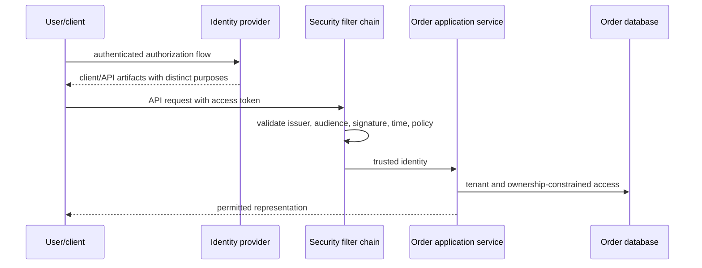
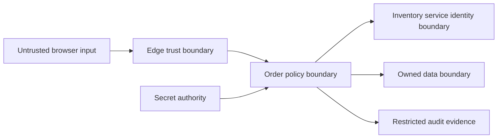

# Chapter 23 — Security: Identity, Authorization, Tokens, and Trust Boundaries

Prepared 2026-10-24. Defensive learning material with unexecuted Java 21 example. No identity provider, credentials, live accounts, penetration test, or production security configuration was changed.

## 1. Lesson title
Verify who is acting, decide exactly what they may do, and preserve those decisions across services, retries, storage, and operations.

## 2. Interview priority
P0 for authentication versus authorization, object/tenant access, OAuth/OIDC roles, JWT validation, Spring filter behavior, and secrets. P1 for service identity, mTLS, threat modeling, browser protections, and incident recovery. Security claims require a named boundary and evidence.

## 3. Prerequisites
HTTP/TLS, Spring proxies and filters, service ownership, and the Order workflow. A principal is an acting identity. Authentication establishes identity evidence; authorization decides whether an action on a resource is permitted. A credential is evidence used to authenticate; a token is a credential or protocol artifact with a defined purpose and audience.

## 4. Learning objectives
Trace Spring Security's request path, distinguish OAuth authorization from OIDC login, validate tokens correctly, enforce object-level access, and separate user from workload identity. Design secret rotation and TLS trust, identify relevant OWASP risks, and turn a threat model into concrete negative tests.

## 5. Official references and version notes
Opened 2026-10-24. Spring Security live pages report 7.1.2; proposed Boot remains 4.1.1 and its managed dependencies are unvalidated here. Java 21/Maven remain agreed. OAuth security guidance includes RFC 9700 (2025), updating earlier OAuth guidance. OIDC Core is 1.0 with errata set 2. OWASP Top 10:2025 was verified; ASVS and cheat sheets are rolling references, not a claim of full compliance.

| ID | Official source | Sections |
|---|---|---|
| S1 | [Spring Security architecture](https://docs.spring.io/spring-security/reference/servlet/architecture.html) | FilterChainProxy, SecurityFilterChain |
| S2 | [JWT resource server](https://docs.spring.io/spring-security/reference/servlet/oauth2/resource-server/jwt.html) | Decoding, validation, authorities |
| S3 | [Method security](https://docs.spring.io/spring-security/reference/servlet/authorization/method-security.html) | Interception and authorization |
| S4 | [CSRF](https://docs.spring.io/spring-security/reference/servlet/exploits/csrf.html) | Browser credentials and protections |
| S5 | [CORS](https://docs.spring.io/spring-security/reference/servlet/integrations/cors.html) | Browser preflight integration |
| O1 | [OAuth 2.0, RFC 6749](https://www.rfc-editor.org/rfc/rfc6749.html) | Roles and grant model |
| O2 | [OAuth security BCP, RFC 9700](https://www.rfc-editor.org/rfc/rfc9700.html) | Current flow/security recommendations |
| O3 | [PKCE, RFC 7636](https://www.rfc-editor.org/rfc/rfc7636.html) | Challenge/verifier binding |
| O4 | [OIDC Core](https://openid.net/specs/openid-connect-core-1_0.html) | ID token, authentication, validation |
| O5 | [JWT BCP, RFC 8725](https://www.rfc-editor.org/rfc/rfc8725.html) | Algorithm, issuer/audience, token confusion |
| O6 | [Introspection, RFC 7662](https://www.rfc-editor.org/rfc/rfc7662.html) | Token active-state query |
| O7 | [OAuth mTLS, RFC 8705](https://www.rfc-editor.org/rfc/rfc8705.html) | Client authentication and bound tokens |
| T1 | [TLS 1.3, RFC 8446](https://www.rfc-editor.org/rfc/rfc8446.html) | Channel protection and authentication |
| W1 | [OWASP authorization](https://cheatsheetseries.owasp.org/cheatsheets/Authorization_Cheat_Sheet.html) | Deny by default, per-request permission |
| W2 | [Secrets management](https://cheatsheetseries.owasp.org/cheatsheets/Secrets_Management_Cheat_Sheet.html) | Lifecycle, rotation, access |
| W3 | [Threat modeling](https://cheatsheetseries.owasp.org/cheatsheets/Threat_Modeling_Cheat_Sheet.html) | Assets, boundaries, threats, mitigation |
| W4 | [ASVS](https://asvs.owasp.org/), [Top 10:2025](https://top10.owasp.org/2025/) | Verification framework and risk awareness |
| W5 | [SSRF prevention](https://cheatsheetseries.owasp.org/cheatsheets/Server_Side_Request_Forgery_Prevention_Cheat_Sheet.html) | Destination controls |
| W6 | [SQL injection prevention](https://cheatsheetseries.owasp.org/cheatsheets/SQL_Injection_Prevention_Cheat_Sheet.html) | Parameterization |
| W7 | [Password storage](https://cheatsheetseries.owasp.org/cheatsheets/Password_Storage_Cheat_Sheet.html) | Adaptive password hashing |
| W8 | [XSS prevention](https://cheatsheetseries.owasp.org/cheatsheets/Cross_Site_Scripting_Prevention_Cheat_Sheet.html) | Contextual encoding and sanitization |

Documented protocol/framework facts are cited. Commerce policies, example identities, threat scenarios, and tests are course recommendations. No book reading, audited compliance, or successful penetration test is claimed.

## 6. Fundamental explanation

### Logging in does not authorize every order
Alice can authenticate successfully and still be forbidden from reading Bob's order. A scope such as `orders:read` can express a broad capability, while tenant and ownership rules determine which particular orders that capability covers. An unpredictable UUID is useful identification, not access control. OWASP recommends deny-by-default behavior and checking permissions consistently. [W1]

Our Order API derives the principal from validated authentication evidence, loads or queries the order within the permitted tenant/ownership boundary, and applies the requested action policy. It never trusts `customerId` supplied by the browser as proof of ownership. The same checks apply to exports, bulk endpoints, WebSocket/SSE subscriptions, and background administrative actions.

Authentication failures normally lead to an authentication response such as 401, while an authenticated principal lacking permission can receive 403. A product may deliberately use 404 for inaccessible objects to avoid revealing their existence, but the policy must be consistent. Do not expose another customer's metadata in an error message before denying access.

### Identity evidence has context
A subject identifier is meaningful within its issuer. Two identity providers can issue the same subject string for different people. Keep issuer/subject mapping explicit and distinguish human identity, tenant membership, service identity, and delegated authority. Email addresses can change and are often unsuitable as the sole immutable authorization key.

If the application manages passwords, use a supported adaptive password-hashing scheme with appropriate parameters and lifecycle handling rather than encryption or a fast general-purpose hash. [W7] This course prefers an external identity provider for the main login study so authentication protocol and application authorization remain separate responsibilities. That choice does not remove account recovery, MFA policy, or session-security design.

## 7. Internal architecture and mechanism

### OAuth and OIDC roles
OAuth defines roles including resource owner, client, authorization server, and resource server. An access token permits access within the authorization contract; OAuth alone is not a complete login identity protocol. [O1] In our example, the browser application is a client, the identity system issues tokens, and Order is a resource server.

OIDC adds authentication information, including an ID token intended for the client. [O4] Do not send an ID token to Order and accept it merely because its signature is valid: its audience and purpose can differ from an API access token. Access tokens can be JWTs or opaque values; a string containing dots does not establish its purpose or trustworthiness.

For an interactive authorization-code flow, PKCE binds the authorization request to the later code exchange through a challenge/verifier mechanism. [O3] Follow current OAuth security guidance for redirect URI handling, code flow, refresh-token protection, and avoidance of outdated insecure grants. [O2] A public browser application cannot protect an embedded client secret as if it were a confidential server.

Client credentials represents a workload acting under its own grant, not a human user. If Order calls Inventory, decide whether Inventory needs only the Order service's authority or also user-delegation context. Blindly forwarding one broad browser token to every dependency can give unintended audiences access and confuse responsibility.

### JWT validation is more than decoding
A signed JWT commonly carries a header, claims, and signature. Decoding base64url reveals data; it does not authenticate it, and signing does not encrypt the claims. JWT BCP requires careful algorithm, issuer, audience, and token-type handling to prevent substitution and confusion. [O5] Use maintained libraries and a configured trust policy rather than implementing cryptography in application code.

For Order, validate the trusted issuer, allowed algorithms/key material, intended API audience, expiry and applicable not-before conditions, and required claim semantics. Treat key IDs as selectors within trusted keys, not permission to download a key from an arbitrary token-supplied URL. Define clock skew deliberately and monitor clock health.

Spring's JWT resource-server integration uses decoding/validation and maps claims into authentication authorities. [S2] Configure the audience intentionally; do not assume every default covers the application's contract. A token with valid signature and expiry can still belong to the wrong API. Scope mapping is also application policy: a claim called roles does not automatically mean every value should become an administrator authority.

Opaque-token introspection asks the authorization server about token activity and metadata. [O6] Local JWT validation reduces per-request dependency on that lookup, while revocation and freshness have different trade-offs. Short lifetimes, introspection, deny lists, and session controls have costs and purposes; choose a coherent policy rather than promising instant revocation from an offline signature check alone.

### Spring's request path
In Servlet applications, Spring Security integrates through a filter proxy and selects a SecurityFilterChain for the request. Authentication filters establish an Authentication, and authorization uses that context before protected work proceeds. [S1] Ordering and matchers matter: an overly broad public chain can bypass a stricter chain if selection is wrong.

Request-level rules protect routes; method security can protect application-service operations through interception. [S3] As with other proxy behavior, review actual invocation paths. Object-level ownership still needs a concrete policy using trusted identity and resource data. A route requiring `orders:read` does not by itself check which order is returned.

For reactive applications, security context follows the reactive execution model rather than assuming a thread-local survives arbitrary asynchronous work. In Servlet applications, new threads likewise require deliberate propagation. Never copy raw unvalidated headers into a trusted security context to make an async task convenient.

### Browser and input boundaries
CSRF concerns unwanted requests using credentials the browser supplies automatically, such as cookies. A stateless server can still be vulnerable if its credential mechanism is ambient. Configure CSRF according to the actual authentication flow; do not disable it solely because endpoints return JSON. [S4] CORS controls browser cross-origin interaction and preflight behavior; it is not authorization and does not block non-browser callers. [S5]

Use parameterized database queries rather than concatenating untrusted input into SQL. [W6] Encode output according to its destination context and sanitize intentional rich HTML with a suitable policy. [W8] Server-side URL fetchers need destination and network controls to avoid SSRF; validation must consider redirects and resolved destinations, not only whether a string begins with https. [W5]

Our API also bounds body size, collection lengths, processing time, and concurrency. Security includes availability and business abuse: a syntactically valid order containing millions of lines can exhaust resources even without a classic injection payload.

## 8. Diagrams





Each arrow needs identity, permission, confidentiality, integrity, and failure behavior appropriate to its data. Network placement alone does not provide all five.

## 9. Java 21 implementation

Unexecuted educational example. Complete OrderAuthorizationDemo.java isolates object-level policy after authentication. Identity objects are test fixtures, not evidence that a real token was validated. A production adapter must construct the trusted identity only after the configured authentication mechanism succeeds.

```java
import java.util.Objects;
import java.util.Set;

public class OrderAuthorizationDemo {
    record AuthenticatedIdentity(String issuer, String subject,
                                 String tenant, Set<String> scopes) {
        AuthenticatedIdentity {
            Objects.requireNonNull(issuer);
            Objects.requireNonNull(subject);
            Objects.requireNonNull(tenant);
            scopes = Set.copyOf(scopes);
            if (issuer.isBlank() || subject.isBlank() || tenant.isBlank()) {
                throw new IllegalArgumentException("Identity fields required");
            }
        }
    }
    record OrderView(String id, String tenant, String ownerIssuer,
                     String ownerSubject) {}

    static boolean mayRead(AuthenticatedIdentity actor, OrderView order) {
        Objects.requireNonNull(actor);
        Objects.requireNonNull(order);
        return actor.scopes().contains("orders:read")
                && actor.tenant().equals(order.tenant())
                && actor.issuer().equals(order.ownerIssuer())
                && actor.subject().equals(order.ownerSubject());
    }

    public static void main(String[] args) {
        var alice = new AuthenticatedIdentity(
                "https://issuer.example", "alice", "T-1", Set.of("orders:read"));
        var own = new OrderView("O-1", "T-1", "https://issuer.example", "alice");
        var other = new OrderView("O-2", "T-1", "https://issuer.example", "bob");
        var otherTenant = new OrderView(
                "O-3", "T-2", "https://issuer.example", "alice");
        if (!mayRead(alice, own) || mayRead(alice, other)
                || mayRead(alice, otherTenant)) {
            throw new AssertionError("Authorization invariant failed");
        }
        System.out.println("own=" + mayRead(alice, own));
        System.out.println("other=" + mayRead(alice, other));
        System.out.println("otherTenant=" + mayRead(alice, otherTenant));
    }
}
```

This deliberately has no administrator bypass. Administrative support is a separate policy with explicit capabilities, resource scope, and audit requirements. In a real database adapter, constrain selection by tenant/ownership where possible so unauthorized data is not fetched and accidentally exposed before a later check. Preserve policy behavior for bulk and export queries as well.

## 10. Spring Boot integration
Configure a reviewed SecurityFilterChain with explicit public endpoints and authenticated API routes, then enable method security where its interception model fits. Supply a trusted JWT decoder/issuer configuration, expected audience validation, and deliberate authority mapping. Keep the chosen dependency set under Boot's reviewed management; this chapter does not invent a working 4.1.1 configuration from newer live documentation.

The controller obtains trusted identity through framework facilities and passes a domain-relevant principal to the application layer. The service enforces tenant/ownership and business action rules inside the correct transaction boundary. Cancellation authorization does not mean cancellation can ignore a late payment authorization; security policy and workflow consistency must both hold.

## 11. Production scenario
An endpoint verifies JWT signatures and checks `orders:read`, but queries only by order ID. A customer changes the ID and receives another customer's order. Authentication worked; object authorization failed. Fix the query/policy boundary and add negative tests for same-tenant different-owner and cross-tenant access, including list/export paths.

A separate incident occurs during signing-key rotation. Some services cache keys longer than intended or cannot reach the trusted key endpoint. Diagnose issuer/key ID, cache state, clock, and validation failure categories without logging tokens. Plan overlapping valid keys and bounded refresh according to the identity provider's protocol; do not disable signature verification to restore availability.

## 12. HLD considerations
Use a threat model to identify assets, actors, dataflows, trust boundaries, plausible abuse, and mitigations. OWASP's guidance provides a structured way to ask what can go wrong and how controls will be verified. [W3] For commerce, assets include customer data, reservation authority, simulated payment identity, signing secrets, administrative actions, and audit integrity.

Service identity should express which workload is acting. TLS protects a channel; mTLS authenticates both channel endpoints under the chosen certificate trust. OAuth mTLS also defines client authentication and certificate-bound access-token mechanisms. [T1, O7] Ordinary mTLS does not automatically bind every bearer token or authorize every method. Map the verified workload identity to narrow business capabilities.

## 13. LLD considerations
Scope idempotency keys by tenant, principal/authorized operation context, and operation type. Otherwise one caller may collide with or retrieve another caller's result. Treat a request fingerprint as integrity evidence for replay, not authentication. Verify signed webhooks over the required raw representation before trusting parsed fields, and protect against replay with documented delivery identity/time policy.

Keep secrets outside source, images, logs, metrics labels, and ordinary error messages. OWASP secret-management guidance covers access, rotation, revocation, and lifecycle. [W2] Prefer workload identity where supported; where secrets remain, define owners, least-privilege access, rotation overlap, and emergency revocation. A secret manager is ineffective if every workload can read every secret.

## 14. Reliability and failure recovery
Security failures need explicit safe behavior. If an unknown signing key cannot be validated, reject authentication rather than treating the token as trusted. A dependency outage in an authorization decision should not silently permit access. Preserve useful diagnostics through categorized failures and request IDs without leaking credentials or sensitive resource details.

After a credential compromise, contain access, revoke/rotate affected credentials, assess scope through audit evidence, and restore trusted operation. Determine whether stolen tokens remain usable until expiry or require additional revocation measures. Reconcile unauthorized business changes through controlled domain workflows; deleting logs or rewriting history would destroy evidence needed for recovery.

## 15. Performance and capacity
Measure authentication latency, key retrieval/introspection calls, authorization query cost, denied requests, token-refresh failures, and audit-pipeline health. Cache trusted key material according to a rotation policy, while bounding unknown-key refresh attempts so arbitrary token headers cannot force unlimited outbound lookups.

Security checks should be efficient but never removed merely to improve a benchmark. Batch authorized reads with tenant/resource constraints, index ownership predicates, and bound expensive password/token operations. Separate rate limits for authentication, exports, and ordinary order reads. A single global average latency can hide an overloaded identity dependency or a denial-of-service path.

## 16. Interview questions with explained answers

1. **Authentication versus authorization?** Authentication establishes identity evidence; authorization evaluates an action on a resource. A valid token and broad scope do not establish order ownership. Show the tenant/object check, not only the login screen.

2. **OAuth versus OIDC?** OAuth defines delegated access roles and tokens; OIDC adds an authentication layer and ID token for the client. An ID token is not interchangeable with an API access token. Validate purpose and audience.

3. **Why use PKCE?** It binds the authorization request to code redemption using challenge/verifier material, reducing intercepted-code misuse. It does not make a browser-held client secret confidential or replace redirect/issuer validation and other flow protections.

4. **What must a JWT validator check?** Trusted signature/key and allowed algorithm, issuer, intended audience, time validity, token purpose, and application claim semantics. Decoding is not validation. A valid signature from an unrelated issuer or for another API is insufficient.

5. **Can offline JWT validation instantly revoke tokens?** Not by signature checking alone. Revocation/freshness needs a policy such as short lifetime, introspection, or another stateful mechanism. Explain the availability and latency trade-offs honestly.

6. **Why is CORS not access control?** It governs browser cross-origin behavior, not every HTTP client. Attackers can send requests outside the browser model. Enforce authentication and resource authorization regardless of CORS settings.

7. **Can stateless APIs have CSRF risk?** Yes, if the browser automatically supplies their credentials, such as cookies. Assess the credential mechanism and request flow. Returning JSON or avoiding server sessions does not alone answer the CSRF question.

8. **What does mTLS prove?** It authenticates channel peers according to certificate trust and protects transport. Permission still requires policy, and token binding requires the relevant protocol. A valid service certificate does not authorize arbitrary inventory changes.

9. **How rotate secrets without downtime?** Design supported overlap or refresh, deploy consumers that can obtain new credentials, verify use, then retire old material. The exact sequence depends on the system. Never claim rotation is complete solely because a new value was stored.

10. **How turn a threat model into evidence?** For each threat, name a control and a negative test or observable property. For cross-tenant access, test altered IDs, exports, and subscriptions with distinct tenants. A diagram without verification is only a proposal.

## 17. Exercises
Run the Java policy example only in a Java 21 practice environment. Expected output: own=true, other=false, otherTenant=false. Remove the tenant comparison and explain why equal subject/issuer values in different tenant contexts can become dangerous. The solution preserves all intended policy dimensions and verifies negative cases.

Build a token-validation matrix on paper: expired token, wrong audience, wrong issuer, unknown signing key, valid token without scope, and valid scope for another user's order. Solution: the first four fail authentication under the intended contract; the latter two fail authorization. Exact public error disclosure follows a documented policy.

Threat-model an endpoint that fetches a customer-supplied receipt URL. Identify SSRF, oversized content, redirects, malicious content, and authorization risks. A defensible solution uses a constrained destination/business model, network egress controls, size/time limits, safe parsing/storage, and tests in a controlled environment. Do not probe real third-party infrastructure.

## 18. Verification
Official references were opened; no Java execution, identity-provider flow, token validation, certificate rotation, Spring context, scanner, or penetration test was run. Expected output is predicted. OWASP Top 10 provides risk awareness and ASVS supports verification requirements; mentioning them does not establish compliance. A later implementation must test authentication negatives, object/tenant authorization, browser flows, key rotation, secrets, and safe failure behavior.

## 19. Common misconceptions
A valid JWT is not universal authorization. Signed does not mean encrypted. An ID token is not an API access token. CORS is not a firewall. Stateless does not automatically mean CSRF-safe. mTLS does not replace business policy. A secret manager does not justify broad access. A successful happy-path login is not a security test suite.

## 20. Knowledge assessment
Unanswered: an authenticated support agent requests another tenant's export, a service presents a valid certificate but the wrong token audience, and key discovery is temporarily unavailable. Explain the independent decisions, safe responses, audit evidence, and recovery policy for each case.

## 21. Revision summary
Validate identity evidence in its issuer, audience, purpose, and time context. Enforce action/resource/tenant policy at the owning service. Protect browser and input boundaries, manage secrets throughout their lifecycle, and verify threat mitigations with explicit negative cases and safe failure behavior.

## 22. Next lesson
Chapter 24 makes these systems observable. Security and business telemetry must provide enough evidence to investigate failures while avoiding token, secret, and personal-data leakage.
