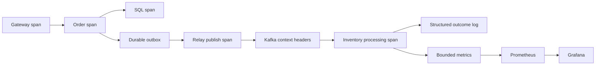

# Chapter 24 — Observability, SLOs, and evidence-led diagnosis

## 1. Lesson title
Follow a distributed order from customer request to durable outcome, and detect when the system fails its promises.

## 2. Interview priority
P0. A senior engineer turns “it is slow” into evidence, a bounded hypothesis, and a useful next action.

## 3. Prerequisites
HTTP, Kafka, database transactions, timeouts, and Chapter15's operational signals. A percentile describes a position in a distribution: p99 is a threshold below which about99% of observed values fall.

## 4. Learning objectives
Choose logs/metrics/traces appropriately, instrument useful boundaries, control cardinality, define SLIs/SLOs/error budgets, investigate asynchronous delays, and design actionable dashboards.

## 5. Official references and versions
- [OpenTelemetry signals](https://opentelemetry.io/docs/concepts/signals/): signal roles.
- [Boot observability](https://docs.spring.io/spring-boot/reference/actuator/observability.html): Micrometer Observation.
- [Boot metrics](https://docs.spring.io/spring-boot/reference/actuator/metrics.html): registries and export.
- [Prometheus histograms](https://prometheus.io/docs/practices/histograms/): aggregation and quantiles.
- [Grafana dashboard practices](https://grafana.com/docs/grafana/latest/visualizations/dashboards/build-dashboards/best-practices/).
- [Google SRE: implementing SLOs](https://sre.google/workbook/implementing-slos/): primary engineering supplement.

Checked2026-10-24. Live Boot docs4.1.2 do not upgrade the proposed4.1.1 baseline. Collector/backend versions remain unselected. The query below deliberately uses classic histogram buckets; it is not a native-histogram example.

## 6. First principles
Monitoring asks known questions, such as whether errors exceed a threshold. Observability supports investigating internal behavior from emitted evidence, including questions not anticipated when the system was built. Neither is achieved simply by installing a dashboard.

Logs record discrete facts with context: an order entered RECONCILING or a retry budget expired. Metrics summarize observations: request rate, error count, latency distribution, queue depth. Traces connect timed operations across boundaries: Gateway to Order to PostgreSQL, followed by publication and consumption.

“How many requests failed?” is a metric question. “Which order failed?” is a structured-log question. “Where was this request delayed?” is a trace question. “Which code consumed CPU?” is a profiling question. Combining signals is more effective than trying to answer everything from logs.

An SLI is a measurement of service behavior. An SLO is its target over a specified window. An SLA is a contractual commitment, often with consequences. For this project, HTTP acceptance latency and order completion latency are different SLIs. A fast202 response can coexist with an hour-long inventory backlog.

Define eligibility carefully. Does a rejected invalid request count as a service failure? Does an unknown payment count as completed? Does the denominator include requests lost before reaching the server? The answer depends on the promise and measurement location. A vague SLO produces a reassuring number that may describe the wrong thing.

## 7. Internal architecture
Instrumentation captures application observations. A metrics registry aggregates them; an exporter or scrape endpoint exposes them. An OpenTelemetry SDK/agent can produce traces and other signals, often through a Collector that batches, filters, and exports. Grafana queries telemetry backends and presents results.

A trace ID identifies a causal trace; each span has its own ID, timing, and context. Across Kafka, propagate suitable context in headers and decide whether processing is a child span or linked asynchronous work. A replay hours later should preserve causation without pretending that the original synchronous request is still running.

Thread-local context does not automatically cross every executor, reactive boundary, or manually created thread. Use supported propagation and test the actual path. An order ID must remain queryable independently because traces can be sampled or expire.

A counter accumulates occurrences. A gauge measures current state. A timer records durations and count. A histogram assigns observations to buckets so compatible measurements can be aggregated. Client-side summary quantiles generally cannot be averaged across instances to calculate a fleet percentile.

Cardinality is the number of distinct label combinations. Ten routes ×five outcomes ×four regions ×twenty instances yields4,000 combinations before histogram buckets. Adding one million order IDs can multiply storage and query work catastrophically. Keep IDs in logs/traces; use bounded labels in metrics.

## 8. Diagrams

The relay may run in another process much later. Persist business correlation deliberately; an in-memory trace context does not survive by itself.

## 9. Java21 implementation
This complete Micrometer component measures processing attempts. It requires micrometer-core through the Boot observability/Actuator stack. It does not pretend a method return is automatically a database commit.

```java
import java.time.Duration;
import java.util.EnumMap;
import java.util.Locale;
import java.util.Map;
import java.util.concurrent.atomic.AtomicInteger;
import java.util.function.Supplier;
import io.micrometer.core.instrument.Gauge;
import io.micrometer.core.instrument.MeterRegistry;
import io.micrometer.core.instrument.Timer;

public final class ReservationMetrics {
    public enum Outcome { SUCCESS, FAILURE }
    private final MeterRegistry registry;
    private final AtomicInteger active = new AtomicInteger();
    private final Map<Outcome, Timer> timers =
        new EnumMap<>(Outcome.class);

    public ReservationMetrics(MeterRegistry registry) {
        this.registry = registry;
        Gauge.builder("inventory.reservation.active",
                active, AtomicInteger::get)
            .description("Currently executing reservation attempts")
            .register(registry);
        for (Outcome outcome : Outcome.values()) {
            timers.put(outcome,
                Timer.builder("inventory.reservation.attempt")
                    .tag("outcome", outcome.name().toLowerCase(Locale.ROOT))
                    .serviceLevelObjectives(Duration.ofMillis(50),
                        Duration.ofMillis(200), Duration.ofSeconds(1))
                    .publishPercentileHistogram()
                    .register(registry));
        }
    }

    public <T> T observe(Supplier<T> operation) {
        Timer.Sample sample = Timer.start(registry);
        Outcome outcome = Outcome.FAILURE;
        active.incrementAndGet();
        try {
            T result = operation.get();
            outcome = Outcome.SUCCESS;
            return result;
        } finally {
            sample.stop(timers.get(outcome));
            active.decrementAndGet();
        }
    }
}
```

The enum bounds outcome cardinality. Meters are registered once. The object observed by the gauge remains strongly reachable. A retry creates another attempt observation, which is why the metric name says attempt.

Success means the supplied function returned normally. If that function submits asynchronous work or returns before transaction commit, the observation does not prove a durable reservation. Instrument the true completion boundary or add a separately named committed-outcome metric. Metrics can be lost during crashes and are not an audit ledger.

## 10. Spring Boot integration
Actuator provides management capabilities; Micrometer connects instrumentation to registries. With a Prometheus registry dependency, a local learning configuration can expose selected endpoints:

```yaml
management:
  endpoints:
    web:
      exposure:
        include: health,prometheus
  endpoint:
    health:
      show-details: never
```

This is not complete access control. Network placement, authentication, authorization, and management-port isolation remain deployment decisions. Do not expose heap dumps or configuration details to untrusted users.

Avoid duplicate spans from overlapping agent and manual instrumentation. Verify that HTTP clients, database calls, Kafka operations, and custom business spans produce one understandable hierarchy.

## 11. Production scenario
Users see accepted orders but shipping never begins. HTTP dashboards are healthy. The order-completion SLI degrades; outbox age is normal; Inventory's oldest unprocessed event grows; SQL lock waits correlate with one popular SKU.

Inspect the blocking transaction and reservation concurrency. Restarting every service may destroy useful evidence and add replay load. Mitigate the contention, observe recovery, and reconcile unfinished orders. A good dashboard narrows the search; it does not prove causation automatically.

## 12. HLD considerations
Each service needs rates, errors, duration, saturation, dependency timings, backlog age, and durable workflow-state measurements. Asynchronous freshness measured with event timestamps depends on clock assumptions; document whether the timestamp is producer time, broker time, or authoritative database time.

Dashboards should move from customer outcome to service behavior to dependency internals. Every graph needs units, aggregation, time window, and scope. A panel titled “latency” without units and percentile is ambiguous during an incident.

Choose retention and sampling based on questions and cost. Head sampling decides early; tail sampling can consider completed trace outcomes but requires buffering. Sampled traces are not automatically a representative basis for financial or business counts.

## 13. LLD considerations
Structured logs should include service/version, environment, operation, outcome, sanitized error category, and correlation identifiers. Avoid tokens, secrets, payment data, and unnecessary personal content.

MDC-style context must be restored/cleared when scopes end; reused threads can otherwise log the wrong order identity. Encapsulate setup and cleanup instead of scattering mutable context operations.

Use normalized route labels such as /orders/{id}. Raw paths or arbitrary exception messages create unbounded series. Prefer stable error categories over free-text labels.

## 14. Reliability
Telemetry pipelines fail too. Bound export queues and understand drop/block behavior so a backend outage does not exhaust application memory. Alert on missing telemetry separately from zero traffic; no data is not the same as no errors.

An actionable alert identifies user impact, owner, evidence, and first response steps. High CPU is often diagnostic rather than sufficient reason to page. Fast consumption of a user-facing error budget is usually a better escalation signal.

For a99.9% success SLO, the permitted bad fraction is0.1%. Across1,000,000 eligible requests, the budget is1,000 bad requests. A current1% bad fraction burns the budget at10 times the allowed rate. Multiple windows help separate transient spikes from sustained problems. These are illustrative calculations, not measured project results.

## 15. Performance
Telemetry consumes CPU, memory, bandwidth, and storage. Benchmark with representative instrumentation enabled. Capturing every payload as an attribute can dominate cost and expose private data.

For the timer above, after checking exported names, a classic histogram query is:

```promql
histogram_quantile(
  0.95,
  sum by (le) (
    rate(inventory_reservation_attempt_seconds_bucket[5m])
  )
)
```

Aggregate bucket rates before estimating the percentile. Preserve service/route dimensions in sum by when comparing different workloads. Bucket boundaries determine precision. Averaging per-instance p95 values does not produce a correct fleet p95.

Averages hide tails:99 requests at10ms and one at5seconds have a mean59.9ms, which does not describe the slow user's experience. Inspect distributions and timeouts, not only means.

## 16. Ten study questions with model answers
1. **Which signal should I use?** Metrics reveal aggregate changes; logs explain discrete outcomes; traces connect causality and timing. Link them without forcing every identifier into every metric.
2. **Why not label by orderId?** Each distinct ID expands the time-series set. Search logs/traces by ID and keep metric labels bounded.
3. **Why is202 latency insufficient?** It measures acceptance. A durable asynchronous workflow also needs completion/freshness SLIs.
4. **Can we average pod p99 values?** Generally no. Percentiles do not combine that way; aggregate compatible histograms first.
5. **Does a successful span prove commit?** Only if the instrumented boundary includes that commit. A method that returns before asynchronous completion can be misleading.
6. **What is an error budget?** The allowed bad service under the SLO over its window. It guides reliability priorities, not permission to ignore failures.
7. **Why preserve context through Kafka?** It connects asynchronous causation. Keep business correlation separately because traces have different sampling and retention.
8. **What if export fails?** Bound buffering and monitor drops/backpressure. Diagnostic export must not create an uncontrolled application outage.
9. **How do you investigate latency?** Establish scope/time, correlate rates/errors/traces/saturation, form a hypothesis, and test a targeted change. Avoid random tuning.
10. **What makes an alert useful?** Timely action can reduce user impact, and the alert identifies an owner and evidence. Non-actionable pages create fatigue.

## 17. Worked exercise
InstanceA handles990 requests at20ms. InstanceB handles10 requests at2seconds. A dashboard averages their p95 values and reports about1.01seconds.

Solution: the averaging is invalid because the populations differ. Use merged observations or compatible buckets. Investigate whether slow traffic is concentrated by route, customer segment, or dependency. A fleet percentile can still hide a badly affected minority.

Now define “orders reach a known terminal state within two minutes.” Specify eligibility, start/end times, unknown-payment treatment, missing data, and measurement delay. Expected output is a precise SLI contract, not merely a dashboard title.

## 18. Verification and execution status
The class, YAML, and queries are unexecuted. Use a test registry to assert successful/failed attempt counts, zero active work after exceptions, and bounded meter count across many order IDs. Run an order through HTTP/outbox/Kafka and inspect correlation. Disable telemetry export and verify bounded behavior. No dashboard or measured SLO is claimed.

## 19. Common misconceptions
A dashboard alone is not observability. Missing logs do not prove zero errors. Trace IDs are not durable order IDs. Percentiles cannot usually be averaged. A healthy process does not prove completed business work.

## 20. Unanswered assessment
HTTP success is99.99%, Kafka lag is low, but many orders remain PAYMENT_UNKNOWN. Define the SLI, diagnostic signals, and alert that reveal the failure.

## 21. Revision summary
Measure actual promises, instrument durable boundaries, keep labels bounded, connect asynchronous evidence, and diagnose with hypotheses.

## 22. Next lesson
Chapter25 turns expectations into automated tests and a controlled release pipeline.

