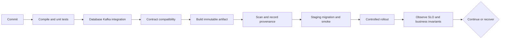

# Chapter 25 — Testing, Maven, CI/CD, and safe releases

## 1. Lesson title
Turn business guarantees into executable evidence and promote one verified artifact through a controlled delivery process.

## 2. Interview priority
P0. Strong engineers explain what each test proves, what it cannot prove, and which failure would escape the suite.

## 3. Prerequisites
Java21, local transactions, the OrderWriter example in Chapter12, Docker, schemas, and observability.

## 4. Learning objectives
Choose unit/integration/contract/end-to-end/failure tests, use JUnit6 and Mockito appropriately, test PostgreSQL/Kafka with real dependencies, understand Maven phases, and design release/rollback evidence.

## 5. Official references and version notes
- [JUnit6.0.3 overview](https://docs.junit.org/6.0.3/overview.html).
- [Mockito official site](https://site.mockito.org/): testing doubles and documentation entry point.
- [Testcontainers PostgreSQL](https://java.testcontainers.org/modules/databases/postgres/).
- [Testcontainers Kafka](https://java.testcontainers.org/modules/kafka/).
- [PostgreSQLContainer2.0.5 source](https://raw.githubusercontent.com/testcontainers/testcontainers-java/2.0.5/modules/postgresql/src/main/java/org/testcontainers/postgresql/PostgreSQLContainer.java).
- [Boot Testcontainers integration](https://docs.spring.io/spring-boot/reference/testing/testcontainers.html).
- [Maven lifecycle](https://maven.apache.org/guides/introduction/introduction-to-the-lifecycle.html).
- [GitHub Maven workflow](https://docs.github.com/en/actions/tutorials/build-and-test-code/java-with-maven).
- [GitHub secure workflow use](https://docs.github.com/en/actions/reference/security/secure-use).

Checked2026-10-24. JUnit6 is explicitly approved; Jupiter APIs retain org.junit.jupiter package names. The referenced Testcontainers2.0.5 modules use testcontainers-postgresql/testcontainers-kafka artifact names. Proposed Boot4.1.1 remains unchanged; live Boot docs show4.1.2. Resolve the real Maven dependency tree before executing examples.

## 6. First principles
A test is an experiment with a claim, controlled inputs, an action, and an observable result. “The method was called” is weaker than “the order and outbox committed together.” Choose observations that match the guarantee.

A unit test isolates a small piece of logic, such as an order state transition. An integration test checks a real boundary, such as SQL constraints and transactions. A contract test checks the assumptions between independently deployed components. An end-to-end test exercises a user journey across the deployed system. A failure test interrupts a boundary to verify recovery.

These categories overlap and their names vary across teams. The important question is what is real, what is substituted, and what evidence is asserted.

Mocks are programmed substitutes. Mockito can force a provider timeout or verify a command identity without calling a real provider. A mocked repository cannot prove PostgreSQL locking, SQL syntax, JPA flush behavior, or uniqueness under concurrency. Use a real database when those mechanisms are the subject.

A fake implements simplified behavior, such as an in-memory simulated payment provider with stable operation IDs. It can support workflow tests, but its behavior must not be mistaken for every real provider's guarantees.

## 7. Internal architecture
JUnit Platform discovers and executes test engines. Jupiter supplies the modern programming/extension model. Maven's test plugins invoke the platform as configured by the build.

Maven phases form an ordered lifecycle. compile precedes test; package creates an artifact; verify performs configured verification after integration-test-related phases. Merely naming a file SomethingIT does not ensure it runs: configure the appropriate plugin and inspect reports. Surefire commonly handles unit tests, Failsafe integration-test/verify. A build with zero discovered tests can appear green without validating the intended behavior.

Testcontainers starts actual service containers, discovers mapped addresses, and tears them down under its lifecycle. Use returned JDBC/bootstrap addresses rather than assuming localhost ports. A mapped host address and a container-network address are different.

Spring test slices load focused infrastructure; @SpringBootTest loads a broader application context. Choose the smallest context that proves the claim. Starting the full application for arithmetic makes the suite slow; using a pure mock for transaction isolation makes it misleading.

For asynchronous tests, trigger the operation, wait within a bounded deadline for an observable condition, then assert the final invariant. Fixed sleeps can be both unnecessarily slow and flaky. A timeout should report useful diagnostics such as current order state and outstanding events.

## 8. Diagrams

The promoted artifact should be the one tested. Rebuilding separately for production creates another unverified input.

## 9. Java21 integration test
This complete test uses OrderWriter from Chapter12 and PostgreSQLContainer2.0.5. Required test dependencies are JUnit Jupiter, testcontainers-postgresql, and the PostgreSQL JDBC driver, managed consistently by the build. Docker must be available.

```java
import static org.junit.jupiter.api.Assertions.assertEquals;
import static org.junit.jupiter.api.Assertions.assertThrows;

import java.util.concurrent.CountDownLatch;
import java.util.concurrent.Executors;
import java.util.concurrent.TimeUnit;
import org.junit.jupiter.api.Test;
import org.postgresql.ds.PGSimpleDataSource;
import org.testcontainers.postgresql.PostgreSQLContainer;

class OrderWriterTest {
    @Test
    void concurrentRetriesCreateOneOrderAndOneEvent() throws Exception {
        try (var postgres = new PostgreSQLContainer("postgres:18")) {
            postgres.start();
            var dataSource = new PGSimpleDataSource();
            dataSource.setURL(postgres.getJdbcUrl());
            dataSource.setUser(postgres.getUsername());
            dataSource.setPassword(postgres.getPassword());
            dataSource.setConnectTimeout(5);
            dataSource.setSocketTimeout(10);
            dataSource.setOptions(
                "-c statement_timeout=10000 -c lock_timeout=5000");
            try (var c = dataSource.getConnection();
                 var s = c.createStatement()) {
                s.execute("""
                    CREATE TABLE demo_orders (
                      order_id uuid PRIMARY KEY,
                      request_key text NOT NULL UNIQUE,
                      request_body text NOT NULL,
                      status text NOT NULL)
                    """);
                s.execute("""
                    CREATE TABLE demo_outbox (
                      event_id uuid PRIMARY KEY,
                      aggregate_id uuid NOT NULL REFERENCES demo_orders,
                      event_type text NOT NULL,
                      payload text NOT NULL,
                      created_at timestamptz NOT NULL DEFAULT now(),
                      published_at timestamptz)
                    """);
            }
            OrderWriter writer = new OrderWriter(dataSource);
            CountDownLatch start = new CountDownLatch(1);
            var pool = Executors.newVirtualThreadPerTaskExecutor();
            try {
                var first = pool.submit(() -> {
                    start.await();
                    return writer.accept("request-100", "sku=A;qty=1");
                });
                var second = pool.submit(() -> {
                    start.await();
                    return writer.accept("request-100", "sku=A;qty=1");
                });
                start.countDown();
                assertEquals(first.get(20, TimeUnit.SECONDS),
                             second.get(20, TimeUnit.SECONDS));
            } finally {
                pool.shutdownNow();
                if (!pool.awaitTermination(5, TimeUnit.SECONDS)) {
                    throw new AssertionError("Database workers did not stop");
                }
            }
            assertThrows(IllegalArgumentException.class,
                () -> writer.accept("request-100", "sku=A;qty=2"));
            try (var c = dataSource.getConnection();
                 var s = c.createStatement();
                 var rs = s.executeQuery("""
                    SELECT (SELECT count(*) FROM demo_orders),
                           (SELECT count(*) FROM demo_outbox)
                    """)) {
                rs.next();
                assertEquals(1L, rs.getLong(1));
                assertEquals(1L, rs.getLong(2));
            }
        }
    }
}
```

The latch releases both requests together, increasing the chance of exercising concurrent uniqueness. One run is not exhaustive concurrency proof; the database constraint is the mechanism and the test checks its integration with our code. Add repeated/concurrent cases and transaction-failure tests when implementing the milestone.

The future waits, JDBC connection/socket timeouts, server statement/lock timeouts, and bounded executor termination cover different waits. shutdownNow requests interruption; it cannot force arbitrary blocking code to stop. We deliberately avoid ExecutorService.close here because it waits for task termination without our five-second cleanup bound. Container startup/teardown has its own lifecycle limits, so the two future deadlines are not a hard deadline for the whole test process. Configure a CI job timeout as a final outer bound and preserve diagnostics on failure.

postgres:18 is an illustrative major tag. Pin an approved exact image/digest for reproducibility after compatibility verification. The referenced container implementation disables fsync for its default test configuration: this test proves SQL/transaction logic, not physical crash durability. That is an important boundary of the evidence.

## 10. Spring Boot integration
Boot's service-connection support can supply connection details from supported containers. This reduces hand-written test property plumbing, but it does not configure your domain migrations or assertions automatically.

Use Mockito for controlled dependency outcomes: provider accepts, rejects, times out, or returns a previously completed operation. Assert that retries preserve paymentOperationId. Avoid verifying every internal method call; refactoring should not break tests that only care about stable business behavior.

A @Transactional test can roll back before a real commit path is exercised. Explicitly test commit-time constraints, after-commit publication behavior, and lazy access outside the transaction where relevant.

## 11. Production scenario
A release passes mocked repository tests but fails under two simultaneous checkout requests. Both requests read “no existing order,” then insert. The missing unique constraint permits duplicates.

The correct prevention combines database uniqueness, a transaction-aware implementation, and an integration test like the one above. The lesson is not to abandon unit tests; it is to test each mechanism at the level where it exists.

Another release changes an event enum and breaks an older consumer. Contract fixtures and the writer/reader matrix from Chapter13 catch a class of failure that a happy-path end-to-end test using only the newest versions can miss.

## 12. HLD considerations
Use a layered evidence strategy. Many fast domain tests cover state transitions; focused integration tests cover data and messaging; contract tests protect independent deployment; a smaller end-to-end suite proves critical journeys; failure/performance suites run under explicit environments and budgets.

Test the unhappy paths that threaten invariants: duplicate request, outbox relay crash, DB commit before checkpoint, payment timeout, compensation failure, schema mismatch, stale cache, rolling deployment, and region recovery. Map each risk to at least one evidence source.

## 13. LLD considerations
Inject Clock, identifier suppliers, provider ports, and retry policy where they make nondeterminism controllable. Avoid global mutable test fixtures and shared group IDs that cause parallel tests to steal each other's messages.

A good assertion names business meaning: one reservation per operation, nonnegative stock, stable order response for a repeated key. An assertion that a private helper ran twice usually tests implementation shape.

Keep test data small but adversarial. Include changed payload under the same idempotency key, out-of-order events, unknown outcomes, and duplicate compensation. Large random datasets are not a replacement for carefully chosen counterexamples.

## 14. Reliability and CI/CD
Continuous integration merges changes into an always-validated codebase. Continuous delivery keeps a releasable artifact ready; continuous deployment automatically releases eligible changes. Decide the rollout policy explicitly.

A minimal educational GitHub Actions workflow, to add only after a Maven project exists:

```yaml
name: verify
on:
  push:
  pull_request:
permissions:
  contents: read
jobs:
  verify:
    runs-on: ubuntu-latest
    steps:
      - uses: actions/checkout@v6
      - uses: actions/setup-java@v4
        with:
          distribution: temurin
          java-version: '21'
          cache: maven
      - run: mvn --batch-mode --no-transfer-progress verify
```

Major action tags are readable teaching references, not immutable supply-chain pins. Review and pin full commit SHAs for a controlled workflow; use the Maven Wrapper once installed/pinned. Do not expose deployment credentials to untrusted pull-request code. Prefer short-lived workload identity for cloud authentication where supported.

Database migration rollback differs from application rollback. Use expand/contract: add compatible schema, deploy code that tolerates old/new forms, migrate data, then remove old structures after the compatibility window. A destructive column drop cannot be undone merely by redeploying yesterday's JAR.

## 15. Performance
A slow/flaky suite encourages bypass. Measure duration by stage, isolate tests, reuse safe infrastructure at an appropriate scope, and parallelize only when data/resources are independent. Do not hide failures with unlimited reruns.

Build cache and dependency cache accelerate work but are not proof of reproducibility. Pin build inputs, record JDK/Maven/dependency versions, and occasionally validate a clean build. An immutable artifact digest connects test evidence to the deployed binary.

Canary rollout compares a limited new version against the baseline under representative traffic. Monitor errors, latency, and business outcomes; a canary receiving only easy requests provides weak evidence.

## 16. Ten study questions with model answers
1. **Why aren't mocks enough?** They implement assumptions you programmed. They cannot reveal real SQL, locking, serialization, or broker coordination behavior.
2. **Why not make every test end-to-end?** Such tests are slower, harder to diagnose, and vulnerable to unrelated failures. Use them for critical journeys while focused tests cover mechanisms.
3. **Does JUnit6 require new package names?** Jupiter APIs remain under org.junit.jupiter. Use the approved managed versions and a compatible runtime/build plugin rather than mixing artifacts manually.
4. **What does Testcontainers prove?** Real service integration under the container's configuration. It does not automatically prove multi-zone resilience or production storage durability.
5. **Why use bounded polling?** Asynchronous completion time varies. Wait for the required condition within a deadline and report current evidence when it fails.
6. **What is a contract test?** A check of assumptions exchanged between components, including schema and semantics. It helps prevent independent deployments from breaking each other.
7. **Why can a green build be misleading?** Tests may not be discovered, integration phases may not run, or assertions may only check mocks. Inspect report counts and evidence.
8. **Why promote one artifact?** Rebuilding changes inputs and can produce a different binary. A digest ties validation to the deployed object.
9. **Why isn't rollback always easy?** Data/schema/events may have changed irreversibly. Design compatibility windows and forward recovery before release.
10. **How do you handle flaky tests?** Classify the nondeterminism, preserve diagnostics, fix timing/isolation assumptions, and track quarantine ownership if necessary. Repeated retries alone hide lost confidence.

## 17. Worked exercise
A Kafka integration test publishes an event, sleeps500ms, and checks a database row. It fails intermittently in CI but passes locally.

Solution: identify whether the consumer was assigned before publication, whether its group/offset policy sees the record, whether the DB transaction committed, and whether another test shares the group. Replace the fixed sleep with bounded condition polling and diagnostic output. Use unique topic/group/data identities where isolation requires them.

Expected result: the test fails only when its business condition remains unmet within a justified deadline, and its report shows the actual state. Do not merely increase the sleep to30seconds.

## 18. Verification and execution status
The test and workflow are unexecuted notes; no pipeline is installed. Later run mvn test and mvn verify, inspect Surefire/Failsafe reports and discovered test counts, and capture environment versions. Run the concurrent request test against the actual OrderWriter, then force an outbox insert failure and verify rollback. Docker availability and image downloads remain prerequisites.

## 19. Common misconceptions
Code coverage is not correctness coverage. Mocked SQL success is not database evidence. A container is not a production cluster. A green status with zero relevant tests proves little. Reverting code does not undo committed business data.

## 20. Unanswered assessment
A new release passes all tests but duplicates payments after consumer restart. Which missing test boundary and business invariant would you add first, and how would you inject the failure?

## 21. Revision summary
Test at the mechanism's real boundary, assert outcomes, control nondeterminism, verify discovery, and connect release evidence to one immutable artifact.

## 22. Next lesson
Chapter26 explains the distributed-system theory behind consistency, coordination, retries, and ownership.

