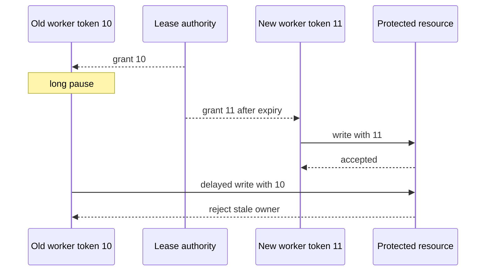

# Chapter 26 — Distributed-systems theory applied to real decisions

## 1. Lesson title
Use consistency, coordination, clocks, and failure models to explain why a design succeeds or fails.

## 2. Interview priority
P0 for applied reasoning; P1 for detailed consensus proofs. This is technology/system-design learning, not a DSA interview track.

## 3. Prerequisites
Partial failure, local transactions, replication, Kafka guarantees, Saga, and network timeouts.

## 4. Learning objectives
Apply CAP/PACELC accurately, distinguish consistency models, reason about quorum assumptions, explain Raft and two-phase commit at mechanism level, and design deadlines, bulkheads, retries, and fencing.

## 5. Official and primary references
- [Gilbert and Lynch: CAP paper](https://www.comp.nus.edu.sg/~gilbert/pubs/BrewersConjecture-SigAct.pdf).
- [Abadi: PACELC](https://www.cs.umd.edu/~abadi/papers/abadi-pacelc.pdf).
- [Ongaro and Ousterhout: Raft](https://raft.github.io/raft.pdf).
- [Lamport: Time, Clocks, and Ordering](https://lamport.azurewebsites.net/pubs/time-clocks.pdf).
- [PostgreSQL18 PREPARE TRANSACTION](https://www.postgresql.org/docs/18/sql-prepare-transaction.html).
- [AWS: timeouts, retries, backoff, jitter](https://aws.amazon.com/builders-library/timeouts-retries-and-backoff-with-jitter/), explicitly identified primary engineering supplement.
- [Java21 System.nanoTime](https://docs.oracle.com/en/java/javase/21/docs/api/java.base/java/lang/System.html#nanoTime()).

Links checked2026-10-24. Research papers establish models, not current product defaults. The unavailable Princeton CAP mirror was replaced by the author's accessible copy. Project scenarios below are original applications of these ideas.

## 6. First principles
A distributed process cannot directly inspect another process's memory or know immediately whether it crashed. It sees messages and time passing. If a response does not arrive, the remote operation may be slow, disconnected, completed with a lost response, or never started. This uncertainty is the starting point of reliable design.

Safety means something forbidden never happens: no negative authoritative stock or two conflicting owners both accepted. Liveness means useful work eventually progresses under stated assumptions. A system that rejects every order preserves stock safety but provides no useful liveness. A system that accepts every order during isolation may be responsive while overselling.

Consistency describes what values and ordering an observer may see. Linearizability makes operations appear to take effect at a point between invocation and response while respecting real-time precedence. Serializability concerns equivalence to a serial transaction execution; it does not alone promise the same real-time ordering. Eventual consistency requires convergence under suitable conditions, but “eventual” alone specifies no useful deadline.

Read-your-writes is a session-oriented promise: after changing an address, that user should see the change. Monotonic reads prevent that user's view from moving backward. Causal consistency preserves relevant cause-before-effect relationships. Choose the smallest guarantee that satisfies each operation's invariant, and state it precisely.

CAP says that under network partitions, the formal model cannot guarantee both linearizable responses and availability for every request to a nonfailed node. It is not a permanent “pick any two” menu or a statement about normal uptime percentages. PACELC additionally highlights latency-versus-consistency choices when no partition is present. These summaries come from the primary papers; the commerce decisions below require their own business assumptions.

## 7. Internal architecture
### Quorums and coordination
A quorum is a required set of participants. In a simple fixed-replica model with N copies, read sizeR and write sizeW such that R+W>N ensure read/write set intersection. Intersection alone does not establish linearizability: version selection, concurrent writes, failure behavior, membership changes, and repair matter.

For N=3,R=2,W=2, a read overlaps an acknowledged write somewhere. If replicas return conflicting versions, the client still needs a correct rule. If a system writes to substitute nodes during failure, the original intersection assumption may no longer describe the actual participants.

Raft organizes replicated-log agreement around leader election, log replication, and safety rules. Terms distinguish leadership generations; candidates need votes, leaders replicate entries, and committed entries are applied in order. Election restrictions and log matching preserve committed history. A majority supports progress under the protocol's conditions; two isolated minorities cannot both form majorities of one fixed configuration. Membership changes need protocol support rather than arbitrary edits to a voter list. This conceptual summary does not implement Raft.

### Atomic commitment
Two-phase commit asks participants to prepare, then records/distributes a commit or abort decision. A prepared participant may retain locks/resources while awaiting resolution. Coordinator recovery and durable decision records therefore matter. It is not equivalent to consensus, though an implementation can use consensus to make coordination more resilient.

For commerce, external providers do not necessarily participate in the same transaction protocol. The Saga/outbox design makes local commits and compensation explicit instead of assuming global atomicity. PostgreSQL prepared transactions should only be used with a transaction manager and operational recovery plan; abandoned prepared work can create long-lived problems.

### Time and failure detection
Physical clocks can drift or step. Logical clocks track ordering relationships without pretending to know universal wall-clock truth. Lamport timestamps preserve the direction of happened-before, but a smaller timestamp does not prove causation. Timestamps alone do not solve all concurrent-update conflicts.

Use monotonic elapsed-time measurement such as System.nanoTime for local duration comparisons. Its origin is arbitrary and cannot be compared across machines as a global timestamp. Persist business times with a defined clock source and uncertainty assumptions.

## 8. Diagrams

The resource enforces the token. Checking a lease only at the worker does not prevent a paused worker from sending a stale request later.

## 9. Java21 implementation
This complete local simulation demonstrates resource-side fencing. It is not a distributed lock service or consensus implementation.

```java
public final class FencingDemo {
    static final class FencedValue {
        private long highestToken = -1;
        private String value = "initial";

        public synchronized void write(long token, String replacement) {
            if (token < 0 || replacement == null) {
                throw new IllegalArgumentException("Invalid write");
            }
            if (token < highestToken) {
                throw new IllegalStateException("Stale owner token " + token);
            }
            highestToken = token;
            value = replacement;
        }

        public synchronized String read() {
            return value;
        }
    }

    public static void main(String[] args) {
        FencedValue resource = new FencedValue();
        resource.write(10, "old owner's earlier value");
        resource.write(11, "new owner's value");
        try {
            resource.write(10, "old owner's delayed value");
            throw new AssertionError("Stale write unexpectedly accepted");
        } catch (IllegalStateException expected) {
            System.out.println(expected.getMessage());
        }
        if (!"new owner's value".equals(resource.read())) {
            throw new AssertionError("New value was overwritten");
        }
        System.out.println(resource.read());
    }
}
```

Tokens10 and11 stand in for monotonically increasing grants from a reliable authority. The protected resource atomically compares and stores the highest token with the update. If that state is lost on resource restart, the guarantee is lost too; a real implementation must make it durable.

Equal-token writes are allowed because one owner may issue multiple writes. Fencing does not deduplicate operations or order all requests from the same owner. Add operation IDs and expected versions when those invariants require them. A stale token can also arrive before the resource has seen a newer token; define acquisition/use protocols so the promised ownership boundary is actually enforced.

## 10. Spring Boot integration
Retry, circuit-breaker, time-limit, and bulkhead libraries can wrap calls, but annotations do not select safe business semantics. Keep the operation identity and deadline in explicit request context.

A circuit breaker temporarily rejects calls based on recent failures and later permits probes. It protects capacity and recovery; it does not prove a dependency is dead. A fallback must preserve the API's truth: returning “payment approved” during provider failure is not a valid availability feature.

A bulkhead isolates resources such as concurrency permits or pools so a slow dependency cannot occupy every worker. Combine it with bounded queues and admission control. A huge queue can turn an isolated failure into minutes of stale work.

## 11. Production scenario
Two regions independently accept reservation of the last unit during a partition. Both had cached stock=1. After reconnecting, merging two decrements yields stock=-1 or two promised deliveries.

The design must choose: route authoritative reservation to one coordinated owner and sometimes reject/defer unreachable requests; allocate independent regional stock quotas beforehand; or permit overselling and define an explicit business correction. A “CP database” label does not choose the product behavior for you.

Catalog browsing can tolerate stale descriptions more readily than authoritative stock reservation. Different operations in one application can make different consistency/availability choices.

## 12. HLD considerations
Put strong invariants near an authority that can enforce them. Cross-service invariants require coordination, reservation, escrow-like allocation, or reconciliation depending on the business. Minimize the number of participants on latency-critical decisions.

A cross-region synchronous write pays communication delay and failure coupling. An asynchronous replica improves local responsiveness but may be stale. Evaluate latency, failure tolerance, conflict handling, RPO, and user expectations together.

Avoid a simplistic consistency label for an entire product: read modes, write modes, transactions, failover, and configuration can provide different guarantees. State the exact operation and failure model.

## 13. LLD considerations
A retry policy needs retryable error classes, stable idempotency identity, attempt/time budget, backoff, jitter, and cancellation behavior. Validation errors are not repaired by retry. A request timeout does not necessarily cancel remote execution.

Propagate an overall deadline. If the caller has500ms left, a downstream client with a fresh two-second timeout cannot satisfy the caller's budget. Subtract time already spent, reserve response overhead, and reject work that cannot reasonably finish.

Retries at multiple layers multiply. Three attempts at each of three nested call layers can produce27 deepest calls for one original request. Centralize the retry owner where practical and measure retry traffic separately from original traffic.

## 14. Reliability
A lease has an expiration condition under clock and communication assumptions. A process can pause beyond that lease and resume unaware that a replacement exists. Fencing handles stale writes at the resource; merely deleting a Redis key on release does not establish this guarantee.

Hedged requests send another attempt before the first completes to reduce tail latency. They increase load and are risky for non-idempotent effects. Use only with an explicit budget, cancellation understanding, and safe operation semantics.

Failure detectors trade sensitivity against false suspicion. Aggressive timeouts react faster but can create unnecessary failovers during pauses or congestion. Test slow responses, asymmetric partitions, and delayed messages—not only process termination.

## 15. Performance
Coordination costs network round trips and resource waiting. Reducing participants, moving computation near data, and avoiding unnecessary strong reads may improve latency without weakening required invariants.

Suppose a request makes three sequential80ms calls plus40ms local work: the simple baseline is280ms before queueing and variation. Parallel independent calls could reduce the dependency portion toward80ms, but correlated failures and concurrency capacity still matter. Never parallelize steps whose results establish prerequisites for later actions.

Backoff reduces repeated pressure; jitter spreads synchronized retries. Neither creates new server capacity. Admission control may be necessary when arrivals exceed sustainable work.

## 16. Ten study questions with model answers
1. **What does CAP actually constrain?** Simultaneously guaranteeing the formal availability and linearizability properties during partitions. It is not a general three-checkbox technology ranking.
2. **Why add PACELC?** Even healthy distributed communication has latency costs. Failure-time trade-offs do not describe every normal-operation decision.
3. **Does R+W>N prove linearizability?** It proves an intersection under specific membership assumptions. Correct ordering/version/recovery behavior still needs an appropriate protocol.
4. **Consensus versus two-phase commit?** Consensus agrees on values/log history despite specified failures; atomic commit coordinates a transaction's decision across participants. They solve related but different problems.
5. **Why can a lease holder become stale?** It may pause beyond expiry and resume after replacement. The protected resource must reject obsolete ownership where required.
6. **Do timestamps establish causality?** Wall clocks may disagree; logical clocks provide particular ordering properties. A numerical comparison alone does not identify every causal relationship.
7. **Why is timeout not failure proof?** The operation may have committed and lost its response. Preserve operation identity and reconcile uncertain outcomes.
8. **Why can retries worsen outages?** They add work to an already constrained dependency, especially when multiplied across layers. Bound attempts and elapsed time.
9. **What does a bulkhead protect?** A defined pool/concurrency budget, limiting how one failing dependency consumes shared resources. It needs bounded queues and useful rejection behavior.
10. **How do you choose consistency?** Start from the business invariant and failure consequence, then choose authority and protocol. Explain what users see during isolation and recovery.

## 17. Worked exercise
A worker holds lease10, pauses30seconds, and its lease expires after10seconds. WorkerB obtains11 and updates a shipment. WorkerA resumes and sends an old update.

Solution: a resource-side token check rejects10 after11 has established newer ownership. A worker-side “I still have my old lease object” check is insufficient. Store the highest token durably and atomically with the protected write. Add expected entity version if same-owner ordering also matters.

Now ask whether an external email provider supports fencing tokens. If not, the local mechanism cannot force it to reject stale mail. Use provider idempotency, durable intent, and documented duplicate tolerance instead of claiming a guarantee the endpoint cannot enforce.

## 18. Verification and execution status
The Java simulation is unexecuted. Later compile/run with Java21 and assert stale writes fail. For real distributed labs, inject message delay, partition, owner pause, and clock changes under controlled scope. Record safety violations and time to recovery separately. This chapter does not implement or verify a consensus protocol.

## 19. Common misconceptions
CAP availability is not an uptime percentage. Eventual consistency has no automatic deadline. Quorum arithmetic is not a full correctness proof. A timeout does not retract remote work. A lease without resource enforcement is not always sufficient ownership protection.

## 20. Unanswered assessment
A regional checkout must remain responsive during isolation while never overselling a globally limited item. Propose a precise authority/allocation model and explain what it refuses or defers.

## 21. Revision summary
State safety, liveness, observer, and failure assumptions. Put invariants at enforceable boundaries. Treat timeouts as uncertainty, retries as load, and stale ownership as a resource-side problem.

## 22. Next lesson
Chapter27 quantifies capacity and latency, then connects profiling evidence to safe optimization.

