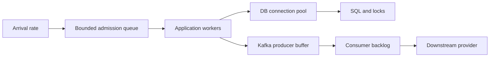

# Chapter 27 — Performance engineering, queueing, and capacity

## 1. Lesson title
Measure the bottleneck, explain the queue, and improve useful throughput without sacrificing correctness.

## 2. Interview priority
P0 for diagnosis and capacity reasoning; P1 for specialized microbenchmarking and collector tuning.

## 3. Prerequisites
Java/JVM/concurrency, database indexes, networking, Kafka, observability, and the testing model. Know that throughput is completed work per unit time and latency is elapsed time for one operation.

## 4. Learning objectives
Apply Little's Law with consistent units, distinguish saturation from CPU usage, choose load models, interpret JFR and query plans, avoid benchmark traps, and produce an honest before/after report.

## 5. Official and primary references
- [OpenJDK JMH repository](https://github.com/openjdk/jmh): benchmark harness and samples. The project website returned403; the official repository was accessible.
- [Oracle Java21 diagnostic tools](https://docs.oracle.com/en/java/javase/21/troubleshoot/diagnostic-tools.html).
- [Java21 jcmd](https://docs.oracle.com/en/java/javase/21/docs/specs/man/jcmd.html).
- [Java21 GC tuning](https://docs.oracle.com/en/java/javase/21/gctuning/introduction-garbage-collection-tuning.html).
- [PostgreSQL18 EXPLAIN](https://www.postgresql.org/docs/18/using-explain.html).
- [k6 open/closed load models](https://grafana.com/docs/k6/latest/using-k6/scenarios/concepts/open-vs-closed/).
- [MIT queueing lecture, Spring2026](https://web.mit.edu/1.041/www/lectures/L8-queuing-models-2026sp.pdf): official academic teaching source for Little's Law and queueing assumptions.

Checked2026-10-24. JMH/k6 versions are not selected or installed. All numeric workloads below are illustrative; no benchmark results are claimed.

## 6. First principles
Performance is a relationship between workload, resources, and objectives. “Fast” is incomplete: fast for which operation, payload, concurrency, data size, percentile, and failure condition?

Latency includes useful service time and waiting. A request may spend3ms computing,20ms in SQL, and400ms waiting for a connection. Optimizing the3ms loop cannot remove the400ms queue. Find where time accumulates before editing code.

Throughput and latency are related but not interchangeable. A system can complete many requests per second while some users wait a long time. A batch can improve throughput while delaying sparse requests. Define both a useful-completion rate and a latency/error target.

Little's Law relates long-run average number of items in a stable defined system to effective arrival rate and average time in that system: L=lambda×W. Use matching boundaries and units. At200 requests/s and0.25seconds average response time, average in-flight work is50 requests. This does not prove that a50-thread pool is optimal or that p99 equals the average.

If arrivals persistently exceed service capacity, a finite buffer eventually fills. A queue postpones rejection; it does not manufacture capacity. Admission control can preserve latency for accepted work instead of allowing all requests to time out after consuming resources.

## 7. Internal architecture
### Queues across the request path
A checkout can queue at the load balancer, application executor, database connection pool, database lock manager, producer buffer, Kafka partition, consumer executor, and provider. Each queue has an owner, capacity, wait budget, and cancellation behavior.

Pools limit concurrency. More database connections can increase contention and reduce total throughput. Virtual threads reduce the cost of waiting in Java but do not increase database I/O capacity or provider quotas. Bound dependency concurrency separately.

### CPU, allocation, and memory
CPU saturation can arise from business computation, serialization, encryption, GC, excessive logging, or contention. High allocation rate creates GC work even when there is no memory leak. A leak is retained memory that remains reachable unnecessarily; a short-lived allocation storm is a different problem.

Heap is not total process memory. Native buffers, thread stacks, metaspace, code cache, mapped files, and runtime overhead also matter. Container memory limits must allow the full process, not only -Xmx. CPU throttling can cause latency even when a host-level CPU graph looks comfortable.

GC tuning trades latency, throughput, footprint, and resource use. First inspect allocation/retention and pause evidence. A different collector cannot fix an unbounded queue retaining every request.

### Database and network
An N+1 access pattern executes one query for a collection and extra queries for each item. A missing index, poor selectivity estimate, spill to disk, or lock wait can dominate request time. EXPLAIN describes a plan; EXPLAIN ANALYZE executes the statement and reports actual behavior. Use it only with an appropriate safe query/environment.

Connection establishment includes DNS, TCP, TLS, and authentication. Reuse pools carefully, set timeouts, and inspect stale connections. A fast local benchmark does not represent cross-zone round-trip costs.

## 8. Diagrams

The slowest constrained stage limits useful flow. Increasing an upstream queue can make the system appear to accept load while worsening completion latency.

## 9. Java21 microbenchmark example
This complete JMH benchmark measures parsing a decimal amount into minor units for a deliberately fixed two-decimal contract. It is not a production money model and does not compare different currency rules.

```java
package course.benchmark;

import java.math.BigDecimal;
import java.util.concurrent.TimeUnit;
import org.openjdk.jmh.annotations.Benchmark;
import org.openjdk.jmh.annotations.BenchmarkMode;
import org.openjdk.jmh.annotations.Fork;
import org.openjdk.jmh.annotations.Measurement;
import org.openjdk.jmh.annotations.Mode;
import org.openjdk.jmh.annotations.OutputTimeUnit;
import org.openjdk.jmh.annotations.Param;
import org.openjdk.jmh.annotations.Scope;
import org.openjdk.jmh.annotations.State;
import org.openjdk.jmh.annotations.Warmup;

@State(Scope.Thread)
@BenchmarkMode(Mode.AverageTime)
@OutputTimeUnit(TimeUnit.NANOSECONDS)
@Warmup(iterations = 5)
@Measurement(iterations = 5)
@Fork(2)
public class AmountParsingBenchmark {
    @Param({"12.34", "999999.99"})
    public String amount;

    @Benchmark
    public long parseMinorUnits() {
        return new BigDecimal(amount)
            .movePointRight(2)
            .longValueExact();
    }
}
```

Use a dedicated Maven benchmark module generated/configured with the official JMH setup, including annotation processing and its runnable harness. The class alone is not a complete benchmark build.

The returned result helps the harness prevent dead-code elimination. Parameterized state reduces trivial constant-folding mistakes. Warmup allows compiled execution to stabilize; forks provide fresh JVMs. These measures reduce pitfalls, but do not guarantee representativeness. Inspect variance, allocation, CPU/JDK/hardware, and profiler results.

Do not replace exact decimal handling with floating-point arithmetic merely because a microbenchmark is faster. Correctness of currency units and rounding is a prerequisite for a valid comparison.

## 10. Spring Boot integration
Measure HTTP route duration, database acquisition time, SQL duration, listener work, and serialization independently. Different frameworks move queues rather than abolishing them: reactive pipelines require nonblocking dependencies and bounded work; blocking an event-loop thread harms many requests.

Tune connection pools from measured database capacity and transaction duration. Tune Kafka batch/consumer settings from measured payloads and dependency speed. Keep effective configuration in the performance report so a result can be reproduced.

A controlled Java21 recording can use these PowerShell commands after selecting the intended local process:

```powershell
jcmd -l
$appProcessId = 12345
jcmd $appProcessId JFR.start name=course settings=profile duration=30s filename=course.jfr
jcmd $appProcessId Thread.print
```

12345 is a placeholder to replace with the actual process ID. Commands were not executed here. Inspect the chosen recording settings and diagnostic impact; profile files can contain operational details and need appropriate handling.

## 11. Production scenario
At100 requests/s, checkout p95 is120ms. At300/s, p95 rises to3seconds while CPU is40%. Database connection acquisition rises sharply, and transactions spend time waiting on a stock row.

The bottleneck is not necessarily CPU. Raising application threads or pool size can create more simultaneous waits. First identify transaction scope, lock order, hot-key behavior, and whether slow remote calls happen while locks are held. Shorten the critical section, preserve inventory correctness, and rerun the same workload.

If a profiler instead shows JSON serialization dominating CPU, database tuning is unlikely to solve that incident. Evidence chooses the optimization.

## 12. HLD considerations
Estimate peak and sustained traffic, burst duration, payload distribution, read/write ratio, key skew, retained state, and dependency fan-out. Average traffic is insufficient for a flash sale.

For backlog recovery, subtract ongoing arrivals from sustainable processing. A backlog of600,000 records with processing1,500/s and arrivals1,000/s needs about1,200seconds under steady assumptions. If arrivals equal processing, backlog never drains. Recovery capacity must exceed normal demand.

Amdahl-style reasoning helps prioritize: if a component is only10% of total latency, making it twice as fast improves the total by about5%, before interactions. Optimize the dominant cost, but consider whether removing it exposes another bottleneck.

## 13. LLD considerations
Avoid unnecessary materialization, repeated parsing, excess object allocation, and unbounded collections when measurements identify them. Preserve readable code and benchmark meaningful alternatives. A cache changes consistency and invalidation costs; it is not merely a faster map lookup.

Batch work when the contract permits it, then define partial failure and maximum wait. Use pagination or streaming for large results with bounded memory. Keyset pagination can avoid deep offset scanning when ordering/index constraints fit the query.

Concurrency-safe optimization needs its own correctness checks. Replacing locking with unsynchronized mutation may improve a benchmark while corrupting production state.

## 14. Reliability
Load testing must include overload behavior. Does the service reject promptly, queue indefinitely, exhaust memory, or retry into a cascade? Good performance under sustainable load does not prove graceful degradation.

An open load model schedules arrivals independently of response completion. A closed model uses a bounded user population that waits before issuing the next operation. Closed-loop generators can reduce offered load when the service slows, hiding the pressure expected from independent arrivals. Choose the model matching the scenario and report actual achieved arrival rate and dropped iterations.

Distinguish load tests at expected demand, stress tests beyond capacity, spike tests for abrupt changes, soak tests for long-term leaks/drift, and failure-under-load tests for recovery. Their success criteria differ.

## 15. Performance method and worked calculations
Use a repeatable cycle: define target; establish representative baseline; collect signals; form a bottleneck hypothesis; change one major factor; repeat; verify correctness; document the result and limits.

Example: a dependency averages50ms of occupied connection time at400 requests/s, one connection use per request. Little's Law suggests20 average busy connections under stable assumptions. It does not imply a pool of20 meets tail targets: bursts, variance, retries, transaction overlap, and database capacity matter. Start with this estimate, then measure wait/active usage.

A service accepting1,200 requests/s but completing1,000/s accumulates200/s. A10,000-request queue fills in roughly50seconds from empty if rates remain constant. A five-minute load test that reports only accepted traffic can conceal the failure.

Record a result table with workload/version, offered/achieved rate, p50/p95/p99, errors/rejections, CPU/memory, dependency saturation, queue age, correctness checks, and test duration. Put “not measured” in empty result fields rather than invented numbers.

## 16. Ten study questions with model answers
1. **Why isn't high throughput sufficient?** Work may be queued, dropped, or completed with wrong outcomes. Measure useful completion, latency, errors, and invariants together.
2. **What does Little's Law tell us?** Average work in a defined stable system relates to effective arrival rate and average residence time. It is a consistency check and sizing aid, not a tail-latency prediction.
3. **Can low CPU coexist with overload?** Yes. Threads may wait for locks, connections, network, or quotas. Inspect queues and dependency saturation.
4. **Why not increase every pool?** More concurrency can amplify contention and resource exhaustion. Pools should protect actual downstream capacity.
5. **Why use JMH?** JVM optimization, warmup, and measurement overhead can invalidate casual timing loops. The harness reduces pitfalls but does not replace representative workload design.
6. **Allocation versus leak?** Allocation creates objects; a leak retains unnecessary reachable objects. Their diagnostic evidence and remedies differ.
7. **Why inspect EXPLAIN ANALYZE carefully?** It executes the statement. A useful diagnostic on a safe read can be harmful when applied casually to a mutating query.
8. **Open versus closed load?** Independent arrivals can maintain pressure when the system slows; waiting users reduce subsequent arrivals. Choose the model matching real demand.
9. **Why can a cache worsen recovery?** Cold misses or synchronized expiration can overload the database. Include warmup, stampede control, and degraded behavior in tests.
10. **What belongs in a performance claim?** Workload, environment, versions, duration, metrics, correctness evidence, comparison, and limitations. A single best run is weak evidence.

## 17. Worked exercise
Your application completes1,000 orders/s and receives1,100/s for ten minutes. An engineer proposes increasing the queue from10,000 to100,000.

Solution: backlog grows100/s, reaching60,000 after ten minutes under constant rates. A larger queue postpones rejection but permits large waiting time and memory use. Improve sustainable capacity, reduce work, or apply admission control based on the business latency budget. Then calculate drain time using capacity minus continuing arrivals.

Expected observation: if completion capacity remains1,000/s and arrivals remain1,100/s, no queue size solves the sustained imbalance. Verify actual event/order completion rather than only HTTP acceptance.

## 18. Verification and execution status
The JMH class, profiling commands, and load scenarios are unexecuted. Later build the benchmark module, run multiple forks, capture environment and variance, and compare representative alternatives. Run a service load test with observability enabled and verify database/business invariants before/after. Do not publish performance numbers until measured.

## 19. Common misconceptions
A queue is not capacity. More threads do not create CPU or database throughput. Mean latency is not p99. Virtual threads do not remove downstream limits. A faster microbenchmark does not automatically improve end-to-end service behavior.

## 20. Unanswered assessment
Checkout p99 doubles after adding more application replicas, while database CPU and lock waits rise. Explain a plausible mechanism and propose an experiment that can distinguish it from network latency.

## 21. Revision summary
Define the workload, find the queue, measure the bottleneck, preserve correctness, and report reproducible evidence with limits.

## 22. Next lesson
Chapter28 uses these quantitative trade-offs in complete high-level architecture exercises, followed by LLD and failure validation.

