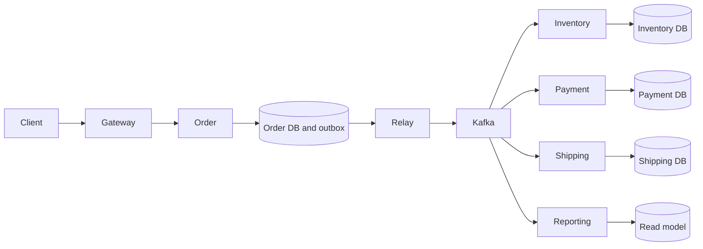

# Chapter 28 — High-Level Design: turning requirements into a defensible system

## 1. Lesson title
High-Level Design (HLD) for our distributed commerce platform and eighteen additional design exercises. HLD describes responsibilities, data ownership, communication, and failure behavior; it is more than a diagram of products.

## 2. Interview priority
P0 for requirements, invariants, estimates, APIs, storage, failure recovery, and trade-offs. P1 for unfamiliar design domains. P2 for multi-region active-active designs that cannot be justified by ordinary requirements.

## 3. Prerequisites
Know HTTP requests, database transactions, asynchronous messages, and the distinction between a process and a machine. Read Chapters 1, 6, 12, 18, and 26 as needed. If “RPO” is new: recovery point objective is the tolerable amount of lost history, normally expressed as time. RTO is the target time to restore a useful service. Neither is achieved simply by writing it in a design.

## 4. Learning objectives
Convert an ambiguous prompt into measurable requirements; calculate approximate load with units; decide where correctness is enforced; draw a complete request and event path; explain overload and partial failure; compare a simpler design; and identify which assumptions need measurement.

## 5. Official references
Checked 2026-10-24:
- [AWS reliability pillar](https://docs.aws.amazon.com/wellarchitected/latest/reliability-pillar/welcome.html): architecture review framework. Used as supporting framing, not proof our design is reliable.
- [Microsoft cloud design patterns](https://learn.microsoft.com/en-us/azure/architecture/patterns/): catalogue for evaluating patterns. Page includes an authorization notice but public overview content was accessible.
- [HTTP semantics RFC 9110](https://www.rfc-editor.org/rfc/rfc9110.html): methods and response semantics.
- [PostgreSQL 18 explicit locking](https://www.postgresql.org/docs/18/explicit-locking.html): row-lock behavior.
- [Kafka 4.2 design](https://kafka.apache.org/42/design/design/): scope of messaging and transaction guarantees.
The worked architectures and numbers below are original proposals and illustrative assumptions, not published reference architectures or measured results. Approved books are optional reading; no chapter is claimed read.

## 6. Fundamental explanation

### Start with a user action, not a product list
A user wants to place an order and learn whether it will be fulfilled. They do not directly require Redis, Kafka, or Kubernetes. These technologies enter only when a mechanism satisfies a requirement.

Separate functional requirements (create order, reserve inventory, cancel order) from quality requirements (latency, durability, availability, security, recovery). “Fast” is not a measurable target. “95% of valid create-order requests receive an acceptance response within 300 ms under the defined peak workload” is testable, though still only a proposed target.

Acceptance latency differs from fulfillment latency. An asynchronous design can acknowledge durable receipt quickly while payment or shipping takes longer. Define both so that an apparently fast API cannot hide stuck workflows.

### Invariants are the hard part
For our system:
1. Available stock must not become negative.
2. A retry of the same business payment operation must not create a second authorization.
3. Fulfillment requires confirmed inventory and payment.
4. Cancellation and shipment must obey a documented race policy.
5. Every durably accepted workflow must remain discoverable for completion or repair.

These invariants establish what must be atomic and what can be delayed. Product descriptions can tolerate a stale cache; authorizing a second payment because of a stale view is unacceptable.

### How a design evolves
Begin with one application and PostgreSQL. Split Inventory when ownership or independent scaling justifies it; use messaging when work must progress independently of an HTTP caller. Add a reporting projection when its queries would burden the write model. At each step state the new failure modes and operational cost.

The simplest viable design is a useful comparison even when the final exercise explicitly requires microservices. It prevents unnecessary components from hiding an unexamined requirement.

## 7. Internal architecture: a worked design

### Step A: assumptions
Assume 200,000 new orders/day, a peak ten times average, 2 KB per order event, six lifecycle events/order, and a seven-day replay window. These are workload assumptions. User demographics, order-line counts, indexes, and operational telemetry are not yet included.

Average order arrival = 200,000 / 86,400 = approximately 2.31 orders/sec.
Illustrative peak = 23.1 orders/sec.
Event volume = 200,000 x 6 x 2,000 = 2.4 billion bytes/day, about 2.4 GB decimal.
Seven days of event payload = 16.8 GB logical. Three replicas imply about 50.4 GB before overhead, compression effects, indexes, and safety headroom.

This estimate tells us which measurements matter. It does not justify thousands of partitions or claim that a laptop meets the workload.

### Step B: contracts and ownership
Order owns order state and the orchestration record. Inventory owns the authoritative reservation. Payment owns authorization identity and result. Shipping owns dispatch state. Reporting owns a derived model. Neither reporting nor a Redis catalog cache can approve a reservation.

Create-order accepts a stable idempotency key scoped to the caller. The server saves the normalized request hash and result reference. A repeated identical request returns the existing outcome; conflicting reuse is rejected. A database uniqueness constraint resolves concurrent attempts.

### Step C: progression
Order and its outgoing command are saved atomically. A relay publishes the command. Inventory atomically records deduplication, updates stock/reservation, and writes its result outbox. Order applies the result only if its workflow state permits it. Payment follows an equivalent business-operation protocol. Shipping begins only at a legal transition.

Why store workflow state? After restart, the coordinator must know what was requested and what remains unresolved. In-memory futures cannot answer that.

### Step D: repair
Every nonterminal state has an age limit, owner, and recovery policy. A timeout raises uncertainty; it does not fabricate a decline. Reconciliation queries authoritative operation state and emits a safe next action. Compensation itself is durable, retried within policy, and visible when exhausted.

## 8. Diagrams



The diagram shows dependency and ownership. It does not depict one global transaction. In a review, trace one order through every arrow and ask what survives if the process stops immediately after that arrow.

```mermaid
sequenceDiagram
    participant Client
    participant Order
    participant DB as Order DB
    participant Relay
    participant Broker
    Client->>Order: Create with stable request key
    Order->>DB: Commit order, workflow, outbox, request identity
    Order-->>Client: Created; workflow processing
    Relay->>Broker: Publish command
    Note over Relay,Broker: Relay completion can be uncertain
    Broker-->>Relay: Publication result
    Relay->>DB: Record publication progress
```

## 9. Java 21 implementation: explicit contract

This complete scoped model is unexecuted. Save as OrderContracts.java to compile it; it is not a running REST service.

```java
import java.math.BigDecimal;
import java.util.List;
import java.util.Objects;
import java.util.UUID;

public final class OrderContracts {
    private OrderContracts() {}

    public record Line(UUID productId, int quantity) {
        public Line {
            Objects.requireNonNull(productId);
            if (quantity <= 0) throw new IllegalArgumentException("quantity");
        }
    }

    public record CreateOrder(UUID customerId, List<Line> lines) {
        public CreateOrder {
            Objects.requireNonNull(customerId);
            lines = List.copyOf(lines);
            if (lines.isEmpty()) throw new IllegalArgumentException("lines");
        }
    }

    public record OrderView(UUID orderId, String status,
                            BigDecimal total, String currency) {
        public OrderView {
            Objects.requireNonNull(orderId);
            Objects.requireNonNull(status);
            Objects.requireNonNull(total);
            Objects.requireNonNull(currency);
        }
    }
}
```

The request does not accept a trusted final price from the customer. Pricing is validated from authoritative catalog/pricing policy and snapshotted into the order. A real contract needs quantity limits, supported currencies, payload limits, authorization, and error schemas. This small model demonstrates responsibility boundaries.

## 10. Spring Boot integration
Use controllers for HTTP mapping, application services for use cases, repositories for storage, and messaging adapters for transport. Do not load every entity in a shared library across services. Use Boot-managed dependencies after resolving the effective POM. API versioning and compatibility tests cover independently deployed clients; Java source compatibility is insufficient for network contracts.

Document whether GET order reads authoritative order state or a delayed projection. If using a projection, expose its semantics honestly. Security filters establish identity; the application still checks ownership of the requested order.

## 11. Production scenario
A promotion concentrates requests on one product while total RPS remains moderate. Average capacity estimates look healthy, but all reservations contend on the same inventory row. Adding Order instances increases contention and connection use. Investigate per-product traffic and lock waits, bound reservation concurrency, and test admission control. Sharding by order ID does not remove contention on the same product's stock invariant.

## 12. HLD considerations: eighteen practice designs
For each design, begin with an invariant, choose ownership, then investigate a failure.

| Exercise | First design decision | Failure to explain |
|---|---|---|
| URL shortener | Identifier uniqueness, redirect lookup/cache, expiration | Cached redirect after deletion |
| Rate limiter | Identity scope and atomic counter/token update | Different nodes independently exceed a global quota |
| Notifications | Delivery attempts versus business notification identity | Provider delivered but response lost |
| Payments | Ledger/authorization ownership and stable operation keys | Unknown provider outcome |
| Order management | Durable workflow and legal transitions | Late success during cancellation |
| Inventory | Atomic reservation and release semantics | Hot SKU contention |
| Ticket booking | Seat hold ownership and expiration | Payment races with hold expiry |
| Distributed scheduler | Durable job identity, lease, fencing | Old worker executes after lease expiry |
| Chat | Conversation ordering and offline history | Reconnect duplicates/missing acknowledgments |
| Real-time analytics | Event time, late data, aggregation semantics | Late event changes an already displayed total |
| Logging platform | Ingestion budget, retention, search indexing | Log burst overloads applications |
| File storage | Metadata versus object integrity | Upload finishes but metadata commit fails |
| Autocomplete | Index construction, prefix access, freshness | Stale index after source update |
| News feed | Fan-out/read trade-off and audience authorization | Deleted/private content remains in cache |
| Ride matching | Location freshness and assignment ownership | Two drivers assigned same trip |
| E-commerce | Checkout consistency and bounded contexts | Stock/payment/shipping disagree |
| Distributed cache | Ownership, eviction, replication, fallback | Cache outage overloads primary database |
| Financial event processing | Immutable operation identity and reconciliation | Replayed events repeat external effects |

These are starting points, not complete answers. For three of them, write APIs, a data model, a diagram, capacity math, and two alternatives. Then apply an interviewer change such as tenfold traffic or a regional outage. The goal is adaptation, not a memorized universal architecture.

## 13. LLD considerations
Translate each owner into interfaces and invariants. OrderWorkflow decides legal transitions; OutboxRelay concerns publication progress; PaymentGateway abstracts a provider without concealing its idempotency and status-query capabilities. Domain errors and transport errors should not share a vague boolean result. Use an enum or sealed result hierarchy when the distinction changes recovery.

## 14. Reliability
A design is incomplete until it explains restoration. Backups without restore exercises do not prove RPO/RTO. A replicated mistake can spread to every replica. An outbox without monitored age can strand work indefinitely. A DLQ without ownership and replay policy moves the failure rather than resolving it.

Design overload behavior before failure: reject or defer selected work while preserving critical reads and already accepted workflows. Give reconciliation a bounded resource budget so repair traffic does not become the next outage.

## 15. Performance
Measure endpoint latency, queue age, completion latency, lock waits, pool occupancy, partition skew, and event size. Average latency hides tails. An end-to-end SLO should identify the population: valid orders, eligible payment responses, and excluded customer abandonment must be defined rather than selected after measurement.

Partition counts are not chosen from daily user counts alone. Measure per-partition workload, ordering constraints, broker resources, and recovery time. A hot key can dominate one partition even when the cluster average is low.

## 16. Ten interview questions and model answers
1. **Where do you start?** With users, operations, invariants, and workload assumptions. Naming databases first can lock the conversation into unnecessary machinery. For checkout, distinguish resource acceptance from fulfillment completion and identify the atomic stock rule before drawing services.
2. **How accurate must estimates be?** Accurate enough to reveal dominant constraints and guide measurements. Keep units visible and perform sensitivity analysis. A factor-of-ten uncertainty in event size may matter more than rounding average RPS to a decimal.
3. **Why PostgreSQL for orders?** Our order write model needs transactional updates, constraints, and indexed lookup. This is a workload-specific recommendation, not a claim that document databases cannot transact. Explain failure recovery and operational skill alongside features.
4. **Why Kafka here?** Independent durable consumption and replay are useful for orchestration results and projections. The cost is schema, lag, retention, and operations. A simpler queue remains a valid alternative if replay and multiple independent subscribers are unnecessary.
5. **How do you prevent overselling?** Enforce availability and reservation creation in the Inventory owner with appropriate local concurrency control and retry policy. A preliminary GET stock is advisory; correctness must hold at the write.
6. **Can Gateway enforce all security?** No. Services must validate trusted identity and resource-specific permissions. Internal reachability is not sufficient authorization, and direct service access or compromised peers must not bypass ownership checks.
7. **What does cancellation mean?** Define legal states and compensation semantics. Before dispatch it might release inventory and void authorization; after dispatch it may become a return process. A single CANCELLED flag cannot erase external effects.
8. **How do you scale a hot product?** First measure lock/queue behavior and bound work. Partitioning by an unrelated key cannot remove the shared invariant. Options include serialized reservation ownership or carefully allocated stock pools, each with explicit trade-offs.
9. **What if a region fails?** Start with RPO/RTO and authority. A failover that permits two writers can violate invariants. Explain replication lag, fencing, routing, credentials, and reconciliation instead of only adding another region to the drawing.
10. **When would you change the design?** Record thresholds in ADRs: workload measurements, team ownership, unmet SLOs, or operational cost. Choosing a simpler first design with an observable migration trigger is stronger than premature complexity.

## 17. Exercise with solution
Design order acceptance for a customer retrying after a lost response. Include storage, response semantics, and a concurrent retry.

Solution: scope an idempotency key to caller and operation; persist request hash, order ID, workflow, and outbox atomically. A unique constraint resolves concurrent creation. Same key and same request returns the stored resource; a different request is a conflict. If the first transaction has not completed, follow a bounded wait/in-progress policy instead of creating another order. After response loss, lookup by key recovers the committed result. This protects creation, not every downstream effect; each owner still needs business idempotency.

## 18. Verification
Run a design review before implementation: trace happy path, lost response, DB failure, publication retry, duplicate consumption, late result, and replay. Each accepted request must have a durable discoverable identity. The API must not claim fulfillment from publication alone. Execute concurrent and crash tests only after the relevant milestone exists. No code, load test, or failover experiment in this chapter has been executed.

## 19. Common misconceptions
A large diagram proves seniority; replication is backup; async means immediate consistency; a cache can decide stock; a gateway eliminates authorization inside services; more partitions solve all skew; multi-region always increases useful availability; example capacity numbers are measurements. Each statement ignores a requirement or failure boundary.

## 20. Knowledge assessment
Your workload has ordinary total RPS but one product receives 70% of reservations. Explain how you would discover the bottleneck, protect correctness, and choose an improvement. No score is assigned until an answer is supplied.

## 21. Summary
Requirements establish success; invariants establish correctness; ownership establishes responsibility; estimates guide measurement; failure analysis establishes recovery work. Technology follows those decisions.

## 22. Next lesson
Chapter 29 translates this architecture into responsibilities, interfaces, state transitions, and tests. Return to this HLD whenever an implementation reveals an unstated assumption.

