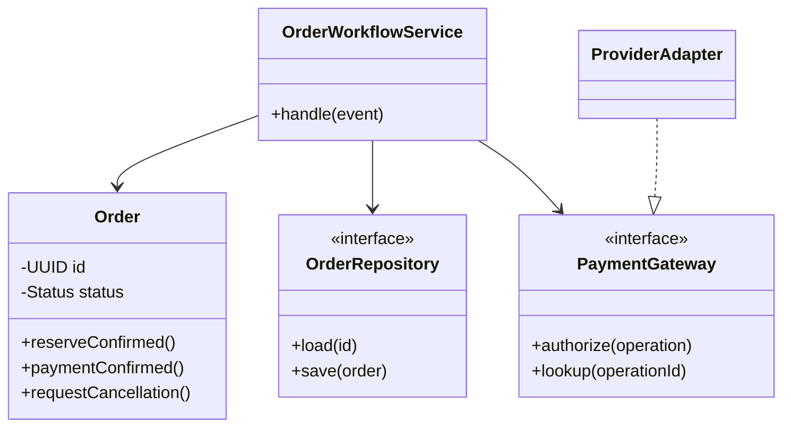
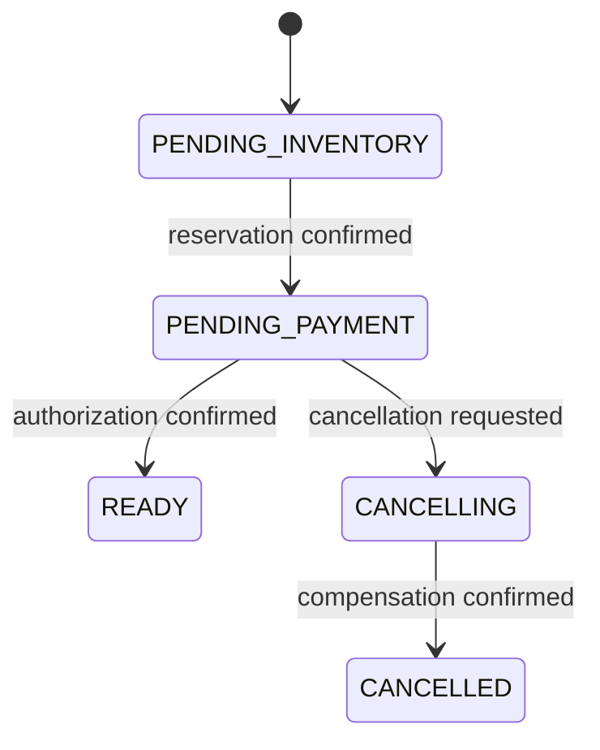

# Chapter 29 — Low-Level Design: responsibilities, invariants, and change

## 1. Lesson title
Designing Java components whose behavior remains understandable when requirements, concurrency, and dependencies change.

## 2. Interview priority
P0: responsibility assignment, interfaces, invariants, errors, tests, state transitions, and concurrency boundaries. P1: selecting patterns for real variation. Pattern-name recall without explanation is not the objective.

## 3. Prerequisites
Basic classes, methods, interfaces, exceptions, and collections. A class is a definition of state and behavior; an object is an instance. An interface states a contract that multiple implementations may satisfy. A domain invariant is a rule that valid state must preserve. Read Chapter 28 for system ownership and Chapter 3 for concurrency.

## 4. Learning objectives
Turn use cases into objects; enforce valid transitions; separate policy from transport; use composition and interfaces purposefully; explain every required pattern; implement a scoped state model; design error and concurrency behavior; and create tests that catch business regressions rather than reproduce the implementation.

## 5. Official references
Verified 2026-10-24:
- [Java 21 concurrency package](https://docs.oracle.com/en/java/javase/21/docs/api/java.base/java/util/concurrent/package-summary.html): executor, collection, and coordination API contracts.
- [Java 21 language specification](https://docs.oracle.com/javase/specs/jls/se21/html/index.html): classes, interfaces, records, sealed types; authoritative language reference.
- [Spring dependency injection](https://docs.spring.io/spring-framework/reference/core/beans/dependencies/factory-collaborators.html): collaborator configuration; live documentation may differ from the proposed project patch.
- [Azure design-pattern catalogue](https://learn.microsoft.com/en-us/azure/architecture/patterns/): architectural patterns, not a Java language specification.
- [PostgreSQL 18 explicit locking](https://www.postgresql.org/docs/18/explicit-locking.html): local data concurrency control.
Patterns below are original teaching explanations of established design ideas. Effective Java, Learning Domain-Driven Design, and Head First Design Patterns are recommended supplements; no unavailable chapter is claimed consulted.

## 6. Fundamental explanation

### Begin with behavior
“Create an Order class” is incomplete. Ask what an order is allowed to do: accept lines, capture agreed prices, await reservation, await payment, become ready, request cancellation, and record shipment. Then ask which transitions are forbidden.

An object with public setters for every field lets callers construct contradictory states. For example, paid=true and paymentStatus=DECLINED can coexist. Encapsulation means exposing meaningful operations that preserve rules, not merely hiding fields behind setters.

### Cohesion and coupling
Cohesion asks whether the responsibilities inside a component belong together. An Order calculating its total and enforcing its state transitions is cohesive. An Order constructing HTTP requests, choosing retry delays, and formatting emails has unrelated reasons to change.

Coupling is dependency. Some dependency is unavoidable. The design goal is to make necessary dependencies explicit and stable, and avoid knowledge of irrelevant internals. An adapter can depend on a provider's JSON; the domain should not.

### Composition and inheritance
Inheritance says a subtype can stand in for its base type without surprising callers. Composition assembles behavior from collaborators. If a payment adapter's inheritance forces unsupported operations to throw unexpectedly, an interface split or composition may be more honest.

Do not introduce an interface for every class automatically. Add a boundary when there are alternative policies, external dependencies, ownership separation, or meaningful test substitution.

### Principles as questions
- Single responsibility: what independent business or technical reason would change this component?
- Open/closed: which variation should be introduced without editing stable orchestration?
- Liskov substitution: does the replacement preserve the promises callers rely on?
- Interface segregation: do clients depend on operations they cannot use?
- Dependency inversion: does business policy depend on a concrete network/database tool?
DRY removes duplicated knowledge, not every repeated line. KISS prefers understandable mechanisms. YAGNI delays speculative extension points. These principles can conflict; explain the trade-off instead of applying slogans mechanically.

## 7. Internal architecture: model the order

### Responsibilities
Order owns legal transitions and business values. CreateOrderService coordinates authorization, pricing, and storage within a use case. OrderRepository loads/saves state. A Kafka listener decodes a message and calls an application handler. OutboxPublisher performs transport. PaymentGateway describes an external capability, including idempotency/status-query limitations.

A domain event is a meaningful state fact; an integration envelope adds transport metadata. A persistence entity is shaped by mapping concerns. They may share a simple representation initially, but do not distribute JPA entities as network contracts.

### Choosing identity
Order identity is stable even when status changes. A Money value has amount and currency and is compared by value. A payment operation has its own identity because one order can have authorization, void, capture, or refund operations with different semantics.

Use immutable inputs where practical. Defensive copying prevents a caller from mutating an order's line list after validation. Immutability reduces coordination needs; it does not make an entire database workflow atomic.

### Error design
Separate validation failure, state conflict, dependency unavailability, and uncertain external outcome. Returning false for all four removes information required for recovery. At the API boundary map these to documented responses without leaking database internals.

### Concurrency ownership
Two application instances can load the same version of an order and apply different events. Java synchronized protects one object's monitor within one JVM, not every replica. Persist a version and handle write conflict, lock rows where appropriate, or serialize ownership with a justified design. Reevaluate state after conflict rather than blindly replaying an old mutation.

## 8. Diagrams



The adapter translates provider behavior; it must not invent stronger guarantees than the provider offers.



A late authorization in CANCELLING needs an explicit compensation policy. The arrow is not silently added to READY.

## 9. Java 21 implementation

Complete single-file educational example, unexecuted. Save OrderStateDemo.java.

```java
import java.util.Objects;
import java.util.UUID;

public final class OrderStateDemo {
    enum Status { PENDING_INVENTORY, PENDING_PAYMENT, READY, CANCELLING, CANCELLED }

    static final class Order {
        private final UUID id;
        private Status status = Status.PENDING_INVENTORY;

        Order(UUID id) { this.id = Objects.requireNonNull(id); }

        void inventoryReserved() {
            move(Status.PENDING_INVENTORY, Status.PENDING_PAYMENT);
        }

        void paymentAuthorized() {
            move(Status.PENDING_PAYMENT, Status.READY);
        }

        void requestCancellation() {
            if (status != Status.PENDING_INVENTORY && status != Status.PENDING_PAYMENT) {
                throw new IllegalStateException("Cancellation not allowed from " + status);
            }
            status = Status.CANCELLING;
        }

        void compensationCompleted() {
            move(Status.CANCELLING, Status.CANCELLED);
        }

        private void move(Status expected, Status next) {
            if (status != expected) {
                throw new IllegalStateException("Expected " + expected + ", got " + status);
            }
            status = next;
        }

        Status status() { return status; }
        UUID id() { return id; }
    }

    public static void main(String[] args) {
        Order order = new Order(UUID.randomUUID());
        order.inventoryReserved();
        order.requestCancellation();

        boolean rejected = false;
        try {
            order.paymentAuthorized();
        } catch (IllegalStateException expected) {
            rejected = true;
        }
        if (!rejected || order.status() != Status.CANCELLING) {
            throw new AssertionError("Late payment must not make cancelling order READY");
        }
        order.compensationCompleted();
        System.out.println(order.status());
    }
}
```

Expected output is CANCELLED. The example rejects an illegal transition; it does not implement the application handler that schedules a void after late authorization. That missing behavior must be implemented before using this as a complete payment workflow. It also has no persistence, thread safety, or duplicate handling.

## 10. Spring Boot integration
Constructor injection supplies collaborators explicitly. Keep application transaction boundaries at the use-case level. A repository adapter can translate optimistic-lock exceptions into a conflict requiring state reload; do not hide them in a blanket retry that reissues external payments. Listener methods should delegate to testable handlers rather than contain every rule.

Spring-managed singleton scope means one bean instance per container, not a global singleton across the deployment. Mutable shared fields still require concurrency design.

## 11. Production scenario
A new payment provider returns PENDING and requires polling, unlike the original immediate-response simulator. An interface returning only boolean approved is inadequate. Model Authorized, Declined, and Pending/Unknown with operation identity. Add a status-query adapter and persist the workflow. This is a real extension pressure that justifies a richer contract; adding a Factory does not fix an incorrect result model.

## 12. HLD considerations
Class boundaries cannot compensate for bad data ownership. A perfectly abstracted repository that writes another service's tables still violates that service's authority. Conversely, many classes do not require many microservices. Deploy modules together until independent deployment serves a requirement.

## 13. LLD considerations: pattern catalogue

### Creational patterns
**Singleton** controls one instance in a defined scope. Use cautiously for immutable/shared facilities; it can hide dependencies and make tests order-dependent. It is not a distributed leader.
**Factory Method** lets a creation operation choose a concrete implementation. Useful when constructing a provider adapter varies; avoid obscuring trivial constructors.
**Abstract Factory** creates a related family of collaborators, such as provider-specific authorization and refund clients. The family must have a real consistency requirement.
**Builder** assembles a complex validated object incrementally. Its build step must enforce invariants; a builder is not permission to expose invalid final state.
**Prototype** derives a new instance from a template. Define deep versus shallow copying; shared mutable lists can make the copy unsafe.

### Structural patterns
**Adapter** translates one interface into another. A provider adapter maps status/error semantics as well as field names.
**Decorator** adds behavior while preserving a contract, such as timing around a gateway. Retrying a non-idempotent call is not a harmless decorator.
**Proxy** controls access or interception. Spring transaction proxies are an example of interception; invocation paths determine whether advice runs.
**Facade** offers a simpler entry point over collaborating components. A checkout facade should not become a god object containing every domain rule.
**Composite** treats individual and grouped objects uniformly, such as a tree of pricing conditions. Watch for cycles and unclear aggregation semantics.
**Bridge** separates independently varying abstraction and implementation, such as notification intent from delivery transport. It helps when both axes truly vary.

### Behavioral patterns
**Strategy** selects an interchangeable policy, such as shipping-price calculation. Its contract must include units and error behavior.
**Observer** notifies interested parties. In-process observation is not durable messaging; a crash can lose a notification.
**Command** represents an intended action with data and identity. A durable command needs a lifecycle and deduplication policy.
**State** organizes behavior by lifecycle state. For a small state machine an enum and transition table may be clearer than many classes.
**Template Method** fixes a sequence while allowing selected steps to vary. Prefer composition when subclass overrides can violate invariants.
**Chain of Responsibility** routes through handlers until one acts or all decline. Define ordering, short-circuit, and no-handler behavior.
**Mediator** centralizes coordination among participants. Our orchestration service resembles this role; avoid accumulating unrelated domain rules.
**Iterator** traverses a collection without exposing representation. Iterating database results also raises paging, transaction, and resource-lifetime concerns.
**Memento** captures restorable state. In a distributed business workflow, restoring an object snapshot does not reverse external payments.

### Application and architectural patterns
Repository hides storage access; Unit of Work groups tracked changes; Dependency Injection supplies dependencies; Circuit Breaker controls calls after observed failures; Retry repeats eligible work within a budget; Outbox persists intended publication with state; CQRS separates write and read responsibilities; Saga coordinates local steps and compensations; Hexagonal Architecture places adapters around application ports. Each solves a particular boundary, not every reliability problem.

## 14. Reliability
A design should specify duplicate, out-of-order, malformed, and late input. A duplicate successful event may be a harmless no-op only after verifying it matches the existing operation. A late event can require compensation. Validation at the controller does not protect messages arriving through Kafka, migrations, or internal jobs; invariants need enforcement at authoritative boundaries.

## 15. Performance
Avoid abstraction costs by measurement, not by removing all boundaries. N+1 database calls dominate many micro-optimizations. A Strategy object allocation is usually irrelevant beside a remote call, but an unbounded queue of commands can consume memory. Keep iteration and batching explicit where data volume matters. Do not introduce a cache without ownership, eviction, and invalidation semantics.

## 16. Ten interview questions and model answers
1. **What is good encapsulation?** Expose operations that preserve meaning, not arbitrary setters. An Order should transition through business operations. Private fields with setters can still permit impossible combinations and do not prove a sound model.
2. **When use an interface?** When it captures a stable capability, meaningful variation, or external boundary. A PaymentGateway is useful for provider semantics and tests; an interface mirroring every trivial class creates navigation cost without clear value.
3. **State versus Strategy?** State changes behavior according to lifecycle; Strategy chooses a policy. Payment retry eligibility might depend on workflow state, while a provider-selection strategy is an independent choice. Combining them carelessly can hide illegal transitions.
4. **Why composition?** It permits focused collaborators and explicit substitution without inheriting unrelated behavior. Inheritance remains valid when substitutability is real. Explain the actual variation rather than claiming one mechanism is always superior.
5. **How ensure thread safety?** Identify mutable state and ownership first. Immutability, confinement, locks, atomics, or database concurrency may fit different boundaries. Synchronizing a bean does not coordinate another application instance.
6. **What is a rich domain model?** It holds behavior that protects domain rules. It is not a model that knows HTTP, SQL, Kafka, and UI details. Application coordination and adapters should remain distinct from business state.
7. **How model failures?** Preserve distinctions that affect action: invalid request, legal-state conflict, unavailable dependency, and unknown outcome. A generic RuntimeException or boolean can erase information needed for retry and reconciliation.
8. **How test extensibility?** Add a concrete variation, such as a pending payment provider, and observe which files change. If orchestration branches on provider names everywhere, the boundary is weak. Test behavior and contracts rather than class-count targets.
9. **When is a pattern harmful?** When its indirection exceeds the variability or risk it addresses. A full State hierarchy for three simple transitions may be less clear than an enum. Patterns are vocabulary for decisions, not mandatory decorations.
10. **How handle late payment success?** Reload authoritative workflow state and correlate the operation. If cancellation has begun, schedule the permitted compensation instead of moving to READY. Record the action durably and tolerate duplicate results.

## 17. Exercises with solutions
A. Add a second authorization provider that can return PENDING. Solution direction: extend the result contract and status lookup, persist the operation identity, and let orchestration await/reconcile. Do not block indefinitely inside the domain object.

B. Implement a notification framework. Separate NotificationRequest, DeliveryChannel, DeliveryResult, and DeliveryAttemptRepository. The attempt ID differs from notification identity. Retry an attempt only under policy; do not promise exactly-once email delivery.

C. Practice the remaining agreed exercises: parking lot, elevator, vending machine, library, Splitwise, ATM, rate limiter, in-memory cache, logging, scheduler, payment processor, inventory engine, order state machine, retry framework, event dispatcher. For each write actors, invariants, object responsibilities, class/state diagram, errors, concurrency, and tests. For an ATM, separate cash-dispense uncertainty from account debit; for a vending machine, handle payment accepted but dispense failed; for Splitwise, define currency/rounding and settlement identity. These scenarios exercise real modeling, not standalone DSA.

## 18. Verification
Run the sample with Java21 after saving it; expected CANCELLED and no assertion failure. It has not been run here. Test every legal and illegal transition, repeat events, conflict versions, cancellation races, malformed identifiers, and provider timeouts in the actual project. A passing sequential demonstration cannot prove concurrent distributed correctness.

## 19. Common misconceptions
More interfaces mean cleaner architecture; design patterns eliminate trade-offs; immutable objects make external effects atomic; singleton means one instance globally; mocks prove provider compatibility; DTOs and entities are interchangeable everywhere; a compensating action is an exact rollback; an enum alone implements workflow durability.

## 20. Knowledge assessment
A new payment provider can return PENDING for up to ten minutes. Which interfaces, persisted state, recovery behavior, and tests would you change? Explain why each belongs to that layer.

## 21. Summary
Begin with responsibility and invariants. Choose boundaries around real variation. Make failure outcomes explicit. Treat concurrency and persistence as part of the design. Prefer the least complicated structure that preserves correctness and supports the next justified change.

## 22. Next lesson
Chapter 30 tests the architecture and component assumptions with controlled failures. Return to the class model when an incident reveals missing state or ambiguous responsibility.

