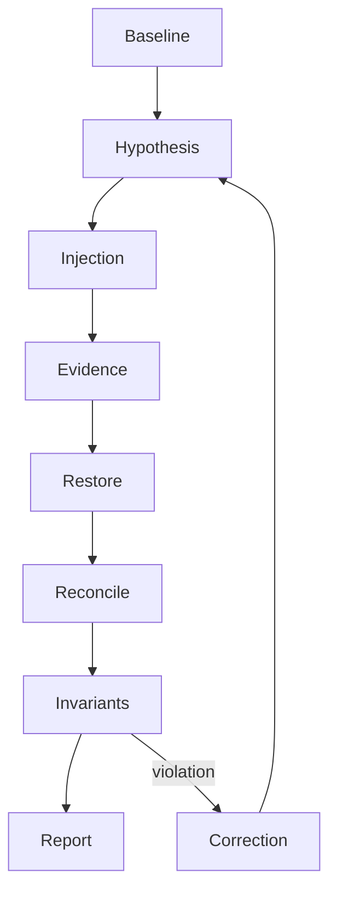
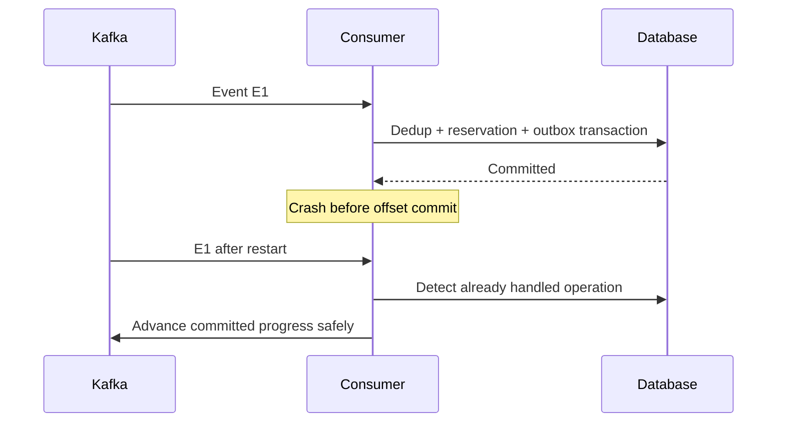

# Chapter 30 — Failure engineering: prove recovery, not just restart

## 1. Lesson title
A controlled failure laboratory for the commerce platform: twenty-five scenarios, evidence collection, safe recovery, and invariant verification.

## 2. Interview priority
P0 for duplicate handling, unknown outcomes, database concurrency, bounded retry, and systematic diagnosis. P1 for infrastructure failures. Multi-broker elections and genuine network partitions need a richer environment than the first single-node demonstration.

## 3. Prerequisites
Have a runnable milestone, isolated lab data, a known healthy baseline, and a documented recovery command before injecting failure. Know which process owns each transaction. No lab below has been executed in this course-writing task. Many require services not yet implemented. Do not run them against shared or production infrastructure.

A fault is an injected condition, such as an unavailable broker. A symptom is an observation, such as rising outbox age. A hypothesis explains the mechanism and predicts evidence. A mitigation reduces harm; a root-cause correction prevents recurrence. Restarting is an action, not a diagnosis.

## 4. Learning objectives
Form testable hypotheses; inject bounded faults; distinguish expected redelivery from business duplication; investigate logs/metrics/traces and database state; recover without deleting evidence; verify invariants; and write a useful incident report.

## 5. Official references
Checked 2026-10-24:
- [Kafka 4.2 design](https://kafka.apache.org/42/design/design/): delivery and replication boundaries.
- [Kafka 4.2 monitoring](https://kafka.apache.org/42/operations/monitoring/): broker/client monitoring categories.
- [PostgreSQL 18 locking](https://www.postgresql.org/docs/18/explicit-locking.html): blocking and deadlocks.
- [PostgreSQL 18 statistics](https://www.postgresql.org/docs/18/monitoring-stats.html): pg_stat_activity and wait evidence.
- [Docker Compose stop](https://docs.docker.com/reference/cli/docker/compose/stop/): stopping without removal.
- [Kubernetes application troubleshooting](https://kubernetes.io/docs/tasks/debug/debug-application/): inspecting workload state.
- [kubectl delete](https://kubernetes.io/docs/reference/kubectl/generated/kubectl_delete/): deletion semantics; use only a named disposable lab Pod.
- [Google SRE incident management](https://sre.google/sre-book/managing-incidents/): primary engineering guidance on incident coordination. This is a named supplement to the approved books; the accessible chapter was consulted for role separation, not reproduced.
Lab procedures are our project designs. Kafka core references are Apache sources. Exact metrics/protocol settings must be checked for the deployed release.

## 6. Fundamental explanation
A healthy process is not proof of a healthy business system. All Pods can be ready while an order waits forever for a lost workflow transition. Conversely, a consumer restart can be expected recovery while the business invariant remains intact.

The lab's question is not “can I make it fail?” It is “does the mechanism preserve the promise under this precise failure?” Each experiment begins with a promise: one reservation per business operation, no negative stock, no duplicate authorization, or eventual visible completion/repair.

Change one condition at a time. If Kafka, PostgreSQL, and the gateway are stopped together, a failure tells little about which boundary is protected. Multi-fault experiments follow only after individual mechanisms are understood.

Record operation IDs, event IDs, timestamps, versions, and starting data. Use synthetic customers and simulated payments. Keep faults reversible. A fault script should identify the exact target and stop condition; it should not discover and terminate arbitrary processes.

## 7. Internal mechanism of a failure experiment
1. Establish a baseline: known request, expected state transition, and normal telemetry.
2. State the hypothesis: “If Inventory commits before its offset, replay occurs but the reservation remains unique.”
3. Choose the boundary: a deterministic hook after DB commit and before acknowledgment is more precise than random sleep.
4. Inject once and capture evidence.
5. Restore the dependency or process.
6. Observe recovery and backlogs.
7. Query authoritative state and assert the invariant.
8. Record whether observation supports the hypothesis.
9. Improve the mechanism and rerun the smallest relevant test.

A failure hook belongs only in a controlled test configuration. It must not be accidentally enabled in a normal deployment. A timed pause is not proof of the exact transaction boundary; instrumentation should make the boundary visible.

## 8. Diagrams




The duplicate delivery is an observation. The invariant is about duplicate business effects.

## 9. Implementation: explicit local commands and SQL

The current project only has a Kafka orientation Compose file. These commands target that disposable lab and must run from C:\Projects\distributed-commerce after Docker verification:

```powershell
docker compose -f .\infrastructure\compose\compose.yaml ps
docker compose -f .\infrastructure\compose\compose.yaml stop kafka
docker compose -f .\infrastructure\compose\compose.yaml start kafka
docker compose -f .\infrastructure\compose\compose.yaml logs --tail 100 kafka
```

Stopping preserves the container; the orientation configuration has no explicit data volume, so removing/recreating it has different data consequences. Do not use down as an interchangeable failure injection. No command above has been executed here.

Database deadlock exercise, isolated lab database only:
```sql
CREATE TABLE lab_accounts (
  id integer PRIMARY KEY,
  balance numeric(12,2) NOT NULL
);
INSERT INTO lab_accounts VALUES (1,100.00),(2,100.00);
```
Session A:
```sql
BEGIN;
UPDATE lab_accounts SET balance = balance + 1 WHERE id = 1;
-- Pause here until B updates row 2.
UPDATE lab_accounts SET balance = balance + 1 WHERE id = 2;
COMMIT;
```
Session B:
```sql
BEGIN;
UPDATE lab_accounts SET balance = balance + 1 WHERE id = 2;
-- Run after A has updated row 1.
UPDATE lab_accounts SET balance = balance + 1 WHERE id = 1;
COMMIT;
```
One transaction can be chosen as the deadlock victim. Explicitly roll it back and retry the complete transaction if appropriate. The solution is consistent lock ordering plus a bounded whole-transaction retry policy; do not retry only the last statement inside an aborted transaction. Expected behavior follows PostgreSQL locking; no actual result is claimed.

## 10. Spring Boot integration
Use profiles/test configuration to inject a controlled exception at a known boundary, simulate a provider response, and configure bounded pool sizes. The actual handler must preserve the same transaction ordering as production code. A mocked repository cannot prove SQL uniqueness under concurrent commits. A listener test must assert database effects as well as consumed records.

When adding failpoints, distinguish exception-before-commit (which may roll back) from process death after commit. A thrown exception inside a transaction is not an equivalent simulation of every crash window.

## 11. Production scenario
Payment authorizations are timing out and operators see retries. First establish whether customers are being charged twice, merely waiting, or seeing inaccurate status. Stabilize admission and retry volume, preserve operation IDs, and reconcile provider state. Releasing all inventory immediately could worsen correctness if authorizations later succeed. Assign one operational decision owner and a communication owner so parallel investigation does not become conflicting changes.

## 12. HLD considerations
Failure domains include process, host, zone, network route, database, broker, credentials, and deployment. Separate availability from correctness. A design that accepts unlimited work while a dependency is down may remain reachable but run out of storage or violate completion objectives. Set admission, retention, and recovery budgets.

## 13. LLD considerations
Represent attempted operations, uncertain outcomes, retry schedules, and compensation status durably. Give runbooks safe lookup keys. A generic “failed” state cannot tell an operator whether retry risks repeating an external effect. Testability improves when adapters expose deterministic controls and application services have explicit inputs.

## 14. The twenty-five failure labs

### 1. Consumer crash after database commit
Prerequisite: durable inbox/reservation/outbox and manual or correctly configured container progress. Inject a termination after commit but before offset acknowledgment. Expect redelivery after restart. Inspect event identity and reservation rows. Recovery: restart consumer, let deduplication short-circuit repeated effects, then verify exactly one reservation. Interview: why is redelivery healthy rather than automatically a bug?

### 2. Producer timeout
Prerequisite: a durable pending outbox record. Make broker communication unavailable or use a controlled network fault; do not assume every timeout means no append. Expect uncertain publication and a pending/retryable record. Inspect producer errors plus consumer/event-ID evidence. Restore connectivity, retry under policy, and verify downstream business uniqueness. Prevention: stable event identity, bounded retries, and observable backlog.

### 3. Broker unavailable
Stop the single lab broker. Expect publication/consumption disruption; durable order acceptance depends on the chosen API/outbox policy. Observe outbox oldest age and service behavior, not just connection errors. Restart and verify backlog drains without duplicates affecting business state. A single-broker outage cannot prove replicated failover.

### 4. Partition leadership change
Requires multiple brokers and a replicated topic. Identify a partition leader, stop only that broker, and observe election and client recovery. Inspect replica health before and after. If the configured durability prerequisites are unmet, writes may fail rather than continue. Restore the broker and verify replica catch-up. Do not run this using the single-node orientation and claim an election test.

### 5. Consumer rebalancing
Add or stop one member in a known group while records arrive. Record assignments, progress, and business effects. Expected redistribution depends on the configured group protocol. Recovery should preserve processed-state invariants despite repeated records. Investigate slow processing and polling behavior before increasing timeouts blindly.

### 6. Duplicate event delivery
Publish the identical event ID twice to a lab topic. Then publish two different event IDs requesting the same business operation. The first tests event deduplication; the second tests business uniqueness. Inspect both counts. A design that passes only the first is incomplete. Repair should not delete the evidence and reapply side effects.

### 7. Poison message
Send deliberately malformed or semantically invalid test data. Observe where failure occurs: deserialization or application handling. Verify retries are bounded, diagnostic metadata is preserved, and later eligible work follows the documented ordering policy. Correct or quarantine the record; replay only after fixing the cause and preserving identity.

### 8. Database deadlock
Use the two-session SQL above. Observe blocked statements and the victim's failure. PostgreSQL wait/lock views provide evidence. Recovery is rollback and policy-controlled retry of the entire unit. Prevention includes consistent access order and short transactions. Verify no half-applied business change.

### 9. Connection-pool exhaustion
Use a small test pool and intentionally hold transactions while requests arrive. Observe pending acquisition, active connections, wait time, and request deadlines. Restore by releasing test blockers and limiting admission. Raising pool size can move overload into the database; investigate transaction lifetime and leaks first.

### 10. PostgreSQL unavailable
Stop the disposable database after capturing its starting state. Expect operations requiring persistence to fail or defer; they must not claim durable success without storage. Observe transaction errors and bounded retries. Restore, verify schema/connection recovery, and reconcile uncertain commits by operation identity.

### 11. Redis unavailable
Stop Redis in the later cache lab. Observe whether catalog reads fall back within a bounded budget or degrade explicitly. Unbounded fallback can overload PostgreSQL. Restore Redis and warm gradually; verify authoritative data remains correct and cache errors do not create stock decisions.

### 12. Stale cache
Coordinate a delayed reader and concurrent writer to recreate an invalidation race. Inspect value version, DB version, TTL, and timing. Recovery may evict affected entries or rely on bounded freshness policy; it must not rewrite correct primary data from stale cache. Prevention needs a documented consistency strategy, not “always delete cache.”

### 13. MongoDB unavailable
Stop the reporting/notification datastore. Decide which read models can lag and which work must be retained for retry. Observe consumer failures and backlog. Restore and rebuild or resume according to projection semantics. Do not replay external notifications indiscriminately while rebuilding a read model.

### 14. Downstream service timeout
Inject latency beyond a caller deadline using a controlled stub. Distinguish cancellation of waiting from cancellation of the remote effect. Record stable operation IDs and unknown outcomes. Recover by status lookup or safe retry; verify no repeated authorization. Prevention includes propagated deadlines and explicit result states.

### 15. API Gateway failure
Stop the lab gateway while internal consumers keep working. External admission may fail while accepted orders continue. Check both paths. Restore routing and verify client retries use stable keys. This separates edge availability from business-processing availability.

### 16. High consumer lag
Throttle processing below arrival rate. Predict backlog growth, then measure it when executed. Restore capacity with bounded downstream concurrency and compute drain time. Verify freshness/business completion as well as offset lag. More members cannot fix a single hot partition or slow database by themselves.

### 17. Kubernetes Pod restart
Only in the named local namespace, remove a selected application Pod or perform a controlled rollout. Observe termination, readiness, replacement, and in-flight work. Inspect events and previous container logs when available. Verify durable workflow recovery; an emptyDir or process map does not survive like a database.

### 18. Memory pressure
Run a bounded test workload with explicit container/JVM limits and observe heap versus native/container memory. Capture evidence before the process is killed when feasible. Recovery is reducing pressure or correcting the cause, not endlessly restarting. Verify queue bounds, payload sizes, thread/native allocation, and leaks separately.

### 19. Thread-pool exhaustion
Block a controlled dependency and fill a bounded worker pool. Inspect thread dumps and queue size. Observe rejection/timeout behavior. Release the blocker, verify tasks drain and permits/connections are released. Prevention includes bulkheads and realistic deadlines; virtual threads do not eliminate downstream capacity limits.

### 20. Retry storm
Configure a small test population to fail together, then compare immediate retries with bounded backoff and jitter. Predict request amplification across layers. Stop the experiment at a defined volume. Recovery includes disabling redundant retry layers and limiting concurrency; preserve business identities throughout.

### 21. Network partition
Requires a deliberate lab network fault between named components, not merely stopping a process. Document directionality: requests may pass while responses fail. Predict which side can act and what knowledge is missing. Restore routing, reconcile uncertain effects, and verify no dual authority. Do not equate a connection refusal with every partition scenario.

### 22. Partial Saga failure
Allow inventory reservation and payment success, then fail shipping initiation. Persist the workflow and apply the defined policy: retry shipping, void authorization/release inventory where allowed, or escalate. Compensation can fail too. Verify final state across owners and expose unresolved operations.

### 23. Outbox publishing failure
Pause the relay while orders commit. Verify order/outbox atomicity and oldest pending age. Restart relay, then inject failure after successful publish but before marking completion. Expect repeat publication; verify idempotent effects. A row marked “sent” before acknowledged publication risks lost work.

### 24. Schema incompatibility
Deploy a consumer contract test against a deliberately incompatible event. Distinguish syntax compatibility from changed business meaning. Observe decode/validation failures and quarantine behavior. Restore a compatible reader/writer or perform a planned migration; never delete problematic history merely to make lag disappear.

### 25. Duplicate payment-authorization attempt
Send repeated requests with the same operation key, then different keys for the same protected business operation. Simulate a lost provider response. Verify durable uniqueness and provider reconciliation. The correct invariant is not “one HTTP request”; it is the permitted number of authorizations for the defined business operation.

## 15. Performance during recovery
Recovery work competes with live work. A backlog of 60,000 at a net drain rate of 200/sec needs about 300 seconds under steady assumptions. If replay consumes all database connections, fresh orders and reconciliation can starve. Define separate budgets or admission policies and observe completion tails. A fast restart followed by an hour of overload is not a successful short recovery.

## 16. Ten interview questions and model answers
1. **What is your first action in an incident?** Establish customer impact, current scope, and safe stabilization while preserving evidence. Do not immediately restart every dependency. A bounded mitigation buys time to diagnose without multiplying changes.
2. **Which logs matter?** Correlated operation/event IDs, state transitions, errors with causes, and timing around boundaries. Logs without stable identity cannot distinguish a retry from a new operation. Avoid sensitive payment/customer data.
3. **How prove no duplicate payment?** Query the authoritative business operation ledger/provider result, not only consumer logs. Two distinct messages may request the same payment. Define the invariant and inspect durable effects after recovery.
4. **Why not retry everything?** Validation failures do not become valid with delay, and unknown outcomes can already have effects. Classify errors, preserve identity, bound attempts, and expose exhausted or unresolved work.
5. **Can you reset offsets to fix lag?** Resetting changes what will be read, not whether business work is correct. It can skip required effects or repeat dangerous ones. First determine whether the backlog is valid and design replay/idempotency.
6. **What if the DLQ grows?** Treat it as owned unresolved work. Classify causes, alert on age and volume, repair contracts/data safely, and replay with preserved identity. A DLQ is not a business completion state.
7. **How distinguish deadlock from slow SQL?** Inspect waits, competing transactions, plans, and timing. A deadlock is a cycle of dependencies; slow execution may consume resources without a cycle. Use evidence rather than the same timeout fix for both.
8. **Why can recovery overload the system?** Replayed work adds to ongoing arrivals, often with cache misses and downstream writes. Limit drain concurrency and protect live traffic. Calculate net recovery capacity rather than assuming restart clears backlog instantly.
9. **What belongs in a postmortem?** Impact, evidence-backed timeline, contributing conditions, mitigation, recovery verification, and owned corrective actions. Avoid speculative blame. Distinguish confirmed causes from remaining hypotheses.
10. **What if compensation fails?** Persist the failed compensation and retry/escalate under policy. Do not mark cancellation complete while inventory or authorization remains unresolved. Recovery needs a visible owner and auditable state.

## 17. Exercise and solution
Design a test for outbox publication uncertainty. Solution: create an order/outbox atomically; let relay publish E1; fail before publication state update; restart; observe E1 again; assert one downstream business operation and eventual outbox progress. Include a second distinct event ID for the same operation to test business idempotency separately. A test that only checks two consumed messages does not establish correctness.

## 18. Verification and report template
For each actual run record environment/version, preconditions, target, hypothesis, injection timestamp, observations, logs/metrics/query evidence, restoration, final invariants, and remaining risks. Use “expected” until executed. Do not fill the observed column with predicted results.

| Field | Record during execution |
|---|---|
| Initial business state | Identifiers and query output |
| Injected fault | Exact target and command/hook |
| Expected consequence | Written before injection |
| Actual consequence | Evidence, not inference alone |
| Recovery | Command/policy and timing |
| Invariant checks | Queries/assertions and results |
| Follow-up | Owner, change, verification |

## 19. Common misconceptions
Restart means recovery; a timeout proves rejection; duplicate delivery proves duplicate business state; green Pods prove orders complete; higher timeouts fix every rebalance; offset reset repairs data; replicas replace backups; all retries are safe; a hypothetical lab result is an observation.

## 20. Knowledge assessment
After Kafka returns, outbox age falls but payment-unknown age keeps rising. Explain at least three hypotheses, evidence that distinguishes them, and a safe first mitigation.

## 21. Summary
A fault experiment is a hypothesis with evidence and a recovery contract. Restore dependencies, reconcile uncertainty, and verify business invariants. Record unexecuted work honestly.

## 22. Next lesson
Chapter 31 turns the resulting artifacts and reasoning into interview explanations and an honest project portfolio.

