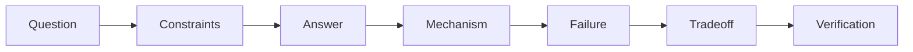
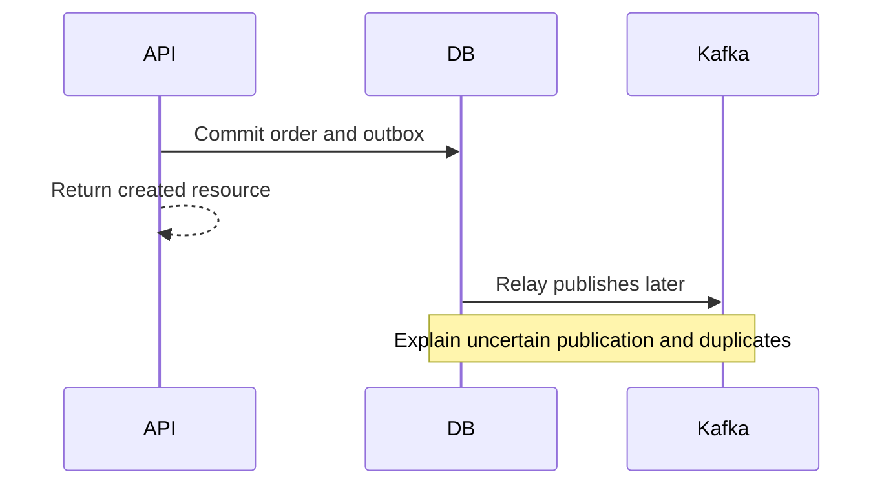

# Chapter 31 — Technical interviews, engineering communication, and project evidence

## 1. Lesson title
Explain mechanisms clearly, defend decisions honestly, and turn the commerce project into evidence of practiced engineering.

## 2. Interview priority
P0: correctness, reasoning, communication, and honest ownership. P1: tailoring depth to the interviewer and handling changing constraints. There is no standalone DSA interview track.

## 3. Prerequisites
You need at least one implemented feature or concrete worked design to discuss. Reading a chapter creates vocabulary, not professional production experience. Keep three categories separate: work you did professionally, experiments you ran in this project, and approaches you understand conceptually.

## 4. Learning objectives
Answer at fundamental and senior depth; reason aloud without guessing; demonstrate a technical mechanism through a trace; explain trade-offs and failures; tell truthful experience stories; evaluate answers with a rubric; and finalize a reproducible project portfolio.

## 5. Official references
Verified 2026-10-24:
- [AWS reliability pillar](https://docs.aws.amazon.com/wellarchitected/latest/reliability-pillar/welcome.html): architecture review context.
- [Kafka 4.2 design](https://kafka.apache.org/42/design/design/): verify messaging claims before using them in answers.
- [Java21 concurrency API](https://docs.oracle.com/en/java/javase/21/docs/api/java.base/java/util/concurrent/package-summary.html): verify Java contracts.
- [PostgreSQL18 locking](https://www.postgresql.org/docs/18/explicit-locking.html): verify SQL concurrency claims.
- [Google SRE incident management](https://sre.google/sre-book/managing-incidents/): named primary engineering supplement for incident roles.
Interview rubrics and practice scenarios below are our course method, not claims about any company's private interview process. No current employer process is asserted. No professional achievements are invented.

## 6. Fundamental explanation

### An answer is a model the listener can inspect
A useful explanation states the conclusion, the mechanism that makes it true, the assumptions it needs, and the case where it fails. Saying “Kafka gives exactly once” hides the important boundary. A stronger answer identifies the input, output, offset transaction, and any external database or side effect outside that boundary.

The listener should be able to draw your explanation. If you cannot trace the request, you may be relying on vocabulary rather than understanding. Use one concrete order, event, transaction, and failure to expose the mechanism.

### Three levels of depth
Fundamental: define the idea in familiar language.
Senior: explain how it operates and what can go wrong.
Design: compare alternatives under stated requirements and propose verification.

For example, idempotency means repeated attempts of the same logical operation preserve the intended business effect. Senior reasoning adds stable operation identity, request-conflict detection, durable uniqueness, concurrency, retention, and external-provider limits. Design reasoning asks which owner enforces it and how recovery finds unknown outcomes.

### Confidence and uncertainty
“I would verify that default in the selected Kafka release” is stronger than inventing it. Follow uncertainty with a method: identify the official config section, inspect effective configuration, and design an experiment. Do not hide lack of experience with claimed production scale.

You can say: “My professional experience is Java/Spring enterprise integration. In this course project I implemented and tested an outbox and duplicate-consumption scenario.” That statement becomes valid only after the implementation and experiment exist.

## 7. Internal mechanism of an interview answer

Use this sequence:
1. Restate the question's relevant constraint.
2. Give the direct answer.
3. Explain the mechanism in chronological order.
4. Name the invariant and boundary.
5. Show a failure case.
6. Compare a realistic alternative.
7. Explain how you would verify it.

Do not recite every fact you know. If asked why a transaction failed, begin with participating resources and invocation path, not a ten-minute history of Spring. If asked to design checkout, clarify acceptance versus completion and inventory/payment correctness before infrastructure.

For troubleshooting, separate observation from hypothesis. “Pool acquisition timed out” is an observation. “A connection leak caused it” is a hypothesis until evidence distinguishes it from long transactions or legitimate saturation.

## 8. Diagrams

A second diagram can make an architecture claim testable:

The database does not literally send Kafka records; “Relay publishes later” represents the relay reading persisted outbox state. In a spoken answer, identify that worker explicitly rather than letting a compressed diagram imply magic.

## 9. Java21 implementation discussion
No new product implementation is required in this chapter. Review a concrete method from earlier notes or the implemented project and explain:
- preconditions and postconditions;
- state it owns;
- exceptions that change recovery;
- synchronization or transaction boundary;
- external operations;
- test evidence;
- limitations.

A useful code-review question is whether a method saves an order and then publishes without a durable outbox. Do not claim a code block is correct merely because it compiles. Compilation establishes syntax/types, not distributed atomicity.

When code is requested in a mock, write a complete scoped example and define what the scope excludes. A sequential map demonstration can teach an idea; it cannot prove concurrency or restart safety.

## 10. Spring Boot integration
Prepare an accurate explanation of request flow, bean creation, proxies, transaction managers, listener containers, and shutdown. Use the actual project's effective POM and configuration when asked versions. The proposed baseline in this course has not yet been resolved and tested as a full application.

Distinguish annotation intent from runtime behavior. A proxy only intercepts the applicable invocation path; an application transaction only governs participating resources. Explain an actual test that demonstrates the behavior.

## 11. Production scenario and truthful storytelling
Use a story structure: context, responsibility, action, evidence, result, and reflection. For a query-optimization incident, explain the observed symptom, execution-plan evidence, chosen change, rollout, and measured result if you have it. If no measurement exists, do not invent “60% improvement.”

Your existing modernization, production troubleshooting, mentoring, and integration experience is valuable. Map it to ownership and trade-off reasoning. Do not relabel JMS work as Kafka production work. A clear transfer explanation is more credible: “I knew acknowledgment/redelivery concepts from JMS; I learned Kafka's retained partition log and group progress separately.”

## 12. HLD interview method
Clarify requirements, prioritize invariants, estimate with units, draw ownership and data flow, then test failures and scaling. Spend time on the most consequential trade-off. If the interviewer changes the workload, revisit the assumption rather than defend a memorized architecture.

For a short interview, state what you are deferring: exact partition sizing requires measurements; security and restore strategy are important but can be discussed after the core workflow. Deferral is a time-management choice, not an assertion that the concern is unimportant.

## 13. LLD interview method
Identify use cases and invariants, assign responsibilities, define interfaces and state transitions, write the critical behavior, then test errors and concurrency. Explain why a pattern fits. If a simple enum is sufficient, do not manufacture a class hierarchy just to name State.

A reviewer should see how a new provider, event, or business rule changes the design. Demonstrating a small extension is stronger than claiming that a design is “fully extensible.”

## 14. Reliability of your claims
Maintain an evidence ledger:
- Claim: what you can do or what the system guarantees.
- Scope: version, configuration, environment, and workload.
- Evidence: test, experiment, query, source, or professional example.
- Limit: what the evidence does not establish.
- Next verification: the unresolved case.

For example: “The duplicate-event integration test leaves one reservation row” is narrower and stronger than “the platform has exactly-once processing.” Add concurrent duplicate, alternate event identity, and restart tests before broadening the claim.

## 15. Performance communication
Separate baseline, changed variable, workload, environment, measurement method, results, and uncertainty. Use percentiles rather than a single average when tails matter. If warm caches or omitted errors distort a benchmark, explain the limitation.

A design estimate is allowed, but label it: “At an assumed peak of 100 requests/sec and average 200 ms in-service time, this rough steady-state reasoning suggests 20 concurrent in-service requests; I would validate distributions and queueing.” Do not present the calculation as an observed capacity result.

## 16. Ten study questions with model answers

1. **Tell me about your Kafka experience.** A truthful answer separates professional usage from project practice and conceptual learning. Describe the exact lab, failure, and test you performed; then explain a lesson such as publication uncertainty. Do not claim broker operations at production scale without having done them.

2. **Why did you choose an outbox?** Our local database transaction must persist both the order and the intent to publish. A relay can retry after failure, so duplicate publication remains possible and consumers need protection. Explain the simpler direct-publish failure window and the storage/relay cost.

3. **What would you change at ten times load?** First identify the bottleneck through telemetry and load tests. Hot keys, database locks, pool limits, and partition assignment may dominate different operations. Scaling every service uniformly wastes resources and may worsen a constrained database.

4. **Describe a production incident.** Use a real incident and make your contribution explicit. Explain customer impact, evidence, mitigation, root cause, and prevention. If you worked as part of a team, say which actions were yours and which were shared. Avoid invented outcome metrics.

5. **How do you handle a question whose default you cannot recall?** State the mechanism you understand, identify the version sensitivity, and explain how you would verify the default and effective setting. Guessing a number confidently can invalidate otherwise sound reasoning.

6. **How would you prevent duplicate payments?** Define the business operation and stable identity; enforce durable uniqueness; detect conflicting request reuse; coordinate with provider idempotency/status lookup; and reconcile unknown outcomes. A consumer offset or event ID alone does not solve every payment duplicate.

7. **How do you know a system is recovered?** Dependencies are available, backlog and unresolved workflows are within objectives, and authoritative business invariants pass checks. A green dashboard with stale business state is insufficient. Name the queries and operation IDs you would inspect.

8. **Why not use microservices everywhere?** They offer ownership and deployment independence at the cost of distributed coordination and operations. Compare with a modular monolith for the actual team and workload. Choosing fewer services can be a deliberate senior decision.

9. **How do you mentor an engineer?** Use a real example: establish the concept gap, demonstrate a mechanism, let them attempt a task, review evidence, and gradually increase ownership. Do not measure mentoring only by how much explanation you delivered; describe the learner's observable capability.

10. **What are this project's limitations?** State implementation and verification status precisely. Local labs do not prove multi-zone operations, real financial compliance, provider guarantees, or production throughput. Explain what additional evidence would be needed and why it matters.

Each answer is a study model. Interactive mocks use fresh questions and withhold the answer until the learner responds.

## 17. Practice and model solution

Exercise: answer “Our payment call timed out; should we retry?” in two minutes.

Model reasoning: first identify whether the timeout occurred before sending or after an uncertain remote effect, and whether the provider supports a stable idempotency key and status lookup. Preserve the same logical operation identity. Classify business decline separately from transport uncertainty. Use bounded retries only under the provider contract, persist unresolved work, and reconcile. Explain that creating a new key can duplicate authorization. Verify with a lost-response experiment and durable state queries.

Then vary the scenario: the provider does not support idempotency. A good answer acknowledges the remaining uncertainty and chooses a reconciliation/manual-review policy rather than promising exactly once.

## 18. Verification and graduation evidence
Reading all chapters does not establish proficiency. A P0 topic needs an independent explanation, mechanism diagram, relevant implementation, failure experiment or reasoning exercise, trade-off comparison, and a fresh follow-up.

Portfolio deliverables must include:
1. Reproducible Maven setup and actual version matrix.
2. Working services and API contracts.
3. Database migrations and ownership.
4. Kafka contracts, outbox, Saga, and idempotency evidence.
5. Docker/Compose and Kubernetes examples with status.
6. Unit/integration/contract tests and actual results.
7. Security and observability configuration.
8. CI/CD pipeline.
9. HLD/LLD/UML/ER/event diagrams and ADRs.
10. Failure runbooks and executed results where available.
11. Performance methodology and actual measurements or explicit unexecuted status.
12. Known limitations and a truthful experience narrative.

Do not check these off because files exist. A configuration that has never started is documentation, not deployment evidence.

## 19. Common misconceptions
Memorized answers prove understanding; naming more technologies improves design; years of experience establish every mechanism; reading notes creates production experience; a sample benchmark is your result; confident guesses are better than bounded uncertainty; code compilation proves reliability; mock scores are objective hiring predictions.

## 20. Assessment rubric and interactive rules
Score 0–10 using five dimensions worth 0–2 each: conceptual correctness, mechanism depth, failure reasoning, trade-off judgment, and clarity/evidence. A serious correctness gap cannot be hidden by fluent delivery. Record specific evidence and one revision task.

Ask one question at a time, wait for the answer, give feedback, then a follow-up. Do not reveal the answer before assessment. Track topic, question, score, misconception, exercise, and reassessment date. Do not claim interview-ready status from study-answer recall.

Unanswered scenario: a team proposes resetting all consumer offsets to latest to restore a lagging checkout system. How would you evaluate and communicate that proposal?

## 21. Summary
Strong technical communication makes assumptions, mechanisms, failures, and evidence visible. Your professional experience and project practice are different sources of credibility. Honest limits make the explanation more precise.

## 22. Next learning cycle
Return to the weakest assessed P0 topic, implement or investigate a fresh case, and reassess. Keep the 16-week schedule adjustable. The course is complete as a reading library only when all chapters exist; engineering competence continues through application, feedback, and operations.

